# 單元 01｜無線通訊系統的基頻模組

**天線基礎：從資訊、編碼與調變，走到天線前的訊號。**

原始影片：陳晏笙老師，[單元 1．天線基礎－無線通訊系統的基頻模組](https://www.youtube.com/watch?v=42VW-8VFu5E)（約 91 分鐘）。

老師講義：[Lecture 1－Antenna Fundamentals／天線基礎](https://drive.google.com/file/d/1ntbBWUmnnTWLRJr7M02QuRqYnrW1tHE7/view)，本單元依 **第 5–19 頁**編排；第 1–4 頁是封面、課程與章節目錄。建議閱讀：主文約 35–45 分鐘，延伸星座與重算例題可於需要時查閱。

讀完後，應能畫出收發機的資訊路徑、區分編碼與調變，並用星座圖解釋資料速率、頻寬與接收品質的取捨。正文跟著老師的頁序；板書接在相關投影片旁，額外推導與完整延伸星座保留在章末。

## 講義與影片對照

下表頁碼皆指**老師 PDF 的頁碼**。影片時間已按口述與板書主題核對，方便找到相關說明，並非逐頁換頁秒數。

| 老師講義頁碼 | 原英文主題 | 中文內容 | 影片定位 |
|:---:|:---|:---|:---|
| 5–6 | Definition of Antennas／Typical Microwave Communication System | 天線角色、收發機全貌 | 約 [07:40–16:40](https://www.youtube.com/watch?v=42VW-8VFu5E&t=460s) |
| 7 | Block Diagram Symbols | 11 種射頻符號 | 約 [16:40–20:00](https://www.youtube.com/watch?v=42VW-8VFu5E&t=1000s) |
| 8–9 | Bilateral Transceiver Structure／Modules in Your Smart Phone | 共用天線與手機模組 | 約 [22:00–25:00](https://www.youtube.com/watch?v=42VW-8VFu5E&t=1320s) |
| 10 | Encoding the Input Information (1/3) | ADC、來源編碼、通道編碼 | 約 [26:00–47:00](https://www.youtube.com/watch?v=42VW-8VFu5E&t=1560s)；板書約 [33:00](https://www.youtube.com/watch?v=42VW-8VFu5E&t=1980s) |
| 11 | Encoding the Input Information (2/3) | 多重存取與 CDMA 展頻 | 約 [47:00–59:00](https://www.youtube.com/watch?v=42VW-8VFu5E&t=2820s)；流程圖約 [54:00](https://www.youtube.com/watch?v=42VW-8VFu5E&t=3240s) |
| 12 | Encoding the Input Information (3/3) | 實際編碼器的處理流程 | 約 [56:50–58:20](https://www.youtube.com/watch?v=42VW-8VFu5E&t=3410s) |
| 13–14 | Modulation: Basic Ideas (1/2–2/2) | 調變目的、振幅／頻率／相位 | 約 [59:00](https://www.youtube.com/watch?v=42VW-8VFu5E&t=3540s) 起 |
| 15 | Modulation: PSK | BPSK、QPSK；接續 8／16-PSK 板書 | 約 [1:03:00](https://www.youtube.com/watch?v=42VW-8VFu5E&t=3780s)；板書約 [1:12:00](https://www.youtube.com/watch?v=42VW-8VFu5E&t=4320s)、[1:12:30](https://www.youtube.com/watch?v=42VW-8VFu5E&t=4350s) |
| 16 | Modulation: ASK | OOK 與兩種非零振幅 | 約 [1:20:00](https://www.youtube.com/watch?v=42VW-8VFu5E&t=4800s) |
| 17 | Modulation: QAM | 16-QAM 與十字形 32-QAM | 約 [1:22:00](https://www.youtube.com/watch?v=42VW-8VFu5E&t=4920s) |
| 18 | Modulation: How to Select One from Them? | BER、頻譜效率與所需 SNR | 約 [1:24:00–1:28:00](https://www.youtube.com/watch?v=42VW-8VFu5E&t=5040s) |
| 19 | Modulation: How to Implement Them? | 完整 QAM 傳送器、I/Q 與 IF | 約 [1:30:00](https://www.youtube.com/watch?v=42VW-8VFu5E&t=5400s) |

## 1．天線在收發機中的位置（講義第 5–6 頁）

對照原題：*Definition of Antennas*、*Typical Microwave Communication System*。

天線（antenna）是電路與外部電磁場之間的介面：傳送時把電路訊號耦合成空間中的電磁波，接收時把入射電磁波轉成電訊號。老師從昆蟲的觸角談起，強調天線是電子系統感知、聯繫外界的入口；它本身不負責辨識聲音、圖片或影片。


第 6 頁把收發機分成兩個主要部分：**基頻與中頻模組處理資訊及波形，射頻模組負責放大、濾波與頻率轉換。**

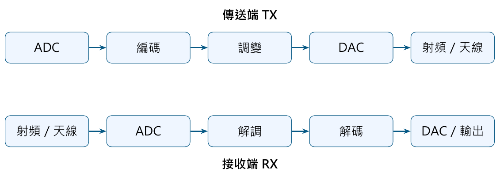

傳送端依序是資訊 → ADC → 編碼器 → 調變器 → DAC → 射頻發射器 → 天線；接收端由天線、射頻接收器、ADC、解調器、解碼器、DAC 恢復資訊。圖為概念簡化；原始資訊若已是數位資料，可以省去輸入端 ADC，數位輸出也不一定需要最後的 DAC。

| 名稱 | 在老師架構中的角色 |
|:---|:---|
| 基頻 Baseband | 用資料位元與基頻波形表示資訊，進行編碼及訊號處理。 |
| 中頻 IF | 先在較低的載波頻率完成調變，便於後續電路處理。 |
| 射頻 RF | 升頻到無線通訊所使用的頻帶，再由天線發射；接收端反向降頻。 |

## 2．辨識射頻方塊圖符號（講義第 7 頁）

對照原題：*Block Diagram Symbols*；影片概略定位：[18:00](https://www.youtube.com/watch?v=42VW-8VFu5E&t=1080s)。

| 元件 | 圖示 | 功能 |
|:-----|:----:|:-----|
| 天線 Antenna |  | 在電訊號與空間電磁波之間轉換，是收發機的對外介面。 |
| 放大器（PA／LNA） Amplifier | 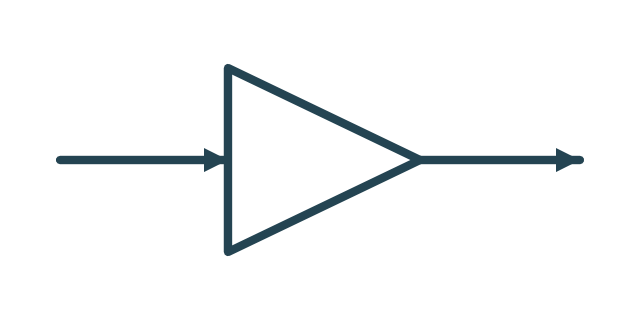 | 放大訊號；PA 位於傳送路徑，LNA 位於接收路徑。 |
| 混頻器 Mixer | 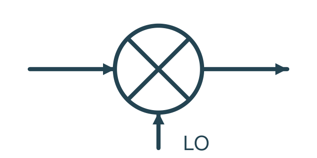 | 與參考載波（LO）相乘，產生和頻與差頻，用於升／降頻。 |
| 振盪器 Oscillator |  | 提供混頻與調變所需的參考載波。 |
| 90° 分配器 90° power divider | 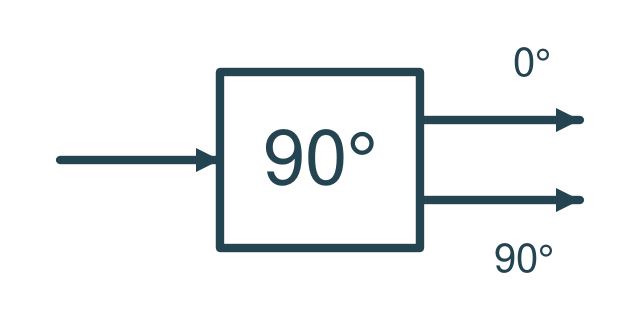 | 將訊號分成兩路，兩路輸出相位相差 90°。 |
| 倍頻器 Frequency multiplier |  | 將輸入頻率倍增；圖示以 ×2 為例。 |
| 分頻器 Frequency divider | 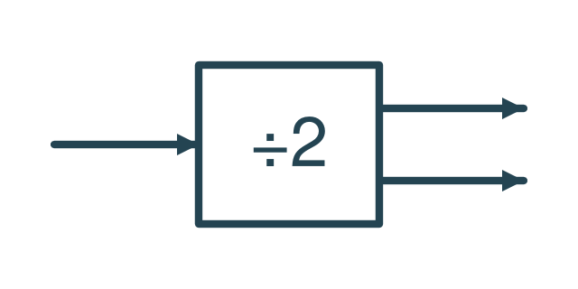 | 將輸入頻率除以指定倍數；圖示以 ÷2 為例。 |
| 開關 Switch | 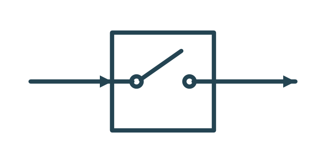 | 接通、斷開或切換訊號路徑；圖示為開路狀態。 |
| 低通濾波器 LPF Low-pass filter | 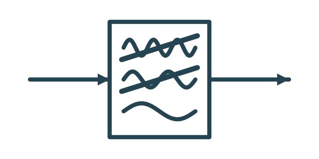 | 保留低頻成分，抑制較高頻成分。 |
| 帶通濾波器 BPF Band-pass filter | 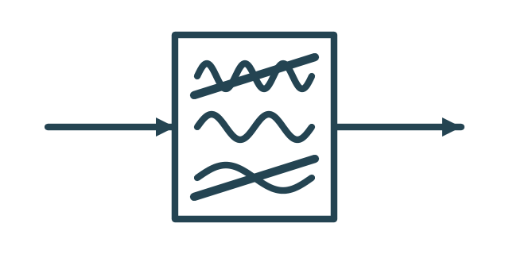 | 保留指定頻帶，抑制頻帶外的成分。 |
| 高通濾波器 HPF High-pass filter | 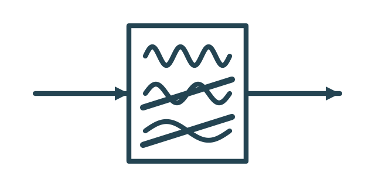 | 保留高頻成分，抑制較低頻成分。 |

依老師講義第 7 頁的符號表重畫。濾波器框內由上至下代表高、中、低頻；斜線劃除的是受到抑制的頻率。倍頻／分頻改變頻率，放大器改變訊號幅度。

## 3．把收、發功能放進同一裝置（講義第 8–9 頁）

對照原題：*Bilateral Transceiver Structure*、*Modules in Your Smart Phone*。

### 共用天線的雙向收發機：第 8 頁

第 6 頁分開畫的傳送端和接收端，可以放進同一部手機。老師這個例子使用**天線開關**選擇 TX 或 RX 路徑，振盪器提供射頻處理器需要的參考訊號，基頻處理器負責資料處理。

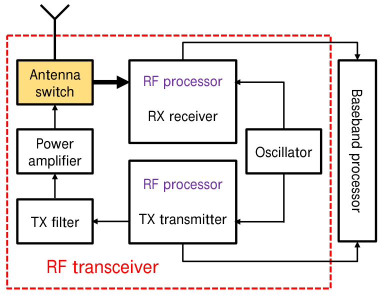

圖源：老師講義第 8 頁方塊圖局部。

傳送時，訊號由基頻處理器送入 RF TX，再通過 TX 濾波器、功率放大器與天線開關；接收時，開關將天線接到 RF RX，再交回基頻。講義提到此例多數時間切到接收路徑，等待外界訊號。這是該頁架構的說明，實際系統如何安排收發，由其雙工方式與電路設計決定。

### 一支手機包含多個通訊模組：第 9 頁

老師用照片標出 GSM／WCDMA、Wi-Fi／Bluetooth、GPS 三類模組。它們服務不同頻帶與用途，卻仍能放回「基頻 → 射頻 → 天線」的系統圖理解。商用模組也可整合調變、解調、收發切換、濾波與放大等功能，因此一個外觀上的模組，內部可能已包含多個方塊。

這兩頁要建立的觀念是：**方塊圖描述功能，不等於每一格都要用一顆獨立晶片。**許多功能可積體化；天線仍需要與工作波長、裝置空間及周圍環境配合。

## 4．編碼器不只是在資料後面加位元（講義第 10–12 頁）

對照原題：*Encoding the Input Information (1/3–3/3)*。

### 4.1．ADC、來源編碼與通道編碼：第 10 頁

ADC 把類比輸入轉成數位表示；編碼器再把來源位元轉成適合通道傳輸的位元。講義指出，編碼器可以由電路、軟體或韌體實作。

| | 來源編碼 Source coding | 通道編碼 Channel coding |
|:---|:---|:---|
| 目的 | 移除資訊表示中可省略的冗餘 | 加入有規則的冗餘，以控制傳輸錯誤 |
| 直覺 | 用較少位元描述原始資料 | 用多一點位元提高判斷可靠度 |
| 接收端 | 恢復資訊的表示 | 檢查並在能力範圍內修正錯誤 |

兩者處理不同問題：先去除不必要的重複，再有目的地加入保護資訊。

#### 老師板書：三個資料位元加三個檢查位元

影片板書概略定位：[33:00 起](https://www.youtube.com/watch?v=42VW-8VFu5E&t=1980s)。

令資料為 $`b_1,b_2,b_3\in\{0,1\}`$。板書採用成對的奇偶檢查，整理為

```math
p_1=(b_1+b_2)\bmod 2,\quad
p_2=(b_2+b_3)\bmod 2,\quad
p_3=(b_1+b_3)\bmod 2.
```

「加總後除以 2 取餘數」等價於 XOR。**同值相加得 0，異值相加得 1。**

傳送碼字寫成 $`b_1b_2b_3p_1p_2p_3`$。

| 資料 |  碼字  | 資料 |  碼字  |
|:----:|:------:|:----:|:------:|
|  000 | 000000 |  100 | 100101 |
|  001 | 001011 |  101 | 101110 |
|  010 | 010110 |  110 | 110011 |
|  011 | 011101 |  111 | 111000 |

**老師板書的錯誤判斷（約 35:00–39:10）：**若送出 $`000000`$，第三位翻轉而收到 $`001000`$，它不在八個合法碼字中，因此能先檢出錯誤。它離 $`000000`$ 只差 1 位，離 $`001011`$ 則差 2 位；在單一位元錯誤的假設下，可還原成 $`000000`$。檢查關係中，第二、第三個檢查都牽涉 $`b_3`$，也能藉共同的嫌疑位元定位錯誤。

老師接著以 CD 刮傷與身分證檢查碼作生活類比（約 39:10–46:30）。要分清楚：有能力「檢出不合法」不等於能在任何錯誤下唯一修正；不同碼的保護能力不同。完整的單一錯誤判斷與碼率重算，見章末補充 A。

### 4.2．以不同碼區分使用者：第 11 頁

老師在編碼脈絡中介紹多重存取，說明 DSP 也能協助多個使用者共享通道。多重存取與前述錯誤保護，解決的是不同問題。

| 方式 | 用什麼區分使用者 | 理解方式 |
|:---|:---|:---|
| FDMA | 不同頻帶 | 每位使用者占用不同的頻率區間。 |
| TDMA | 不同時段 | 共用頻帶，輪流在不同時槽傳送。 |
| CDMA | 不同碼序列 | 可同時使用相同頻帶，以各自的展頻碼識別訊號。 |

第 11 頁的重點是 CDMA：每位使用者的資料與自己的展頻碼組合，各路訊號相加後一起進入通道；接收端使用對應的碼相關、加總，取回所需資料。

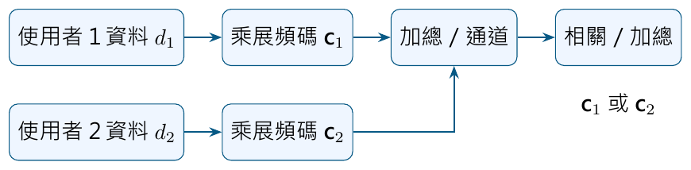

此圖為概念簡化，影片流程圖的既有定位約 [54:00](https://www.youtube.com/watch?v=42VW-8VFu5E&t=3240s)。直觀上，**FDMA 分頻率、TDMA 分時間、CDMA 分碼**；碼能否有效分離訊號，仍受同步、相關性、雜訊與接收功率差影響。章末補充 B 用四個 chip 的正交碼重算一次。

### 4.3．實際編碼器還包含哪些處理：第 12 頁

第 10 頁的「Encoder」在實際系統裡，可以是一整串資料處理，而非單一奇偶檢查器。

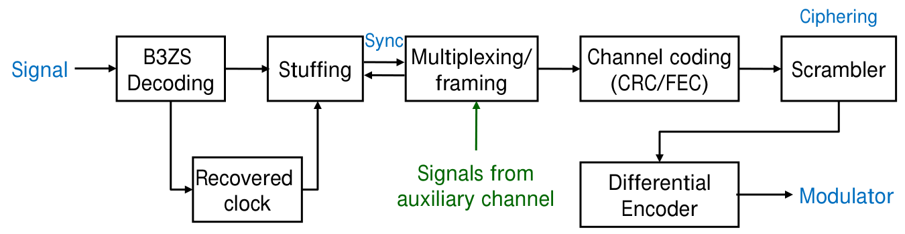

圖源：老師講義第 12 頁編碼器方塊圖局部；箭頭及各區塊關係保留原圖。

主訊號路徑是 **B3ZS 解碼 → 位元填補 → 多工／成框 → 通道編碼 → 擾碼 → 差分編碼 → 調變器**。圖中另有恢復時脈、同步資訊與輔助通道，協助各段資料保持正確的時間與框架關係。

| 原圖區塊 | 中文理解 |
|:---|:---|
| B3ZS Decoding／Recovered clock | 從輸入線路碼恢復資料與時脈，供後續數位處理使用。 |
| Stuffing | 以位元填補協調資料速率，使資料能放進指定框架。 |
| Multiplexing／framing | 整合資料與輔助通道，加入接收端辨認資料邊界所需的框架／同步資訊。 |
| Channel coding（CRC／FEC） | CRC 用來檢查錯誤；FEC 加入可供接收端更正錯誤的冗餘。 |
| Scrambler | 擾碼，改變位元序列特性；講義在此區塊上方另標示 Ciphering。 |
| Differential Encoder | 讓資料與相鄰符號間的變化建立關係，再交給調變器。 |

**名詞補充：**擾碼與加密並非同義，展頻碼也不等於加密。是否具有保密功能，要看具體的演算法與金鑰設計；這裡保留老師原圖的標示，避免只憑區塊名稱推定其功能。

**口述與原圖對照（約 56:50）：**老師以資料壓縮、資料整合與錯誤保護概括這條處理鏈；但原圖第一格寫的是 B3ZS Decoding，這是線路碼解碼，不宜直接標成來源壓縮。上表依投影片的實際方塊名稱整理。

老師在這頁列出數位訊號處理、數位通訊、錯誤控制編碼、基頻通訊系統與電路設計等相關課程。本單元先認識這些方塊的系統角色，不需在此推導每種編碼演算法。

## 5．調變的基本想法（講義第 13–14 頁）

對照原題：*Modulation: Basic Ideas (1/2–2/2)*。

### 先把資訊對應到中頻波形：第 13 頁

編碼之後仍是位元序列。調變器把位元對應到一組可辨識的波形；老師採用的架構先把頻譜搬到中頻 IF，再交給後面的射頻電路。講義列出的 IF 範圍為數 kHz 到數百 MHz，並點出**位元錯誤率與資料傳輸速率的取捨**。

數位資料的 0 與 1 不指定某個載波頻率，但實際電壓脈衝有頻譜與頻寬；不能把「資料不是載波」理解成「數位訊號沒有頻率」。

### 一個正弦波有哪三個可調整的量：第 14 頁

老師用下式表示調變載波：

```math
v_c(t)=A\cos(\omega_ct+\phi),\qquad \omega_c=2\pi f_c.
```

$`A`$ 是振幅，$`\omega_c`$ 是角頻率，$`\phi`$ 是相位。調變就是讓資料決定其中一個或多個參數。

| 方式 | 改變的量 | 老師定義中固定的量 | 圖像直覺 |
|:---|:---|:---|:---|
| 振幅移鍵 ASK | 振幅 $`A`$ | $`\omega_c,\phi`$ | 波形高低不同 |
| 相位移鍵 PSK | 相位 $`\phi`$ | $`A,\omega_c`$ | 星座點角度不同 |
| 頻率移鍵 FSK | 頻率 $`\omega_c`$ | $`A,\phi`$ | 波形疏密不同 |
| 正交振幅調變 QAM | 振幅與相位 | $`\omega_c`$ | 星座點分布於平面 |

**符號約定：**每次選到的一種波形狀態稱為一個符號（symbol），持續時間為 $`T_s`$。若有 $`M=2^m`$ 種狀態，一個符號可代表 $`m=\log_2M`$ 位元。下列波形式皆用單一符號內的局部時間 $`0\le t<T_s`$；波形圖中的虛線是符號邊界。

第 14 頁僅定義 FSK，沒有另列完整星座；本筆記把 2-FSK 波形與通式放到章末補充 C。接下來依老師頁序，先看 PSK，再看 ASK、QAM。

## 6．PSK：以相位區分資料（講義第 15 頁與板書）

對照原題：*Modulation: PSK*；BPSK／QPSK 約 [1:03:00](https://www.youtube.com/watch?v=42VW-8VFu5E&t=3780s)。

PSK（Phase Shift Keying）固定振幅與頻率，以相位區分資料。$`M`$ 個等角度星座點的通式為

```math
s_k(t)=A\cos\!\left(\omega_ct+\phi_{\mathrm{off}}+\frac{2\pi k}{M}\right),
\qquad k=0,\ldots,M-1.
```

```math
(I_k,Q_k)=A\left(\cos\phi_k,\sin\phi_k\right),\qquad
\phi_k=\phi_{\mathrm{off}}+\frac{2\pi k}{M}.
```

所有點位於半徑 $`A`$ 的圓周；每個符號攜帶 $`\log_2M`$ 位元。以下圖形以 $`A=1`$ 表示，QPSK 使用老師的 $`45^\circ`$ 偏移，其餘各階以 $`0^\circ`$ 為起點。BPSK／QPSK 的映射來自第 15 頁；8／16-PSK 接在此處對照板書。

### BPSK／2-PSK：兩種相位，每次代表一位

老師的映射是 $`0\mapsto0^\circ`$、$`1\mapsto180^\circ`$；每個符號攜帶 **1 bit**：

```math
s_b(t)=A\cos(\omega_ct+\pi b)=A(-1)^b\cos(\omega_ct),
\qquad b\in\{0,1\}.
```

| 位元 | 相位 | 傳送波形 | $`(I,Q)`$ |
|:---:|:---:|:---|:---:|
| 0 | $`0^\circ`$ | $`A\cos(\omega_ct)`$ | $`(A,0)`$ |
| 1 | $`180^\circ`$ | $`A\cos(\omega_ct+\pi)=-A\cos(\omega_ct)`$ | $`(-A,0)`$ |

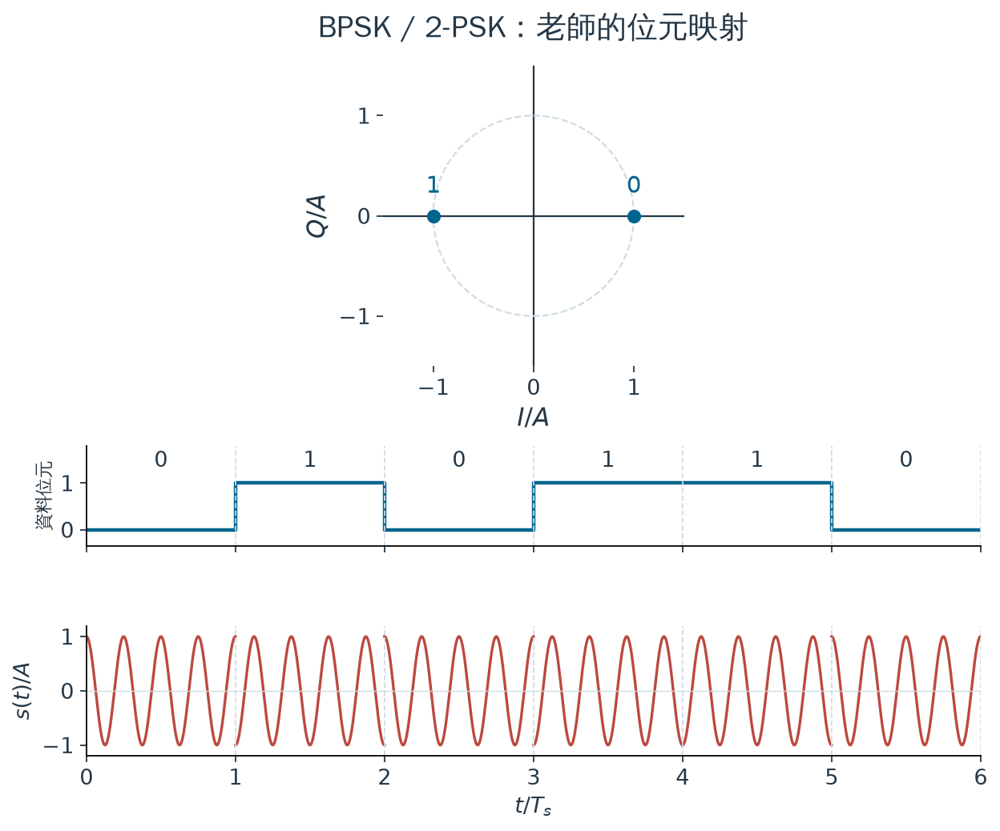

依講義第 15 頁的映射重畫，波形以 $`010110`$ 示範。振幅大小保持 $`A`$，相位切換 $`180^\circ`$ 時波形正負翻轉。

### QPSK／4-PSK：四種相位，每次代表兩位

依老師的映射，每個符號攜帶 **2 bits**：

```math
s_k(t)=A\cos\!\left(\omega_ct+\frac\pi4+\frac{\pi k}{2}\right),
\qquad k=0,1,2,3.
```

| 索引 $`k`$ | 位元 | 相位 | 傳送波形 | $`(I,Q)`$ |
|:---:|:---:|:---:|:---|:---:|
| 0 | 00 | $`45^\circ`$ | $`A\cos(\omega_ct+\pi/4)`$ | $`(A/\sqrt2,A/\sqrt2)`$ |
| 1 | 01 | $`135^\circ`$ | $`A\cos(\omega_ct+3\pi/4)`$ | $`(-A/\sqrt2,A/\sqrt2)`$ |
| 2 | 11 | $`-135^\circ`$ | $`A\cos(\omega_ct-3\pi/4)`$ | $`(-A/\sqrt2,-A/\sqrt2)`$ |
| 3 | 10 | $`-45^\circ`$ | $`A\cos(\omega_ct-\pi/4)`$ | $`(A/\sqrt2,-A/\sqrt2)`$ |

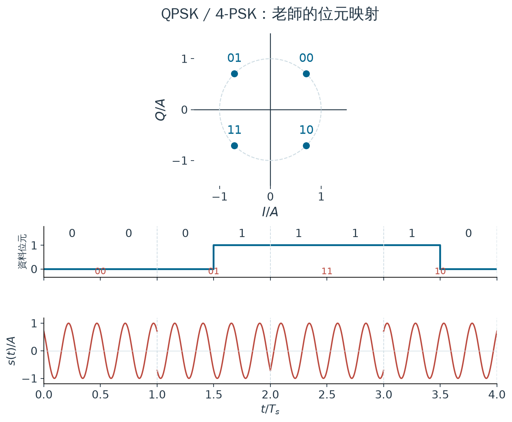

依講義第 15 頁重畫。波形依序傳送 $`00,01,11,10`$，每兩個位元選擇一個相位；位元時間 $`T_b=T_s/2`$。$`225^\circ`$ 與 $`-135^\circ`$、$`315^\circ`$ 與 $`-45^\circ`$ 各表示同一相位。相鄰點的位元標記只差一位，為 Gray code 安排。

### 板書延伸：8-PSK，八種相位，每次代表三位

老師板書從 $`0^\circ`$ 起，每隔 $`45^\circ`$ 放一點；每個符號攜帶 **3 bits**：

```math
s_k(t)=A\cos\!\left(\omega_ct+\frac{\pi k}{4}\right),
\qquad k=0,\ldots,7.
```

| 索引 $`k`$ | 板書位元 | 相位 | 傳送波形 |
|:---:|:---:|:---:|:---|
| 0 | 000 | $`0^\circ`$ | $`A\cos(\omega_ct)`$ |
| 1 | 001 | $`45^\circ`$ | $`A\cos(\omega_ct+\pi/4)`$ |
| 2 | 010 | $`90^\circ`$ | $`A\cos(\omega_ct+\pi/2)`$ |
| 3 | 011 | $`135^\circ`$ | $`A\cos(\omega_ct+3\pi/4)`$ |
| 4 | 100 | $`180^\circ`$ | $`A\cos(\omega_ct+\pi)`$ |
| 5 | 101 | $`225^\circ`$ | $`A\cos(\omega_ct+5\pi/4)`$ |
| 6 | 110 | $`270^\circ`$ | $`A\cos(\omega_ct+3\pi/2)`$ |
| 7 | 111 | $`315^\circ`$ | $`A\cos(\omega_ct+7\pi/4)`$ |

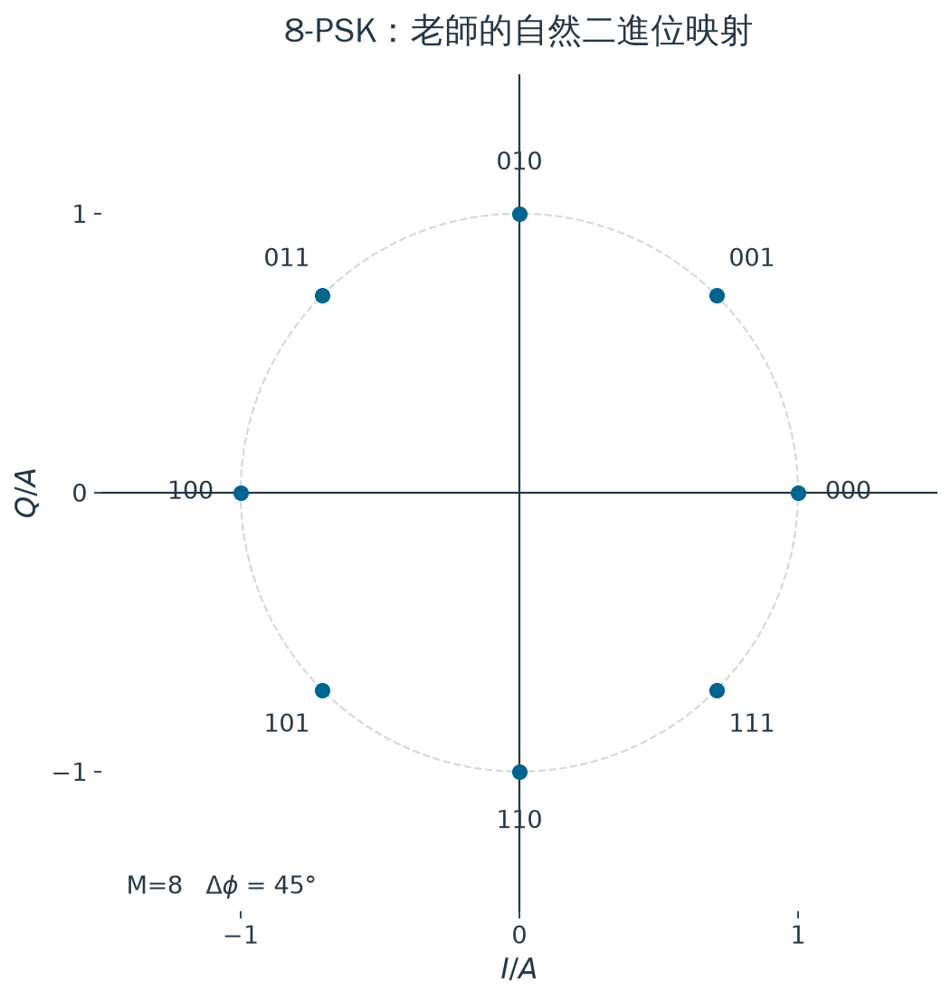

依 [1:12:00 板書](https://www.youtube.com/watch?v=42VW-8VFu5E&t=4320s)重畫。此處依老師使用**自然二進位順序**，並非 Gray code；例如 $`001`$ 與 $`010`$ 相鄰但差兩個位元。

### 板書延伸：16-PSK，十六種相位，每次代表四位

每個符號攜帶 **4 bits**，相位間距 $`22.5^\circ`$：

```math
s_k(t)=A\cos\!\left(\omega_ct+\frac{\pi k}{8}\right),
\qquad \phi_k=22.5^\circ k,\quad k=0,\ldots,15.
```

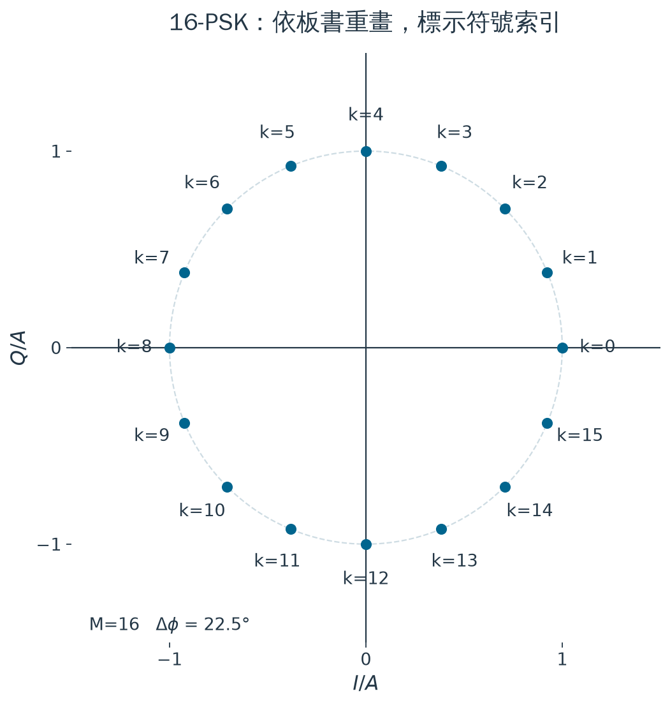

依 [1:12:30 板書](https://www.youtube.com/watch?v=42VW-8VFu5E&t=4350s)把 8-PSK 角度間隔再分成兩份。**補充解說：**圖上標示索引 $`k`$；老師此處未逐點指定四位元映射。

## 7．ASK：以振幅區分資料（講義第 16 頁）

對照原題：*Modulation: ASK*；影片概略定位：[1:20:00](https://www.youtube.com/watch?v=42VW-8VFu5E&t=4800s)。

ASK（Amplitude Shift Keying）固定載波頻率與相位，用不同振幅表示資料。一般式為

```math
s_k(t)=A_k\cos(\omega_ct+\phi_0),\qquad k=0,\ldots,M-1.
```

### 2-ASK／OOK：用「關」與「開」表示一位

依老師講義第 16 頁，$`0`$ 對應零振幅，$`1`$ 對應振幅 $`A`$；每個符號攜帶 **1 bit**。OOK 是 On-Off Keying。

```math
s_b(t)=Ab\cos(\omega_ct),\qquad b\in\{0,1\}.
```

| 位元 $`b`$ | 振幅 | 傳送波形 | 星座座標 $`(I,Q)`$ |
|:---:|:---:|:---|:---:|
| 0 | $`0`$ | $`s_0(t)=0`$ | $`(0,0)`$ |
| 1 | $`A`$ | $`s_1(t)=A\cos(\omega_ct)`$ | $`(A,0)`$ |

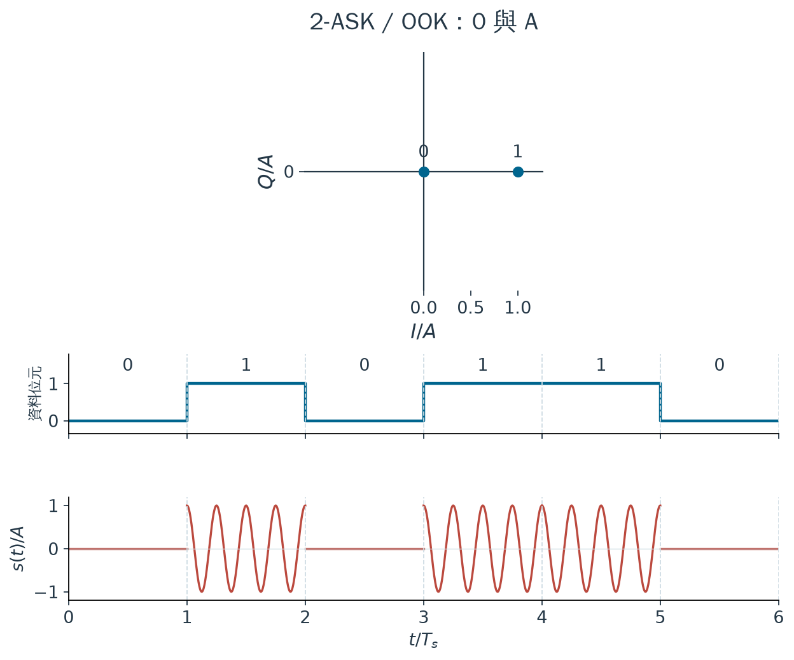

星座依講義重畫；波形以資料 $`010110`$ 示範。位元為 0 的區段沒有載波，為 1 的區段出現載波。

### 2-ASK 的另一組振幅：$`A/2`$ 與 $`A`$

老師同頁另比較兩種非零振幅；每個符號仍攜帶 **1 bit**：

```math
s_b(t)=\frac{A(1+b)}{2}\cos(\omega_ct),\qquad b\in\{0,1\}.
```

| 位元 $`b`$ | 傳送波形 | 星座座標 $`(I,Q)`$ |
|:---:|:---|:---:|
| 0 | $`s_0(t)=\dfrac A2\cos(\omega_ct)`$ | $`(A/2,0)`$ |
| 1 | $`s_1(t)=A\cos(\omega_ct)`$ | $`(A,0)`$ |

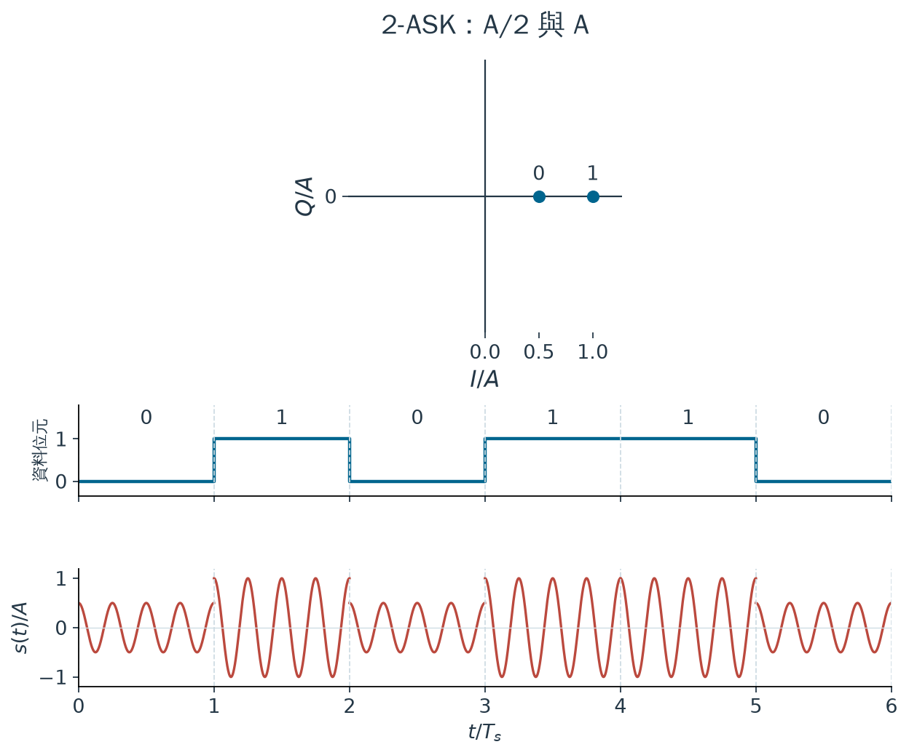

兩圖都取相同的峰值 $`A`$。OOK 的兩點距離是 $`A`$，此例只有 $`A/2`$；接收強度變動時，門檻判斷更困難。這是老師在微波通訊情境下比較振幅狀態的例子。

老師在這頁強調，微波傳播會使接收強度明顯變動，因此只靠振幅門檻區分資料會遇到困難。這是在該通訊情境下的取捨，不表示 ASK 在所有應用中都不能使用。

## 8．QAM：同時使用振幅與相位（講義第 17 頁）

對照原題：*Modulation: QAM*；影片概略定位：[1:22:00](https://www.youtube.com/watch?v=42VW-8VFu5E&t=4920s)。

QAM（Quadrature Amplitude Modulation）把資料映射到平面上的 I/Q 座標。點到原點的距離是振幅、點的角度是相位，所以不同點可以有不同振幅與相位。老師以 **16-QAM 方形星座**和**32-QAM 十字形星座**說明如何配置訊號狀態，並指出 QAM 適合高容量數位無線通訊。

為對照圖上的座標，令 $`I=au,Q=av`$，其中 $`a>0`$ 是座標尺度，$`\mathcal C_M`$ 是合法星座集合。以下各圖取 $`a=1`$；若比較不同階數的抗雜訊能力，還須固定平均功率，不能只比較圖片中的間隔。

下列傳送波形採用本章一致的 I/Q 慣例 $`I\cos(\omega_ct)-Q\sin(\omega_ct)`$；其電路意義在講義第 19 頁的段落說明。

### 16-QAM：十六個點，每次代表四位

依老師的 $`4\times4`$ 方形星座，每個符號攜帶 **4 bits**：

```math
\mathcal C_{16}=\{a(u,v):u,v\in\{-3,-1,1,3\}\},\qquad
s_{u,v}(t)=a\left[u\cos(\omega_ct)-v\sin(\omega_ct)\right].
```

下表保留講義位元標記，橫向為 $`I/a`$，縱向為 $`Q/a`$：

| $`Q/a\backslash I/a`$ | $`-3`$ | $`-1`$ | $`1`$ | $`3`$ |
|:---:|:---:|:---:|:---:|:---:|
| $`3`$ | 1000 | 1001 | 0001 | 0000 |
| $`1`$ | 1010 | 1011 | 0011 | 0010 |
| $`-1`$ | 1110 | 1111 | 0111 | 0110 |
| $`-3`$ | 1100 | 1101 | 0101 | 0100 |

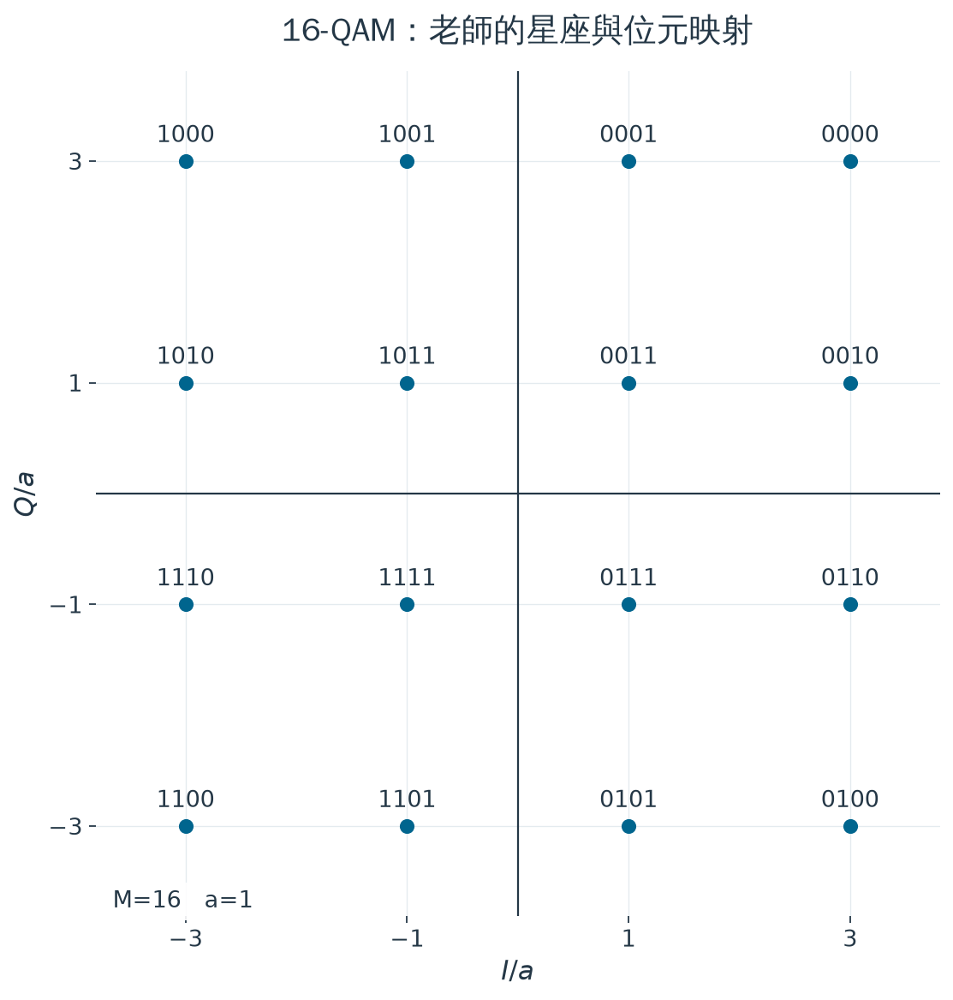

例如 $`0000\mapsto(3a,3a)`$，波形為 $`3a\cos(\omega_ct)-3a\sin(\omega_ct)`$，振幅 $`3\sqrt2a`$、相位 $`45^\circ`$；$`0011\mapsto(a,a)`$ 的相位相同，振幅則是 $`\sqrt2a`$。

### 32-QAM：三十二個點，每次代表五位

老師畫的是**十字形 32-QAM**：$`6\times6`$ 方格去除四個角點，每個符號攜帶 **5 bits**：

```math
\mathcal C_{32}=\left\{a(u,v):
u,v\in\{-5,-3,-1,1,3,5\},\ (\lvert u\rvert,\lvert v\rvert)\ne(5,5)\right\},
```

```math
s_{u,v}(t)=a\left[u\cos(\omega_ct)-v\sin(\omega_ct)\right],
\qquad (au,av)\in\mathcal C_{32}.
```

下表保留講義全部位元標記；「—」表示沒有星座點：

| $`Q/a\backslash I/a`$ | $`-5`$ | $`-3`$ | $`-1`$ | $`1`$ | $`3`$ | $`5`$ |
|:---:|:---:|:---:|:---:|:---:|:---:|:---:|
| $`5`$ | — | 01010 | 01110 | 11110 | 11010 | — |
| $`3`$ | 01111 | 01101 | 01100 | 11100 | 11101 | 11111 |
| $`1`$ | 01011 | 01001 | 01000 | 11000 | 11001 | 11011 |
| $`-1`$ | 00011 | 00001 | 00000 | 10000 | 10001 | 10011 |
| $`-3`$ | 00111 | 00101 | 00100 | 10100 | 10101 | 10111 |
| $`-5`$ | — | 00010 | 00110 | 10110 | 10010 | — |

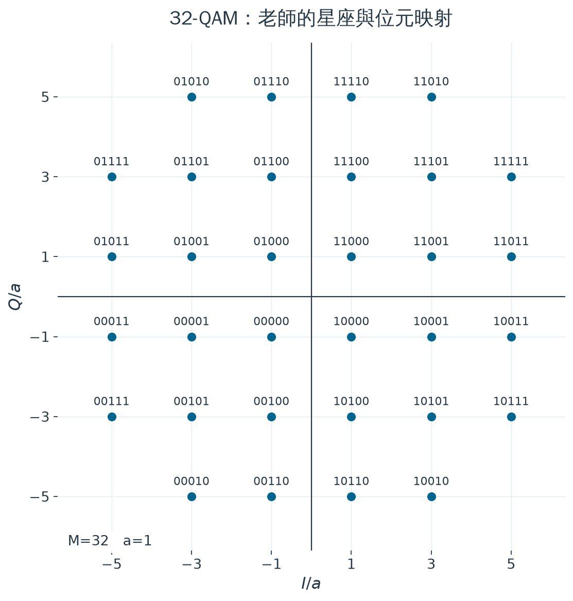

點數為 $`36-4=32`$。例如 $`11110\mapsto(a,5a)`$，波形為 $`a\cos(\omega_ct)-5a\sin(\omega_ct)`$，振幅 $`\sqrt{26}a`$、相位 $`\mathop{\mathrm{atan2}}(5,1)`$。

## 9．如何選擇調變方式（講義第 18 頁）

對照原題：*Modulation: How to Select One from Them?*；影片概略定位：[1:24:00–1:28:00](https://www.youtube.com/watch?v=42VW-8VFu5E&t=5040s)。

高階調變每個符號能表示較多位元，但在相同平均功率下，星座點通常更難分辨。老師用同一目標錯誤率下的性能圖，把**頻譜效率**與**所需訊雜比**一起比較。

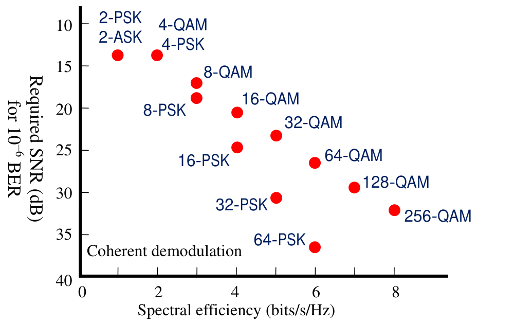

圖源：老師講義第 18 頁性能比較圖局部。這是講義的比較圖，並非本筆記重算的理論曲線或實測數據。

| 讀圖項目 | 意義 |
|:---|:---|
| 橫軸 Spectral efficiency | 頻譜效率，單位 bit/s/Hz；往右代表每單位頻寬可承載更多資訊。 |
| 縱軸 Required SNR | 達到指定錯誤率所需的訊雜比，單位 dB。此圖刻度由上方 10 增至下方 40，**越往下要求越高**。 |
| 圖中的共同條件 | 目標 BER 為 $`10^{-6}`$，並標示同調解調 Coherent demodulation。 |
| 同一調變族往高階移動 | 頻譜效率提高，通常需要更高 SNR 才能維持相同 BER。 |

**讀圖校正：**原圖明確標示 SNR，本節照原圖使用此名稱，不把縱軸改稱 $`E_b/N_0`$。兩者有關但不相等；換算須知道位元速率與接收頻寬，見章末補充 F。

### 用限制條件篩選方案

1. 先固定目標 BER、解調條件與座標單位。
2. 若已知可用 SNR，保留「所需 SNR 不超過可用值」的點，再選頻譜效率最高者。
3. 若已知最低頻譜效率，保留達到要求的點，再選所需 SNR 最低者。

依這張圖讀取，**可用 SNR 為 30 dB** 時，128-QAM 約需 29 dB，256-QAM 約需 32 dB，因此圖中可行且效率最高者是 128-QAM。若要求**至少 6 bit/s/Hz**，64-QAM 約需 26 dB，所需 SNR 比同樣效率的 64-PSK 低。這些是講義圖上的近似讀值，不代表所有實作都具有相同門檻。

### BER 與資料速率各在說什麼

位元錯誤率（BER）的定義是

```math
\mathrm{BER}=\frac{\text{錯誤位元數}}{\text{總傳送位元數}}.
```

老師在約 1:14:55–1:16:05 的例子是：2.048 Mbps 的資料每秒錯 2 位，重算得

```math
\mathrm{BER}=\frac{2}{2{,}048{,}000}\approx9.77\times10^{-7}.
```

一次符號判錯可能造成多位錯誤，位元映射是否採 Gray code 也會影響結果。選調變時應同時說明資料速率、占用頻寬、平均功率及目標 BER；只有「每符號幾位」不足以判定性能。完整速率公式與各階對照保留於章末補充 F。

## 10．從星座圖走到 QAM 傳送器（講義第 19 頁）

對照原題：*Modulation: How to Implement Them?*；影片概略定位：[1:30:00](https://www.youtube.com/watch?v=42VW-8VFu5E&t=5400s)。

### 先看完整電路功能路徑

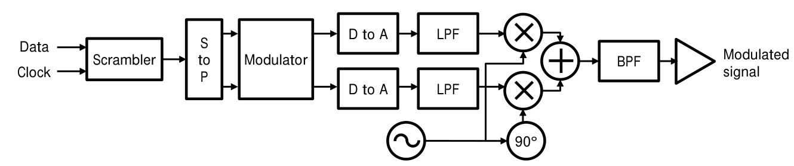

圖源：老師講義第 19 頁 QAM transmitter 方塊圖局部。

| 區塊 | 對星座與波形的作用 |
|:---|:---|
| Data／Clock → Scrambler | 接收資料與時脈，先進行擾碼。 |
| S to P | 串列轉並列，將輸入位元分組。 |
| Modulator | 依每組位元選出對應星座點，產生兩路數位振幅資料。 |
| 兩路 D to A／LPF | DAC 把數值轉成類比訊號；低通濾波器處理轉換後的波形與不需要的高頻成分。 |
| 振盪器、90° 支路、兩個混頻器 | 產生相差 90° 的載波，分別乘上 I、Q 兩路訊號。 |
| 加法器 → BPF → 放大器 | 合成調變波形，保留所需頻帶，再提供後級需要的訊號電平。 |

這張圖把前面抽象的「選擇一個星座點」，變成兩路實際電路訊號。

### I/Q 合成式：把兩個座標轉回振幅與相位

**公式整理：**本筆記固定使用下式，對應一支路為 $`\cos\omega_ct`$，另一支路為 $`-\sin\omega_ct`$：

```math
s_k(t)=I_k\cos(\omega_ct)-Q_k\sin(\omega_ct)
      =A_k\cos(\omega_ct+\phi_k),
```

```math
I_k=A_k\cos\phi_k,\qquad Q_k=A_k\sin\phi_k,
```

```math
A_k=\sqrt{I_k^2+Q_k^2},\qquad
\phi_k=\mathop{\mathrm{atan2}}(Q_k,I_k).
```

$`\mathop{\mathrm{atan2}}`$ 同時考慮兩個座標的正負，才能選到正確象限。若改採 $`I\cos+Q\sin`$，相位符號也要一起改；不能只換其中一個負號。

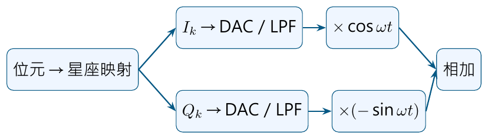

上圖只保留與星座座標直接相關的路徑；完整的擾碼、串並轉換及後級濾波、放大，請對照本節第一張原圖。

### 為什麼先做 IF，而不直接做到 RF？

老師強調，在數 kHz 到數百 MHz 的較低頻率完成前段調變，可以較容易沿用電路學、IC 設計與集總元件的觀點；之後再升到所需 RF 頻段。

**適用條件：**能否忽略傳播效應，實際取決於電路尺寸相對於波長是否夠小，不能只看「IF」這個名稱。這個單元先理解老師採用的架構；其他收發機也可能使用直接轉換等安排。

> **本單元主線：**先決定如何表示與保護資訊，再選擇可辨識的波形，最後用 I/Q 電路把星座點實作出來。下一單元才沿著射頻路徑繼續看升頻、濾波與放大。

## 11．補充解說與重算例題

以下集中保留自學推導、延伸星座及查表。它們協助理解正文，並非老師在每一頁都逐項推導的內容。

### 補充 A．檢查位元如何定位單一錯誤

**補充解說／重算例題：**原本傳送 $`000000`$，卻收到 $`001000`$。接收端將收到的資料與檢查位元交叉檢查：

```math
s_1=b_1\oplus b_2\oplus p_1=0,\quad
s_2=b_2\oplus b_3\oplus p_2=1,\quad
s_3=b_1\oplus b_3\oplus p_3=1.
```

只有第二、第三個關係不成立，兩者共同涉及 $`b_3`$。在**最多一位錯誤**的假設下，可判定 $`b_3`$ 翻轉，再修正成 0。

> **核心觀念：** 額外位元的價值，在於建立接收端可以檢查的關係；單純重複資料並不是唯一保護方法。

**補充解說／重算例題：**正文的碼字表有 8 個合法碼字，任兩碼字至少相差 3 個位置，故可修正一位錯誤。兩位錯誤可能被誤判，不能無條件保證修正。此例碼率 $`R_c=3/6=1/2`$：不計其他開銷，傳送 1 Mbps 原始資料需要 2 Mbps 編碼位元。

### 補充 B．用正交碼重算 CDMA

**補充解說／重算例題：**用四個 chip 的理想正交碼，看清楚「混在一起仍能分開」：

```math
\mathbf c_1=(1,1,-1,-1),\quad
\mathbf c_2=(1,-1,1,-1),\quad
\mathbf c_1\cdot\mathbf c_2=0.
```

令 $`d_1=+1,d_2=-1`$，則通道中的合成向量為

```math
\mathbf y=d_1\mathbf c_1+d_2\mathbf c_2=(0,2,-2,0).
```

接收端分別相關並除以碼長：

```math
\widehat d_1=\frac{\mathbf y\cdot\mathbf c_1}{4}=+1,\qquad
\widehat d_2=\frac{\mathbf y\cdot\mathbf c_2}{4}=-1.
```

這個補充例題假設碼彼此正交、同步、沒有雜訊或其他通道失真。真實系統的相關性與接收功率差會影響辨識效果。

### 補充 C．FSK 的通式與兩種頻率波形

FSK（Frequency Shift Keying）用不同載波頻率表示資料。老師講義第 14 頁固定振幅與相位，改變 $`\omega_c`$。等間距 $`M`$-FSK 可整理成

```math
s_k(t)=A\cos\!\left[2\pi(f_0+k\Delta f)t+\phi_0\right],
\qquad k=0,\ldots,M-1,\quad \Delta f>0.
```

#### 2-FSK／BFSK：兩種頻率，每次代表一位

每個符號攜帶 **1 bit**。以 $`0\mapsto f_0`$、$`1\mapsto f_1`$ 表示：

```math
s_b(t)=A\cos(2\pi f_bt+\phi_0),\qquad b\in\{0,1\},\quad f_0\ne f_1.
```

| 位元 | 傳送波形 | 圖像特徵 |
|:---:|:---|:---|
| 0 | $`s_0(t)=A\cos(2\pi f_0t+\phi_0)`$ | 較低頻率，波形較疏 |
| 1 | $`s_1(t)=A\cos(2\pi f_1t+\phi_0)`$ | 較高頻率，波形較密 |

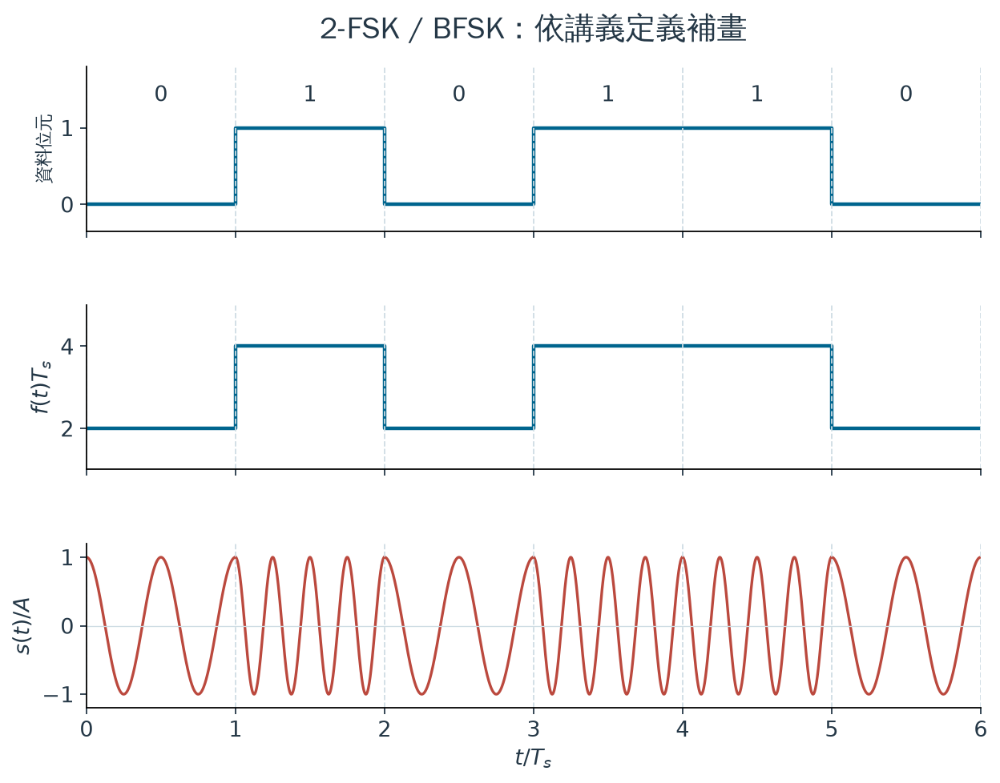

**補充解說：**依老師的 FSK 定義補畫，取 $`f_0=2/T_s`$、$`f_1=4/T_s`$、$`\phi_0=0`$，資料為 $`010110`$。一個符號內分別振盪 2 次或 4 次，振幅保持相同。這兩個頻率是繪圖示例；實際 FSK 的頻率間隔、相位是否連續依設計而定。FSK 使用不同頻率的波形，不宜把兩種狀態畫成同一固定載波下的兩個 I/Q 星座點。

### 補充 D．性能圖延伸：32-PSK 與 64-PSK

第 18 頁性能圖列出這兩種階數，以下保留通式與重畫星座，供比較角度間隔。

#### 32-PSK：三十二種相位，每次代表五位

每個符號攜帶 **5 bits**，相位間距 $`11.25^\circ`$：

```math
s_k(t)=A\cos\!\left(\omega_ct+\frac{\pi k}{16}\right),
\qquad \phi_k=11.25^\circ k,\quad k=0,\ldots,31.
```

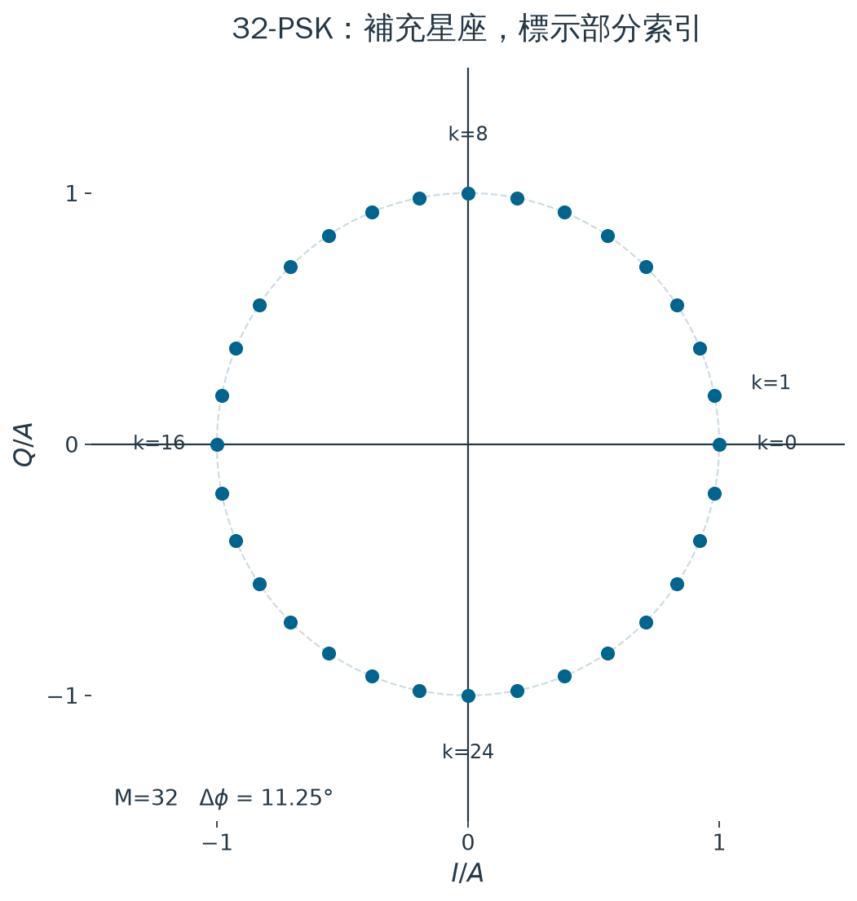

**補充解說：**老師在第 18 頁性能比較圖列出 32-PSK；此圖依通式補畫，標示部分索引 $`k`$，完整符號集由公式定義。

#### 64-PSK：六十四種相位，每次代表六位

每個符號攜帶 **6 bits**，相位間距 $`5.625^\circ`$：

```math
s_k(t)=A\cos\!\left(\omega_ct+\frac{\pi k}{32}\right),
\qquad \phi_k=5.625^\circ k,\quad k=0,\ldots,63.
```

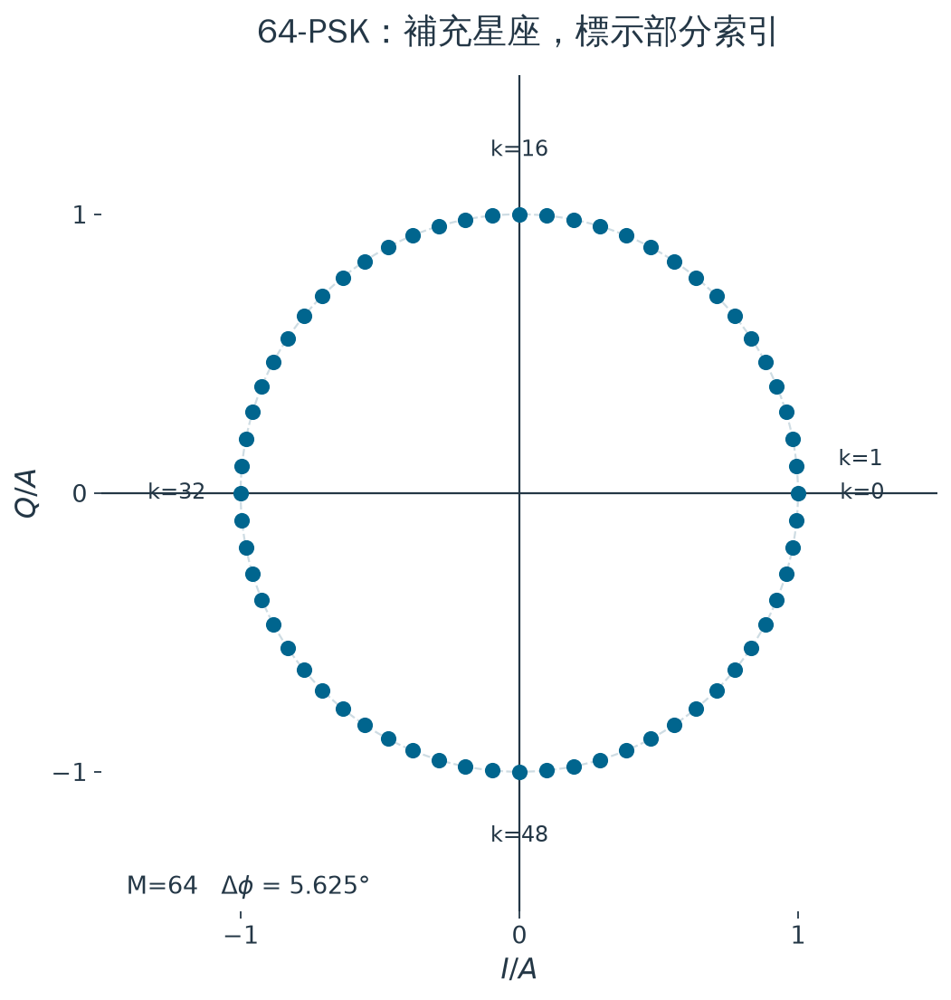

**補充解說：**老師在第 18 頁性能比較圖列出 64-PSK；此圖依通式補畫。半徑相同時，點的角度間距比 32-PSK 更小。

### 補充 E．其他階數 QAM 的完整星座查表

老師第 18 頁只列出這些階數的名稱，未指定星座布局。以下保留既有補畫，並非唯一合法配置；令 $`I=au,Q=av`$、$`a>0`$，傳送波形統一為 $`s_{u,v}(t)=a[u\cos(\omega_ct)-v\sin(\omega_ct)]`$，每個符號承載 $`\log_2M`$ 位元。

#### 4-QAM：四個點，每次代表兩位

採 $`2\times2`$ 方形星座，每個符號攜帶 **2 bits**：

```math
\mathcal C_4=\{a(u,v):u,v\in\{-1,1\}\},\qquad
s_{u,v}(t)=a\left[u\cos(\omega_ct)-v\sin(\omega_ct)\right].
```

| 位元 | $`(I,Q)`$ | 傳送波形 |
|:---:|:---:|:---|
| 00 | $`(a,a)`$ | $`a[\cos(\omega_ct)-\sin(\omega_ct)]`$ |
| 01 | $`(-a,a)`$ | $`a[-\cos(\omega_ct)-\sin(\omega_ct)]`$ |
| 11 | $`(-a,-a)`$ | $`a[-\cos(\omega_ct)+\sin(\omega_ct)]`$ |
| 10 | $`(a,-a)`$ | $`a[\cos(\omega_ct)+\sin(\omega_ct)]`$ |

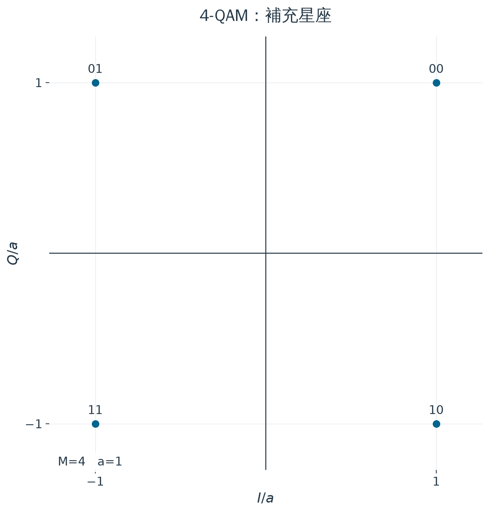

**補充解說：**沿用老師 QPSK 的位元映射。此星座四點振幅均為 $`\sqrt2a`$，令 $`a=A/\sqrt2`$ 即得到前述 QPSK；4-QAM 的此種安排與 QPSK 等價。

#### 8-QAM：八個點，每次代表三位

以 $`4\times2`$ 矩形星座示範，每個符號攜帶 **3 bits**：

```math
\mathcal C_8=\{a(u,v):u\in\{-3,-1,1,3\},\ v\in\{-1,1\}\},\qquad
s_{u,v}(t)=a\left[u\cos(\omega_ct)-v\sin(\omega_ct)\right].
```

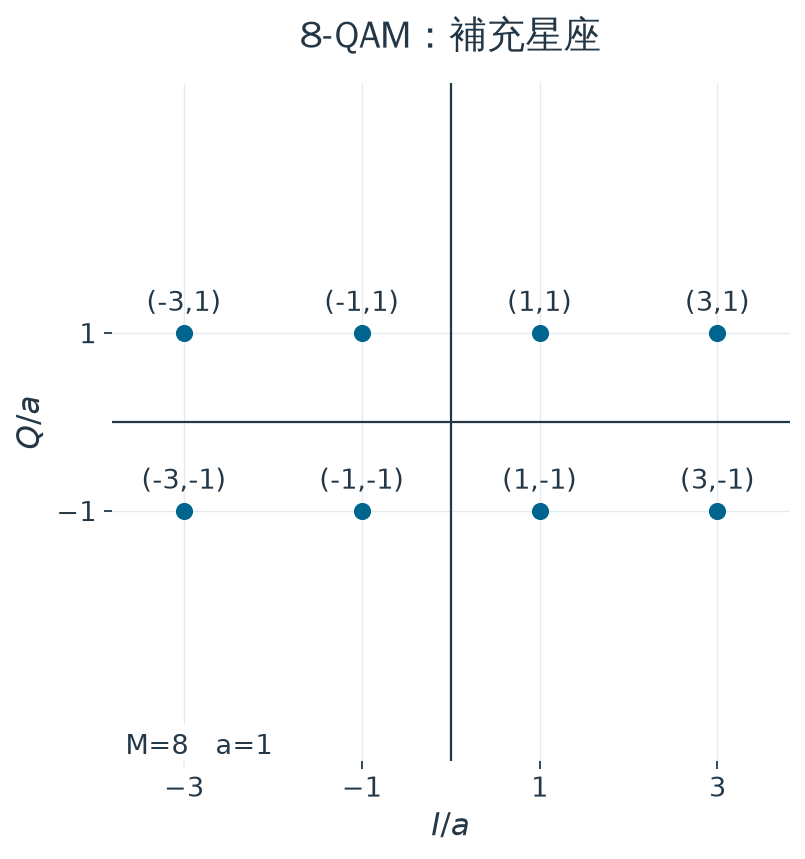

**補充解說：**圖中列出全部八個座標，未指定三位元映射。8-QAM 也可採其他布局；不能只憑「8-QAM」名稱推定其點位或性能。

#### 64-QAM：六十四個點，每次代表六位

採 $`8\times8`$ 方形星座，每個符號攜帶 **6 bits**：

```math
\mathcal C_{64}=\{a(u,v):u,v\in\{-7,-5,-3,-1,1,3,5,7\}\},\qquad
s_{u,v}(t)=a\left[u\cos(\omega_ct)-v\sin(\omega_ct)\right].
```

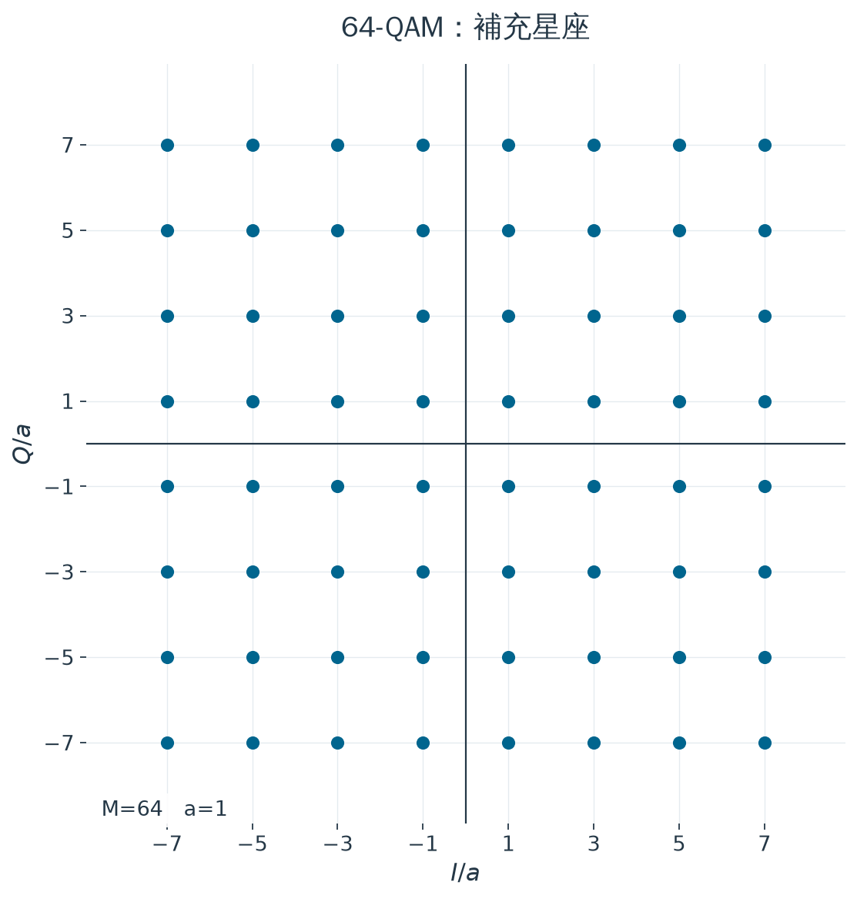

**補充解說：**依第 18 頁列出的階數補畫，兩軸各八種電平，共 $`8\times8=64`$ 點；圖上標示座標電平，未指定六位元映射。

#### 128-QAM：一百二十八個點，每次代表七位

以十字形星座示範：$`12\times12`$ 方格去除每角的 $`2\times2`$ 點，每個符號攜帶 **7 bits**。令

```math
\mathcal L_{12}=\{-11,-9,-7,-5,-3,-1,1,3,5,7,9,11\},
```

```math
\mathcal C_{128}=\{a(u,v):u,v\in\mathcal L_{12},\ \min(\lvert u\rvert,\lvert v\rvert)\le7\},
```

```math
s_{u,v}(t)=a\left[u\cos(\omega_ct)-v\sin(\omega_ct)\right],
\qquad (au,av)\in\mathcal C_{128}.
```

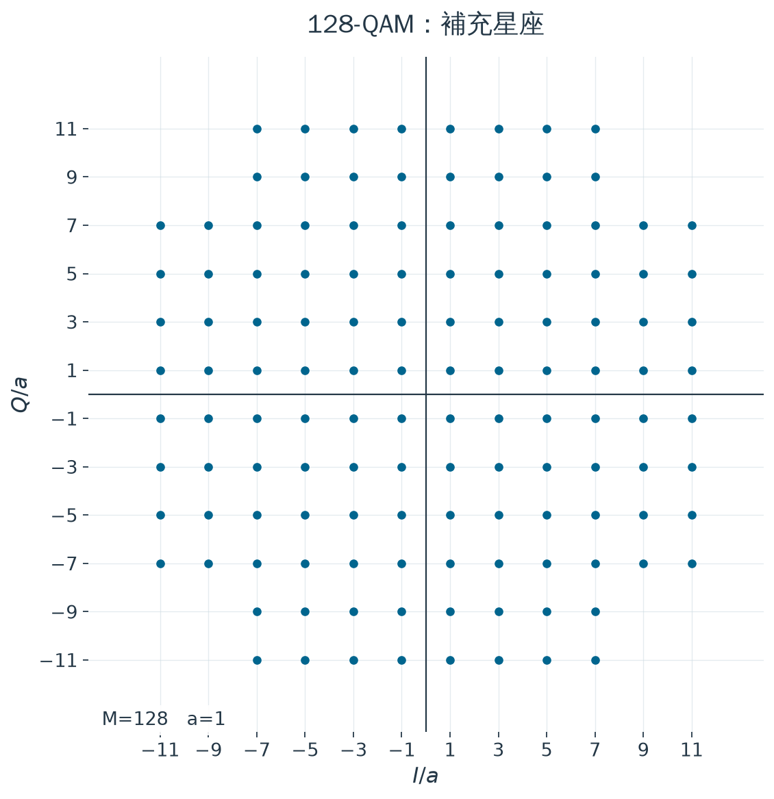

**補充解說：**點數為 $`12\times12-4\times(2\times2)=128`$。老師比較圖列出 128-QAM，但未指定布局；此處選用十字形示例，未指定七位元映射。

#### 256-QAM：二百五十六個點，每次代表八位

採 $`16\times16`$ 方形星座，每個符號攜帶 **8 bits**：

```math
\mathcal L_{16}=\{-15,-13,-11,-9,-7,-5,-3,-1,1,3,5,7,9,11,13,15\},
```

```math
\mathcal C_{256}=\{a(u,v):u,v\in\mathcal L_{16}\},\qquad
s_{u,v}(t)=a\left[u\cos(\omega_ct)-v\sin(\omega_ct)\right].
```

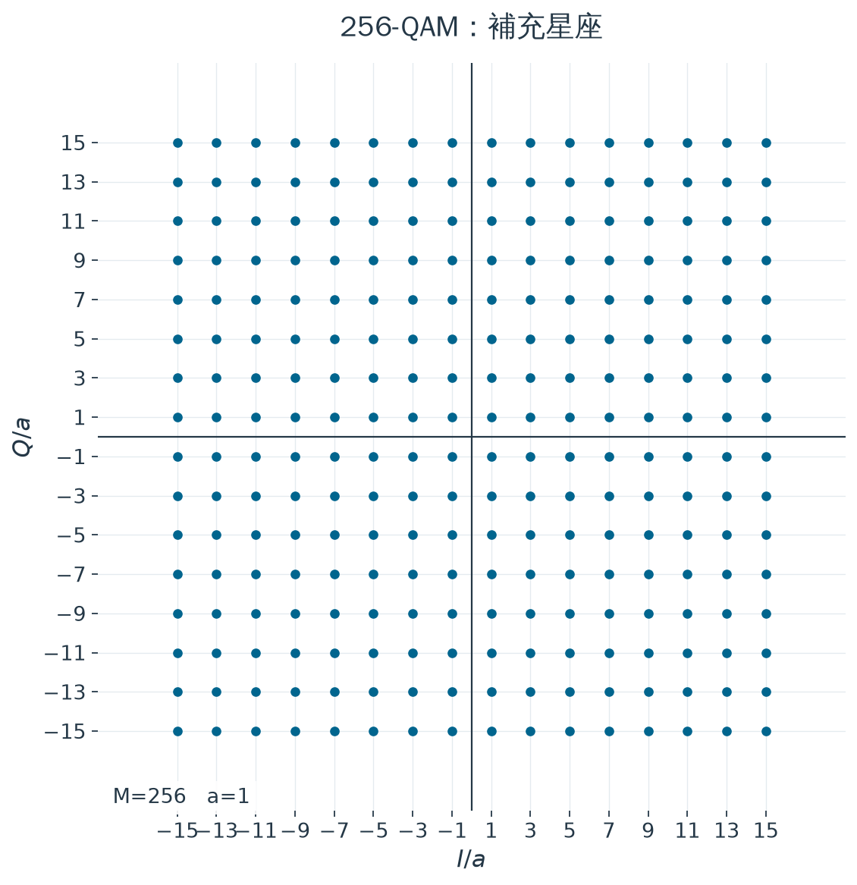

**補充解說：**依第 18 頁列出的階數補畫，兩軸各十六種電平，共 $`16\times16=256`$ 點；圖上標示座標電平，未指定八位元映射。

### 補充 F．符號距離、資料速率與頻譜效率

對 $`M`$-PSK，所有點在半徑 $`A`$ 的同一圓周上，相鄰點的角度間距是 $`2\pi/M`$，距離為

```math
d_{\min}=2A\sin\!\left(\frac{\pi}{M}\right).
```

在半徑不變時，$`M`$ 越大，相鄰點越近。這解釋了高階 PSK 為何需要更好的接收品質，才能維持同樣的錯誤率。

#### 位元速率與符號速率

**補充解說／重算例題：**不計編碼與協定開銷，位元速率與符號速率的關係為

```math
R_b=R_s\log_2 M.
```

$`R_b`$ 的單位是 bit/s；$`R_s`$ 是 symbol/s 或 baud。載波頻率 $`f_c`$ 則是波形每秒振盪幾次，三者不能混用。

| 調變           | 每符號位元數 | $`R_s=1`$ Msymbol/s 時的 $`R_b`$ |
|:---------------|:------------:|:----------------------------:|
| BPSK／2-ASK／2-FSK |     1      |            1 Mbps            |
| QPSK／4-QAM    |       2      |            2 Mbps            |
| 8-PSK／8-QAM    |       3      |            3 Mbps            |
| 16-PSK／16-QAM |       4      |            4 Mbps            |
| 32-PSK／32-QAM |       5      |            5 Mbps            |
| 64-PSK／64-QAM |       6      |            6 Mbps            |
| 128-QAM       |       7      |            7 Mbps            |
| 256-QAM       |       8      |            8 Mbps            |

**補充解說／重算例題：**若再加入本章編碼例題的碼率 $`R_c=1/2`$ 的編碼，16-QAM 在上述符號速率下的**原始資訊速率**為 $`1\times4\times1/2=2`$ Mbps，並非 4 Mbps。

#### 頻譜效率與 SNR 的定義

頻譜效率為

```math
\eta=\frac{R_{\mathrm{information}}}{B},
```

單位是 bit/s/Hz。$`\log_2M`$ 只描述每個符號承載幾個位元；實際頻譜效率還取決於占用頻寬、脈衝成形、編碼與協定開銷，不能直接把兩者畫上等號。

若接收訊號功率為 $`P_s`$、等效接收頻寬為 $`B`$，且頻寬內雜訊功率以 $`N_0B`$ 表示，則

```math
\mathrm{SNR}=\frac{P_s}{N_0B},\qquad
E_b=\frac{P_s}{R_b},\qquad
\frac{E_b}{N_0}=\mathrm{SNR}\frac{B}{R_b}.
```

這是**線性比值**的關係。以 dB 表示時：

```math
\left(\frac{E_b}{N_0}\right)_{\mathrm{dB}}
=\mathrm{SNR}_{\mathrm{dB}}+10\log_{10}\!\left(\frac{B}{R_b}\right).
```

$`R_b`$ 必須與 $`E_b`$ 採用相同的位元定義；若改用原始資訊位元或編碼位元，應連同碼率一起說明。這個補充換算不改變第 18 頁原圖標示的 SNR。

### 補充 G．用一個星座點驗證 I/Q 公式

取 $`I=1,Q=1`$，得到 $`A=\sqrt2,\phi=45^\circ`$：

```math
\cos\omega_ct-\sin\omega_ct=\sqrt2\cos(\omega_ct+45^\circ).
```

因此「選 I/Q 座標」和「選振幅、相位」是同一個波形的兩種表示法。對 16-QAM，$`I,Q\in\{-3a,-a,a,3a\}`$ 有 16 種組合，但各點的振幅不完全相同；性能比較時須交代平均功率的正規化方式。

### 補充 H．在可行方案裡選最快的

**補充解說／重算例題：**下表數值為教學假設，用來練習程序，並非影片的性能數據。固定目標 BER，且目前可用品質為 18 dB：

| 方案 | 頻譜效率   | 所需品質 | 是否可行 |
|:-----|:-----------|:---------|:---------|
| A    | 2 bit/s/Hz | 10 dB    | 可行     |
| B    | 4 bit/s/Hz | 16 dB    | 可行     |
| C    | 6 bit/s/Hz | 22 dB    | 不可行   |

若以最高效率為目標，選 B。C 雖快，接收品質不足；A 雖容易達成，未充分利用目前可用條件。反過來，若要求至少 4 bit/s/Hz，則 B、C 都達到效率要求，但 B 的所需品質較低。

## 12．自測與解析

先遮住答案，用 5 分鐘說明你的判斷。

1. 天線接收到無線訊號後，為什麼不會直接輸出圖片？請列出從天線到資訊的主要步驟。
2. 本章三資料位元的編碼例題中，資料 $`101`$ 的檢查位元、完整碼字與碼率各是多少？
3. 兩位使用者同時占用相同頻帶，接收端以不同序列分開訊號，屬於哪種多重存取？它和奇偶檢查有何不同？
4. 16-QAM 的符號速率為 500 ksymbol/s，通道碼率為 $`3/4`$。忽略其他開銷，原始資訊速率是多少？
5. 在相同星座半徑下，8-PSK 與 16-PSK 何者相鄰點較近？這會如何影響維持相同錯誤率所需的接收品質？
6. 第 18 頁圖中，一個點的位置越往下代表什麼？可否直接把縱軸 SNR 改寫成 $`E_b/N_0`$？

### 答案與解析

1. 天線先把入射電磁場轉成電訊號；射頻前端做濾波、放大、降頻，再由基頻做 ADC、解調、解碼，恢復資料表示。天線本身不辨識圖片內容。
2. $`p_1=1,p_2=1,p_3=0`$，碼字 $`101110`$；三位資料變成六位碼字，$`R_c=1/2`$。
3. CDMA。展頻碼區分共享通道中的使用者；奇偶檢查建立錯誤檢查與更正的關係。
4. $`500{,}000\times\log_2 16\times(3/4)=1{,}500{,}000`$ bit/s，即 **1.5 Mbps**。
5. 16-PSK 較近，角度間距由 45° 變成 22.5°；同樣功率與雜訊條件下較容易判錯，通常需更高 SNR 才能維持相同錯誤率。
6. 該圖的縱軸數值向下增加，越往下代表所需 SNR 越高。不能直接改稱 $`E_b/N_0`$；換算要知道 $`B/R_b`$，並使用一致的雜訊與位元定義。

**下一單元：**[無線通訊系統的射頻模組](002_無線通訊系統的射頻模組.md)。沿著老師講義第 20 頁繼續看 IF 放大、振盪器、混頻、濾波與天線。
