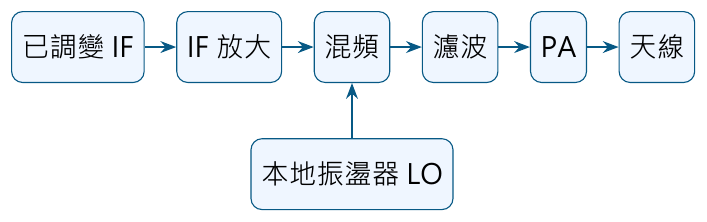
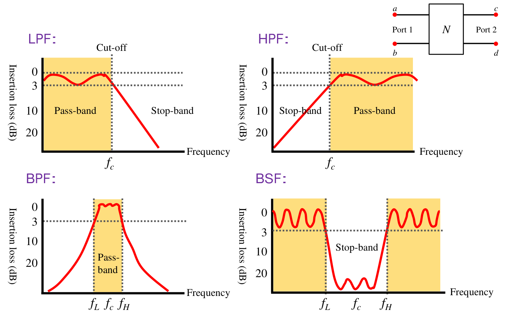
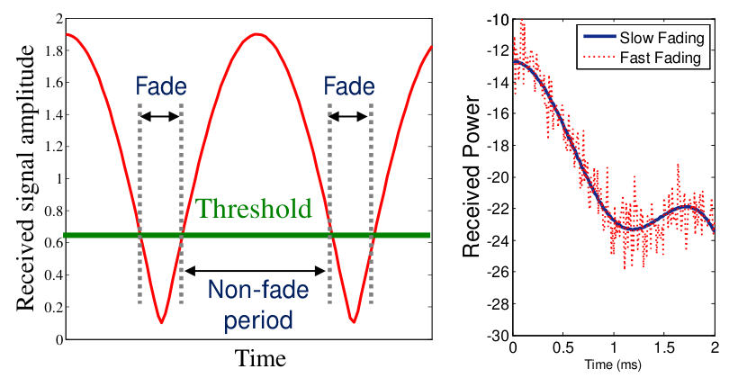
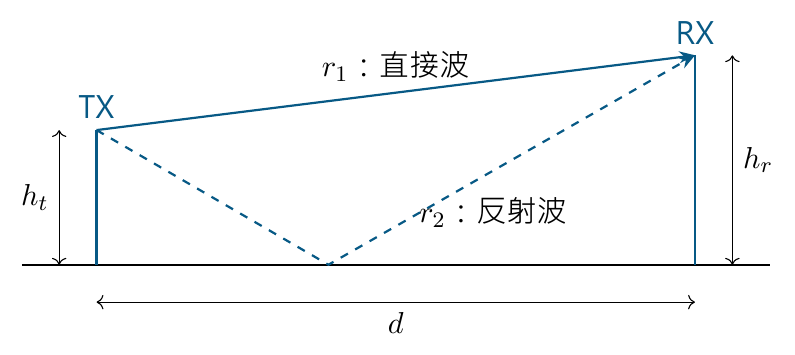
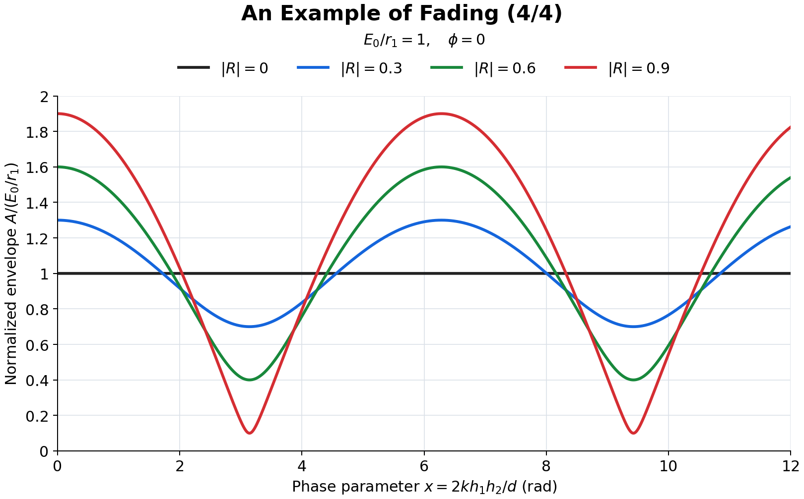
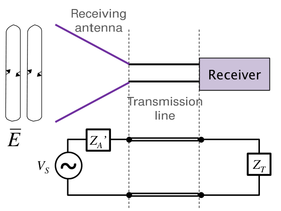

# 單元 02｜無線通訊系統的射頻模組

原始影片：[陳晏笙老師「天線」單元 2](https://www.youtube.com/watch?v=QbpX-J8aokE)（約 47 分鐘）

老師講義：[Lecture 1 — Antenna Fundamentals](https://drive.google.com/file/d/1ntbBWUmnnTWLRJr7M02QuRqYnrW1tHE7/view)，**第 20～38 頁**。本文的頁碼均指老師原始 PDF 頁碼。

建議閱讀：約 40 分鐘。前置單元：01，先理解編碼、調變及基頻與射頻的分工。

> **學習重點：**沿著「中頻放大 → 升頻 → 發射 → 無線通道 → 接收 → 降頻 → 解調解碼」的順序，理解每個模組解決什麼問題，再用兩路徑模型看懂接收訊號為何忽大忽小。

## 講義與影片對照

正文按老師講義的頁序編排，英文標題保留作為對照。時間連結依影片口述與畫面核對，用來找到相關講解，並非逐頁換頁時刻。14:30 板書與四張 Fading 的定位另有畫面核對。

| 老師講義 | 原英文主題 | 中文內容 | 影片定位 |
|:---------|:-----------|:---------|:---------|
| p.20 | IF Amplifier | 中頻放大器補足訊號電平 | [約 00:00～02:00](https://www.youtube.com/watch?v=QbpX-J8aokE&t=0s) |
| pp.21–22 | Oscillator (1/2)–(2/2) | 本地振盪器與可調頻道 | [約 02:00～04:20](https://www.youtube.com/watch?v=QbpX-J8aokE&t=120s) |
| p.23 | Mixer | 相乘產生和頻與差頻 | [約 04:20～06:55](https://www.youtube.com/watch?v=QbpX-J8aokE&t=260s) |
| pp.24–25 | RF Filter (1/2)–(2/2) | 選頻與四類濾波器 | [約 05:30～07:30](https://www.youtube.com/watch?v=QbpX-J8aokE&t=330s) |
| p.26 | Power Amplifier | 功率、效率與壓縮 | [約 07:30～09:50](https://www.youtube.com/watch?v=QbpX-J8aokE&t=450s) |
| p.27 | TX Antenna | 發射天線的場型與規格 | [約 09:50～11:20](https://www.youtube.com/watch?v=QbpX-J8aokE&t=590s) |
| p.28 | Wireless Propagation | 多路徑、衰落與尺寸分類 | [14:30 板書](https://www.youtube.com/watch?v=QbpX-J8aokE&t=870s) |
| pp.29–32 | An Example of Fading (1/4)–(4/4) | 幾何 → 相量 → 時域 → 包絡 | [21:00 起；逐頁定位見第 8 節](https://www.youtube.com/watch?v=QbpX-J8aokE&t=1260s) |
| p.33 | RX Antenna | 入射場如何形成接收電壓 | [約 37:30～38:00](https://www.youtube.com/watch?v=QbpX-J8aokE&t=2250s) |
| p.34 | Band-Pass Filter | 選頻與防止前端過載 | [約 38:00～40:05](https://www.youtube.com/watch?v=QbpX-J8aokE&t=2280s) |
| p.35 | Low-Noise Amplifier | 弱訊號放大與新增雜訊 | [約 40:05～43:05](https://www.youtube.com/watch?v=QbpX-J8aokE&t=2405s) |
| p.36 | Mixer and Oscillator | 降頻、級聯與 LO 洩漏 | [約 43:05～44:10；46:05 起補充多級變頻](https://www.youtube.com/watch?v=QbpX-J8aokE&t=2585s) |
| p.37 | IF Filter | 清除混頻產物、選出中頻 | [約 43:05～44:10，降頻與濾波一起說明](https://www.youtube.com/watch?v=QbpX-J8aokE&t=2585s) |
| p.38 | Baseband and IF Module | 解調、判決、解碼與同步 | [約 44:10～46:05](https://www.youtube.com/watch?v=QbpX-J8aokE&t=2650s) |

先用下圖把傳送鏈串起來，再逐頁看每一個元件。



接收鏈則依序為：天線 → BPF → LNA → 混頻／LO → IF 濾波 → ADC／解調／解碼。每一級都有自己的限制；後級放大不能補回所有前級已失去的訊息。

## 1．中頻放大器：補足調變後的電平（IF Amplifier，p.20）

調變器有插入損耗，因此已調變訊號進入射頻變頻鏈前，先以**中頻放大器**提高電平。這裡的中頻（Intermediate Frequency，IF）是系統選定的處理頻率；放大器主要改變訊號大小，變頻則由後面的混頻器負責。

老師列出的實作元件包括 Si 或 GaAs 場效電晶體（FET）、雙極性電晶體、異質接面雙極性電晶體（HBT）與高電子遷移率電晶體（HEMT）。此處要掌握的是：它們是需要直流供電的主動元件，不會憑空增加能量。

| 原講義規格 | 中文理解 | 為什麼要看 |
|:-----------|:---------|:-----------|
| Power gain | 功率增益 | 能否把調變後的訊號提升到下一級所需電平 |
| Noise figure | 雜訊指數 | 放大過程增加多少雜訊、使訊雜比惡化多少 |
| Intercept points | 截取點 | 用來評估非線性造成的互調失真，不能只看增益夠不夠 |

## 2．本地振盪器：建立可控制的載波（Oscillator 1/2–2/2，pp.21–22）

本地振盪器（Local Oscillator，LO）產生精確且可控制的頻率 $`f_{\mathrm{LO}}`$，供混頻器使用。它把直流功率轉成週期性的交流波形；老師以適當偏壓下呈現負電阻的主動電路說明振盪來源。

調諧範圍決定可以涵蓋哪些頻道；頻率解析度決定每次可調多細；頻率穩定度與相位雜訊則影響載波是否偏移、相位是否抖動。這些都要與功耗一起考慮，不能只要求「有振盪即可」。

### GSM900 例：為什麼 LO 不能只有一個固定頻率？

第 22 頁用 GSM900 的頻道分配說明可調頻需求。投影片畫出上行約 890～915 MHz、下行約 935～960 MHz，並以 **200 kHz 頻道間距**表示不同使用者可使用不同頻道。以下保留原表中可直接對照的列：

| 投影片頻道編號 | 上行（MHz） | 下行（MHz） |
|:--------------:|:-----------:|:-----------:|
| 1 | 890.2 | 935.2 |
| 2 | 890.4 | 935.4 |
| 124 | 914.8 | 959.8 |

重點是：當目標 RF 頻道改變，而選用的 IF 不變時，LO 也必須跟著調整，才能把訊號搬到對應頻帶。圖中亦區分控制頻道與承載訊息的交通頻道（Traffic channel）。

**原表疑點：**第 3、4 列下行原印 935.5、935.6 MHz，與同頁標示的 200 kHz 等間距不一致；若依第 1、2 列延伸，應為 935.6、935.8 MHz。這裡只指出投影片的內部一致性問題；原表末列 125 與頻帶邊界也不作正式頻道規範使用。

## 3．混頻器：把 IF 搬到 RF（Mixer，p.23）

理想混頻器把 LO 與 IF 相乘，產生和頻與差頻。沿用老師的轉換常數 $`K`$，先以兩個單位振幅的正弦訊號表示：

```math
\begin{aligned}
v_{\mathrm{RF}}(t)
&=K\,v_{\mathrm{LO}}(t)v_{\mathrm{IF}}(t)\\
&=K\cos(2\pi f_{\mathrm{LO}}t)\cos(2\pi f_{\mathrm{IF}}t)\\
&=\frac K2\left[\cos 2\pi(f_{\mathrm{LO}}+f_{\mathrm{IF}})t
+\cos 2\pi(f_{\mathrm{LO}}-f_{\mathrm{IF}})t\right].
\end{aligned}
```

若兩個輸入的振幅分別為 $`A,B`$，上式係數改為 $`KAB/2`$。實際承載資訊的是一段頻譜；混頻會搬移整段頻譜，並保留其中的調變資訊。

混頻器有 IF、LO、RF 三個埠，可利用二極體、電晶體的非線性，或開關的時變特性完成頻率轉換。**LO 決定搬移位置，混頻器產生頻率組合，後面的濾波器再選出需要的那一組。**

## 4．射頻濾波器：留下目標頻帶（RF Filter 1/2–2/2，pp.24–25）

老師這個傳送鏈選擇和頻作為 RF：

```math
f_{\mathrm{RF}}=f_{\mathrm{LO}}+f_{\mathrm{IF}}.
```

因此需要濾波器抑制差頻與其他不需要的混頻產物。真實非線性元件還可能產生諧波、$`m f_{\mathrm{LO}}+n f_{\mathrm{IF}}`$ 等組合，不能把理想相乘的兩個頻率當成全部輸出。

第 25 頁將濾波器視為二埠網路，畫出四種頻率響應：



*圖源：老師 Lecture 1，第 25 頁局部。原圖縱軸為插入損耗，數值向下增大；曲線越接近 0 dB，表示通過時損失越少。曲線為類型示意，非本講義量測結果。*

| 類型 | 中文名稱 | 通帶與阻帶的讀法 |
|:-----|:---------|:-----------------|
| LPF | 低通 | 低於截止頻率 $`f_c`$ 的成分通過，高頻受到抑制 |
| HPF | 高通 | 高於截止頻率 $`f_c`$ 的成分通過，低頻受到抑制 |
| BPF | 帶通 | 保留下截止 $`f_L`$ 到上截止 $`f_H`$ 之間的頻帶 |
| BSF | 帶拒／帶阻 | 抑制 $`f_L`$ 到 $`f_H`$ 之間的頻帶，兩側可通過 |

原圖用 3 dB 水平線協助辨識截止位置，也畫出通帶漣波與有限的轉換斜率：實際濾波器不會在某個頻率突然由全通變成完全阻斷。

評估規格時，**插入損耗**關係到留下多少有用功率，**截止頻率**決定保留範圍，**帶外衰減速度**決定多快抑制鄰近頻率，**群延遲**則描述訊號各頻率成分通過時的延遲。群延遲在訊號頻帶內差異過大，也可能使調變波形失真。

## 5．功率放大器：提供足夠發射功率（Power Amplifier，p.26）

功率放大器（Power Amplifier，PA）位在 RF 濾波器之後、發射天線之前，目的是提高發射器的輸出功率，讓訊號經過傳播損耗後仍可接收。

老師特別列出兩個規格：

- **功率附加效率（Power Added Efficiency，PAE）**：衡量直流供電有多少轉成額外的 RF 輸出，與耗電及散熱直接相關。
- **1 dB 壓縮點**：輸入增加時，輸出不會永遠維持固定增益；當增益比小訊號線性外推值少 1 dB，即進入此規格所指的壓縮程度。需要保留振幅資訊的訊號尤其要注意失真。

投影片以 Si 與 GaAs 元件的使用頻段說明材料與性能取捨，並強調放大器可和混頻器、振盪器、開關等一起整合。該頁列出的 2 GHz、4 GHz 是教材當時的技術例示，不視為材料的物理截止頻率。

## 6．發射天線：把端口訊號送進空間（TX Antenna，p.27）

發射天線將調變後的載波轉成向外傳播的電磁波。投影片以「平面波」說明遠離天線後的傳播觀點；靠近天線的近場結構，留待下一單元處理。

| 通訊情境 | 老師列出的場型需求 | 設計直覺 |
|:---------|:-------------------|:---------|
| 點對點 | 高指向性 | 能量集中朝向已知的另一端 |
| 多點對多點 | 偏好全向場型 | 使用者可能分布在多個方位 |
| 廣播 | 全向場型 | 希望涵蓋周圍的接收者 |

這裡的全向通常是指關注平面上的方位覆蓋，不能直接理解成在三維所有方向都完全相同。

第 27 頁列出的規格包括**輻射場型、輻射效率、峰值增益、返回損耗、頻寬與尺寸**。讀這些規格時可分成兩個問題：

- **電路端：**前級送來的功率，有多少被天線接受？需看阻抗、匹配、反射與工作頻寬。
- **空間端：**接受的功率，有多少真正輻射、往哪裡輻射？需看效率、場型、指向性、增益與極化。

「匹配很好」只回答端口的一部分問題，不能單獨保證輻射效率或空間覆蓋。

## 7．無線傳播：直接波與多路徑一起抵達（Wireless Propagation，p.28）

第 28 頁畫出直接、反射、散射與繞射路徑。同一個發射訊號可能經過不同路徑抵達接收端，帶著不同的衰減、延遲與相位。

### 7.1 尺寸必須相對於波長來看

障礙物必須以**尺寸相對波長**理解，不能只用「大樓很大、桌子很小」的日常尺度判斷。

依老師在影片[約 14:30 的板書](https://www.youtube.com/watch?v=QbpX-J8aokE&t=870s)，以 $`D`$ 表示障礙物的特徵尺寸、$`\lambda`$ 表示波長，對照如下（不等號依板書照錄）：

| 現象 | 尺寸與波長的關係（板書） | 尺度直覺 |
|:-----|:------------------------|:---------|
| 反射（Reflection） | $`D \ge 10\lambda`$ | 尺寸至少約為波長的 10 倍 |
| 散射（Scattering） | $`0.1\lambda < D \le 10\lambda`$ | 尺寸約介於波長的 1/10 至 10 倍 |
| 繞射（Diffraction） | $`D < 0.1\lambda`$ | 尺寸小於波長的 1/10 |

**補充解說：**以上是課堂建立直覺的概略分類，不是普遍適用的嚴格界線；板書在 $`D=10\lambda`$ 處的範圍有重疊，也未單獨指定 $`D=0.1\lambda`$ 的歸類。繞射也會出現在大型障礙物的邊緣；材料、形狀與角度都會影響結果，三種機制可以同時存在。

**老師口述例（約 [14:50](https://www.youtube.com/watch?v=QbpX-J8aokE&t=890s)）：**以 1 GHz 為例，波長約 30 cm；依上表，3 cm 與 3 m 是兩個尺寸比較尺度。同一張桌子或同一輛車，在不同頻率下會對應不同的電氣尺寸；判斷不能只靠日常所說的「大物體、小物體」。精確端點仍以上述板書及其校註為準。

### 7.2 圖中的訊號起伏代表什麼？

老師在本頁列出衰落（Fading）、符際干擾（Intersymbol Interference，ISI）與路徑損耗等傳播問題。三者可一起影響接收，但不是同一件事：路徑損耗描述傳播帶來的整體衰減；多條路徑的場相加會產生增強或抵消；延遲不同的複本若跨入其他符號時段，還可能造成符際干擾。



*圖源：老師 Lecture 1，第 28 頁局部。左圖縱軸是接收振幅，右圖縱軸是接收功率；兩者不能直接用同一數值解讀。*

左圖的綠線是接收門檻（Threshold）；曲線跌到門檻以下的區間，標成 Fade。這說明平均訊號夠強，不代表每個時刻都足以可靠接收。右圖疊畫較慢變化的趨勢與快速起伏，提醒接收電平會隨觀察時間或位置改變；此處先讀圖意，不以圖中的毫秒刻度作所有系統的分類界線。

**老師口述提醒（約 [18:00–20:00](https://www.youtube.com/watch?v=QbpX-J8aokE&t=1080s)）：**量到的接收振幅起伏，可能就是多路徑造成的真實通道變化，不能一看到曲線高低就全部歸因於儀器誤差。最需要留意的是波谷是否低於可解調門檻。這不表示所有量測起伏都一定來自多路徑；判讀仍須配合量測環境。

**接收端相加的是帶相位的電場。**兩波相位接近可能增強；相差約 180° 且振幅接近則可能抵消。下一組四張投影片用最簡單的兩路徑把這件事算出來。

## 8．兩路徑衰落：由幾何算到包絡（An Example of Fading 1/4–4/4，pp.29–32）

以下依[老師原始投影片](https://drive.google.com/file/d/1ntbBWUmnnTWLRJr7M02QuRqYnrW1tHE7/view)第 29～32 頁的順序整理。影片連結定位在各頁已出現的畫面；第 2 張的講解中穿插了較長的相量板書解說。

| 投影片標題 | 原投影片頁碼 | 影片對照 | 這一頁要掌握的事 |
|:-----------|:------------:|:---------|:-------------------|
| An Example of Fading (1/4) | 29 | [約 21:00](https://www.youtube.com/watch?v=QbpX-J8aokE&t=1260s) | 由幾何求直接路徑、反射路徑與路徑差 |
| An Example of Fading (2/4) | 30 | [約 23:00](https://www.youtube.com/watch?v=QbpX-J8aokE&t=1380s) | 把兩條路徑的電場相量相加 |
| An Example of Fading (3/4) | 31 | [約 33:00](https://www.youtube.com/watch?v=QbpX-J8aokE&t=1980s) | 回到時域，分辨包絡振幅與相位 |
| An Example of Fading (4/4) | 32 | [約 34:10](https://www.youtube.com/watch?v=QbpX-J8aokE&t=2050s) | 比較不同反射強度造成的衰落深度 |

本節沿用投影片的 $`h_1,h_2,R,E_r`$；與本講義插圖及後續算例的符號對照如下：

| 投影片符號 | 本講義其他段落的符號 | 意義 |
|:-----------|:---------------------|:-----|
| $`h_1`$ | $`h_t`$ | 傳送端天線高度（圖中的行動台 MS） |
| $`h_2`$ | $`h_r`$ | 接收端天線高度（圖中的基地台 BS） |
| $`R=\lvert R\rvert e^{j\phi}`$ | $`\Gamma`$ | 地面反射係數；$`\lvert R\rvert`$ 為大小，$`\phi`$ 為反射相位 |
| $`E_r`$ | $`\widetilde E`$ | 接收端合成電場的相量 |

### 8.1 先求兩條路徑長度（An Example of Fading 1/4，p.29）

**對照第 29 頁。**傳送端與接收端相距 $`d`$，高度分別為 $`h_1,h_2`$。模型只取直接波與一次地面反射波；$`r_2`$ 是從傳送端經反射點到接收端的**完整路徑長度**。



由幾何關係得到：

```math
\begin{aligned}
r_1&=\sqrt{d^2+(h_2-h_1)^2}
\approx d+\frac{(h_2-h_1)^2}{2d},\\
r_2&=\sqrt{d^2+(h_2+h_1)^2}
\approx d+\frac{(h_2+h_1)^2}{2d}.
\end{aligned}
```

近似條件是 $`d\gg h_1,h_2`$，使用 $`\sqrt{1+x}\approx1+x/2`$。相減後，反射波比直接波多走的距離為

```math
\Delta r=r_2-r_1
\approx\frac{(h_2+h_1)^2-(h_2-h_1)^2}{2d}
=\frac{2h_1h_2}{d}.
```

**這一頁的重點：**路徑差會造成相位差 $`k\Delta r`$，其中 $`k=2\pi/\lambda`$。即使 $`\Delta r`$ 相對於總路程很小，相對於波長仍可能很大。

### 8.2 在相量域相加（An Example of Fading 2/4，p.30）

**對照第 30 頁。**採用 $`e^{j\omega t}`$ 的時間慣例，傳播距離 $`r`$ 對應相位因子 $`e^{-jkr}`$。地面反射係數為 $`R=|R|e^{j\phi}`$，接收端的場相量為

```math
E_r=\frac{E_0e^{-jkr_1}}{r_1}
 +\frac{E_0R e^{-jkr_2}}{r_2}.
```

第一項是直接波，第二項是反射波；$`E_0`$ 是此簡化模型中兩路徑共用的場強係數。反射係數同時改變振幅與相位，不能只取 $`|R|`$ 而忽略 $`\phi`$。

依投影片，對振幅分母作 $`r_2\approx r_1`$ 的近似，提出直接波的共同因子：

```math
E_r\approx\frac{E_0e^{-jkr_1}}{r_1}
\left[1+R e^{-jk(r_2-r_1)}\right].
```

為了讓後兩頁容易閱讀，以下以 $`\delta`$ 簡寫投影片中反覆出現的相位組合：

```math
\delta=k\Delta r-\phi
\approx\frac{2kh_1h_2}{d}-\phi.
```

代入路徑差，再用歐拉公式展開：

```math
\begin{aligned}
E_r&\approx\frac{E_0e^{-jkr_1}}{r_1}
\left[1+|R|e^{-j\delta}\right]\\
&=\frac{E_0e^{-jkr_1}}{r_1}
\left[1+|R|\cos\delta-j|R|\sin\delta\right].
\end{aligned}
```

**這一頁的重點：**$`r_1\approx r_2`$ 用在振幅分母，**仍須保留指數項中的路徑差**。若連相位也直接設成相同，就會把要分析的干涉現象消掉。以上近似步驟以 $`\approx`$ 標示，與投影片中連續寫等號的排法有所區別。

**老師板書例（約 [29:40–31:50](https://www.youtube.com/watch?v=QbpX-J8aokE&t=1780s)）：**假設 $`r_1=100\lambda`$、$`r_2=100.2\lambda`$，兩個振幅分母只差約 0.2%，可在此情境下近似相同；相位差卻是

```math
k(r_2-r_1)=\frac{2\pi}{\lambda}(0.2\lambda)
=0.4\pi=72^\circ.
```

72° 對相加結果影響很大。這正是老師保留指數內路徑差、只近似分母的理由。

### 8.3 回到時域，分出包絡與相位（An Example of Fading 3/4，p.31）

**對照第 31 頁。**令 $`\theta=\omega t-kr_1`$，並依投影片定義兩個實數係數：

```math
X=\frac{E_0}{r_1}\left(1+|R|\cos\delta\right),\qquad
Y=\frac{E_0}{r_1}|R|\sin\delta.
```

相量乘回 $`e^{j\omega t}`$ 並取實部，得到時域接收訊號：

```math
e_r(t)=\mathop{\mathrm{Re}}\nolimits \{E_r e^{j\omega t}\}
\approx X\cos\theta+Y\sin\theta
=A\cos(\theta+\Psi).
```

其中包絡振幅 $`A`$ 與相對直接波的附加相位 $`\Psi`$ 為

```math
A=\sqrt{X^2+Y^2},\qquad
\Psi=\mathop{\mathrm{atan2}}\nolimits (-Y,X)\quad(A>0).
```

**公式校正（第 31 頁）：**原投影片同時寫 $`A\cos(\theta+\Psi)`$ 與正號的 $`\tan^{-1}(Y/X)`$，兩者依該頁的 $`X,Y`$ 定義並不一致。本講義保留餘弦內的加號，因此相位改為 $`\mathop{\mathrm{atan2}}\nolimits (-Y,X)`$；這也能處理正確象限。等價寫法是 $`A\cos[\theta-\mathop{\mathrm{atan2}}\nolimits (Y,X)]`$。若 $`A=0`$，合成訊號的相位無法定義。

- **沒有反射時：**$`R=0`$，所以 $`X=E_0/r_1`$、$`Y=0`$，回到單一直接波 $`e_r(t)=(E_0/r_1)\cos(\omega t-kr_1)`$。
- **行動台移動時：**$`d`$ 或 $`h_1`$ 改變，路徑差與相位組合 $`\delta`$ 跟著改變，包絡振幅 $`A`$ 與相位 $`\Psi`$ 都可能變化。

**這一頁的重點：**衰落描述的是接收正弦波的**包絡振幅**變化；訊號本身仍以載波角頻率 $`\omega`$ 振盪。

### 8.4 從包絡曲線看衰落深度（An Example of Fading 4/4，p.32）

**對照第 32 頁。**把上一頁的 $`X,Y`$ 代回，得到投影片圖上的包絡公式：

```math
\begin{aligned}
A&=\frac{E_0}{r_1}
\sqrt{\left(1+|R|\cos\delta\right)^2
 +\left(|R|\sin\delta\right)^2}\\
&=\frac{E_0}{r_1}
\sqrt{1+|R|^2+2|R|\cos\delta},
\qquad \delta\approx\frac{2kh_1h_2}{d}-\phi.
\end{aligned}
```

投影片作圖設定為 **$`E_0/r_1=1`$、$`\phi=0`$**，橫軸是相位參數 $`x=2kh_1h_2/d`$，不是直接以距離或時間作橫軸。以下依相同公式與設定重畫：



| $`\lvert R\rvert`$ | 最小包絡 $`A_{\min}`$ | 最大包絡 $`A_{\max}`$ | 對照圖形 |
|:-------:|:--------------------:|:--------------------:|:---------|
| 0 | 1 | 1 | 黑線：只有直接波，不會產生兩路徑干涉起伏 |
| 0.3 | 0.7 | 1.3 | 藍線：反射較弱，起伏較小 |
| 0.6 | 0.4 | 1.6 | 綠線：反射較強，谷值更低 |
| 0.9 | 0.1 | 1.9 | 紅線：兩波振幅接近，可能形成深谷 |

上述數值採用圖中的歸一化設定；一般情況下，包絡的上下限為

```math
A_{\min}=\frac{E_0}{r_1}\left|1-|R|\right|,\qquad
A_{\max}=\frac{E_0}{r_1}\left(1+|R|\right).
```

- **波峰：**$`\delta=2n\pi`$ 時兩波同相，振幅相加。
- **波谷：**$`\delta=(2n+1)\pi`$ 時兩波反相，振幅相減；$`n`$ 為整數。
- **「0 到 2 倍」的意思：**投影片文字說明的是此近似模型中 $`|R|=1`$ 的極限。圖上的紅線採用 $`|R|=0.9`$，因此實際是 **0.1 到 1.9 倍**，尚未完全抵消。

**補充解說：**圖形每隔 $`2\pi`$ 在相位參數 $`x`$ 上重複。因為 $`x\propto1/d`$，不能直接解讀成「每移動固定距離就出現一次波谷」；若實際改變距離，直接波振幅 $`E_0/r_1`$ 本身也會改變。

投影片最後提醒：實際環境包含大量分布不規則的反射、繞射、折射與散射物，接收端會有更多路徑疊加，可能出現更深、更不規則的衰落。兩路徑模型的用途，是先看懂**相位干涉如何使接收訊號忽大忽小**。

## 9．接收天線：把入射場轉成電壓（RX Antenna，p.33）

接收天線面對的是通道中來自不同路徑、可能跨越不同頻段的電磁波。第 33 頁以電壓源及天線阻抗的等效電路，連接「空間中的場」與「接收器端口的訊號」。



*圖源：老師 Lecture 1，第 33 頁局部；$`V_S`$ 是等效感應電壓，$`Z_A'`$ 是圖中的天線等效阻抗，$`Z_T`$ 為接收端所見的負載。*

老師用沿天線長度的電場積分建立直覺：

```math
V_S=\int_L\vec E\cdot\mathrm d\vec l.
```

$`L`$ 表示積分的天線長度路徑；點積表示只有沿積分方向的場分量有貢獻。這有助理解為何接收結果與天線方向、尺寸及入射場有關。投影片據此說明較大的天線可能具有較好的接收能力。

**模型條件：**不能把上式讀成「任意天線越長就一定越好」。各處場的相位、電流分布、極化與端口匹配都會影響實際電壓及接收功率；圖中的電壓源觀點，是後續天線電路參數與有效接收面積的起點。

## 10．接收帶通濾波器：先擋掉不需要的訊號（Band-Pass Filter，p.34）

接收端的帶通濾波器（Band-Pass Filter，BPF）位在 LNA 前，抑制所需頻帶以外的訊號與雜訊。老師特別問：**天線既然已有頻率選擇性，為什麼還需要 BPF？**

1. 天線可能有多個共振模態，不能保證只有目標頻帶會把訊號送入接收器。
2. 頻帶外的強干擾即使不是我們要解調的訊號，也可能先讓靈敏的 LNA 過載。先濾掉它，才能讓後級維持可用的線性操作範圍。

因此 BPF 同時負責頻帶選擇與前端保護。它無法分開已落在同一通帶內的訊號與雜訊；本身的插入損耗也要納入接收鏈設計。

## 11．低雜訊放大器：放大弱訊號，少增加雜訊（Low-Noise Amplifier，p.35）

訊號走過長距離通道後通常很弱，低雜訊放大器（Low-Noise Amplifier，LNA）先提高其電平，同時盡量減少自身新增的雜訊。投影片的重點是**接收器前幾級對整體雜訊的影響特別大**，因此主要規格是雜訊指數及最大增益。

LNA 會連同輸入端原本的雜訊一起放大；「低雜訊」是指少加雜訊，不是把混進訊號的雜訊刪掉。若接收訊號已夠強，可以依系統條件省略 LNA，但下一級的損耗與雜訊就更需要注意。

至此可對照三種放大器的任務：

| 放大器 | 位置與目的 | 老師強調的規格 |
|:-------|:-----------|:---------------|
| IF 放大器 | 變頻前補足調變後的電平 | 功率增益、雜訊指數、截取點 |
| PA | 天線前提高發射功率 | 功率附加效率、1 dB 壓縮點 |
| LNA | 接收前端提高弱訊號電平 | 雜訊指數、最大增益 |

## 12．接收混頻器與 LO：把 RF 降回 IF（Mixer and Oscillator，p.36）

接收端也會產生和頻與差頻，但此處要選擇較低的差頻：

```math
f_{\mathrm{IF}}=\left|f_{\mathrm{RF}}-f_{\mathrm{LO}}\right|.
```

當 RF 與 LO 接近時，和頻約為 RF 的兩倍，差頻則遠低於 RF，適合交給後面的 IF／基頻模組處理。老師也指出，實務上可以使用多級變頻，以安排需要的頻率與性能。

本頁另有兩個容易忽略的限制：

- 若前面沒有 LNA，混頻器的損耗與雜訊特性可能成為接收性能的主要限制。
- **LO 到 RF 的隔離度有限：**部分 LO 功率可能由 RF 埠反向洩漏，經接收天線再輻射出去。因此混頻器不只要看轉換是否成功，也要看埠間隔離。

## 13．中頻濾波器：選出差頻，清除混頻雜散（IF Filter，p.37）

IF 濾波器留下所需差頻並抑制混頻產生的諧波與雜散。老師的圖採用 $`f_{\mathrm{RF}}>f_{\mathrm{LO}}`$，所以直接寫成 $`f_{\mathrm{IF}}=f_{\mathrm{RF}}-f_{\mathrm{LO}}`$；一般討論則應取差頻的非負大小。

投影片以「IF 通常遠低於 LO，例如低於 100 MHz」說明這種架構的頻率安排。這是教材例示，實際 IF 需配合濾波、變頻與後續取樣需求選擇。

老師在本頁總結 RF 前端的要求：低損耗、低成本、重量輕、高性能、省電與尺寸小。放大、混頻、振盪、濾波等功能可以朝積體電路整合；天線則仍需另外考慮相對波長的尺寸與空間輻射需求。原頁「除了天線，其他元件都可整合進 IC」是在強調這個設計差異，不應當成天線在任何條件下都不能與晶片整合的定理。

## 14．基頻與中頻模組：還原訊息（Baseband and IF Module，p.38）

依投影片接收方塊圖，IF 經 ADC 後進入數位處理，完成解調、解碼，必要時再經 DAC 轉回類比輸出。

| 工作 | 要恢復什麼 | 本頁重點 |
|:-----|:-----------|:---------|
| 解調（Demodulation） | 調變符號及其代表的資料 | 相干檢波後接判決電路，判斷收到的是哪一個符號 |
| 解碼（Decoding） | 原始訊息 | 由接收到的通道位元恢復編碼前的資料 |
| 載波擷取與同步 | 正確的解調參考 | DSP 協助建立並追蹤載波參考，使相干檢波能運作 |

回看整條鏈，升頻與降頻改變訊號所在的頻譜位置；解調與解碼才逐步恢復其承載的訊息。通道衰落、前端失真或雜訊造成的問題，最終都會反映到判決可靠度。

## 15．補充解說與重算例題

本節是幫助理解的補充，與前面的老師逐頁內容分開。數值例題為本講義重算，並非老師投影片的原題。

### 15.1 升頻例題與接收鏡像

取 $`f_{\mathrm{IF}}=100`$ MHz、$`f_{\mathrm{LO}}=2.3`$ GHz，理想混頻器產生 2.4 GHz 與 2.2 GHz。若要發射 2.4 GHz，RF 濾波器保留其所在頻帶，抑制 2.2 GHz 分量。

反過來，用 2.3 GHz LO 接收 2.4 GHz 訊號時，所需差頻是 100 MHz；但 2.2 GHz 的干擾也可能產生同一個 100 MHz 差頻。這是接收鏡像的基本例子：**混頻後兩個訊號若已重疊，僅靠 IF 濾波器就不容易分開**，因此要在前端安排選頻與鏡像抑制。

### 15.2 反射相位為 180° 的兩路徑算例

第 32 頁的曲線取 $`\phi=0`$；以下重算例題另取 $`R=\Gamma=-1`$，即 $`|R|=1`$、$`\phi=\pi`$，兩者的反射相位設定不同。由同一包絡公式，並進一步令振幅分母 $`r_1\approx d`$，可得

```math
A\approx\frac{E_0}{d}\sqrt{2-2\cos(k\Delta r)}
=\frac{2E_0}{d}\left|\sin\frac{k\Delta r}{2}\right|
\approx\frac{2E_0}{d}\left|\sin\frac{2\pi h_th_r}{\lambda d}\right|.
```

當正弦項接近零，兩束波互相抵消；原本看似足夠的訊號，就可能跌到無法可靠解調的程度。

#### 路徑只多走一點，相位卻變很多

**補充解說／重算例題：**令 $`h_t=h_r=1.5`$ m，$`d=30`$ m，$`f=2.4`$ GHz。取 $`c=3\times10^8`$ m/s：

```math
\lambda=\frac{c}{f}=0.125\ \mathrm m,\qquad
\Delta r\approx\frac{2(1.5)(1.5)}{30}=0.15\ \mathrm m.
```

傳播相位差約為

```math
k\Delta r=\frac{2\pi(0.15)}{0.125}=2.4\pi\ \mathrm{rad}.
```

若再考慮 $`\Gamma=-1`$ 的反射相位，合成振幅為

```math
\frac{|\widetilde E|}{E_0/d}\approx2|\sin(1.2\pi)|\approx1.176.
```

直接波的單獨振幅 $`E_0/d`$ 並沒有變成合成振幅的兩倍。要看兩波的相位關係；換個位置或頻率，結果又可能差很多。

#### 遠距離近似：場與功率的衰減不同

**補充解說／重算例題：**在 $`|2\pi h_th_r/(\lambda d)|\ll1`$ 時，$`\sin x\approx x`$：

```math
|\widetilde E|\approx\frac{4\pi E_0h_th_r}{\lambda d^2}.
```

此簡化兩路徑模型在這個條件下**場振幅約依 $`d^{-2}`$ 衰減，功率約依 $`d^{-4}`$ 衰減**。只有單一自由空間傳播路徑時，場振幅通常依 $`d^{-1}`$，功率密度依 $`d^{-2}`$。切勿把這兩種情境混用。

### 15.3 為什麼前幾級雜訊格外重要？

影片指出整體雜訊表現對前幾級尤其敏感，因此接收器前端採用 LNA。**補充解說／重算例題：**雜訊因子 $`F=\mathrm{SNR}_{\mathrm{in}}/\mathrm{SNR}_{\mathrm{out}}`$，雜訊指數 $`\mathrm{NF}=10\log_{10}F`$。兩級串接時，

```math
F_{\mathrm{total}}=F_1+\frac{F_2-1}{G_1}.
```

這裡 $`F_1,F_2,G_1`$ 都用線性值；第一級增益可降低第二級新增雜訊的相對影響。LNA 前的濾波器損耗也可能惡化整體 NF，所以不能只看 LNA 單顆的規格。

> **核心觀念：** 改善接收不能只靠「放大更多」：頻帶選擇、前端雜訊、反射相消、解調所需 SNR，都可能成為限制。

## 16．自測與解析

建議先用 5 分鐘作答，再核對解析。

1.  IF 為 70 MHz、LO 為 930 MHz，理想混頻器產生的兩個主要頻率是多少？若要發射 1 GHz，該保留哪一個？

2.  接收端已混入雜訊，為何 LNA 增益更大不代表 SNR 一定更好？

3.  兩束接收波各自的振幅為 $`A`$，相位相差 180°。相加後的場振幅是多少？可以直接將功率加成兩倍嗎？

4.  $`h_t=h_r=2`$ m、$`d=100`$ m，遠距離近似下的路徑差為何？若頻率 3 GHz，單看傳播的相位差是多少？

5.  使用兩路徑的遠距離 $`P_r\propto d^{-4}`$ 近似，距離加倍時功率變成幾分之一？約少幾 dB？

### 答案與解析

1.  和頻 1000 MHz，差頻 860 MHz。選擇 1000 MHz 所在頻帶，抑制 860 MHz 分量。

2.  前級雜訊與訊號會一起放大，LNA 自己也會加雜訊。要同時看雜訊表現與增益，並考慮後級；不能用輸出電平直接代表可靠度。

3.  在振幅相同且完全反相的理想條件下，場振幅為 0。功率由合成場的平方決定，不能忽略干涉項。

4.  $`\Delta r\approx2(2)(2)/100=0.08`$ m。$`\lambda=0.1`$ m，$`k\Delta r=1.6\pi`$ rad，即 288°。總相位關係還要包含反射係數。

5.  變為 $`1/16`$；$`10\log_{10}(1/16)\approx-12.04`$ dB。答案僅適用於題目指定的近似，不能套用到所有環境。

**容易混淆的四件事：** IF 放大器、PA、LNA 的功能不同；混頻後仍需濾波；多路徑除了損耗，也有相位干涉；場振幅與功率的距離次方關係相差一倍。

**下一單元：**[單元 03｜電磁波輻射的原因](003_電磁波輻射的原因.md)。由「訊號如何送到天線」，轉向「天線為何能將能量送進外部空間」。
