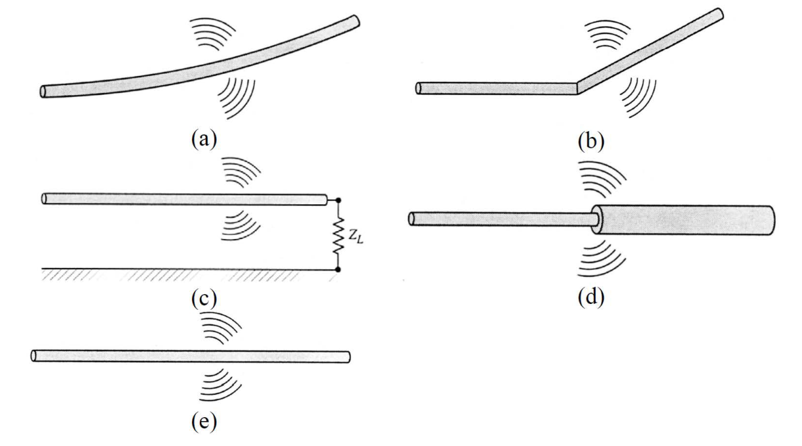
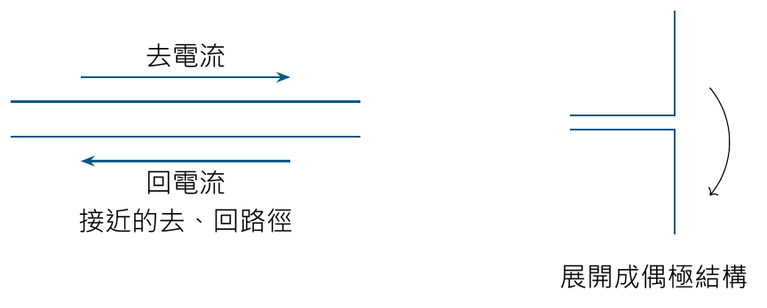
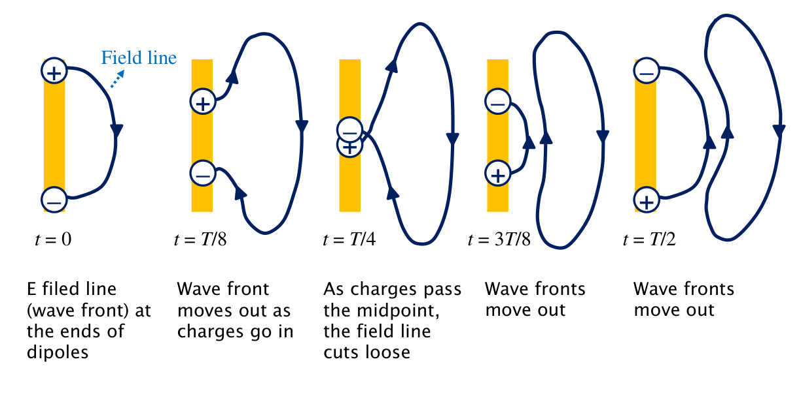
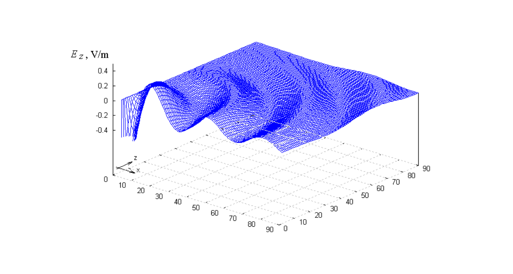
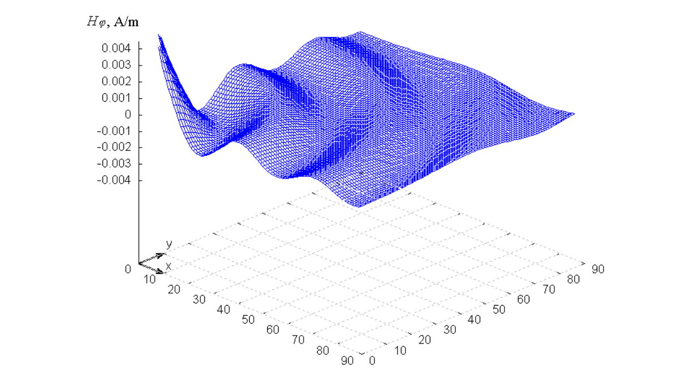
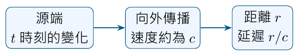

# 單元 03｜電磁波輻射的原因

原始影片：[陳晏笙老師「天線」單元 3](https://www.youtube.com/watch?v=RFdFHg_0qig)

老師講義：[Lecture 1 — Antenna Fundamentals](https://drive.google.com/file/d/1ntbBWUmnnTWLRJr7M02QuRqYnrW1tHE7/view)，第 39–53 頁

影片長度：約 52 分鐘　建議閱讀：約 30 分鐘

前置單元：01–02；先理解傳送器、接收器與天線在系統中的位置。

> **本單元主線：** 天線銜接傳輸線與自由空間。先區分靜態場與輻射，再看傳輸線如何展開成偶極天線，最後區分天線周圍的場區，以及電路端、空間端各自需要的參數。

學完應能說明：為什麼有電磁場不一定有輻射、偶極天線動畫中的電荷與場線代表什麼，以及近場量測為什麼不能直接當成遠場特性。

## 講義與影片對照

第 39 頁是「1.2 How Does an Antenna Work?」目錄，第 52 頁切換至「1.3 Antenna Parameters」；正文依老師頁序編排。下表依影片口述定位**約略主題範圍**，不是逐頁換頁時間；簡諧運動是課堂板書補充，並非原投影片上的推導。

| 老師講義 | 原英文主題 | 中文內容 | 影片定位 |
|:--|:--|:--|:--|
| 39–40 | Contents / Why Do We Need Antennas? | 天線銜接電路與空間，以及兩項任務 | [約 04:30–08:15](https://www.youtube.com/watch?v=RFdFHg_0qig&t=270s) |
| 41–43 | Static Electric and Magnetic Fields / Radiation from Simple Sources / Dynamic Electromagnetic Wave | 靜態場、簡單源、時變電流與開口場 | [約 08:15–13:20](https://www.youtube.com/watch?v=RFdFHg_0qig&t=495s) |
| 44–45 | How Does an Antenna Work? (1/4–2/4) | 傳輸線與偶極天線；延伸至簡諧運動板書 | [約 13:20–18:45；板書約 18:45–30:00](https://www.youtube.com/watch?v=RFdFHg_0qig&t=800s) |
| 46–50 | Oscillation for Only One Time / How Does an Antenna Work? (3/4–4/4) / Radiation of Short Dipole | 單次與週期擾動、場線演變、電場與磁場動畫 | [約 30:00–41:40；46:30 起回應動畫疑問](https://www.youtube.com/watch?v=RFdFHg_0qig&t=1800s) |
| 51 | Antenna Field Regions | 反應近場、輻射近場、遠場 | [約 41:40–46:30](https://www.youtube.com/watch?v=RFdFHg_0qig&t=2500s) |
| 52–53 | Contents / Antenna Parameters | 電路參數與輻射參數總覽 | 講義章末導覽；影片[約 41:30](https://www.youtube.com/watch?v=RFdFHg_0qig&t=2490s)預告後續輻射參數，未逐項展開 |

## 1．為什麼需要天線？（Why Do We Need Antennas?，p.40）

老師先把單元 01–02 的收發系統縮成一條路徑：

**傳送器 → 傳輸線 → 傳送天線 → 自由空間 → 接收天線 → 傳輸線 → 接收器。**

傳輸線把能量限制在導引結構附近、送往指定位置；自由空間傳播則需要能量離開導引結構。天線就是這兩種傳播方式之間的**轉換結構**（transitional structure）。接收時則反過來，把入射場耦合成電路中的訊號。


*本筆記示意圖：依 p.40 的電路與空間觀點整理。*

| 老師列出的任務 | 要回答的問題 | p.40 對應參數 |
|:--|:--|:--|
| 接受傳送器送來的輸入功率 | 工作頻率上，功率能否有效進入天線？ | 阻抗匹配、回波損耗、工作頻寬 |
| 把接受的功率朝需要的方向輻射 | 功率往哪裡去？波束多寬？有多少變成輻射？ | 場型、指向性、波束寬度、輻射效率 |

這是本課後續分成「電路參數」與「輻射參數」的原因。匹配良好只回答輸入端的一部分問題，空間中的輻射表現仍需另外描述。

## 2．先分清靜態場與輻射（Static Electric and Magnetic Fields，p.41）

### 2.1 靜止電荷：有電場，沒有持續向外的輻射

對位於原點、大小為 $`Q`$ 的點電荷，老師列出庫侖場：

```math
\mathbf E(\mathbf r)=\frac{Q}{4\pi\varepsilon_0 r^2}\,\hat{\mathbf r},
\qquad r=\lvert\mathbf r\rvert.
```

$`\varepsilon_0`$ 是真空介電常數，$`\hat{\mathbf r}`$ 是由電荷指向觀察點的單位向量。正電荷的場線向外、負電荷的場線向內。若電荷分布不隨時間變化，這是靜電場；「周圍有場」本身不等於「持續送出電磁波」。

### 2.2 穩定電流：有磁場，也不等於在輻射

右圖以沿導線流動的穩定電流 $`I`$，示意環繞導線的磁場。對穩態電流分布，Biot–Savart 定律的向量式為：

```math
\mathbf B(\mathbf r)
=\frac{\mu_0 I}{4\pi}
\int\frac{d\boldsymbol\ell'\times(\mathbf r-\mathbf r')}
{\lvert\mathbf r-\mathbf r'\rvert^3}.
```

$`\mathbf r'`$ 是源點位置，$`\mathbf r`$ 是觀察點位置，$`d\boldsymbol\ell'`$ 沿慣用電流方向；叉積決定磁場繞導線的方向。

> **講義公式校正：** p.41 印成 $`\int(\mathbf r-\mathbf r')\,d\ell'/\lvert\mathbf r-\mathbf r'\rvert^3`$ 的形式，缺少有方向的線元素與叉積。上式補回 $`d\boldsymbol\ell'\times(\mathbf r-\mathbf r')`$，才能得到圖中的環繞磁場。

老師用「電荷不動」與「電荷以固定速度移動」對照不輻射的情境。右圖要理解為**穩定電流形成靜磁場的模型**；不能由此推論所有移動電荷都只有磁場、沒有電場。這頁的核心是：靜態源可以有場，但不會形成這堂課要討論的持續向外輻射。

## 3．哪些源與結構會產生輻射？（pp.42–43）

### 3.1 簡單源：電荷運動與幾何都要看（Radiation from Simple Sources，p.42）



*來源：老師講義 p.42，保留原圖 (a)–(e) 標記。這是輻射機制的示意，沒有提供各結構的輻射效率或定量場型。*

| 圖號 | 圖中的特徵 | 閱讀重點 |
|:--|:--|:--|
| (a) | 平滑彎曲的導線 | 電荷運動方向可以改變；即使速率不變，速度向量仍可能改變。 |
| (b) | 導線有明顯轉折 | 幾何轉折會改變電流與電荷的空間分布。 |
| (c) | 導線末端接負載 $`Z_L`$ | 末端與負載是邊界條件，會影響沿線的電流、電荷分布。 |
| (d) | 導線截面突然改變 | 截面不連續處必須考慮電流分布如何銜接。 |
| (e) | 直導線 | 不必有彎折才可能輻射；直導線上的時變電流也能建立輻射場。 |

圖中的波紋是在提示可能的輻射來源，不能解讀成「只要導線彎一下，任何直流穩態電路就會持續送出電磁波」。判斷時仍要看源是否隨時間變化，以及整體場如何疊加。

### 3.2 動態電磁波的兩種觀察方式（Dynamic Electromagnetic Wave，p.43）

老師把重點寫成兩項：**時變電流**（time-varying current），以及**電荷加速、減速**（acceleration and deceleration of charge）。前者從電路與電流分布描述，後者從電荷運動建立直覺；最後都要回到整個結構產生的場。

| p.43 的模型 | 從哪裡描述源？ | 圖中要看的關係 |
|:--|:--|:--|
| 線型天線（wire antenna） | 導體上的時變電流與電荷分布 | 電流周圍的磁場 $`H`$，以及與電荷分布相連的電場 $`E`$。 |
| 孔徑天線（aperture antenna） | 開口處的電磁場分布 | 截斷波導（truncated waveguide）把導引場接到外部空間。 |

這是兩種建模視角，不是兩套不同的電磁定律。也不是任何交流電路都會有效對外輻射；去、回路徑的場可能在遠處大幅抵消。

## 4．從傳輸線到偶極天線（How Does an Antenna Work? 1/4–2/4，pp.44–45）

### 4.1 傳輸線：近接的去、回電流使外部場大致抵消（p.44）

老師先畫出射頻元件之間的傳輸線。兩條很接近的導線承載方向相反的去、回電流；在距離遠大於線間距的位置，兩者的場大致抵消，能量主要沿傳輸線前進。



*本筆記示意圖：對照老師 pp.44–45。*

p.44 的「resultant magnetic fields cancel out」是在強調外部場的抵消。它不表示傳輸線兩導體間完全沒有場；線間正是能量傳送的重要區域。

### 4.2 末端展開：改變場的疊加方式（p.45）

把兩條導線末端朝相反方向展開，就得到圖中的偶極天線（dipole antenna）。老師將總長寫成 $`L`$，單側長度為 $`L/2`$，並標出沿結構、隨時間改變的電流分布 $`I(\mathbf r',t)`$。

此時兩臂的電流與電荷分布不再像緊密平行線那樣，對外大幅抵消。老師強調輻射與整段導線上的時變源有關，不只發生在兩個尖端。開路末端則可積聚電荷，瞬時電流與電荷會隨激勵週期交替變化。

圖中的綠點標作 electron，表示電子。電子主要在導體內局部移動；開路末端並不是讓電子飛向接收天線的出口。

### 4.3 課堂板書：用簡諧運動理解交流變化

影片約 [19:00–29:00](https://www.youtube.com/watch?v=RFdFHg_0qig&t=1140s)；以下依板書講解整理，接在 p.45「加速電荷形成交流電流」之後閱讀。

老師以彈簧恢復力類比往返運動。位移為 $`x`$、質量為 $`m`$、恢復力係數為 $`K>0`$：

```math
F=-Kx=m\frac{d^2x}{dt^2}
\quad\Longrightarrow\quad
\frac{d^2x}{dt^2}+\frac Km x=0.
```

用 $`x=e^{st}`$ 試解，得到特徵方程與根：

```math
s^2+\frac Km=0,
\qquad s=\pm j\sqrt{\frac Km}=\pm j\omega_0.
```

因此通解可以寫成：

```math
x(t)=C_1e^{j\omega_0t}+C_2e^{-j\omega_0t}.
```

利用歐拉公式 $`e^{j\theta}=\cos\theta+j\sin\theta`$，實數位移可改寫成：

```math
x(t)=a\cos\omega_0t+b\sin\omega_0t
=A\cos(\omega_0t+\phi),
\qquad \omega_0=\sqrt{K/m}.
```

因此振幅 $`A`$、角頻率 $`\omega_0`$、相位 $`\phi`$ 自然出現在往返運動中。正弦變化是線性振盪系統的自然解，也使交流訊號與加速電荷的關係容易理解。

這裡用大寫 $`K`$ 表示恢復力係數，以免與後面的電磁波波數 $`k`$ 混淆。彈簧只是類比模型；真實天線的諧振仍取決於幾何、介質與電流分布，不能直接代任意 $`K,m`$ 計算。

## 5．從一次振動到連續電磁波（pp.46–50）

### 5.1 只振動一次會看到什麼？（Oscillation for Only One Time，p.46）

這頁用單次振動的場分布動畫，讓學生把「源的變化」與「變化往外傳」分開看：源只擾動一次，外部的擾動仍需要時間到達較遠的位置；若源持續週期振動，才會不斷產生後續波形。

原 PDF 只保留動畫的一個近乎平坦畫面，不能把該格當成整個過程都沒有場。對照影片時要看波形如何隨時間向外移動，而不是只比較單張截圖的高度。p.46、49、50 的動畫來源在老師投影片中標為 Natalia K. Nikolova, *Class Hand Out*, 2012。

### 5.2 一個半週期內的場線演變（How Does an Antenna Work? 3/4，p.47）



*來源：老師講義 p.47。$`T`$ 為週期；圖中的場線與正負號用來示意電場與電荷分布。*

| 時刻 | 原圖中的變化 | 中文讀法 |
|:--|:--|:--|
| $`t=0`$ | 上正、下負，場線連接兩端 | 先看電荷分離所建立的電場。 |
| $`t=T/8`$ | 電荷往中央移動，外側波前繼續向外 | 近處已跟著源改變，遠處仍保留較早的場變化。 |
| $`t=T/4`$ | 電荷通過中央，原圖寫 field line cuts loose | 用場線形成向外波前的畫法，示意擾動離開源區。 |
| $`t=3T/8`$ | 上負、下正，出現相反方向的新場線 | 源端極性已反轉，前一段擾動仍往外走。 |
| $`t=T/2`$ | 反向電荷分離更明顯，外側波前繼續前進 | 半週期後源的極性相反，但向外傳播沒有停止。 |

「場線脫離」是圖像化說法：場線不是能被剪斷並丟出的實體細線，電子也不需要跨越兩支天線間的空氣。真正往外傳的是電磁場的擾動與能量。

**課後問答（約 [46:30–52:25](https://www.youtube.com/watch?v=RFdFHg_0qig&t=2790s)）：**老師回應「動畫只畫電子，為什麼還有正電荷？」以及「開路端為什麼看起來還有回流？」正負標記是在描述電子移動後的局部電荷分布；慣用電流方向與電子運動方向相反。閱讀動畫時要同時追蹤去、回導體與電源，不要把單一綠點當成整條電流，也不要理解成電子穿過開路空隙。

### 5.3 為何叫「電磁」波？（How Does an Antenna Work? 4/4，p.48）

這頁同時畫出電場線 $`E`$ 與環繞的磁場 $`H`$，再用某一時刻的空間波形呈現週期變化。只畫電場線的動畫是為了容易觀看，並不表示磁場不存在。

圖中相鄰反向電場區域的間隔標為 $`\lambda/2`$：半個週期對應半個波長；同相位位置相隔一個波長。時間上的週期 $`T`$ 與空間上的週期 $`\lambda`$，透過傳播速度連在一起。

對自由空間遠場的局部平面波，可把電場、磁場與傳播方向理解成互相垂直。這項簡化不能直接搬到緊貼天線的近場，下一頁組會說明觀察距離的差異。

**課堂口述整理（約 27:40–29:40、33:00–39:00）：**老師以長、短導體比較諧振：在相似結構下，增加電氣長度通常降低對應諧振頻率，縮短則升高。它是在說天線適合工作的頻率如何隨幾何改變；驅動訊號頻率仍由傳送器決定。約略定位同本節 [29:00–41:00](https://www.youtube.com/watch?v=RFdFHg_0qig&t=1740s)。

### 5.4 短偶極的電場與磁場要分開讀（Radiation of Short Dipole，pp.49–50）



*來源：老師講義 p.49，$`E_z`$，縱軸單位 V/m。這是原動畫的靜態快照，不是本筆記新做的模擬。*



*來源：老師講義 p.50，$`H_\varphi`$，縱軸單位 A/m。*

| 頁面 | 顯示的量 | 應如何理解 |
|:--|:--|:--|
| 49 | 電場的 $`z`$ 分量 $`E_z`$ | 波峰、波谷代表該分量的正負，並非「負能量」。電場分量也不是完整向量的大小。 |
| 50 | 環繞偶極軸線的磁場分量 $`H_\varphi`$ | 觀察磁場的空間起伏與傳播；不能把縱軸直接拿來和 $`E_z`$ 比數值大小。 |

兩張圖共同強調：源附近與遠處的場分布不同，場的變化向外傳播，且離源較遠時幅度變小。圖中的縱軸單位、分量和尺度不同，不能只用兩個波峰高度相除就認定已求得自由空間波阻抗，也不能由這兩張單格快照判定完整相位關係。

## 6．天線周圍的三個場區（Antenna Field Regions，p.51）

沿用本頁符號：$`L`$ 是天線最大尺寸，$`\lambda`$ 是工作波長，$`R`$ 是觀察距離。舊筆記曾用 $`D`$ 表示最大尺寸，此處與老師統一為 $`L`$。

| 場區 | 老師要強調的物理意義 | 觀察時的重點 |
|:--|:--|:--|
| 反應近場（reactive near field） | 天線附近的儲能效應顯著，與端口阻抗的虛部相關。 | 強烈局部電場或磁場不直接代表高遠場增益。 |
| 輻射近場（radiating near field；Fresnel 區） | 場已向外輻射，但角度場型仍隨觀察距離改變。 | 即使消除整體振幅差異，場型形狀仍可能改變。 |
| 遠場（far field；Fraunhofer 區） | 正規化後的角度場型近似不再隨距離改變。 | 可比較方向特性；不表示場強不隨距離衰減。 |

老師給出的兩條常用工程估計界線為：

```math
R_{\mathrm{reactive}}\approx0.62\sqrt{\frac{L^3}{\lambda}},
\qquad
R_{\mathrm{far}}\approx\frac{2L^2}{\lambda}.
```

在適用這組分區估計的情況下，內側為反應近場、兩界線之間為輻射近場，外側為遠場；講義特別標出遠場條件：

```math
R\geq\frac{2L^2}{\lambda}.
```

**理解提醒：**這些不是場突然改變的硬邊界。p.51「The energy does not radiate」是在說反應場中儲存、交換的能量，不能解讀為該區域完全沒有輻射場。遠場判斷也要考慮距離相對於尺寸、波長是否足夠大，電小天線尤其不能只算 $`2L^2/\lambda`$ 就宣稱已到遠場；章末例題示範適用尺寸下的計算。

## 7．後續要用哪些參數描述天線？（Antenna Parameters，pp.52–53）

第 52 頁切換到參數導覽。p.53 將 p.40 的兩項任務展開成後續課程的學習地圖。

| 類別 | 老師列出的參數 | 要回答的問題 |
|:--|:--|:--|
| 電路參數 | 輸入阻抗（input impedance） | 天線端口的電壓與電流關係是什麼？ |
| 電路參數 | 回波損耗（return loss）、電壓駐波比（VSWR） | 與饋線連接時，反射與不匹配有多大？ |
| 電路參數 | 工作頻寬（operational bandwidth） | 在哪些頻率內，指定的電路性能達到要求？ |
| 輻射參數 | 極化（polarization） | 電場方向如何隨時間變化？ |
| 輻射參數 | 電場場型（field pattern）、功率場型（power pattern） | 場與功率如何隨方向分布？ |
| 輻射參數 | 波束寬度（beamwidth）、指向性（directivity） | 主波束多寬？輻射集中到某方向的程度如何？ |
| 輻射參數 | 輻射效率（radiation efficiency）、增益（gain） | 接受的功率有多少被輻射？考慮效率後，各方向的表現如何？ |

因此後續先回到傳輸線、阻抗、反射與匹配，再討論空間場型與增益。本頁是分類與用途總覽；各參數的正式定義、量測條件與公式留在對應單元展開。

## 8．補充解說與重算例題

以下是為自學保留的補充，與上面老師投影片的頁序主線分開。

### 8.1 由位移核對速度與加速度

對板書中的 $`x(t)=A\cos(\omega_0t+\phi)`$ 微分：

```math
\frac{dx}{dt}=-A\omega_0\sin(\omega_0t+\phi),
\qquad
\frac{d^2x}{dt^2}=-\omega_0^2x(t).
```

位移到達兩端時，速度為零、加速度大小最大；通過中央時，速度大小最大、加速度為零。因此「來回振盪」並不是整段時間保持固定速度。

### 8.2 距離為什麼會變成相位延遲？



*本筆記的傳播延遲示意，輔助閱讀 pp.46–50。*

若源隨 $`\cos\omega t`$ 變化，距離 $`R`$ 的觀察者要等約 $`R/c`$ 才看到該次變化。只抽出相位關係：

```math
\cos\!\left[\omega\left(t-\frac Rc\right)+\phi\right]
=\cos(\omega t-kR+\phi),
\qquad k=\frac\omega c=\frac{2\pi}{\lambda}.
```

這與單元 02 採 $`e^{j\omega t}`$ 時間慣例時的傳播因子 $`e^{-jkR}`$ 相同。此式只示範延遲，省略實際場的距離衰減與方向因子。電子的局部運動速度不等同場的傳播速度。

### 8.3 2.4 GHz、最大尺寸 0.5 m 的場區估計

取 $`c=3\times10^8`$ m/s、$`L=0.5`$ m、$`f=2.4`$ GHz：

```math
\lambda=\frac cf=0.125\ \mathrm m,
```

```math
R_{\mathrm{reactive}}
\approx0.62\sqrt{\frac{(0.5)^3}{0.125}}
=0.62\ \mathrm m,
\qquad
R_{\mathrm{far}}
\approx\frac{2(0.5)^2}{0.125}
=4\ \mathrm m.
```

依這組估計，1 m 在輻射近場範圍；若要用遠場場型解讀量測，至少先檢查 4 m 這個條件，並考慮實際量測環境與所需精度。

### 8.4 場、功率與端口阻抗如何接起來？

瞬時坡印廷向量（Poynting vector）描述能量流密度：

```math
\mathbf S(t)=\mathbf E(t)\times\mathbf H(t)
\qquad [\mathrm{W/m^2}].
```

向外的時間平均能量流，經封閉曲面積分後可得到輻射功率。在端口觀點，天線阻抗的實部可能同時包含輻射與材料損耗的效果；虛部與淨反應儲能相關。因此「實部很大」或「阻抗虛部為零」都不足以單獨證明輻射效率高。

實際饋線若不平衡、有共模電流或幾何不連續，也可能出現非預期輻射。設計時既要使天線產生所需的輻射，也要控制饋線對量測與場型的影響。

## 9．自測與解析

1. 靜止電荷周圍有電場，為什麼不能直接說它正在輻射？
2. 理想平衡傳輸線與展開的偶極天線，場的疊加有何不同？
3. 對 $`mx''+Kx=0`$，若 $`K`$ 變成四倍而 $`m`$ 不變，頻率如何變化？
4. p.47 的「場線脫離」是否表示電子從傳送天線飛到接收天線？
5. 最大尺寸 $`L=1`$ m、頻率 3 GHz，依講義公式估計的遠場距離是多少？
6. 天線旁 1 cm 量到很大的電場，且輸入匹配良好，是否已能證明遠場增益很高？

### 答案與解析

1. 靜態場表示電荷對周圍空間的作用；源分布不隨時間變化，並沒有持續往外傳播的輻射擾動。「有場」與「向外輻射」要分開判斷。
2. 緊密平行的去、回電流在外部遠處產生的場大致抵消；展開末端改變了源的空間分布與場的相加方式，讓所需的輻射場能保留下來。
3. $`\omega_0=\sqrt{K/m}`$、$`f_0=\omega_0/(2\pi)`$；$`K`$ 為四倍，角頻率與頻率都變成兩倍。
4. 不是。場線是示意工具；電子主要在導體內局部運動，向外傳播的是電磁場的擾動與能量，距離 $`R`$ 對應約 $`R/c`$ 的延遲。
5. $`\lambda=0.1`$ m，因此 $`2L^2/\lambda=20`$ m。這是工程距離估計，還須檢查實際量測條件。
6. 不能。1 cm 可能位於反應近場，包含強烈耦合與儲能效果；匹配只描述端口功率接受情形。遠場增益還需要方向性的輻射功率與效率等資訊。

**下一單元：**[單元 04｜傳輸線理論概述](004_傳輸線理論概述.md)，先理解饋線上的電壓與電流為什麼也會隨位置改變。
