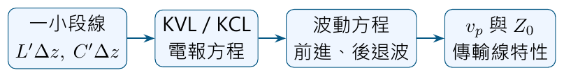
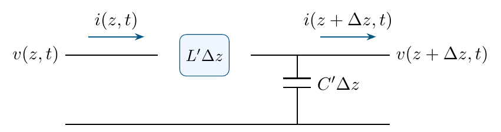
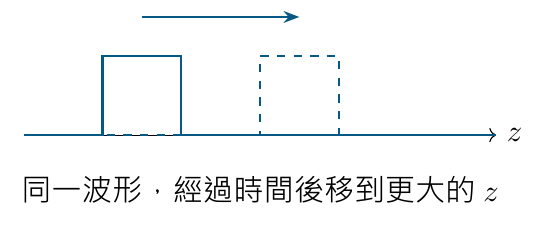

# 單元 04｜傳輸線理論概述

[下載原始 PDF](../pdf/004_傳輸線理論概述.pdf)

原始影片：[陳晏笙老師「天線」單元 4](https://www.youtube.com/watch?v=49zyg1igWsg)

影片長度：約 64 分鐘　建議閱讀：約 20–25 分鐘

前置知識：KCL、KVL、電容與電感的電壓電流關係。

> **核心觀念：** 當線路尺寸不能忽略於訊號波長時，導線不再只是理想短路。線上的電壓、電流會隨位置與時間改變，必須用分布參數與波的觀點描述。

## 這節課的推導路線

這是基本電路法則的延伸。不是換一套 KCL、KVL，而是對非常短的小段使用相同法則，再令段長趨近零。

## 天線工程為什麼需要它？

前級電路到天線之間有饋線。即使天線本身相同，線長與線的性質改變，也可能讓前級看到不同電壓電流關系。後續阻抗匹配與史密斯圖，都建立在此模型上。

## 閱讀地圖

第 2 頁：何時需要傳輸線模型；第 3 頁：分布 LC 與電報方程；第 4 頁：波動方程與傳播方向；第 5 頁：特性阻抗；第 6 頁：自測。 本單元先採影片的理想無損模型；有損傳輸線在單元 10 展開。圖解依影片重繪，新增算例標示為補充。

## 1．不能把所有導線都當作零長度短路

影片對照：[約 03:00](https://www.youtube.com/watch?v=49zyg1igWsg&t=180s)－[21:00](https://www.youtube.com/watch?v=49zyg1igWsg&t=1260s)

理想集總電路假設一個節點上的電壓相同，導線的傳輸延遲可忽略。影片用電壓脈衝示意：來源端施加脈衝後，遠端負載不可能在完全相同時刻知道這個變化。

### 判斷標準是電氣尺寸

對單一頻率，波長與相位速度關係為

$$
\lambda=\frac{v_p}{f},\qquad
\theta=\frac{2\pi l}{\lambda}.
$$

$l$ 是線長；$\theta$ 是該線長對應的相位變化。尺寸「小」是指相對波長足夠小，而不是幾公分看起來很短。 老師建議先建立自由空間的尺度直覺：1 GHz 對應 30 cm，5 GHz 對應 6 cm，2.4 GHz 對應 12.5 cm。**補充解說／重算例題：**線內有介質時，要再改用該線的 $v_p$；不能把自由空間波長直接當成所有電路板走線的波長。 **補充解說／重算例題：**常用 $l\ll\lambda$ 作為集總近似的判斷方向。$l=\lambda/10$ 已對應 36°，是否可忽略仍取決於精度需求；不能把十分之一波長當作任何用途都安全的界線。 數位脈衝還含有多個頻率成分，要考慮上升時間與傳播延遲。不能只看時脈的基本頻率，忽略快速邊緣。

### 影片介紹的傳輸結構

|          |                                                                            |
|:---------|:---------------------------------------------------------------------------|
| 三維結構 | 一般導線、同軸電纜、波導與光纖；各自的傳播模式與適用頻段不同。             |
| 平面結構 | 微帶線、槽線、共平面波導 CPW、共平面帶線 CPS，常出現在電路板或平面結構中。 |

這些結構可以用不同程度的模型描述，不能只把它們當成兩個點之間的理想導線。實際選用要考慮尺寸、頻段、損耗、模式與製作方式。

### 算例：短線也可能有明顯延遲

**補充解說／重算例題：**線長 $l=0.1$ m、相位速度 $v_p=2\times10^8$ m/s：

$$
\tau=\frac{l}{v_p}=0.5\ {\rm ns}.
$$

若頻率為 1 GHz，週期只有 1 ns；這條線的單程延遲已達半個週期，不能再把它理解為「立即相連」。

> **核心觀念：** 線長要與波長比較；延遲要與訊號變化的時間尺度比較。

## 2．分布參數：每一小段都有 L 與 C

影片對照：[約 21:00](https://www.youtube.com/watch?v=49zyg1igWsg&t=1260s)－[34:00](https://www.youtube.com/watch?v=49zyg1igWsg&t=2040s)

導體之間有電壓差，因此存在電場與電容；流動的電流建立磁場，因此存在電感。這些性質分布在整條線，不只集中在某一端。

$$
L'\ {\rm [H/m]},\quad C'\ {\rm [F/m]},\qquad
L_{\Delta z}=L'\Delta z,\quad C_{\Delta z}=C'\Delta z.
$$

這裡加上撇號，強調它們是每單位長度的參數；影片以 $L,C$ 表示相同意義。整條線可以看成無限多段 LC 小電路串接。

### KVL：電壓差落在串聯電感

$$
v(z,t)-v(z+\Delta z,t)
=L'\Delta z\,\frac{\partial i}{\partial t}.
$$

除以 $\Delta z$ 再取極限：

$$
\boxed{\frac{\partial v}{\partial z}
=-L'\frac{\partial i}{\partial t}}.
$$

### KCL：電流差流入並聯電容

$$
i(z,t)-i(z+\Delta z,t)
=C'\Delta z\,\frac{\partial v}{\partial t}
\quad\Longrightarrow\quad
\boxed{\frac{\partial i}{\partial z}
=-C'\frac{\partial v}{\partial t}}.
$$

兩式合稱無損傳輸線的**電報方程**。電壓與電流既跟時間 $t$ 有關，也跟位置 $z$ 有關，所以使用偏微分。

> **核心觀念：** 導線沿途儲存電、磁能量，讓訊號傳遞需要時間。無損不等於沒有 L、C 或沒有延遲。

## 3．電路方程為何變成波動方程？

影片對照：[約 34:00](https://www.youtube.com/watch?v=49zyg1igWsg&t=2040s)－[44:00](https://www.youtube.com/watch?v=49zyg1igWsg&t=2640s)

將電壓的電報方程再對位置微分，再代入電流方程：

$$
\frac{\partial^2v}{\partial z^2}
=-L'\frac{\partial}{\partial t}\frac{\partial i}{\partial z}
=L'C'\frac{\partial^2v}{\partial t^2}.
$$

因此

$$
\boxed{\frac{\partial^2v}{\partial z^2}
-\frac{1}{v_p^2}\frac{\partial^2v}{\partial t^2}=0},
\qquad
\boxed{v_p=\frac{1}{\sqrt{L'C'}}}.
$$

電流也滿足同樣形式的波動方程。由電路的 L、C 導出有限的相位速度，正是本單元要建立的關係。

### 兩個傳播方向都可能存在

$$
v(z,t)=v^+\!\left(t-\frac{z}{v_p}\right)
      +v^-\!\left(t+\frac{z}{v_p}\right).
$$

$v^+$ 與 $v^-$ 是波形函數，不一定是正弦波，可以是脈衝。上標 $+$、$-$ 表示傳播方向，不代表電壓必然為正或負。 驗證任一項 $f(t\mp z/v_p)$：兩次位置微分得到 $f''/v_p^2$，兩次時間微分得到 $f''$；代入波動方程即為零。這是影片要求的代回驗算。

-   對 $t-z/v_p=\text{常數}$，時間增加時 $z$ 增加：往 $+z$ 傳播。

-   對 $t+z/v_p=\text{常數}$，時間增加時 $z$ 減少：往 $-z$ 傳播。

**補充解說／重算例題：**若線段末端反射，就可能有 $v^-$。但電報方程本身不決定其大小；還需要來源與負載的邊界條件。

> **核心觀念：** 傳輸線的電壓不是「整條線同一個值」，而是前進與後退兩個波形在每個位置、時間相加的結果。

## 4．特性阻抗：一個行進波的 V/I

影片對照：[約 44:00](https://www.youtube.com/watch?v=49zyg1igWsg&t=2640s)－[63:00](https://www.youtube.com/watch?v=49zyg1igWsg&t=3780s)

將行進波的電壓代回電報方程，可得電流：

$$
i(z,t)=\frac{1}{Z_0}v^+\!\left(t-\frac{z}{v_p}\right)
      -\frac{1}{Z_0}v^-\!\left(t+\frac{z}{v_p}\right),
\qquad
\boxed{Z_0=\sqrt{\frac{L'}{C'}}}.
$$

後退波前面的負號，是因為本單元將電流的參考方向固定為 $+z$；它不代表某個元件出現負電阻。 推導時先算 $\partial_zv=(-v^{+\prime}+v^{-\prime})/v_p$，再用 $\partial_zv=-L'\partial_ti$，對時間積分。前進波的比例為 $1/(L'v_p)=\sqrt{C'/L'}=1/Z_0$，後退波則多一個負號。

### 這個「50 Ω」與電阻不一樣

-   $Z_0$ 是線上**單一方向行進波**的電壓與電流比例，由分布 L、C 決定。

-   理想無損線的 $Z_0$ 可以是實數，但不表示線本身有一串會發熱的 50 Ω 電阻。

-   有兩個方向的波同時存在時，**總電壓／總電流**一般不等於 $Z_0$。

### 算例：由分布參數求出兩個特性

**補充解說／重算例題：**令 $L'=250$ nH/m，$C'=100$ pF/m：

$$
Z_0=\sqrt{\frac{250\times10^{-9}}{100\times10^{-12}}}
=50\ \Omega,
$$

$$
v_p=\frac{1}{\sqrt{(250\times10^{-9})(100\times10^{-12})}}
=2\times10^8\ {\rm m/s}.
$$

若只有 1 V 的前進波，其對應前進波電流為 $1/50=20$ mA。若某處同時有 0.5 V 的後退波：

$$
v=1+0.5=1.5\ {\rm V},\qquad
i=\frac{1-0.5}{50}=10\ {\rm mA}.
$$

此處瞬間的總量比例為 $150\ \Omega$，不是 $50\ \Omega$。在任意瞬態中，這個瞬間比例也不能一律當作穩態輸入阻抗。

### 還缺哪些資訊？

本單元已決定波的形式、速度與波電壓／電流比例；真正的振幅與反射量，還需來源電壓、來源阻抗、線長、負載等資料。下一單元用正弦穩態與相量進一步解出。 描述一段理想無損線的實用三項資料是 **$Z_0$、$v_p$、線長 $\ell$**；$L',C'$ 可以導出前兩項，仍不能取代線長。

## 5．自測與答案

請先確認單位：L、C 是每米參數，長度與速度才可換算成延遲。

1.  10 cm 線路在 10 kHz 與 1 GHz 下，能否用相同的「短」來判斷？理由是什麼？

2.  $L'=400$ nH/m，$C'=100$ pF/m，求 $Z_0$ 與 $v_p$。

3.  $g(t+z/v_p)$ 朝哪個方向傳播？以「維持函數自變數不變」說明。

4.  為什麼無損傳輸線仍會有相位延遲？50 Ω 特性阻抗是否代表線沿途有 50 Ω 的耗能電阻？

5.  在某位置，50 Ω 線的前進波電壓為 2 V、後退波電壓為 1 V。以固定 $+z$ 電流方向，求總電壓、總電流。

### 答案與解析

1.  不能。固定速度下，頻率越高波長越短，同一長度對應的電氣尺寸越大；還須考慮實際波形與精度需求。

2.  $Z_0=\sqrt{400\times10^{-9}/10^{-10}}\approx63.25\ \Omega$； $v_p=1/\sqrt{400\times10^{-9}\times10^{-10}}\approx1.581\times10^8$ m/s。

3.  朝 $-z$。當時間增加，要讓 $t+z/v_p$ 保持不變，位置 $z$ 必須減少。

4.  L、C 儲能與交換能量，使訊號以有限速度傳播；無損表示不把能量轉成熱耗散，不表示瞬時傳輸。$Z_0$ 是波的比例，不是沿線耗能電阻。

5.  $v=2+1=3$ V；$i=(2-1)/50=20$ mA。後退波的電流項帶負號。

### 本單元公式卡

$$
\frac{\partial v}{\partial z}=-L'\frac{\partial i}{\partial t},
\quad
\frac{\partial i}{\partial z}=-C'\frac{\partial v}{\partial t},
\quad
v_p=\frac1{\sqrt{L'C'}},
\quad
Z_0=\sqrt{L'/C'}.
$$

前進與後退波**電壓相加，電流依參考方向相減**。這個符號關係會一路延續到反射係數、輸入阻抗與駐波分析。
