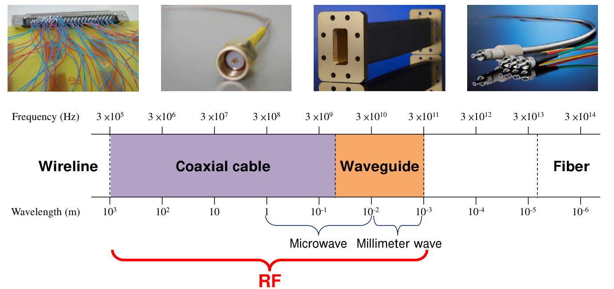
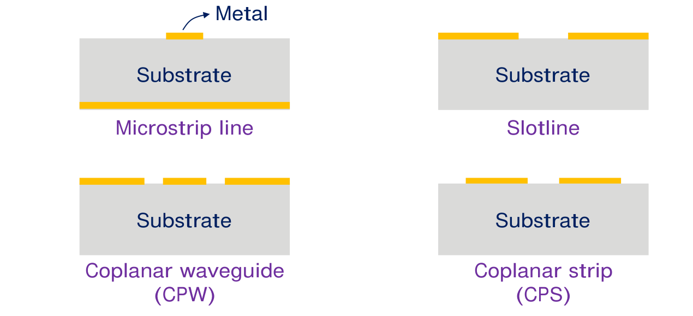
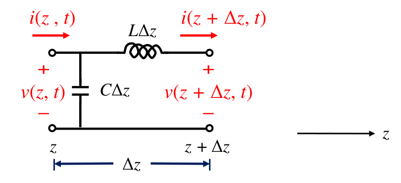

# 單元 04｜傳輸線理論概述

原始影片：[陳晏笙老師「天線」單元 4](https://www.youtube.com/watch?v=49zyg1igWsg)（約 64 分鐘）

老師講義：[Lecture 2 — Circuit Parameters](https://drive.google.com/file/d/1wHWHyXrkJXY4lCvk3vFuf73KGOgOCiky/view)，PDF 第 3–14 頁。第 3 頁是「2.1 Transmission Line Theory」章節頁。

建議閱讀：約 25–30 分鐘。前置知識：KCL、KVL、電容與電感的電壓電流關係。

> **學習重點：** 從各種傳輸線的實體結構，走到每單位長度的電感、電容模型，再用 KVL、KCL 推出電壓波與電流波。最後理解相位速度 $`v_p`$、特性阻抗 $`Z_0`$，以及何時可以退回一般集總電路近似。

## 講義與影片對照

以下按老師 PDF 頁序編排。時間依影片口述主題核對，供段落定位；老師有提前解釋、回看與板書，不代表逐頁換頁時間。

| 老師 PDF 頁碼 | 原英文主題 | 本文內容 | 影片粗定位 |
|:--|:--|:--|:--|
| 3–7 | Transmission Line Theory / 3D-Type / Planar-Type / Description of Circuitry / Is the Assumption in Circuit Reasonable? | 傳輸結構、三個線路參數、訊號延遲 | [約 03:15–20:00](https://www.youtube.com/watch?v=49zyg1igWsg&t=180s) |
| 8–10 | Equivalent Circuits / Telegrapher’s Equation | 分布 LC、小段電路、電報方程 | [約 20:00–32:20](https://www.youtube.com/watch?v=49zyg1igWsg&t=1200s) |
| 11–12 | Manipulation / The Solution of Telegrapher’s Equation | 波動方程、兩個傳播方向 | [約 32:20–42:00](https://www.youtube.com/watch?v=49zyg1igWsg&t=1940s) |
| 13–14 | Low Frequency Approximation / More Explicit Expressions | 電氣尺寸、電壓電流的比例與負號 | [尺度觀念約 04:45–10:50；比例推導約 42:00–54:50](https://www.youtube.com/watch?v=49zyg1igWsg&t=2040s) |

## 1．先認識三維傳輸結構（3D-Type Transmission Lines，p.4）

傳輸線的任務是把訊號從來源送到負載。老師先以傳送電壓、電流訊號的導體系統建立概念，再把視野擴大到不同頻段的導波結構。

**老師口述（約 03:15–06:45）：**「傳輸線」是傳送訊號的實體系統；「傳輸線理論」則是在訊號傳播延遲不可忽略時使用的分析方法。低頻也可能因線路很長而需要分布模型，高頻也須連同尺寸判斷；不能只用一個頻率把兩者切開。



*圖源：老師 Lecture 2，PDF p.4 局部。頻率與波長軸用來建立尺度直覺，色塊不是各種結構絕對的適用界線。*

| 結構 | 讀圖時要抓住的差別 |
|:--|:--|
| 一般導線（wireline） | 低頻電路常可忽略線的電氣長度；頻率升高或線很長時仍須考慮傳播。 |
| 同軸電纜（coaxial cable） | 內外導體形成傳輸結構，適合連接射頻設備與天線。 |
| 波導（waveguide） | 用導波模式描述，尺寸與操作頻率密切相關；不能一律套用本章的無損雙導體 LC 模型。 |
| 光纖（fiber） | 將導波的觀念延伸到光學頻段，不是用兩端導體電壓、電流直接描述的普通電線。 |

圖上的頻率 $`f`$ 與自由空間波長以 $`\lambda_0=c/f`$ 對應。它回答「這個頻率的電磁波大約有多長」；後面分析實際線路時，則要使用線上的傳播速度。

老師在約 07:20–10:50 強調建立尺度直覺：先記住 **1 GHz ↔ 30 cm**，再按頻率反比縮放。500 MHz 對應 60 cm、2.4 GHz 對應 12.5 cm、5 GHz 對應 6 cm；28 GHz 約 1.07 cm，60 GHz 約 0.5 cm。

課堂以尺寸約 $`0.1\lambda`$ 到 $`10\lambda`$ 說明電波分析常見的尺度；例如 500 MHz 時是 6 cm 到 6 m。這是方法選擇的工程直覺，並非線長一超過 $`10\lambda`$，傳輸線理論就失效；實際仍依導波結構、場分布與精度需求選模型。


## 2．平面傳輸線：金屬與介質如何排列（Planar-Type Transmission Lines，p.5）



*圖源：老師 Lecture 2，PDF p.5 局部。黃色為金屬，灰色為介質基板（substrate）。*

| 結構 | 對照原圖辨認方式 |
|:--|:--|
| 微帶線（microstrip line） | 基板上方一條訊號金屬線，下方為接地金屬面。 |
| 槽線（slotline） | 同一平面的金屬中留下一道狹縫，藉狹縫形成傳輸結構。 |
| 共平面波導（coplanar waveguide, CPW） | 中央訊號金屬線與兩側接地金屬同在一個平面。 |
| 共平面帶線（coplanar strip, CPS） | 兩條並排金屬帶位於基板同一面。 |

各種結構服務不同情境。老師列出的選擇條件包括**特性阻抗、工作頻率、損耗、電氣長度、相位速度與可調整性**；因此不能只看「能否把兩個點接起來」。

## 3．把實體結構畫成電路模型（Description of Circuitry，p.6）

講義把同軸電纜與微帶線，都畫成來源 $`V_S`$、來源阻抗 $`Z_S`$、傳輸線、負載 $`Z_L`$ 的串接系統。先忽略損耗時，一段均勻傳輸線以三個參數描述：

| 參數 | 意義 |
|:--|:--|
| $`Z_0`$ | 特性阻抗，決定單一方向電壓波與電流波的比例。 |
| $`v_p`$ | 相位速度，決定波傳播的快慢。 |
| $`\ell`$ | 實際線長，連同速度決定單程延遲 $`\tau=\ell/v_p`$。 |

$`Z_0,v_p`$ 描述線本身的性質，**線長仍是有限線段不可缺少的資訊**。相同天線接上不同長度的饋線，前級所見的電壓、電流關係就可能不同；後續阻抗匹配與史密斯圖正是用來分析這件事。

## 4．理想導線的「立即到達」假設合理嗎？（Is the Assumption in Circuit Reasonable?，p.7）

老師畫出脈衝電壓源、兩條導線與負載電阻。若直接使用理想導線，會把來源端與負載端分別視為同一節點，彷彿電壓脈衝一產生，另一端就立刻收到。

實際訊號有傳播延遲。只有當**電路尺寸相對訊號的變化尺度足夠小**，這段延遲才可以忽略。這裡先提出問題；講義 p.13 會用波長把「足夠小」說得更精確。

## 5．整條線是一個分布參數網路（Equivalent Circuits of the Whole Line，p.8）

導體間的電壓差會建立電場並儲存電荷；導體上的電流會建立磁場。老師用電容與電感表示這兩種儲能，因此真實線路的模型是沿線分布的 LC 網路。

本文沿用講義符號：

```math
L\quad [{\rm H/m}],\qquad C\quad [{\rm F/m}].
```

它們是**每單位長度**的串聯電感、並聯電容，並非整條線的總電感、總電容。長度 $`\Delta z`$ 的小段才有

```math
L_{\Delta z}=L\Delta z,\qquad C_{\Delta z}=C\Delta z.
```

舊筆記與部分課本寫成 $`L',C'`$，與本文的 $`L,C`$ 意義相同。講義的 $`C=Q/v`$、$`L=\phi_m/i`$ 用來說明電荷與電壓、磁通鏈結與電流的比例；若以每米參數解讀，$`Q`$ 與 $`\phi_m`$ 也須對應每單位長度。

理想短路模型把導線上的電壓視為相同；分布模型則容許電壓與電流**隨位置而變**。這是一般情況的描述，不是說任何激發下每一個位置都必定有不同的值。

## 6．對小段套 KVL、KCL，得到電報方程（Equivalent Circuits of a Short Section / Telegrapher’s Equation，pp.9–10）

我們要求的是 $`v(z,t)`$ 與 $`i(z,t)`$：指定位置 $`z`$、時間 $`t`$，才能決定當地的電壓與電流。電流的正參考方向固定為 $`+z`$。



*圖源：老師 Lecture 2，PDF p.9 局部。以下有限段方程依圖中元件位置列寫。*

### KVL：兩端電壓差落在串聯電感

圖中電感的電流是 $`i(z+\Delta z,t)`$，因此

```math
v(z+\Delta z,t)-v(z,t)
=-L\Delta z\,\frac{\partial i(z+\Delta z,t)}{\partial t}.
```

除以 $`\Delta z`$，令 $`\Delta z\to0`$：

```math
\boxed{\frac{\partial v(z,t)}{\partial z}
=-L\frac{\partial i(z,t)}{\partial t}}.\tag{1}
```

### KCL：流入與流出電流的差，流進並聯電容

依圖，電容接在 $`z`$ 端，故

```math
i(z+\Delta z,t)-i(z,t)
=-C\Delta z\,\frac{\partial v(z,t)}{\partial t}.
```

同樣除以段長並取極限：

```math
\boxed{\frac{\partial i(z,t)}{\partial z}
=-C\frac{\partial v(z,t)}{\partial t}}.\tag{2}
```

> **講義校註（p.9）：** 原圖的電容在 $`z`$ 端，原 KCL 卻使用 $`v(z+\Delta z,t)`$；上式依圖改為 $`v(z,t)`$。這個有限段的標示差異在 $`\Delta z\to0`$ 後消失，講義 p.10 的電報方程仍正確。

(1)、(2) 就是無損傳輸線的**電報方程（telegrapher’s equations）**。它們仍由 KVL、KCL 得到，只是未知量同時依賴位置與時間，所以必須使用偏微分。

## 7．消去電流或電壓，得到波動方程（Manipulation，p.11）

講義先將 (1) 對 $`z`$ 微分，再將 (2) 對 $`t`$ 微分，消去混合偏導數：

```math
\frac{\partial^2v}{\partial z^2}
=-L\frac{\partial^2i}{\partial z\partial t},
\qquad
\frac{\partial^2i}{\partial t\partial z}
=-C\frac{\partial^2v}{\partial t^2}.
```

因此電壓與電流分別滿足

```math
\frac{\partial^2v}{\partial z^2}
-LC\frac{\partial^2v}{\partial t^2}=0,
\qquad
\frac{\partial^2i}{\partial z^2}
-LC\frac{\partial^2i}{\partial t^2}=0.
```

與標準一維波動方程比較：

```math
\frac{\partial^2f}{\partial z^2}
-\frac{1}{v_p^2}\frac{\partial^2f}{\partial t^2}=0
\quad\Longrightarrow\quad
\boxed{v_p=\frac{1}{\sqrt{LC}}}.
```

**電路中的分布電感、電容，決定波在這條線上的速度。** 在本章理想、均勻且不隨頻率改變的 LC 模型中，波形可以不變形地傳播；之後分析其他模式或有損線時，不能直接把此模型的所有結論照搬過去。

## 8．解包含入射波與反射波（The Solution of Telegrapher’s Equation，p.12）

沿用老師的上標 $`i`$、$`r`$，分別表示入射（incident）與反射（reflected）。注意電流函數中的 $`i`$ 是電流名稱，右上角的 $`i`$ 才是方向標記。

```math
v(z,t)=v^i\!\left(t-\frac{z}{v_p}\right)
      +v^r\!\left(t+\frac{z}{v_p}\right),
```

```math
i(z,t)=i^i\!\left(t-\frac{z}{v_p}\right)
      +i^r\!\left(t+\frac{z}{v_p}\right).
```

這裡的 $`v^i,v^r`$ 是波形函數，可以是正弦，也可以是脈衝；上標不是次方。兩個函數描述兩個傳播方向：

| 維持同一個波形位置的條件 | 時間增加時 | 傳播方向 |
|:--|:--|:--|
| $`t-z/v_p=\text{常數}`$ | $`z`$ 隨之增加 | $`+z`$，入射波 |
| $`t+z/v_p=\text{常數}`$ | $`z`$ 隨之減少 | $`-z`$，反射波 |


*概念重繪：同一波形隨時間往 $`+z`$ 平移。*

代回驗算也很直接。對任一 $`F(t\mp z/v_p)`$，兩次位置微分得到 $`F''/v_p^2`$，兩次時間微分得到 $`F''`$，代入波動方程後正好相消。

> **讀懂 p.12 的兩句話：** 「二階方程有兩個解」在這裡是指解可分成向左、向右兩類行進波，不是只有兩個固定波形。「$`t,z`$ 無法分開」則強調一般行進波由 $`t\mp z/v_p`$ 共同決定；特定正弦穩態仍可用分離變數與相量表示，下一單元就會這樣做。

一般集總電路給每個節點一個電壓、每個支路一個電流；傳輸線理論則需要指定線上位置。若末端反射，就會有反向波；其大小仍須由來源與負載的邊界條件決定，單靠波動方程還不夠。

## 9．低頻時，為什麼又能當作普通導線？（Low Frequency Approximation，p.13）

老師用固定時間下的 $`v(z)`$ 曲線說明：若 $`z_1,z_2`$ 相距很近，沿線變化又很慢，就有

```math
v(z_1,t)\approx v(z_2,t).
```

「相距很近」應與**波長**比較。對頻率 $`f`$ 的正弦波，

```math
\lambda=\frac{v_p}{f},\qquad
\theta=\frac{2\pi\ell}{\lambda}.
```

$`\theta`$ 是線長 $`\ell`$ 所造成的相位差。頻率降低、波長增加，同一段實體長度的電氣尺寸就變小，於是較有機會採用集總近似。講義以 60 Hz 交流作為低頻例子。

**區別電路理論與傳輸線理論的關鍵，是電氣尺寸。** 不是只問「有幾公分」，也不是把任何低頻、任何長度的線都視為零延遲。對數位脈衝，還要把傳播延遲與快速邊緣的時間尺度相比，不能只看時脈基本頻率。

## 10．電壓波與電流波的比例：特性阻抗（More Explicit Expressions，p.14）

電壓與電流的波形不是彼此獨立。將 p.12 的電壓解代入電報方程 (1)：

```math
\frac{\partial v}{\partial z}
=-\frac{1}{v_p}(v^i)'
 +\frac{1}{v_p}(v^r)'
=-L\frac{\partial i}{\partial t}.
```

撇號此處表示波形對自身自變數的微分，不是每米參數。比較兩個方向的波項，可得

```math
i(z,t)=\frac{1}{Z_0}v^i\!\left(t-\frac{z}{v_p}\right)
       -\frac{1}{Z_0}v^r\!\left(t+\frac{z}{v_p}\right),
\qquad
\boxed{Z_0=Lv_p=\sqrt{\frac{L}{C}}}.
```

對傳播中的波形，這表示 $`i^i=v^i/Z_0`$、$`i^r=-v^r/Z_0`$；若另外存在靜態偏壓，仍須以直流邊界條件指定，不能只由時間微分式決定。

### 反向電流為何有負號？

我們把所有電流的參考方向固定為 $`+z`$。反向電壓波往 $`-z`$ 傳播，因此其電流在同一個參考方向下多一個負號。**負號來自方向，不代表線上有負電阻。** 這個符號關係會延續到反射係數、輸入阻抗與駐波分析。

### 特性阻抗是線的性質，並非沿線的耗能電阻

| 容易混淆的量 | 正確解讀 |
|:--|:--|
| $`Z_0=50\ \Omega`$ | 單一方向行進波的電壓、電流比例，來自線的分布 $`L,C`$。 |
| 50 Ω 集總電阻 | 電流流過時將電能轉為熱，是耗能元件。 |
| 總電壓／總電流 | 同時存在兩個方向的波時，通常不等於 $`Z_0`$，也可能隨位置而改變。 |

**老師口述（約 49:10–51:40）：**1 A RMS 流過 50 Ω 電阻會消耗 50 W；同樣 1 A 的單向波沿理想無損、特性阻抗 50 Ω 的線傳送，線本身不把這 50 W 變成熱。老師要求把「特性阻抗」完整說出來，避免和耗能電阻混淆。

講義用理想導體（PEC）強調線可以不耗散能量。更完整地說，本章已同時忽略導體電阻與介質漏電／損耗，所以是**理想無損線**；只有導體理想，並不足以排除介質損耗。

至此，p.6 的 $`Z_0,v_p,\ell`$ 都有了物理意義：$`L,C`$ 決定前兩者，線長決定累積的延遲與相位。要進一步求實際振幅、反射量，還需要 $`V_S,Z_S,Z_L`$ 等邊界資料。

### 片尾動畫：相量分析處理哪一段？

約 54:50–58:30，老師將下一單元的問題設定為「求出正弦穩態下每個位置的電壓相量」。約 59:00–63:40 的動畫則先顯示波抵達負載、產生反射，再觀察穩態的兩波疊加。

- 動畫剛啟動、波前抵達與第一次反彈屬於暫態，單一頻率的穩態相量解不直接描述這段過程。
- 進入穩態後，總電壓仍是入射波與反射波的和；按暫停可看 $`v(z)`$ 的快照，固定位置則看 $`v(t)`$。
- 若來源阻抗等於線的特性阻抗，回到來源的反射波被吸收，不再從來源產生下一次反射。這是動畫採用的邊界條件，並非所有線路都如此。

## 補充解說與重算例題

以下為理解本章而保留的補充，不是老師投影片上的獨立例題。

### A．自由空間波長與線內波長要分清楚

以 $`c\approx3\times10^8`$ m/s 重算常見頻率：

| 頻率 | 自由空間波長 $`\lambda_0=c/f`$ |
|:--|--:|
| 1 GHz | 30 cm |
| 2.4 GHz | 12.5 cm |
| 5 GHz | 6 cm |

若線內 $`v_p=2\times10^8`$ m/s，則 1 GHz 的線內波長只有 20 cm。10 cm 的線具有

```math
\tau=\frac{0.1}{2\times10^8}=0.5\ {\rm ns},
\qquad
\theta=2\pi\frac{0.1}{0.2}=\pi=180^\circ.
```

1 GHz 的週期是 1 ns，因此這條線的延遲達半個週期。又例如 $`\ell=\lambda/10`$ 仍有 36° 相位差；「十分之一波長」不能當作所有精度需求下都能忽略延遲的保證。

### B．由分布參數算速度、阻抗，再算兩波疊加

設 $`L=250`$ nH/m、$`C=100`$ pF/m：

```math
Z_0=\sqrt{\frac{250\times10^{-9}}{100\times10^{-12}}}
=50\ \Omega,
\qquad
v_p=\frac{1}{\sqrt{(250\times10^{-9})(100\times10^{-12})}}
=2\times10^8\ {\rm m/s}.
```

只有 1 V 前進波時，對應電流是 20 mA。若某位置、某時刻同時有 1 V 前進波與 0.5 V 後退波，則

```math
v=1+0.5=1.5\ {\rm V},\qquad
i=\frac{1-0.5}{50}=10\ {\rm mA}.
```

當下總電壓／總電流為 150 Ω，並不等於線的 50 Ω 特性阻抗；任意瞬態中的瞬時比值，也不能直接等同正弦穩態的輸入阻抗。

### C．把本章推導串起來


*概念重繪；圖中的 $`L',C'`$ 即本章沿用老師符號的 $`L,C`$。*

```math
\frac{\partial v}{\partial z}=-L\frac{\partial i}{\partial t},
\quad
\frac{\partial i}{\partial z}=-C\frac{\partial v}{\partial t},
\quad
v_p=\frac{1}{\sqrt{LC}},
\quad
Z_0=\sqrt{\frac{L}{C}}.
```

無損表示沒有能量耗散，仍然有電場、磁場的儲能與有限的傳播時間。

## 自測與解析

1. 10 cm 線路在 10 kHz 與 1 GHz 下，能否用相同的「短」來判斷？
2. $`L=400`$ nH/m、$`C=100`$ pF/m，求 $`Z_0`$ 與 $`v_p`$。
3. $`g(t+z/v_p)`$ 朝哪個方向傳播？請用固定自變數說明。
4. 為什麼無損傳輸線仍會延遲訊號？50 Ω 特性阻抗是否代表線上有 50 Ω 耗能電阻？
5. 某位置、某時刻，50 Ω 線的前進波電壓為 2 V、後退波為 1 V；求總電壓、總電流。

### 答案與解析

1. 不能。固定速度下，頻率越高波長越短，同一長度的電氣尺寸越大；是否能忽略還取決於波形與精度需求。
2. $`Z_0\approx63.25\ \Omega`$，$`v_p\approx1.581\times10^8`$ m/s。記得先把 nH、pF 換成 SI 單位，而且兩者都是每米參數。
3. 往 $`-z`$。時間增加時，位置 $`z`$ 必須減少，才能維持 $`t+z/v_p`$ 不變。
4. 分布 $`L,C`$ 的儲能與能量傳遞使速度有限；$`Z_0`$ 是行進波的比例，並非沿線耗能電阻。
5. $`v=2+1=3`$ V，$`i=(2-1)/50=20`$ mA。電流參考方向固定為 $`+z`$，所以反向波電流項帶負號。

下一單元：[單元 05｜傳輸線理論的頻域深入探討](005_傳輸線理論的頻域深入探討.md)，把本章時域波形改寫成正弦穩態相量，進一步求反射與輸入阻抗。
