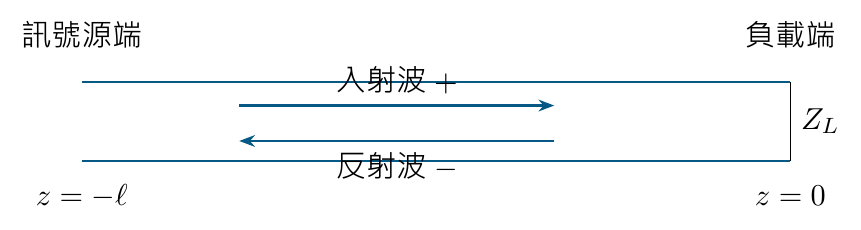

# 單元 05｜傳輸線理論的頻域深入探討

[下載原始 PDF](../pdf/005_傳輸線理論的頻域深入探討.pdf)

原始影片：[陳晏笙老師「天線」單元 5](https://www.youtube.com/watch?v=Xo-yztR7XY4)

影片長度：約 104 分鐘　建議閱讀：約 25 分鐘

前置單元：04。會使用 $Z_0$、$v_p$，並知道去、回波電流的符號不同。

> **核心觀念：** 頻域分析把時間變化收進 $e^{j\omega t}$，留下位置相量。由負載先求反射，再往訊號源移動，便可求出阻抗、電壓與功率；同一條線不同位置的阻抗可以不同。

## 本單元要完成的任務

1.  把正弦行進波寫成相量，分清 $\omega$、$\beta$、$v_p$。

2.  用負載與訊號源邊界條件，求出兩個行進波係數。

3.  用反射功率解讀回返損失、匹配損失與工作頻寬。

## 固定座標，避免正負號混亂

電流正方向統一沿 $+z$。用 $d=-z\ge0$ 表示「從負載往訊號源量的距離」。全講義採用峰值相量與 $e^{j\omega t}$ 慣例。

## 閱讀地圖

第 2 頁：相量；第 3 頁：頻域方程；第 4 頁：反射與阻抗；第 5 頁：求波係數；第 6 頁：阻抗變換；第 7 頁：功率；第 8 頁：損失與頻寬；第 9 頁：自測。 公式按影片板書重整。新增數值、限制與一般化說明均以補充標示。

## 1．相量：只把共同的時間因子省略

影片對照：[約 00:00](https://www.youtube.com/watch?v=Xo-yztR7XY4&t=0s)－[19:00](https://www.youtube.com/watch?v=Xo-yztR7XY4&t=1140s)

對固定頻率的正弦穩態，寫成

$$
v(z,t)=\operatorname{Re}\{\widetilde V(z)e^{j\omega t}\}.
$$

相量 $\widetilde V(z)$ 有振幅與相位，仍可能隨位置改變。它不是瞬間電壓，也不是只有振幅的正數。

### 從單元四的行進波開始

沿 $+z$ 的波在 $z$ 位置延遲 $z/v_p$：

$$
v^+(z,t)=A\cos\!\left[\omega\!\left(t-\frac z{v_p}\right)+\phi\right]
 =A\cos(\omega t-\beta z+\phi).
$$

定義

$$
\beta=\frac{\omega}{v_p}=\frac{2\pi}{\lambda},\quad
\omega=2\pi f,\quad \lambda=\frac{v_p}{f}.
$$

所以 $\widetilde V^+(z)=Ae^{j\phi}e^{-j\beta z}$。反方向的波則有 $e^{+j\beta z}$。

| 量       | 單位  | 物理意義                           |
|:---------|:------|:-----------------------------------|
| $\omega$ | rad/s | 時間每增加一秒，相位改變多少       |
| $\beta$  | rad/m | 沿線每增加一公尺，傳播相位改變多少 |
| $v_p$    | m/s   | 固定相位點向前移動的速度           |

影片還區分 $1/\lambda$（每公尺的週數）與 $2\pi/\lambda$（rad/m）。不同教材可能都用 $k$；必須先查定義，本講義統一用 $\beta=2\pi/\lambda$。

### 相量能還原成實際波形

**補充解說／重算例題：**若 $\widetilde V(z)=2e^{-j\beta z}$ V，則 $v(z,t)=2\cos(\omega t-\beta z)$ V。在 $z=\lambda/4$ 時，

$$
\widetilde V=-j2,\qquad v=2\cos(\omega t-90^\circ).
$$

$-j2$ 不代表實際電壓「是虛數」；它表示相對參考點有 $-90^\circ$ 相位。

### 為什麼時間微分變成乘 $j\omega$？

因為 $d(e^{j\omega t})/dt=j\omega e^{j\omega t}$。共同的時間因子省略後，微分運算可用相量的代數關係處理；位置微分則仍要保留。 這裡求的是正弦穩態。剛開啟訊號源、波還未走遍整條線時的暫態，不能用單一穩態相量直接描述。

> **核心觀念：** 相量保留振幅與相位，省略共同時間因子；不會把沿線的傳播效應一起省掉。

## 2．頻域傳輸線方程與兩個未知係數

影片對照：[約 19:00](https://www.youtube.com/watch?v=Xo-yztR7XY4&t=1140s)－[29:00](https://www.youtube.com/watch?v=Xo-yztR7XY4&t=1740s)

本單元先處理無損線。單位長度參數為 $L',C'$，時間域方程轉成

$$
\frac{d\widetilde V}{dz}=-j\omega L'\widetilde I,\qquad
\frac{d\widetilde I}{dz}=-j\omega C'\widetilde V.
$$

將第一式再對位置微分，代入第二式：

$$
\frac{d^2\widetilde V}{dz^2}+\omega^2 L'C'\widetilde V=0.
$$

因 $\beta=\omega\sqrt{L'C'}$，特徵根為 $\pm j\beta$，得到兩個行進波：

$$
\widetilde V(z)=V_0^+e^{-j\beta z}+V_0^-e^{j\beta z}.
$$

由第一條傳輸線方程求電流：

$$
\widetilde I(z)=\frac{V_0^+}{Z_0}e^{-j\beta z}
              -\frac{V_0^-}{Z_0}e^{j\beta z},\qquad
Z_0=\sqrt{\frac{L'}{C'}}.
$$

### 為何反射電流前面有負號？

電流的參考正方向固定沿 $+z$；反射波往 $-z$ 傳。電壓可以相加，兩個行進波所對應的電流卻要依同一參考方向帶入正負號。

### 先有通解，還缺什麼？

$V_0^+,V_0^-$ 是兩個複數常數。只知道 $Z_0$ 與 $\beta$，還不能決定它們；需要負載端與訊號源端的邊界條件。 **補充解說／重算例題：**二階方程有兩個獨立解，不等於「兩個解大小一定相同」。完全匹配時可以有 $V_0^-=0$，只剩入射波。

### 三種阻抗不要混用

|        |                                              |
|:-------|:---------------------------------------------|
| $Z_0$  | 線的特性阻抗；描述單向行進波的電壓／電流比。 |
| $Z_L$  | 線末端實際接上的負載。                       |
| $Z(z)$ | 該位置的總電壓／總電流比；受負載與距離影響。 |

> **核心觀念：** 把時間域轉成頻域，並沒有改變波的物理意義；兩個係數仍必須由兩端接了什麼來決定。

## 3．反射係數把兩個波的關係整理出來

影片對照：[約 29:00](https://www.youtube.com/watch?v=Xo-yztR7XY4&t=1740s)－[44:00](https://www.youtube.com/watch?v=Xo-yztR7XY4&t=2640s)

影片先定義每個位置的電壓反射係數：

$$
\Gamma(z)=\frac{V_0^-e^{j\beta z}}{V_0^+e^{-j\beta z}}
         =\Gamma_L e^{j2\beta z},\qquad
\Gamma_L=\frac{V_0^-}{V_0^+}.
$$

因負載放在 $z=0$，$\Gamma_L$ 就是負載端反射係數。從負載往訊號源移動距離 $d$：

$$
\Gamma(d)=\Gamma_L e^{-j2\beta d}.
$$

無損線只讓反射係數的相位改變；其大小不變。相位是 $2\beta d$，因為比值同時包含入射與反射兩方向的傳播相位。

### 由 $\Gamma$ 得到局部阻抗

$$
\widetilde V=V_0^+e^{-j\beta z}[1+\Gamma(z)],\qquad
\widetilde I=\frac{V_0^+}{Z_0}e^{-j\beta z}[1-\Gamma(z)].
$$

兩式相除：

$$
Z(z)=Z_0\frac{1+\Gamma(z)}{1-\Gamma(z)},\qquad
\Gamma(z)=\frac{Z(z)-Z_0}{Z(z)+Z_0}.
$$

在負載端套用 $Z(0)=Z_L$：

$$
\boxed{\Gamma_L=\frac{Z_L-Z_0}{Z_L+Z_0}}.
$$

### 三個立即可驗證的情境

| 負載                | $\Gamma_L$ | 電壓反射 | 負載端狀態 |
|:--------------------|:-----------|:---------|:-----------|
| $Z_L=Z_0$           | 0          | 無反射   | $Z(0)=Z_0$ |
| 短路 $Z_L=0$        | $-1$       | 反相     | 總電壓為 0 |
| 開路 $Z_L\to\infty$ | $+1$       | 同相     | 總電流為 0 |

**補充解說／重算例題：**$Z_0=50\,\Omega,Z_L=100\,\Omega$ 時，$\Gamma_L=1/3$；反射波電壓只有入射波的三分之一，反射功率則為九分之一。

> **核心觀念：** 阻抗與反射係數是一對可互換的描述。$\Gamma=0$ 表示匹配，不表示線上沒有電壓或電流。

## 4．老師的五步驟：把完整電路解完

影片對照：[約 29:00](https://www.youtube.com/watch?v=Xo-yztR7XY4&t=1740s)－[60:00](https://www.youtube.com/watch?v=Xo-yztR7XY4&t=3600s)

線的源端位於 $z=-\ell$。訊號源採戴維寧模型：開路電壓峰值相量 $V_g$、串聯阻抗 $Z_g$，後面接無損傳輸線與 $Z_L$。

1.  **定義反射係數。** 用 $\Gamma_L=V_0^-/V_0^+$ 把兩個未知係數的比例整理出來。

2.  **把電壓、電流與阻抗改寫成 $\Gamma$。** 使用上一頁的 $1+\Gamma$、$1-\Gamma$ 與阻抗轉換式。

3.  **套用負載端邊界。** 在 $z=0$ 令 $Z=Z_L$，算出 $\Gamma_L$，再傳回源端：

    $$
    \Gamma_{\mathrm{in}}=\Gamma_L e^{-j2\beta\ell}.
    $$

4.  **求源端輸入阻抗。**

    $$
    Z_{\mathrm{in}}=Z_0\frac{1+\Gamma_{\mathrm{in}}}{1-\Gamma_{\mathrm{in}}}.
    $$

5.  **用源端分壓決定振幅。**

    $$
    V_{\mathrm{in}}=V_g\frac{Z_{\mathrm{in}}}{Z_g+Z_{\mathrm{in}}},
    \quad
    V_0^+=\frac{V_{\mathrm{in}}e^{-j\beta\ell}}{1+\Gamma_{\mathrm{in}}},
    \quad V_0^-=\Gamma_L V_0^+.
    $$

    最後代回 $\widetilde V(z),\widetilde I(z)$，就得到整條線的解。

**補充解說／重算例題：**上述分壓形式在特殊零分母情況需取極限或直接使用電壓、電流邊界式；不能把形式上的 $0/0$ 當成物理解消失。

### 算例：源與線匹配，但負載沒有匹配

**補充解說／重算例題：**$V_g=2$ V、$Z_g=Z_0=50\,\Omega$、$Z_L=100\,\Omega$、$\ell=\lambda/2$。此時 $\Gamma_{\mathrm{in}}=1/3$、$Z_{\mathrm{in}}=100\,\Omega$：

$$
V_{\mathrm{in}}=\frac43\ \mathrm V,\quad
V_0^+=-1\ \mathrm V,\quad V_0^-=-\frac13\ \mathrm V.
$$

源端入射波為 $V_0^+e^{j\pi}=1$ V，反射波為 $1/3$ V；負載端電壓則為 $-4/3$ V。兩端峰值大小相同，但相位差 180°。

> **核心觀念：** 先由負載決定反射的比例，再由訊號源決定整體振幅。缺少其中一端資訊，就無法算出完整電壓、電流。

## 5．阻抗變換：一條線也能改變你看到的負載

影片對照：[約 60:00](https://www.youtube.com/watch?v=Xo-yztR7XY4&t=3600s)－[66:00](https://www.youtube.com/watch?v=Xo-yztR7XY4&t=3960s)

把 $\Gamma_L=(Z_L-Z_0)/(Z_L+Z_0)$ 與 $\Gamma_{\mathrm{in}}=\Gamma_L e^{-j2\beta\ell}$ 代進阻抗式，並整理成正切形式：

$$
\boxed{Z_{\mathrm{in}}=
Z_0\frac{Z_L+jZ_0\tan(\beta\ell)}
{Z_0+jZ_L\tan(\beta\ell)}}.
$$

這是無損線的核心公式。$\ell$ 是實際線長，$\beta\ell$ 是電氣長度；計算時用線內波長 $\lambda=v_p/f$。

### 半波長：負載阻抗重現

若 $\ell=n\lambda/2$，$\tan(\beta\ell)=0$，故 $Z_{\mathrm{in}}=Z_L$。任意再增加半波長，輸入阻抗重複，但並不表示瞬間電壓相位也完全相同。

### 四分之一波長：阻抗倒置

若 $\ell=(2n+1)\lambda/4$，取正切趨近無限的極限：

$$
Z_{\mathrm{in}}=\frac{Z_0^2}{Z_L}.
$$

這會把大負載阻抗轉成較小的輸入阻抗，反之亦然。 **補充解說／重算例題：**$Z_0=50\,\Omega$，$\ell=\lambda/4$，接 $Z_L=100\,\Omega$ 時，源端看到 $25\,\Omega$；反射係數從 $+1/3$ 轉成 $-1/3$。大小沒有下降，這條線沒有消除不匹配。

### 任意長度的數值例題

**補充解說／重算例題：**$Z_0=50\,\Omega,Z_L=100\,\Omega,\ell=\lambda/8$。因 $\tan(\pi/4)=1$：

$$
Z_{\mathrm{in}}=50\frac{100+j50}{50+j100}
=40-j30\ \Omega.
$$

一個純電阻負載，經線長轉換後可以呈現複數輸入阻抗。源端看到的虛部來自傳播與反射，不需在線內放一顆額外集總電容。

### 匹配負載是另一種特殊情況

若 $Z_L=Z_0$，任何線長都得到 $Z_{\mathrm{in}}=Z_0$。這與「剛好半波長而看回原負載」是不同原因。

> **核心觀念：** 線長不只帶來延遲，還會改變源端看到的阻抗。先知道參考位置，才知道某個阻抗數值代表什麼。

## 6．平均功率：入射減反射

影片對照：[約 66:00](https://www.youtube.com/watch?v=Xo-yztR7XY4&t=3960s)－[75:00](https://www.youtube.com/watch?v=Xo-yztR7XY4&t=4500s)

用峰值相量時，時間平均功率是

$$
P(z)=\frac12\operatorname{Re}\{\widetilde V(z)\widetilde I^*(z)\}.
$$

星號代表複數共軛。無損線的 $Z_0$ 為實數，代入兩個波並取實部：

$$
\boxed{P_{\mathrm{net}}=
\frac{|V_0^+|^2-|V_0^-|^2}{2Z_0}
=P_{\mathrm{inc}}(1-|\Gamma_L|^2)}.
$$

其中

$$
P_{\mathrm{inc}}=\frac{|V_0^+|^2}{2Z_0},\qquad
P_{\mathrm{refl}}=\frac{|V_0^-|^2}{2Z_0}.
$$

### 為什麼無損線的淨功率與位置無關？

無損線不消耗平均功率，$|e^{\pm j\beta z}|=1$；兩個波的功率不隨位置減少。局部電壓、電流與阻抗雖可變動，淨功率仍相同。 **補充解說／重算例題：**若採 RMS 相量，功率公式不再有前面的 $1/2$。不要把峰值電壓代入 RMS 版本，否則功率會算成兩倍。

### 接續源端例題，驗算負載功率

上一個 $\ell=\lambda/2$ 例題中，$|V_0^+|=1$ V、$|V_0^-|=1/3$ V：

$$
P_{\mathrm{inc}}=10\ \mathrm{mW},\quad
P_{\mathrm{refl}}=\frac{10}{9}\ \mathrm{mW},\quad
P_L=\frac{80}{9}\ \mathrm{mW}\approx8.89\ \mathrm{mW}.
$$

也可直接用負載端峰值電壓 $4/3$ V 檢查：

$$
P_L=\frac{|V_L|^2}{2R_L}
=\frac{(4/3)^2}{200}
=8.89\ \mathrm{mW}.
$$

### 完全反射，不等於沒有電壓

開路或短路的理想負載，$|\Gamma_L|=1$，故負載平均吸收功率為 0。但線上仍可能有很大的電壓、電流與來回交換的能量，並在下一單元形成駐波。

> **核心觀念：** 電壓反射比例是 $|\Gamma|$，功率反射比例是 $|\Gamma|^2$。判斷「浪費多少功率」時，必須平方。

## 7．回返損失與工作頻寬

影片對照：[約 75:00](https://www.youtube.com/watch?v=Xo-yztR7XY4&t=4500s)－[103:50](https://www.youtube.com/watch?v=Xo-yztR7XY4&t=6230s)

影片把反射比例換成 dB，方便判讀天線的頻率掃描曲線。

$$
\mathrm{RL}=-10\log_{10}\frac{P_{\mathrm{refl}}}{P_{\mathrm{inc}}}
=-20\log_{10}|\Gamma|.
$$

RL 越大，反射越小。量測圖若畫 $20\log_{10}|S_{11}|$，則通常是負值；例如 $S_{11}=-10$ dB 對應 RL $=+10$ dB。

| RL    | $\vert \Gamma\vert$ | 反射功率比 | 接受功率比 |
|:------|:--------------------|:-----------|:-----------|
| 3 dB  | 0.708               | 50.1%      | 49.9%      |
| 6 dB  | 0.501               | 25.1%      | 74.9%      |
| 10 dB | 0.316               | 10%        | 90%        |
| 20 dB | 0.100               | 1%         | 99%        |

### 影片的另一個損失量

影片使用入射與負載接受功率的比值：

$$
-10\log_{10}\frac{P_L}{P_{\mathrm{inc}}}
=-10\log_{10}(1-|\Gamma|^2).
$$

**補充解說／重算例題：**此式在這裡表示因反射造成的失配損失。影片以 insertion loss 稱呼；一般二埠插入損失還涉及元件前後、訊號源及負載的定義，不能將所有 $S_{21}$ 損失都套入此式。RL $=10$ dB 時，本式僅約 $0.458$ dB。

### 把門檻套進頻率掃描

影片以 RL $>10$ dB 定義示範天線的匹配頻寬。對負值 $S_{11}$ 圖，等同找低於 $-10$ dB 的連續頻段；兩個交點是 $f_L,f_H$。影片也用手機與基地台說明：門檻可能選 6 或 20 dB，須依設計需求指定，10 dB 並非唯一標準。

$$
B=f_H-f_L,\qquad
\mathrm{FBW}=\frac{f_H-f_L}{f_c}\times100\%,\quad
f_c\text{ 為明確指定的參考頻率。}
$$

影片優先用電抗為零的共振頻率；若沒有複數阻抗資料，建議用幾何平均 $f_c=\sqrt{f_Lf_H}$，不是算術中點或反射谷底。 **補充解說／重算例題：**若 $f_L=2.30$ GHz、$f_H=2.50$ GHz，則 $B=200$ MHz、幾何中心約 $2.398$ GHz、FBW 約 $8.34\%$。若另定義算術中心 $2.40$ GHz，則得到 $8.33\%$；比較時應註明採用哪種分母。 **補充解說／重算例題：**多頻帶有多組交點；不要把兩個不相連的合格區間連成一個寬頻帶。匹配頻寬也不能直接保證增益、效率與場型在全頻帶內合格。

> **核心觀念：** RL 的「損失大」代表反射功率小，匹配較好；失配損失的「損失大」卻代表接受功率較少，兩者方向不同。

## 8．自測與答案

先遮住答案，建議用 5 分鐘作答。

1.  $v_p=2\times10^8$ m/s、$f=1$ GHz，$\lambda$ 與 $\beta$ 是多少？沿線走 5 cm，單向傳播相位改變多少？

2.  $Z_0=50\,\Omega,Z_L=25\,\Omega$，求 $\Gamma_L$ 與反射功率比。

3.  同一負載接長度 $\lambda/4$ 的 50 $\Omega$ 無損線，輸入阻抗與反射係數為何？

4.  入射峰值電壓 2 V、$Z_0=50\,\Omega$、$|\Gamma|=0.5$，求入射、反射及負載淨功率。

5.  $S_{11}=-15$ dB 的頻率點，反射功率與接受功率各占多少？RL $>10$ dB 頻段為 900–1100 MHz，絕對與分數頻寬為何？

### 答案與解析

1.  $\lambda=0.2$ m，$\beta=10\pi$ rad/m；$\beta(0.05)=\pi/2$，即 90°。反射係數的相位轉動會是兩倍。

2.  $\Gamma_L=(25-50)/(25+50)=-1/3$；功率比為 $1/9\approx11.1\%$。負號表示電壓反相，不是負功率。

3.  $Z_{\mathrm{in}}=50^2/25=100\,\Omega$；$\Gamma_{\mathrm{in}}=+1/3$。反射大小未變。

4.  $P_{\mathrm{inc}}=2^2/(2\times50)=40$ mW；反射 $=10$ mW；負載淨功率 $=30$ mW。

5.  反射 $=10^{-15/10}\approx3.16\%$；接受 $\approx96.84\%$。頻寬 $200$ MHz；依影片的幾何平均取 $f_c=\sqrt{900\times1100}\approx994.99$ MHz，FBW 約 $20.10\%$。若另定義算術中心 1000 MHz，則為 $20\%$。

### 計算前的四個檢查

-   座標往哪邊增加？負載在哪個位置？

-   目前使用的是線內波長，還是自由空間波長？

-   電壓採峰值還是 RMS？功率式有沒有 $1/2$？

-   dB 圖畫 RL，還是負值的 $20\log|S_{11}|$？

**下一單元：**電壓駐波比。把反射造成的沿線電壓起伏，整理成一個可以量測、比較的數字。
