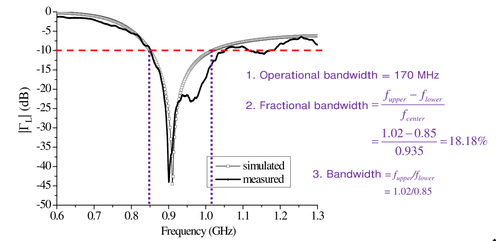

# 單元 05｜傳輸線理論的頻域深入探討

原始影片：[陳晏笙老師「天線」單元 5](https://www.youtube.com/watch?v=Xo-yztR7XY4)

老師講義：[Lecture 2 — Circuit Parameters](https://drive.google.com/file/d/1wHWHyXrkJXY4lCvk3vFuf73KGOgOCiky/view)，PDF 第 15–30 頁。

影片長度：約 104 分鐘　建議閱讀：約 30 分鐘

前置單元：[04｜傳輸線理論概述](004_傳輸線理論概述.md)。先熟悉特性阻抗、相速度與去回波電流的符號。

本單元沿老師講義的順序，先用相量表示正弦行進波，再由負載與訊號源兩端的條件求出完整解，最後以功率、回返損失和頻寬判斷匹配效果。五種特殊輸入阻抗接在下一單元，對應講義第 31–36 頁。

## 講義與影片對照

下表依影片口述與講義主題核對，時間標示口述主題的約略起點，方便回看；不代表精確換頁秒數。頁碼一律指老師 PDF。

| 講義頁碼 | 原英文主題 | 中文內容 | 影片定位 |
|:--|:--|:--|:--|
| 15–16 | Frequency-Domain Analysis / To Completely Get the Signal Expression | 回顧傳輸線、邊界條件與波形動畫 | [00:27 起](https://www.youtube.com/watch?v=Xo-yztR7XY4&t=27s) |
| 17 | Sinusoidal Traveling Wave | 正弦波、頻率與兩種波數定義 | [10:15 起](https://www.youtube.com/watch?v=Xo-yztR7XY4&t=615s) |
| 18 | Phasor Expression | 相量、相速度與時間微分 | [13:29 起](https://www.youtube.com/watch?v=Xo-yztR7XY4&t=809s) |
| 19–20 | Frequency-Domain TL Equation (1/2–2/2) | 頻域方程、特徵根與兩個波係數 | [19:42 起](https://www.youtube.com/watch?v=Xo-yztR7XY4&t=1182s) |
| 21 | Finding Coefficients V⁺ and V⁻ (1/5) | 第一步：反射係數的變數代換 | [29:42 起](https://www.youtube.com/watch?v=Xo-yztR7XY4&t=1782s) |
| 22 | Finding Coefficients V⁺ and V⁻ (2/5) | 第二步：引入輸入阻抗 | [34:00 起](https://www.youtube.com/watch?v=Xo-yztR7XY4&t=2040s) |
| 23 | Finding Coefficients V⁺ and V⁻ (3/5) | 第三步：負載端邊界 | [42:17 起](https://www.youtube.com/watch?v=Xo-yztR7XY4&t=2537s) |
| 24–25 | Finding Coefficients V⁺ and V⁻ (4/5–5/5) | 源端邊界、分壓求振幅與動畫驗證 | [47:29 起](https://www.youtube.com/watch?v=Xo-yztR7XY4&t=2849s)；[分壓 52:35](https://www.youtube.com/watch?v=Xo-yztR7XY4&t=3155s) |
| 26 | Impedance Transformation | 任意兩位置的反射與阻抗變換 | [58:18 起](https://www.youtube.com/watch?v=Xo-yztR7XY4&t=3498s) |
| 27–28 | Average Power along a Lossless TL (1/2–2/2) | 平均功率、峰值／RMS、入射與反射 | [1:04:14 起](https://www.youtube.com/watch?v=Xo-yztR7XY4&t=3854s) |
| 29 | Return Loss and Insertion Loss | 回返損失正負號與 dB 心算；IL 公式見講義 | [1:15:22 起](https://www.youtube.com/watch?v=Xo-yztR7XY4&t=4522s)；[板書換算 1:21:05](https://www.youtube.com/watch?v=Xo-yztR7XY4&t=4865s) |
| 30 | Operational Bandwidth | 頻寬門檻、不同應用與中心頻率選法 | [1:29:19 起](https://www.youtube.com/watch?v=Xo-yztR7XY4&t=5359s)；[中心頻率 1:39:14](https://www.youtube.com/watch?v=Xo-yztR7XY4&t=5954s) |

## 1．還缺什麼，才能求出完整訊號？（pp.15–16）

**原題：Frequency-Domain Analysis / To Completely Get the Signal Expression**

上一單元已得到無損線的時間域通解：

```math
v(z,t)=v^i\!\left(t-\frac{z}{v_p}\right)
      +v^r\!\left(t+\frac{z}{v_p}\right),
```

```math
i(z,t)=\frac{1}{Z_0}v^i\!\left(t-\frac{z}{v_p}\right)
      -\frac{1}{Z_0}v^r\!\left(t+\frac{z}{v_p}\right).
```

這告訴我們訊號由入射波與反射波組成，卻還沒有決定兩個波的振幅與相位。它們取決於訊號源電壓 $`V_S`$、源阻抗 $`Z_S`$、負載 $`Z_L`$，以及線的 $`Z_0,v_p,\ell`$。老師選擇正弦穩態，是因為共同的時間變化可用相量處理，讓微分方程與電路邊界條件接在一起。


**課堂動畫（[07:18–10:12](https://www.youtube.com/watch?v=Xo-yztR7XY4&t=438s)）：**固定某一時刻，沿線取電壓，就得到 $`v(z,t_0)`$ 的空間快照；固定某一位置，觀察一個週期，則得到 $`v(z_0,t)`$ 的時間波形。老師示範的總電壓看起來一邊移動、一邊伸縮，其實是一個往前與一個往後的波疊加。把一週期分成八個時刻，分別畫出空間快照再依序播放，就能看出這種變化。剛開啟電源、反射尚未傳遍線路的部分屬於暫態，不是接下來單頻相量求解的範圍。

沿用講義座標：負載在 $`z=0`$，源端在 $`z=-\ell`$，電流正方向沿 $`+z`$。需要用正距離時，另定義 $`d=-z\geq0`$，表示從負載往源端量的距離。全文採峰值相量與 $`e^{j\omega t}`$ 慣例；講義的 $`V^+,V^-`$ 對應舊筆記的 $`V_0^+,V_0^-`$。

## 2．正弦行進波與相量（pp.17–18）

**原題：Sinusoidal Traveling Wave / Phasor Expression**

### 正弦波同時隨時間與位置改變

電路中的訊號源可以寫成 $`v_s(t)=A\cos(\omega t+\phi)`$。波往 $`+z`$ 傳播，到達位置 $`z`$ 所需的延遲是 $`z/v_p`$，所以

```math
v^+(z,t)=A\cos\!\left[\omega\!\left(t-\frac{z}{v_p}\right)+\phi\right]
        =A\cos(\omega t-\beta z+\phi).
```

| 符號 | 定義與單位 | 看波形時的意義 |
|:--|:--|:--|
| $`A`$ | 峰值振幅，V | 波峰離零的高度 |
| $`f`$、$`T`$ | $`f=1/T`$，Hz、s | 每秒振盪幾次、一次振盪多久 |
| $`\lambda`$ | 波長，m | 同一時刻相鄰波峰的距離 |
| $`\phi`$ | 初相位，rad | 相對參考波形的平移 |
| $`k`$ | 講義定義 $`k=1/\lambda`$，m⁻¹ | 每公尺有幾個空間週期 |
| $`\omega`$ | $`\omega=2\pi f`$，rad/s | 時間變化的角頻率 |
| $`\beta`$ | $`\beta=2\pi k=2\pi/\lambda`$，rad/m | 每公尺的傳播相位變化 |

> **講義校註：**p.17 把 $`\omega`$ 的單位寫成「1/rad」，應為 rad/s。另有教材以 $`k`$ 表示 $`2\pi/\lambda`$；本章維持老師的 $`k=1/\lambda`$、$`\beta=2\pi/\lambda`$，避免差一個 $`2\pi`$。

### 相速度：追蹤同一個波峰

p.18 的三幅波形圖追蹤同一相位點：從 $`t_1`$ 到 $`t_2`$，它向前移動 $`\Delta z`$；經過一個週期 $`T`$，移動距離就是一個波長。因此

```math
v_p=\frac{\Delta z}{\Delta t}
   =\frac{\lambda}{T}
   =\lambda f
   =\frac{\omega}{\beta}
   =\frac{1}{\sqrt{L'C'}}.
```

此處 $`L',C'`$ 是單位長度電感與電容，對應講義簡寫的 $`L,C`$。必須用線內波長 $`\lambda=v_p/f`$，不能一律代自由空間的 $`c/f`$。

### 相量省略共同時間因子，保留空間變化

```math
v(z,t)=\mathop{\mathrm{Re}}\nolimits \{V(z)e^{j\omega t}\},
\qquad V(z)=Ae^{j\phi}e^{-j\beta z}.
```

相量 $`V(z)`$ 是帶有振幅與相位的複數，仍然隨位置改變；實際瞬時電壓則是取實部後的 $`v(z,t)`$。因為

```math
\frac{\partial}{\partial t}\!\left[V(z)e^{j\omega t}\right]
=j\omega V(z)e^{j\omega t},
```

時間微分在相量域中變成乘 $`j\omega`$，位置微分仍須保留。這是固定頻率的正弦穩態分析；剛開啟訊號源時的暫態，不能直接以一個穩態相量取代。

**老師的延伸說明（[14:25–15:23](https://www.youtube.com/watch?v=Xo-yztR7XY4&t=865s)）：**若輸入不是單一正弦波，而是週期訊號，可先用傅立葉級數拆成不同頻率的正弦分量。對線性電路，分別求每個頻率的穩態響應，再在時間域疊加，就能重建原訊號的穩態響應。不同頻率不能共用一個 $`\omega`$ 的相量直接相加。

## 3．頻域傳輸線方程：未知數只剩兩個（pp.19–20）

**原題：Frequency-Domain TL Equation (1/2–2/2)**

由上一單元無損線的時間域方程，將 $`\partial/\partial t`$ 換成 $`j\omega`$：

```math
\frac{dV}{dz}=-j\omega L'I,
\qquad
\frac{dI}{dz}=-j\omega C'V.
```

將第一式再對 $`z`$ 微分，代入第二式：

```math
\frac{d^2V}{dz^2}+\omega^2L'C'V=0,
\qquad \beta^2=\omega^2L'C'.
```

二階常係數方程的特徵根為 $`\pm j\beta`$，因此

```math
\boxed{V(z)=V^+e^{-j\beta z}+V^-e^{j\beta z}}.
```

$`V^+=|V^+|e^{j\phi_+}`$、$`V^-=|V^-|e^{j\phi_-}`$ 是兩個待定複數常數。第一項往 $`+z`$ 傳播，第二項往 $`-z`$ 傳播。

電流也滿足 $`d^2I/dz^2+\beta^2I=0`$，但不能再把它的兩個係數當成獨立未知數。代回 $`dV/dz=-j\omega L'I`$，便得到

```math
\boxed{I(z)=\frac{V^+}{Z_0}e^{-j\beta z}
              -\frac{V^-}{Z_0}e^{j\beta z}},
\qquad Z_0=\sqrt{\frac{L'}{C'}}.
```

反射電流前面的負號來自統一的電流參考方向：反射波往 $`-z`$ 傳，電流卻仍以 $`+z`$ 為正。只要求出 $`V^+,V^-`$，沿線所有電壓與電流就都確定了。

## 4．老師的五步驟：由兩端條件求波係數（pp.21–25）

**原題：Finding Coefficients V⁺ and V⁻ (1/5–5/5)**

### 第一步：定義每個位置的反射係數（p.21）

電壓反射係數（reflection coefficient）是「該位置反射波相量／入射波相量」，不是總電壓的比值：

```math
\Gamma(z)=\frac{V^-e^{j\beta z}}{V^+e^{-j\beta z}}
         =\frac{V^-}{V^+}e^{j2\beta z}.
```

負載放在 $`z=0`$，所以

```math
\Gamma_L\equiv\Gamma(0)=\frac{V^-}{V^+},
\qquad \Gamma(z)=\Gamma_L e^{j2\beta z}.
```

這裡的相位變化是 $`2\beta z`$，因為比值包含兩個方向的傳播相位。無損線的指數因子大小為 1，故沿線 $`|\Gamma(z)|`$ 不變。

### 第二步：把電壓、電流、阻抗都改寫成 Γ（p.22）

```math
V(z)=V^+e^{-j\beta z}[1+\Gamma(z)],
```

```math
I(z)=\frac{V^+}{Z_0}e^{-j\beta z}[1-\Gamma(z)].
```

兩式相除，定義從該位置向負載看進去的阻抗：

```math
\boxed{Z(z)=\frac{V(z)}{I(z)}
=Z_0\frac{1+\Gamma(z)}{1-\Gamma(z)}},
\qquad
\boxed{\Gamma(z)=\frac{Z(z)-Z_0}{Z(z)+Z_0}}.
```

$`Z_0`$ 是線的特性阻抗，$`Z_L`$ 是末端接上的負載，$`Z(z)`$ 是該位置總電壓／總電流的比值。三者不能混用；即使線均勻無損，$`Z(z)`$ 仍可隨位置改變。

**老師的電路類比（[35:30–39:45](https://www.youtube.com/watch?v=Xo-yztR7XY4&t=2130s)）：**假設某一側有一大群固定不動的電阻、電容、電感，另一側的待分析元件卻會一直更換，就不必每次把整個網路重新解一次。先用端口電壓／電流比把固定網路等效成一個輸入阻抗，便能保留它對外的作用。在這裡，被等效的網路就是「這個位置之後的傳輸線加負載」；觀察位置改變，包含的線段長度也改變，所以等效阻抗會跟著變。這個等效針對目前的頻率，並不表示所有頻率都得到同一數值。

### 第三步：套入負載端邊界（p.23）

在 $`z=0`$，總電壓與總電流必須滿足負載的歐姆定律，因此 $`Z(0)=Z_L`$：

```math
\boxed{\Gamma_L=\frac{Z_L-Z_0}{Z_L+Z_0}},
\qquad \Gamma(z)=\Gamma_L e^{j2\beta z}.
```

現在知道兩個波的比例，未知數只剩入射波係數 $`V^+`$。若 $`Z_L=Z_0`$，則 $`\Gamma_L=0`$、$`V^-=0`$；匹配表示無反射，並不表示沒有訊號。

### 第四步：接上訊號源，求輸入阻抗（p.24）

源端在 $`z=-\ell`$。先把負載反射係數移到源端，再轉回阻抗：

```math
\Gamma_{\mathrm{in}}=\Gamma(-\ell)
=\Gamma_L e^{-j2\beta\ell},
```

```math
\boxed{Z_{\mathrm{in}}=Z(-\ell)
=Z_0\frac{1+\Gamma_{\mathrm{in}}}{1-\Gamma_{\mathrm{in}}}}.
```

老師以戴維寧等效電路（Thévenin equivalent circuit）表示訊號源：開路電壓相量 $`V_S`$ 串聯源阻抗 $`Z_S`$。對訊號源而言，線與負載可先用一個 $`Z_{\mathrm{in}}`$ 代表。

### 第五步：用分壓決定振幅（p.25）

```math
V(-\ell)=V_S\frac{Z_{\mathrm{in}}}{Z_S+Z_{\mathrm{in}}}.
```

另一方面，通解在源端給出 $`V(-\ell)=V^+e^{j\beta\ell}[1+\Gamma(-\ell)]`$。整理後就是老師的最後一步：

```math
\boxed{V^+=\frac{V_Se^{-j\beta\ell}}{1+\Gamma_{\mathrm{in}}}
\frac{Z_{\mathrm{in}}}{Z_S+Z_{\mathrm{in}}}},
\qquad \boxed{V^-=\Gamma_LV^+}.
```

最後把這兩個係數代回 $`V(z),I(z)`$。整個流程是：**負載決定反射比例，訊號源決定整體振幅。** 特殊開短路或共振條件若造成中間式出現 $`0/0`$，應由原始電壓、電流邊界式取極限，不能直接把解判為不存在。

**動畫回看與工程重點（[54:10–58:18](https://www.youtube.com/watch?v=Xo-yztR7XY4&t=3250s)）：**老師實際更換電源電壓、源阻抗及複數負載，展示這些邊界條件如何決定沿線波形，並特別更正動畫輸入的電壓是峰值，不是 RMS 值。前端也不必真的是一個孤立的電壓源加電阻，整個前級電路的戴維寧等效同樣適用。求出每一個位置、每一個時間的電壓後，資訊仍太多；接下來的阻抗、反射與平均功率，才把這些解整理成工程師容易比較的量。

## 5．阻抗變換：將參考位置移到別處（p.26）

**原題：Impedance Transformation**

### 任意兩位置的反射係數

老師先把負載到任意位置的關係，推廣到線上兩個位置 $`z_1,z_2`$：

```math
\boxed{\Gamma(z_2)=\Gamma(z_1)e^{j2\beta(z_2-z_1)}}.
```

若從負載往源端移動正距離 $`d`$，則 $`z=-d`$，相位減少 $`2\beta d`$：

```math
\Gamma(-d)=\Gamma_L e^{-j2\beta d}.
```

### 由反射係數換回阻抗

將 $`\Gamma(z)=\frac{Z_L-Z_0}{Z_L+Z_0}e^{j2\beta z}`$ 代入 $`Z=Z_0(1+\Gamma)/(1-\Gamma)`$，分子分母同乘適當相位因子，再以正弦、餘弦整理：

```math
Z(z)=Z_0\frac{Z_L\cos(\beta z)-jZ_0\sin(\beta z)}
{Z_0\cos(\beta z)-jZ_L\sin(\beta z)}
=Z_0\frac{Z_L+jZ_0\tan(-\beta z)}
{Z_0+jZ_L\tan(-\beta z)}.
```

同樣可把 $`Z(z_1)`$ 當成新參考端：

```math
\boxed{Z(z_2)=Z_0
\frac{Z(z_1)+jZ_0\tan[-\beta(z_2-z_1)]}
{Z_0+jZ(z_1)\tan[-\beta(z_2-z_1)]}}.
```

最常用的是由負載求源端輸入阻抗，令 $`z=-\ell`$：

```math
\boxed{Z_{\mathrm{in}}=Z_0
\frac{Z_L+jZ_0\tan(\beta\ell)}
{Z_0+jZ_L\tan(\beta\ell)}}.
```

$`\ell`$ 是實際線長，$`\beta\ell`$ 是電氣長度。移動參考位置可能把純電阻變成複數阻抗，但無損線上的反射係數大小並未因此減少。五種特殊情況依老師頁序留到下一單元展開。

## 6．無損線平均功率：入射減反射（pp.27–28）

**原題：Average Power along a Lossless TL (1/2–2/2)**

以峰值相量計算時間平均功率：

```math
P_{\mathrm{av}}(z)=\frac12\mathop{\mathrm{Re}}\nolimits \{V(z)I^*(z)\}.
```

星號表示複數共軛。無損線的 $`Z_0`$ 為實數，代入前面的 $`1+\Gamma`$ 與 $`1-\Gamma`$ 形式：

```math
V(z)I^*(z)=\frac{|V^+|^2}{Z_0}
[1+\Gamma(z)][1-\Gamma^*(z)]
=\frac{|V^+|^2}{Z_0}
[1-|\Gamma(z)|^2+\Gamma(z)-\Gamma^*(z)].
```

最後兩項是純虛數，取實部後消失，因此

```math
\boxed{P_{\mathrm{av}}(z)=\frac{|V^+|^2}{2Z_0}
[1-|\Gamma(z)|^2]=P_i-P_r},
```

```math
P_i=\frac{|V^+|^2}{2Z_0},
\qquad P_r=\frac{|V^-|^2}{2Z_0}
=P_i|\Gamma_L|^2.
```

老師在 p.28 問「為什麼 $`P_{\mathrm{av}}`$ 與位置無關？」：無損線不消耗平均功率，且 $`|\Gamma(z)|=|\Gamma_L|`$。局部電壓、電流、阻抗可以變動，淨功率仍維持相同，並由負載接受：

```math
P_L=P_{\mathrm{av}}=P_i(1-|\Gamma_L|^2).
```

**口述用詞釐清（[1:12:18–1:16:49](https://www.youtube.com/watch?v=Xo-yztR7XY4&t=4338s)）：**老師把反射係數連到功率比例，並口頭使用「功率反射係數」這個名稱。計算時要分清：$`\Gamma`$ 本身是帶相位的複數電壓比；真正的功率比是 $`P_r/P_i=|\Gamma|^2`$。對被動負載與實數 $`Z_0`$，介於 0 和 1 之間的是 $`|\Gamma|^2`$（以及其平方根 $`|\Gamma|`$），不能把複數 $`\Gamma`$ 說成一個負的百分比。

因此固定入射功率時，反射越小，負載接受的功率越大。理想開路、短路或純電抗負載有 $`|\Gamma_L|=1`$，不吸收平均功率；線上仍可有電壓、電流與往返交換的能量。若使用 RMS 相量，平均功率式不再有 $`1/2`$，不能將峰值電壓代入 RMS 公式。

## 7．回返損失與講義的插入損失（p.29）

**原題：Return Loss and Insertion Loss**

### 回返損失：反射相對於入射有多小？

```math
\boxed{\mathrm{RL}=-10\log_{10}\frac{P_r}{P_i}
=-20\log_{10}|\Gamma_L|}\quad\text{dB}.
```

RL 越大，反射越小。匹配時 $`\Gamma_L=0`$，理想 RL 趨近無限大；開路或短路時全部反射，RL 為 0 dB。

> **講義校註：**p.29 中間式把 $`(V^-/V^+)^2`$ 直接放入對數。兩個波係數是複數，功率比應為 $`|V^-/V^+|^2`$；後面寫成 $`-20\log|\Gamma|`$ 的結果才是正確的實數 dB 值。

量測圖若以 $`20\log_{10}|S_{11}|`$ 表示反射幅度，數值通常為負。在相同實數參考阻抗及參考平面下，$`S_{11}=\Gamma`$，所以圖上 −10 dB 對應正值 RL＝10 dB。別把正、負號不同的兩種標法混在一起。

**老師的正負號類比（[1:17:27–1:20:25](https://www.youtube.com/watch?v=Xo-yztR7XY4&t=4647s)）：**「收益是 −20 萬」與「損失 20 萬」描述同一件事，不能又說「損失 −20 萬」。同樣，反射曲線的 −20 dB 對應 RL＝20 dB。老師口述的「反射係數是負值」在此指的是其 **dB 表示值**，不是前面帶相位的複數 $`\Gamma`$。

### 課堂板書：用 3 dB 心算反射與接受比例

老師在 [1:21:05–1:29:19](https://www.youtube.com/watch?v=Xo-yztR7XY4&t=4865s) 建立的換算表，重點是先記住兩個基準：−10 dB 約反射 10%，−3 dB 約反射一半。反射曲線再下降約 3 dB，反射功率約減半；下降 10 dB，則變成原來的十分之一。

| 反射幅度 dB 值 $`20\log_{10}\lvert\Gamma\rvert`$ | 反射功率比例（課堂近似） | 負載接受比例（課堂近似） |
|:--|:--|:--|
| −3 dB | 50% | 50% |
| −6 dB | 25% | 75% |
| −7 dB | 20% | 80% |
| −10 dB | 10% | 90% |
| −13 dB | 5% | 95% |
| −16 dB | 2.5% | 97.5% |
| −20 dB | 1% | 99% |

例如 −7 dB 比 −10 dB 高約 3 dB，所以反射約由 10% 加倍成 20%；−13 dB 則約減半成 5%。精算仍用 $`P_r/P_i=10^{D/10}`$，其中 $`D=20\log_{10}|\Gamma|`$；3 dB 的精確倍率是 $`10^{3/10}\approx1.995`$，因此表中的「減半」是方便心算的近似。

### 講義的 IL：反射使接受功率少了多少？

老師把負載接受功率記為 $`P_t=P_i-P_r`$，定義

```math
\mathrm{IL}=-10\log_{10}\frac{P_t}{P_i}
=-10\log_{10}(1-|\Gamma_L|^2)\quad\text{dB}.
```

本頁採無損線模型，因此這個量表示**因失配反射造成的功率損失**，不是線材發熱損耗。RL 越大越好，這個 IL 則越小越好：完全匹配時 IL＝0 dB，完全反射時趨近無限大。

**名詞補充：**講義將此量稱為 insertion loss；一般二埠元件的插入損失還涉及插入前後、源與負載的參考條件，不能把所有 $`S_{21}`$ 損失都代成這個式子。此處以「失配損失」理解，較不容易誤用。

## 8．從反射曲線讀工作頻寬（p.30）

**原題：Operational Bandwidth**

老師以 RL＞10 dB 作為本頁的匹配門檻，等效於反射幅度 dB 曲線低於 −10 dB，也就是反射功率少於 10%、負載接受功率大於 90%。先找出符合門檻的連續頻段，再讀取兩個邊界 $`f_{\mathrm{lower}},f_{\mathrm{upper}}`$。



*圖源：老師 Lecture 2，p.30，擷取曲線與原始算例。空心方塊為 simulated，黑色實線為 measured；紅虛線為 −10 dB 門檻，紫色虛線標示本頁採用的頻段邊界。*

### 老師原始算例：0.85–1.02 GHz

依講義標記，$`f_L=0.85`$ GHz、$`f_H=1.02`$ GHz。三種頻寬表示法分別為：

| 表示法 | 定義 | 本頁結果 |
|:--|:--|:--|
| 絕對頻寬（operational bandwidth） | $`B=f_H-f_L`$ | 0.17 GHz＝170 MHz |
| 分數頻寬（fractional bandwidth） | $`\mathrm{FBW}=B/f_c\times100\%`$ | $`0.17/0.935\times100\%=18.18\%`$ |
| 頻率比（ratio bandwidth） | $`f_H/f_L`$ | $`1.02/0.85=1.2`$，即 1.2:1 |

本頁實際代入 $`f_c=0.935`$ GHz，正好是兩個邊界的算術平均 $`(f_H+f_L)/2`$。它不同於反射谷底約 0.9 GHz。上表保留投影片的原始算例；老師在影片末段另外提出了自己的中心頻率選法，兩者需要分開對照。

### 老師口述的分母選法：優先共振，其次幾何中心

在 [1:37:43–1:39:14](https://www.youtube.com/watch?v=Xo-yztR7XY4&t=5863s)，老師用比較例說明為何需要分數頻寬：一支在約 1 GHz 工作、頻寬 170 MHz 的天線，不能只因另一支約 10 GHz 天線有 200 MHz 頻寬，就判定後者相對更寬。以這兩個工作頻率粗略正規化，前者約 17%，後者約 2%。

接著在 [1:39:14–1:40:53](https://www.youtube.com/watch?v=Xo-yztR7XY4&t=5954s) 與 [1:42:33–1:43:52](https://www.youtube.com/watch?v=Xo-yztR7XY4&t=6153s)，老師提出課堂偏好的做法：

1. 若有複數輸入阻抗資料，優先以電抗為零的**共振頻率** $`f_r`$ 作為分母，即 $`\mathop{\mathrm{Im}}\nolimits Z_L(f_r)=0`$。
2. 若手邊只有反射幅度圖，沒有足夠資料找出共振頻率，就取邊界的**幾何平均** $`f_c=\sqrt{f_Lf_H}`$。
3. 不把反射曲線的最低點直接當成共振頻率。反射幅度圖已捨去相位資訊，僅憑谷底無法確定阻抗虛部為零。

**講義與口述對照：**老師在口述中明確反對用算術平均作這裡的分母；這是本課的選法與偏好，不能延伸成「常用的算術中心定義一律錯誤」。投影片 p.30 的 18.18% 正是算術中心的結果。若對同一組邊界改採老師口述的幾何中心，則

```math
f_c=\sqrt{0.85\times1.02}\approx0.93113\ \mathrm{GHz},
\qquad \mathrm{FBW}=\frac{0.17}{0.93113}\times100\%
\approx18.26\%.
```

比較不同天線的 FBW 時，要一併寫清楚反射門檻、頻段邊界與分母定義。本頁沒有提供完整複數阻抗資料，因此不能從圖中替老師推定一個精確的共振頻率。

### 曲線與門檻要一起讀

模擬與量測的深谷位置接近，但谷底深度及高頻側走勢並不完全相同；讀數時須指定採用哪一條曲線。黑色量測線在高頻側還可能再次跨過門檻，不能把不連續的合格區間一律併成一個大頻帶。−10 dB 是本頁的示範條件，實際設計要先指定門檻。

### −10 dB 並非每一個應用的共同門檻

老師在 [1:31:17–1:36:17](https://www.youtube.com/watch?v=Xo-yztR7XY4&t=5477s) 以不同設計經驗說明門檻的取捨：

| 課堂例子 | 反射幅度門檻 | 對應的接受功率比例 | 老師用來說明的考量 |
|:--|:--|:--|:--|
| 一般示範／未另指定需求 | −10 dB | 90% | 先用一個明確門檻劃分頻段 |
| 手機天線例子 | −6 dB | 約 75% | 可用設計空間受限，匹配要求可能放寬 |
| 老師參與的基地台天線專案 | −20 dB | 99% | 入射功率較大，相同反射比例對應較大的反射功率 |
| 老師提及的參訪案例 | −40 dB | 99.99% | 說明特殊需求可能要求更低反射 |

這些是老師用來比較的課堂案例，並非每一類天線都必須採用的統一規格。以功率看最清楚：$`P_r=P_i|\Gamma|^2`$；同樣反射 10%，若入射功率增加，送回前級的絕對功率也增加。是否可能影響或損傷前級，要看該系統的耐受與保護設計。

反射小只表示匹配較好。單靠這張圖，還不能確認天線效率、增益或場型在全頻帶內都符合需求；這些參數會在後面的輻射特性單元分別討論。

## 補充解說與重算例題

以下是幫助理解的補充計算，不是老師 p.30 以外的原始投影片例題。

### A．複數相量如何還原成實際電壓？

若 $`V(z)=2e^{-j\beta z}`$ V，則 $`v(z,t)=2\cos(\omega t-\beta z)`$ V。在 $`z=\lambda/4`$ 時，$`V=-j2`$ V，對應 $`v=2\cos(\omega t-90^\circ)`$ V。$`-j2`$ 表示振幅與相位，並不是實際量到的電壓變成虛數。

### B．把源端、負載端與功率一次算完

設 $`V_S=2`$ V（峰值）、$`Z_S=Z_0=50\,\Omega`$、$`Z_L=100\,\Omega`$、$`\ell=\lambda/2`$。依五步驟：

```math
\Gamma_L=\frac{100-50}{100+50}=\frac13,
\qquad\Gamma_{\mathrm{in}}=\frac13e^{-j2\pi}=\frac13,
\qquad Z_{\mathrm{in}}=100\ \Omega.
```

```math
V(-\ell)=\frac43\ \mathrm V,
\qquad V^+=\frac{(4/3)e^{-j\pi}}{1+1/3}=-1\ \mathrm V,
\qquad V^-=-\frac13\ \mathrm V.
```

源端入射波為 $`V^+e^{j\pi}=1`$ V，反射波為 $`1/3`$ V；負載端總電壓則為 $`V_L=-4/3`$ V。兩端電壓峰值相同，相位差 180°。

```math
P_i=\frac{1^2}{2\times50}=10\ \mathrm{mW},
\qquad P_r=\frac{10}{9}\ \mathrm{mW},
\qquad P_L=\frac{80}{9}\ \mathrm{mW}\approx8.89\ \mathrm{mW}.
```

再用負載電壓驗算：$`P_L=|V_L|^2/(2R_L)=(4/3)^2/200=8.89`$ mW。負載與源端兩種算法一致，且反射**電壓**為三分之一，反射**功率**為九分之一。

### C．同一負載，不同線長看到不同阻抗

保持 $`Z_0=50\,\Omega,Z_L=100\,\Omega`$，改用不同線長：

| 線長 | 輸入阻抗 | 輸入反射係數 |
|:--|:--|:--|
| $`\lambda/8`$ | $`50(100+j50)/(50+j100)=40-j30\,\Omega`$ | $`-j/3`$ |
| $`\lambda/4`$ | $`Z_0^2/Z_L=25\,\Omega`$ | $`-1/3`$ |
| $`\lambda/2`$ | $`Z_L=100\,\Omega`$ | $`+1/3`$ |

反射係數大小都等於 $`1/3`$，所以只改變線長沒有消除失配。第一列出現虛部，也不代表線中必須額外接一顆集總電容；它來自波的傳播與反射。

### D．回返損失、接受功率與失配損失對照

下表限於實數 $`Z_0`$、無損線及被動負載。

| RL | $`\lvert\Gamma\rvert`$ | 反射功率比 | 接受功率比 | 失配損失 |
|:--|:--|:--|:--|:--|
| 3 dB | 0.708 | 50.1% | 49.9% | 3.021 dB |
| 6 dB | 0.501 | 25.1% | 74.9% | 1.256 dB |
| 10 dB | 0.316 | 10% | 90% | 0.458 dB |
| 20 dB | 0.100 | 1% | 99% | 0.044 dB |

同為「損失」，RL 衡量反射相對入射有多小；失配損失衡量接受功率比入射少多少，兩者數值方向相反。

### E．分數頻寬的中心頻率要註明

若 $`f_L=2.30`$ GHz、$`f_H=2.50`$ GHz，絕對頻寬為 200 MHz。用算術中心 $`f_c=2.40`$ GHz，FBW 為 8.33%；改用幾何中心 $`\sqrt{f_Lf_H}\approx2.398`$ GHz，則約 8.34%。窄頻時兩者相近，寬頻時差異會變大。若以電抗為零的共振頻率作分母，還需要複數阻抗資料；最低反射點不保證就是電抗為零的位置。

## 自測與解析

1. $`v_p=2\times10^8`$ m/s、$`f=1`$ GHz，$`\lambda`$ 與 $`\beta`$ 是多少？沿線走 5 cm，單向傳播相位與反射係數相位各轉多少？
2. $`Z_0=50\,\Omega,Z_L=25\,\Omega`$，求 $`\Gamma_L`$ 與反射功率比。
3. 同一負載接長度 $`\lambda/4`$ 的 50 Ω 無損線，求輸入阻抗與反射係數；反射功率是否減少？
4. 入射峰值電壓 2 V、$`Z_0=50\,\Omega`$、$`|\Gamma|=0.5`$，求入射、反射及負載淨功率。
5. 反射幅度 dB 圖某點為 −15 dB，反射功率與接受功率各占多少？若 RL＞10 dB 的連續頻段為 900–1100 MHz，以算術中心計算絕對與分數頻寬。

### 答案與解析

1. $`\lambda=0.2`$ m，$`\beta=10\pi`$ rad/m。$`\beta(0.05)=\pi/2`$，單向相位差為 90°；反射係數相位差為 180°。正負號取決於移動方向。
2. $`\Gamma_L=(25-50)/(25+50)=-1/3`$；功率比為 $`1/9\approx11.1\%`$。負號表示電壓反相，不是負功率。
3. $`\Gamma_{\mathrm{in}}=(-1/3)e^{-j\pi}=+1/3`$，$`Z_{\mathrm{in}}=100\,\Omega`$。大小未變，反射功率比例仍為 $`1/9`$。
4. $`P_i=2^2/(2\times50)=40`$ mW；$`P_r=40(0.5)^2=10`$ mW；$`P_L=30`$ mW。
5. 反射比為 $`10^{-15/10}\approx3.16\%`$，接受比約 96.84%。$`B=200`$ MHz，$`f_c=(900+1100)/2=1000`$ MHz，所以 FBW＝20%。若另採幾何中心 994.99 MHz，結果為 20.10%，須一併註明定義。

計算前先確認四件事：座標與參考位置、線內波長、峰值或 RMS 相量，以及圖上畫的是正值 RL 還是負值反射幅度 dB。

**下一單元：**[06｜電壓駐波比](006_電壓駐波比.md)。先以五種特殊輸入阻抗驗證公式，再由沿線電壓起伏建立 VSWR。
