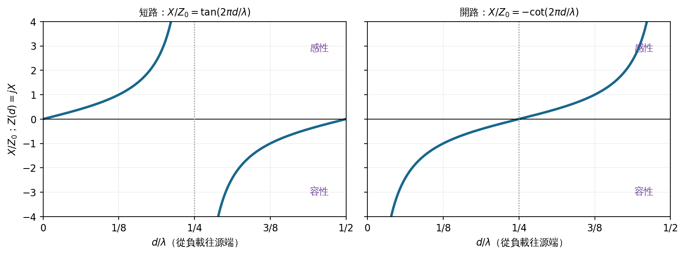
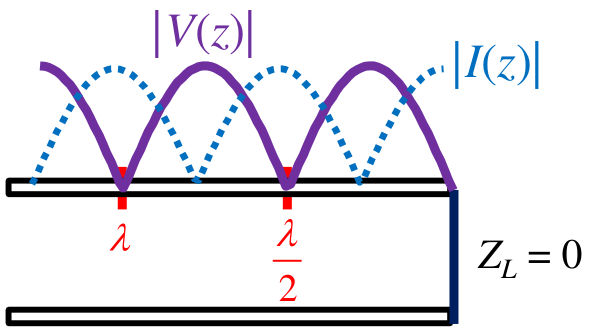
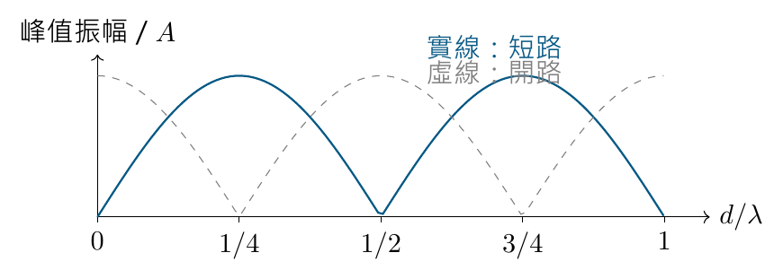
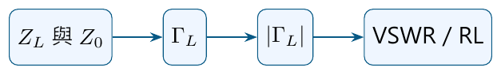
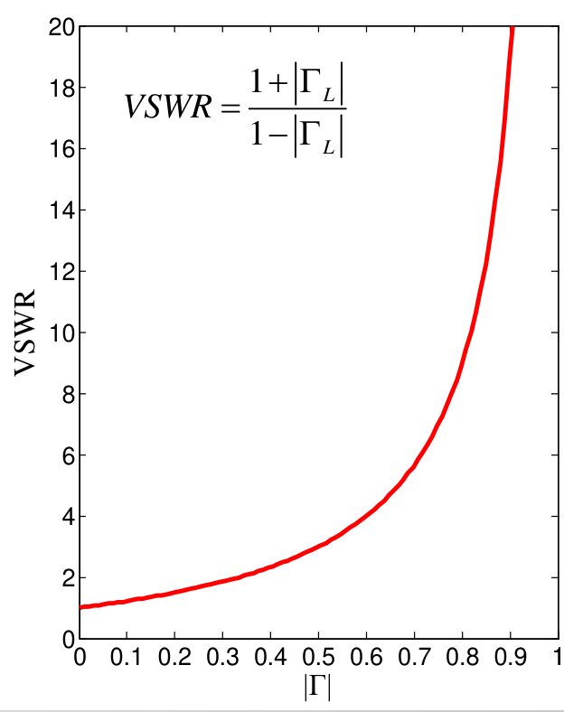

# 單元 06｜電壓駐波比

原始影片：[陳晏笙老師「天線」單元 6](https://www.youtube.com/watch?v=C_E4Gu8YoWo)（約 40 分鐘）

老師講義：[Lecture 2 — Circuit Parameters，pp.31–41](https://drive.google.com/file/d/1wHWHyXrkJXY4lCvk3vFuf73KGOgOCiky/view)

建議閱讀：約 25 分鐘。前置單元：[單元 05｜傳輸線理論的頻域深入探討](005_傳輸線理論的頻域深入探討.md)。

本章先用五種特殊情況檢查阻抗變換式，再從入射波與反射波的疊加，推導電壓駐波比（Voltage Standing Wave Ratio, VSWR）。讀完應能由峰谷振幅換算反射功率，並分辨 VSWR、回返損失（Return Loss, RL）與負值反射係數曲線。

> VSWR 記錄沿線電壓振幅的起伏程度。它保留反射係數的大小，卻不保留相位；因此不能單獨決定負載阻抗，也不能單獨代表天線輻射效率。

## 講義與影片對照

以下頁碼均指老師 PDF。影片時間已依完整口述主題核對，供搜尋主題使用，並非精確換頁時間；影片開頭約 00:00–09:00 另回顧前單元的回返損失與圖軸標示。

| 講義頁碼 | 原英文主題 | 本章中文內容 | 影片定位（約略） |
|:--|:--|:--|:--|
| 31–36 | Special Cases of Input Impedance；Special Case 1–5 | 短路、開路、匹配、半波長、四分之一波長 | [09:20–23:25](https://www.youtube.com/watch?v=C_E4Gu8YoWo&t=540s) |
| 37 | Voltage Standing Wave Phenomenon | 短路線的電壓與電流駐波 | [24:00–26:30](https://www.youtube.com/watch?v=C_E4Gu8YoWo&t=1440s) |
| 38 | Generalized Standing Wave | 匹配線與一般不匹配線的包絡 | [26:30–30:20](https://www.youtube.com/watch?v=C_E4Gu8YoWo&t=1590s) |
| 39 | What are the Extreme Values of \|V(z)\|? | 振幅平方、最大值與最小值 | [31:50–33:20](https://www.youtube.com/watch?v=C_E4Gu8YoWo&t=1860s) |
| 40 | Voltage Standing Wave Ratio (VSWR) | 定義、反解、範圍與適用條件 | [30:20–33:55](https://www.youtube.com/watch?v=C_E4Gu8YoWo&t=1860s) |
| 41 | VSWR vs. Return Loss | 四種常見門檻及曲線判讀 | [33:55–影片結尾](https://www.youtube.com/watch?v=C_E4Gu8YoWo&t=2100s) |

## 1．五種特殊輸入阻抗（Special Cases of Input Impedance，pp.31–36）

### 1.1 先固定座標與適用條件（p.31）

以下採用**無損傳輸線、正實數特性阻抗** $`Z_0`$，以及 $`e^{j\omega t}`$ 相量慣例。老師把負載放在 $`z=0`$，源端位於 $`z=-l`$；為方便描述「距負載多遠」，另外令 $`d=-z\ge0`$，從負載往源端量距離。

```math
\Gamma_L=\frac{Z_L-Z_0}{Z_L+Z_0},\qquad
\Gamma(d)=\Gamma_L e^{-j2\beta d},\qquad
\beta=\frac{2\pi}{\lambda}.
```

```math
Z(d)=Z_0\frac{Z_L+jZ_0\tan(\beta d)}
{Z_0+jZ_L\tan(\beta d)}.
```

$`\lambda`$ 是**線內波長**。輸入阻抗指從某個參考位置往負載看進去的電壓／電流比，不一定等於末端負載本身。

> **座標校註：**講義 pp.35–36 在負載左側標上正的 $`z=\lambda/2`$、$`z=\lambda/4`$，與前面的 $`z\le0`$ 座標混用。本筆記以 $`d=\lambda/2`$、$`d=\lambda/4`$ 表示正距離，對應座標為 $`z=-d`$；半波長與四分之一波長的阻抗結論不變。

### 1.2 短路：末端為零阻抗，不代表整條線都為零（p.32）

代入 $`Z_L=0`$：

```math
\Gamma_L=-1,\qquad Z(d)=jZ_0\tan(\beta d).
```

負載端入射與反射電壓相消，所以 $`V(0)=0`$。但離開負載後相位差改變，輸入阻抗通常不為零，而是純電抗。

以 $`Z(d)=jX`$ 表示，$`X>0`$ 為感性，$`X<0`$ 為容性。在第一個半波長內：

- $`0<d<\lambda/4`$：$`\tan\beta d>0`$，呈感性。
- $`d=\lambda/4`$：阻抗趨近無限大，看起來像開路。
- $`\lambda/4<d<\lambda/2`$：$`\tan\beta d<0`$，呈容性。
- $`d=\lambda/2`$：輸入阻抗再次為零，此後每隔 $`\lambda/2`$ 重複。

這就是短路傳輸線殘段能等效成電感或電容的原因。講義圖中以 $`X=j\omega L`$ 等形式標元件；為區分「阻抗」與「電抗」，本筆記使用 $`Z_L^{\rm(inductor)}=j\omega L`$、$`Z_C=-j/(\omega C)`$，其中電抗 $`X`$ 本身為實數。

### 1.3 開路：末端無電流，四分之一波長外卻像短路（p.33）

令 $`Z_L\to\infty`$：

```math
\Gamma_L=+1,\qquad Z(d)=-jZ_0\cot(\beta d).
```

負載電流為零，電壓反射與入射同相。第一個半波長內，輸入電抗與短路線恰好互換：

| 距離 | 短路線 | 開路線 |
|:--|:--|:--|
| $`d=0`$ | 短路 | 開路 |
| $`0<d<\lambda/4`$ | 感性 | 容性 |
| $`d=\lambda/4`$ | 開路 | 短路 |
| $`\lambda/4<d<\lambda/2`$ | 容性 | 感性 |
| $`d=\lambda/2`$ | 回到短路 | 回到開路 |



依講義 pp.32–33 公式重畫，橫軸統一為正距離 $`d/\lambda`$；圖中截斷的曲線仍會趨向正／負無限大。開短路互換是反射與傳播造成的阻抗變換，導體末端的接線沒有改變。

### 1.4 匹配：任意位置都看到相同阻抗（p.34）

當 $`Z_L=Z_0`$：

```math
\Gamma_L=0,\qquad \Gamma(d)=0,\qquad Z(d)=Z_0.
```

沒有反射波，因此輸入阻抗不隨長度改變。無損線的 $`Z_0=50\,\Omega`$ 是單向行進波的電壓／電流比；它不表示線本身是一顆耗能電阻。末端的匹配電阻才吸收送到負載的功率。

### 1.5 半波長：重現負載（p.35）

令 $`d=n\lambda/2`$，$`n=0,1,2,\ldots`$，此時 $`\tan\beta d=0`$，所以

```math
Z(n\lambda/2)=Z_L,\qquad
\Gamma(n\lambda/2)=\Gamma_L e^{-j2\pi n}=\Gamma_L.
```

電壓單程傳播的相位每半波長變 $`\pi`$，但反射係數的相位含有來回路徑，因此變 $`2\pi`$，回到同一複數值。**阻抗重現不等於匹配**：若原負載不匹配，半波長線只是把同樣的不匹配帶到輸入端。

### 1.6 四分之一波長：倒置阻抗（p.36）

令 $`d=(2n+1)\lambda/4`$，取 $`\tan\beta d\to\pm\infty`$ 的極限：

```math
Z(d)=Z_0\frac{jZ_0}{jZ_L}
=\boxed{\frac{Z_0^2}{Z_L}}.
```

這就是四分之一波長變壓器（quarter-wavelength transformer）的阻抗倒置關係：開路變短路、短路變開路，大的純電阻可變小，小的純電阻可變大。這些結論以理想無損線與該頻率的四分之一線內波長為前提。

## 2．短路線的電壓駐波（Voltage Standing Wave Phenomenon，p.37）

### 2.1 從頻域疊加回到時域

沿用老師的 $`z`$ 座標，電壓與電流峰值相量為

```math
V(z)=V^+e^{-j\beta z}+V^-e^{j\beta z},\qquad
I(z)=\frac{V^+e^{-j\beta z}-V^-e^{j\beta z}}{Z_0}.
```

短路負載有 $`V^-=-V^+`$，代入後：

```math
V(z)=-2jV^+\sin\beta z,\qquad
I(z)=\frac{2V^+}{Z_0}\cos\beta z.
```

選時間原點，使入射相量 $`V^+=A`$ 為正實數，再取 $`\mathop{\mathrm{Re}}\nolimits \{V(z)e^{j\omega t}\}`$：

```math
v(z,t)=2A\sin\beta z\sin\omega t,\qquad
i(z,t)=\frac{2A}{Z_0}\cos\beta z\cos\omega t.
```

這兩式把空間與時間因子分開。$`\sin\beta z=0`$ 的位置，任何時刻電壓都為零，稱為電壓節點（node）；振幅最大的地方稱為腹點。節點位置固定，入射波與反射波仍各自傳播。

> **相位條件：**講義以 $`|V^+|`$ 寫出上述時域式，等同已把入射初相位吸收進時間原點。若保留 $`V^+=Ae^{j\phi_+}`$，應把 $`\omega t`$ 改成 $`\omega t+\phi_+`$，空間包絡不受影響。

### 2.2 電壓節點正是電流腹點

```math
|V(z)|=2A|\sin\beta z|,\qquad
|I(z)|=\frac{2A}{Z_0}|\cos\beta z|.
```



來源：老師講義 p.37 右下圖。紫色為電壓、藍色為電流；兩條曲線用來比較節點位置，並非把伏特與安培當作相同單位。短路端電壓為零，電流最大；往源端移 $`\lambda/4`$ 後，電壓最大而電流為零。相鄰電壓節點距離為 $`\lambda/2`$。

講義左下紅色與紫色曲線則是**不同時間的電壓快照**，不能與右下的振幅包絡混為一談。完全駐波的入射與反射平均功率相等，淨送入理想短路負載的平均功率為零。

## 3．一般化駐波（Generalized Standing Wave，p.38）

講義把兩種情況並排：

| 負載情況 | 反射 | 沿線電壓振幅 |
|:--|:--|:--|
| $`Z_L=Z_0`$ | $`\Gamma_L=0`$ | 水平直線；只有行進波 |
| $`Z_L\ne Z_0`$ | $`\Gamma_L\ne0`$ | 出現固定的峰谷，通常谷底大於零 |

若 $`0<|\Gamma_L|<1`$，反射波比入射波小，無法完全相消；沿線振幅仍有最大值與最小值，稱為一般化駐波。此時仍有淨功率送往負載。

> **講義校註：**p.38 寫「完全駐波只出現在開路或短路」。較完整的條件是 $`|\Gamma_L|=1`$。在正實數 $`Z_0`$ 下，任何理想純電抗負載 $`Z_L=jX`$ 都有 $`|(jX-Z_0)/(jX+Z_0)|=1`$，也會形成完全駐波；開路、短路是最容易看出節點位置的兩個特例。

開路時 $`V^-=V^+`$，因此 $`V(z)=2A\cos\beta z`$；電壓腹點落在負載，節點與短路情況相差 $`\lambda/4`$。



補充示意圖：橫軸是距負載的正距離 $`d/\lambda`$。兩條線都是**每個位置的最大振幅**，不表示某一時刻的電壓正負值。

## 4．電壓振幅的極值（What are the Extreme Values of |V(z)|?，p.39）

### 4.1 為什麼峰谷固定在特定位置？

令 $`\Gamma_L=\rho e^{j\phi_L}`$，$`\rho=|\Gamma_L|`$。沿線反射係數為 $`\Gamma(z)=\Gamma_L e^{j2\beta z}`$，因此

```math
V(z)=V^+e^{-j\beta z}[1+\Gamma(z)].
```

用複數與共軛相乘求振幅：

```math
\begin{aligned}
|V(z)|^2
&=|V^+|^2[1+\Gamma(z)][1+\Gamma^*(z)]\\
&=|V^+|^2\{1+\rho^2+2\rho\cos(2\beta z+\phi_L)\}.
\end{aligned}
```

```math
|V(z)|=|V^+|\sqrt{1+\rho^2+2\rho\cos(2\beta z+\phi_L)}.
```

這與老師講義的正負號一致。若改用正距離 $`d=-z`$，餘弦內就變成 $`\phi_L-2\beta d`$。相位差隨位置改變，於是有些位置相長、有些位置相消。

### 4.2 最大值是相加，最小值是相減

對被動負載與正實數 $`Z_0`$，有 $`0\le\rho\le1`$。餘弦取 $`+1`$ 與 $`-1`$ 時，分別得到

```math
\boxed{|V|_{\max}=|V^+|(1+\rho)},\qquad
\boxed{|V|_{\min}=|V^+|(1-\rho)}.
```

因此反射大小決定峰谷的高低，反射相位 $`\phi_L`$ 決定峰谷的位置。對 $`\rho>0`$，相鄰最大值相隔 $`\lambda/2`$，最大值到最近最小值相隔 $`\lambda/4`$。原因是包絡內含 $`2\beta z`$，距離改變半波長，相位就改變一整圈。

## 5．電壓駐波比的定義（Voltage Standing Wave Ratio，p.40）

定義沿線**電壓振幅包絡**最大值與最小值之比：

```math
\boxed{\mathrm{VSWR}\equiv\frac{|V|_{\max}}{|V|_{\min}}
=\frac{1+\rho}{1-\rho}}.
```

**老師口述（約 30:20–33:20）：**口試常問 VSWR 的「定義」，要先回答沿線電壓**振幅**最大值與最小值之比；不能漏掉振幅／相量絕對值，也不能只背反射係數的換算式。第一個等號是定義，第二個等號才是由無損線的峰谷公式推導出的關係。分子、分母均為非負振幅，不是某一瞬間的正電壓與負電壓。

| 情況 | $`\rho`$ | VSWR |
|:--|:--|:--|
| 完全匹配 | 0 | 1 |
| 部分反射 | $`0<\rho<1`$ | 大於 1 的有限實數 |
| 完全反射 | 1 | 最小振幅為零，VSWR 趨近無限大 |

VSWR 無單位，常寫成 $`2:1`$，不需要加 dB。反過來可求

```math
\boxed{\rho=\frac{\mathrm{VSWR}-1}{\mathrm{VSWR}+1}}.
```



第一步仍保留複數資訊；一旦取 $`|\Gamma_L|`$，相位資訊就消失。例如 $`50\,\Omega`$ 系統中，$`100\,\Omega`$ 與 $`25\,\Omega`$ 負載的反射係數分別是 $`+1/3`$、$`-1/3`$，但兩者 VSWR 都是 2。

沿線峰谷振幅可用來求反射大小，是 VSWR 的直接量測意義；取得完整複數反射係數還需要相位資訊。老師在約 35:55–36:55 以早期峰谷量測與網路分析儀的差異，解釋為何文獻同時沿用這兩種指標。

## 6．VSWR、回返損失與圖軸標示（VSWR vs. Return Loss，p.41）

### 6.1 對照老師列出的四個門檻

```math
\mathrm{RL}=-20\log_{10}\rho,\qquad
\frac{P_{\rm reflected}}{P_{\rm incident}}=\rho^2.
```



來源：老師講義 p.41 左圖。圖的橫軸實際是 $`|\Gamma|`$，縱軸是 VSWR；RL 須再由上式換算。接近完全反射時，VSWR 急速上升，並非與反射係數成正比。

下表列各門檻**邊界值**的精確換算。老師投影片用約數列出 14、10、7.4、6 dB；這是四種常用判讀尺度，具體設計仍須依規格選門檻。

| VSWR 邊界 | $`\rho`$ | 反射功率比例 | RL | $`S_{11,\mathrm{dB}}`$ |
|:--|:--|:--|:--|:--|
| 1.5 | 0.2000 | 4.00% | 13.98 dB | $`-13.98`$ dB |
| 2.0 | 0.3333 | 11.11% | 9.54 dB | $`-9.54`$ dB |
| 2.5 | 0.4286 | 18.37% | 7.36 dB | $`-7.36`$ dB |
| 3.0 | 0.5000 | 25.00% | 6.02 dB | $`-6.02`$ dB |

若要求 VSWR **小於**表中門檻，則 $`\rho`$ 與反射功率也要小於該列數值，RL 則要大於該列數值。VSWR $`<2`$ 與 RL $`>10`$ dB 很接近，但不完全相同；RL $`=10`$ dB 對應 VSWR 約 1.925。

### 6.2 正值 RL 與負值反射曲線不要混用

影片開頭約 [00:00–09:00](https://www.youtube.com/watch?v=C_E4Gu8YoWo&t=0s) 回顧此問題，後段約 [35:00 起](https://www.youtube.com/watch?v=C_E4Gu8YoWo&t=2100s) 接回 VSWR 判讀。在相同正實數參考阻抗的一埠量測中，$`S_{11}=\Gamma`$，所以

```math
S_{11,\mathrm{dB}}=20\log_{10}|S_{11}|=-\mathrm{RL}.
```

- 標示 **Return loss**：採 $`-20\log_{10}|\Gamma|`$，被動負載時非負；數值越大，反射越少。
- 標示 **$`|S_{11}|`$ (dB)** 或 **Reflection coefficient (dB)**：採 $`20\log_{10}|\Gamma|`$，被動負載時非正；曲線越低，反射越少。
- **VSWR**：最小只能為 1；若出現小於 1 的數值，應先查振幅定義、計算或資料處理。

同樣地，被動端口若出現 $`S_{11,\mathrm{dB}}>0`$，在上述參考條件下即意味 $`|\Gamma|>1`$，應檢查模擬收斂、端口與參考設定。主動電路或特殊複數參考阻抗的波定義，需要另行交代條件。

### 老師的兩個論文判讀練習

影片約 05:45–08:20 展示反射曲線超過 0 dB 的例子，提醒先查模擬的收斂條件與迭代結果；約 37:00–40:15 展示 VSWR 低於 1 的曲線，要求學生從定義判斷它不可能成立。這些案例的學習重點是：**圖畫得平順或有三個共振谷，不代表資料就符合物理定義。**單憑異常曲線可判定結果需要修正，尚不能排除計算、標示或資料處理錯誤而直接認定作者動機。

### 6.3 比較設計時，看通過門檻的整段頻帶

曲線的單一深谷只表示該頻率反射很小。要比較工作頻寬，應先固定 VSWR 或 RL 門檻，再找出整段合格頻率；不能只比較最漂亮的谷底。

即使匹配很好，VSWR 仍只回答反射問題，不能回答接受功率有多少真正輻射。天線還需分別檢查效率、增益、極化與場型。

## 補充解說與重算例題

以下為幫助理解的重算與延伸，不是老師 PDF 另列的例題。

### A．用八分之一波長驗算電抗

若 $`Z_0=50\,\Omega`$、$`d=\lambda/8`$，則 $`\beta d=\pi/4`$。短路線輸入為 $`j50\,\Omega`$，開路線為 $`-j50\,\Omega`$；兩者實部均為零，理想負載不吸收平均功率。這也核對了 pp.32–33 曲線的感性／容性方向。

### B．$`30+j40\,\Omega`$ 負載的峰谷位置

老師在約 26:30–29:50 以此負載示範一般化駐波；這是影片動畫中的條件。以下在 $`Z_0=50\,\Omega`$ 下重算：

```math
\Gamma_L=\frac{(30+j40)-50}{(30+j40)+50}
=\frac{-20+j40}{80+j40}=j0.5.
```

因此 $`\rho=0.5`$、$`\phi_L=\pi/2`$，VSWR $`=3`$。由 $`\cos(\phi_L-2\beta d)`$ 判斷，從負載往源端第一個最大值在 $`d=\lambda/8`$，第一個最小值在 $`d=3\lambda/8`$。反射相位決定峰谷位置，大小決定峰谷比。

### C．從量到的振幅反推行進波與功率

某無損線的電壓包絡最大 1.8 V、最小 0.6 V：

```math
\mathrm{VSWR}=\frac{1.8}{0.6}=3,\qquad
\rho=\frac{3-1}{3+1}=0.5.
```

反射功率為入射功率的 $`0.5^2=25\%`$，負載接受 $`75\%`$；RL 為 6.02 dB。入射與反射振幅則為

```math
|V^+|=\frac{|V|_{\max}+|V|_{\min}}{2}=1.2\ \mathrm V,\qquad
|V^-|=\frac{|V|_{\max}-|V|_{\min}}{2}=0.6\ \mathrm V.
```

量到的最大振幅 1.8 V 是兩個波同相相加的結果，不能直接當成入射振幅。使用峰值相量時，$`P^+=|V^+|^2/(2Z_0)`$；若改用 RMS 相量，分母的 2 才會消失。

### D．匹配頻寬與輻射效率是不同問題

假設規格為 VSWR $`\le2`$，曲線在 2.35–2.55 GHz 合格，匹配頻寬為 200 MHz。用算術平均中心 2.45 GHz 計算，分數頻寬為

```math
\mathrm{FBW}=\frac{2.55-2.35}{2.45}\times100\%\approx8.16\%.
```

若入射功率 1 W、VSWR $`=2`$，天線接受約 $`1-1/9=0.889`$ W；若輻射效率只有 10%，真正輻射約 0.0889 W。低反射不代表高輻射效率。

### E．移動量測參考平面

在理想無損線上移動參考平面，只改變 $`\Gamma`$ 相位，不改變其大小，因此 VSWR 與 RL 不變，量到的複數阻抗卻會改變。若饋線有損耗，往返衰減會使儀器端看到的反射變小；未移除饋線影響時，不能把儀器端的良好匹配直接當成天線端的匹配。

## 自測與解析

先作答，再核對解析。

1. $`50\,\Omega`$ 線接開路，距負載 $`\lambda/4`$ 處輸入阻抗為何？VSWR 為何？
2. 電壓包絡最大 2.4 V、最小 1.2 V，求 VSWR、反射係數大小與反射功率比。
3. RL $`=20`$ dB 時，反射功率百分比與 VSWR 是多少？
4. 沿線相鄰最大振幅位置相隔 6 cm。線內波長為何？若 $`v_p=2.4\times10^8`$ m/s，頻率為何？
5. 一張被動天線曲線標 Return loss，谷底為 $`-25`$ dB，應如何更正？若 VSWR $`=1.5`$，是否已可斷言輻射效率高？
6. 純電抗負載 $`Z_L=j50\,\Omega`$ 接在 $`50\,\Omega`$ 無損線上，是否形成完全駐波？

### 解析

1. 四分之一波長使開路轉成短路，輸入阻抗為 0；完全反射，VSWR 趨近無限大。局部輸入阻抗改變，反射大小沒有下降。
2. VSWR $`=2`$、$`\rho=1/3`$、反射功率比 $`=1/9\approx11.11\%`$。
3. $`\rho=10^{-20/20}=0.1`$，反射功率 $`=1\%`$；VSWR $`=1.1/0.9\approx1.222`$。
4. 相鄰峰值距離為 $`\lambda/2`$，故 $`\lambda=12`$ cm；$`f=v_p/\lambda=2`$ GHz。
5. 若保留負值曲線，改標 $`|S_{11}|`$ (dB) 並定義；若保留 RL 名稱，資料應改成正值，該點為 $`+25`$ dB。VSWR $`=1.5`$ 只代表反射約 4%，無法決定輻射效率。
6. $`\Gamma_L=(j50-50)/(j50+50)=j`$，大小為 1，所以是完全駐波。開路與短路並不是唯一條件。

**下一單元：**[單元 07｜史密斯圖（一）](007_史密斯圖（一）.md)，把複數阻抗與反射係數的轉換畫成圖，保留本章 VSWR 未包含的相位資訊。
