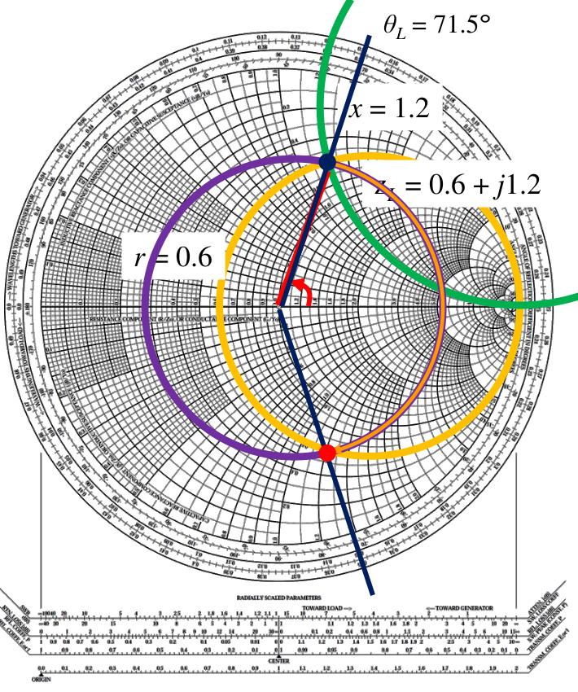

# 單元 07｜史密斯圖（一）

從複數反射平面，走到完整的阻抗網格

原始影片：[陳晏笙老師「天線」單元 7](https://www.youtube.com/watch?v=bCQsw8MQCJI)

老師講義：[Lecture 2 — Circuit Parameters](https://drive.google.com/file/d/1wHWHyXrkJXY4lCvk3vFuf73KGOgOCiky/view)，第 42–46、53–60 頁

影片長度：約 43 分鐘　建議閱讀：約 20 分鐘

前置單元：05–06。會用 $`\Gamma=(Z-Z_0)/(Z+Z_0)`$ 與複數表示。

> **核心觀念：** 史密斯圖是反射係數的複數平面，疊上正規化阻抗的刻度。線上的傳播在 $`\Gamma`$ 平面很容易畫；加入阻抗刻度後，又能直接讀出你真正想知道的阻抗。

## 本單元的三個目標

1.  把匹配、短路、開路與複數負載放到 $`\Gamma`$ 平面。

2.  說明為何要把阻抗除以參考阻抗 $`Z_0`$。

3.  從代數關係推導等電阻圓、等電抗圓，看懂兩族圓如何組成史密斯圖。

## 講義與影片對照

正文依老師講義的頁序編排；第 42 頁為章節目錄。第 47–52 頁的電壓幾何與開槽線量測，對照[單元 09](009_史密斯圖（三）.md)。影片開頭複習 VSWR 的部分可回查單元 06。以下時間依影片口述與換頁畫面核對，作為主題定位；第 59–60 頁在片尾先介紹，第 8 單元接續讀圖例題。

| 老師講義 | 原英文主題 | 中文內容 | 影片定位 |
|:--|:--|:--|:--|
| 42–44 | Contents / Z Plane vs. Γ Plane / Properties of Γ Plane | 由阻抗轉到反射係數、沿線旋轉 | [約 12:50–19:10](https://www.youtube.com/watch?v=bCQsw8MQCJI&t=770s) |
| 45–46 | Marking Impedances on Γ Plane (1/2–2/2), EX 2.1 | 四個負載；0.3 波長第二問依講義補齊 | [約 19:10–23:30](https://www.youtube.com/watch?v=bCQsw8MQCJI&t=1150s) |
| 53–55 | Why Don’t We Do the Entire System on Γ Plane? / Concept of Smith Chart / Why Is Smith Chart So Smart? | 在反射平面直接標阻抗，再正規化 | [約 23:30–31:30](https://www.youtube.com/watch?v=bCQsw8MQCJI&t=1410s) |
| 56–57 | Normalized Impedances on Γ Plane (1/4–2/4) | 直線映射與圓方程推導 | [約 31:30–35:20](https://www.youtube.com/watch?v=bCQsw8MQCJI&t=1890s) |
| 58 | Normalized Impedances on Γ Plane (3/4) | 等電阻圓 | [約 35:20–37:20](https://www.youtube.com/watch?v=bCQsw8MQCJI&t=2120s) |
| 59–60 | Normalized Impedances on Γ Plane (4/4) / How to Read Impedances From Smith Chart? | 等電抗圓、完整網格與上下半平面 | [約 37:20–片尾](https://www.youtube.com/watch?v=bCQsw8MQCJI&t=2240s) |

## 1．把阻抗問題轉到反射係數平面（Z Plane vs. Γ Plane / Properties of Γ Plane，pp.43–44）

影片對照：[約 12:50–19:10](https://www.youtube.com/watch?v=bCQsw8MQCJI&t=770s)

令 $`\Gamma=u+jv`$，橫軸是實部 $`u`$，縱軸是虛部 $`v`$。距原點的長度是 $`|\Gamma|`$，與實軸的夾角是反射相位。


被動負載、正實數 $`Z_0`$ 下，$`|\Gamma|\le1`$，所以常用範圍在單位圓內；純電抗位於圓周，匹配點位於中心。

### 1.1 同一位置可以用阻抗或反射係數描述

沿用前面單元的座標：負載在 $`z=0`$，源端在 $`z=-l`$。對無損線，老師先由電壓與電流的比值得到：

```math
Z(z)=\frac{V(z)}{I(z)}
=Z_0\frac{1+\Gamma(z)}{1-\Gamma(z)},\qquad
\Gamma(z)=\frac{Z(z)-Z_0}{Z(z)+Z_0}.
```

兩個平面描述同一個端口，只是座標不同。在阻抗平面直接追蹤沿線變化，必須處理帶有正切的複數分式；在反射平面則是：

```math
\Gamma(z)=\Gamma_L e^{2j\beta z},\qquad
\Gamma(-d)=\Gamma_L e^{-2j\beta d},\quad d\ge0.
```

從負載往源端走正距離 $`d`$，反射係數繞原點**順時針**轉 $`2\beta d`$，大小保持不變。走 $`\lambda/2`$，便轉完整一圈；這是反射係數的相位往返累積，不能直接當成單向行進波的 $`\beta d`$。

> **座標校註：** pp.43–44 部分線路標籤把位於 $`z=-z_0`$ 的量寫成 $`\Gamma(z_0)`$ 或 $`Z(z_0)`$。依該頁座標與順時針圖示，應讀為 $`\Gamma(-z_0)`$、$`Z(-z_0)`$；本筆記以正距離 $`d=-z`$ 避免混淆。

## 2．老師例題：四種負載與線長旋轉（Marking Impedances on Γ Plane，EX 2.1，pp.45–46）

| 負載                 | $`\Gamma_L`$  | 圖上的位置 |
|:---------------------|:------------|:-----------|
| A：$`50\,\Omega`$      | 0           | 原點       |
| B：$`0\,\Omega`$       | $`-1`$        | 最左端     |
| C：開路              | $`+1`$        | 最右端     |
| D：$`50+j150\,\Omega`$ | $`(9+j6)/13`$ | 上半平面   |

對 D：

```math
\Gamma_L=\frac{j150}{100+j150}
=\frac9{13}+j\frac6{13}\approx0.6923+j0.4615.
```

**講義第二問（本片未逐步計算，依 p.46 補齊）：**D 負載往源端走 $`0.3\lambda`$ 後，反射係數為何？由未四捨五入的複數值重算，大小約 0.8321、相位約 33.69°，因此

```math
\begin{aligned}
\Delta\angle\Gamma&=-2\beta(0.3\lambda)=-216^\circ,\\
\Gamma(-0.3\lambda)&\approx0.8321\angle(-182.31^\circ)
=0.8321\angle177.69^\circ.
\end{aligned}
```

**數值對照：**p.46 列出 33.78° 與 177.78°；按題目原始負載精算為 33.69° 與 177.69°。差異很小，但旋轉量仍必須是 216°。圖上的終點在左半平面、略高於負實軸。是觀察端口的 $`\Gamma`$ 在轉動，負載元件本身沒有改變。

> **核心觀念：** 線長變換在 $`\Gamma`$ 平面是一個旋轉；無損線上的旋轉不會改變距原點的半徑。

## 3．直接在反射平面讀阻抗（Concept of Smith Chart，pp.53–54）

老師把計算程序拆成三步：


1. 由已知 $`Z_L`$ 算出 $`\Gamma_L`$。
2. 順時針旋轉 $`2\beta l`$，得到 $`\Gamma_{\rm in}`$。
3. 把 $`\Gamma_{\rm in}`$ 換回 $`Z_{\rm in}`$。

若反射平面上的每一點，事先都標好它對應的阻抗，第 1、3 步就能直接讀圖；中間仍使用簡單的旋轉。**史密斯圖（Smith chart）就是疊上阻抗刻度的反射係數平面。** 圖上的位置仍是複數 $`\Gamma`$，不是把橫軸直接改成電阻、縱軸改成電抗。

> **公式校正：**p.54 的 Step 2 印成 $`\Gamma_{\rm in}=\Gamma_L e^{2j\beta l}`$。依 pp.43–44 的座標、p.53 的順時針操作及 $`z=-l`$，應為 $`\Gamma_{\rm in}=\Gamma_L e^{-2j\beta l}`$。負號才能與同頁的輸入阻抗正切公式相符。

## 4．正規化：讓同一張圖適用不同系統（Why Is Smith Chart So Smart?，p.55）

影片對照：[約 26:00–31:30](https://www.youtube.com/watch?v=bCQsw8MQCJI&t=1560s)

原本

```math
\Gamma=\frac{Z-Z_0}{Z+Z_0}.
```

若直接用歐姆值，一張圖就要依不同 $`Z_0`$ 重畫刻度。影片改用正規化阻抗：

```math
z_n=\frac Z{Z_0}=r+jx,\qquad
r=\frac R{Z_0},\quad x=\frac X{Z_0}.
```

這裡 $`z_n`$ 是無單位的阻抗，不是沿線位置座標 $`z`$。 代入後，

```math
\boxed{\Gamma=\frac{z_n-1}{z_n+1}},\qquad
\boxed{z_n=\frac{1+\Gamma}{1-\Gamma}}.
```

所以同一個正規化阻抗只對應一個 $`\Gamma`$，與 $`Z_0`$ 的歐姆值無關。讀圖後再乘回 $`Z_0`$，才得到實際阻抗。

### 匹配、短路、開路在兩種平面

| 情境 | 正規化阻抗平面 | $`\Gamma`$ 平面 |
|:-----|:---------------|:--------------|
| 匹配 | $`z_n=1`$        | $`\Gamma=0`$    |
| 短路 | $`z_n=0`$        | $`\Gamma=-1`$   |
| 開路 | $`z_n\to\infty`$ | $`\Gamma\to1`$  |

這個轉換把無限大的開路阻抗，放到 $`\Gamma`$ 平面的一個有限點。因此不能拿一般阻抗直角座標的距離，直接當成史密斯圖上的距離。

> **核心觀念：** 圖上的 $`r=1`$ 表示 $`R=Z_0`$；不是所有系統都表示 1 $`\Omega`$。

## 5．阻抗平面的直線如何變成圓？（Normalized Impedances on Γ Plane 1/4–2/4，pp.56–57）

影片對照：[約 31:30–35:20](https://www.youtube.com/watch?v=bCQsw8MQCJI&t=1890s)

第 56 頁先畫正規化阻抗平面的兩族直線：$`r=r_0`$ 是垂直線，$`x=x_0`$ 是水平線。老師的問題是：經過阻抗與反射係數的映射，這些線在 $`\Gamma`$ 平面會變成什麼形狀？

把 $`z_n=r+jx`$ 與 $`\Gamma=u+jv`$ 代入反轉換：

```math
r+jx=\frac{1+u+jv}{1-u-jv}.
```

分子、分母同乘 $`1-u+jv`$，分母變成實數：

```math
r+jx=
\frac{1-u^2-v^2+j2v}{(1-u)^2+v^2}.
```

對照實、虛部：

```math
r=\frac{1-u^2-v^2}{(1-u)^2+v^2},\qquad
x=\frac{2v}{(1-u)^2+v^2}.
```

### 固定 $`r`$，讓 $`x`$ 改變，會得到什麼？

先取實部關係並移項：

```math
r[(1-u)^2+v^2]=1-u^2-v^2,
```

```math
(r+1)(u^2+v^2)-2ru+r-1=0.
```

除以 $`r+1`$ 並對 $`u`$ 配方，得到

```math
\boxed{\left(u-\frac r{r+1}\right)^2+v^2
=\left(\frac1{r+1}\right)^2}.
```

這是標準圓方程。因此每個固定的正規化電阻，都有自己的等電阻圓：

```math
\text{圓心}=\left(\frac r{r+1},0\right),\qquad
\text{半徑}=\frac1{r+1}.
```

### 也可先看到另一族圓的形式

由虛部式可整理為

```math
(u-1)^2+\left(v-\frac1x\right)^2=\left(\frac1x\right)^2,\qquad x\ne0.
```

這就是等電抗圓；p.59 再用它補齊另一族刻度。

> **核心觀念：** 等電阻圓不是額外的經驗刻度，而是阻抗與反射係數轉換式的幾何結果。

## 6．等電阻圓的大小、位置與讀法（Normalized Impedances on Γ Plane 3/4，p.58）

影片對照：[約 35:20–37:20](https://www.youtube.com/watch?v=bCQsw8MQCJI&t=2120s)


### 四個直接看得出的性質

1.  $`r=0`$ 時，圓心在原點，半徑為 1，就是最外面的單位圓。

2.  $`r=1`$ 時，圓心在 $`(1/2,0)`$，半徑 $`1/2`$；它通過匹配點 $`\Gamma=0`$。

3.  $`r`$ 越大，圓心越靠右、半徑越小；左端點為 $`(r-1)/(r+1)`$。

4.  所有等電阻圓都相切於 $`\Gamma=1`$。那裡代表阻抗趨近無限大的極限，不能當成有限 $`r`$ 的一般數值點。

### 前面的 D 點確實在 $`r=1`$ 圓上

50 $`\Omega`$ 系統中的 $`50+j150\,\Omega`$，正規化為 $`1+j3`$。代入 $`\Gamma=(9+j6)/13`$：

```math
\left(\frac9{13}-\frac12\right)^2+\left(\frac6{13}\right)^2
=\frac14.
```

它位於 $`r=1`$ 圓的上半部。沿這個圓移動表示保持電阻不變、改變電抗；並非沿線移動的等 $`|\Gamma|`$ 圓。 **補充解說／重算例題：**等電阻圓的圓心通常不在原點；等 $`|\Gamma|`$ 圓的圓心一定在原點。兩者用途不同，不要看到「一個圓」就當成同一種操作。

> **核心觀念：** 圖上的點表示一個複數阻抗；等電阻圓是一族可能阻抗，還需要電抗刻度才可定位其中的一點。

## 7．疊上等電抗圓，完成史密斯圖（Normalized Impedances on Γ Plane 4/4 / How to Read Impedances From Smith Chart?，pp.59–60）

影片對照：[約 37:20–片尾](https://www.youtube.com/watch?v=bCQsw8MQCJI&t=2240s)。老師把固定電抗的水平線映到反射平面，再將兩族圓疊起來。

對非零正規化電抗 $`x`$，等電抗圓的圓心為 $`(1,1/x)`$、半徑為 $`1/|x|`$。被動阻抗只取單位圓內的弧：正電抗在上半平面（感性），負電抗在下半平面（容性）；$`x=0`$ 則對應實軸。各弧在最右側的開路極限點相會。



**老師的讀圖提醒：**這些圓弧像地圖的等高線，每條線標示某個固定的阻抗分量。先選等電阻圓，再找等電抗弧，兩者交點便定位出一個正規化阻抗。圖上位置仍是反射係數；阻抗只是加在這個平面上的刻度。

p.60 接著用 $`Z_0=50\,\Omega`$、$`Z_L=30+j60\,\Omega`$ 與 $`0.2\lambda`$ 線長示範讀圖。本片先認識網格；完整的標點、旋轉、反正規化及數值校驗，接在[單元 08 的講義 p.60 例題](008_史密斯圖（二）.md)。

## 8．補充解說與重算例題

### 8.1 同一圖點，不同歐姆值

50 $`\Omega`$ 系統中的 $`25+j50\,\Omega`$，與 75 $`\Omega`$ 系統中的 $`37.5+j75\,\Omega`$，正規化後都是 $`z_n=0.5+j1`$。它們位於同一圖點，但實際歐姆值不同；圖上必須註明參考阻抗，才能還原負載。

### 8.2 用被動性檢查圖點

對 $`z_n=r+jx`$，直接由轉換式可得：

```math
1-\lvert\Gamma\rvert^2
=\frac{4r}{(r+1)^2+x^2}.
```

因此在正實數參考阻抗下，$`r>0`$ 位於單位圓內，$`r=0`$ 落在圓周。等電阻圓通常不以原點為圓心；沿無損線移動的等 $`\lvert\Gamma\rvert`$ 圓才以原點為圓心。兩種圓代表不同操作。

## 9．自測與解析

建議用 5 分鐘作答。

1.  50 $`\Omega`$ 參考阻抗下，$`100-j50\,\Omega`$ 的正規化阻抗是多少？若圖上讀到 $`0.5+j2`$，真實阻抗是多少？

2.  推導 $`r=2`$ 等電阻圓的圓心、半徑與最左端實軸交點。

3.  50 $`\Omega`$ 負載接在 50 $`\Omega`$ 線上，史密斯圖的點在最右端還是中心？開路在哪裡？

4.  影片的 $`50+j150\,\Omega`$ 負載，為什麼在 $`r=1`$ 圓上，卻沒有匹配？

5.  無損線往源端移動 $`\lambda/8`$，$`\Gamma`$ 在圖上轉幾度？它沿等電阻圓還是等 $`|\Gamma|`$ 圓移動？

### 答案與解析

1.  $`z_n=2-j1`$；反正規化 $`Z=50(0.5+j2)=25+j100\,\Omega`$。

2.  圓心 $`(2/3,0)`$，半徑 $`1/3`$；最左端 $`u=1/3`$。可由 $`v=0`$、$`z_n=2`$ 的反射係數直接驗算。

3.  匹配在中心 $`\Gamma=0`$；開路在最右端 $`\Gamma=1`$。最右端不表示「阻抗正好等於 $`Z_0`$」。

4.  因電阻部分等於 $`Z_0`$，但仍有 $`j150\,\Omega`$ 電抗；完全匹配需整個負載阻抗等於 $`Z_0`$。

5.  相位改變 $`-2\beta(\lambda/8)=-90^\circ`$，順時針。沿以原點為中心的等 $`|\Gamma|`$ 圓移動，電阻可能改變。

**本單元公式卡**

```math
\begin{aligned}
z_n&=\frac Z{Z_0},\quad
\Gamma=\frac{z_n-1}{z_n+1},\quad
z_n=\frac{1+\Gamma}{1-\Gamma},\\
\text{等電阻圓：}\quad
\left(u-\frac r{r+1}\right)^2+v^2&=\frac1{(r+1)^2}.
\end{aligned}
```

**下一單元：**[史密斯圖（二）](008_史密斯圖（二）.md)。從完整網格進入讀圖、阻抗與導納的轉換，進一步用圖求解線長、阻抗與匹配問題。
