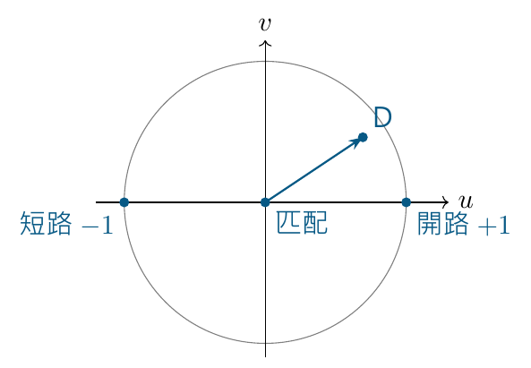
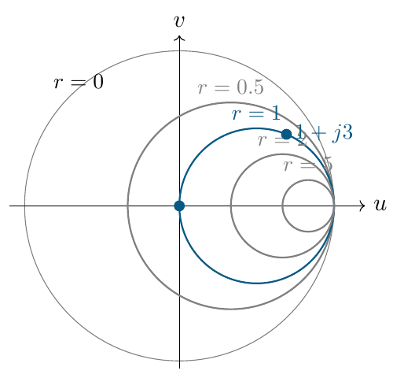

# 單元 07｜史密斯圖（一）

[下載原始 PDF](../pdf/007_史密斯圖（一）.pdf)

從複數反射平面，走到等電阻圓

原始影片：[陳晏笙老師「天線」單元 7](https://www.youtube.com/watch?v=bCQsw8MQCJI)

影片長度：約 43 分鐘　建議閱讀：約 20 分鐘

前置單元：05–06。會用 $\Gamma=(Z-Z_0)/(Z+Z_0)$ 與複數表示。

> **核心觀念：** 史密斯圖是反射係數的複數平面，疊上正規化阻抗的刻度。線上的傳播在 $\Gamma$ 平面很容易畫；加入阻抗刻度後，又能直接讀出你真正想知道的阻抗。

## 本單元的三個目標

1.  把匹配、短路、開路與複數負載放到 $\Gamma$ 平面。

2.  說明為何要把阻抗除以參考阻抗 $Z_0$。

3.  從代數關係推導等電阻圓，看懂圓心與半徑。

## 老師採用的概念流程

若每一步都重算複數分式，程序仍能完成，但不直觀。史密斯圖把第一、最後兩次轉換，變成同一張圖上的阻抗刻度。

## 閱讀地圖

第 2 頁：$\Gamma$ 平面與影片例題；第 3 頁：正規化；第 4 頁：圓的推導；第 5 頁：等電阻圓與讀圖；第 6 頁：自測。 前段重複 VSWR 與圖軸標示的提醒，已整合於單元 06；本講義集中於本支影片的史密斯圖新內容。新增算例標示為補充。

## 1．先認識反射係數的複數平面

影片對照：[約 13:00](https://www.youtube.com/watch?v=bCQsw8MQCJI&t=780s)－[25:00](https://www.youtube.com/watch?v=bCQsw8MQCJI&t=1500s)

令 $\Gamma=u+jv$，橫軸是實部 $u$，縱軸是虛部 $v$。距原點的長度是 $|\Gamma|$，與實軸的夾角是反射相位。

被動負載、正實數 $Z_0$ 下，$|\Gamma|\le1$，所以常用範圍在單位圓內；純電抗位於圓周，匹配點位於中心。

### 影片例題：50 $\Omega$ 線接四種負載

| 負載                 | $\Gamma_L$  | 圖上的位置 |
|:---------------------|:------------|:-----------|
| A：$50\,\Omega$      | 0           | 原點       |
| B：$0\,\Omega$       | $-1$        | 最左端     |
| C：開路              | $+1$        | 最右端     |
| D：$50+j150\,\Omega$ | $(9+j6)/13$ | 上半平面   |

對 D：

$$
\Gamma_L=\frac{j150}{100+j150}
=\frac9{13}+j\frac6{13}\approx0.6923+j0.4615.
$$

**補充解說／重算例題：**它的大小約 0.8321，相位約 33.69°。從負載往源端走 $0.3\lambda$，$\Gamma$ 轉動 $-216^\circ$，大小不變；相位約 177.69°。是 $\Gamma$ 在轉動，不是負載元件真的改變。

> **核心觀念：** 線長變換在 $\Gamma$ 平面是一個旋轉；無損線上的旋轉不會改變距原點的半徑。

## 2．為什麼一張圖能適用不同阻抗系統？

影片對照：[約 25:00](https://www.youtube.com/watch?v=bCQsw8MQCJI&t=1500s)－[33:00](https://www.youtube.com/watch?v=bCQsw8MQCJI&t=1980s)

原本

$$
\Gamma=\frac{Z-Z_0}{Z+Z_0}.
$$

若直接用歐姆值，一張圖就要依不同 $Z_0$ 重畫刻度。影片改用正規化阻抗：

$$
z_n=\frac Z{Z_0}=r+jx,\qquad
r=\frac R{Z_0},\quad x=\frac X{Z_0}.
$$

這裡 $z_n$ 是無單位的阻抗，不是沿線位置座標 $z$。 代入後，

$$
\boxed{\Gamma=\frac{z_n-1}{z_n+1}},\qquad
\boxed{z_n=\frac{1+\Gamma}{1-\Gamma}}.
$$

所以同一個正規化阻抗只對應一個 $\Gamma$，與 $Z_0$ 的歐姆值無關。讀圖後再乘回 $Z_0$，才得到實際阻抗。

### 正規化例題

**補充解說／重算例題：**50 $\Omega$ 系統中的 $25+j50\,\Omega$，與 75 $\Omega$ 系統中的 $37.5+j75\,\Omega$，都有

$$
z_n=0.5+j1.
$$

它們位於史密斯圖的同一點；但真實歐姆值不同。

### 匹配、短路、開路在兩種平面

| 情境 | 正規化阻抗平面 | $\Gamma$ 平面 |
|:-----|:---------------|:--------------|
| 匹配 | $z_n=1$        | $\Gamma=0$    |
| 短路 | $z_n=0$        | $\Gamma=-1$   |
| 開路 | $z_n\to\infty$ | $\Gamma\to1$  |

這個轉換把無限大的開路阻抗，放到 $\Gamma$ 平面的一個有限點。因此不能拿一般阻抗直角座標的距離，直接當成史密斯圖上的距離。

> **核心觀念：** 圖上的 $r=1$ 表示 $R=Z_0$；不是所有系統都表示 1 $\Omega$。

## 3．由代數推導等電阻圓

影片對照：[約 33:00](https://www.youtube.com/watch?v=bCQsw8MQCJI&t=1980s)－[40:00](https://www.youtube.com/watch?v=bCQsw8MQCJI&t=2400s)

把 $z_n=r+jx$ 與 $\Gamma=u+jv$ 代入反轉換：

$$
r+jx=\frac{1+u+jv}{1-u-jv}.
$$

分子、分母同乘 $1-u+jv$，分母變成實數：

$$
r+jx=
\frac{1-u^2-v^2+j2v}{(1-u)^2+v^2}.
$$

對照實、虛部：

$$
r=\frac{1-u^2-v^2}{(1-u)^2+v^2},\qquad
x=\frac{2v}{(1-u)^2+v^2}.
$$

### 固定 $r$，讓 $x$ 改變，會得到什麼？

先取實部關係並移項：

$$
r[(1-u)^2+v^2]=1-u^2-v^2,
$$

$$
(r+1)(u^2+v^2)-2ru+r-1=0.
$$

除以 $r+1$ 並對 $u$ 配方，得到

$$
\boxed{\left(u-\frac r{r+1}\right)^2+v^2
=\left(\frac1{r+1}\right)^2}.
$$

這是標準圓方程。因此每個固定的正規化電阻，都有自己的等電阻圓：

$$
\text{圓心}=\left(\frac r{r+1},0\right),\qquad
\text{半徑}=\frac1{r+1}.
$$

### 也可先看到另一族圓的形式

由虛部式可整理為

$$
(u-1)^2+\left(v-\frac1x\right)^2=\left(\frac1x\right)^2,\qquad x\ne0.
$$

這就是等電抗圓；下一單元以它組成完整史密斯圖。本頁先掌握等電阻圓的配方推導。

> **核心觀念：** 等電阻圓不是額外的經驗刻度，而是阻抗與反射係數轉換式的幾何結果。

## 4．等電阻圓的大小、位置與讀法

影片對照：[約 36:00](https://www.youtube.com/watch?v=bCQsw8MQCJI&t=2160s)－[42:50](https://www.youtube.com/watch?v=bCQsw8MQCJI&t=2570s)

### 四個直接看得出的性質

1.  $r=0$ 時，圓心在原點，半徑為 1，就是最外面的單位圓。

2.  $r=1$ 時，圓心在 $(1/2,0)$，半徑 $1/2$；它通過匹配點 $\Gamma=0$。

3.  $r$ 越大，圓心越靠右、半徑越小；左端點為 $(r-1)/(r+1)$。

4.  所有等電阻圓都相切於 $\Gamma=1$。那裡代表阻抗趨近無限大的極限，不能當成有限 $r$ 的一般數值點。

### 前面的 D 點確實在 $r=1$ 圓上

50 $\Omega$ 系統中的 $50+j150\,\Omega$，正規化為 $1+j3$。代入 $\Gamma=(9+j6)/13$：

$$
\left(\frac9{13}-\frac12\right)^2+\left(\frac6{13}\right)^2
=\frac14.
$$

它位於 $r=1$ 圓的上半部。沿這個圓移動表示保持電阻不變、改變電抗；並非沿線移動的等 $|\Gamma|$ 圓。 **補充解說／重算例題：**等電阻圓的圓心通常不在原點；等 $|\Gamma|$ 圓的圓心一定在原點。兩者用途不同，不要看到「一個圓」就當成同一種操作。

> **核心觀念：** 圖上的點表示一個複數阻抗；等電阻圓是一族可能阻抗，還需要電抗刻度才可定位其中的一點。

## 5．自測與答案

建議用 5 分鐘作答。

1.  50 $\Omega$ 參考阻抗下，$100-j50\,\Omega$ 的正規化阻抗是多少？若圖上讀到 $0.5+j2$，真實阻抗是多少？

2.  推導 $r=2$ 等電阻圓的圓心、半徑與最左端實軸交點。

3.  50 $\Omega$ 負載接在 50 $\Omega$ 線上，史密斯圖的點在最右端還是中心？開路在哪裡？

4.  影片的 $50+j150\,\Omega$ 負載，為什麼在 $r=1$ 圓上，卻沒有匹配？

5.  無損線往源端移動 $\lambda/8$，$\Gamma$ 在圖上轉幾度？它沿等電阻圓還是等 $|\Gamma|$ 圓移動？

### 答案與解析

1.  $z_n=2-j1$；反正規化 $Z=50(0.5+j2)=25+j100\,\Omega$。

2.  圓心 $(2/3,0)$，半徑 $1/3$；最左端 $u=1/3$。可由 $v=0$、$z_n=2$ 的反射係數直接驗算。

3.  匹配在中心 $\Gamma=0$；開路在最右端 $\Gamma=1$。最右端不表示「阻抗正好等於 $Z_0$」。

4.  因電阻部分等於 $Z_0$，但仍有 $j150\,\Omega$ 電抗；完全匹配需整個負載阻抗等於 $Z_0$。

5.  相位改變 $-2\beta(\lambda/8)=-90^\circ$，順時針。沿以原點為中心的等 $|\Gamma|$ 圓移動，電阻可能改變。

### 本單元公式卡

$$
z_n=\frac Z{Z_0},\quad
\Gamma=\frac{z_n-1}{z_n+1},\quad
z_n=\frac{1+\Gamma}{1-\Gamma}.
$$

$$
\text{等電阻圓：}\quad
\left(u-\frac r{r+1}\right)^2+v^2=\frac1{(r+1)^2}.
$$

**下一單元：**史密斯圖（二）。加入等電抗圓、阻抗與導納的轉換，進一步用圖求解線長、阻抗與匹配問題。
