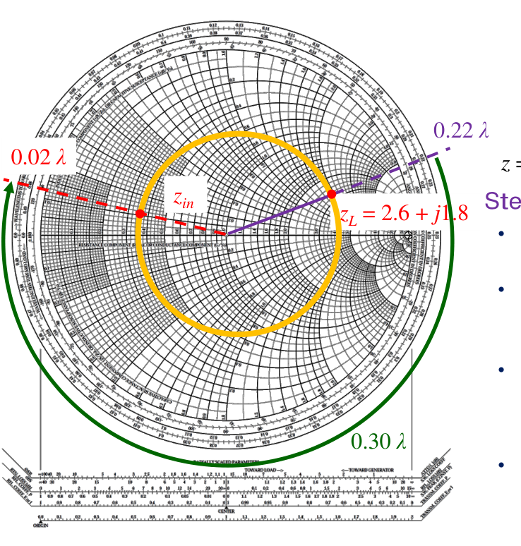
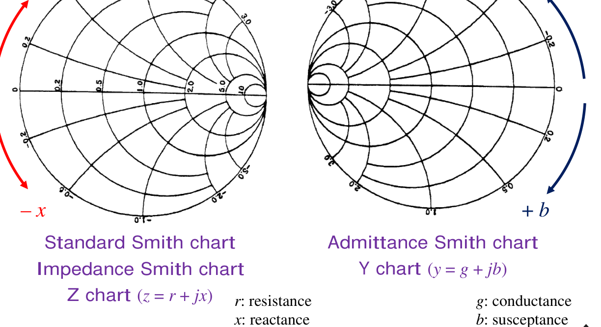
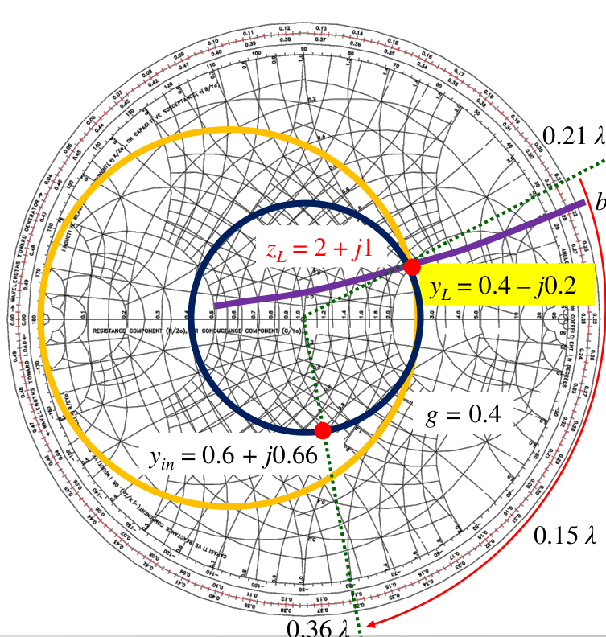
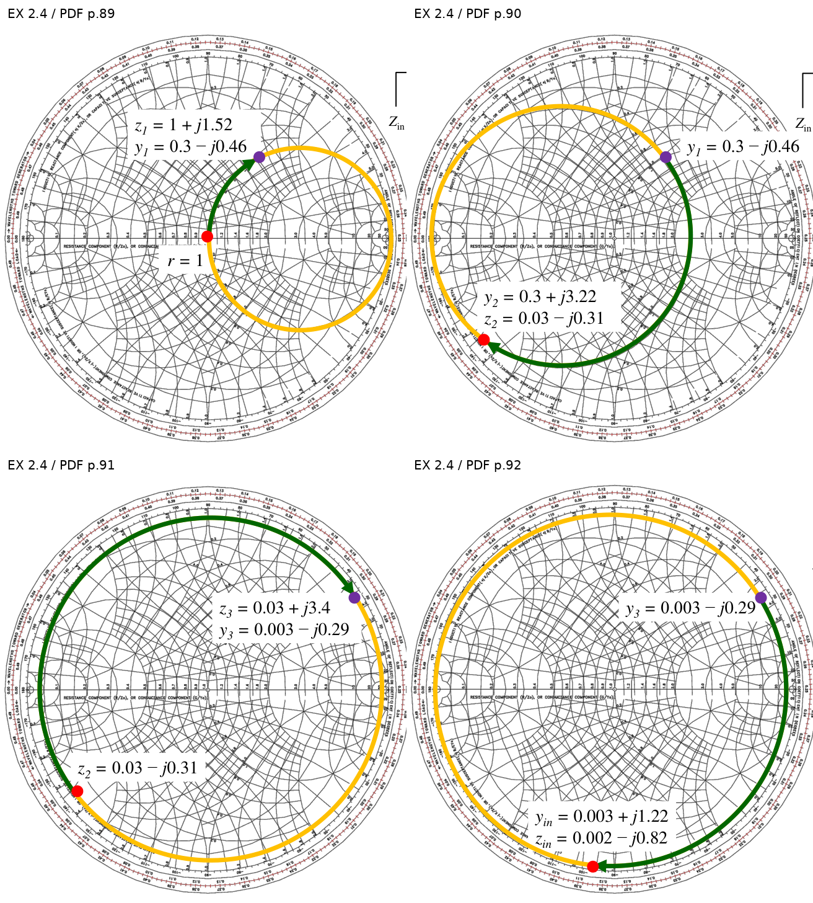
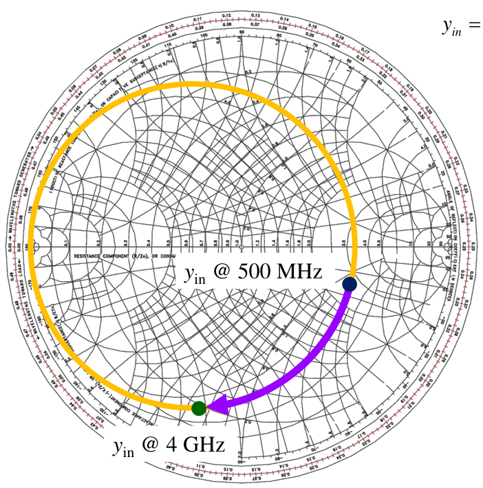
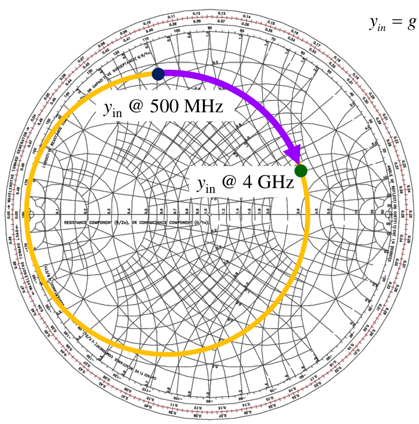
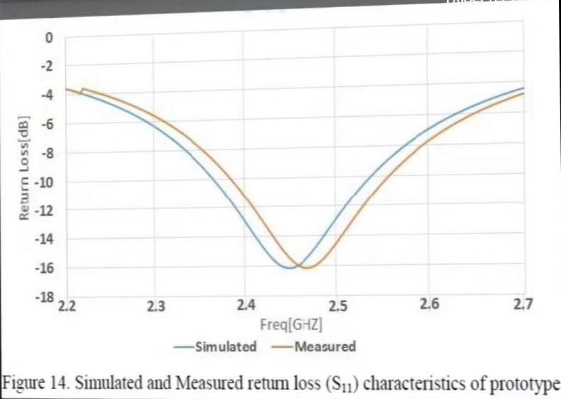
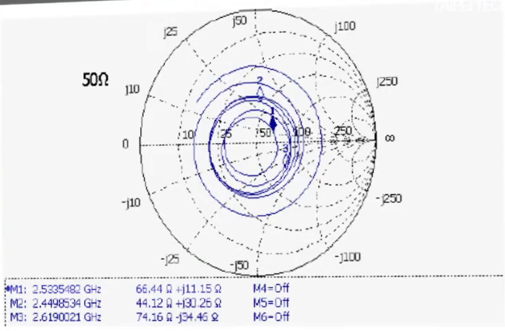

# 單元 08｜史密斯圖（二）

由阻抗讀圖到導納操作：傳輸線、串聯元件與並聯元件

原始影片：[陳晏笙老師「天線」單元 8](https://www.youtube.com/watch?v=sJKNY5c5dsQ)

老師講義：[Lecture 2 — Circuit Parameters](https://drive.google.com/file/d/1wHWHyXrkJXY4lCvk3vFuf73KGOgOCiky/view)，PDF **第 59–94 頁**。

影片長度：約 97 分鐘　建議閱讀：約 45 分鐘

前置單元：05–07；先熟悉反射係數、正規化阻抗與等電阻圓。

本單元依老師講義的頁序，先練習讀取阻抗、反射、VSWR 與線長，再學串聯元件與掃頻，最後引入導納圖，完成串並聯 LC 網路。三個原講義例題 **EX 2.2、EX 2.3、EX 2.4** 都保留完整計算流程，並區分老師的讀圖近似與代數重算。

> 串聯元件加阻抗，並聯元件加導納；沿無損傳輸線移動，則旋轉反射係數。先認清操作，再決定該沿哪一族圓移動。

## 講義與影片對照

以下影片連結是可直接回看的**約略播放定位點**，不是換頁時間；已對照影片口述與相關畫面。正文依講義頁序編排，老師板書、設計判讀與片尾量測示例放在對應主題旁。

| 老師講義頁碼 | 原英文主題 | 本章內容 | 影片／閱讀定位 |
|:---|:---|:---|:---|
| 59–60 | Normalized Impedances on Γ Plane; How to Read Impedances From Smith Chart? | 等電抗圓；30+j60 Ω 與 0.2λ 線長 | [約 02:00：完整圖與板書](https://www.youtube.com/watch?v=sJKNY5c5dsQ&t=120s)；[08:00：p.60](https://www.youtube.com/watch?v=sJKNY5c5dsQ&t=480s) |
| 61–63 | Smith Chart; Landmark Points | 反射、VSWR、導納與特殊點 | [約 24:00：p.61](https://www.youtube.com/watch?v=sJKNY5c5dsQ&t=1440s)；[28:00：p.62](https://www.youtube.com/watch?v=sJKNY5c5dsQ&t=1680s)；[30:00：p.63](https://www.youtube.com/watch?v=sJKNY5c5dsQ&t=1800s) |
| 64–67 | Basic Procedures of Smith Chart | EX 2.2：六個讀圖量 | 老師[約 30:16 略過此例](https://www.youtube.com/watch?v=sJKNY5c5dsQ&t=1816s)；本章依講義補齊 |
| 68 | Characteristics of Smith Chart | 設計與量測用途 | [約 31:00：p.68](https://www.youtube.com/watch?v=sJKNY5c5dsQ&t=1860s) |
| 69–74 | Connecting ZL with a TL / Inductor / Capacitor in Series | 線長與串聯元件；EX 2.3 | [約 38:00：p.69](https://www.youtube.com/watch?v=sJKNY5c5dsQ&t=2280s)；[45:00：p.73](https://www.youtube.com/watch?v=sJKNY5c5dsQ&t=2700s) |
| 75–76 | Complex Impedance vs. Frequency | 串聯 RL、RC 掃頻圖例 | [約 50:00：p.76](https://www.youtube.com/watch?v=sJKNY5c5dsQ&t=3000s) |
| 77–84 | If We Deal With Connection in Parallel…; Admittance Smith Chart | 導納、Z/Y 刻度、0.15λ 導納例題 | [約 60:00：p.80](https://www.youtube.com/watch?v=sJKNY5c5dsQ&t=3600s)；[70:00：p.83](https://www.youtube.com/watch?v=sJKNY5c5dsQ&t=4200s) |
| 85–86 | Connecting ZL with a Capacitor / Inductor in Parallel | 並聯元件與等電導圓 | [約 80:00：p.85](https://www.youtube.com/watch?v=sJKNY5c5dsQ&t=4800s) |
| 87–92 | Shunt and Series Impedances | EX 2.4：四個 LC 元件逐級化簡 | [約 84:00：p.90](https://www.youtube.com/watch?v=sJKNY5c5dsQ&t=5040s)；[85:00：p.92](https://www.youtube.com/watch?v=sJKNY5c5dsQ&t=5100s) |
| 93–94 | Complex Admittance vs. Frequency | 並聯 RC、RL 掃頻圖例 | [約 86:45：p.93](https://www.youtube.com/watch?v=sJKNY5c5dsQ&t=5205s)；[87:45：p.94](https://www.youtube.com/watch?v=sJKNY5c5dsQ&t=5265s) |
| 影片補充，PDF 無此例 | Paper Review / Measurement Example | 微帶天線反射曲線、螺旋軌跡與量測參考面 | [約 90:06–97:03](https://www.youtube.com/watch?v=sJKNY5c5dsQ&t=5406s)；見第 15 節 |

## 1．等電抗圓：把完整阻抗放上反射係數平面

*Normalized Impedances on Γ Plane (4/4)，講義第 59 頁。*

令正規化阻抗 $`z_n=Z/Z_0=r+jx`$，反射係數 $`\Gamma=u+jv`$。由

```math
z_n=\frac{1+\Gamma}{1-\Gamma}
=\frac{1-u^2-v^2+j2v}{(1-u)^2+v^2},
```

可分別讀出

```math
r=\frac{1-u^2-v^2}{(1-u)^2+v^2},\qquad
x=\frac{2v}{(1-u)^2+v^2}.
```

上一單元已得到等電阻圓；固定 $`x\ne0`$，把第二式配方，就得到等電抗圓（constant reactance circle）：

```math
\left(u-\frac{r}{r+1}\right)^2+v^2=\frac{1}{(r+1)^2},
```

```math
(u-1)^2+\left(v-\frac1x\right)^2=\frac1{x^2}.
```

等電抗圓的圓心是 $`(1,1/x)`$，半徑為 $`1/|x|`$。被動負載取單位圓內的弧段；$`x=0`$ 直接對應實軸，不必代入含 $`1/x`$ 的公式。

在本課使用的 $`e^{j\omega t}`$ 慣例下，上半部 $`x>0`$ 是感性阻抗，下半部 $`x<0`$ 是容性阻抗；實軸 $`x=0`$ 是純電阻。純電阻仍可能不匹配，只有中心 $`r=1,x=0`$ 才匹配。

**老師開場的學習方法（[約 01:22–06:40](https://www.youtube.com/watch?v=sJKNY5c5dsQ&t=82s)）：**先把圖想成空白的 $`\Gamma`$ 平面，再自行畫出 $`r=0,0.5,1,2`$ 與 $`x=\pm0.5,\pm1,\pm2`$ 的主要圓弧。細刻度方便讀值，史密斯圖更重要的用途則是讓你立即判斷網路的性質與下一步操作；需要精確答案時，再用複數代數或程式驗算。本章因此並列讀圖近似與精算結果。

**讀圖程序：**先除以 $`Z_0`$，找到 $`r`$ 圓，再找有正負號的 $`x`$ 弧，交點就是負載。史密斯圖是在 $`\Gamma`$ 平面上標阻抗刻度，並不是用橫、縱直角座標直接畫 $`r,x`$。

## 2．第一個讀圖例：30+j60 Ω，再往源端走 0.2λ

*How to Read Impedances From Smith Chart?，講義第 60 頁。*

已知 $`Z_L=30+j60\,\Omega`$、$`Z_0=50\,\Omega`$。先正規化：

```math
z_L=0.6+j1.2.
```

在 $`r=0.6`$ 圓與 $`x=+1.2`$ 弧的交點，從圖心量出的半徑就是 $`|\Gamma_L|`$，與正實軸的夾角就是 $`\theta_L`$。代數檢查為

```math
\Gamma_L=\frac{z_L-1}{z_L+1}=0.2+j0.6
=0.63246\angle71.565^\circ.
```

**老師板書的尺量示範：**影片 [約 09:40–12:19](https://www.youtube.com/watch?v=sJKNY5c5dsQ&t=580s) 以圖心到外圈 8 cm、圖心到負載 5 cm 為例，故取 $`|\Gamma_L|\approx5/8=0.625`$、角度約 $`71.5^\circ`$。這是畫圖尺量近似；關鍵是用「負載半徑／單位圓半徑」正規化，不能直接把公分數當成反射係數。


依講義第 60 頁條件與反射係數公式重繪。Load 為負載點，Input 為輸入點；藍線順時針，虛線是等反射幅度圓。

從負載往源端走距離 $`d`$，無損線上的關係為

```math
\Gamma_{\rm in}=\Gamma_L e^{-j2\beta d},\qquad \beta=\frac{2\pi}{\lambda}.
```

本題 $`d=0.2\lambda`$，因此圖上的轉角為 $`-144^\circ`$，不是單程相位 $`-72^\circ`$。轉動後

```math
\Gamma_{\rm in}\approx0.19087-j0.60297
=0.63246\angle(-72.435^\circ),
```

```math
z_{\rm in}=\frac{1+\Gamma_{\rm in}}{1-\Gamma_{\rm in}}
\approx0.58924-j1.18430,
```

```math
\boxed{Z_{\rm in}\approx29.46-j59.22\ \Omega.}
```

老師講義讀圖取 $`z_{\rm in}\approx0.6-j1.2`$，所以得到 $`30-j60\,\Omega`$；這是圖上近似，不是恰好共軛的精確結果。

## 3．完整讀圖：反射、VSWR、倒數與特殊點

*Smith Chart (1/2)–(2/2); Landmark Points，講義第 61–63 頁。*

### 3.1 講義的 O、A、B、C 四個點

| 圖中點 | 正規化阻抗 | 讀圖重點 |
|:---|:---|:---|
| O | $`1+j0`$ | 圖心；與參考阻抗匹配 |
| A | $`1+j1`$ | $`r=1`$、$`x=1`$ 的交點 |
| B | $`0.5+j1.9`$ | 上半部的感性阻抗 |
| C | $`0.45-j0.55`$ | 下半部的容性阻抗；同時練習讀反射係數 |

第 61 頁由 C 點讀出 $`\Gamma\approx0.5\angle-115^\circ`$。用所標的阻抗代數重算，得到 $`|\Gamma|\approx0.5016`$、相位約 $`-114.23^\circ`$；差異屬讀圖與標值的精度。

### 3.2 等反射幅度圓與 VSWR

沿同一條無損線移動時，$`\rho=|\Gamma|`$ 不變。其等幅圓與實軸相交於 $`\Gamma=\pm\rho`$，代回阻抗轉換式：

```math
\Gamma=+\rho\ \Longrightarrow\ z_n=\frac{1+\rho}{1-\rho}=\mathrm{VSWR},
```

```math
\Gamma=-\rho\ \Longrightarrow\ z_n=\frac{1-\rho}{1+\rho}
=\frac1{\mathrm{VSWR}}.
```

因此右交點的正規化電阻就是 VSWR；也可直接用圖下方的 SWR 刻度讀取。第 62 頁的 C 點取 $`\rho\approx0.5`$，得到 VSWR 約 3。右交點對應電壓振幅最大處，左交點對應最小處，兩位置相隔 $`\lambda/4`$。

### 3.3 為什麼對面點可以讀導納？

長度 $`\lambda/4`$ 的無損線會把阻抗變為 $`Z_0^2/Z_L`$。正規化後

```math
z_{\lambda/4}=\frac1{z_L}=y_L,
\qquad y_L=\frac{Y_L}{Y_0},\quad Y_0=\frac1{Z_0}.
```

老師在 [約 25:37–26:26](https://www.youtube.com/watch?v=sJKNY5c5dsQ&t=1537s) 推算時也更正了轉角：$`\lambda/4`$ 對反射係數是 $`2\beta(\lambda/4)=\pi=180^\circ`$。

在圖上轉半圈，$`\Gamma\to-\Gamma`$，使用同一套 Z 刻度所讀到的數值，便是原阻抗的正規化導納。講義 C 點的對面點 D 為

```math
y_C=\frac1{0.45-j0.55}\approx0.8911+j1.0891.
```

注意：這裡可用旋轉作**倒數讀值**，不表示電路真的加了一段線；兩種用途必須分清楚。

### 3.4 三個地標與兩種幾何操作

| 地標／操作 | 反射係數上的位置或變化 | 阻抗意義 |
|:---|:---|:---|
| 短路 | 最左端 $`\Gamma=-1`$ | $`Z_L=0`$ |
| 開路 | 最右端 $`\Gamma=+1`$ | $`Z_L\to\infty`$ |
| 匹配 | 中心 $`\Gamma=0`$ | $`Z_L=Z_0`$、$`z_L=1`$ |
| 對實軸鏡射 | $`\Gamma\to\Gamma^*`$ | $`z_L\to z_L^*`$；電抗變號 |
| 繞圖心轉 180° | $`\Gamma\to-\Gamma`$ | 用 Z 刻度讀出 $`1/z_L=y_L`$ |

第 63 頁例子為 $`z_L=0.3+j0.5`$：反射係數約 $`0.62\angle123^\circ`$；鏡射得 $`0.3-j0.5`$，而對面點讀出 $`y_L\approx0.88-j1.47`$。**共軛與倒數是兩件事。**

## 4．EX 2.2：一條 0.3λ 傳輸線，求六個量

*Basic Procedures of Smith Chart (1/4)–(4/4)，講義第 64–67 頁。*

已知 $`Z_L=130+j90\,\Omega`$，終接在長 $`0.3\lambda`$、特性阻抗 $`50\,\Omega`$ 的無損線上。題目依序要求負載反射係數、輸入反射係數、VSWR、回波損耗、輸入阻抗、輸入導納。

### 4.1 先定位負載，讀出反射與匹配程度

```math
z_L=\frac{130+j90}{50}=2.6+j1.8,
```

```math
\Gamma_L=\frac{1.6+j1.8}{3.6+j1.8}
=0.55556+j0.22222
=0.59835\angle21.801^\circ.
```

由半徑再求

```math
\mathrm{VSWR}=\frac{1+|\Gamma_L|}{1-|\Gamma_L|}
\approx3.9795,
\qquad
\mathrm{RL}=-20\log_{10}|\Gamma_L|\approx4.4609\ \mathrm{dB}.
```

講義第 65 頁讀圖列 $`|\Gamma_L|\approx0.6`$、相位 $`21.8^\circ`$、VSWR 3.98、RL 4.4 dB。這些是不同刻度的近似讀值；保留完整精度重算時，以以上結果為準。

### 4.2 沿線往源端走：外圈線長刻度如何跨過零點？



來源：老師講義第 66 頁讀圖部分。紅點是負載，橘點是輸入；綠色外圈箭頭表示往源端走 $`0.3\lambda`$。

外圈「toward generator」刻度讀得負載約在 $`0.22\lambda`$。加上線長後

```math
0.22\lambda+0.30\lambda=0.52\lambda
\equiv0.02\lambda\pmod{0.5\lambda}.
```

外圈一圈只有 $`0.5\lambda`$，因為反射係數的相位是雙程相位。從 $`0.02\lambda`$ 刻度向圖心畫半徑線，與原等幅圓的交點就是 $`z_{\rm in}`$。代數驗算同一操作：

```math
\angle\Gamma_{\rm in}=21.801^\circ-720^\circ(0.3)
=-194.199^\circ\equiv165.801^\circ,
```

```math
\Gamma_{\rm in}\approx-0.58007+j0.14677,
\qquad
z_{\rm in}\approx0.25494+j0.11657.
```

線是無損的，因此反射幅度、VSWR、RL 都維持不變。改變的是反射相位，以及該參考面看到的阻抗。

### 4.3 乘回阻抗單位，再求導納

```math
\boxed{Z_{\rm in}=Z_0z_{\rm in}
\approx12.747+j5.828\ \Omega,}
```

```math
y_{\rm in}=\frac1{z_{\rm in}}\approx3.2443-j1.4834,
```

```math
\boxed{Y_{\rm in}=Y_0y_{\rm in}
\approx0.064886-j0.029668\ \mathrm S.}
```

老師第 66–67 頁讀圖為 $`z_{\rm in}\approx0.255+j0.117`$、$`Z_{\rm in}\approx12.7+j5.8\,\Omega`$、$`y_{\rm in}\approx3.24-j1.49`$、$`Y_{\rm in}\approx0.065-j0.03\,\mathrm S`$。這與代數結果一致到讀圖精度。

本題最容易錯的不是旋轉，而是最後的單位還原：**阻抗乘 $`Z_0`$；導納乘 $`Y_0=1/Z_0`$。**

## 5．史密斯圖在設計與量測中的用途

*Characteristics of Smith Chart，講義第 68 頁。*

老師把史密斯圖的用途分成三類：評估串聯／並聯元件對輸入阻抗的影響、顯示複數阻抗隨頻率的軌跡，以及設計阻抗匹配網路。CAD 模擬軟體與向量網路分析儀（VNA）都使用這種顯示方式。

只看 $`|S_{11}|`$ 對頻率的曲線，會失去反射相位；在史密斯圖上，同一點能同時讀到反射係數與阻抗實、虛部。掃頻軌跡穿過實軸只表示電抗為零，是否匹配仍要看它距離中心有多遠。

### 老師的設計判讀：從曲線知道該調什麼

老師在 [約 31:11–36:12](https://www.youtube.com/watch?v=sJKNY5c5dsQ&t=1871s) 提醒：只盯著反射幅度的谷點左右移動，容易只剩下試著加長、縮短天線；史密斯圖保留的實部與虛部，能提供更具體的調整方向。

| 軌跡透露的資訊 | 可據此思考的調整方向 | 判讀條件 |
|:---|:---|:---|
| 阻抗位於上半部，$`x>0`$ | 感性偏強，可思考增加容性補償 | 仍須檢查電阻是否合適 |
| 阻抗位於下半部，$`x<0`$ | 容性偏強，可思考增加感性補償 | 消除電抗不保證匹配 |
| 主要落在 $`r<1`$ 的區域 | 所見電阻小於 $`Z_0`$，需調整輻射電阻、饋入位置或匹配網路 | 應讀等電阻圓，不能只以畫面的左右半邊判斷 |

老師也在 [約 33:07–35:12](https://www.youtube.com/watch?v=sJKNY5c5dsQ&t=1987s) 畫出圖心附近約三分之一半徑的匹配區。若規格是 $`S_{11,\mathrm{dB}}\le-10\,\mathrm{dB}`$，精確條件為

```math
|\Gamma|\le10^{-10/20}=0.31623.
```

在掃頻軌跡進、出這個圓的位置放置頻率標記，讀得 $`f_L`$ 與 $`f_H`$，就能求出該段匹配頻寬 $`f_H-f_L`$。板書的 $`1/3`$ 是便於目測的近似，對應約 $`-9.54\,\mathrm{dB}`$，並非精確的 $`-10\,\mathrm{dB}`$ 邊界。

**解讀線長調整的限制：**老師同時提到可利用傳輸線旋轉阻抗，讓後續匹配設計較方便。不過單純增加同特性阻抗的**無損**饋線，只改變 $`\Gamma`$ 的相位，不會減少其幅度，因此不能單靠旋轉改善同參考阻抗下的回波損耗。若看到反射幅度改變，須另外考慮阻抗變換、網路元件或損耗。

## 6．先接傳輸線，再接串聯電感或電容

*Connecting ZL with a TL / Inductor / Capacitor in Series，講義第 69–71 頁。*

### 6.1 傳輸線：繞圖心轉，半徑不變

接一段同參考阻抗的無損線，從負載往輸入端看，就是沿等 $`|\Gamma|`$ 圓順時針轉 $`2\beta l`$。這不是把一個集總阻抗直接加到負載上；整段線會同時改變所見阻抗的實部與虛部。

### 6.2 串聯電感、電容：沿等電阻圓移動

若負載為 $`Z_L=R+jX`$，串聯理想電抗 $`jX_s`$ 後

```math
Z_{\rm in}=Z_L+jX_s,
\qquad
z_{\rm in}=r+j\left(x+\frac{X_s}{Z_0}\right).
```

電阻 $`r`$ 不變，所以在 Z 圖上沿等電阻圓移動。

| 串聯元件 | 元件阻抗 | 正規化電抗增量 | 增加元件電抗時的圖上路徑 |
|:---|:---|:---|:---|
| 電感 $`L`$ | $`j\omega L`$ | $`x_L=\omega L/Z_0`$ | 加正電抗，順時針 |
| 電容 $`C`$ | $`-j/(\omega C)`$ | $`x_C=-1/(\omega C Z_0)`$ | 加負電抗，逆時針 |

講義以 $`j x_L`$、$`j x_C`$ 表示整個正規化虛阻抗；本筆記讓 $`x_L,x_C`$ 本身保留實數值與正負號，避免把 $`j`$ 重複乘入。

## 7．EX 2.3：100 Ω 負載、λ/12 線段與 4.8 pF 串聯電容

*Connecting ZL with Various Components in Series，講義第 72–74 頁。*

條件為 $`Z_L=100\,\Omega`$、$`Z_0=50\,\Omega`$、$`f=2\,\mathrm{GHz}`$、$`l=\lambda/12`$、$`C=4.8\,\mathrm{pF}`$。電容接在**傳輸線的輸入端**，所以從負載往左計算時，要先變換線段，再加入電容。

第一步，$`z_L=2`$，所以 $`\Gamma_L=1/3`$。第二步，沿等幅圓順時針轉

```math
2\beta l=\frac{4\pi}{\lambda}\frac{\lambda}{12}
=\frac\pi3=60^\circ.
```

講義第 73 頁讀得 $`z_1\approx1.15-j0.73`$。用無損線公式重算：

```math
z_1=\frac{z_L+j\tan(\beta l)}{1+jz_L\tan(\beta l)}
=\frac{2+j\tan(\pi/6)}{1+j2\tan(\pi/6)}
\approx1.14286-j0.74231.
```

第三步，串聯電容提供

```math
jx_C=-\frac{j}{\omega C Z_0}
=-\frac{j}{2\pi(2\times10^9)(4.8\times10^{-12})(50)}
\approx-j0.33157.
```

從 $`z_1`$ 沿同一條等電阻圓逆時針走，得到

```math
z_{\rm in}=z_1+jx_C\approx1.14286-j1.07388,
```

```math
\boxed{Z_{\rm in}\approx57.14-j53.69\ \Omega.}
```

講義第 74 頁沿用讀圖近似，寫成 $`z_{\rm in}\approx1.15-j1.06`$、$`Z_{\rm in}\approx57.5-j53\,\Omega`$。兩者的差別來自中間讀值精度。

**不能交換元件順序：**把電容改接在負載端，會先改變負載，再由整段線變換該新負載；通常不會得到相同的輸入阻抗。

## 8．固定 R、L、C，改變頻率：兩個原講義圖例

*Complex Impedance vs. Frequency (1/2)–(2/2)，講義第 75–76 頁。*

前面是在固定頻率下加入元件；這兩頁則是元件值固定，讓頻率從 100 MHz 掃到 500 MHz。判斷箭頭時先看清楚變數。

| 講義圖例 | 正規化輸入阻抗 | 100 MHz | 500 MHz | 頻率升高時 |
|:---|:---|:---|:---|:---|
| p.75：$`R=15\,\Omega`$、$`L=25\,\mathrm{nH}`$、$`Z_0=50\,\Omega`$ | $`z_{\rm in}=0.3+j\omega L/Z_0`$ | $`0.3+j0.314`$ | $`0.3+j1.571`$ | 沿 $`r=0.3`$ 圓，正電抗增大 |
| p.76：$`R=5\,\Omega`$、$`C=20\,\mathrm{pF}`$、$`Z_0=50\,\Omega`$ | $`z_{\rm in}=0.1-j/(\omega C Z_0)`$ | $`0.1-j1.592`$ | $`0.1-j0.318`$ | 沿 $`r=0.1`$ 圓，負電抗的絕對值變小 |

兩例的 $`x`$ 都隨頻率增加而增加，因此都順時針移動。但 RL 在上半部往更大的正電抗走，RC 在下半部往實軸走。降低頻率時，箭頭方向反過來。

## 9．並聯為什麼改用導納？

*If We Deal With Connection in Parallel…; How to Find the Admittance on Smith Chart?，講義第 77–78 頁。*

以並聯 RC 為例，若硬用阻抗計算：

```math
Z_{\rm in}=R\parallel\frac1{j\omega C}
=\frac{R}{1+j\omega CR}
=\frac{R}{1+(\omega CR)^2}
-j\frac{\omega CR^2}{1+(\omega CR)^2}.
```

實部與虛部都隨 $`C`$ 或頻率改變，不容易直接看成 Z 圖上的單純加法。改用導納則只剩

```math
Y_{\rm in}=\frac1R+j\omega C.
```

> **講義公式校註（p.77）：**最後展開式的兩個分母印成 $`1-\omega^2C^2R^2`$；應為 $`1+\omega^2C^2R^2`$，因為乘上共軛後分母是 $`(1+j\omega CR)(1-j\omega CR)=1+(\omega CR)^2`$。本章使用校正後的式子。

導納的正規化定義為

```math
y_n=\frac{Y}{Y_0}=YZ_0=\frac1{z_n}=g+jb,
\qquad Y_0=\frac1{Z_0}.
```

$`g`$ 是正規化電導（conductance），$`b`$ 是正規化電納（susceptance）；兩者無單位。實際 $`Y=y_n/Z_0`$，單位是西門子 S。

第 78 頁再用 $`Z_L=30+j60\,\Omega`$ 示範：

```math
z_L=0.6+j1.2,\qquad
y_L=\frac1{0.6+j1.2}=\frac13-j\frac23.
```

在只有 Z 刻度的圖上，把負載點繞圖心轉 180°，讀得約 $`0.33-j0.66`$，就是原負載的正規化導納。

## 10．從 Z 圖到 Y 圖：換刻度，不必一直搬動點

*Rotating the Axis of Smith Chart; From Z Chart to Y Chart; Admittance Smith Chart，講義第 79–82 頁。*

由反射係數的轉換式

```math
z_n=\frac{1+\Gamma}{1-\Gamma},\qquad
y_n=\frac{1-\Gamma}{1+\Gamma},
```

可知有兩種一致的讀法：

1. **只有 Z 刻度：**把點移到 $`-\Gamma`$，用原刻度讀出 $`y_n`$。
2. **另畫 Y 刻度：**把整套阻抗刻度繞中心轉 180°，點留在原來的物理 $`\Gamma`$ 位置，就能直接讀 $`g+jb`$。

**老師的座標類比（[約 54:53–58:31](https://www.youtube.com/watch?v=sJKNY5c5dsQ&t=3293s)）：**固定直角座標軸，把點 $`(3,4)`$ 逆時針轉 90°，會得到 $`(-4,3)`$；也可保持點不動，把座標軸順時針轉 90°，再讀取新座標，結果相同。史密斯圖取倒數的 180° 操作也是如此：可以轉點，也可以反向轉刻度。這個類比用來理解「改讀值方式」，不要把它誤認為實際電路發生變化。

第二種就是導納史密斯圖。Z 與 Y 刻度疊在一起，便是 Z–Y 圖。不能已經換成 Y 刻度，又把點轉到對面，否則等於多取了一次倒數。



來源：老師講義第 82 頁。左為 Z 圖，右為 Y 圖。Z 圖的上半部是 $`+x`$；Y 圖的同一上半部卻是 $`-b`$。

| 圖上位置 | 阻抗刻度 | 導納刻度 | 物理性質 |
|:---|:---|:---|:---|
| 上半部 | $`x>0`$ | $`b<0`$ | 感性 |
| 下半部 | $`x<0`$ | $`b>0`$ | 容性 |
| 最左端 | $`z=0`$ | $`y\to\infty`$ | 短路 |
| 最右端 | $`z\to\infty`$ | $`y=0`$ | 開路 |
| 圖心 | $`z=1`$ | $`y=1`$ | 匹配 |

第 80–81 頁可看成兩組圓的鏡像。等電阻圓靠右，等電導圓靠左；用物理 $`\Gamma=u+jv`$ 座標表示等電導圓：

```math
\left(u+\frac{g}{g+1}\right)^2+v^2=\frac1{(g+1)^2}.
```

換刻度只改變表示方式，並不改變負載、入射波或反射波。

老師在 [約 73:37–76:49](https://www.youtube.com/watch?v=sJKNY5c5dsQ&t=4417s) 特別問：「改讀 Y 刻度，開路與短路是否要換邊？」答案是不換。開路、短路的物理反射係數仍分別是 $`+1`$、$`-1`$；變的是同一位置旁邊要讀 $`z`$ 還是 $`y`$。實際操作時一次只讀一套刻度：串聯看 Z、並聯看 Y；做線長旋轉時先看 $`\Gamma`$，轉完再讀需要的量。

## 11．兩個導納讀圖例：務必分清負載的正負號

*Find the Admittance of zL = 2 − j1; Impedance and Admittance Smith Chart，講義第 83–84 頁。*

### 11.1 第 83 頁：直接讀 $`z_L=2-j1`$ 的導納

```math
y_L=\frac1{2-j1}=\frac{2+j1}{5}=0.4+j0.2.
```

Z–Y 圖上保持點不動：Z 刻度讀 $`r=2,x=-1`$，Y 刻度讀 $`g=0.4,b=+0.2`$。若 $`Z_0=50\,\Omega`$，實際導納為 $`0.008+j0.004\,\mathrm S`$。

### 11.2 第 84 頁：$`Z_L=100+j50\,\Omega`$，另接 0.15λ 線段

這是**另一個負載**：$`z_L=2+j1`$，不能直接沿用前一頁的 $`2-j1`$。

```math
y_L=\frac1{2+j1}=0.4-j0.2.
```



來源：老師講義第 84 頁。右上紅點同時標出 $`z_L=2+j1`$ 與 $`y_L=0.4-j0.2`$；沿等反射幅度圓順時針走到右下紅點後，改讀 Y 刻度。

往源端走 $`0.15\lambda`$，反射係數轉 $`-108^\circ`$，因為 $`2\beta l=0.6\pi=108^\circ`$。這裡要重新計算，不能沿用第 60 頁 $`0.2\lambda`$ 例題的 $`144^\circ`$。圖上外圈約從 $`0.21\lambda`$ 走到 $`0.36\lambda`$，讀得

```math
y_{\rm in}\approx0.6+j0.66,
\qquad
Y_{\rm in}\approx0.012+j0.013\ \mathrm S.
```

代數可直接以導納線長公式驗算：

```math
y_{\rm in}
=\frac{y_L+j\tan(\beta l)}{1+jy_L\tan(\beta l)}
\approx0.60006+j0.66340,
```

```math
Y_{\rm in}\approx0.012001+j0.013268\ \mathrm S.
```

> **口述校註（[約 72:02](https://www.youtube.com/watch?v=sJKNY5c5dsQ&t=4322s)）：**講解中提到轉 144°，但本題的 $`0.15\lambda`$ 應轉 108°。以 $`2\beta l`$ 的計算與講義圖上的線長差為準。

講義寫「$`z=0.15\lambda`$」是在描述離負載的線長；若沿用前頁「負載為座標 0、源端為負座標」的座標慣例，該輸入位置應寫 $`z=-0.15\lambda`$。本章改用正的距離 $`l`$ 並寫明往源端，避免把座標與線長混用。

## 12．並聯電容與電感：沿等電導圓加電納

*Connecting ZL with a Capacitor / Inductor in Parallel，講義第 85–86 頁。*

並聯支路承受同一個電壓，電流直接相加，所以自然的運算是

```math
Y_{\rm in}=Y_L+Y_p,\qquad
y_{\rm in}=g+j(b+b_p).
```

加入理想純電抗元件時，電導 $`g`$ 不變。在物理 $`\Gamma`$ 平面上的 Y 刻度，路徑為：

| 並聯元件 | 元件導納 | 正規化電納增量 | 沿等電導圓的方向 |
|:---|:---|:---|:---|
| 電容 $`C`$ | $`j\omega C`$ | $`b_C=\omega C/Y_0=\omega C Z_0`$ | 加正電納，順時針 |
| 電感 $`L`$ | $`-j/(\omega L)`$ | $`b_L=-1/(\omega LY_0)=-Z_0/(\omega L)`$ | 加負電納，逆時針 |

這裡「加並聯電容」與前面的「加串聯電容」方向不同，因為一個加的是正電納，另一個加的是負電抗。先寫出 $`Y_C`$ 或 $`Z_C`$，就不必猜方向。

### 老師板書：L、C 的四種表示法放在一起

老師在 [約 77:17–79:26](https://www.youtube.com/watch?v=sJKNY5c5dsQ&t=4637s) 完成這張板書；[87:15 的畫面](https://www.youtube.com/watch?v=sJKNY5c5dsQ&t=5235s) 仍可完整對照。表中將元件的阻抗、正規化阻抗、導納、正規化導納排成對照表。這張表能檢查 EX 2.4 每一步的單位與加法是否一致：

| 表示法 | 電感 $`L`$ | 電容 $`C`$ |
|:---|:---|:---|
| $`Z`$，單位 Ω | $`j\omega L`$ | $`1/(j\omega C)`$ |
| $`z_n=Z/Z_0`$，無單位 | $`j\omega L/Z_0`$ | $`1/(j\omega C Z_0)`$ |
| $`Y=1/Z`$，單位 S | $`1/(j\omega L)`$ | $`j\omega C`$ |
| $`y_n=Y/Y_0`$，無單位 | $`1/(j\omega L Y_0)=Z_0/(j\omega L)`$ | $`j\omega C/Y_0=j\omega C Z_0`$ |

## 13．EX 2.4：串並聯 LC 網路的完整六頁對照

*Shunt and Series Impedances (1/6)–(6/6)，講義第 87–92 頁。*

在 $`f=1\,\mathrm{GHz}`$、$`Z_0=50\,\Omega`$ 下，老師分析兩顆串聯電感與兩顆並聯電容組成的網路。


依老師講義第 87 頁重繪。從負載往輸入端，依序是 $`L_1=12.1\,\mathrm{nH}`$、$`C_1=11.7\,\mathrm{pF}`$、$`L_2=29.5\,\mathrm{nH}`$、$`C_2=4.8\,\mathrm{pF}`$；兩顆電容均跨接上下導線。

### 13.1 第 87–88 頁：確定拓樸，先正規化全部元件

負載 $`r=50/50=1`$，$`\omega=2\pi\times10^9`$，所以

```math
x_{L_1}=\frac{\omega L_1}{Z_0}=1.52053,\qquad
x_{L_2}=\frac{\omega L_2}{Z_0}=3.70708,
```

```math
b_{C_1}=\frac{\omega C_1}{Y_0}=3.67566,\qquad
b_{C_2}=\frac{\omega C_2}{Y_0}=1.50796.
```

講義保留兩位小數，分別用 $`1.52,3.71,3.68,1.51`$。電感準備的是**串聯阻抗**，電容準備的是**並聯導納**，不能把四個數直接相加。

### 13.2 第 89–92 頁：每一步都配合下一顆元件選 Z 或 Y



來源：老師講義第 89、90、91、92 頁的讀圖部分，依左上、右上、左下、右下排列。綠色路徑依序表示串聯 $`L_1`$、並聯 $`C_1`$、串聯 $`L_2`$、並聯 $`C_2`$；同一個物理點上的 $`z`$ 與 $`y`$ 標籤是互為倒數的兩套讀值。

| 講義頁碼 | 原講義步驟與圖上操作 | 講義讀圖近似 |
|:---|:---|:---|
| 89 | Step 2–3：從 $`r=1`$ 起，沿等電阻圓串聯 $`L_1`$；準備接電容，改讀導納 | $`z_1=1+j1.52`$；$`y_1\approx0.3-j0.46`$ |
| 90 | Step 4：沿等電導圓並聯 $`C_1`$；準備接電感，改讀阻抗 | $`y_2\approx0.3+j3.22`$；$`z_2\approx0.03-j0.31`$ |
| 91 | Step 5：沿等電阻圓串聯 $`L_2`$；準備接電容，改讀導納 | $`z_3\approx0.03+j3.4`$；$`y_3\approx0.003-j0.29`$ |
| 92 | Step 6：沿等電導圓並聯 $`C_2`$；最後讀回輸入阻抗 | $`y_{\rm in}\approx0.003+j1.22`$；$`z_{\rm in}\approx0.002-j0.82`$ |

整個流程可以濃縮成四個相依式，保留取倒數的順序：

```math
z_1=1+jx_{L_1},\qquad
y_2=\frac1{z_1}+jb_{C_1},
```

```math
z_3=\frac1{y_2}+jx_{L_2},\qquad
y_{\rm in}=\frac1{z_3}+jb_{C_2},\qquad
z_{\rm in}=\frac1{y_{\rm in}}.
```

保留元件值的完整精度重算如下。所有小寫 $`z,y`$ 都已正規化：

| 中間量 | 代數重算結果 |
|:---|:---|
| $`z_1`$ | $`1+j1.520531`$ |
| $`y_1=1/z_1`$ | $`0.301931-j0.459096`$ |
| $`y_2=y_1+jb_{C_1}`$ | $`0.301931+j3.216568`$ |
| $`z_2=1/y_2`$ | $`0.028928-j0.308175`$ |
| $`z_3=z_2+jx_{L_2}`$ | $`0.028928+j3.398904`$ |
| $`y_3=1/z_3`$ | $`0.002504-j0.294191`$ |
| $`y_{\rm in}=y_3+jb_{C_2}`$ | $`0.002504+j1.213773`$ |
| $`z_{\rm in}=1/y_{\rm in}`$ | $`0.001700-j0.823874`$ |

```math
\boxed{Z_{\rm in}=50z_{\rm in}\approx0.085-j41.194\ \Omega.}
```

講義第 92 頁的讀圖結果是 $`0.1-j40.98\,\Omega`$，與代數重算相近。這題在練習**分析既定網路**；算出來離 $`50+j0\,\Omega`$ 很遠，不能因此稱它為 1 GHz 的匹配網路。

### 13.3 閱讀原講義時的標示校註

- **第 91 頁 Step 5 的第二個敘述：**原文仍寫接 $`jx_{L_2}`$ 串聯並在 Z 圖讀阻抗，但此時 $`L_2`$ 已接完。依電路與下一頁，應是「準備並聯 $`C_2`$，先在 Y 圖讀出 $`y_3=1/z_3`$」。
- **第 92 頁右上小電路：**$`0.003-j0.29`$ 是 $`y_3`$ 的讀值，旁邊的 $`z_2`$ 標籤誤植；它不是阻抗 $`z_2`$。
- **第 92 頁 Step 6：**兩個並聯支路應先求總導納；文字中的「shunt impedance」應依下方算式理解為導納相加，再取倒數。

## 14．並聯 RC、RL 掃頻：頻率升高時，電納往哪裡走？

*Complex Admittance vs. Frequency (1/2)–(2/2)，講義第 93–94 頁。*

影片畫面可直接對照：[86:45 的並聯 RC](https://www.youtube.com/watch?v=sJKNY5c5dsQ&t=5205s)；[87:45 的並聯 RL](https://www.youtube.com/watch?v=sJKNY5c5dsQ&t=5265s)。這兩頁接在 EX 2.4 之後，仍屬本單元。

兩題都令 $`Z_0=50\,\Omega`$、$`Y_0=0.02\,\mathrm S`$，正規化電導 $`g=0.3`$，因此實際電導為 $`G=gY_0=0.006\,\mathrm S`$。電阻支路為 $`R=1/G\approx166.67\,\Omega`$，不要把 $`g=0.3`$ 誤當成 0.3 Ω。

### 14.1 第 93 頁：電導並聯 1 pF 電容

```math
y_{\rm in}=g+j\frac{\omega C}{Y_0}
=0.3+j\omega C Z_0.
```



來源：老師講義第 93 頁左側原圖。從藍點 500 MHz 到綠點 4 GHz，正電納增加，沿 $`g=0.3`$ 圓順時針移動，路徑在反射係數平面下半部。

```math
500\ \mathrm{MHz}:\quad y_{\rm in}=0.3+j0.15708,
```

```math
4\ \mathrm{GHz}:\quad y_{\rm in}=0.3+j1.25664.
```

若繼續增加頻率，理想電容導納會變得很大，整體逐漸接近短路；在圖上趨近左端 $`\Gamma=-1`$。

### 14.2 第 94 頁：電導並聯 10 nH 電感

```math
y_{\rm in}=g-j\frac1{\omega L Y_0}
=0.3-j\frac{Z_0}{\omega L}.
```



來源：老師講義第 94 頁左側原圖。從藍點 500 MHz 到綠點 4 GHz，負電納的絕對值減小，$`b`$ 本身增加；同樣沿 $`g=0.3`$ 圓順時針移動，但這次路徑位於上半部，往實軸靠近。

```math
500\ \mathrm{MHz}:\quad y_{\rm in}=0.3-j1.59155,
```

```math
4\ \mathrm{GHz}:\quad y_{\rm in}=0.3-j0.19894.
```

當頻率繼續升高，理想電感的導納趨近零，該支路趨近開路；剩下電導支路 $`y_{\rm in}\to0.3`$。因此整體趨近 $`Z_{\rm in}=50/0.3\approx166.67\,\Omega`$，不是整個網路都開路。

> **口述校註：**[約 87:33](https://www.youtube.com/watch?v=sJKNY5c5dsQ&t=5253s) 將 RC 掃頻方向說成逆時針；依 $`b=\omega C Z_0`$ 與原圖箭頭，應為順時針。[約 89:20](https://www.youtube.com/watch?v=sJKNY5c5dsQ&t=5360s) 將電感高頻極限說成短路；應為開路，才會得到老師接著說的「只剩電導 $`G`$」的結果。

> **講義標示校註（pp.93–94）：**兩頁 500 MHz 那一行均印成 $`z_{\rm in}`$，但公式、圖上刻度與數值都是**正規化導納 $`y_{\rm in}`$**。若要實際阻抗，必須再算 $`Z_{\rm in}=Z_0/y_{\rm in}`$；不能把這些導納值直接乘 50 Ω。

## 15．老師的論文檢查示例：反射谷點正常，量測就正常嗎？

*課堂口述與另開的論文圖例，影片[約 90:06–97:03](https://www.youtube.com/watch?v=sJKNY5c5dsQ&t=5406s)；不在 Lecture 2 PDF 內。*

老師最後展示一個約 2.45 GHz 的開槽微帶天線，圖中有兩個饋入點。這段的重點是交叉檢查量測資料：反射幅度曲線看似合理，還要看史密斯圖的複數軌跡，確認參考面與饋線影響。

### 15.1 先看縱軸：Return Loss 與負的 S11 dB 值不能混寫



來源：影片[約 91:15](https://www.youtube.com/watch?v=sJKNY5c5dsQ&t=5475s) 的論文圖局部擷取。原圖橫軸約 2.2–2.7 GHz，谷底在 2.45 GHz 附近；縱軸寫 Return Loss，卻使用負 dB 值。

老師首先指出縱軸的符號問題。對被動單埠，兩種量的定義應分清楚：

```math
S_{11,\mathrm{dB}}=20\log_{10}|\Gamma|\le0,
\qquad
\mathrm{RL}=-20\log_{10}|\Gamma|\ge0.
```

所以若保留圖上的負數刻度，應標成 $`S_{11}`$ 的 dB 值；若要稱為回波損耗，就要把符號反過來。

### 15.2 再看史密斯圖：同一筆資料的幅度與阻抗應能互相驗證



來源：影片[約 91:35](https://www.youtube.com/watch?v=sJKNY5c5dsQ&t=5495s) 的論文圖局部擷取。這是課堂用來討論問題的原始圖，不代表本筆記認可其量測條件。

老師在 [約 92:24–93:32](https://www.youtube.com/watch?v=sJKNY5c5dsQ&t=5544s) 先把 dB 值與圖上半徑連起來。用公式精算：

```math
-4\ \mathrm{dB}\ \Longleftrightarrow\ |\Gamma|=10^{-4/20}\approx0.6310,
```

```math
-16\ \mathrm{dB}\ \Longleftrightarrow\ |\Gamma|=10^{-16/20}\approx0.1585.
```

這樣就能檢查幅度圖與史密斯圖是否相容，而不只是看兩張圖是否各自「像正常的天線結果」。

**依畫面標記補充核算：**史密斯圖的 M2 約在 2.450 GHz，標出 $`Z=44.12+j30.26\,\Omega`$。以 50 Ω 為參考：

```math
\left|\frac{44.12+j30.26-50}{44.12+j30.26+50}\right|
\approx0.3118,
\qquad S_{11,\mathrm{dB}}\approx-10.12\ \mathrm{dB}.
```

這與前圖該頻率附近約 $`-16\,\mathrm{dB}`$ 的谷底不同。若兩圖宣稱是同一埠、同一參考面與同一量測條件，就應回查原始資料；不同埠或不同條件的資料則不能直接混比。

### 15.3 為什麼老師懷疑量到了未校正的長饋線？

老師在 [約 93:33–97:03](https://www.youtube.com/watch?v=sJKNY5c5dsQ&t=5613s) 指出：此例預期是在工作頻帶附近呈現主要共振的微帶天線，史密斯軌跡卻繞行多圈、反覆穿過實軸。每次穿過實軸，只能說**該量測參考面**的輸入電抗為零，不能直接算成一個新的天線模態。

若在已校正的端點與天線之間又接了一段線，量到的反射係數會包含這段線。在均勻、同參考阻抗的傳輸線模型下：

```math
\Gamma_{\rm meas}(f)=\Gamma_{\rm ant}(f)
e^{-2\alpha(f)\ell}e^{-j2\beta(f)\ell}.
```

$`\beta(f)\ell`$ 造成隨頻率改變的雙程相位，長線可使軌跡繞多圈；$`e^{-2\alpha(f)\ell}`$ 則衰減反射幅度，可能讓失配看起來較小。老師以此提醒：校正後再增加未去嵌入的電纜，參考面就不在天線接頭上。

量測時應先確認校正終點，必要時移除或去嵌入額外饋線，再判讀天線本身。**螺旋軌跡是檢查饋線與參考面的線索，並不能單靠外形唯一確定故障原因；真正的天線頻率響應也仍包含在量測中。**

## 補充解說與重算例題

以下補充用來檢查操作限制，不屬於老師上述三個編號例題。

### A．等反射圓的實軸交點，不是原負載的電阻

對第 60 頁的 $`Z_L=30+j60\,\Omega`$，$`\rho=\sqrt{0.4}`$，所以 VSWR 約 4.4415。右、左交點讀得

```math
z_{n,\max}=4.4415,\qquad z_{n,\min}=0.22515.
```

乘回 $`50\,\Omega`$ 後約為 $`222.08\,\Omega`$ 與 $`11.26\,\Omega`$。它們是沿線兩個特定位置的純電阻，並不是原負載的 $`30\,\Omega`$ 實部。

### B．只用一顆串聯元件，能做到什麼？

在 1 GHz、50 Ω 系統中，若負載為 $`50+j30\,\Omega`$，串聯電容只要提供 $`-j30\,\Omega`$：

```math
C=\frac1{2\pi(10^9)(30)}\approx5.305\ \mathrm{pF}.
```

消掉電抗後正好是 50 Ω。但若原負載改為 $`30+j30\,\Omega`$，同一顆電容只會得到 30 Ω；沿等電阻圓無法把錯誤的電阻改成 50 Ω。

### C．只用一顆並聯元件，限制也相同

若 $`Y_L=0.02-j0.01\,\mathrm S`$，在 1 GHz 並聯電容補上 $`+j0.01\,\mathrm S`$ 即可匹配：

```math
C=\frac{0.01}{2\pi(10^9)}\approx1.592\ \mathrm{pF}.
```

但若正規化電導只有 $`g=0.4`$，即使把電納調到零，也只是 $`y=0.4`$、$`z=2.5`$。消除虛部不等於完成匹配。

### D．掃頻、線長變化與元件值變化要分開看

固定元件掃頻時，串聯電感的 $`\omega L`$ 增大，串聯電容的負電抗絕對值減小；並聯電容的 $`\omega C`$ 增大，並聯電感的負電納絕對值減小。簡單串聯 RL／RC 沿等電阻圓；簡單並聯 RL／RC 沿等電導圓。多級混合網路應逐頻完整計算，不能把其中一顆元件的路徑當成整個網路的路徑。

## 自測與解析

1. $`Z_L=30+j60\,\Omega`$、$`Z_0=50\,\Omega`$，求 $`z_L,y_L,\Gamma_L`$。往源端走 $`0.2\lambda`$ 後，反射係數轉幾度？
2. EX 2.2 中為什麼 $`0.22\lambda+0.30\lambda`$ 可以讀成 $`0.02\lambda`$？線前與線後的 RL 有沒有不同？
3. 對實軸鏡射與繞圖心轉 180°，各對應哪一種代數運算？
4. EX 2.3 為什麼先做線長變換，再加電容？串聯電容前後，哪一個正規化量保持不變？
5. 第 83 頁的 $`2-j1`$ 與第 84 頁的 $`2+j1`$，導納各是多少？哪一個是感性負載？
6. EX 2.4 已得到 $`z_2`$，下一步要串聯 $`L_2`$；可否直接算 $`y_2+jx_{L_2}`$？
7. 在 1 GHz 用一顆元件匹配 $`50+j30\,\Omega`$，或匹配 $`y_L=1-j0.5`$，分別該選什麼元件？

### 答案與檢查點

1. $`z_L=0.6+j1.2`$、$`y_L=1/3-j2/3`$、$`\Gamma_L=0.2+j0.6`$。往源端走 $`0.2\lambda`$，反射相位變化是 $`-144^\circ`$；重算輸入阻抗約 $`29.46-j59.22\,\Omega`$。
2. 反射係數每走 $`\lambda/2`$ 轉一圈，故外圈以 $`0.5\lambda`$ 為週期。無損線上 $`|\Gamma|`$ 不變，所以 RL 同為約 4.46 dB。
3. 鏡射對應複共軛 $`z\to z^*`$；對面點使用同一套 Z 刻度讀值，對應倒數 $`z\to1/z=y`$。
4. 電容位在傳輸線輸入端；須依實際拓樸由負載往輸入逐級化簡。串聯理想電容不改變正規化電阻 $`r`$。
5. 分別是 $`0.4+j0.2`$ 與 $`0.4-j0.2`$。$`2+j1`$ 是感性阻抗，對應負電納。
6. 不可。$`y_2`$ 是導納，$`jx_{L_2}`$ 是阻抗；應先取 $`z_2=1/y_2`$，再計算 $`z_3=z_2+jx_{L_2}`$。
7. 第一題串聯約 5.305 pF 電容；第二題在 50 Ω 系統並聯約 1.592 pF 電容。前者減少電抗，後者增加電納。

下一單元：[單元 09｜史密斯圖（三）](009_史密斯圖（三）.md)。
