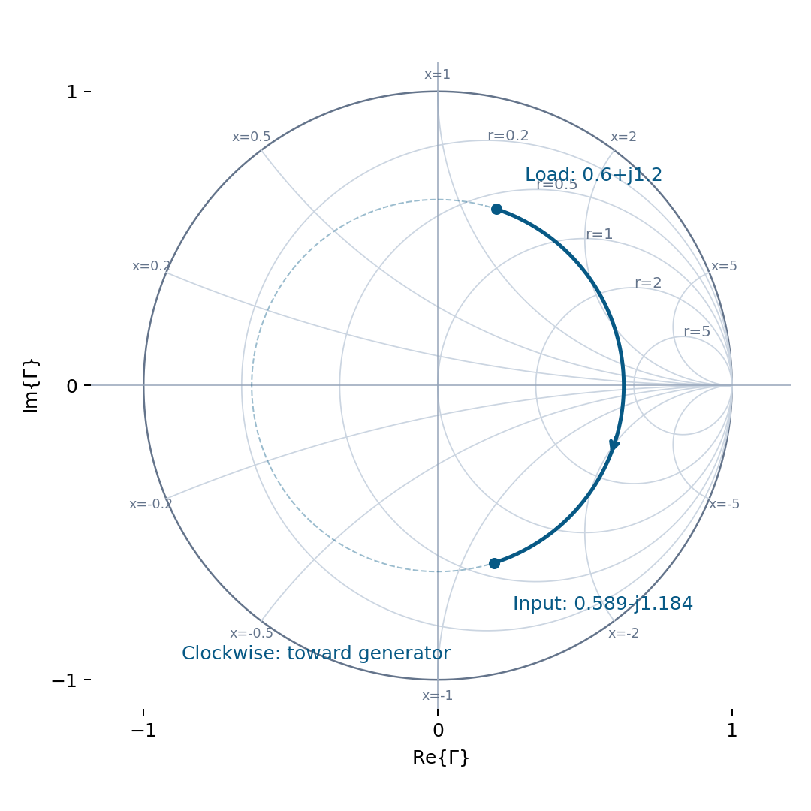
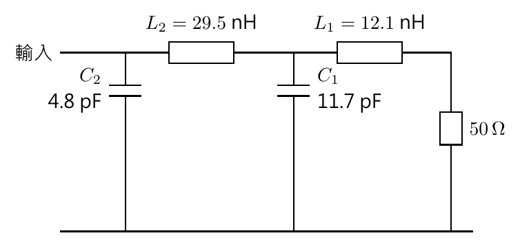

# 單元 08｜史密斯圖（二）

[下載原始 PDF](../pdf/008_史密斯圖（二）.pdf)

讀圖、線長與串並聯元件

原始影片：[陳晏笙老師「天線」單元 8](https://www.youtube.com/watch?v=sJKNY5c5dsQ)

影片長度：約 97 分鐘　建議閱讀：約 25 分鐘

前置單元：05–07。熟悉 $\Gamma$、正規化阻抗與等電阻圓。

> **核心觀念：** 串聯元件直接加阻抗，並聯元件直接加導納。傳輸線則旋轉反射係數。知道正在做哪一種操作，就知道該沿哪一族圓移動。

## 本單元的四個目標

1.  用等電阻、等電抗曲線定位複數阻抗，求反射與線長變換。

2.  用實軸交點讀 VSWR，辨識開路、短路、匹配與共軛點。

3.  分清阻抗圖與導納圖，用對應刻度處理串並聯元件。

4.  重算影片的混合 LC 網路，驗證每個步驟。

## 先記住三種操作

| 操作         | 使用的量        | 保持不變的東西      |
|:-------------|:----------------|:--------------------|
| 沿無損線移動 | 複數 $\Gamma$   | $\vert \Gamma\vert$ |
| 串聯理想電抗 | 阻抗 $z_n=r+jx$ | 電阻 $r$            |
| 並聯理想電納 | 導納 $y_n=g+jb$ | 電導 $g$            |

## 閱讀地圖

第 2–3 頁：完整史密斯圖與傳輸線例題；第 4 頁：VSWR 與特殊點；第 5 頁：串聯元件；第 6 頁：導納；第 7 頁：並聯元件；第 8–9 頁：混合網路；第 10 頁：自測。 依影片例題與板書重寫；讀圖近似以代數重算核對。額外數值與限制標示為補充。

## 1．等電抗圓讓你能定位完整阻抗

影片對照：[約 00:00](https://www.youtube.com/watch?v=sJKNY5c5dsQ&t=0s)－[07:00](https://www.youtube.com/watch?v=sJKNY5c5dsQ&t=420s)

上一單元推導等電阻圓；影片這次加入等電抗圓，組成完整史密斯圖。令 $\Gamma=u+jv$、$z_n=r+jx$：

$$
\left(u-\frac r{r+1}\right)^2+v^2=\frac1{(r+1)^2},
$$

$$
(u-1)^2+\left(v-\frac1x\right)^2=\frac1{x^2},\qquad x\ne0.
$$

後式的圓心為 $(1,1/x)$、半徑為 $1/|x|$；只取落在單位圓內的弧段。$x=0$ 則是實軸，不需硬套 $1/x$。

### 上半部與下半部代表什麼？

在本講義的 $e^{j\omega t}$ 慣例下：

-   上半部：$x>0$，感性阻抗。

-   下半部：$x<0$，容性阻抗。

-   實軸：$x=0$，純電阻；負載可能完全匹配，也可能不匹配。

### 一步一步定位

1.  先把歐姆值除以 $Z_0$，得到 $r+jx$。

2.  找到對應的等電阻圓 $r$。

3.  找到正、負號正確的等電抗弧 $x$。

4.  兩者交點就是該負載；最後讀值要乘回 $Z_0$。

例如影片以 $Z_L=30+j60\,\Omega$、$Z_0=50\,\Omega$ 示範：

$$
z_L=0.6+j1.2.
$$

選 $r=0.6$ 圓與 $x=+1.2$ 弧，交點在上半部。只有找到 $r=0.6$，還無法知道是哪個負載。 **補充解說／重算例題：**圖上密集刻度只提升解析度；理解轉換式後，不必背誦每一條線的位置。讀圖誤差可用複數代數驗算。

> **核心觀念：** 史密斯圖是在 $\Gamma$ 平面讀阻抗刻度；它不是把 $r,x$ 當直角座標直接畫在平面上。

## 2．影片例題：30+j60 $\Omega$，再接 0.2 波長的線

影片對照：[約 07:00](https://www.youtube.com/watch?v=sJKNY5c5dsQ&t=420s)－[24:00](https://www.youtube.com/watch?v=sJKNY5c5dsQ&t=1440s)

先定位 $z_L=0.6+j1.2$，再由圖上的半徑、角度理解反射。以代數驗算：

$$
\Gamma_L=\frac{0.6+j1.2-1}{0.6+j1.2+1}=0.2+j0.6.
$$

因此 $|\Gamma_L|=\sqrt{0.4}\approx0.6325$，相位 $\theta_L\approx71.565^\circ$。

依轉換式重繪。Load 是負載點，Input 是線長變換後的輸入點；藍色路徑順時針，虛線以原點為圓心。 往源端走 $d=0.2\lambda$，反射相位轉動

$$
-2\beta d=-4\pi(0.2)=-144^\circ.
$$

所以輸入反射相位約 $-72.435^\circ$，$\Gamma_{\mathrm{in}}\approx0.1909-j0.6030$。轉回阻抗：

$$
z_{\mathrm{in}}\approx0.5892-j1.1843,\qquad
Z_{\mathrm{in}}\approx29.46-j59.22\ \Omega.
$$

影片讀圖約為 $30-j60\,\Omega$；上式為同一條件的代數重算，兩者差異來自讀圖近似。

> **核心觀念：** 走 0.2 波長，反射係數轉 144°；不要把單程電壓的 72° 相位，誤當成反射係數的轉角。

## 3．用實軸交點讀 VSWR 與特殊位置

影片對照：[約 24:00](https://www.youtube.com/watch?v=sJKNY5c5dsQ&t=1440s)－[38:00](https://www.youtube.com/watch?v=sJKNY5c5dsQ&t=2280s)

在無損線上，沿線的 $\Gamma$ 都落在以原點為圓心、半徑 $\rho=|\Gamma|$ 的圓。這個圓與實軸有兩個交點。

$$
\Gamma=+\rho\ \Longrightarrow\
z_n=\frac{1+\rho}{1-\rho}=\mathrm{VSWR},
$$

$$
\Gamma=-\rho\ \Longrightarrow\
z_n=\frac{1-\rho}{1+\rho}=\frac1{\mathrm{VSWR}}.
$$

右邊交點對應電壓振幅最大、純電阻較大；左邊交點對應振幅最小、純電阻較小。兩個位置相隔 $\lambda/4$。

### 接續前面的 $30+j60\,\Omega$ 例題

$\rho=\sqrt{0.4}$，故 VSWR 約 4.442。等 $|\Gamma|$ 圓的右、左交點可讀到

$$
z_{n,\max}\approx4.442,\qquad z_{n,\min}\approx0.2251.
$$

乘回 $50\,\Omega$，分別約為 $222.08\,\Omega$ 與 $11.26\,\Omega$。這兩個是特定沿線位置看到的純電阻，與負載本身的 $30+j60\,\Omega$ 不同。

### 外圈線長刻度：轉一圈代表多少？

$\Gamma$ 的相位轉一圈需 $2\beta d=2\pi$，所以 $d=\lambda/2$。圖外圈的線長刻度通常從 0 到 0.5 波長，一圈並不是一個波長。 往源端走，順時針；往負載走，逆時針。跨過刻度零點時，要按半波長的週期補回差值。

### 三個特殊點與兩種鏡射

-   中心 $\Gamma=0$：$z_n=1$，匹配。

-   最左 $\Gamma=-1$：$z_n=0$，短路；最右 $\Gamma=1$：開路。

-   對實軸鏡射：$\Gamma\to\Gamma^*$，對應 $z_n\to z_n^*$，電抗符號反轉。

-   對原點旋轉 180°：$\Gamma\to-\Gamma$，對應 $z_n\to1/z_n$；這與共軛不同。

**補充解說／重算例題：**比較 $\Gamma$ 的半徑，也能比較匹配好壞；靠近中心通常代表較小反射。但「一個掃頻曲線經過實軸」只表示該頻率的輸入電抗為零，不自動代表匹配。

### 影片強調：掃頻時保留複數資訊

只畫 $|S_{11}|$ 對頻率的曲線，會丟掉反射相位；史密斯圖可同時看見匹配程度與阻抗的實部、虛部。RL 至少 10 dB，對應 $|\Gamma|\le\sqrt{0.1}\approx0.3162$ 的中心圓；掃頻軌跡進出此圓的頻率，便能標出匹配頻帶。 **補充解說／重算例題：**加長同一種無損饋線只會旋轉 $\Gamma$，不會改變 $|\Gamma|$ 或 VSWR。它可改變後續匹配元件所看到的阻抗，卻不能靠單純旋轉直接降低反射。

> **核心觀念：** 等 $|\Gamma|$ 圓右交點的正規化電阻，正好等於 VSWR；這是公式的幾何結果。

## 4．串聯元件：沿等電阻圓加電抗

影片對照：[約 38:00](https://www.youtube.com/watch?v=sJKNY5c5dsQ&t=2280s)－[52:00](https://www.youtube.com/watch?v=sJKNY5c5dsQ&t=3120s)

串聯時，阻抗可以直接相加。對負載 $Z_L=R+jX$：

$$
Z_{\mathrm{new}}=Z_L+jX_s,\qquad
z_{\mathrm{new}}=r+j\left(x+\frac{X_s}{Z_0}\right).
$$

電阻不變，只移動電抗，所以沿同一條等電阻圓。

| 元件     | 串聯阻抗                      | 正規化電抗          |
|:---------|:------------------------------|:--------------------|
| 電感 $L$ | $j\omega L$                   | $+\omega L/Z_0$     |
| 電容 $C$ | $1/(j\omega C)=-j/(\omega C)$ | $-1/(\omega C Z_0)$ |

從原負載加上正電抗，沿等電阻圓順時針；加上負電抗，則逆時針。方向以本講義的阻抗史密斯圖與時間慣例為準。

### 算例：用串聯電容消掉感性電抗

**補充解說／重算例題：**50 $\Omega$ 系統中，$Z_L=50+j30\,\Omega$、$f=1$ GHz。要到達匹配點，串聯電容須提供 $-j30\,\Omega$：

$$
C=\frac1{\omega(30)}\approx5.305\ \mathrm{pF}.
$$

原點位於 $r=1,x=0.6$；加電容後沿 $r=1$ 圓走到 $x=0$，最後 $Z_{\mathrm{new}}=50\,\Omega$。

### 只用一個串聯元件的限制

若負載是 $30+j30\,\Omega$，同樣可用電容消掉 $j30$，但結果是 $30\,\Omega$；電阻仍不等於 $Z_0$，所以沒有完全匹配。

### 沿線移動後再串聯，順序不能交換

影片例題以 $f=2$ GHz、$C=4.8$ pF，將 $100\,\Omega$ 負載先接長度 $\lambda/12$ 的 $50\,\Omega$ 線，再在輸入端串聯電容。先作線長變換：

$$
z_1= \frac{2+j\tan(\pi/6)}{1+j2\tan(\pi/6)}
\approx1.1429-j0.7423.
$$

然後才加電容的正規化電抗 $-1/(\omega C Z_0)\approx-0.3316$，得到 $z_{\mathrm{in}}\approx1.1429-j1.0739$，亦即 $Z_{\mathrm{in}}\approx57.14-j53.69\,\Omega$。影片讀圖約 $1.15-j1.06$；差異來自圖上近似。若把同一顆電容放到負載端，線的輸入阻抗一般會不同。 **補充解說／重算例題：**「加上一顆電容」與「固定電容的頻率升高」是不同操作：前者加負電抗；後者使 $-1/\omega C$ 的絕對值減小。判斷方向時要先說清楚變數。

> **核心觀念：** 串聯的自然運算是加阻抗。能消除電抗，不代表已能修正錯誤的電阻值。

## 5．導納：讓並聯問題也變成簡單加法

影片對照：[約 52:00](https://www.youtube.com/watch?v=sJKNY5c5dsQ&t=3120s)－[72:00](https://www.youtube.com/watch?v=sJKNY5c5dsQ&t=4320s)

並聯時，直接加阻抗很不方便；改用導納 $Y=1/Z$。參考導納 $Y_0=1/Z_0$，正規化後：

$$
y_n=\frac Y{Y_0}=YZ_0=\frac1{z_n}=g+jb.
$$

$g$ 是正規化電導，$b$ 是正規化電納；兩者均無單位。真實 $Y=y_n/Z_0$，單位是 S。

### 為什麼有兩種讀導納的方法？

以阻抗刻度讀同一點的 $\Gamma$：

$$
z_n=\frac{1+\Gamma}{1-\Gamma},\qquad
y_n=\frac{1-\Gamma}{1+\Gamma}.
$$

若堅持用原本的阻抗刻度讀 $y_n$，就把點移到對面的 $-\Gamma$：

$$
\frac{1+(-\Gamma)}{1-(-\Gamma)}=y_n.
$$

因此「同一張 Z 圖取對面點」，可讀出倒數。另一種方式是把導納刻度本身旋轉 180°，用 Y 圖在**原來的物理 $\Gamma$ 點**直接讀取。

### 兩種方法不能混做兩次

1.  只有 Z 刻度：先定位阻抗點，再移到對面，讀值當成導納。

2.  有 Y 刻度：保持點不動，切換到 Y 刻度讀導納。

不要已切到 Y 刻度，又把點移到對面；那會再取一次倒數。

### 影片數值：$z_L=2-j1$ 的導納

$$
y_L=\frac1{2-j1}=0.4+j0.2.
$$

$$
Y_L=\frac{y_L}{50}=0.008+j0.004\ \mathrm S.
$$

這個容性負載，電抗為負、電納為正；符號互換是倒數運算的結果。 **補充解說／重算例題：**另接 $0.15\lambda$ 的同阻抗無損線，先旋轉 $-108^\circ$；重算得 $y_{\mathrm{in}}\approx1.3977+j1.1133$。實際導納 $Y_{\mathrm{in}}=y_{\mathrm{in}}/50\approx0.02795+j0.02227$ S。還原導納是乘 $Y_0=1/Z_0$，不是乘 $Z_0$。 **補充解說／重算例題：**導納圖只改變讀值刻度，不會讓入射波、反射波或物理負載產生變化。要區分「換表示方法」與「真的加一段傳輸線」。

> **核心觀念：** 阻抗正規化除以 $Z_0$；導納正規化乘以 $Z_0$。兩者不是使用同一個除法。

## 6．並聯元件：先換成導納，再加電納

影片對照：[約 72:00](https://www.youtube.com/watch?v=sJKNY5c5dsQ&t=4320s)－[78:00](https://www.youtube.com/watch?v=sJKNY5c5dsQ&t=4680s)

並聯各支路承受同一個電壓，總電流為各支路電流的和。因此

$$
Y_{\mathrm{new}}=Y_L+Y_p,\qquad
y_{\mathrm{new}}=g+j(b+b_p).
$$

加入理想電感、電容，不改變電導 $g$；應沿等電導圓，而不是等電阻圓。

| 並聯元件 | 導納                          | 正規化電納        |
|:---------|:------------------------------|:------------------|
| 電容 $C$ | $j\omega C$                   | $+\omega C Z_0$   |
| 電感 $L$ | $1/(j\omega L)=-j/(\omega L)$ | $-Z_0/(\omega L)$ |

### 在物理反射係數平面看等電導圓

由 $y_n=(1-\Gamma)/(1+\Gamma)$，可得

$$
\left(u+\frac g{g+1}\right)^2+v^2=\frac1{(g+1)^2}.
$$

相較等電阻圓，圓心移到實軸左側。增加正電納 $b$，沿等電導圓順時針；增加負電納，逆時針。若用「對面點加 Z 刻度」代替 Y 刻度，仍須保持整套操作一致。

### 重算練習：並聯電容抵消負電納

**補充解說／重算例題：**$Z_0=50\,\Omega$、$f=1$ GHz，負載導納為

$$
Y_L=0.02-j0.01\ \mathrm S,\qquad y_L=1-j0.5.
$$

要匹配，並聯電容須補上 $+j0.01$ S：

$$
C=\frac{0.01}{2\pi(10^9)}\approx1.592\ \mathrm{pF}.
$$

加入後 $Y_{\mathrm{new}}=0.02$ S，故 $Z_{\mathrm{new}}=50\,\Omega$。

### 若電導不對，一個並聯元件仍不夠

將 $g=0.4,b=-0.5$ 補成 $b=0$，只會得到 $y_n=0.4$，所以 $z_n=2.5$；它是純電阻，卻仍不匹配。 串聯元件控制 $x$，並聯元件控制 $b$；透過兩種操作交替，才可能同時調整負載所呈現的實部與虛部。

> **核心觀念：** 並聯電容加正電納，並聯電感加負電納。先寫出導納，符號就不必靠記憶猜測。

## 7．影片 LC 網路：先決定運算順序

影片對照：[約 78:00](https://www.youtube.com/watch?v=sJKNY5c5dsQ&t=4680s)－[84:00](https://www.youtube.com/watch?v=sJKNY5c5dsQ&t=5040s)

影片在 $f=1$ GHz、參考阻抗 $Z_0=50\,\Omega$，分析下列網路。從輸入端看向負載時，依序是並聯電容、串聯電感、並聯電容、串聯電感，以及 $50\,\Omega$ 負載。

兩顆電容均跨接上下導線；兩顆電感則串在上方路徑。以下依此拓樸從負載端向左計算。

### 從負載往源端，逐級取代

1.  從 $z_L=1$ 開始，串聯 $L_1$：加阻抗。

2.  換成導納，並聯 $C_1$：加導納。

3.  換回阻抗，串聯 $L_2$：加阻抗。

4.  再換成導納，並聯 $C_2$：加導納。

5.  取倒數，得到輸入阻抗。

$$
\omega=2\pi(10^9),\quad
x_{L_1}=1.52053,\ x_{L_2}=3.70708,\quad
b_{C_1}=3.67566,\ b_{C_2}=1.50796.
$$

**補充解說／重算例題：**這些數值以影片元件值代入重算，採理想集總元件；實體 GHz 元件的寄生與自諧振須另外建模。

> **核心觀念：** 每跨過一個並聯節點就先取倒數；每遇到串聯元件就在阻抗表示中相加。

## 8．完成網路重算，再理解頻率軌跡

影片對照：[約 84:00](https://www.youtube.com/watch?v=sJKNY5c5dsQ&t=5040s)－[97:00](https://www.youtube.com/watch?v=sJKNY5c5dsQ&t=5820s)

接續上一頁，所有 $z,y$ 都是正規化值。保留中間精度，最後才四捨五入。

| 步驟       | 運算與結果                                         |
|:-----------|:---------------------------------------------------|
| 串聯 $L_1$ | $z_1=1+j1.52053$                                   |
| 換成導納   | $y_1=1/z_1\approx0.301931-j0.459096$               |
| 並聯 $C_1$ | $y_2=y_1+j3.67566\approx0.301931+j3.216568$        |
| 換回阻抗   | $z_2=1/y_2\approx0.028928-j0.308175$               |
| 串聯 $L_2$ | $z_3=z_2+j3.70708\approx0.028928+j3.398904$        |
| 換成導納   | $y_3=1/z_3\approx0.002504-j0.294191$               |
| 並聯 $C_2$ | $y_{\rm in}=y_3+j1.50796\approx0.002504+j1.213773$ |
| 換回阻抗   | $z_{\rm in}=1/y_{\rm in}\approx0.001700-j0.823874$ |

$$
\boxed{Z_{\rm in}=50z_{\rm in}\approx0.085-j41.194\ \Omega.}
$$

此例是在演練網路分析，並不是每一組 LC 數值都能匹配。計算結果離 $50+j0\,\Omega$ 很遠，便不能宣稱這個頻率已匹配。

### 掃頻時，每顆元件怎麼變？

影片也用頻率掃描展示史密斯圖軌跡。固定 $R,L,C$，提高頻率：

-   串聯電感：$x=\omega L/Z_0$ 增加。

-   串聯電容：$x=-1/(\omega C Z_0)$ 趨近零。

-   並聯電容：$b=\omega C Z_0$ 增加。

-   並聯電感：$b=-Z_0/(\omega L)$ 趨近零。

簡單串聯 RL、RC 支路沿等電阻圓；簡單並聯 RL、RC 支路沿等電導圓。多級混合網路須逐頻重算。並聯電感在高頻趨近開路：導納 $1/(j\omega L)$ 趨近零。

### 影片末段：史密斯圖繞很多圈，代表很多共振嗎？

不一定。量測參考面若包含一段饋線，低損耗、相同參考阻抗下：

$$
\Gamma_{\rm meas}(f)=\Gamma_{\rm ant}(f)
e^{-2\alpha(f)\ell}e^{-j2\beta(f)\ell}.
$$

饋線延遲使相位隨頻率多次旋轉，損耗使軌跡縮小；不能把每次過實軸都當成天線模態。影片用螺旋軌跡提醒檢查量測：應校正到接頭、再去嵌入饋線，並同看反射幅度。螺旋本身不足以確定故障原因。

> **核心觀念：** 圖上的路徑需要標明「線長變化、元件值變化，或頻率變化」，才能正確解讀。

## 9．五題自測與答案

先遮住答案；能說出操作的理由，比只記住方向更重要。

1.  $Z_0=50\,\Omega$，$Z_L=30+j60\,\Omega$。求正規化阻抗、導納與反射係數。

2.  接續上題，往源端走 $0.2\lambda$，$\Gamma$ 相位變多少？輸入阻抗約多少？

3.  同一負載的等 $|\Gamma|$ 圓，右、左實軸交點各讀到多少正規化電阻？與 VSWR 有什麼關係？

4.  在 1 GHz，如何用一顆串聯元件將 $50+j30\,\Omega$ 匹配到 $50\,\Omega$？若原負載改為 $30+j30\,\Omega$ 呢？

5.  在 50 $\Omega$ 系統，$y_L=1-j0.5$。於 1 GHz 並聯什麼元件可匹配？加入並聯元件前應使用 $z$ 還是 $y$？

### 答案與檢查點

1.  $z_L=0.6+j1.2$；$y_L=1/3-j2/3$；$\Gamma_L=0.2+j0.6$。不要把正規化導納的 $1/3$ 當成 S。

2.  相位 $-144^\circ$；$Z_{\rm in}\approx29.46-j59.22\,\Omega$。線長 .2 波長要用往源端的順時針方向。

3.  $\rho=\sqrt{0.4}$，VSWR $\approx4.442$。右邊為 4.442，左邊為其倒數 0.2251；兩點所對應的位置相隔 $\lambda/4$。

4.  串聯 $C\approx5.305$ pF，抵消 $+j30\,\Omega$。若電阻為 30 $\Omega$，同一操作只消除電抗，仍無法匹配。

5.  用 $y$；並聯電容使 $b$ 增加 0.5。$C=0.5/(\omega Z_0)\approx1.592$ pF。

### 回看影片的四個位置

[07:00](https://www.youtube.com/watch?v=sJKNY5c5dsQ&t=420s)：負載與線長例題；[24:00](https://www.youtube.com/watch?v=sJKNY5c5dsQ&t=1440s)：VSWR 圓； [52:00](https://www.youtube.com/watch?v=sJKNY5c5dsQ&t=3120s)：導納；[78:00](https://www.youtube.com/watch?v=sJKNY5c5dsQ&t=4680s)：混合 LC 網路。

> **核心觀念：** 能把「沿線旋轉、串聯加 Z、並聯加 Y」連成一套流程，就能進入後面的阻抗匹配課程。
