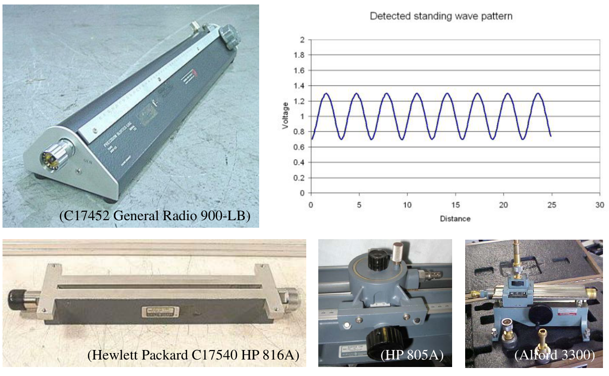

# 單元 09｜史密斯圖（三）

由反射係數軌跡讀出振幅，並用開槽線量測未知阻抗。

原始影片：[陳晏笙老師「天線」單元 9](https://www.youtube.com/watch?v=yR3WKsl5aQY)（約 38 分鐘）

老師講義：[Lecture 2 — Circuit Parameters](https://drive.google.com/file/d/1wHWHyXrkJXY4lCvk3vFuf73KGOgOCiky/view)，**PDF pp.46–52**；開頭重訪 EX 2.1，另外穿插掃頻板書與片末論文圖。

建議閱讀：約 25 分鐘。前置單元：[05 頻域傳輸線](005_傳輸線理論的頻域深入探討.md)、[06 電壓駐波比](006_電壓駐波比.md)、[07 史密斯圖（一）](007_史密斯圖（一）.md)、[08 史密斯圖（二）](008_史密斯圖（二）.md)。

學習重點：分清單程相位與反射係數的雙程相位；把 $`\Gamma`$ 平面上的距離讀成電壓／電流振幅；由駐波的大小及位置還原複數負載；檢查 VSWR 與反射 dB 圖是否相容。

## 講義與影片對照

本單元影片回頭補講 Lecture 2 前段的 $`\Gamma`$ 平面性質，因此講義頁碼會比單元 08 小。以下按老師 PDF 頁序編排；板書放在相關主題旁。影片定位已依影片口述與畫面抽查校準，並非逐頁精確換頁時間。

| 老師 PDF 頁碼 | 原英文主題 | 中文內容 | 影片定位 |
|:--|:--|:--|:--|
| p.46，題目承 p.45 | EX 2.1 — Marking Impedances on Γ Plane (2/2) | 回顧負載點與沿線旋轉；再以板書討論掃頻軌跡 | [約 00:00–16:00](https://www.youtube.com/watch?v=yR3WKsl5aQY&t=0s) |
| p.47 | Amplitude of Voltage Wave | 距離 $`-1`$、$`+1`$ 分別對應電壓、電流振幅 | [約 16:00–19:30](https://www.youtube.com/watch?v=yR3WKsl5aQY&t=960s) |
| p.48 | Maximum Voltage and Minimum Voltage | 圓上的最大／最小振幅及 VSWR | [約 19:30–21:00](https://www.youtube.com/watch?v=yR3WKsl5aQY&t=1170s) |
| p.49 | Slotted Line Measurements | 開槽線儀器與移動探針 | [約 21:00–22:30](https://www.youtube.com/watch?v=yR3WKsl5aQY&t=1260s) |
| pp.50–52 | Applications of Γ-Plane Properties (1/3)–(3/3) | 量包絡、求相位、求反射大小、還原阻抗 | [約 22:30–29:30](https://www.youtube.com/watch?v=yR3WKsl5aQY&t=1350s) |
| 影片另外展示，未列於這份 PDF | 論文曲線討論 | 反射 dB、VSWR 與單位的交叉檢查 | [約 29:30–37:30](https://www.youtube.com/watch?v=yR3WKsl5aQY&t=1770s) |

## 1．從一個負載點到整條掃頻軌跡

**Marking Impedances on Γ Plane (2/2)｜p.46；含開頭板書延伸**

### 先統一座標與參考面

沿用老師的座標：負載在 $`z=0`$，源端在 $`z<0`$；另以 $`d=-z\ge0`$ 表示離負載往源端的距離。使用峰值相量與 $`e^{j\omega t}`$ 慣例，線無損，特徵阻抗 $`Z_0`$ 為正實數。

```math
\Gamma(z)=\Gamma_L e^{j2\beta z},\qquad
\Gamma(d)=\Gamma_L e^{-j2\beta d},\qquad
\beta=\frac{2\pi}{\lambda}.
```


其中 $`\lambda`$ 是線內波長。往源端移動時，$`\Gamma`$ 在等半徑圓上**順時針旋轉**；相位減少 $`2\beta d`$。

### p.46 的例題回顧：0.3 波長應旋轉 216°

EX 2.1 以 $`Z_0=50\,\Omega`$ 為參考：匹配負載、短路、開路分別落在 $`\Gamma=0,-1,+1`$。第四個負載為 $`Z_L=50+j150\,\Omega`$，所以

```math
\Gamma_L=\frac{(50+j150)-50}{(50+j150)+50}
=\frac9{13}+j\frac6{13}
\approx0.8321\angle33.69^\circ.
```

往源端走 $`0.3\lambda`$，旋轉量為

```math
\Delta\theta=-2\beta(0.3\lambda)=-216^\circ,
\qquad
\Gamma(-0.3\lambda)\approx0.8321\angle177.69^\circ.
```

> **數值校註：**p.46 寫 $`33.78^\circ`$ 與 $`177.78^\circ`$；由同頁的 $`50+j150\,\Omega`$ 精算為 $`33.69^\circ`$ 與 $`177.69^\circ`$。半徑與旋轉規則不受這個小幅數值差異影響。

### 為什麼反射係數的相位多一個 2？

在距負載 $`d`$ 處，入射波與反射波分別是

```math
V^+(d)=V_0^+e^{j\beta d},\qquad
V^-(d)=V_0^-e^{-j\beta d}.
```

反射係數取兩者的比：

```math
\frac{V^-(d)}{V^+(d)}
=\frac{V_0^-}{V_0^+}e^{-j2\beta d}
=\Gamma_L e^{-j2\beta d}.
```

分子相位減少 $`\beta d`$，分母增加 $`\beta d`$；相除時兩者相減，合計減少 $`2\beta d`$。

| 往源端距離 | 單程相位大小 $`\beta d`$ | $`\Gamma`$ 相位變化 |
|:--|:--|:--|
| $`\lambda/8`$ | $`45^\circ`$ | $`-90^\circ`$ |
| $`\lambda/4`$ | $`90^\circ`$ | $`-180^\circ`$ |
| $`\lambda/3`$ | $`120^\circ`$ | $`-240^\circ`$ |
| $`\lambda/2`$ | $`180^\circ`$ | $`-360^\circ`$ |

### 板書掃頻軌跡：每個頻點都繞原點旋轉

老師在[約 02:30–14:50](https://www.youtube.com/watch?v=yR3WKsl5aQY&t=150s)以 57–67 GHz 天線的設計經驗，標出 57、59、62、65、67 GHz 五個頻點，延伸討論掃頻阻抗軌跡。天線若要直接與帶電容性的晶片匹配，可能需要感性輸入阻抗；不能先假定每個設計都以 $`50\,\Omega`$ 圖的中心為目標。

板書的三分之一波長假設若在各頻點都成立，則

```math
\Gamma_{\mathrm{in}}(f_i)
=\Gamma_L(f_i)e^{-j4\pi/3}.
```

每個點保留原半徑，角度減去 $`240^\circ`$，最後依頻率順序連回。旋轉中心是 **$`\Gamma=0`$**，不是彎曲軌跡自己的中心。不同半徑的點走過不同弧長，但轉角相同。

**口述校註：**約 08:00–14:30 提醒要「逐點旋轉」很有用；但在本題「所有頻點電氣長度相同」的假設下，乘上同一個單位複數就是繞原點的剛體旋轉，整條 $`\Gamma`$ 軌跡的形狀與長度都不變。因為任兩點都有 $`|\Gamma_1e^{-j\alpha}-\Gamma_2e^{-j\alpha}|=|\Gamma_1-\Gamma_2|`$，不能將阻抗刻度較密解讀成反射係數軌跡縮短。固定物理線長的掃頻轉角才通常各不相同。

> **老師資訊欄勘誤：**本片資訊欄明確註明「板書例題的旋轉角度應為240度，而非120度」。$`\lambda/3`$ 的 $`120^\circ`$ 是單程相位；反射係數應順時針轉 $`240^\circ`$，等同逆時針轉 $`120^\circ`$。這個板書例子與 p.46 的 **$`0.3\lambda`$、$`216^\circ`$** 是兩組不同線長，不能混用。

對相同實數參考阻抗的無損線，各頻點都有

```math
|\Gamma_{\mathrm{in}}(f)|=|\Gamma_L(f)|.
```

因此輸入電抗可以改變，反射 dB 與 VSWR 仍不變；單純接上一段同 $`Z_0`$ 的無損線，不能讓反射半徑縮小。若是固定物理長度的實體線，各頻點轉角會隨 $`\beta(f)`$ 改變，章末另以數值說明。

## 2．用兩段距離讀出電壓與電流振幅

**Amplitude of Voltage Wave｜p.47**

老師先將入射相量提出來：

```math
V(z)=V^+e^{-j\beta z}[1+\Gamma(z)],\qquad
I(z)=\frac{V^+e^{-j\beta z}}{Z_0}[1-\Gamma(z)].
```

因為無損線上的 $`|e^{-j\beta z}|=1`$，所以

```math
|V(z)|=|V^+|\,|1+\Gamma(z)|,
\qquad
|I(z)|=\frac{|V^+|}{Z_0}|1-\Gamma(z)|.
```

老師的 $`V^+`$ 即前節負載參考面的 $`V_0^+`$。在 $`\Gamma`$ 複數平面上：

| 幾何距離 | 對應的振幅比例 | 邊界條件檢查 |
|:--|:--|:--|
| 從 $`-1`$ 到 $`\Gamma`$ | $`\lvert1+\Gamma\rvert=\lvert V\rvert/\lvert V^+\rvert`$ | 短路 $`\Gamma=-1`$ 時電壓為零 |
| 從 $`+1`$ 到 $`\Gamma`$ | $`\lvert1-\Gamma\rvert=Z_0\lvert I\rvert/\lvert V^+\rvert`$ | 開路 $`\Gamma=+1`$ 時電流為零 |


這兩段長度都是無因次比例，還要乘上入射振幅與相應的阻抗因子，才能得到伏特或安培。同一個點沿等 $`|\Gamma|`$ 圓旋轉時，兩段距離交替變長、變短，正好對應沿線的駐波包絡。

## 3．圓的兩端就是電壓最大與最小

**Maximum Voltage and Minimum Voltage｜p.48**

令 $`\rho=|\Gamma_L|`$，對被動負載有 $`0\le\rho\le1`$。在半徑 $`\rho`$ 的圓上，距離 $`-1`$ 最遠的是 $`\Gamma=+\rho`$，最近的是 $`\Gamma=-\rho`$。

```math
|V_{\max}|=|V^+|(1+\rho),\qquad
|V_{\min}|=|V^+|(1-\rho).
```

電流則看距離 $`+1`$，所以同一位置的極值相反：

```math
|I_{\min}|=\frac{|V^+|}{Z_0}(1-\rho),\qquad
|I_{\max}|=\frac{|V^+|}{Z_0}(1+\rho).
```

| 反射係數所在位置 | 電壓 | 電流 |
|:--|:--|:--|
| 正實軸 $`\Gamma=+\rho`$ | 最大 | 最小 |
| 負實軸 $`\Gamma=-\rho`$ | 最小 | 最大 |

從正實軸轉到負實軸需轉 $`180^\circ`$，因此電壓最大與最近的電壓最小相隔 $`\lambda/4`$；相鄰兩個波谷相隔 $`\lambda/2`$。

老師於頁末得到電壓駐波比：

```math
\boxed{S=\mathrm{VSWR}=\frac{|V_{\max}|}{|V_{\min}|}
=\frac{1+\rho}{1-\rho}.}
```

匹配時 $`\rho=0`$、$`S=1`$，包絡不隨位置變化。全反射時 $`\rho=1`$，理想波谷為零，VSWR 趨近無窮大。

## 4．開槽線：把空間中的駐波量出來

**Slotted Line Measurements｜p.49**

開槽線（slotted line）讓小探針沿傳輸線移動，探測不同位置的局部電壓振幅。老師展示 General Radio 900-LB、HP 816A、HP 805A 與 Alford 3300 等儀器，以及探測到的週期性駐波曲線。



圖源：老師 Lecture 2，p.49。原投影片另註明圖片參考 Microwaves101 的 slotted-line measurements 頁面。

這類量測直接提供兩種資訊：**探針讀值告訴我們振幅，探針位置告訴我們波谷在哪裡**。把二者合起來，即使沒有直接量相位，也可以還原複數負載。下列推導假設探針對原線路的擾動很小，且負載參考面與線內波長已知。

## 5．依老師的四步驟，從量測反推未知阻抗

**Applications of Γ-Plane Properties (1/3)–(3/3)｜pp.50–52**

### Step 1：量到包絡與第一個波谷（p.50）

將未知 $`Z_L`$ 接到已知 $`Z_0`$、相速 $`v_p`$ 的線上。從負載往源端找出第一個電壓最小值，記錄其位置 $`z=-d_{\min}`$，以及沿線的 $`|V_{\max}|`$、$`|V_{\min}|`$。

若已知頻率與相速，線內波長為 $`\lambda=v_p/f`$；也可從相鄰兩波谷的間隔 $`\Delta d`$ 求得

```math
\lambda=2\Delta d,\qquad \beta=\frac{\pi}{\Delta d}.
```

有介質的線，不能直接拿自由空間波長 $`c/f`$ 代入。

### Step 2：波谷位置決定反射相位（p.51）

波谷在 $`\Gamma`$ 平面的負實軸上。以老師使用的主值範圍 $`-\pi\le\theta_L\le\pi`$ 表示，從負載點順時針轉到第一個波谷可寫成

```math
\theta_L+2\beta(-d_{\min})=-\pi.
```

因此老師頁末的式子是

```math
\boxed{\theta_L=\frac{4\pi d_{\min}}{\lambda}-\pi.}
```

若選用其他波谷，或採用 $`0\le\theta_L<2\pi`$ 的角度範圍，統一寫成

```math
\theta_L=\pi+2\beta d_{\min}\pmod{2\pi}.
```

老師在[約 27:00–28:40](https://www.youtube.com/watch?v=yR3WKsl5aQY&t=1620s)也說明：波腹同樣能求相位，但量測曲線的峰頂較平，谷底通常較容易定位，因此習慣先找最小值。

兩式只相差 $`2\pi`$，不是正負號衝突。相鄰波谷相隔半波長，增加的相位也剛好是 $`2\pi`$。負載本身就是波谷時，$`d_{\min}=0`$、$`\Gamma_L=-\rho`$。

### Step 3：最大／最小振幅決定反射大小（p.52）

```math
S=\frac{|V_{\max}|}{|V_{\min}|},\qquad
\boxed{\rho=|\Gamma_L|=\frac{S-1}{S+1}.}
```

這一步決定等 $`|\Gamma|`$ 圓的半徑；前一步才決定圓上的角度。只量 VSWR，不能唯一決定複數阻抗。

### Step 4：由反射係數還原負載（p.52）

```math
\Gamma_L=\rho e^{j\theta_L},\qquad
\boxed{Z_L=Z_0\frac{1+\Gamma_L}{1-\Gamma_L}.}
```

老師的流程可以濃縮成：**量空間包絡 → 用波谷定角度 → 用 VSWR 定半徑 → 反轉換成阻抗**。匹配負載 $`\rho=0`$ 沒有可辨識的駐波波谷，也不需要求反射相位，直接得到 $`Z_L=Z_0`$。

## 6．影片延伸：用 VSWR 與反射 dB 互相檢查

**影片約 29:30–37:30 的論文圖討論；不在本次提供的 PDF pp.46–52 內**

老師在片末另展示論文圖，比對相同天線的 VSWR 與 $`S_{11}`$ 曲線。若兩圖使用相同頻率、參考面與實數參考阻抗，兩者可以互相換算：

```math
\rho=|S_{11}|=\frac{S-1}{S+1},\qquad
S_{11,\mathrm{dB}}=20\log_{10}\rho.
```

| 狀態 | VSWR | $`20\log_{10}\lvert S_{11}\rvert`$ |
|:--|:--|:--|
| 完美匹配 | 1 | 趨近 $`-\infty`$ dB |
| $`\rho=0.1`$ | 約 1.222 | $`-20`$ dB |
| $`\rho=\sqrt{0.1}`$ | 約 1.925 | $`-10`$ dB |
| $`\rho=0.5`$ | 3 | 約 $`-6.02`$ dB |
| 全反射 | 趨近無窮大 | 0 dB |

VSWR 越接近 1，匹配越好；反射 dB 越負，匹配越好。若同一頻點的反射接近 0 dB，VSWR 就應很大，不能同時接近 1。兩張圖的縱軸刻度不同，谷底形狀可能看起來很不一樣，但數值換算必須一致。

也要分清名稱與單位：$`S_{11}`$ 對數幅度是 **dB**；**dBm** 是以 1 mW 為基準的絕對功率，不能拿來標無因次反射係數。若寫的是回波損耗（return loss），其定義為正值 $`-20\log_{10}|S_{11}|`$。

**影片的兩個具體檢查點：**約 30:30–34:30 的植入式天線在 2.44 GHz 附近有反射谷，但高頻端反射升回接近 0 dB，VSWR 卻仍接近 1，兩圖不相容。約 35:00–37:30 的寬頻單極天線，低頻端反射約 −10 dB，對應 VSWR 應約 1.93；另一圖卻畫到約 14，也需要回查資料與繪圖流程。這些是曲線間的可驗證矛盾。

同一反射資料畫成兩種縱軸可以方便閱讀，但並未增加獨立的匹配證據。判讀圖表時，要先查定義、頻點、參考面與單位，再比較曲線。

## 補充解說與重算例題

以下為理解上述講義而加入的推導與自設數值，與老師原例題分開。

### A．固定物理線長與固定電氣長度不同

一條物理長度 $`\ell`$ 固定的線，應在每個頻率使用其 $`\beta(f)`$：

```math
\Gamma_{\mathrm{in}}(f)=\Gamma_L(f)e^{-j2\beta(f)\ell}.
```

若相速近似不變，且在 $`f_0`$ 有 $`\ell=\lambda(f_0)/3`$，相位變化為 $`-240^\circ(f/f_0)`$。在 $`0.9f_0,f_0,1.1f_0`$ 分別轉 $`-216^\circ,-240^\circ,-264^\circ`$；整段頻帶不能共用一個轉角。

另外，$`\Gamma`$ 與輸入阻抗每半波長重複，但入射電壓相量會多出 $`e^{j\pi}=-1`$，總電壓相量也可反號。振幅不變，不代表相位完全相同。

### B．複數晶片阻抗的匹配目標

若晶片阻抗是 $`Z_c=R_c+jX_c`$，理想共軛匹配所需的天線阻抗為 $`Z_a=Z_c^*=R_c-jX_c`$。這與對固定實數 $`Z_0`$ 的零反射條件不同。匹配也只描述端口接受功率的比例，不能單憑一條匹配曲線推斷輻射效率、增益或場型。

### C．完整開槽線重算例題

自設條件：$`Z_0=50\,\Omega`$，$`|V_{\max}|=1.8`$ V、$`|V_{\min}|=0.6`$ V；相鄰波谷距離 6 cm，從負載往源端的第一個波谷距負載 4.5 cm。

先求波長與相位：

```math
\lambda=12\ \mathrm{cm},\qquad
\frac{d_{\min}}{\lambda}=\frac{4.5}{12}=\frac38,
\qquad
\theta_L=4\pi\frac38-\pi=\frac\pi2.
```

再求半徑與阻抗：

```math
S=3,\qquad \rho=\frac{3-1}{3+1}=0.5,\qquad
\Gamma_L=j0.5,
```

```math
Z_L=50\frac{1+j0.5}{1-j0.5}=30+j40\ \Omega.
```

驗算：往源端走 $`3\lambda/8`$，相位由 $`90^\circ`$ 減少 $`270^\circ`$，變成 $`-180^\circ`$，確實落在負實軸、形成電壓波谷。

### D．實際量測要注意的參考量

若負載參考面無法直接定位，可用已知短路作位置校正；未校正的探針距離不能直接當作 $`d_{\min}`$。也可使用波腹，此時 $`\Gamma(d_{\max})=+\rho`$，改用 $`\theta_L=2\beta d_{\max}\pmod{2\pi}`$。

若偵測器讀到的是功率且工作在平方律區，電壓 VSWR 應取 $`\sqrt{P_{\max}/P_{\min}}`$；不能把功率比直接當成電壓比。

## 自測與解析

1. 在無損線上往源端走 $`\lambda/8`$，入射波相位增加多少？反射係數相位減少多少？
2. $`\Gamma=0.3+j0.4`$，$`|V^+|=1`$ V、$`Z_0=50\,\Omega`$。求電壓與電流振幅。
3. VSWR = 2 時，反射大小是多少？能否斷定負載一定是 $`100\,\Omega`$？
4. $`Z_0=50\,\Omega`$、VSWR = 3，且負載本身恰為電壓最小位置。求負載阻抗。
5. 平方律偵測器的最大功率讀值為最小的 9 倍，求 VSWR。若相鄰波谷距離 5 cm，線內波長為何？
6. p.46 的 $`0.3\lambda`$ 與板書的 $`\lambda/3`$，反射係數旋轉角度各是多少？

### 解析

1. 入射波增加 $`45^\circ`$，反射係數減少 $`90^\circ`$；後者是兩個波的相位差。
2. $`|V|=|1.3+j0.4|=\sqrt{1.85}\approx1.360`$ V；$`|I|=|0.7-j0.4|/50\approx16.12`$ mA。
3. $`\rho=1/3`$。不能；$`100\,\Omega`$ 與 $`25\,\Omega`$ 都有 VSWR = 2，另有整圈複數負載也符合。
4. $`\Gamma_L=-0.5`$，$`Z_L=50(1-0.5)/(1+0.5)=16.667\,\Omega`$。波谷位置決定了負實軸方向。
5. VSWR $`=\sqrt9=3`$；$`\lambda=2(5)=10`$ cm。
6. 分別順時針轉 $`216^\circ`$ 與 $`240^\circ`$；都要使用雙程相位 $`2\beta d`$。

**下一單元：**[10｜有損傳輸線分析](010_有損傳輸線分析.md)，加入衰減與複數特徵阻抗，檢查哪些無損線的幾何結論仍適用。
