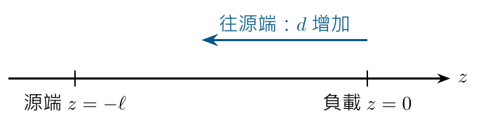
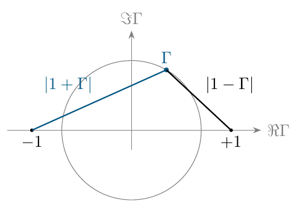

# 單元 09｜史密斯圖（三）

[下載原始 PDF](../pdf/009_史密斯圖（三）.pdf)

掃頻旋轉與振幅量測

原始影片：[陳晏笙老師「天線」單元 9](https://www.youtube.com/watch?v=yR3WKsl5aQY)

影片長度：約 38 分鐘　建議閱讀：約 20 分鐘

前置單元：05–08。熟悉沿無損線的反射係數旋轉與 VSWR。

> **核心觀念：** 振幅最大、最小告訴你反射係數的大小；波谷位於哪裡，告訴你反射相位。兩種資訊合起來，才能反推複數負載。

## 你會學到什麼？

1.  分清波的單程相位與反射係數的雙程相位。

2.  逐點變換掃頻軌跡，分清電氣長度與固定物理線長。

3.  在 $\Gamma$ 平面上，用兩段距離讀電壓與電流振幅。

4.  用開槽線的振幅與位置量測，反推負載阻抗。

5.  判讀 VSWR、負值反射曲線為何只是同一資訊的不同尺度。

## 統一座標，避免整題算反

本講義把負載放在 $z=0$，源端在 $z<0$；另以 $d=-z\ge0$ 表示離負載往源端的距離。使用峰值相量與 $e^{j\omega t}$ 慣例，參考阻抗 $Z_0$ 為正實數、線無損。

$$
\Gamma(d)=\Gamma_L e^{-j2\beta d},\qquad \beta=2\pi/\lambda.
$$

只要先說清楚座標，順逆時針與正負號就能從公式驗證。

## 閱讀地圖

第 2 頁：相位與方向；第 3 頁：掃頻曲線變換；第 4 頁：振幅的幾何表示；第 5 頁：量測反推公式；第 6 頁：完整重算例題與曲線解讀；第 7 頁：自測。 依影片板書與量測流程重寫；額外數值例題標示為補充。

## 1．同一條線：電壓相位與反射相位不同

影片對照：[約 00:00](https://www.youtube.com/watch?v=yR3WKsl5aQY&t=0s)－[16:00](https://www.youtube.com/watch?v=yR3WKsl5aQY&t=960s)

往源端走 $d$，入射與反射電壓相量為

$$
V^+(d)=V_0^+e^{j\beta d},\qquad
V^-(d)=V_0^-e^{-j\beta d}.
$$

兩個波各自變化 $\beta d$，方向相反。反射係數是兩者的比：

$$
\frac{V^-(d)}{V^+(d)}
=\frac{V_0^-}{V_0^+}e^{-j2\beta d}
=\Gamma_L e^{-j2\beta d}.
$$

### 為什麼多出一個 2？

分子的相位減少 $\beta d$，分母相位增加 $\beta d$；相除等於相位相減，合計減少 $2\beta d$。所以不是任意加上的修正係數。

| 往源端的距離 | 單程相位大小 $\beta d$ | $\Gamma$ 相位變化 |
|:-------------|:-----------------------|:------------------|
| $\lambda/8$  | $45^\circ$             | $-90^\circ$       |
| $\lambda/4$  | $90^\circ$             | $-180^\circ$      |
| $\lambda/2$  | $180^\circ$            | $-360^\circ$      |

### 半波長重複，並非電壓相量完全相同

$\Gamma$ 與輸入阻抗每半波長重複。入射電壓相量卻多出 $e^{j\pi}=-1$，所以總電壓相量可反號。振幅不變，不代表相位也不變。 **補充解說／重算例題：**若改把源端放在座標原點，公式的參考相量與座標也會改；不應把兩種座標的式子直接混用。

> **核心觀念：** 在史密斯圖往源端移動，是 $\Gamma$ 順時針轉動；轉角大小為 $4\pi d/\lambda$。

## 2．整段掃頻曲線：每個點都以原點為中心

影片對照：[約 03:00](https://www.youtube.com/watch?v=yR3WKsl5aQY&t=180s)－[16:00](https://www.youtube.com/watch?v=yR3WKsl5aQY&t=960s)

影片用天線的掃頻軌跡，討論接上傳輸線後的反射曲線。此天線要直接與帶電容性的晶片匹配，目標可為感性阻抗；不能先假定所有設計都要落在 $50\,\Omega$ 圖的中心。 **補充解說／重算例題：**若晶片阻抗是 $Z_c=R_c+jX_c$，理想共軛匹配的天線阻抗為 $Z_a=Z_c^*=R_c-jX_c$。這與對固定實數 $Z_0$ 的零反射條件不同。

### 影片的假設：每個頻率都接三分之一波長

老師刻意假設各頻點都滿足 $d/\lambda=1/3$。每個原始點按同一公式變換：

$$
\Gamma_{\mathrm{in}}(f_i)=\Gamma_L(f_i)e^{-j4\pi/3}.
$$

讀出各點的半徑與相位，半徑保留，角度減去 $240^\circ$；最後依頻率順序連回軌跡。轉動中心是 $\Gamma=0$，不是彎曲軌跡自己的中心。不同半徑的點走過不同弧長，但轉角相同。 **補充解說／重算例題：**同一轉角繞原點旋轉整條曲線，與逐點變換等價。影片在此例寫出的 $-120^\circ$ 是單程相位；反射係數應使用雙程的 $-240^\circ$，等同逆時針 $120^\circ$。本講義以 $-2\beta d$ 重算。

### 實際製作：物理長度固定，電氣長度隨頻率變

一條長度 $\ell$ 固定的線，應在每個頻率使用其 $\beta(f)$：

$$
\Gamma_{\mathrm{in}}(f)=\Gamma_L(f)e^{-j2\beta(f)\ell}.
$$

**補充解說／重算例題：**若相速近似固定，且在 $f_0$ 有 $\ell=\lambda(f_0)/3$，則相位變化為 $-240^\circ(f/f_0)$。在 $0.9f_0,f_0,1.1f_0$ 分別轉 $-216^\circ,-240^\circ,-264^\circ$；整段頻帶不能共用一個轉角。

### 阻抗軌跡改變，反射半徑仍相同

對相同實數參考阻抗的無損線，各頻點都有 $|\Gamma_{\mathrm{in}}(f)|=|\Gamma_L(f)|$。電抗可能變號，反射 dB 與 VSWR 曲線仍維持原值；若要降低反射，須另做阻抗匹配設計。

> **核心觀念：** 先說清楚是「每個頻率相同電氣長度」還是「一條固定長度的實體線」，再逐點計算。

## 3．兩段距離：讀出電壓與電流振幅

影片對照：[約 16:00](https://www.youtube.com/watch?v=yR3WKsl5aQY&t=960s)－[22:00](https://www.youtube.com/watch?v=yR3WKsl5aQY&t=1320s)

將入射相量提出來：

$$
V(d)=V^+(d)[1+\Gamma(d)],\qquad
I(d)=\frac{V^+(d)}{Z_0}[1-\Gamma(d)].
$$

由於無損線上 $|V^+(d)|=|V_0^+|$，

$$
|V(d)|=|V_0^+|\,|1+\Gamma(d)|,
$$

$$
|I(d)|=\frac{|V_0^+|}{Z_0}|1-\Gamma(d)|.
$$

在複數平面，$|1+\Gamma|$ 就是 $\Gamma$ 點距離 $-1$ 的長度；$|1-\Gamma|$ 是距離 $+1$ 的長度。

### 靠近短路點，電壓小；靠近開路點，電流小

短路 $\Gamma=-1$，電壓振幅為零；開路 $\Gamma=+1$，電流振幅為零。距離圖將這些邊界條件直接畫出來。 當同一個點在等 $|\Gamma|$ 圓上旋轉，兩段距離隨位置變化，就形成駐波包絡。

### 可以從幾何重推最大、最小

半徑為 $\rho$ 的圓，距離 $-1$ 最遠為 $1+\rho$、最近為 $1-\rho$。因此

$$
V_{\max}=|V_0^+|(1+\rho),\qquad
V_{\min}=|V_0^+|(1-\rho).
$$

電流的最大值對應電壓最小位置；無損線中二者波腹位置相隔 $\lambda/4$。

> **核心觀念：** 電壓看距離 $-1$，電流看距離 $+1$。這兩段距離是相量振幅比例，尚未乘上實際入射振幅。

## 4．開槽線：只量振幅，也能找出複數負載

影片對照：[約 22:00](https://www.youtube.com/watch?v=yR3WKsl5aQY&t=1320s)－[30:00](https://www.youtube.com/watch?v=yR3WKsl5aQY&t=1800s)

影片介紹開槽線（slotted line）：沿傳輸線移動探針，觀察電壓包絡與波谷位置。探針位置提供空間資訊；振幅偵測器提供大小資訊。

### 步驟一：量最大、最小，求反射大小

$$
S=\frac{V_{\max}}{V_{\min}},\qquad
\rho=|\Gamma_L|=\frac{S-1}{S+1}.
$$

這決定史密斯圖上等 $|\Gamma|$ 圓的半徑，但還不知道圓上的哪一點。

### 步驟二：由相鄰波谷求線內波長

相鄰兩個電壓最小值的距離為 $\lambda/2$。若間隔為 $\Delta d$：

$$
\lambda=2\Delta d,\qquad \beta=\frac{\pi}{\Delta d}.
$$

這是傳輸線中的波長；有介質時，不能直接使用自由空間的 $c/f$。

### 步驟三：由已知參考面量到波谷

令距負載最近的波谷位於 $d=d_{\min}$。波谷時反射係數在負實軸：

$$
\Gamma(d_{\min})=-\rho,\qquad
\theta_L-2\beta d_{\min}=(2n+1)\pi.
$$

因此

$$
\boxed{\theta_L=\pi+2\beta d_{\min}\pmod{2\pi}.}
$$

波谷相隔半波長，帶入不同波谷只會增加 $2\pi$；所以得到同一個負載反射係數。 影片優先用波谷定位，因為波腹附近通常較平緩。也可使用波腹：此時 $\Gamma(d_{\max})=+\rho$，改用 $\theta_L=2\beta d_{\max}\pmod{2\pi}$。

### 步驟四：還原未知阻抗

$$
\Gamma_L=\rho e^{j\theta_L},\qquad
\boxed{Z_L=Z_0\frac{1+\Gamma_L}{1-\Gamma_L}.}
$$

**補充解說／重算例題：**若負載參考面無法直接定位，可用已知短路作位置校正；未校正的探針距離不能直接當成 $d_{\min}$。若偵測器讀到的是功率且在線性平方律區，電壓 VSWR 應取 $\sqrt{P_{\max}/P_{\min}}$。

> **核心觀念：** VSWR 決定半徑，波谷的相對位置決定角度；只量 VSWR 不足以唯一決定負載阻抗。

## 5．完整算例與論文曲線的判讀

影片對照：[24:00](https://www.youtube.com/watch?v=yR3WKsl5aQY&t=1440s)－[37:30](https://www.youtube.com/watch?v=yR3WKsl5aQY&t=2250s)

**補充解說／重算例題：**以下沿用影片量測流程，另設一組便於驗算的數值：$Z_0=50\,\Omega$，$V_{\max}=1.8$ V、$V_{\min}=0.6$ V。相鄰波谷距離 6 cm；從負載往源端的第一個波谷距負載 4.5 cm。

### 先找半徑與波長

$$
S=3,\qquad \rho=\frac{3-1}{3+1}=0.5,\qquad
\lambda=12\ \mathrm{cm}.
$$

因此 $d_{\min}/\lambda=4.5/12=3/8$。

### 用波谷角度反推負載

$$
\theta_L=\pi+4\pi(3/8)=\frac{5\pi}{2}
\equiv\frac{\pi}{2}\pmod{2\pi}.
$$

$$
\Gamma_L=j0.5,\qquad
Z_L=50\frac{1+j0.5}{1-j0.5}=30+j40\ \Omega.
$$

驗算波谷：往源端 $3\lambda/8$，相位從 $90^\circ$ 減少 $270^\circ$，變成 $-180^\circ$，確實落在負實軸。

### 影片最後的圖：VSWR 與反射 dB 是否提供不同證據？

若兩張曲線使用同一個參考面與相同頻率，VSWR 與 $20\log_{10}|S_{11}|$ 可由彼此換算，不是兩種獨立的匹配量測。尺度不同，谷底與峰值看起來可能差很多。

| 狀態                            | VSWR       | $20\log_{10}\vert S_{11}\vert$ |
|:--------------------------------|:-----------|:-------------------------------|
| 完美匹配                        | 1          | 趨近 $-\infty$ dB              |
| $\vert \Gamma\vert =0.1$        | 約 1.222   | $-20$ dB                       |
| $\vert \Gamma\vert =\sqrt{0.1}$ | 約 1.925   | $-10$ dB                       |
| $\vert \Gamma\vert =0.5$        | 3          | 約 $-6.02$ dB                  |
| 全反射                          | 趨近無窮大 | 0 dB                           |

VSWR 曲線向 1 靠近代表改善；反射 dB 曲線越負代表改善。若標成 Return loss，應改為正值 $-20\log_{10}|S_{11}|$。 影片用論文圖練習抓錯：$S_{11}$ 的對數幅度單位是 dB，不能寫成表示絕對功率的 dBm。若同一頻點的反射接近 0 dB，VSWR 應很大；不能另一張圖卻接近 1。先核對定義、參考面與頻點，再檢查兩圖是否一致。 **補充解說／重算例題：**接受同樣比例的入射功率，不代表兩個天線的輻射效率、增益或場型也相同；匹配曲線只描述端口反射。

> **核心觀念：** 能互相換算的兩張圖，可以用來方便閱讀，但不能當成兩份相互獨立的性能證明。

## 6．五題自測與答案

建議先做題，再回查座標與參考面。

1.  在無損線上往源端走 $\lambda/8$，入射波相位增加多少？反射係數相位減少多少？

2.  $\Gamma=0.3+j0.4$，$|V_0^+|=1$ V、$Z_0=50\,\Omega$。求該點的電壓與電流振幅。

3.  VSWR = 2 時，負載反射大小是多少？能否由此斷定負載一定是 $100\,\Omega$？

4.  $Z_0=50\,\Omega$、VSWR = 3，且負載本身恰為電壓最小位置。求負載阻抗。

5.  偵測器在線性平方律區，最大功率讀值為最小的 9 倍，求 VSWR。若相鄰波谷距離 5 cm，線內波長為何？

### 答案

1.  入射波增加 $45^\circ$，反射係數減少 $90^\circ$；後者是兩個波相位的差。

2.  $|V|=|1.3+j0.4|=\sqrt{1.85}\approx1.360$ V。 
    $|I|=|0.7-j0.4|/50=\sqrt{0.65}/50\approx16.12$ mA。

3.  $\rho=1/3$。不能；$100\,\Omega$ 與 $25\,\Omega$ 都有 VSWR = 2，另有整圈複數負載也符合。

4.  $\Gamma_L=-0.5$，$Z_L=50(1-0.5)/(1+0.5)=16.667\,\Omega$。負載位於波谷，決定了負實軸方向。

5.  VSWR $=\sqrt9=3$；$\lambda=2(5)=10$ cm。功率比不能直接當作電壓比。

### 公式速記

$$
|V|=|V_0^+||1+\Gamma|,\qquad
|I|=\frac{|V_0^+|}{Z_0}|1-\Gamma|,
$$

$$
\rho=\frac{S-1}{S+1},\quad
\theta_L=\pi+2\beta d_{\min}\pmod{2\pi},\quad
Z_L=Z_0\frac{1+\rho e^{j\theta_L}}{1-\rho e^{j\theta_L}}.
$$

**下一單元：**把理想無損模型推廣到有損傳輸線，理解振幅衰減、複數特徵阻抗，以及量測位置造成的差異。
