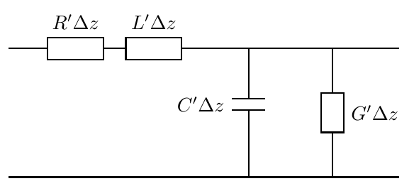
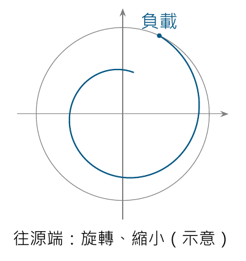
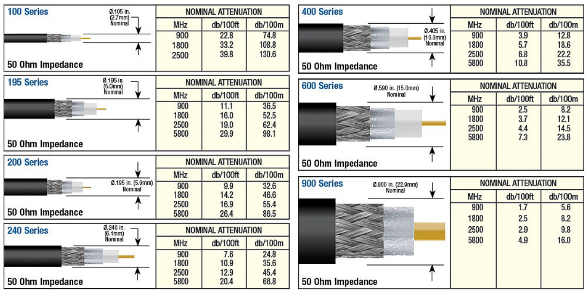
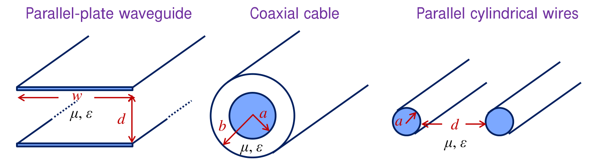
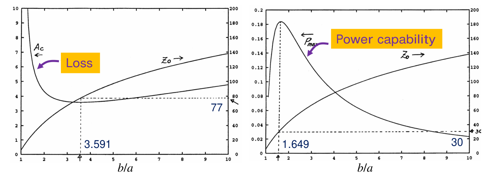
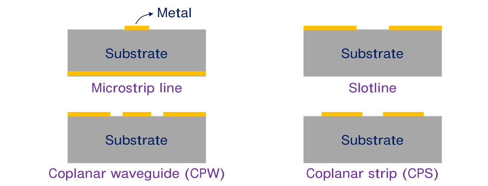
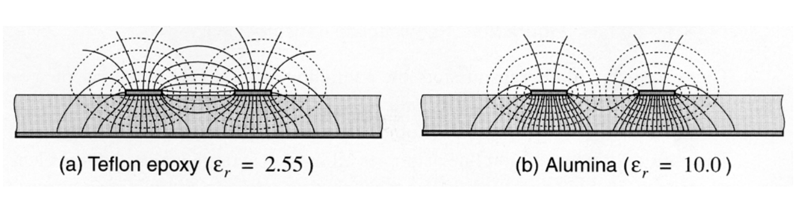

# 單元 10｜有損傳輸線分析

從 RLGC 模型、衰減與同軸線，走到微帶線的尺寸設計。

原始影片：[陳晏笙老師「天線」單元 10](https://www.youtube.com/watch?v=_D8ccjffZAk)（約 77 分鐘）

老師講義：[L2 — Circuit Parameters，正文 PDF pp.95–123；片末預告 pp.124–125](https://drive.google.com/file/d/1wHWHyXrkJXY4lCvk3vFuf73KGOgOCiky/view)

建議閱讀：約 50 分鐘；前置單元：04–09。

本篇按老師講義順序整理。先由分佈參數推得複數傳播常數，再算輸入阻抗與平均功率，最後比較實際傳輸線，完成講義的 65 Ω 微帶線例題。講義使用 $`R,L,G,C`$ 表示「每單位長度」參數；本篇沿用此符號，等同前幾單元的 $`R',L',G',C'`$。

**學習重點：**分清 $`\alpha`$ 的振幅衰減與功率衰減；知道低損耗近似的條件；由材料、幾何尺寸判讀線損與特徵阻抗；能從目標 $`Z_0`$ 反推微帶線寬度。

## 講義與影片對照

下表依影片口述、講義與重點畫面交叉核對，時間是主題定位，並非逐頁換頁的精確秒數。老師先在板書解釋衰減波，再回到投影片推低損耗公式；本篇正文仍依講義頁序，將口述補在對應概念旁。pp.114–115 與 pp.119–123 在影片中快速帶過，以下另按 PDF 補齊內容。

| 老師 PDF 頁碼 | 原英文主題 | 中文內容 | 影片定位（約） |
|:---|:---|:---|:---|
| 95–96 | Lossy Transmission Lines / Two Significant Results of Lossless TL | 本節標題、回顧無損線的阻抗與功率 | [00:27](https://www.youtube.com/watch?v=_D8ccjffZAk&t=27s)–03:21 |
| 97 | Presumption: From Lossless to Lossy | 導體／介質損耗與 RLGC | [03:21](https://www.youtube.com/watch?v=_D8ccjffZAk&t=201s)–09:12 |
| 98 | Transmission Lines at Very Low Frequency | 低頻極限 | [09:12](https://www.youtube.com/watch?v=_D8ccjffZAk&t=552s)–11:10 |
| 99–101 | Transmission Line Equations / Solution of Telegrapher's Equations | 電報方程、複數傳播常數與解 | [11:10](https://www.youtube.com/watch?v=_D8ccjffZAk&t=670s)–17:45 |
| 102–103 | Only Two Cases That We Are Interested In | 無損、低損耗與特徵阻抗 | [26:23](https://www.youtube.com/watch?v=_D8ccjffZAk&t=1583s)–34:14 |
| 104；相關板書／動畫 | Physical Meaning of the V(z) Expression | 雙向衰減波的物理意義 | [17:46](https://www.youtube.com/watch?v=_D8ccjffZAk&t=1066s)–25:52；[34:14](https://www.youtube.com/watch?v=_D8ccjffZAk&t=2054s)–35:17 回顧 |
| 105 | Lossless Lines vs. Lossy Lines | 比較阻抗與功率公式 | [35:47](https://www.youtube.com/watch?v=_D8ccjffZAk&t=2147s)–38:16 |
| 106–108 | Input Impedance of Lossy Lines | 輸入阻抗三步推導；線損使反射縮小 | [38:16](https://www.youtube.com/watch?v=_D8ccjffZAk&t=2296s)–46:23 |
| 109–110 | Time-Average Power in a Lossy Line | 平均功率、峰值相量與線損 dB | [46:23](https://www.youtube.com/watch?v=_D8ccjffZAk&t=2783s)–48:50 |
| 111 | Attenuation in Coaxial Cables | 由線材衰減規格反推 $`\alpha`$ | [48:50](https://www.youtube.com/watch?v=_D8ccjffZAk&t=2930s)–50:28 |
| 112–113 | Three-Dimensional Structures | 幾何與材料參數；表皮深度算例 | [50:28](https://www.youtube.com/watch?v=_D8ccjffZAk&t=3028s)–65:28 |
| 114–115 | EM Properties / Practical Issues of 3-D TLs | 介質波長、場屏蔽 | [65:00](https://www.youtube.com/watch?v=_D8ccjffZAk&t=3900s) 附近快速略過，內容按 PDF 整理 |
| 116–117 | Standard Coaxial Cables / Why Do We Use 50-Ω Coaxial Lines? | 同軸規格與 50 Ω 的折衷 | [65:28](https://www.youtube.com/watch?v=_D8ccjffZAk&t=3928s)–73:40 |
| 118 | Coaxial Connectors | 同軸接頭 | [73:40](https://www.youtube.com/watch?v=_D8ccjffZAk&t=4420s)–74:11 |
| 119–123 | Planar Structures / Microstrip Lines / MSL Experienced Formulation | 平面線、有效介電常數、分析與設計式 | [74:11](https://www.youtube.com/watch?v=_D8ccjffZAk&t=4451s)–74:50，快速帶過；公式與例題按 PDF 整理 |
| 124–125（下單元預告） | Antenna Impedance / Equivalent Circuit of Transmitting Antennas | 天線阻抗的實部與虛部 | [74:50](https://www.youtube.com/watch?v=_D8ccjffZAk&t=4490s)–77:25 |

## 1．先回顧無損線的兩項結果（Two Significant Results of Lossless TL，pp.95–96）

把負載放在 $`z=0`$、輸入端放在 $`z=-\ell`$。無損線中，特徵阻抗 $`Z_0`$ 為正實數，輸入阻抗為

```math
Z_{\rm in}=Z_0\frac{Z_L+jZ_0\tan(\beta\ell)}
{Z_0+jZ_L\tan(\beta\ell)}.
```

使用峰值相量，平均功率、負載反射係數與回波損耗分別是

```math
P_{\rm av}(z)=\frac{|V^+|^2}{2Z_0}[1-|\Gamma(z)|^2],\qquad
\Gamma_L=\frac{Z_L-Z_0}{Z_L+Z_0},\qquad
RL=-20\log_{10}|\Gamma|.
```

無損線的 $`|\Gamma|`$ 沿線不變，所以平均淨功率也不變。本節要追問的是：導體和介質會耗能時，上述兩項結果如何改寫？

## 2．從無損線加上 R、G（Presumption: From Lossless to Lossy，p.97）

一小段 $`\Delta z`$ 的線，串聯支路為 $`(R+j\omega L)\Delta z`$，並聯支路為 $`(G+j\omega C)\Delta z`$。

| 每單位長度參數 | 物理意義 | 單位 | 長度 $`\Delta z`$ 的元件 |
|:---|:---|:---|:---|
| $`R`$ | 有限導電率造成導體耗能 | Ω/m | 串聯電阻 $`R\Delta z`$ |
| $`L`$ | 磁場儲能 | H/m | 串聯電感 $`L\Delta z`$ |
| $`G`$ | 介質漏流／介質損耗 | S/m | 並聯電導 $`G\Delta z`$ |
| $`C`$ | 電場儲能 | F/m | 並聯電容 $`C\Delta z`$ |



**講義校註：**p.97 將 $`R,G`$ 的單位一併寫成 Ω/m；$`G`$ 應為 **S/m**。圖上並聯電阻的標示 $`G\Delta z`$ 是電導值，該支路的電阻實際為 $`1/(G\Delta z)`$。

$`\Delta z`$ 是用來取極限的微段；不是把任意長的射頻線視為一顆集中電阻或電容。

**老師的材料觀點（[03:21–09:12](https://www.youtube.com/watch?v=_D8ccjffZAk&t=201s)）：**導體希望導電率 $`\sigma_c`$ 很大，理想極限為無窮大；絕緣介質則希望等效導電率 $`\sigma_d`$ 很小，理想極限為零。兩者的目標相反，分別對應串聯 $`R`$ 與並聯 $`G`$。老師在約 08:44 也口述 $`G`$ 的正確單位為 S/m，與投影片單位誤植應分開看。

## 3．很低頻時為什麼像普通導線？（Transmission Lines at Very Low Frequency，p.98）

當 $`\omega\to0`$，電感阻抗 $`j\omega L\Delta z\to0`$，電容導納 $`j\omega C\Delta z\to0`$；若介質漏電也可忽略，微段就只剩串聯電阻 $`R\Delta z`$。這正是直流電路常用的導線模型。

但講義的 $`G(\omega)\to0`$ 有材料假設：若用近似固定的損耗正切描述介質，$`G=\omega C\tan\delta`$ 會隨頻率降低而趨近零。**存在直流導電或漏電的材料，不能一概假設 $`G\to0`$。** 導體的直流電阻也不應用稍後的高頻表皮效應公式求得。

## 4．電報方程與電壓波解（Transmission Line Equations / Solution of Telegrapher's Equations，pp.99–101）

### 從 KVL、KCL 到相量方程

對微段套用 KVL、KCL，除以 $`\Delta z`$ 再令 $`\Delta z\to0`$：

```math
\frac{\partial v}{\partial z}=-Ri-L\frac{\partial i}{\partial t},\qquad
\frac{\partial i}{\partial z}=-Gv-C\frac{\partial v}{\partial t}.
```

採用 $`e^{j\omega t}`$ 時間慣例，時間微分換成 $`j\omega`$：

```math
\frac{dV}{dz}=-(R+j\omega L)I,\qquad
\frac{dI}{dz}=-(G+j\omega C)V.
```

若線沿 $`z`$ 均勻，將第一式微分，再代入第二式：

```math
\frac{d^2V}{dz^2}=(R+j\omega L)(G+j\omega C)V.
```

定義複數傳播常數（complex propagation constant）：

```math
\boxed{\gamma=\sqrt{(R+j\omega L)(G+j\omega C)}=\alpha+j\beta.}
```

微分方程成為 $`d^2V/dz^2-\gamma^2V=0`$，特徵根是 $`\pm\gamma`$，因此

```math
\boxed{V(z)=V^+e^{-\gamma z}+V^-e^{+\gamma z}.}
```

選平方根時，應使被動線的前進波沿傳播方向衰減，即 $`\alpha\ge0`$；一般正頻率的線還採 $`\beta\ge0`$。$`V^+,V^-`$ 是參考面 $`z=0`$ 的兩波複數振幅，不能和任意位置的總電壓混淆。

## 5．老師關心的兩種情況（Only Two Cases That We Are Interested In，pp.102–103）

### 情況一：完全無損

$`R=G=0`$ 時，

```math
\gamma=j\omega\sqrt{LC},\qquad \alpha=0,\qquad \beta=\omega\sqrt{LC}.
```

所以 $`V(z)=V^+e^{-j\beta z}+V^-e^{j\beta z}`$，回到前面已學過的無損線。

### 情況二：低損耗近似

條件是

```math
R\ll\omega L,\qquad G\ll\omega C.
```

提出無損部分，再使用 $`\sqrt{1+\epsilon}\approx1+\epsilon/2`$：

```math
\begin{aligned}
\gamma
&=j\omega\sqrt{LC}
\sqrt{\left(1+\frac{R}{j\omega L}\right)
      \left(1+\frac{G}{j\omega C}\right)}\\
&\approx j\omega\sqrt{LC}
\left[1+\frac12\left(\frac{R}{j\omega L}+\frac{G}{j\omega C}\right)\right].
\end{aligned}
```

分離實部、虛部：

```math
\boxed{\alpha\approx\frac R2\sqrt{\frac CL}
+\frac G2\sqrt{\frac LC}=\alpha_c+\alpha_d,\qquad
\beta\approx\omega\sqrt{LC}.}
```

$`\alpha_c`$ 是導體損耗，$`\alpha_d`$ 是介質損耗。這裡的 $`\beta`$ 是一階近似，並非任意有損線的精確值。「高頻」本身不能取代上面兩個不等式。

### 電流解與特徵阻抗

把電壓解代回 KVL：

```math
I(z)=-\frac1{R+j\omega L}\frac{dV}{dz}
=\frac{\gamma}{R+j\omega L}
\left(V^+e^{-\gamma z}-V^-e^{\gamma z}\right).
```

令前面的係數為 $`1/Z_0`$，得到

```math
\boxed{Z_0=\frac{R+j\omega L}{\gamma}
=\sqrt{\frac{R+j\omega L}{G+j\omega C}},\qquad
I(z)=\frac{V^+e^{-\gamma z}-V^-e^{\gamma z}}{Z_0}.}
```

一般 $`Z_0`$ 為複數，電壓與電流的行進波可能不同相。低損耗時令 $`Z_{00}=\sqrt{L/C}`$，忽略 $`Z_0`$ 的小虛部：

```math
Z_0\approx Z_{00},\qquad
\alpha_c\approx\frac{R}{2Z_{00}},\qquad
\alpha_d\approx\frac{GZ_{00}}2.
```

$`Z_0`$ 的平方根支必須與 $`\gamma`$ 一致。它是行進波電壓與電流的比值，不能把其實部直接當成整條線的一顆耗能電阻。

## 6．波形中的衰減與方向（Physical Meaning of the V(z) Expression，p.104）

令 $`V^\pm=|V^\pm|e^{j\phi^\pm}`$，則實際電壓為

```math
\begin{aligned}
v(z,t)
={}&|V^+|e^{-\alpha z}\cos(\omega t-\beta z+\phi^+)\\
 &+|V^-|e^{+\alpha z}\cos(\omega t+\beta z+\phi^-).
\end{aligned}
```

| 量 | 意義 | 單位／關係 |
|:---|:---|:---|
| $`\alpha`$ | 振幅衰減常數 | Np/m；振幅每前進 $`\ell`$ 乘 $`e^{-\alpha\ell}`$ |
| $`\beta`$ | 相位常數 | rad/m；相位每前進 $`\ell`$ 延遲 $`\beta\ell`$ |
| $`\gamma=\alpha+j\beta`$ | 把衰減與相位合在同一個指數 | $`e^{-\gamma z}=e^{-\alpha z}e^{-j\beta z}`$ |
| $`\lambda,v_p`$ | 線上的波長與相速度 | $`\lambda=2\pi/\beta`$、$`v_p=\omega/\beta`$ |

第二項雖然有 $`e^{+\alpha z}`$，卻不是反射波會自行增強：它往 $`-z`$ 傳播，沿其前進方向 $`z`$ 下降，所以振幅也下降。

**老師的動畫讀法（[22:00–24:46](https://www.youtube.com/watch?v=_D8ccjffZAk&t=1320s)）：**老師刻意放大衰減，讓兩個方向的波都能看出「越傳越小」。畫面上的總電壓仍是入射波與反射波的疊加；不能把某處總振幅較大或較小，直接解讀成只有前進波在變化。動畫的強衰減用於示意，並非正常低損耗纜線的實測數據。

老師在 [31:17–34:45](https://www.youtube.com/watch?v=_D8ccjffZAk&t=1877s) 把結果整理成三個描述量：$`Z_0`$ 管行進波電壓／電流比例，$`\beta`$（或 $`v_p`$）管相位，新增的 $`\alpha`$ 管損耗。他口述「特徵阻抗不變」承接的是**低損耗近似**，不表示任意有損線都能忽略複數 $`Z_0`$。

## 7．無損與有損線比較（Lossless Lines vs. Lossy Lines，p.105）

老師先把後續推導的結果並列，接著才詳細算輸入阻抗、平均功率。

| 比較項目 | 無損線 | 有損線 |
|:---|:---|:---|
| 傳播常數 | $`\gamma=j\beta`$ | $`\gamma=\alpha+j\beta`$ |
| 阻抗轉換中的函數 | $`j\tan(\beta\ell)`$ | $`\tanh(\gamma\ell)`$ |
| 往源端的反射係數大小 | 不變 | 乘上往返衰減 $`e^{-2\alpha\ell}`$ |
| 平均淨功率 | 沿線不變 | 隨位置改變，差額耗散於線中 |

**讀表條件：**p.105 右欄的 $`\beta=\omega\sqrt{LC}`$ 與功率簡式延續前頁的低損耗、$`Z_0`$ 近似實數假設。下面的雙曲正切輸入阻抗式則可用於一般均勻有損線。

## 8．輸入阻抗的三步推導（Input Impedance of Lossy Lines，pp.106–108）

### 第一步：在任意位置定義反射係數（p.106）

負載仍在 $`z=0`$。當地的反射電壓波除以前進電壓波：

```math
\Gamma(z)=\frac{V^-e^{\gamma z}}{V^+e^{-\gamma z}}
=\frac{V^-}{V^+}e^{2\gamma z}.
```

因此

```math
V(z)=V^+e^{-\gamma z}[1+\Gamma(z)],\qquad
I(z)=\frac{V^+e^{-\gamma z}}{Z_0}[1-\Gamma(z)],
```

```math
Z(z)=\frac{V(z)}{I(z)}=Z_0\frac{1+\Gamma(z)}{1-\Gamma(z)}.
```

### 第二步：用負載條件求出常數（p.107）

在 $`z=0`$，$`Z(0)=Z_L`$，故

```math
\Gamma_L=\frac{V^-}{V^+}=\frac{Z_L-Z_0}{Z_L+Z_0},\qquad
\Gamma(z)=\Gamma_Le^{2\gamma z}.
```

若改用「離負載往源端的正距離」$`d=-z`$，

```math
\Gamma(d)=\Gamma_Le^{-2\gamma d},\quad
|\Gamma(d)|=|\Gamma_L|e^{-2\alpha d},\quad
\arg\Gamma(d)=\arg\Gamma_L-2\beta d.
```



**老師的量測提醒（[42:19–45:23](https://www.youtube.com/watch?v=_D8ccjffZAk&t=2539s)）：**只要線有損耗，把纜線拉長，就可能讓源端量到的反射越來越接近零；天線本身卻沒有因此改善。低反射只是第一關，還要確認能量真的到達負載，而非被線材吸收。章末例題 B 用數字重算這個差異。

上圖可讀成 $`\Gamma`$ 平面上的螺旋：往源端看時順時針旋轉、向中心縮小。若 $`Z_0`$ 為複數，這是以該波阻抗定義的電壓波反射係數，不能直接等同於以實數參考阻抗校正的量測 S 參數。

### 第三步：令 $`z=-\ell`$，改寫成雙曲正切（p.108）

將 $`\Gamma(z)`$ 代回 $`Z(z)`$，利用 $`\tanh x=(e^{2x}-1)/(e^{2x}+1)`$ 整理：

```math
Z(z)=Z_0\frac{Z_L+Z_0\tanh(-\gamma z)}
{Z_0+Z_L\tanh(-\gamma z)}.
```

在輸入端得到

```math
\boxed{Z_{\rm in}=Z_0\frac{Z_L+Z_0\tanh(\gamma\ell)}
{Z_0+Z_L\tanh(\gamma\ell)}.}
```

三個檢查點：$`\ell=0`$ 時回到 $`Z_L`$；$`Z_L=Z_0`$ 時任意長度都匹配；無損極限 $`\tanh(j\beta\ell)=j\tan(\beta\ell)`$，回到 p.96。只要 $`\alpha\ne0`$，半波長線一般不再精確重現負載阻抗。

## 9．平均功率必須先保留複數阻抗（Time-Average Power in a Lossy Line，pp.109–110）

### 完整式：不能直接把反射大小平方當成功率扣除

老師在 [45:53–46:53](https://www.youtube.com/watch?v=_D8ccjffZAk&t=2753s) 特別說明：本課相量取振幅峰值，所以平均功率有 $`1/2`$；若改用 RMS 相量，就不再乘這個 $`1/2`$。峰值相量的平均實功率始終是

```math
P_{\rm av}(z)=\frac12\Re\{V(z)I^*(z)\}.
```

令特徵導納 $`Y_0=1/Z_0=G_0+jB_0`$；這裡 $`G_0,B_0`$ 的單位是 S，**不同於每米的分佈電導 $`G`$**。代入前節的兩波式：

```math
\begin{aligned}
P_{\rm av}(z)
&=\frac{|V^+|^2e^{-2\alpha z}}2
\Re\{Y_0^*(1+\Gamma)(1-\Gamma^*)\}\\
&=\frac{|V^+|^2e^{-2\alpha z}}2
\left[G_0(1-|\Gamma(z)|^2)+2B_0\Im\Gamma(z)\right].
\end{aligned}
```

關鍵代數為 $`(1+\Gamma)(1-\Gamma^*)=1-|\Gamma|^2+2j\Im\Gamma`$。$`B_0\ne0`$ 時，最後一個交叉項不能刪掉；單憑 $`|\Gamma|^2`$ 不足以決定淨送達功率。

### 低損耗簡式與線損的 dB 換算

若 $`Z_0`$ 的虛部可忽略，$`B_0\approx0`$、$`G_0\approx1/Z_0`$：

```math
P_{\rm av}(z)\approx\frac{|V^+|^2}{2Z_0}
[1-|\Gamma(z)|^2]e^{-2\alpha z}.
```

單一行進波通過長度 $`\ell`$，振幅乘 $`e^{-\alpha\ell}`$，功率乘其平方：

```math
\frac{P_{\rm out}^+}{P_{\rm in}^+}=e^{-2\alpha\ell},\qquad
\boxed{\mathrm{IL}_{\rm line}=-10\log_{10}(e^{-2\alpha\ell})
=8.686\,\alpha\ell\ \mathrm{dB}.}
```

這是講義的線材單程衰減；匹配時可直接當成插入損耗。若端點失配，整個兩埠的實際插入損耗還包含反射等影響。源端量到反射小，也可能是線材先把反射波吸收了一部分，不能據此判定天線效率高。

## 10．從線材衰減表學會比較規格（Attenuation in Coaxial Cables，p.111）



圖源：老師 L2 p.111，原頁引自 L-com 的線材比較資料；此處保留為課堂範例。

這些線都標為 50 Ω，但損耗不同。以原表 **900 MHz** 為例：

| 原表系列 | 標示外徑 | 衰減（dB/100 ft） | 衰減（dB/100 m） |
|:---|:---|---:|---:|
| 100 | 2.7 mm | 22.8 | 74.8 |
| 400 | 10.3 mm | 3.9 | 12.8 |
| 600 | 15.0 mm | 2.5 | 8.2 |
| 900 | 22.9 mm | 1.7 | 5.6 |

讀圖時要分開三件事：**阻抗是否相同、每單位長度損耗多少、機械尺寸是否可接受**。同一系列的衰減也會隨頻率增加。比較前要統一頻率與長度單位；100 ft = 30.48 m，不能把 dB/100 ft 當作 dB/100 m。

**老師的規格反推題（[49:22–49:54](https://www.youtube.com/watch?v=_D8ccjffZAk&t=2962s)）：**原表 100 Series 在 900 MHz 的損耗為 74.8 dB/100 m，代入 $`\mathrm{IL}=8.686\alpha\ell`$，可反推出

```math
\alpha\approx\frac{74.8}{8.686\times100}
=0.0861\ \mathrm{Np/m}.
```

這是該頻率下的總衰減常數，不能直接沿用到其他頻率；也不能在分母誤填 100 ft。

## 11．三種立體傳輸線的參數（Three-Dimensional Structures，pp.112–113）



圖源：老師 L2 p.112。$`w`$ 為板寬，$`d`$ 在平行板代表板間距；雙圓柱公式中的 $`d`$ 則必須是兩導體**中心距**，原圖箭頭畫在兩圓之間，不宜誤讀成表面間隙。$`a`$ 是內導體／圓柱半徑，$`b`$ 是同軸外導體的內半徑。

老師在 [50:28–52:31](https://www.youtube.com/watch?v=_D8ccjffZAk&t=3028s) 將可調因素分成「幾何」和「材料」：尺寸決定場如何分布，材料的 $`\varepsilon,\mu,\sigma`$ 決定電場儲能、磁場儲能與耗能。這些參數像材料的電磁身分證；由它們先算 RLGC，再得到 $`Z_0,\alpha,\beta`$。

### 先看儲能與特徵阻抗（p.112）

以下是均勻介質 TEM 線的理想化參數；平行板忽略邊緣場，$`Z_0`$ 採低損耗值。為縮短表格，令 $`q=\operatorname{arcosh}(d/2a)`$；反雙曲餘弦不是 $`1/\cosh`$。

| 結構 | 每米電容 $`C`$ | 每米電感 $`L`$ | 低損耗 $`Z_0\approx\sqrt{L/C}`$ |
|:---|:---|:---|:---|
| 平行板 | $`\varepsilon'w/d`$ | $`\mu d/w`$ | $`\sqrt{\mu/\varepsilon'}\,d/w`$ |
| 同軸 | $`2\pi\varepsilon'/\ln(b/a)`$ | $`\mu\ln(b/a)/(2\pi)`$ | $`\sqrt{\mu/\varepsilon'}\ln(b/a)/(2\pi)`$ |
| 平行雙圓柱 | $`\pi\varepsilon'/q`$ | $`\mu q/\pi`$ | $`\sqrt{\mu/\varepsilon'}q/\pi`$ |

同軸線若填充空氣，$`Z_0\approx60\ln(b/a)\ \Omega`$。三種理想化結構都滿足 $`LC=\mu\varepsilon'`$；因此均勻介質中的波速由材料決定，阻抗則還由幾何比例決定。

### 再看導體與介質損耗（p.113）

採 $`e^{j\omega t}`$，有損介質表示為

```math
\varepsilon=\varepsilon'-j\varepsilon''
=\varepsilon'(1-j\tan\delta),\qquad
\tan\delta=\frac{\varepsilon''}{\varepsilon'}.
```

若將介質導電損耗等效進介電常數，該部分為 $`-j\sigma_d/\omega`$。**講義 pp.112–113 最後寫成 $`+j\sigma/\omega`$，與前面的 $`-j\varepsilon''`$ 不一致；依本課時間慣例應為負號。** 這裡的介質等效電導率 $`\sigma_d`$，須與金屬的導電率區分。

良導體在高頻且足夠厚時，表皮深度與表面電阻為

```math
\delta_s=\sqrt{\frac{2}{\omega\mu\sigma}},\qquad
R_s=\frac1{\sigma\delta_s}=\sqrt{\frac{\omega\mu}{2\sigma}}.
```

$`\delta_s`$ 是場振幅在導體內降為表面 $`1/e`$ 的深度，$`R_s`$ 的單位為 Ω（常寫成 Ω/□）。兩側金屬採同種材料，並忽略雙線的近接效應時：

| 結構 | 每米串聯電阻 $`R`$ | 每米介質電導 $`G`$ |
|:---|:---|:---|
| 平行板 | $`2R_s/w`$ | $`\omega\varepsilon''w/d`$ |
| 同軸 | $`\dfrac{R_s}{2\pi}(1/a+1/b)`$ | $`2\pi\omega\varepsilon''/\ln(b/a)`$ |
| 平行雙圓柱 | $`R_s/(\pi a)`$ | $`\pi\omega\varepsilon''/q`$ |

三者都有 $`G=\omega C\tan\delta`$。表中的 $`R,G`$ 再帶回 $`\alpha_c\approx R/(2Z_0)`$、$`\alpha_d\approx GZ_0/2`$，便把材料、尺寸與線損連起來。

在材料參數近似不變時，$`R_s\propto\sqrt f`$，導體損耗常隨 $`\sqrt f`$ 增加；介質損耗若 $`\tan\delta`$ 近似不變，則常隨 $`f`$ 增加。薄金屬層不宜直接套用厚導體的表面電阻，章末另補模型說明。

### 老師的表皮深度算例與模型校註（[54:04–62:30](https://www.youtube.com/watch?v=_D8ccjffZAk&t=3244s)）

老師先以 $`\delta_s=\sqrt{2/(\omega\mu\sigma)}`$ 問：頻率提高或導電率提高，表皮深度如何變？兩者都使 $`\delta_s`$ 變小。接著用線上計算器比較銅與導電率較低的奈米墨水示例；工具輸入的是**電阻率** $`\rho=1/\sigma`$，不要把它與導電率混用。

| 影片中的輸入／情境 | 電阻率 $`\rho`$（μΩ·cm） | 頻率 | 畫面結果與公式重算 |
|:---|---:|---:|:---|
| 銅，約 60:35 | 1.678 | 10 GHz | $`\delta_s\approx0.652\ \mu\mathrm m`$ |
| 改成較高電阻率，約 61:10 | 10 | 10 GHz | $`\delta_s\approx1.59\ \mu\mathrm m`$ |
| 同一較差導體，提高頻率，約 62:15 | 10 | 28 GHz | $`\delta_s\approx0.951\ \mu\mathrm m`$ |

三列均取 $`\mu_r=1`$，且 $`1\ \mu\Omega\cdot\mathrm{cm}=10^{-8}\ \Omega\cdot\mathrm m`$。後兩列是老師改動計算器的示例參數；其導電率約為第一列的 $`1/6`$，不是所有奈米墨水的固定數值。提高頻率雖讓表皮深度變小，$`R_s\propto\sqrt f`$ 卻變大，因此不能據此推論線損改善。

**口述校註：**老師用過往 HFSS 經驗強調「金屬厚度要超過表皮深度」，並把理想導體和表面模型連在一起解釋。這應理解為所採邊界近似的限制，**不是 $`t<\delta_s`$ 的薄金屬違反物理，也不是 PEC 必須三維、Perfect E 必須二維的物理定律**。厚導體的電流密度在深度 $`\delta_s`$ 約降為表面的 $`1/e`$，並非超過該深度就完全為零。HFSS 的有限導電率邊界採表面近似；薄層可改用適合的有限厚度模型，詳見 [Ansys 有限導電率邊界說明](https://ansyshelp.ansys.com/public/Views/Secured/Electronics/v252/en/Subsystems/HFSS/Content/HFSS/FiniteConductivityBoundaries.htm) 與 [COMSOL 薄導電層邊界說明](https://doc.comsol.com/6.4/doc/com.comsol.help.rf/rf_ug_radio_frequency.07.070.html)。章末 C 保留薄片電阻的補充推導。

老師在 [62:30–65:28](https://www.youtube.com/watch?v=_D8ccjffZAk&t=3750s) 進一步區分金屬的 $`\sigma_c`$ 與介質的 $`\sigma_d`$，並說明材料資料常改用 $`\tan\delta=\varepsilon''/\varepsilon'`$ 描述介質損耗。損耗正切將損耗相對於儲能的程度表達出來，**仍可能隨頻率改變**，不能因公式含了頻率就假定它對整個頻帶是常數。

## 12．介質改變波速與波長（EM Properties in Some Dielectrics，p.114）

在非磁性、低損耗的均勻介質，$`\mu\approx\mu_0`$、$`\varepsilon'\approx\varepsilon_0\varepsilon_r`$：

```math
v_p\approx\frac{c_0}{\sqrt{\varepsilon_r}},\qquad
\lambda_g\approx\frac{\lambda_0}{\sqrt{\varepsilon_r}}.
```

$`\varepsilon_r`$ 越大，波長越短，同樣電氣長度所需的物理尺寸越小。講義表列的名目值如下；它們用於概念比較，實際設計仍需使用特定材料、頻率的資料。

| 材料 | 講義列出的 $`\varepsilon_r`$ | 材料 | 講義列出的 $`\varepsilon_r`$ |
|:---|---:|:---|---:|
| 空氣 | 1.0054（原表值，計算常近似 1） | 聚苯乙烯 | 2.5–2.6 |
| FR4 玻璃纖維板 | 4.4 | 聚丙烯 | 2.25 |
| 環氧樹脂 | 3.9 | 陶瓷 | 3–7 |
| 聚亞醯胺 | 4.5 | Duroid RO 5880 | 2.2 |
| 聚四氟乙烯（PTFE） | 2.1 | Duroid RO 4003 | 3.55 |

微帶線的場一部分在空氣、一部分在基板，不能直接把上式中的 $`\varepsilon_r`$ 當成微帶線整體值；p.121 會改用有效介電常數。

## 13．立體線的實際選擇與同軸規格（Practical Issues / Standard Coaxial Cables，pp.115–116）

### 平行雙線與同軸線（p.115）

老師用場線圖比較：平行雙線的場延伸到周圍空間，較容易受附近物體影響，也較容易耦合到其他電路；同軸線的外導體提供屏蔽，理想 TEM 場主要侷限於內、外導體之間。

講義以接收天線到電視、電話線及低頻電力線舉平行雙線的應用，以 RF 系統與量測設備舉同軸的應用。**這是相對於有屏蔽同軸的比較，不能推論所有平衡雙線都必然高輻射**；平衡程度、導線間距、周圍環境與共模電流都會影響結果。

### 讀懂 RG／M17 表（p.116）

| 講義型號 | $`Z_0`$（Ω） | 原表介質 | 1 GHz 損耗（dB/100 ft） | 電容（pF/ft） |
|:---|---:|:---|---:|---:|
| RG 8A/U | 50 | PE | 9.0 | 29.5 |
| RG 213A/U | 50 | Foam PE | 9.0 | 30.8 |
| RG 188A/U | 50 | Solid TFE | 30.0 | 29.4 |
| RG 179B/U | 75 | Solid TFE | 25.0 | 19.5 |
| RG 141A/U | 50 | Solid TFE | 13.0 | 29.4 |
| M17/90 | 93 | Air space PE | 13.5 | — |
| M17/56 | 95 | PE | 17.0 | — |
| M17/6 | 75 | PE | 20.6 | — |
| M17/95 | 95 | Solid TFE | 15.4 | — |

此表照錄課堂範例，破折號代表原表未列資料。PE 是聚乙烯，TFE 指表中使用的含氟介質。相同 50 Ω 並不保證相同衰減；材料、尺寸與結構仍有差異。舊講義的型號表不代替實際供應商規格。

## 14．為什麼 RF 系統常用 50 Ω？（Why Do We Use 50-Ω Coaxial Lines?，p.117）



圖源：老師 L2 p.117。橫軸均為 $`b/a`$；圖中的阻抗曲線隨 $`b/a`$ 增加。

在**固定外導體內半徑 $`b`$、空氣填充**等比較條件下：

| 設計目標 | 最佳 $`b/a`$ | 對應 $`Z_0\approx60\ln(b/a)`$ |
|:---|---:|---:|
| 最低導體損耗 | 3.591 | 約 77 Ω |
| 擊穿限制下的最大功率容量 | 1.649 | 約 30 Ω |

較小的內導體會增加表面電流造成的損耗，也會改變最大電場；所以兩個最佳點不同。老師以 50 Ω 說明系統介面的工程折衷。這不是「所有天線的自然阻抗都應為 50 Ω」，也不是每種介質、每種限制下都相同的最佳值。

**老師的介質延伸（[72:40–73:40](https://www.youtube.com/watch?v=_D8ccjffZAk&t=4360s)）：**若換成聚四氟乙烯填充，老師口述最低損耗與最大功率容量對應的阻抗約為 52 Ω、20 Ω，用來提醒最佳值依介質而變。由 $`Z_0\propto1/\sqrt{\varepsilon_r}`$ 檢查，採 p.114 的 $`\varepsilon_r=2.1`$，空氣例的 76.7 Ω、30 Ω 約變成 52.9 Ω、20.7 Ω，與口述的概略值相符。

## 15．同軸接頭也是傳輸線的一部分（Coaxial Connectors，p.118）

接頭維持同軸的導體配置，使線路能連接到儀器或電路。老師列出四類供辨識：

| 類型 | 講義強調的外觀／結構 | 講義列出的頻率示例 |
|:---|:---|:---|
| Type-N | 母端外徑約 0.625 in | 上限約 11–18 GHz |
| TNC | 外形概念接近常見 BNC | 列至 1 GHz |
| APC-7 | 無公母之分（sexless） | 列至 18 GHz |
| SMA | 母端外部尺寸約 0.25 in，RF／微波量測常見 | 上限約 18–25 GHz |

這些是**原講義的類型示例**，尤其不能把 TNC 表列的 1 GHz 視為整個接頭類型的通用上限。實際能用到哪個頻率，須連同具體型號、阻抗、加工公差和組裝狀態判斷；接頭外觀相近也不代表可以直接替換。

## 16．平面傳輸線與場外洩（Planar Structures / Problem of Field Leakage，pp.119–120）

### 四種平面線的截面（p.119）



圖源：老師 L2 p.119；黃色為金屬，灰色為基板。

| 結構 | 圖中導體配置 | 主要幾何控制量 |
|:---|:---|:---|
| 微帶線（microstrip line） | 上面一條訊號線、下面整面接地 | 線寬 $`w`$、基板厚度 $`h`$ |
| 槽線（slotline） | 同一面金屬中開一條縫隙 | 槽寬、基板厚度 |
| 共平面波導（CPW） | 中間訊號線，兩側同面接地 | 中央線寬、兩側間隙 |
| 共平面雙線（CPS） | 同一面並列兩條導體 | 線寬、線間距 |

這些結構適合印刷電路與微波積體電路。其 $`Z_0,\alpha,\beta`$ 同時受幾何與介質影響；透過調整線寬、間距、基板厚度，就能設計不同的特徵阻抗。

### 場沒有完全被金屬包住（p.120）



圖源：老師 L2 p.120，原頁引自 Ludwig《RF Circuit Design》。左圖為 $`\varepsilon_r=2.55`$，右圖為 $`\varepsilon_r=10`$。

與有屏蔽同軸相比，這些開放式平面線的場會伸到外部，鄰近線路容易串擾，彎折、不連續處也可能輻射。圖中較高介電常數將更多場束縛在基板內；老師用它說明降低外洩與交互耦合的方向。這不是只看一個 $`\varepsilon_r`$ 就能決定總損耗，介質損耗、幾何與頻率仍需一起考慮。

## 17．微帶線的有效介電常數（Microstrip Lines，p.121）

**講義閱讀提示：**影片 [74:11–74:50](https://www.youtube.com/watch?v=_D8ccjffZAk&t=4451s) 快速翻過平面線與微帶線頁面，老師表示已有設計工具，因此不逐式講解。以下第 17–19 節依原 PDF 補齊，例題數值是本筆記按講義公式重算，並非影片中逐步算出的板書答案。

微帶線的電場同時經過空氣和基板，因此用一個假想均勻介質的有效介電常數 $`\varepsilon_{\rm eff}`$ 表示其傳播特性。$`w`$ 為線寬，$`h`$ 為基板厚度，$`t`$ 為金屬厚度。

- 線很寬，$`w/h\gg1`$：場大多在基板內，$`\varepsilon_{\rm eff}\to\varepsilon_r`$。
- 線很窄，$`w/h\ll1`$：講義以 $`\varepsilon_{\rm eff}\approx(\varepsilon_r+1)/2`$ 說明空氣與介質共同作用。

在準 TEM 近似下，

```math
v_p\approx\frac{c_0}{\sqrt{\varepsilon_{\rm eff}}},\qquad
\lambda_g\approx\frac{\lambda_0}{\sqrt{\varepsilon_{\rm eff}}}.
```

**老師的設計題：**要以 65 Ω 微帶線饋入 65 Ω 貼片天線，基板採 $`\varepsilon_r=4.4`$ 的 FR4、厚度 $`h=0.6`$ mm，工作頻率 2 GHz，線寬應為多少？講義接著分成「已知尺寸求阻抗」與「已知阻抗求尺寸」兩個方向。

## 18．已知尺寸求阻抗（MSL Experienced Formulation: Analysis，p.122）

令 $`u=w/h`$。以下是講義的經驗近似式，使用自然對數 $`\ln`$，$`Z_0`$ 以 Ω 計；假設金屬相對薄、基板截面均勻，適合準 TEM 設計的初估。

### 窄線：$`u\le1`$

```math
\varepsilon_{\rm eff}\approx
\frac{\varepsilon_r+1}{2}
+\frac{\varepsilon_r-1}{2}
\left[\left(1+\frac{12}{u}\right)^{-1/2}+0.04(1-u)^2\right],
```

```math
Z_0\approx\frac{60}{\sqrt{\varepsilon_{\rm eff}}}
\ln\left(\frac8u+\frac u4\right).
```

### 寬線：$`u\ge1`$

```math
\varepsilon_{\rm eff}\approx\frac{\varepsilon_r+1}{2}
+\frac{\varepsilon_r-1}{2}\left(1+\frac{12}{u}\right)^{-1/2},
```

```math
Z_0\approx\frac{120\pi}
{\sqrt{\varepsilon_{\rm eff}}[u+1.393+0.667\ln(u+1.444)]}.
```

讀 p.122 右側曲線的重點：固定基板時，**線越寬，$`\varepsilon_{\rm eff}`$ 越接近基板值，$`Z_0`$ 越低**；同一 $`w/h`$ 下，較高 $`\varepsilon_r`$ 通常也得到較低 $`Z_0`$。在分段交界兩式近似接合，並非完全精確相等。

## 19．已知阻抗求線寬，完成 65 Ω 例題（MSL Experienced Formulation: Design，p.123）

### 窄線設計式：結果須滿足 $`w/h<2`$

```math
A=\frac{Z_0}{60}\sqrt{\frac{\varepsilon_r+1}{2}}
+\frac{\varepsilon_r-1}{\varepsilon_r+1}
\left(0.23+\frac{0.11}{\varepsilon_r}\right),\qquad
\frac wh\approx\frac{8e^A}{e^{2A}-2}.
```

### 寬線設計式：結果須滿足 $`w/h\ge2`$

```math
B=\frac{377\pi}{2Z_0\sqrt{\varepsilon_r}},
```

```math
\frac wh\approx\frac2\pi
\left\{B-1-\ln(2B-1)
+\frac{\varepsilon_r-1}{2\varepsilon_r}
\left[\ln(B-1)+0.39-\frac{0.61}{\varepsilon_r}\right]\right\}.
```

**講義校註：**p.123 將 $`+0.39-0.61/\varepsilon_r`$ 排在 $`(\varepsilon_r-1)/(2\varepsilon_r)`$ 所乘括號之外；上式已校正，這兩項應與 $`\ln(B-1)`$ 一起乘該係數。可對照作者公開的 [Orfanidis《Electromagnetic Waves and Antennas》§11.3，式 (11.3.8)](https://eceweb1.rutgers.edu/~orfanidi/ewa/ch11.pdf)。

注意：**分析式在 $`w/h=1`$ 分段，設計式在 $`w/h=2`$ 分段**，不能混用。先試算、檢查適用區間，再回代分析式核對阻抗。

### 講義例題重算（題目出自 p.121）

給定 $`Z_0=65\ \Omega`$、$`\varepsilon_r=4.4`$、$`h=0.6`$ mm。先用窄線設計式：

```math
A\approx1.94065,\qquad \frac wh\approx1.19831<2,
```

```math
\boxed{w\approx1.19831(0.6)=0.719\ \mathrm{mm}.}
```

接著驗算：此時 $`w/h>1`$，所以要用 **p.122 的寬線分析式**，得到

```math
\varepsilon_{\rm eff}\approx3.21224,\qquad
Z_0\approx64.93\ \Omega.
```

與目標 65 Ω 接近，差異來自兩組經驗近似式。2 GHz 對應的傳播尺度約為

```math
v_p\approx1.673\times10^8\ \mathrm{m/s},\qquad
\lambda_g\approx83.6\ \mathrm{mm}.
```

這組初估式沒有直接代入頻率，因為先採準靜態幾何模型；2 GHz 用於求波長，實際工作頻率還會影響色散、損耗及模型適用性。若要製作，還須考慮銅厚、基板實際介電常數與蝕刻公差。

## 20．片末銜接：把負載換成天線（Antenna Impedance，pp.124–125）

影片 [74:50 至片末](https://www.youtube.com/watch?v=_D8ccjffZAk&t=4490s) 已翻到下一小節的目錄與天線等效電路。老師先提醒：前面一直分析「傳輸線接上一個負載」，接著要把這個負載具體寫成天線阻抗。

```math
Z_A=R_{\rm total}+jX_A=(R_r+R_L)+jX_A.
```

實部對應從電路端離開的平均功率，可能變成輻射，也可能變成發熱；虛部反映近場中的儲能與返還。老師在片末先提出「天線的實部、虛部各是什麼、要如何設計」，尚未進行完整功率推導。相關等效電路與輻射／損耗電阻的分析，接續整理於[單元 11](011_天線阻抗.md)。

## 補充解說與重算例題

以下是幫助理解的延伸，不改變老師講義的主線順序。

### A．低損耗的一階阻抗修正與數字檢查

若想保留 $`Z_0`$ 的小虛部：

```math
Z_0\approx Z_{00}\left[1-\frac j2
\left(\frac{R}{\omega L}-\frac{G}{\omega C}\right)\right],\qquad
Z_{00}=\sqrt{L/C}.
```

取 $`L=250`$ nH/m、$`C=100`$ pF/m、$`R=2\ \Omega/\mathrm m`$、$`G=0.0004`$ S/m，在 1 GHz：

```math
Z_{00}=50\ \Omega,\qquad
\alpha\approx\frac2{2(50)}+\frac{0.0004(50)}2
=0.03\ \mathrm{Np/m}.
```

兩個小參數為 $`R/(\omega L)\approx0.00127`$、$`G/(\omega C)\approx0.000637`$，確實都遠小於 1。導體與介質分別貢獻 0.02、0.01 Np/m；忽略 $`Z_0`$ 的虛部不等於忽略全部線損。

### B．低反射仍可能送達很少功率

採 $`Z_0\approx50\ \Omega`$、$`\alpha=0.1`$ Np/m、$`\ell=2`$ m、$`|\Gamma_L|=0.5`$，入射到線輸入端的功率為 10 mW：

1. 單程功率比例 $`e^{-2\alpha\ell}=e^{-0.4}\approx0.6703`$，線損約 1.737 dB。
2. 負載收到的入射功率約 6.703 mW；反射 25%、接受 75%，所以接受功率約 5.027 mW。
3. 輸入反射大小為 $`0.5e^{-0.4}\approx0.3352`$，反射功率比例約 11.23%。
4. 輸入淨功率為 $`10(1-0.1123)\approx8.877`$ mW，與負載接受功率的差額約 3.850 mW，耗散在線路中。

源端只看到約 11.23% 的反射，負載卻只接受最初入射功率的約 50.27%。若負載是天線，還要再乘上輻射效率才得到輻射功率。

### C．表皮深度決定模型，不是薄導體能否存在

由 $`\delta_s=1/\sqrt{\pi f\mu\sigma}`$ 可知：同材料頻率增為四倍，表皮深度變成一半；同頻率導電率降為原來 $`1/7`$，表皮深度增為 $`\sqrt7`$ 倍。

取 $`\sigma_{\rm Cu}=5.8\times10^7`$ S/m、$`\mu=\mu_0`$、$`f=2.4`$ GHz：

```math
\delta_{\rm Cu}\approx1.35\ \mu\mathrm m,\qquad
\delta_{\sigma_{\rm Cu}/7}\approx3.57\ \mu\mathrm m.
```

同樣 2 μm 厚的塗層，不能對兩種材料都套用厚導體近似。「厚度需大於表皮深度」應理解為某些表面阻抗模型的條件，不能推論薄導體不會導電。當 $`t\ll\delta_s`$、厚度方向電流近似均勻時，薄片的片電阻約為

```math
R_{\square}\approx\frac1{\sigma t}\quad(\Omega/\square).
```

導體不夠厚時需改用適合的薄層模型或求解內部場；PEC 是零損耗的理想邊界，不能用來評估有限導電率的發熱。

### D．77 Ω 與 30 Ω 的極值從哪裡來？

固定外半徑 $`b`$，令 $`x=b/a`$。空氣同軸的低損耗式給出

```math
\alpha_c\propto\frac{x+1}{\ln x}.
```

微分後的極小條件是 $`\ln x=1+1/x`$，解得 $`x\approx3.591`$，故 $`Z_0\approx60\ln x\approx76.7\ \Omega`$。

若以最大表面電場不超過擊穿場強為條件，$`E_{\max}=|V|/[a\ln(b/a)]`$。容許電壓與 $`a\ln x`$ 成正比，功率容量則

```math
P_{\max}\propto\frac{[a\ln x]^2}{Z_0}
\propto\frac{\ln x}{x^2}.
```

極大條件是 $`1-2\ln x=0`$，即 $`x=\sqrt e\approx1.649`$，對應 $`Z_0\approx30\ \Omega`$。這也說明固定哪個幾何量是比較的重要前提。

## 自測與解析

1. $`\gamma=0.2+j20`$，$`\alpha,\beta`$ 的單位分別為何？通過 3 m，前進波振幅與功率各剩多少？
2. $`Z_{00}=50\ \Omega`$、$`R=1\ \Omega/\mathrm m`$、$`G=0.0002`$ S/m。低損耗的 $`\alpha`$ 為何？
3. $`\alpha=0.05`$ Np/m、$`\ell=4`$ m、$`|\Gamma_L|=0.8`$。輸入反射大小與單程線損為何？
4. 有損線長 $`\lambda/2`$，是否必定 $`Z_{\rm in}=Z_L`$？
5. 若 $`Z_0`$ 明顯為複數，能否只用 $`1-|\Gamma|^2`$ 計算淨功率？
6. 50 Ω 是否為空氣同軸最低導體損耗的阻抗？
7. 微帶線設計得到 $`w/h=1.2`$。設計式與分析式各應選哪個分支？可否直接使用 $`\varepsilon_r`$ 算微帶波長？

### 答案與檢查點

1. $`\alpha`$ 為 Np/m，$`\beta`$ 為 rad/m；振幅剩 $`e^{-0.6}\approx0.5488`$，功率剩 $`e^{-1.2}\approx0.3010`$。
2. $`\alpha\approx1/(2\cdot50)+0.0002(50)/2=0.015`$ Np/m，導體與介質分別為 0.01、0.005 Np/m。
3. $`|\Gamma_{\rm in}|=0.8e^{-0.4}\approx0.5363`$；單程損耗 $`8.686(0.05)(4)\approx1.737`$ dB。
4. 不一定，反射振幅仍衰減。$`\alpha\to0`$ 時回到無損半波長重複；若原本 $`Z_L=Z_0`$，任意長度則都保持匹配。
5. 不能，須用 $`\tfrac12\Re\{VI^*\}`$，或保留第 9 節的 $`2B_0\Im\Gamma`$ 項。
6. 不是；本章固定外尺寸的空氣同軸例子約為 77 Ω，最大功率容量約為 30 Ω，50 Ω 是折衷。
7. 設計式選 $`w/h<2`$ 的分支，回代分析選 $`w/h\ge1`$ 的分支。微帶波長應使用 $`\varepsilon_{\rm eff}`$，因為場同時經過空氣與基板。

**下一單元：**[單元 11｜天線輸入阻抗](011_天線阻抗.md)，把傳輸線末端的負載具體化為天線，分清輻射電阻、損耗電阻與輸入電抗。
