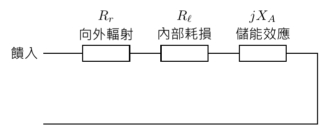
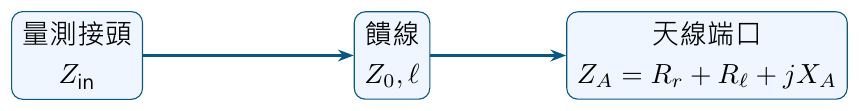

# 單元 11｜天線阻抗

把輻射、耗損與儲能分清楚

原始影片：[陳晏笙老師「天線」單元 11](https://www.youtube.com/watch?v=Jl99OrIuKWk)

影片長度：約 43 分鐘　建議閱讀：約 20 分鐘

前置單元：05、06、10；複數功率與相量。

> **核心觀念：** 天線的輸入實部包含「向外輻射」與「內部耗損」。電抗描述淨儲能效應。只看是否匹配到 50 $`\Omega`$，不能分辨功率最後去了哪裡。

## 你會學到什麼？

1.  用輻射電阻、耗損電阻與電抗表示發射天線。

2.  用複數功率解釋電抗為何提高電壓／電流需求。

3.  重算影片三個相同實功率、不同電抗的例子。

4.  分清共振、端口匹配，以及輻射效率。

## 本單元採 RMS 相量

影片板書的複數功率例題使用 RMS（均方根）相量。本單元跟隨此慣例：

```math
S=VI^*,\qquad P=\Re S,\qquad Q=\Im S.
```

前面各單元多採峰值相量；若使用峰值，則 $`S=\tfrac12 V_{\rm pk}I_{\rm pk}^*`$。兩種慣例都正確，但不可混算。

## 閱讀地圖

第 2 頁：天線等效電路；第 3 頁：實功率與虛功率；第 4 頁：影片三個算例；第 5 頁：輻射電阻從哪來；第 6 頁：共振與匹配；第 7 頁：饋線與量測參考面；第 8 頁：自測。 依影片板書與投影片重寫；峰值公式另列以協助核對原片。補充例題均有標示。

## 1．天線輸入阻抗的三個部分

影片對照：[約 00:00](https://www.youtube.com/watch?v=Jl99OrIuKWk&t=0s)－[09:00](https://www.youtube.com/watch?v=Jl99OrIuKWk&t=540s)

從天線饋入端看進去，輸入阻抗為

```math
\boxed{Z_A=R_A+jX_A=(R_r+R_\ell)+jX_A.}
```

$`R_r`$ 是輻射電阻，$`R_\ell`$ 是耗損電阻。這裡的下標 $`\ell`$ 表示 loss；與傳輸線的負載下標 $`L`$ 要分清楚。



### 為什麼輻射可以用電阻表示？

從端口能量平衡看，輻射帶走的平均功率與電流平方成正比。用等效 $`R_r`$ 表示這個功率，可以在電路分析中正確計算端口的實功率；它不代表有一顆實體電阻將那部分全轉成熱。

```math
P_{\rm rad}=|I|^2R_r,\qquad
P_{\rm loss}=|I|^2R_\ell,\qquad
P_{\rm acc}=|I|^2(R_r+R_\ell).
```

三式均採饋入端 RMS 電流。前兩個是不同的能量去向，卻同樣出現在輸入阻抗的實部。

### 電抗是端口看到的淨儲能效應

$`X_A>0`$ 為感性，$`X_A<0`$ 為容性，與本課程 $`e^{j\omega t}`$ 慣例一致。理想電抗不消耗週期平均實功率，但會讓電壓與電流不同相。 **補充解說／重算例題：**等效模型描述選定頻率與參考面的端口行為；不應把整段頻帶的真實天線直接當成固定數值的三顆元件。

> **核心觀念：** 實部告訴你平均功率離開端口，卻還沒告訴你是輻射還是發熱；需要另外拆出 $`R_r`$ 與 $`R_\ell`$。

## 2．複數功率：電抗不耗實功率，仍增加負擔

影片對照：[約 09:00](https://www.youtube.com/watch?v=Jl99OrIuKWk&t=540s)－[14:00](https://www.youtube.com/watch?v=Jl99OrIuKWk&t=840s)

使用 RMS 相量，由 $`V=Z_AI`$：

```math
S=VI^*=Z_A|I|^2
=(R_r+R_\ell)|I|^2+jX_A|I|^2.
```

因此

```math
\boxed{P=(R_r+R_\ell)|I|^2,\qquad Q=X_A|I|^2.}
```

$`P`$ 的單位為 W，$`Q`$ 為 var；$`|S|`$ 是視在功率，單位 VA。

### 固定實功率，需要多少電流與電壓？

令 $`R_A=R_r+R_\ell`$；欲使天線接受實功率 $`P`$：

```math
|I|=\sqrt{\frac P{R_A}},\qquad
|V|=|I|\sqrt{R_A^2+X_A^2}.
```

在 $`P,R_A`$ 相同時，電流振幅不變；$`|X_A|`$ 越大，所需電壓越高，$`|Q|`$ 也越高。電壓電流相位差：

```math
\phi=\arg Z_A=\tan^{-1}(X_A/R_A)
\quad(R_A>0).
```

### 若電壓源固定，結果不同

在固定端口電壓幅值下，

```math
P=\frac{|V|^2R_A}{R_A^2+X_A^2}.
```

增加電抗會降低電流與接受實功率。因此「電抗不耗平均功率」並不等於「電抗對送入功率沒有影響」。

### 虛功率不是多出來的平均瓦數

$`Q`$ 描述電場、磁場儲能與端口交換的相位效應；不能把 $`P+Q`$ 當成總瓦數。相量複數功率的模長是

```math
|S|=\sqrt{P^2+Q^2}.
```

**補充解說／重算例題：**功率因數 $`P/|S|=R_A/|Z_A|`$ 可描述此單頻端口的電壓電流關係；它也不等於輻射效率。

> **核心觀念：** 談「加上電抗有何影響」時，先交代固定的是實功率、電壓，還是源的可用功率。

## 3．影片的三個相同實功率算例

影片對照：[約 14:00](https://www.youtube.com/watch?v=Jl99OrIuKWk&t=840s)－[26:00](https://www.youtube.com/watch?v=Jl99OrIuKWk&t=1560s)

影片令接受實功率 $`P=100`$ W、總實部 $`R_A=50\,\Omega`$，比較電抗。選電流相位為零，RMS 電流皆為

```math
I=\sqrt{100/50}\angle0^\circ
=\sqrt2\angle0^\circ\ \mathrm A.
```

| $`Z_A`$             | RMS 電壓 $`V=Z_AI`$             | 虛功率 $`Q=X_A\vert I\vert ^2`$ |
|:------------------|:------------------------------|:------------------------------|
| $`50+j0\,\Omega`$   | $`70.711\angle0^\circ`$ V       | 0 var                         |
| $`50+j10\,\Omega`$  | $`72.111\angle11.310^\circ`$ V  | 20 var                        |
| $`50+j150\,\Omega`$ | $`223.607\angle71.565^\circ`$ V | 300 var                       |

### 逐步重算第三個例子

```math
V=(50+j150)\sqrt2
\approx70.711+j212.132\ \mathrm V.
```

```math
|V|=\sqrt{70.711^2+212.132^2}\approx223.607\ \mathrm V,
```

```math
S=VI^*=100+j300\ \mathrm{VA},\qquad
|S|=\sqrt{100^2+300^2}\approx316.228\ \mathrm{VA}.
```

實功率仍是 100 W；不是 400 W。電壓卻是共振例子的 $`\sqrt{10}\approx3.162`$ 倍，因為需要支持更大的電抗與電壓電流相位差。

### 共振例子的意義

第一例 $`X_A=0`$，端口電壓電流同相；在相同 $`P,R_A`$ 條件下所需端口電壓最低。這是影片以三個算例說明「電抗值得處理」的核心。

### 反向檢查：若 RMS 電壓固定為 70.711 V？

**補充解說／重算例題：**代入上一頁的固定電壓公式，三例的接受實功率分別為 100 W、約 96.154 W、10 W。固定實功率與固定電壓是不同問題，不能共用「電流都相同」的結論。

> **核心觀念：** 比較電抗時，影片固定的是 100 W 實功率與 50 $`\Omega`$ 實部；把這兩個條件寫清楚，才知道哪些量應相同。

## 4．輻射電阻由電磁場功率定義

影片對照：[約 26:00](https://www.youtube.com/watch?v=Jl99OrIuKWk&t=1560s)－[33:00](https://www.youtube.com/watch?v=Jl99OrIuKWk&t=1980s)

輻射電阻並非任意指定；先算向外流出的平均功率，再換成端口等效電阻：

```math
R_r=\frac{P_{\rm rad}}{|I_{\rm rms}|^2}
=\frac{2P_{\rm rad}}{|I_{\rm pk}|^2}.
```

影片投影片採右邊的峰值電流版本。兩式描述相同物理量。

### 從遠場坡印廷向量積分

峰值場相量的平均向外功率：

```math
P_{\rm rad}=\frac12
\Re\!\oint_S(\mathbf E\times\mathbf H^*)\cdot d\mathbf S.
```

在足夠遠的包覆面積分，即得到天線向各方向輻射的總功率。相同端口電流下，場越強、總積分越大，等效 $`R_r`$ 越大。

### 影片的電短偶極示例

投影片用電短、均勻電流的偶極模型，得到

```math
\boxed{R_r\approx80\pi^2\left(\frac l\lambda\right)^2\ \Omega.}
```

$`l`$ 是此模型的有效電流段長度。代入 $`l/\lambda=0.05`$、0.1，分別約 1.974、7.896 $`\Omega`$。比例升高時，電短近似逐漸變差；不能無限外推。 **補充解說／重算例題：**此公式的係數依電流分佈與長度定義而定。細線中心饋入、全長很短、近似三角形電流的實體短偶極，若 $`l`$ 指全長，常得到 $`20\pi^2(l/\lambda)^2`$。後續線型天線單元會深入討論；不要把均勻電流模型直接套給所有短天線。補充模型核對：[IIT Madras 無線系統天線講義](https://www.ee.iitm.ac.in/uday/notes/wsd/antennas.html)。

### 損耗電阻與輻射效率

```math
R_\ell=P_{\rm loss}/|I_{\rm rms}|^2,\qquad
\eta_{\rm rad}=\frac{P_{\rm rad}}{P_{\rm acc}}
=\frac{R_r}{R_r+R_\ell}.
```

**補充解說／重算例題：**若 $`R_r=40\,\Omega`$、$`R_\ell=10\,\Omega`$，接受 100 W，則輻射 80 W、耗損 20 W，效率 80%。相同總實部 50 $`\Omega`$，仍可能有完全不同的能量分配。

> **核心觀念：** 計算輻射電阻時，要說明所用電流的參考位置、峰值／RMS，以及天線模型的電流分佈。

## 5．共振、匹配、效率是三個判斷

影片對照：[約 33:00](https://www.youtube.com/watch?v=Jl99OrIuKWk&t=1980s)－[43:00](https://www.youtube.com/watch?v=Jl99OrIuKWk&t=2580s)

影片先說明電抗與共振，再回到反射與匹配。

| 判斷     | 條件或量                  | 主要回答                     |
|:---------|:--------------------------|:-----------------------------|
| 共振     | $`X_A=0`$                   | 端口電壓、電流是否同相？     |
| 端口匹配 | $`Z_A=Z_0`$，$`Z_0`$ 為正實數 | 入射波是否有反射？           |
| 輻射效率 | $`R_r/(R_r+R_\ell)`$        | 接受的實功率有多少向外輻射？ |

例如 50 $`\Omega`$ 線接 $`Z_A=25+j0\,\Omega`$：天線共振，但 $`\Gamma=-1/3`$、VSWR = 2，沒有完全匹配。 若 $`Z_A=50+j0\,\Omega`$，端口匹配；若實部大部分是耗損電阻，輻射效率仍可能很低。

### 理想補償可以抵消端口電抗

在選定頻率，串聯相反電抗 $`X_m=-X_A`$ 可使外部看到的合成電抗為零：

```math
Z_{\rm combined}=R_A+j(X_A+X_m)=R_A.
```

如果 $`R_A=Z_0`$，即可同時達到該頻率的端口匹配。若 $`R_A\ne Z_0`$，還需阻抗變換。 補償元件和天線內仍可能有很大的循環儲能及局部電壓；外部合成電抗為零，並不代表所有地方都沒有儲能。

### 再把匹配與輻射能量接起來

以正實數 $`Z_0`$ 為參考：

```math
\Gamma=\frac{Z_A-Z_0}{Z_A+Z_0},\qquad
P_{\rm acc}=P_{\rm inc}(1-|\Gamma|^2),
```

```math
\boxed{P_{\rm rad}=P_{\rm inc}(1-|\Gamma|^2)\eta_{\rm rad}.}
```

**補充解說／重算例題：**對複數源阻抗，最大可用功率的條件是共軛匹配；這與「50 $`\Omega`$ 線上無反射」的端口條件須按具體電路區分。後續匹配單元會分別處理。

> **核心觀念：** 共振只消掉電抗；匹配控制反射；效率控制接受功率的去向。設計與量測需要分別確認。

## 6．量到的是天線阻抗，還是饋線輸入阻抗？

影片對照：[約 35:00](https://www.youtube.com/watch?v=Jl99OrIuKWk&t=2100s)－[43:10](https://www.youtube.com/watch?v=Jl99OrIuKWk&t=2590s)

影片末段特別提醒：網路分析儀接頭或模擬埠所在位置，決定你量到的阻抗。接頭與天線之間若有饋線，讀值通常是整段線的輸入阻抗，不能直接當成天線端口的 $`Z_A`$。



無損、實數 $`Z_0`$ 的線會做阻抗變換：

```math
Z_{\rm in}=Z_0\frac{Z_A+jZ_0\tan(\beta\ell)}
{Z_0+jZ_A\tan(\beta\ell)}.
```

### 很大的輸入實部，也可能只是線長造成

**補充解說／重算例題：**設天線端口為 $`Z_A=10+j0\,\Omega`$，接 $`50\,\Omega`$ 無損線，線長 $`\lambda/4`$：

```math
Z_{\rm in}=\frac{50^2}{10}=250\,\Omega.
```

輸入電阻放大 25 倍，並沒有新增輻射能力。若天線原本 $`R_r=2\,\Omega`$、$`R_\ell=8\,\Omega`$，它的輻射效率仍是 $`2/10=20\%`$。 無損線只改變電壓、電流與阻抗關係；不改變接受功率最後在天線內的分配。

### 如何避免錯誤判讀？

1.  清楚標出模擬埠或量測校正面。

2.  若要解讀天線本身，將饋線去嵌入至天線端口，或用已知傳輸線模型反推 $`Z_A`$。

3.  再以輻射功率和該端口電流求 $`R_r`$；不要把任意參考面的 $`\Re Z_{\rm in}`$ 直接叫作輻射電阻。

4.  無損半波長線只在對應頻率重複負載；有損線一般不會精確重複。

### 接收時的端口模型

對線性、被動、互易的天線，接收等效電路仍使用同一端口阻抗；接收開路電壓則由入射場決定。匹配網路能改善功率耦合，輻射／接收能力還要配合後續場型、增益與效率分析。

> **核心觀念：** 把參考面放對，才能將端口實部拆成輻射與耗損；饋線變換後的實部大小，無法單獨判斷天線好壞。

## 7．五題自測與答案

本頁沿用 RMS 相量；所有實部均視為非負。

1.  天線 $`R_r=30\,\Omega`$、$`R_\ell=10\,\Omega`$、$`X_A=20\,\Omega`$，饋入 RMS 電流 2 A。求輻射、耗損、接受實功率與虛功率。

2.  $`Z_A=50+j150\,\Omega`$，希望接受 100 W。求 RMS 電流、電壓幅值與視在功率。

3.  一支天線 $`Z_A=25+j0\,\Omega`$，接 50 $`\Omega`$ 線。它共振嗎？匹配嗎？VSWR 多少？

4.  均勻電流的電短偶極模型，$`l/\lambda=0.02`$，求 $`R_r`$。若耗損電阻 1 $`\Omega`$，輻射效率約多少？

5.  天線已完美匹配 50 $`\Omega`$，卻只有 10% 輻射效率。入射 1 W，有多少反射、多少輻射、多少耗損？

### 答案與理由

1.  $`P_{\rm rad}=120`$ W、$`P_{\rm loss}=40`$ W、$`P_{\rm acc}=160`$ W，$`Q=80`$ var。$`Q`$ 不能加到 160 W 中變成耗能。

2.  $`|I|=\sqrt2`$ A；$`|V|\approx223.607`$ V；$`|S|\approx316.228`$ VA。這三個是 RMS／平均功率一致的結果。

3.  共振，因電抗為零；不匹配，因電阻不等於 50 $`\Omega`$。$`\Gamma=-1/3`$，VSWR = 2。

4.  $`R_r\approx80\pi^2(0.02)^2\approx0.31583\,\Omega`$；效率 $`\approx0.31583/(1.31583)\approx24.0\%`$。須保留本題的均勻電流模型條件。

5.  反射 0 W、輻射 0.1 W、耗損 0.9 W。端口匹配沒有排除高耗損。

### 公式速記

```math
Z_A=R_r+R_\ell+jX_A,\qquad S=VI^*,
```

```math
P_{\rm rad}=R_r|I|^2,\quad
P_{\rm loss}=R_\ell|I|^2,\quad Q=X_A|I|^2.
```

**下一單元：**以匹配網路讓源、傳輸線與天線有效傳送功率，先從集總電感電容開始。
