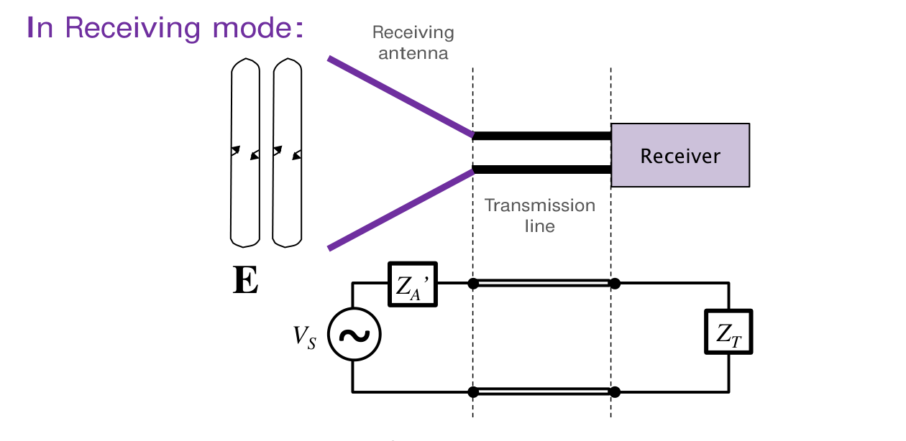

# 單元 11｜天線阻抗

原始影片：[陳晏笙老師「天線」單元 11](https://www.youtube.com/watch?v=Jl99OrIuKWk)

老師講義：[Lecture 2 — Circuit Parameters](https://drive.google.com/file/d/1wHWHyXrkJXY4lCvk3vFuf73KGOgOCiky/view)，第 124–132 頁

影片長度：約 43 分鐘　建議閱讀：約 30 分鐘。前置單元：05、06、10。

> **學習重點：** 從同一個天線端口，分辨輻射、發熱與儲能；再用反射係數判斷多少入射功率能進入天線。端口匹配、共振與輻射效率，回答的是三個不同問題。

## 講義與影片對照

第 124 頁為章節目錄。正文依投影片頁序；老師先講的複數功率板書，整理在 p.129 電抗主題旁。下表依影片口述校準主題時間；板書與頁面切換並非逐一對應。

| 老師講義 | 原英文主題 | 中文內容 | 影片定位 |
|:--|:--|:--|:--|
| 124–126 | Contents / Equivalent Circuit of Transmitting Antennas / Antenna Impedance (1/4) | 天線端口、輻射與損耗等效電阻 | [約 00:30–06:20](https://www.youtube.com/watch?v=Jl99OrIuKWk&t=30s)；[回看端口 34:30–39:15](https://www.youtube.com/watch?v=Jl99OrIuKWk&t=2070s) |
| 127 | Antenna Impedance (2/4) | 由遠場積分定義輻射電阻 | [約 27:40–32:30](https://www.youtube.com/watch?v=Jl99OrIuKWk&t=1660s) |
| 128 | Antenna Impedance (3/4) | 導體、介質與表皮效應損耗 | [約 32:30–34:00](https://www.youtube.com/watch?v=Jl99OrIuKWk&t=1950s) |
| 129 | Antenna Impedance (4/4) | 電抗、儲能與共振；插入複數功率板書 | [板書約 06:20–26:00](https://www.youtube.com/watch?v=Jl99OrIuKWk&t=380s)；[電抗約 33:00 起](https://www.youtube.com/watch?v=Jl99OrIuKWk&t=1980s) |
| 130–131 | Return Loss (1/2–2/2) | 接受功率與回返損失 | [約 39:15 起簡述](https://www.youtube.com/watch?v=Jl99OrIuKWk&t=2355s)；數值表依講義補齊 |
| 132 | Equivalent Circuit of Receiving Antennas | 接收電壓源與互易端口阻抗 | [約 39:40–40:15](https://www.youtube.com/watch?v=Jl99OrIuKWk&t=2380s) |

**相量慣例：**老師 PDF 的 $`I_{\rm in}`$ 採峰值，因此功率式有 $`1/2`$；複數功率板書的數值例採 RMS。本章在式旁明示，兩者以 $`I_{\rm pk}=\sqrt2 I_{\rm rms}`$ 互換。

## 1．發射天線的等效電路（Equivalent Circuit of Transmitting Antennas，p.125）

老師把發射系統畫成訊號源、傳輸線與天線三部分。天線端口看入去的阻抗為

```math
Z_A=R_{\rm total}+jX_A=(R_r+R_L)+jX_A.
```

$`R_r`$ 是輻射電阻（radiation resistance），$`R_L`$ 是損耗電阻（loss resistance），$`X_A`$ 是天線電抗。老師的 $`R_L`$ 在舊筆記寫成 $`R_\ell`$，兩者意義相同；此處的 L 表示 loss，不是傳輸線負載。


*本筆記示意圖，對照老師 p.125；圖中的 $`R_\ell`$ 對應講義 $`R_L`$。*

天線接受的實功率分成向外輻射及內部損耗。等效輻射電阻能在電路中表達向外離開的功率；它不代表存在一顆把輻射能量全轉成熱的實體電阻。

## 2．先指定端口，再談輸入阻抗（Antenna Impedance 1/4，p.126）

同一個天線，若把觀察面移到一段饋線前方，讀到的阻抗可能不同。老師在 p.126 特別要求先定義合適的輸入端子；該端子的電流才是公式中的 $`I_{\rm in}`$。

採峰值相量：

```math
P_{\rm acc}=\frac12(R_r+R_L)|I_{\rm in}|^2,
\quad P_r=\frac12R_r|I_{\rm in}|^2,
\quad P_L=\frac12R_L|I_{\rm in}|^2.
```

**符號對照：**p.126 將端口實功率標成 $`P_{\rm in}`$；pp.125、130 則把傳輸線入射功率標成 $`P_{\rm in}`$，另用 $`P_{\rm accept}`$ 表示接受功率。本筆記統一以 $`P_{\rm acc}`$ 表示進入天線的淨實功率，以 $`P_{\rm inc}`$ 表示入射功率，避免把兩個分母混在一起。

**影片補充（[約 34:30–39:15](https://www.youtube.com/watch?v=Jl99OrIuKWk&t=2070s)）：**網路分析儀接頭或模擬埠所在位置，決定你量到的阻抗。接頭與天線之間若有饋線，讀值通常是整段線的輸入阻抗，不能直接當成天線端口的 $`Z_A`$。


無損、實數 $`Z_0`$ 的線會做阻抗變換：

```math
Z_{\rm in}=Z_0\frac{Z_A+jZ_0\tan(\beta\ell)}
{Z_0+jZ_A\tan(\beta\ell)}.
```

## 3．輻射電阻由遠場總功率決定（Antenna Impedance 2/4，p.127）

### 3.1 定義：先積分輻射，再換成等效電阻

```math
P_r=\frac12\operatorname{Re}\iint_{S_{\rm ff}}
(\mathbf E\times\mathbf H^*)\cdot d\mathbf S,
\qquad R_r=\frac{2P_r}{|I_{\rm in}|^2}.
```

$`S_{\rm ff}`$ 是包住天線的遠場閉合面，$`d\mathbf S`$ 指向外側；場與電流均採峰值。對理想向外傳播的遠場，積分本身已是實數；顯式保留實部運算，可避免把近場複數功率也當成平均輻射功率。

### 3.2 老師算例：均勻電流的電短偶極

老師用長度 $`L\ll\lambda`$、電流近似均勻的模型，給出自由空間遠場：

```math
\mathbf E=\hat{\boldsymbol\theta}
\frac{j\eta k I_{\rm in}L\sin\theta}{4\pi r}e^{-jkr},
\qquad
\mathbf H=\hat{\boldsymbol\phi}
\frac{jk I_{\rm in}L\sin\theta}{4\pi r}e^{-jkr}.
```

其中 $`k=2\pi/\lambda`$、$`\eta=120\pi\,\Omega`$，且 $`H_\phi=E_\theta/\eta`$。因此平均功率密度只朝外：

```math
\frac12\operatorname{Re}(\mathbf E\times\mathbf H^*)
=\hat{\mathbf r}\frac{\eta k^2|I_{\rm in}|^2L^2}{32\pi^2r^2}\sin^2\theta.
```

代入 $`dS=r^2\sin\theta\,d\theta d\phi`$，利用 $`\int_0^\pi\sin^3\theta\,d\theta=4/3`$：

```math
P_r=\frac{\eta k^2|I_{\rm in}|^2L^2}{12\pi},
\qquad
R_r=\frac{\eta k^2L^2}{6\pi}
=80\pi^2\left(\frac L\lambda\right)^2\ \Omega.
```

| $`L/\lambda`$ | 講義讀值 | 由公式重算 |
|:--|:--|:--|
| 0.05 | 約 2 Ω | 1.974 Ω |
| 0.1 | 約 7.9 Ω，旁註 Imprecise | 7.896 Ω；電短假設的誤差已須注意 |

這裡 $`L`$ 是均勻電流段的長度；不能無條件套到具有三角形電流分布的實體短偶極。後續[線型天線](021_線型天線.md)會區分這兩個模型。

## 4．損耗電阻：導體與介質的耗能（Antenna Impedance 3/4，p.128）

講義先分成導體損耗與介質損耗。對長度 $`L`$、導電率 $`\sigma`$、有效截面積 $`A`$ 的均勻導體：

```math
R_{L,\rm conductor}=\frac{L}{\sigma A}.
```

高頻時電流主要集中在表面。對直徑 $`d`$ 的圓導線，若表皮深度遠小於半徑，講義用薄環截面近似：

```math
\delta=\frac1{\sqrt{\pi f\mu\sigma}},\qquad
A\approx\pi d\delta,
\qquad
R_L\approx\frac Ld\sqrt{\frac{f\mu}{\pi\sigma}}.
```

因此在此模型下，線越長、越細，損耗越大；頻率升高使有效導電截面縮小，電阻約隨 $`\sqrt f`$ 增加。$`\mu`$ 是導體磁導率，$`f`$ 用 Hz，幾何尺寸使用一致單位。

**模型條件：**這是均勻導線電流的高頻估算。真實天線電流沿位置改變時，端口等效損耗電阻須按局部電流平方加權；介質損耗又取決於材料與場分布。老師因而指出介質損耗通常需要全波分析，不能只把金屬線的 $`L/(\sigma A)`$ 拿來代替。

## 5．電抗、近場儲能與共振（Antenna Impedance 4/4，p.129）

$`X_A>0`$ 是感性，$`X_A<0`$ 是容性，沿用 $`e^{j\omega t}`$ 慣例。電抗反映端口的淨儲能效應；理想電抗的週期平均實功率為零，但電壓與電流可以不同相。

p.129 的藍色瞬時功率曲線在正負之間振盪，綠線標示平均耗散功率為零，紅線表示虛功率的尺度。能量是在源與儲能場之間往返，不能把虛功率數值當成持續消耗的瓦數。

當 $`X_A=0`$，老師稱為共振；它表示端口淨電抗為零，並不保證近場各處都沒有儲能，也不保證實部等於傳輸線的 $`Z_0`$。

### 5.1 課堂板書：複數功率的比較條件

以下板書算例改採 RMS 相量，故 $`S=VI^*`$；若使用講義峰值，應改為 $`S=V_{\rm pk}I_{\rm pk}^*/2`$。

影片對照：[約 06:20–11:40](https://www.youtube.com/watch?v=Jl99OrIuKWk&t=380s)

使用 RMS 相量，由 $`V=Z_AI`$：

```math
S=VI^*=Z_A|I|^2
=(R_r+R_\ell)|I|^2+jX_A|I|^2.
```

因此

```math
\boxed{P=(R_r+R_\ell)|I|^2,\qquad Q=X_A|I|^2.}
```

$`P`$ 的單位為 W，$`Q`$ 為 var；$`|S|`$ 是視在功率，單位 VA。

#### 固定實功率，需要多少電流與電壓？

令 $`R_A=R_r+R_\ell`$；欲使天線接受實功率 $`P`$：

```math
|I|=\sqrt{\frac P{R_A}},\qquad
|V|=|I|\sqrt{R_A^2+X_A^2}.
```

在 $`P,R_A`$ 相同時，電流振幅不變；$`|X_A|`$ 越大，所需電壓越高，$`|Q|`$ 也越高。電壓電流相位差：

```math
\phi=\arg Z_A=\tan^{-1}(X_A/R_A)
\quad(R_A>0).
```

#### 若電壓源固定，結果不同

在固定端口電壓幅值下，

```math
P=\frac{|V|^2R_A}{R_A^2+X_A^2}.
```

增加電抗會降低電流與接受實功率。因此「電抗不耗平均功率」並不等於「電抗對送入功率沒有影響」。

#### 虛功率不是多出來的平均瓦數

$`Q`$ 描述電場、磁場儲能與端口交換的相位效應；不能把 $`P+Q`$ 當成總瓦數。相量複數功率的模長是

```math
|S|=\sqrt{P^2+Q^2}.
```

**補充解說／重算例題：**功率因數 $`P/|S|=R_A/|Z_A|`$ 可描述此單頻端口的電壓電流關係；它也不等於輻射效率。

> **核心觀念：** 談「加上電抗有何影響」時，先交代固定的是實功率、電壓，還是源的可用功率。

### 5.2 課堂板書：三個相同實功率算例

影片對照：[約 11:40–26:00](https://www.youtube.com/watch?v=Jl99OrIuKWk&t=700s)

影片為說明基地台維持相同涵蓋能力的要求，固定 $`P=100`$ W、$`R_A=50\,\Omega`$，並假設損耗為零，所以此例接受功率也就是輻射功率。另省去傳輸線、令源內阻為零，以單獨比較電抗的影響。選電流相位為零，RMS 電流皆為

```math
I=\sqrt{100/50}\angle0^\circ
=\sqrt2\angle0^\circ\ \mathrm A.
```

| $`Z_A`$             | RMS 電壓 $`V=Z_AI`$             | 虛功率 $`Q=X_A\vert I\vert ^2`$ |
|:------------------|:------------------------------|:------------------------------|
| $`50+j0\,\Omega`$   | $`70.711\angle0^\circ`$ V       | 0 var                         |
| $`50+j10\,\Omega`$  | $`72.111\angle11.310^\circ`$ V  | 20 var                        |
| $`50+j150\,\Omega`$ | $`223.607\angle71.565^\circ`$ V | 300 var                       |

#### 逐步重算第三個例子

```math
V=(50+j150)\sqrt2
\approx70.711+j212.132\ \mathrm V.
```

```math
|V|=\sqrt{70.711^2+212.132^2}\approx223.607\ \mathrm V,
```

```math
S=VI^*=100+j300\ \mathrm{VA},\qquad
|S|=\sqrt{100^2+300^2}\approx316.228\ \mathrm{VA}.
```

**口述用語校註：**影片將較大的虛功率稱為「浪費」，應理解為源與元件須承受更大的電壓、電流及視在功率容量；理想電抗並不持續消耗實能量。實功率仍是 100 W；不是 400 W。電壓卻是共振例子的 $`\sqrt{10}\approx3.162`$ 倍，因為需要支持更大的電抗與電壓電流相位差。

#### 共振例子的意義

第一例 $`X_A=0`$，端口電壓電流同相；在相同 $`P,R_A`$ 條件下所需端口電壓最低。這是影片以三個算例說明「電抗值得處理」的核心。

> **核心觀念：** 比較電抗時，影片固定的是 100 W 實功率與 50 $`\Omega`$ 實部；把這兩個條件寫清楚，才知道哪些量應相同。

## 6．回返損失：有多少入射功率進入天線？（Return Loss 1/2–2/2，pp.130–131）

在天線端口，以正實數 $`Z_0`$ 為參考：

```math
\Gamma_L=\frac{Z_A-Z_0}{Z_A+Z_0},\qquad
P_{\rm acc}=P_{\rm inc}(1-|\Gamma_L|^2),
```

```math
RL=-10\log_{10}|\Gamma_L|^2
=-10\log_{10}\frac{P_{\rm inc}-P_{\rm acc}}{P_{\rm inc}}.
```

此處 RL 是回返損失，單位 dB；不要與損耗電阻 $`R_L`$ 混淆。

| 老師列出的情況 | 反射功率比例 | 接受功率 |
|:--|:--|:--|
| 開路 $`Z_A\to\infty`$ | 1 | 0 |
| 短路 $`Z_A=0`$ | 1 | 0 |
| 匹配 $`Z_A=Z_0`$ | 0 | 等於入射功率 |

| 講義 RL 門檻 | 反射功率比例 $`10^{-RL/10}`$ | 接受比例 |
|:--|:--|:--|
| 10 dB | 0.1 | 90% |
| 6 dB | 約 0.2512 | 約 74.88%；講義取 75% |
| 3 dB | 約 0.5012 | 約 49.88%；講義取 50% |

**三個判斷一起看：**共振要求 $`X_A=0`$；無反射匹配要求 $`Z_A=Z_0`$；輻射效率則是 $`\eta_{\rm rad}=R_r/(R_r+R_L)`$。因此

```math
P_r=P_{\rm inc}(1-|\Gamma_L|^2)\eta_{\rm rad}.
```

例如 $`Z_A=25+j0\,\Omega`$ 接到 50 Ω 線，雖然共振，仍有 $`\Gamma_L=-1/3`$。即使完美匹配，若實部主要來自發熱，輻射功率也可能很低。

## 7．接收天線也能化成端口電路（Equivalent Circuit of Receiving Antennas，p.132）



*來源：老師 Lecture 2，第 132 頁局部。*

講義將接收天線畫成感應電壓源 $`V_S`$ 串聯天線阻抗 $`Z_A'`$，再接到接收器負載 $`Z_T`$。對短偶極，老師用沿導線的電場積分建立直覺：

```math
V_S=\int_L\mathbf E\cdot d\boldsymbol\ell.
```

此式說明入射場的方向與沿線分布會影響感應電壓；一般天線還須配合有效長度與電流分布模型，不能由線長單獨判定接收能力。依互易定理，在同一端口與環境、線性互易條件下，發射與接收使用相同阻抗：

```math
Z_A'=Z_A=(R_r+R_L)+jX_A.
```

改變收發模式，不代表端口會忽然變成另一個阻抗；接收時增加的是由入射波決定的等效電壓源。

## 8．補充解說與重算例題

### 8.1 固定電壓，與固定接受功率不同

**補充解說／重算例題：**固定 RMS 電壓為 70.711 V，代入第 5 節的固定電壓公式，三例的接受實功率分別為 100 W、約 96.154 W、10 W。固定實功率與固定電壓是不同問題，不能共用「電流都相同」的結論。

### 8.2 量到天線端口，還是饋線輸入端？

沿用正文的端口與無損饋線關係，以下以自設數值說明。

#### 很大的輸入實部，也可能只是線長造成

**補充解說／重算例題：**設天線端口為 $`Z_A=10+j0\,\Omega`$，接 $`50\,\Omega`$ 無損線，線長 $`\lambda/4`$：

```math
Z_{\rm in}=\frac{50^2}{10}=250\,\Omega.
```

輸入電阻放大 25 倍，並沒有新增輻射能力。若天線原本 $`R_r=2\,\Omega`$、$`R_\ell=8\,\Omega`$，它的輻射效率仍是 $`2/10=20\%`$。 無損線只改變電壓、電流與阻抗關係；不改變接受功率最後在天線內的分配。

#### 如何避免錯誤判讀？

1.  清楚標出模擬埠或量測校正面。

2.  若要解讀天線本身，將饋線去嵌入至天線端口，或用已知傳輸線模型反推 $`Z_A`$。

3.  再以輻射功率和該端口電流求 $`R_r`$；不要把任意參考面的 $`\Re Z_{\rm in}`$ 直接叫作輻射電阻。

4.  無損半波長線只在對應頻率重複負載；有損線一般不會精確重複。

### 8.3 輻射效率與電流模型

若 $`R_r=40\,\Omega`$、$`R_L=10\,\Omega`$，天線接受 100 W，則輻射 80 W、發熱 20 W。對於相同總實部 50 Ω，仍需知道實部如何分配。

p.127 採均勻電流短電流元，$`R_r=80\pi^2(L/\lambda)^2`$。若改成細線中心饋入、全長 $`L`$、近似三角形電流的電短偶極，以饋入電流為基準常得到 $`20\pi^2(L/\lambda)^2`$。係數不同來自電流分布與參考電流；不能只看到「短偶極」三字便混用。

### 8.4 抵消電抗仍須檢查實部

在指定頻率串聯 $`X_m=-X_A`$，合成阻抗變成 $`R_r+R_L`$。只有實部也等於 $`Z_0`$ 時，才同時達到無反射匹配；對複數源的最大功率傳送，則須進一步考慮共軛匹配。補償元件本身的損耗及頻寬，也會影響結果。

## 9．自測與解析

本節沿用 RMS 相量；所有實部均視為非負。

1.  天線 $`R_r=30\,\Omega`$、$`R_\ell=10\,\Omega`$、$`X_A=20\,\Omega`$，饋入 RMS 電流 2 A。求輻射、耗損、接受實功率與虛功率。

2.  $`Z_A=50+j150\,\Omega`$，希望接受 100 W。求 RMS 電流、電壓幅值與視在功率。

3.  一支天線 $`Z_A=25+j0\,\Omega`$，接 50 $`\Omega`$ 線。它共振嗎？匹配嗎？VSWR 多少？

4.  均勻電流的電短偶極模型，$`l/\lambda=0.02`$，求 $`R_r`$。若耗損電阻 1 $`\Omega`$，輻射效率約多少？

5.  天線已完美匹配 50 $`\Omega`$，卻只有 10% 輻射效率。入射 1 W，有多少反射、多少輻射、多少耗損？

### 答案與理由

1.  $`P_{\rm rad}=120`$ W、$`P_{\rm loss}=40`$ W、$`P_{\rm acc}=160`$ W，$`Q=80`$ var。$`Q`$ 不能加到 160 W 中變成耗能。

2.  $`|I|=\sqrt2`$ A；$`|V|\approx223.607`$ V；$`|S|\approx316.228`$ VA。這三個是 RMS／平均功率一致的結果。

3.  共振，因電抗為零；不匹配，因電阻不等於 50 $`\Omega`$。$`\Gamma=-1/3`$，VSWR = 2。

4.  $`R_r\approx80\pi^2(0.02)^2\approx0.31583\,\Omega`$；效率 $`\approx0.31583/(1.31583)\approx24.0\%`$。須保留本題的均勻電流模型條件。

5.  反射 0 W、輻射 0.1 W、耗損 0.9 W。端口匹配沒有排除高耗損。

### 公式速記

```math
Z_A=R_r+R_\ell+jX_A,\qquad S=VI^*,
```

```math
P_{\rm rad}=R_r|I|^2,\quad
P_{\rm loss}=R_\ell|I|^2,\quad Q=X_A|I|^2.
```

**下一單元：**[基本觀念與集總元件匹配法](012_基本觀念與集總元件匹配法.md)，從最大功率傳送走向匹配網路設計。
