# 單元 12｜基本觀念與集總元件匹配法

原始影片：[陳晏笙老師「天線」單元 12](https://www.youtube.com/watch?v=fnhAMW-Q1Lw)（約 94 分 56 秒）

原始講義：[Lecture 3 — Impedance Matching Networks](https://drive.google.com/file/d/1fVGbNCHfqeGabsR-2ABXvOkeuYlyDFzq/view)，**PDF 第 3–64 頁**。本章依 §3.1–§3.3 排列；第 3、12、32 頁為分節頁。

建議閱讀：50–65 分鐘，可分成「匹配目標與四分之一波長線」及「集總元件匹配」兩次。前置單元：05–11。

本章要學會：區分無反射與最大功率傳送，設計四分之一波長變壓器，以 Smith 圖與代數求 L 型網路，並辨認實體電容、電感的高頻限制。正文保留老師的四個例題；額外推導與重算集中在章末。

## 講義與影片對照

以下頁碼都是老師 PDF 的頁碼。時間依影片口述與投影片／板書畫面交叉核對，為方便跳看的約略範圍，並非精確換頁秒數。老師在本支影片略過的講義例題與推導，仍按頁序保留，表中另作說明。

| 講義頁碼 | 原英文主題 | 中文內容 | 影片定位 |
| --- | --- | --- | --- |
| 3–11 | Objective of Impedance Matching | 反射、匹配電路、應用與最大功率 | [約 00:30](https://www.youtube.com/watch?v=fnhAMW-Q1Lw&t=30s)–19:50；含章節導讀 |
| 12–16 | Quarter-Wavelength Transformers | 變壓原理與微帶天線案例 | [約 20:00](https://www.youtube.com/watch?v=fnhAMW-Q1Lw&t=1200s)–30:20；23:50 有線長提問，26:00 起為微帶例 |
| 17–20 | EX 3.1 — Frequency Response | 固定線長的掃頻與週期性匹配 | [約 30:20](https://www.youtube.com/watch?v=fnhAMW-Q1Lw&t=1820s) 起 |
| 21 | Operational Bandwidth | 允許反射、阻抗比與分數頻寬 | [約 33:00](https://www.youtube.com/watch?v=fnhAMW-Q1Lw&t=1980s)–34:50 |
| 22–25 | EX 3.2 — A Practical Design Situation | FR4 線寬、線長與頻寬設計 | 講義例題；本支影片未逐頁展開 |
| 26–27 | Complex Load / Inserting a Series Section | 兩種前處理及串聯線段的 Smith 圖操作 | [約 35:10](https://www.youtube.com/watch?v=fnhAMW-Q1Lw&t=2110s)–39:40；38:00 畫面為第 27 頁 |
| 28–31 | Inserting a Shunt Stub | 並聯開路／短路殘段的詳細設計 | 老師約 [39:40](https://www.youtube.com/watch?v=fnhAMW-Q1Lw&t=2380s) 說明留待 `3.4 後回看；此處按講義補全 |
| 32–38 | A Review of Smith Chart Operation | 四元件網路逐級求輸入阻抗 | [約 43:50](https://www.youtube.com/watch?v=fnhAMW-Q1Lw&t=2630s)–50:30；45–47 分鐘有 L／C 對照表板書 |
| 39–43 | Analysis vs. Synthesis / L-Section Networks | 倒數第二步、兩種位置與八種拓樸 | [約 50:30](https://www.youtube.com/watch?v=fnhAMW-Q1Lw&t=3030s)–59:50 |
| 44–52 | EX 3.3 — Smith Chart Solutions | 兩個 L 型匹配解 | [約 59:50](https://www.youtube.com/watch?v=fnhAMW-Q1Lw&t=3590s)–70:00 |
| 53 | Which One Has Better Bandwidth? | 掃頻與 Smith 圖上的頻寬直覺 | [約 70:00](https://www.youtube.com/watch?v=fnhAMW-Q1Lw&t=4200s)–74:10 |
| 54 | Dynamic Ranges | 八拓樸可匹配範圍；雙電容板書逆推 | [約 74:10](https://www.youtube.com/watch?v=fnhAMW-Q1Lw&t=4450s)–81:10 |
| 55–61 | Derivation / EX 3.4 — Analytic Solutions | 解析解推導與精確重算 | 老師約 [81:10](https://www.youtube.com/watch?v=fnhAMW-Q1Lw&t=4870s) 明說不展開推導，留作講義自讀 |
| 62–64 | Characteristics / Real-World Components | 尺寸、調整、成本與寄生模型 | [約 81:40](https://www.youtube.com/watch?v=fnhAMW-Q1Lw&t=4900s)–94:50；85:40 起講電容，92:00 起講電感 |

## 1．為什麼需要匹配？（Objective of Impedance Matching，頁 3–5）

老師在 [00:30–02:00](https://www.youtube.com/watch?v=fnhAMW-Q1Lw&t=30s) 先區分兩個要求：**虛部歸零**表示端口的電抗抵消、電壓與電流同相；**匹配到主線**還要求實部等於主線特徵阻抗。天線已諧振，阻抗仍可能是 15 Ω、70 Ω，而不是系統需要的 50 Ω，這時就需要阻抗變換。

取無損線的負載端為 $`z=0`$，主線特徵阻抗 $`Z_0`$ 為正實數。沿線電壓、電流為

```math
V(z)=V^+e^{-j\beta z}+V^-e^{j\beta z},\qquad
I(z)=\frac{V^+e^{-j\beta z}-V^-e^{j\beta z}}{Z_0}.
```

當 $`Z_L\ne Z_0`$，負載會產生反射：

```math
\Gamma_L=\frac{Z_L-Z_0}{Z_L+Z_0},\qquad
\Gamma(z)=\Gamma_Le^{j2\beta z}.
```

採**峰值相量**時，朝負載方向的淨平均功率為

```math
P_{\rm av}(z)=\frac{|V^+|^2}{2Z_0}\left(1-|\Gamma(z)|^2\right).
```

反射使同一入射功率中能被負載接受的部分減少，也可能使發射端承受不利的電壓、電流。這裡的「功率浪費」是沒有送達預定負載，不能一律解讀成在線上變成熱。

第 5 頁將匹配電路插在主線與負載之間，設計目標是

```math
\boxed{Z_{\rm in}=Z_0\quad\Longrightarrow\quad\Gamma_{\rm in}=0.}
```

從主線看進去，**匹配電路與負載合在一起**等效為 $`Z_0`$。負載本身仍可有 $`\Gamma_L\ne0`$，網路內也可有反射與儲能。老師約 [07:00–09:00](https://www.youtube.com/watch?v=fnhAMW-Q1Lw&t=420s) 用「暫存器／緩衝器」說明這一點：設計要消除的是主線參考面看到的總反射，不是每個內部交界的局部反射。在正弦穩態，真正要驗證的是輸入阻抗與平均功率平衡。

## 2．匹配電路的種類與應用（頁 6–9）

理想匹配網路使用不消耗平均功率的電抗元件：集總電感、集總電容，以及傳輸線殘段（stub）。若只加電阻來降低反射，部分功率會消耗在匹配器內，無法達到本章理想無損匹配的目的。

| 負載與需求 | 講義列出的方案 | 後續位置 |
| --- | --- | --- |
| 純實數負載 | 四分之一波長變壓器 | 本章 §3.2 |
| 複數負載 | L 型集總元件、串聯／並聯單殘段、雙殘段 | 本章 §3.3、單元 13 |
| 複數負載，仍想使用四分之一波長線 | 先加線段或並聯殘段，轉成純電阻 | 本章頁 26–31 |
| 寬頻匹配 | 多節網路與頻寬設計 | 單元 14 |

同一組負載與目標阻抗可以有許多解，選擇時要比較複雜度、頻寬、實作方式、可調整性與尺寸。老師約 [11:00–12:30](https://www.youtube.com/watch?v=fnhAMW-Q1Lw&t=660s) 特別把「可調整性」說成很實際的問題：負載換了之後，能否只更換元件，還是必須連整塊電路板一起重做？頻寬也應先按系統需求決定，不能把寬頻天線接上過窄的匹配器，卻仍期待整體保有原本的頻寬。

第 8 頁的電視天線例子是約 $`300\,\Omega`$ 的摺疊偶極，原可用約 $`300\,\Omega`$ 平行雙線饋入；若改接較容易屏蔽外界干擾的 $`50`$ 或 $`75\,\Omega`$ 同軸，就需要阻抗變換。第 9 頁再列出天線饋入端、功率放大器介面的實體匹配器。它們的共同工作都是讓兩個不同阻抗的端口有效交換功率。

## 3．無反射之後，還要檢查源端（Maximum Power Transfer，頁 10–11）

負載網路已匹配到主線，只能保證主線看見 $`Z_0`$。若源內阻 $`Z_S`$ 與 $`Z_0`$ 不適當，仍未必取得源的最大可用功率。老師在 [16:30–19:50](https://www.youtube.com/watch?v=fnhAMW-Q1Lw&t=990s) 改變「從哪一端看進去」的參考面，提醒我們：對主線無反射，與對訊號源取得最大功率，是需要分別確認的條件。

以戴維寧源 $`V_S`$、$`Z_S=R_S+jX_S`$ 表示，外部等效負載需要滿足

```math
Z_{\rm seen}=Z_S^*,\qquad
P_{\rm available}=\frac{|V_S|^2}{8R_S}\quad(R_S>0).
```

第 11 頁假設源內阻為純實數，因此可以分成兩步：選 $`Z_0=R_S`$，再設計負載匹配器，使 $`Z_{\rm in}=R_S`$。若源內阻含電抗，一條正實數 $`Z_0`$ 的無損線本身不能直接等於複數 $`Z_S^*`$，還要處理該電抗。

講義的 **50% power efficiency** 指固定戴維寧源在共軛匹配時，源內電阻與外部負載消耗相同實功率。它不表示理想匹配器損失了一半功率，也不能直接當成實際功率放大器的直流轉射頻效率。

## 4．四分之一波長變壓器（Quarter-Wavelength Transformers，頁 12–16）

### 原理：把純電阻倒數變換（頁 13–14）

已知主線 $`Z_0`$ 與純電阻負載 $`R_L`$，插入特徵阻抗 $`Z_1`$、長度 $`\ell=\lambda_g/4`$ 的無損線。這裡 $`\lambda_g`$ 是**變壓線內、設計頻率下的導波波長**。

```math
Z_{\rm in}=Z_1\frac{R_L+jZ_1\tan(\beta\ell)}
{Z_1+jR_L\tan(\beta\ell)}.
```

在 $`\beta\ell=\pi/2`$ 時取極限：

```math
Z_{\rm in}=\frac{Z_1^2}{R_L}.
```

令 $`Z_{\rm in}=Z_0`$，就得到

```math
\boxed{Z_1=\sqrt{Z_0R_L},\qquad\ell=\frac{\lambda_g}{4}.}
```

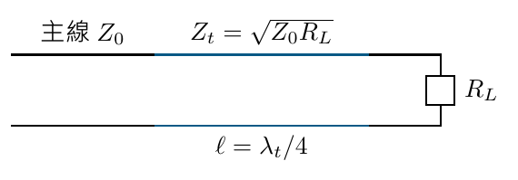

圖為概念重畫，其中 $`Z_t`$ 對應老師的 $`Z_1`$，$`\lambda_t`$ 對應老師的 $`\lambda_g`$。主線阻抗、變壓線阻抗及負載電阻是三個不同量。

老師在 [23:50–25:50](https://www.youtube.com/watch?v=fnhAMW-Q1Lw&t=1430s) 提了一個重要問題：看起來有 $`Z_1`$ 與線長兩個未知數，為什麼不能先任選八分之一波長，再求另一個 $`Z_1`$？關鍵是 $`Z_{\rm in}=Z_0`$ 是**複數等式，包含實部、虛部兩個條件**。對不同的正實數 $`R_L`$、$`Z_0`$，單節無損線只能取奇數個四分之一波長；章末補充 A 完成老師留給同學的代數證明。

### 微帶天線案例與代價（頁 15–16）

老師以 $`15\,\Omega`$ 貼片天線接到 $`50\,\Omega`$ 主線為例：

```math
Z_1=\sqrt{50\times15}=27.386\,\Omega\approx27.4\,\Omega.
```

微帶線藉線寬調整特徵阻抗；在既有饋線與天線間增加這段線，代價是額外面積與線長。

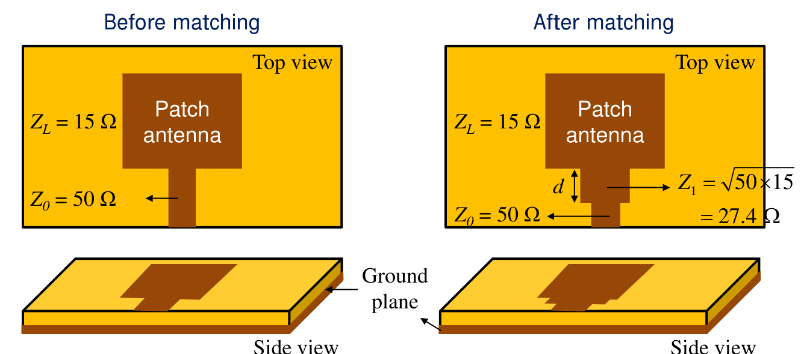

來源：講義第 15 頁局部。右圖較寬的一段微帶線是 $`27.4\,\Omega`$ 變壓段，長度 $`d=\lambda_g/4`$；主線仍維持 $`50\,\Omega`$。

約 [26:00–28:20](https://www.youtube.com/watch?v=fnhAMW-Q1Lw&t=1560s) 的口述比較三個想法：改天線、加匹配段，或把主線也改成 15 Ω。第三個方法雖可消除這個局部交界的失配，卻還要接回原有收發機、連接器與 50 Ω 系統，會把問題移到另一個介面。因此設計時通常把系統參考阻抗當成既定條件，再調整天線或匹配網路。

> **講義數值校註：**第 15 頁列出匹配前回波損耗 $`RL=5.37\,\mathrm{dB}`$，這與 $`|\Gamma|=|15-50|/(15+50)=0.53846`$ 一致；但同頁「17% power is lost」與此不符。反射功率占入射功率的 $`|\Gamma|^2=28.99\%`$，負載接受約 71.01%。這是失配造成的功率分配，不是無損線的熱耗損。

雖然變壓段末端仍因 $`Z_1\ne R_L`$ 而反射，整段合成後在主線參考面可達 $`\Gamma_{\rm in}=0`$。主要限制是：基本公式要求純電阻負載，完全匹配受電氣長度限制，離開設計頻率後通常失配。

## 5．老師例題 EX 3.1：固定線長的頻率響應（頁 17–20）

題目給 $`R_L=100\,\Omega`$、$`Z_0=50\,\Omega`$，求變壓段阻抗並畫 $`|\Gamma_{\rm in}|`$ 對 $`f/f_0`$。

```math
Z_1=\sqrt{50\times100}=70.7107\,\Omega.
```

實體線長固定在 $`\ell=v_p/(4f_0)`$。若相速度近似不隨頻率改變，掃頻時變的是電氣長度：

```math
\theta(f)=\beta(f)\ell=\frac{\pi}{2}\frac{f}{f_0}.
```

將 $`Z_{\rm in}(f)`$ 代入

```math
\Gamma_{\rm in}(f)=\frac{Z_{\rm in}(f)-Z_0}{Z_{\rm in}(f)+Z_0}
```

即可得到第 19–20 頁的曲線。把代數整理成不含 $`\tan\theta`$ 奇點的形式，更容易看出圖意：

```math
|\Gamma_{\rm in}(f)|=
\frac{|R_L-Z_0|\,|\cos\theta|}
{\sqrt{4Z_0R_L+(R_L-Z_0)^2\cos^2\theta}}.
```

| $`f/f_0`$ | 電氣長度 $`\theta`$ | 本例 $`\lvert\Gamma_{\rm in}\rvert`$ | 解讀 |
| --- | --- | --- | --- |
| 0 的極限 | 0 | $`1/3`$ | 線段電氣上趨近零長度 |
| 1 | $`\pi/2`$ | 0 | 四分之一波長匹配 |
| 2 | $`\pi`$ | $`1/3`$ | 半波長重現原負載 |
| 3 | $`3\pi/2`$ | 0 | 三個四分之一波長再次匹配 |
| 4 | $`2\pi`$ | $`1/3`$ | 一波長重現原負載 |

第 20 頁的表應讀成「固定物理線段在各頻率下的**電氣長度**」。在 $`3f_0`$，它長達當下波長的 $`3/4`$；實際線長並沒有變成原來的三倍。

第 19 頁以水平門檻 $`\Gamma_m`$ 與曲線的兩個交點定義頻寬，示意交點約在 $`0.6f_0`$ 與 $`1.4f_0`$，所以分數頻寬約 0.8，即 80%。這是該門檻下的示意結果，並非每個四分之一波長變壓器都有 80% 頻寬。

上述奇數倍頻率重現完美匹配，依賴固定純電阻、無損與近似不色散的模型；真實天線的 $`Z_L(f)`$ 也會改變。

## 6．先定反射門檻，再定頻寬（Operational Bandwidth，頁 21）

對固定正實數 $`Z_0`$、$`R_L`$，允許 $`|\Gamma|\le\Gamma_m`$ 時，設計頻率附近的分數頻寬為

```math
\boxed{
\frac{\Delta f}{f_0}
=2-\frac4\pi\cos^{-1}\left(
\frac{\Gamma_m}{\sqrt{1-\Gamma_m^2}}
\frac{2\sqrt{Z_0R_L}}{|R_L-Z_0|}
\right).}
```

老師在本頁以 $`Z_L`$ 表示純實數負載；此處沿用前文 $`R_L`$ 以免誤代複數。$`\Gamma_m`$ 是**最大允許的反射係數幅值**，不是要求反射至少達到的最小值，也不是回波損耗的 dB 數；反餘弦用弧度。

從式子與圖可讀出兩個趨勢：允許較大的反射，頻寬較寬；負載較接近主線阻抗，所需變換較小，頻寬也較寬。圖中阻抗比 10 與 0.1 的幅值曲線相同，4 與 0.25 相同，2 與 0.5 相同，反映互為倒數的阻抗比有相同失配大小。

老師約 [32:20–34:10](https://www.youtube.com/watch?v=fnhAMW-Q1Lw&t=1940s) 用「降低標準，大家都及格」提醒：提高 $`\Gamma_m`$ 得到更寬的合格區間，只是放寬規格，並沒有改善電路本身。比較兩個設計的頻寬時，必須使用相同門檻。他也以 60 Ω 對 50 Ω 和十倍阻抗差作比較，說明原本越接近匹配，越容易保有較寬頻帶。

公式括號內需在 $`[0,1]`$；若原負載已經符合門檻，可能沒有圖中那種最近交越點，不能硬套超出範圍的反餘弦。若 $`R_L=Z_0`$，本來就匹配，也不需要這個除以 $`|R_L-Z_0|`$ 的公式。

## 7．老師例題 EX 3.2：在 FR4 上做出變壓線（頁 22–25）

這是老師講義中的完整實作例題，本支影片未逐頁講解；以下依講義保留設計步驟。

題目：將 $`10\,\Omega`$ 負載匹配至 $`50\,\Omega`$，設計頻率 $`1\,\mathrm{GHz}`$，要求 $`VSWR<1.5`$；基板為 FR4，厚度 $`h=1\,\mathrm{mm}`$，相對介電常數 $`\varepsilon_r=4.4`$。

第一步先求電路需求，再換成幾何尺寸：

```math
Z_1=\sqrt{50\times10}=22.36\,\Omega.
```

第 23 頁用 TXLine 軟體依基板條件求得線寬 $`w=6.03\,\mathrm{mm}`$。這是講義給定模型的結果；不能只知道 $`Z_1`$ 就在不同基板沿用相同線寬。

第二步求導波波長。第 24 頁的軟體結果為有效介電常數 $`\varepsilon_{\rm eff}=3.71`$：

```math
\lambda_g=\frac{\lambda_0}{\sqrt{\varepsilon_{\rm eff}}}
\approx\frac{300\,\mathrm{mm}}{\sqrt{3.71}}
\approx155.75\,\mathrm{mm},\qquad
L=\frac{\lambda_g}{4}\approx38.94\,\mathrm{mm}.
```

微帶線的場分布在空氣與基板中，所以此處用 $`\varepsilon_{\rm eff}`$，不能直接以 $`\varepsilon_r=4.4`$ 代替。

第三步把 VSWR 規格轉成幅值門檻：

```math
\Gamma_m=\frac{VSWR-1}{VSWR+1}
=\frac{1.5-1}{1.5+1}=0.2.
```

代入第 21 頁公式：

```math
\frac{\Delta f}{f_0}
=2-\frac4\pi\cos^{-1}\left(
\frac{0.2}{\sqrt{1-0.2^2}}
\frac{2\sqrt{50\times10}}{40}\right)
\approx0.29316.
```

因此理想固定電阻模型的百分比頻寬約 **29.3%**，即約 $`293\,\mathrm{MHz}`$；交越點約 $`0.8534`$ 與 $`1.1466\,\mathrm{GHz}`$。老師以有效位數寫為 29%。這題把「阻抗需求 → 微帶線寬 → 導波波長與線長 → 可用頻寬」串成完整實作流程。

## 8．負載是複數時，先把它變成純電阻（頁 26–31）

直接把複數 $`Z_L`$ 放進 $`Z_1=\sqrt{Z_0Z_L}`$，通常會得到複數的 $`Z_1`$，並非一般無損線可用的設計。第 26 頁提出兩種前處理，再接四分之一波長變壓器。

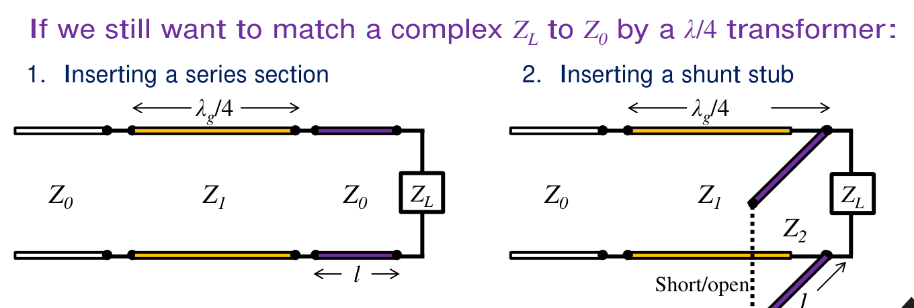

來源：講義第 26 頁局部。左方先插入一段線；右方在負載旁並聯開路或短路殘段。兩者都先產生純電阻，黃色四分之一波長線再負責電阻值變換。

### 方法一：增加串聯線段（Inserting a Series Section，頁 27）

老師在 [36:40–39:40](https://www.youtube.com/watch?v=fnhAMW-Q1Lw&t=2200s) 實際講解本頁。前處理線段的阻抗先固定為主線 $`Z_0`$，這一步只調**長度**，先解決虛部；後面的四分之一波長段才處理實部的阻抗變換。

這裡「串聯線段」指沿主路徑接入一段傳輸線，並非在電路中直接加 $`jX`$。令它的特徵阻抗為 $`Z_0`$，從負載往源端沿等 $`|\Gamma|`$ 圓順時針轉動，直到 $`x=0`$ 的純電阻點。

老師給 $`Z_L=25+j50\,\Omega`$、$`Z_0=50\,\Omega`$，所以 $`z_L=0.5+j1`$。等反射幅值圓與實軸有兩個交點；講義選較短線長的解。依同頁圖重算：

```math
\Gamma_L=\frac{0.5+j1-1}{0.5+j1+1}
=0.076923+j0.615385
=0.620174\angle82.875^\circ.
```

順時針轉 $`2\beta\ell=82.875^\circ`$ 到正實軸，得到

```math
\ell\approx0.11510\lambda_g,\qquad
r_L'=\frac{1+|\Gamma_L|}{1-|\Gamma_L|}=4.26556.
```

因此 $`R_L'\approx213.28\,\Omega`$，接著選

```math
Z_1=\sqrt{Z_0R_L'}\approx103.27\,\Omega.
```

另一個交點要再多走 $`\lambda_g/4`$，得到 $`R_L'\approx11.72\,\Omega`$，對應 $`Z_1\approx24.21\,\Omega`$。這說明同一個複數負載也能有不同尺寸與線阻抗的解。

### 方法二：並聯短路殘段（Inserting a Shunt Stub，頁 28–29）

約 [39:40](https://www.youtube.com/watch?v=fnhAMW-Q1Lw&t=2380s)，老師說明接下來四頁要等 `3.4 的殘段概念講完後再回看。本筆記依講義順序先把短路與開路兩種做法補齊，方便之後對照。

令負載導納 $`Y_L=G_L+jB_L`$。特徵阻抗 $`Z_2`$、長度 $`\ell`$ 的短路殘段，其輸入導納為

```math
Z_{\rm sh}=jZ_2\tan\beta\ell,\qquad
Y_{\rm sh}=-j\frac{\cot\beta\ell}{Z_2}.
```

並聯時導納直接相加：

```math
Y_{\rm total}=G_L+j\left(B_L-\frac{\cot\beta\ell}{Z_2}\right).
```

要消除虛部，選 $`Z_2=\cot(\beta\ell)/B_L`$。講義以兩個方便的固定電氣長度實現：

| 短路殘段長度 | 所需 $`Z_2`$ | 何時能得到正實數線阻抗 |
| --- | --- | --- |
| $`\lambda_g/8`$ | $`1/B_L`$ | $`B_L>0`$ |
| $`3\lambda_g/8`$ | $`-1/B_L`$ | $`B_L<0`$ |

抵消後 $`Y_{\rm total}=G_L`$，等效負載為 $`1/G_L`$，因此變壓線選

```math
\boxed{Z_1=\sqrt{\frac{Z_0}{G_L}}.}
```

延續 $`25+j50\,\Omega`$ 例子，$`y_L=0.4-j0.8`$，所以 $`G_L=0.008\,\mathrm S`$、$`B_L=-0.016\,\mathrm S`$。並聯需要補上 $`+j0.016\,\mathrm S`$，可選短路殘段 $`\ell=3\lambda_g/8`$、$`Z_2=62.5\,\Omega`$。此時

```math
z_{\rm total}=2.5,\quad Z_{\rm total}=125\,\Omega,\quad
Z_1=\sqrt{50\times125}=79.06\,\Omega.
```

### 方法二的另一實作：並聯開路殘段（頁 30–31）

開路殘段的公式改為

```math
Z_{\rm op}=-jZ_2\cot\beta\ell,\qquad
Y_{\rm op}=j\frac{\tan\beta\ell}{Z_2}.
```

要使 $`Y_L+Y_{\rm op}`$ 為純實數，需

```math
Z_2=-\frac{\tan\beta\ell}{B_L}.
```

| 開路殘段長度 | 所需 $`Z_2`$ | 何時能得到正實數線阻抗 |
| --- | --- | --- |
| $`\lambda_g/8`$ | $`-1/B_L`$ | $`B_L<0`$ |
| $`3\lambda_g/8`$ | $`1/B_L`$ | $`B_L>0`$ |

同一負載可選 $`\lambda_g/8`$ 的開路殘段、$`Z_2=62.5\,\Omega`$，得到相同 $`Z_{\rm total}=125\,\Omega`$ 與 $`Z_1=79.06\,\Omega`$。

讀第 29、31 頁的 Smith 圖時，重點是**總正規化電納由 $`-0.8`$ 增到 0**，沿等 $`g=0.4`$ 圓到純電導點。圖面所示順／逆時針須連同採用的 Z／Y 刻度與殘段長度讀，不能把「短路一定負電納、開路一定正電納」當成定律；符號取決於 $`\cot\beta\ell`$ 或 $`\tan\beta\ell`$。

## 9．先複習已知電路的分析（A Review of Smith Chart Operation，頁 32–38）

第 33 頁給定四元件網路，頻率為 $`2\,\mathrm{GHz}`$，主線 $`Z_0=50\,\Omega`$。從負載往源端的次序是：$`R_L=31.25\,\Omega`$ → 並聯 $`C_1=1.91\,\mathrm{pF}`$ → 串聯 $`L_1=4.38\,\mathrm{nH}`$ → 並聯 $`C_2=2.39\,\mathrm{pF}`$ → 串聯 $`L_2=3.98\,\mathrm{nH}`$。

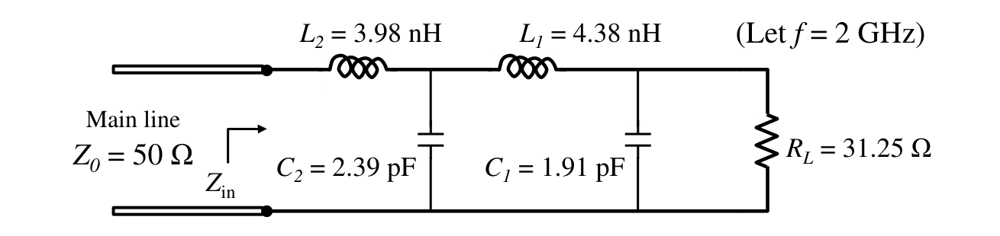

來源：講義第 33 頁局部。先從圖右端算起；串聯時加阻抗，並聯時加導納。

正規化時 $`z=Z/Z_0`$、$`y=Y/Y_0=YZ_0`$，其中 $`Y_0=1/Z_0`$。老師在 [45:00–47:00](https://www.youtube.com/watch?v=fnhAMW-Q1Lw&t=2700s) 重新板書下表，並強調只要知道電感阻抗 $`j\omega L`$ 與電容阻抗 $`1/(j\omega C)`$，其餘都能由倒數與正規化求出，不必另外死背。

| 元件 | 阻抗 $`Z`$（Ω） | 正規化阻抗 $`z=Z/Z_0`$ | 導納 $`Y=1/Z`$（S） | 正規化導納 $`y=Y/Y_0`$ |
| --- | --- | --- | --- | --- |
| 電感 $`L`$ | $`j\omega L`$ | $`j\omega L/Z_0`$ | $`-j/(\omega L)`$ | $`-j/(\omega L Y_0)`$ |
| 電容 $`C`$ | $`-j/(\omega C)`$ | $`-j/(\omega C Z_0)`$ | $`j\omega C`$ | $`j\omega C/Y_0`$ |

$`Z,Y`$ 有單位，$`z,y`$ 沒有單位。電感的電抗為正，但電納為負；電容則相反。**串聯看 Z 刻度，並聯看 Y 刻度**，再決定沿等電阻圓或等電導圓走多少，而不是只憑圖上的上下方向記憶。

回到本例，老師採約數：

```math
r_L=0.625,\qquad x_{L1}=1.1,\quad x_{L2}=1,
\qquad b_{C1}=1.2,\quad b_{C2}=1.5.
```

| 講義頁碼 | 從負載往輸入端的運算 | 結果 | Smith 圖上的操作 |
| --- | --- | --- | --- |
| 34–35 | 負載轉為導納，再加 $`jb_{C1}`$ | $`y_1=1/0.625+j1.2=1.6+j1.2`$；$`z_1=0.4-j0.3`$ | 以 Y 刻度沿等 $`g=1.6`$ 圓 |
| 36 | 串聯 $`jx_{L1}`$ | $`z_2=z_1+j1.1=0.4+j0.8`$；$`y_2=0.5-j1`$ | 以 Z 刻度沿等 $`r=0.4`$ 圓 |
| 37 | 並聯 $`jb_{C2}`$ | $`y_3=y_2+j1.5=0.5+j0.5`$；$`z_3=1-j1`$ | 以 Y 刻度沿等 $`g=0.5`$ 圓 |
| 38 | 串聯 $`jx_{L2}`$ | $`z_{\rm in}=z_3+j1=1`$ | 沿等 $`r=1`$ 圓到匹配中心 |

因此 $`Z_{\rm in}=50\,\Omega`$。表中以老師的正規化約數計算；若直接使用只列三位有效數字的 pF、nH 標稱值，結果會有微小偏差。

> **符號校註：**第 35–38 頁部分敘述把導納相加或串聯電抗相加寫成「$`\parallel`$」。請以實際接線及下一行算式為準：並聯支路的**導納相加**，串聯元件的**阻抗相加**，不能把每一步都當成阻抗並聯。

## 10．由分析轉向設計：L 型網路（Analysis vs. Synthesis，頁 39–43）

「分析」是給定電路，求它在 Smith 圖上走到哪裡；「合成／設計」則是給定起點 $`z_L`$ 與終點 1，反求一條可由元件實現的路徑。

### 老師最強調的設計關鍵：倒數第二步

約 [51:30–53:50](https://www.youtube.com/watch?v=fnhAMW-Q1Lw&t=3090s)，老師從終點反推：最後加入的是純電抗或純電納，只能改變虛部，所以**倒數第二步就必須讓對應的實部到位**。

| 最後一步 | 倒數第二步必須到達 | 最後怎麼回到中心 |
| --- | --- | --- |
| 串聯純電抗 | $`z_1=1+jx_1`$，即 $`r=1`$ 圓 | 加 $`-jx_1`$ |
| 並聯純電納 | $`y_1=1+jb_1`$，即 $`g=1`$ 圓 | 加 $`-jb_1`$ |

如果前面的路徑根本碰不到目標圓，就應換拓樸，而不是繼續猜元件值。老師在約 [56:20–57:50](https://www.youtube.com/watch?v=fnhAMW-Q1Lw&t=3380s) 說明，重點是用 Smith 圖建立這個直覺；後面的解析公式可用來驗算。

第 40 頁以一個串聯電抗 $`jX`$、一個並聯電納 $`jB`$ 作匹配。第 41 頁展示 0603、0402、0201、0805 等晶片元件；尺寸相對波長夠小，才適合當成集總元件。頁中的 $`L<\lambda/10`$ 是**元件幾何長度**的判斷，不是電感量；實際還有寄生、損耗、邊緣場與接地效應。

### 兩種基本位置（頁 42）

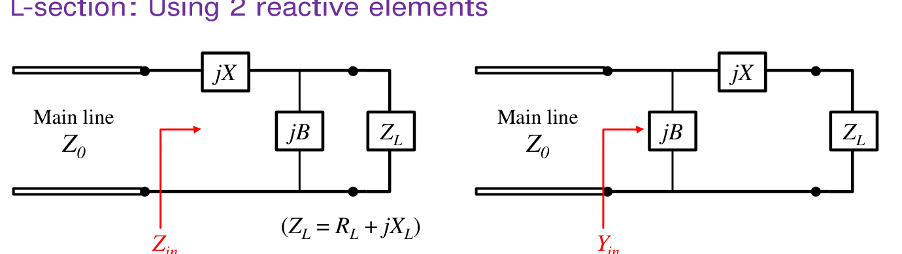

來源：講義第 42 頁局部。左圖的並聯元件靠負載，右圖的並聯元件靠源；不要只看外形像 L 就混用公式。

| 位置 | 從負載往源端的計算次序 | 最後要到達的中間條件 | 老師用來選型的典型情境 |
| --- | --- | --- | --- |
| 左圖：並聯元件靠負載 | 先並聯 $`jB`$，再串聯 $`jX`$ | 並聯後的阻抗實部為 $`Z_0`$ | $`R_L>Z_0`$ |
| 右圖：並聯元件靠源 | 先串聯 $`jX`$，再並聯 $`jB`$ | 串聯後的導納實部為 $`Y_0`$ | $`R_L<Z_0`$ |

第 42 頁列出兩型的解析解，後面第 55–61 頁再推導。此處先掌握選型與圖解；對含電抗的負載，左型的可用範圍其實比 $`R_L>Z_0`$ 更廣，詳細條件見第 12、13 節。

### 為什麼有八種拓樸？（頁 43）

每一種位置，都有「串聯 L 或 C」乘上「並聯 L 或 C」四種組合，因此共有八種。兩個元件也可能同為 L 或同為 C，並非只能一電感一電容。

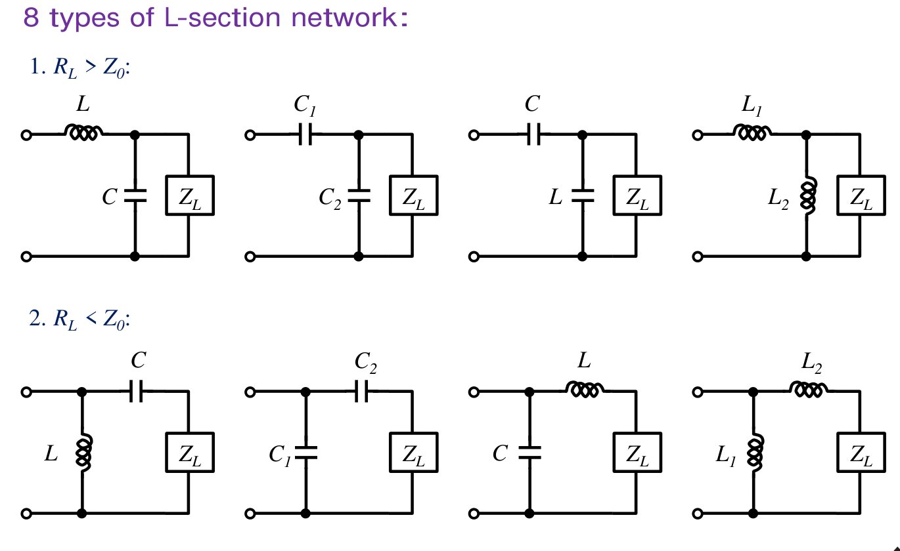

來源：講義第 43 頁局部。圖上方四種的並聯支路靠負載，下方四種靠源。某一組負載是否能用其中一型，要看所需 $`X`$、$`B`$ 的正負以及中間交點能否到達。

## 11．老師例題 EX 3.3：Smith 圖上的兩個解（頁 44–53）

題目為 $`Z_L=200-j100\,\Omega`$、$`Z_0=100\,\Omega`$、$`f_0=500\,\mathrm{MHz}`$：求 L 型匹配器，再比較兩個解的頻寬。

### 選位置與找交點（頁 44–46）

```math
z_L=2-j1,\qquad y_L=\frac1{2-j1}=0.4+j0.2.
```

若先串聯，阻抗只能沿 $`r=2`$ 圓移動，無法到達最後能靠並聯元件進入匹配中心的 $`g=1`$ 圓。因此採「**先並聯、後串聯**」，其中「先」指由負載往源端計算。

先並聯時沿 $`g=0.4`$ 圓移動。為讓下一個串聯元件能完成匹配，中間點的倒數阻抗必須落在 $`r=1`$ 圓。兩圓有上、下兩個交點 A、B，對應兩個解。

### 解一：負載並聯電容，源側串聯電感（頁 47–48、51）

老師由圖讀得 $`y_{1,A}\approx0.4+j0.5`$，需補的正規化電納約為 $`j0.3`$：

```math
C\approx\frac{0.3Y_0}{\omega_0}
=\frac{0.3\times0.01}{2\pi\times500\times10^6}
\approx0.95\,\mathrm{pF}.
```

A 點的阻抗約讀為 $`z_{1,A}\approx1-j1.22`$，所以再串聯 $`+j1.22`$：

```math
L\approx\frac{1.22Z_0}{\omega_0}
=\frac{1.22\times100}{2\pi\times500\times10^6}
\approx38.8\,\mathrm{nH}.
```

> **講義校註：**第 48 頁代入式的分子印成 $`1.22\times50`$，應為 $`1.22\times100`$，才符合題目 $`Z_0=100\,\Omega`$ 及所列 $`38.8\,\mathrm{nH}`$。另外 $`0.4+j0.5`$ 與 $`1-j1.22`$ 是各自讀圖的約數，並非嚴格互為倒數；精確交點於 EX 3.4 重算。

### 解二：負載並聯電感，源側串聯電容（頁 49–50、52）

另一交點約為 $`y_{1,B}\approx0.4-j0.5`$，因此需補 $`-j0.7`$。並聯電感的導納為負虛數：

```math
L\approx\frac{1}{0.7\omega_0Y_0}\approx45.5\,\mathrm{nH}.
```

B 點阻抗約為 $`z_{1,B}\approx1+j1.22`$，再串聯負電抗：

```math
C\approx\frac{1}{1.22\omega_0Z_0}\approx2.61\,\mathrm{pF}.
```

第 50 頁文字中的「corresponding inductance」應讀為電容量，因為此步實際求的是串聯電容。

### 兩個解的掃頻比較（頁 51–53）

老師在 [70:00–71:30](https://www.youtube.com/watch?v=fnhAMW-Q1Lw&t=4200s) 先用一個簡化思考：即使暫時把負載阻抗視為固定，匹配器的 $`L,C`$ 仍會隨頻率改變電抗／電納，所以離開 500 MHz 仍可能失配。**這個口述假設與下一張實際曲線的負載模型要分開**；要重現講義第 53 頁，必須使用圖中指定的串聯 RC 負載。

第 53 頁將負載建模為 $`200\,\Omega`$ 電阻串聯 $`3.18\,\mathrm{pF}`$ 電容，近似重現 500 MHz 時的 $`200-j100\,\Omega`$：

```math
Z_L(f)=200-\frac{j}{2\pi fC_L},\qquad C_L\approx3.18\,\mathrm{pF}.
```

若把兩型的元件各記為 $`C_1,L_1`$ 與 $`L_2,C_2`$，則

```math
Z_{{\rm in},1}(f)=\frac1{1/Z_L(f)+j2\pi fC_1}+j2\pi fL_1,
```

```math
Z_{{\rm in},2}(f)=\frac1{1/Z_L(f)+1/(j2\pi fL_2)}
+\frac1{j2\pi fC_2}.
```

每個頻率都要重算負載與匹配元件，再求 $`\Gamma_{\rm in}(f)`$；不能把只有 500 MHz 才成立的 $`200-j100\,\Omega`$ 當成全頻段常數。

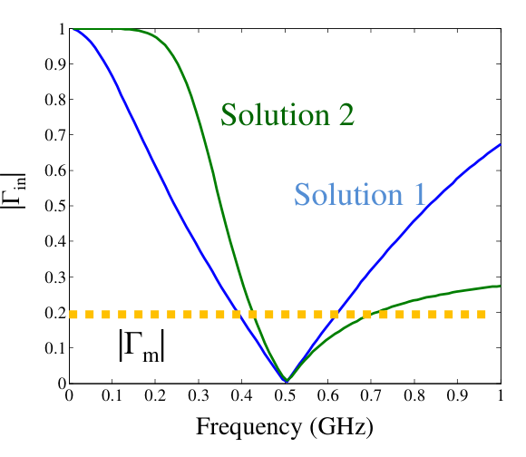

來源：講義第 53 頁局部。橫軸為 GHz，縱軸為反射係數**幅值**；黃色門檻是約 0.2。藍色解一與綠色解二在中心附近都低反射，遠離中心則明顯不同。講義稱本例頻寬沒有很大的差異，並指出兩元件值一旦由匹配條件決定，就沒有額外自由度可獨立調頻寬。

這不代表兩條曲線完全相同，也不表示所有複數負載的兩解都具有相同頻寬。老師的圖解元件值經過取整，因此數值驗算時中心反射也可能只是很小，而非嚴格為零。

### 可以直接用 Smith 圖上的路徑長度判斷頻寬嗎？

約 [71:30–74:10](https://www.youtube.com/watch?v=fnhAMW-Q1Lw&t=4290s)，老師用等 $`|\Gamma|`$ 圓討論頻寬直覺，口述另舉 $`|\Gamma|=1/3`$ 作門檻示意，與上圖原本的 0.2 門檻不同。但他也提醒，**不能把圖上軌跡的長短直接當成頻寬**。

前面的匹配路徑是在固定頻率下逐步接入元件；真正的掃頻軌跡則是把整個電路固定，逐頻率計算 $`\Gamma_{\rm in}(f)`$。嚴格的合格頻帶要由後者進入、離開門檻圓的頻率決定。老師預告後續的等 Q 曲線（constant-Q paths，單元 14）可提供更多設計直覺，仍不能取代實際掃頻。

## 12．每種拓樸有自己的可匹配範圍（Dynamic Ranges，頁 54）

本頁的 dynamic range 指「固定這一種元件位置與 L／C 類型後，哪些負載能匹配到 $`Z_0`$」，並非接收機可以處理的功率動態範圍。

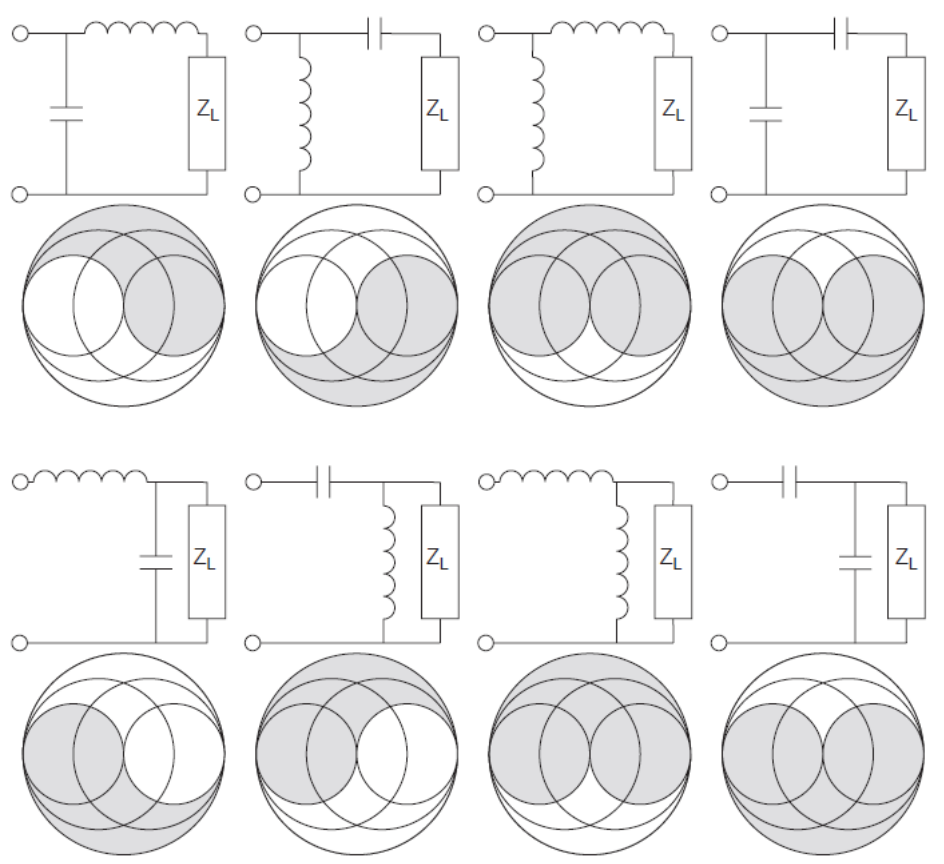

來源：講義第 54 頁局部。每個小電路下方的 **白色區域**才是該拓樸的可匹配負載範圍，灰色區域不適用；八張小圖的元件位置需逐一對照。

可用以下交點條件理解這些區域。對「先並聯、後串聯」，寫 $`y_L=g+jb`$，並聯後 $`y_1=g+jb_1`$。要求 $`\Re(1/y_1)=1`$，得到

```math
\frac{g}{g^2+b_1^2}=1
\quad\Longrightarrow\quad
b_1=\pm\sqrt{g-g^2}.
```

因此需要 $`0<g\le1`$，所需並聯增量與串聯增量是

```math
b_p=b_1-b,\qquad x_s=\frac{b_1}{g}.
```

對「先串聯、後並聯」，寫 $`z_L=r+jx`$，串聯後 $`z_1=r+jx_1`$。要求 $`\Re(1/z_1)=1`$，同理得到

```math
x_1=\pm\sqrt{r-r^2},\qquad
x_s=x_1-x,\qquad b_p=\frac{x_1}{r},
\qquad0<r\le1.
```

這兩組條件先判斷交點是否存在，再由 $`x_s`$、$`b_p`$ 正負決定 L 或 C，便能解釋八張圖的差異。邊界上可能兩解合併，或一個元件不再需要；若負載完全沒有可吸收實功率的實部，理想無損匹配器不能將它變成吸收全部入射功率的正電阻。

### 老師板書示範：先並聯 C，再串聯 C，哪些負載可用？

老師在 [75:40–80:40](https://www.youtube.com/watch?v=fnhAMW-Q1Lw&t=4540s) 以原圖**右下角的雙電容拓樸**示範逆推，並請同學練習其餘七型：

1. 最後串聯的是電容，只能加入負電抗，因此中間阻抗要先落在 $`r=1`$ 圓的感性半邊，即 $`z_1=1+jx_1,\ x_1>0`$。
2. 前一步並聯電容，只能增加正電納。負載的 Y 軌跡不但要能碰到上述目標，也要能沿「電納增加」的方向碰到。
3. 因此不是整個 $`r=1`$ 圓都可當中繼點，也不是任意感性負載都能用這兩顆電容。

用前面公式整理這段板書，對兩個非零電容，需選

```math
b_1=-\sqrt{g-g^2},\qquad
b_p=b_1-b>0,\qquad x_s=\frac{b_1}{g}<0,
```

也就是 $`0<g<1`$ 且 $`b<-\sqrt{g-g^2}`$。這些條件對應老師畫出的上半部白色可達區；邊界上則可能退化成只需一顆元件。

老師最後用物理直覺檢查答案：本來就很容性的負載，再串、並更多電容，不能抵消出所需的感性成分。先看「需要什麼方向的補償」，再用圖上的交點確認，才是這張動態範圍表的讀法。

## 13．解析解的推導與 EX 3.4（Derivation of Analytic Solutions，頁 55–61）

約 [81:10–81:40](https://www.youtube.com/watch?v=fnhAMW-Q1Lw&t=4870s)，老師明確略過這段代數推導，建議有興趣的同學自行閱讀投影片。本筆記保留關鍵步驟與精確重算，用來驗證前面的圖解。

### 情況一：先並聯負載，再串聯（頁 55–56）

令 $`Z_L=R_L+jX_L`$，輸入阻抗為

```math
Z_{\rm in}=jX+\frac1{1/Z_L+jB}.
```

若直接令 $`Z_{\rm in}=Z_0`$，講義將複數等式拆成

```math
B(XR_L-X_LZ_0)=R_L-Z_0,
\qquad X(1-BX_L)=BZ_0R_L-X_L.
```

更容易追蹤的做法，是先定義

```math
D=R_L^2+X_L^2,\qquad
G_L=\frac{R_L}{D},\qquad B_L=-\frac{X_L}{D}.
```

並聯後總電納為 $`B_t=B_L+B`$，所以

```math
\frac1{G_L+jB_t}
=\frac{G_L-jB_t}{G_L^2+B_t^2}.
```

實部必須等於 $`Z_0`$，得到 $`B_t^2=G_L/Z_0-G_L^2`$；串聯電抗再抵消虛部。整理為老師使用的 $`R_L,X_L`$：

```math
\boxed{
B=\frac{X_L\pm\sqrt{\dfrac{R_L}{Z_0}
\left(R_L^2+X_L^2-Z_0R_L\right)}}{R_L^2+X_L^2}.}
```

```math
\boxed{X=\frac{Z_0}{R_L}
\left[B(R_L^2+X_L^2)-X_L\right].}
```

當 $`B\ne0`$ 時，第二式等價於講義的

```math
X=\frac1B+\frac{X_LZ_0}{R_L}-\frac{Z_0}{BR_L}.
```

保留前一個不除以 $`B`$ 的式子，可處理某些退化情況。根號有實數解的條件為 $`R_L^2+X_L^2\ge Z_0R_L`$，等價於上一節的 $`g\le1`$。$`R_L>Z_0`$ 是保證成立的條件，但不是含電抗負載下唯一可行範圍。

> **講義符號校註：**第 56 頁右側判別式敘述寫成 $`R_L^2+Z_L^2-Z_0R_L>0`$，應為 $`R_L^2+X_L^2-Z_0R_L>0`$，與同頁根號及 $`|Z_L|^2=R_L^2+X_L^2`$ 一致。

### 情況二：先串聯負載，再並聯（頁 57–58）

這次以導納寫匹配條件：

```math
Y_{\rm in}=jB+\frac1{R_L+j(X_L+X)}=\frac1{Z_0}.
```

令 $`T=X_L+X`$，實部條件給

```math
\frac{R_L}{R_L^2+T^2}=\frac1{Z_0}
\quad\Longrightarrow\quad
T^2=R_L(Z_0-R_L).
```

因此

```math
\boxed{X=\pm\sqrt{R_L(Z_0-R_L)}-X_L,\qquad
B=\frac{X+X_L}{Z_0R_L}.}
```

需要 $`0<R_L\le Z_0`$。嚴格小於時通常有兩個交點；等於時兩解合併。

### 從正負號選元件（頁 59）

| 計算結果 | 元件 | 換算值 |
| --- | --- | --- |
| 串聯 $`X>0`$ | 電感 | $`L=X/\omega`$ |
| 串聯 $`X<0`$ | 電容 | $`C=-1/(\omega X)`$ |
| 並聯 $`B>0`$ | 電容 | $`C=B/\omega`$ |
| 並聯 $`B<0`$ | 電感 | $`L=-1/(\omega B)`$ |

負號代表元件的電抗／電納方向；實體電容、電感的標稱值仍是正數。

### 老師例題 EX 3.4：用解析解驗證 EX 3.3（頁 60–61）

條件仍為 $`200-j100\,\Omega`$ 接到 $`100\,\Omega`$、500 MHz。代入情況一，精確結果為

```math
B_1=+0.002898979486\,\mathrm S,\qquad
X_1=+122.4744871\,\Omega,
```

```math
B_2=-0.006898979486\,\mathrm S,\qquad
X_2=-122.4744871\,\Omega.
```

| 解 | 負載旁的並聯元件 | 源側的串聯元件 | 與圖解的關係 |
| --- | --- | --- | --- |
| 1 | $`C_1=0.922774\,\mathrm{pF}`$ | $`L_1=38.98484\,\mathrm{nH}`$ | 第 47–48 頁約讀為 0.95 pF、38.8 nH |
| 2 | $`L_2=46.13869\,\mathrm{nH}`$ | $`C_2=2.598989\,\mathrm{pF}`$ | 第 49–50 頁約讀為 45.5 nH、2.61 pF |

第 61 頁解析例題也有取整，列約 0.92 pF、38.8 nH，以及 46.1 nH、2.61 pF；上表保留較多位數，方便重算。

直接驗證交點：

```math
y_{1,A}=0.4+j0.48989795
\quad\Longleftrightarrow\quad z_{1,A}=1-j1.22474487,
```

```math
y_{1,B}=0.4-j0.48989795
\quad\Longleftrightarrow\quad z_{1,B}=1+j1.22474487.
```

再加上各自的串聯電抗，兩解都得到 $`z_{\rm in}=1`$。這也解釋為何圖上 $`\pm0.5`$ 只是近似讀值。

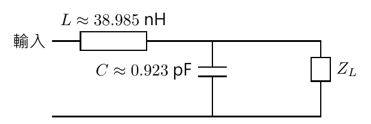

圖為依 EX 3.4 精確解重畫；並聯電容與負載同端，串聯電感在源側。驗算中心頻率後，仍需依前節公式檢查完整頻帶。

## 14．集總元件的實作限制（Characteristics / Real-World Components，頁 62–64）

### L 型網路的優點與限制（頁 62）

老師列出尺寸小、容易調整，以及可達較寬匹配頻帶等優點；限制是高頻時理想 L、C 不易實現，商用元件值也離散、範圍有限。「較寬頻」是設計比較的趨勢，並不是 L 型網路一定比所有傳輸線方案寬；負載頻率響應、阻抗變換比與元件品質都會影響結果。

約 [40:10–43:50](https://www.youtube.com/watch?v=fnhAMW-Q1Lw&t=2410s) 的轉場先比較尺寸：5 GHz 的自由空間波長為 6 cm，四分之一波長為 15 mm，在基板中還可更短；降到 2 GHz，自由空間四分之一波長已是 37.5 mm，傳輸線方案占的空間就更明顯。老師以約 2 GHz 以下偏好集總元件、約 5 GHz 以上較常採傳輸線作教學情境；這是尺寸與元件性能的取捨，並非固定的適用頻率界線。

約 [82:40–85:40](https://www.youtube.com/watch?v=fnhAMW-Q1Lw&t=4960s) 又補上實作觀點：換天線後，L、C 常可直接解焊重換，省去重做 PCB；但理論算出的值未必正好有現成標稱值，必須取近似值再驗算。量產時每顆元件與焊接也都有累積成本，不能只按單顆零件看起來便宜來選方案。

### 真實電容（Real-World Capacitors，頁 63）

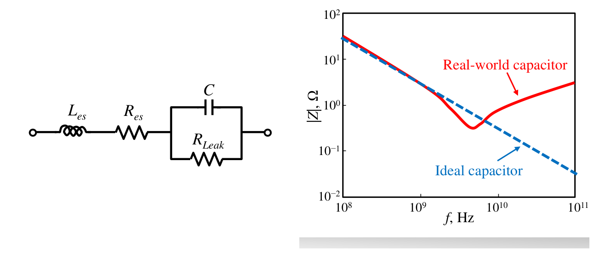

來源：講義第 63 頁局部，並排整理等效電路與曲線。模型為串聯 $`L_{es}`$、$`R_{es}`$，再接 $`C\parallel R_{\rm leak}`$；紅線是實體模型，藍色虛線是理想電容。圖為趨勢示意，不是本章特定商品的量測規格。

$`R_{es}`$ 是接線、電極等造成的等效串聯電阻，會發熱；$`L_{es}`$ 與封裝和接線有關；$`R_{\rm leak}`$ 代表漏電及簡化的介質耗損通道。老師在 [85:40–88:20](https://www.youtube.com/watch?v=fnhAMW-Q1Lw&t=5140s) 從實體平行金屬板說明：金屬導電度有限、介質並非完全絕緣，會分別出現損耗；連接導線形成的電流迴路則帶來寄生電感。

```math
Z_C=R_{es}+j\omega L_{es}
+\frac1{1/R_{\rm leak}+j\omega C}.
```

當漏電可忽略：

```math
Z_C\approx R_{es}+j\left(\omega L_{es}-\frac1{\omega C}\right),
\qquad f_{\rm SRF}\approx\frac1{2\pi\sqrt{L_{es}C}}.
```

低於自諧振頻率時主要呈容性，阻抗隨頻率下降；自諧振附近串聯電抗抵消，阻抗接近最小；再往高頻則可能呈感性，阻抗重新上升。只知道標稱 pF 值不足以保證高頻行為。

老師在 [88:20–92:00](https://www.youtube.com/watch?v=fnhAMW-Q1Lw&t=5300s) 用兩個相反趨勢解釋轉折：$`\omega L_{es}`$ 隨頻率上升，$`1/(\omega C)`$ 則下降，兩者終會相遇。縮小寄生電感可以把自諧振推往更高頻，卻不能把真實封裝變成在任意高頻都理想的電容。
### 真實電感（Real-World Inductors，頁 64）

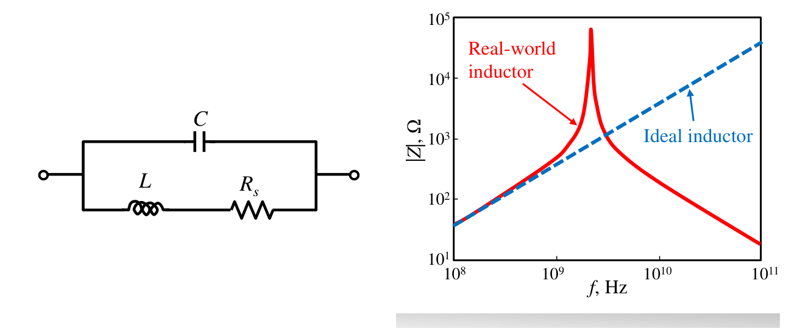

來源：講義第 64 頁局部，並排整理等效電路與曲線。$`L`$ 與導體串聯電阻 $`R_s`$ 的支路，再並聯繞線間寄生電容 $`C`$。

```math
Z_L^{\rm(component)}=
\left(\frac1{R_s+j\omega L}+j\omega C\right)^{-1}.
```

這裡上標 component 用來和前文的「負載阻抗 $`Z_L`$」區分。寄生電容大小取決於繞線與結構；在低損耗近似下，自諧振頻率仍約為 $`1/(2\pi\sqrt{LC})`$，但這次是**並聯諧振**，所以阻抗形成峰值。高於自諧振後可能呈容性，與理想電感 $`|j\omega L|`$ 持續上升的趨勢相反。

設計流程因此是：先用理想元件解出所需值，再以實際元件模型、可買到的標稱值與佈線重新驗證。中心反射小、匹配器耗損低、天線輻射效率高，是需要分別確認的三件事。

## 補充解說與重算例題

### A．為什麼純電阻匹配不能任意選單節線長？

這是老師約 [23:50–25:50](https://www.youtube.com/watch?v=fnhAMW-Q1Lw&t=1430s) 提出的延伸問題；以下是本筆記補出的代數證明。

把傳輸線公式乘上 $`\cos\theta`$，令 $`Z_{\rm in}=Z_0`$：

```math
Z_0(Z_1\cos\theta+jR_L\sin\theta)
=Z_1(R_L\cos\theta+jZ_1\sin\theta).
```

因為 $`Z_0,R_L,Z_1`$ 都是正實數，實部、虛部必須分別相等：

```math
Z_1(Z_0-R_L)\cos\theta=0,\qquad
(Z_0R_L-Z_1^2)\sin\theta=0.
```

若 $`R_L\ne Z_0`$，第一式強迫 $`\cos\theta=0`$，第二式再給出 $`Z_1=\sqrt{Z_0R_L}`$，因此

```math
\ell=(2m+1)\frac{\lambda_g}{4},\qquad m=0,1,2,\ldots
```

一個複數等式包含兩個實數條件，所以不能任選 $`\lambda_g/8`$ 再期待只調 $`Z_1`$ 就匹配。若本來 $`R_L=Z_0`$，用同阻抗線相接則任意長度皆可。多節線或複數負載的情況另當別論。

### B．50 Ω 與 200 Ω 的尺寸、頻寬重算

令 $`f_0=1\,\mathrm{GHz}`$，變壓線內相速度 $`v_p=2\times10^8\,\mathrm{m/s}`$：

```math
Z_1=\sqrt{50\times200}=100\,\Omega,\qquad
\lambda_g=20\,\mathrm{cm},\qquad\ell=5\,\mathrm{cm}.
```

若要求回波損耗至少 20 dB，則 $`\Gamma_m=0.1`$。代入頻寬公式得 $`\Delta f/f_0\approx0.1711`$，約為 171 MHz。這是額外算例，與老師 EX 3.1 的 100 Ω 負載、EX 3.2 的 10 Ω 負載不同。

### C．阻抗變換以外，還有哪些介面問題？

摺疊偶極的 300 Ω 與同軸的 75 Ω 相差四倍，但天線為平衡結構、同軸為不平衡結構，還要考慮平衡轉換與共模電流。只把阻抗變成 75 Ω，不代表整個饋入設計已完成。

匹配也不會自動改善天線本身的輻射效率：若端口實部主要是耗損電阻，匹配後送進去的功率仍可能大多變成熱。在元件模型適用的頻帶內，可用 $`Q_L\approx\omega L/R_s`$、$`Q_C\approx1/(\omega CR_s)`$ 初估損耗，但焊墊、接地回路、封裝寄生仍需納入。

## 自測與解析

1. **匹配器輸入端沒有反射，是否代表每個內部交界都沒有反射？**

   不代表。匹配是指定參考面看到 $`Z_{\rm in}=Z_0`$；四分之一波長變壓段的末端仍可因 $`Z_1\ne R_L`$ 產生局部反射。

2. **EX 3.2 的 1 GHz FR4 設計，為什麼不能用自由空間的 75 mm 當線長？**

   需用導波波長。$`\varepsilon_{\rm eff}=3.71`$ 時，$`L\approx300/(4\sqrt{3.71})=38.94\,\mathrm{mm}`$。

3. **$`VSWR=1.5`$ 對應反射幅值多少？反射功率比又是多少？**

   $`|\Gamma|=(1.5-1)/(1.5+1)=0.2`$；反射功率比是 $`|\Gamma|^2=0.04`$，即 4%。

4. **$`25+j50\,\Omega`$ 負載直接並聯殘段時，為什麼要補正電納？**

   因 $`Y_L=0.008-j0.016\,\mathrm S`$，需補 $`+j0.016\,\mathrm S`$。可用 62.5 Ω、$`\lambda_g/8`$ 開路殘段，或同阻抗、$`3\lambda_g/8`$ 短路殘段。

5. **EX 3.3 為何不能先串聯，再用並聯元件完成匹配？**

   $`z_L=2-j1`$ 的 $`r=2>1`$，先串聯只能改電抗，無法到達 $`g=1`$；改以先並聯，$`g=0.4\le1`$，可找到兩個 $`r=1`$ 交點。

6. **精確的兩個中間點為何不是 $`0.4\pm j0.5`$？**

   $`b_1=\pm\sqrt{0.4-0.4^2}=\pm0.48989795`$。$`\pm0.5`$ 是讀圖約數；精確倒數為 $`1\mp j1.22474487`$。

7. **一個負電納 $`B<0`$ 應用什麼並聯元件？**

   電感，因 $`Y_L=1/(j\omega L)=-j/(\omega L)`$；標稱值 $`L=-1/(\omega B)>0`$。

8. **實體電容與實體電感在自諧振附近，阻抗曲線有何差別？**

   本章電容模型呈串聯諧振，阻抗接近谷值；電感模型呈並聯諧振，阻抗接近峰值。越過自諧振後，兩者都可能不再呈現標稱元件原有的電抗符號。

下一單元：[單元 13｜傳輸線殘段匹配法](013_傳輸線殘段匹配法.md)，用開路、短路線段提供所需電抗或電納。
