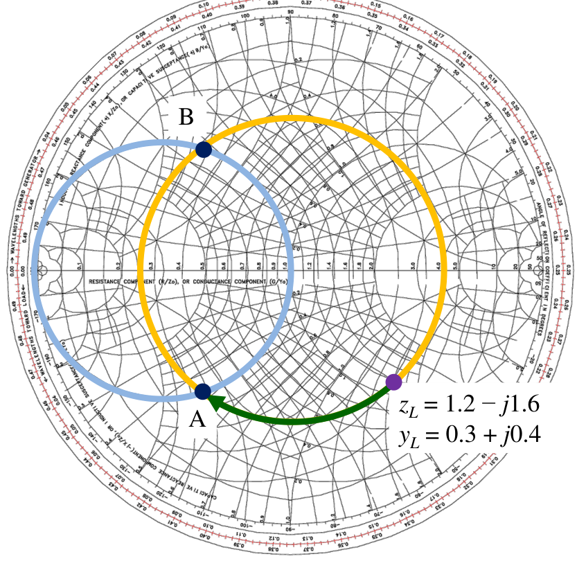
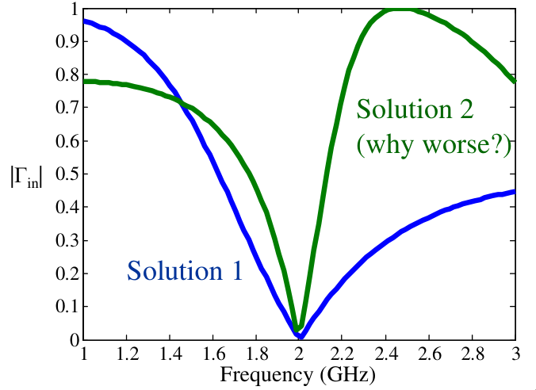
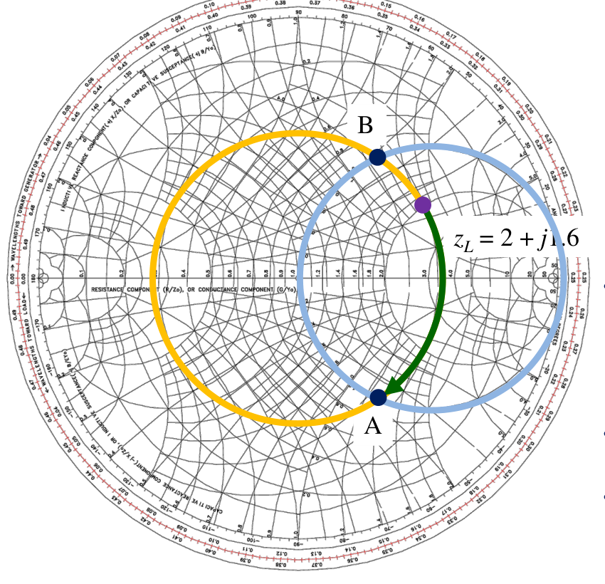
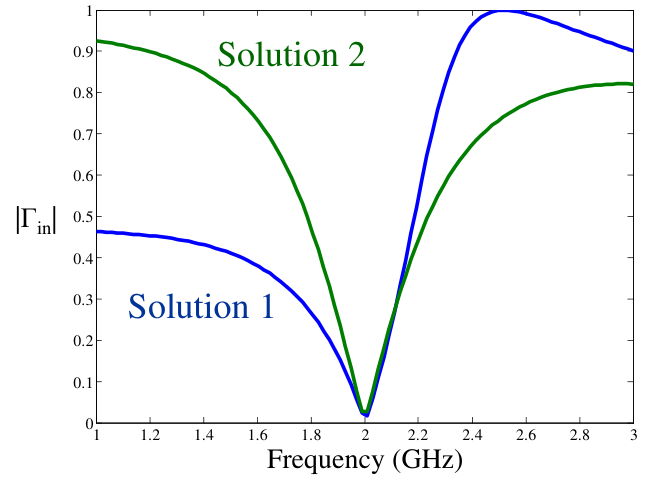
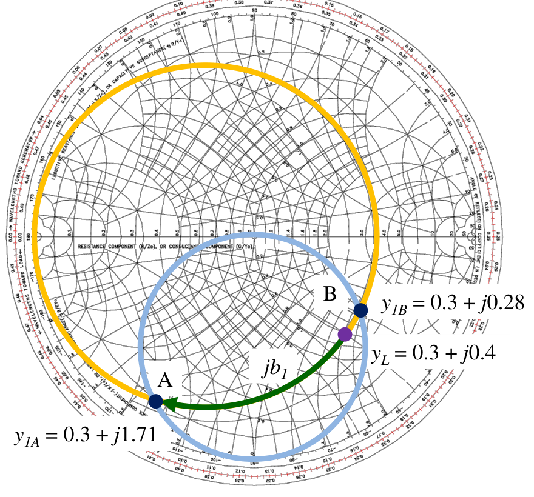
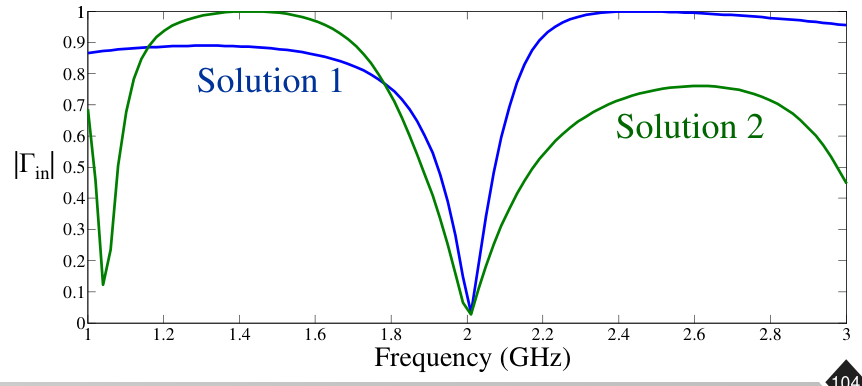
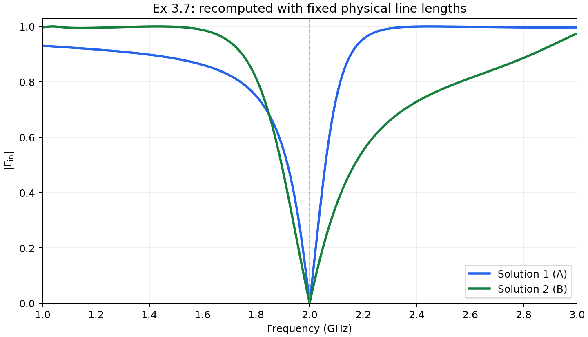

# 單元 13｜傳輸線殘段匹配法

用主線距離調整實部，再用開路／短路殘段消除虛部。

原始影片：[陳晏笙老師「天線」單元 13](https://www.youtube.com/watch?v=zIH-mj9NF78)（75 分鐘）

老師講義：[Lecture 3 — Impedance Matching Networks](https://drive.google.com/file/d/1fVGbNCHfqeGabsR-2ABXvOkeuYlyDFzq/view)，**PDF pp.65–104**。

建議閱讀：約 40 分鐘。前置：單元 05–12 的傳輸線、史密斯圖與阻抗匹配。

本章依講義順序整理：單並聯殘段 → Ex 3.5 → 單串聯殘段與 Ex 3.6 → 解析解與實作限制 → 雙殘段與 Ex 3.7；最後接老師片尾板書的禁區說明。讀完應能分清 $`d`$ 與 $`l`$、求出兩組匹配解，並知道「中心頻率匹配」和「整段頻帶匹配」的差別。

## 講義與影片對照

下表時間已對照完整口述與畫面，是**定位點**，不是各主題精確換頁時間。頁碼一律指老師 PDF；老師在例題之間的板書解說不另占 PDF 頁碼。

| 講義頁碼 | 原英文主題 | 本文內容 | 影片定位 |
|---|---|---|---|
| 65–69 | Matching with TL Stubs / Matching with Single Stub / Shunt Stubs / From LC to Single-Stub Matching Circuit / Design Idea of Shunt Stubs | 殘段公式、實作與並聯設計觀念 | [00:45](https://www.youtube.com/watch?v=zIH-mj9NF78&t=45s)（p.65 章節起點） |
| 70–77 | Smith Chart Solutions of Shunt-Stub Matching (1/8–8/8) | Ex 3.5：短路並聯、兩解與 RC 掃頻 | [20:35](https://www.youtube.com/watch?v=zIH-mj9NF78&t=1235s)（p.71）；[35:05](https://www.youtube.com/watch?v=zIH-mj9NF78&t=2105s)（p.74） |
| 78–85 | Design Idea of Series Stubs / Smith Chart Solutions of Series-Stub Matching (1/7–7/7) | Ex 3.6：開路串聯、兩解與 RL 掃頻 | [38:05](https://www.youtube.com/watch?v=zIH-mj9NF78&t=2285s)（p.78）；[43:50](https://www.youtube.com/watch?v=zIH-mj9NF78&t=2630s)（p.84） |
| 86–88 | Analytic Solutions of Shunt Stub (Opened-Circuit) / Derivation of Analytic Solutions | 用代數求主線位置與殘段長度 | [44:40](https://www.youtube.com/watch?v=zIH-mj9NF78&t=2680s)（p.88） |
| 89 | Characteristics of Matching with Single Stubs | 尺寸、頻寬與可調整性 | [45:30](https://www.youtube.com/watch?v=zIH-mj9NF78&t=2730s) |
| 90–93 | Matching with Double Stub / Design Idea of Double-Stub Matching / Why Fix the Spacing d between the Two Stubs? | 固定間距、只調兩條殘段 | [50:35](https://www.youtube.com/watch?v=zIH-mj9NF78&t=3035s)（p.90） |
| 94–104 | Smith Chart Solutions of Double-Stub Matching (1/11–11/11) | Ex 3.7：兩組開路雙殘段與掃頻 | [55:05](https://www.youtube.com/watch?v=zIH-mj9NF78&t=3305s)（p.94）；[66:35](https://www.youtube.com/watch?v=zIH-mj9NF78&t=3995s)（p.104） |
| 片尾板書，接 p.104 | Forbidden area | 固定間距雙殘段的禁區 | [約 66:30–74:50](https://www.youtube.com/watch?v=zIH-mj9NF78&t=3990s) |

## 1．單殘段的兩種接法與開短路公式（pp.65–67）

**Matching with Single Stub / Shunt Stubs**

**老師的實務開場（約 02:00–07:30）：**串聯饋入的貼片陣列裝進雷達模組後，探測距離比預期短。確認輻射表現後，問題落在裝板環境使匹配偏移；老師在 CPW 與陣列相接處加上並聯殘段，調整接入距離和殘段長度，修正端口匹配。這說明即使模擬已考慮外殼與鄰近元件，實物的尺寸、材料和位置誤差仍可能需要最後調整。

殘段（stub）是一小段遠端開路或短路的傳輸線。無損時，它的輸入阻抗是純虛數，因此可以在指定頻率取代集總電感或電容。單殘段匹配有兩個可設計的長度：

- $`d`$：負載到殘段接入點的**主線距離**，改變接入點所見負載的實部與虛部。
- $`l`$：**殘段本身長度**，決定它提供的純電抗或純電納。

講義假設主線與各殘段有相同的 $`Z_0`$，$`Y_0=1/Z_0`$。本章用 $`z=Z/Z_0`$、$`y=Y/Y_0=YZ_0`$ 表示正規化阻抗與導納；$`\lambda`$ 是**線內波長**，$`\beta=2\pi/\lambda`$，相量採 $`e^{j\omega t}`$。

### 四個公式一起看

若殘段的特性阻抗為 $`Z_s`$、相位常數為 $`\beta_s`$：

| 遠端接法 | 輸入阻抗（串聯時使用） | 輸入導納（並聯時使用） |
|---|---|---|
| 短路 Short circuit | $`Z_{\mathrm{short}}=jZ_s\tan(\beta_s l)`$ | $`Y_{\mathrm{short}}=-jZ_s^{-1}\cot(\beta_s l)`$ |
| 開路 Open circuit | $`Z_{\mathrm{open}}=-jZ_s\cot(\beta_s l)`$ | $`Y_{\mathrm{open}}=jZ_s^{-1}\tan(\beta_s l)`$ |

在 $`0<l<\lambda_s/4`$ 內，短路殘段呈感性阻抗、開路殘段呈容性阻抗；跨過四分之一波長後，符號會交換。理想輸入阻抗每隔 $`\lambda_s/2`$ 重複。恰好四分之一波長時，短路變成輸入開路，開路變成輸入短路。

若 $`Z_s=Z_0`$，正規化式只剩 $`j\tan`$、$`-j\cot`$；若不相同，必須保留阻抗比。**短路的 $`j\tan`$ 是阻抗，不能直接拿來當並聯電納。**

### 講義的實作比較

並聯殘段只要從主線分出支線，通常比串聯殘段容易連接。微帶線的**開路**殘段不必再接地，較容易製作；同軸線的**短路**殘段則較常用，講義指出其輻射較少。這是結構選擇，並不表示開路或短路在電路上只能實現其中一種電抗。

影片約 12:00–14:30 進一步比較：微帶開路容易做，但端點到地板的邊緣場帶有等效電容；短路需接地導通孔，也有寄生電感。選擇須看製程與誤差，實體模型不能只保留理想開短路邊界。

## 2．從 LC 匹配到並聯單殘段（pp.68–69）

**From LC to Single-Stub Matching Circuit / Design Idea of Shunt Stubs**

前一單元用兩個集總電抗完成匹配；本章把兩個自由度改成「一段主線 $`d`$ ＋ 一條殘段 $`l`$」。主線變換會在史密斯圖上沿等 $`|\Gamma|`$ 圓旋轉，不等同於單純加上一個串聯電抗。


圖為整理示意：從接入點看向負載得到 $`y_1`$，再加上短路殘段的導納。

設計分兩步：

1. 選 $`d`$，使主線輸入導納 $`Y_1=Y_0+jB`$，也就是 $`y_1=1+jb`$。
2. 選 $`l`$，讓並聯殘段提供 $`Y_s=-jB`$，使 $`Y_{\mathrm{in}}=Y_1+Y_s=Y_0`$。

所以史密斯圖的第一個目標是 **$`g=1`$ 圓**。殘段只能增加電納，不能直接改變同一參考面的電導；若先停在 $`g\ne1`$，再怎麼消虛部也不會匹配。

## 3．Ex 3.5：短路並聯單殘段（pp.70–77）

**Smith Chart Solutions of Shunt-Stub Matching (1/8–8/8)**

題目：在 $`f_0=2\,\mathrm{GHz}`$，將 $`Z_L=60-j80\,\Omega`$ 匹配到 $`Z_0=50\,\Omega`$；找兩組**短路並聯**解，再把負載視為串聯 RC，畫出 1–3 GHz 的 $`|\Gamma_{\mathrm{in}}|`$。

### 步驟一、二：正規化，找兩個 $`g=1`$ 交點（pp.71–72、74）

```math
z_L=1.2-j1.6,\qquad y_L=\frac1{z_L}=0.3+j0.4.
```



來源：老師講義 p.71 局部。從 $`y_L`$ 沿等 $`|\Gamma|`$ 圓往源端轉，與 $`g=1`$ 圓交於 A、B。圖上以導納數值讀點，不要誤讀成阻抗。

| 解 | 講義交點讀值 | 主線距離的讀圖計算 | 要補的殘段電納 |
|---|---|---|---|
| A／Solution 1 | $`y_{1A}\approx1+j1.44`$ | $`d_A=(0.424-0.317)\lambda=0.107\lambda`$ | $`-j1.44`$ |
| B／Solution 2 | $`y_{1B}\approx1-j1.44`$ | $`d_B=(0.5+0.078-0.317)\lambda=0.261\lambda`$ | $`+j1.44`$ |

老師在約 23:00–24:10 強調：外圈的 0.317 或 0.424 是相對刻度，真正有意義的是兩者沿正確方向的差值。

加 $`0.5\lambda`$ 是外圈刻度跨過零點後的回繞，並非額外接了一段主線。每半波長通常有兩個交點，因此會得到兩組解。

### 步驟三：由目標電納求短路殘段長度（pp.73、75）

短路並聯殘段的正規化導納為

```math
y_s=-j\cot(\beta l)=jb_s.
```

從短路端的導納位置開始，沿殘段自己的外圓讀線長，講義得到

```math
l_A\approx0.095\lambda,\qquad l_B\approx0.405\lambda.
```

這一步是在求**另一條傳輸線的輸入導納**；它與「把 $`y_1`$ 加上 $`jb_s`$ 移到中心」是兩種不同操作。主線與殘段的線長都應按「toward generator」刻度讀取；並聯相加則依電納正負沿等 $`g`$ 圓移動。

> **讀圖校註：** pp.72、74 的文字都寫「Counterclockwise」，不能把它當成所有並聯補償的固定方向。兩解的補償電納正負相反；應以 $`y_1+jb_s=1`$ 驗證，並區分「沿主線旋轉」與「加一個並聯電納」。

### 讀圖值與代數重算的差異（p.76）

講義以 $`\lambda_0=150\,\mathrm{mm}`$（2 GHz、相速取 $`c`$）換算尺寸：

| 解 | 講義 $`d`$ | 講義 $`l`$ | 用原負載精確重算 $`d/\lambda_0`$ | 精確重算 $`l/\lambda_0`$ |
|---|---|---|---|---|
| A | 16.05 mm | 14.25 mm | 0.110423 | 0.094975 |
| B | 39.15 mm | 60.75 mm | 0.259445 | 0.405025 |

精確交點為 $`1\pm j1.471960`$，所以講義的 $`1.44`$ 與線長是讀圖近似，不能把近似與精確值混成一組設計。重算推導放在章末。微帶線若有介電質，實體尺寸應使用其導波波長；不能直接把這張表的 150 mm 套進所有板材。

### 第二問：RC 負載與頻率響應（pp.76–77）

負載在 2 GHz 的電抗為 $`-80\,\Omega`$，因此

```math
R=60\,\Omega,\qquad
C=\frac1{2\pi f_0\,80}\approx0.994718\,\mathrm{pF},
\qquad Z_L(f)=60-\frac{j}{2\pi fC}.
```

p.76 印成「0.995 F」漏了 p；由公式與 p.77 的電路圖可知應為 **0.995 pF**。

固定物理尺寸 $`d=k\lambda_0`$、$`l=m\lambda_0`$，相速近似不變時：

```math
\beta d=2\pi k\frac f{f_0},\qquad
\beta l=2\pi m\frac f{f_0}.
```

依 p.77 的電路，先算變換後負載 $`Z_1`$ 與短路殘段 $`Z_2`$，再並聯：

```math
Z_1=Z_0\frac{Z_L(f)+jZ_0\tan(\beta d)}
                 {Z_0+jZ_L(f)\tan(\beta d)},\qquad
Z_2=jZ_0\tan(\beta l),
```

```math
Z_{\mathrm{in}}=Z_1\parallel Z_2,\qquad
\Gamma_{\mathrm{in}}=\frac{Z_{\mathrm{in}}-Z_0}{Z_{\mathrm{in}}+Z_0}.
```



來源：老師講義 p.77 局部。藍色 Solution 1、綠色 Solution 2 都在 2 GHz 附近匹配，但 Solution 2 往高頻側很快失配。較長的線段在同樣頻率偏移下產生較大的電氣長度變化；因此中心點同樣匹配，不代表頻寬相同。比較時要用相同的反射門檻，並讓 **RC 負載和兩條線的電氣長度同時隨頻率改變**。

## 4．串聯單殘段與 Ex 3.6（pp.78–85）

**Design Idea of Series Stubs / Smith Chart Solutions of Series-Stub Matching (1/7–7/7)**

串聯時直接相加的是阻抗：先選 $`d`$，使 $`Z_1=Z_0+jX`$；再選 $`l`$，使殘段提供 $`Z_s=-jX`$。正規化後就是

```math
z_1=1+jx,\qquad z_s=-jx,\qquad z_{\mathrm{in}}=1.
```

因此第一個目標改成 **$`r=1`$ 圓**，不能沿用並聯題的 $`g=1`$ 交點或主線距離。

### Ex 3.6 的負載與兩組解（pp.79–84）

這次題目是 $`Z_L=100+j80\,\Omega`$、$`Z_0=50\,\Omega`$、$`f_0=2\,\mathrm{GHz}`$，使用**開路串聯**殘段：

```math
z_L=2+j1.6,\qquad z_s=-j\cot(\beta l).
```



來源：老師講義 p.80 局部。沿等 $`|\Gamma|`$ 圓從負載往源端旋轉，找 $`r=1`$ 圓的 A、B 兩點，再分別消掉負、正電抗。

| 項目 | A／Solution 1（pp.81–82） | B／Solution 2（pp.83–84） |
|---|---|---|
| 講義交點 | $`1-j1.33`$ | $`1+j1.33`$ |
| 主線刻度差 | $`(0.328-0.208)\lambda=0.120\lambda`$ | $`(0.5+0.172-0.208)\lambda\approx0.463\lambda`$ |
| 所需殘段阻抗 | $`+j1.33`$ | $`-j1.33`$ |
| 開路殘段刻度差 | $`(0.5+0.147-0.25)\lambda=0.397\lambda`$ | $`(0.353-0.25)\lambda=0.103\lambda`$ |
| 代數重算 $`d/\lambda`$ | 0.119744 | 0.463373 |
| 代數重算 $`l/\lambda`$ | 0.397631 | 0.102369 |

精確交點為 $`1\mp j1.334166`$。A 解需要正電抗，所以開路殘段長於四分之一波長；B 解需要負電抗，開路殘段短於四分之一波長。兩者都滿足 $`z_1-j\cot(\beta l)=1`$。

p.83 印出的三位小數刻度相減為 0.464，而表列結果為 0.463；精確重算約 0.463373，屬讀圖與取位差異。pp.81、83 的移動方向也應依電抗正負判斷，不要只背圖旁重複的「Counterclockwise」。

### 第二問：串聯 RL 負載的掃頻（p.85）

本題的 $`+j80\,\Omega`$ 用電感表示：

```math
R=100\,\Omega,\qquad
L=\frac{80}{2\pi f_0}\approx6.36620\,\mathrm{nH},
\qquad Z_L(f)=100+j2\pi fL.
```

主線的 $`Z_1`$ 仍用傳輸線變換式；開路殘段為 $`Z_2=-jZ_0\cot(\beta l)`$。與前一題不同，現在是**串聯**：

```math
Z_{\mathrm{in}}=Z_1+Z_2,\qquad
\Gamma_{\mathrm{in}}=\frac{(Z_1+Z_2)-Z_0}{(Z_1+Z_2)+Z_0}.
```



來源：老師講義 p.85 局部。藍色 Solution 1 在低頻側的反射較小，但高頻側也可能很快升高；綠色 Solution 2 在另一側可能較有利。這張圖強調應比較**整段規格頻帶**，不能單憑某一條殘段比較短就斷定整體頻寬較好。

## 5．並聯殘段的解析解：先解電導，再解電納（pp.86–88）

**Analytic Solutions of Shunt Stub (Opened-Circuit) / Derivation of Analytic Solutions**

史密斯圖適合理解幾何路徑，代數則能避免讀圖誤差。沿用講義的 $`Z_L=R_L+jX_L`$，令 $`t=\tan(\beta d)`$。主線輸入阻抗與導納為

```math
Z_1=Z_0\frac{(R_L+jX_L)+jZ_0t}
                 {Z_0+j(R_L+jX_L)t},\qquad
Y_1=\frac1{Z_1}=G+jB.
```

將實部與虛部分開，得到 p.87 的兩式：

```math
G=\frac{R_L(1+t^2)}{R_L^2+(X_L+Z_0t)^2},
```

```math
B=\frac{R_L^2t-(Z_0-X_Lt)(X_L+Z_0t)}
        {Z_0[R_L^2+(X_L+Z_0t)^2]}.
```

### 主線位置：令 $`G=Y_0=1/Z_0`$

整理得到二次方程

```math
(Z_0-R_L)t^2+2X_Lt+
\frac{R_L^2+X_L^2-R_LZ_0}{Z_0}=0.
```

當 $`R_L\ne Z_0`$，兩根可以寫成講義形式：

```math
t=\frac{X_L\pm
\sqrt{\dfrac{R_L[(Z_0-R_L)^2+X_L^2]}{Z_0}}}
{R_L-Z_0}.
```

定義 $`\operatorname{mod}_{\pi}`$ 把角度取到 $`[0,\pi)`$，則

```math
\frac d\lambda=\frac{\operatorname{mod}_{\pi}(\arctan t)}{2\pi}.
```

也就是 $`t<0`$ 時須在 $`\arctan t`$ 上加 $`\pi`$，避免得到負線長。

當 $`R_L=Z_0`$、$`X_L\ne0`$ 時，有限根為 $`t=-X_L/(2Z_0)`$。另有 $`d=\lambda/4`$ 的解，因為這時 $`t`$ 發散，不能從有限 $`t`$ 的一次方程直接看出。若 $`Z_L=Z_0`$，負載已匹配，則不必再用殘段補償。

### 殘段長度：要求 $`B_s=-B`$

對 p.86 標題的**開路並聯**殘段，正確關係是

```math
Y_s=jY_0\tan(\beta l)=jB_s,
\qquad
\frac l\lambda=
\frac{\operatorname{mod}_{\pi}[\arctan(B_s/Y_0)]}{2\pi}.
```

若改成**短路並聯**殘段，則應使用

```math
Y_s=-jY_0\cot(\beta l)=jB_s,
\qquad \cot(\beta l)=-\frac{B_s}{Y_0}=\frac{B}{Y_0}.
```

兩種殘段實現相同非零電納時，半波長內的解相差四分之一波長（對 $`\lambda/2`$ 取餘數）。零電納的開路解可取零長，短路解取四分之一波長。

> **p.88 公式校註：** 該頁先寫短路式 $`Z_2=jZ_0\tan\beta l`$、$`Y_2=-jY_0\cot\beta l`$，右側卻接上開路式 $`\arctan(B_s/Y_0)`$；中間的 $`\cot\beta l`$ 又直接等於具有導納單位的式子，缺少正規化且符號不一致。依 p.86 的開路題意，應採上一段的 $`Y_s=jY_0\tan\beta l`$；若要講短路，應整段改用 $`\cot\beta l=-B_s/Y_0`$。不能把兩種邊界條件混用。

## 6．單殘段的優點與限制（p.89）

**Characteristics of Matching with Single Stubs**

單殘段很常見，微帶並聯殘段容易製作，也能按工作頻率縮放尺寸。在理想無損模型、負載有正的耗能實部、位置與線長可自由選擇時，可將負載匹配到主線。

老師以約 5 GHz 作為實務選型的粗略分界：頻率高時，導波波長變短，印刷殘段較容易放入板面；低頻則可能以集總元件較省空間。這不是殘段只能用在 5 GHz 以上的限制，也不是所有高頻集總元件都不能用。

代價有三項：尺寸可能較大；匹配通常偏窄頻；而且負載一變，最佳接入位置 $`d`$ 也可能要移動，已做好的主線不易調整。p.89 的「any load」應理解為上述可匹配的被動負載範圍；理想純電抗負載沒有實功率消耗，不能靠完全無損的網路變成實數 $`Z_0`$。

影片約 46:40–48:10 說明可調性的差別：驗證時可用銅箔加長或修短殘段 $`l`$，但要搬動它在主線上的接入位置 $`d`$ 困難得多。雙殘段因此把調整自由度放在兩條可伸縮線段。口述以 20% 頻寬提醒單殘段的限制，應當作設計提醒；能達到多少頻寬仍由負載頻率響應、線長與允許反射門檻決定。

下一步因此不是再多找一組 $`d,l`$，而是把主線位置固定，改成調整兩條殘段。

## 7．雙殘段：固定間距，調整兩個電納（pp.90–93）

**Matching with Double Stub / Design Idea of Double-Stub Matching / Why Fix the Spacing d between the Two Stubs?**

雙並聯殘段把兩個接入點固定，只改 $`l_1,l_2`$。依講義從負載往源端的順序，靠負載的是第一殘段，靠輸入端的是第二殘段。


圖為整理示意；兩條殘段可選開路或短路。本章 Ex 3.7 使用開路。

```math
y_L\ \xrightarrow{+jb_1}\ y_1
\ \xrightarrow{\text{主線 }d}\ y_2
\ \xrightarrow{+jb_2}\ y_{\mathrm{in}}=1.
```

第一殘段不改變 $`y_L`$ 的電導，只調整電納，讓接下來經固定長度主線變換後的 $`y_2`$ 恰好落在 $`g=1`$ 圓上；第二殘段再消掉 $`y_2`$ 的虛部。

p.92 說明實際負載可以離第一殘段一段 $`d_1`$：先把真正的 $`Y'_L`$ 沿這段線變換到第一殘段平面，把所得等效導納稱作 $`Y_L`$，再套上述流程。講義常選兩殘段間距 $`d=\lambda_0/8`$ 或 $`3\lambda_0/8`$；這個 $`d`$ 與負載前置距離 $`d_1`$ 不同。

固定間距使實驗室調諧器更好操作，只需調兩個可伸縮的短路線段。p.93 以同軸與波導調諧器作例子，並列出某波導產品 1–10 GHz、可調整至 20:1 失配等規格；這是投影片展示的特定設備，不能當成所有雙殘段的通用能力。增加殘段與可調參數，可擴大可匹配範圍。 **老師特別澄清（約 54:10–55:00）：**調諧器標示 1–10 GHz，表示可在其中選定頻點後重新調整；不表示同一組線長可以一次把整個 1–10 GHz 頻帶全部匹配。

> **p.91 的適用條件：** 投影片寫「match any load」，但在固定 $`d`$、第一殘段位置也固定時存在禁區。老師片尾另用板書補充此限制；第 9 節接著整理。

## 8．Ex 3.7：兩條開路殘段、間隔八分之一波長（pp.94–104）

**Smith Chart Solutions of Double-Stub Matching (1/11–11/11)**

題目回到 $`Z_L=60-j80\,\Omega`$、$`Z_0=50\,\Omega`$、$`f_0=2\,\mathrm{GHz}`$，兩條殘段皆開路，固定 $`d=\lambda_0/8`$。因此

```math
y_L=0.3+j0.4,\qquad
2\beta d=2\frac{2\pi}{\lambda_0}\frac{\lambda_0}{8}
=\frac\pi2=90^\circ.
```

**主線電氣長度是 $`\beta d=45^\circ`$，史密斯圖上的反射係數旋轉角是 $`2\beta d=90^\circ`$。** 影片約 55:05 的板書也寫出這個二倍角關係。

### 先把目標圓倒推，再找第一殘段（pp.95–98）

第二殘段只能消電納，因此它前面的 $`y_2`$ 必須在 $`g=1`$ 圓。把這個圓按固定主線距離**逆向旋轉**，得到 p.97 的藍色目標圓；第一殘段只要把 $`y_L`$ 沿 $`g=0.3`$ 圓移到藍色圓上，後續變換就能到達 $`g=1`$。



來源：老師講義 p.97 局部。藍色圓與等電導圓有兩個交點，所以有 A、B 兩解。

| 步驟 | A／Solution 1 | B／Solution 2 | 對照頁碼 |
|---|---|---|---|
| 第一殘段後 $`y_1`$ | $`0.3+j1.71`$ | $`0.3+j0.28`$ | 97 |
| 第一殘段 $`jb_1=y_1-y_L`$ | $`+j1.31`$ | $`-j0.12`$ | 97–98、101 |
| 開路第一殘段長度 | $`l_{1A}\approx(0.396-0.25)\lambda=0.146\lambda`$ | $`l_{1B}\approx(0.5+0.23-0.25)\lambda=0.48\lambda`$ | 98、101 |
| 經 $`\lambda/8`$ 主線後 $`y_2`$ | $`1-j3.38`$ | $`1+j1.38`$ | 99、102 |
| 第二殘段 $`jb_2=1-y_2`$ | $`+j3.38`$ | $`-j1.38`$ | 100、103 |
| 開路第二殘段長度 | $`l_{2A}\approx(0.454-0.25)\lambda=0.204\lambda`$ | $`l_{2B}\approx(0.5+0.10-0.25)\lambda=0.35\lambda`$ | 100、103 |

表中保留老師的讀圖值。p.98 圖內另寫「0.14」，與右側的 0.146 不一致；應用較完整讀值約 0.146。p.101 圖內把第一殘段寫作 $`jb_2=-j0.12`$，依位置與該頁步驟應為 **$`jb_1`$**。p.95 的 $`y_1=y_L\parallel jb_1`$ 若解讀為導納運算也不正確：並聯導納應相加，$`y_1=y_L+jb_1`$。

### 兩解的數值核對

以完整負載重算：

| 解 | $`b_1`$ | $`b_2`$ | $`l_1/\lambda_0`$ | $`l_2/\lambda_0`$ |
|---|---|---|---|---|
| A | +1.314143 | +3.380476 | 0.146474 | 0.204225 |
| B | −0.114143 | −1.380476 | 0.481912 | 0.349775 |

A 解的 $`y_2=1-j3.380476`$，B 解的 $`y_2=1+j1.380476`$；各自加第二殘段後都得到 $`y_{\mathrm{in}}=1`$。其中 $`l_1,l_2`$ 是從各殘段的**開路端**讀到所需電納的距離，不能把表內的電納數字直接當作主線阻抗。

### 第二問：雙殘段的完整掃頻（p.104）

仍使用前面的 $`R=60\,\Omega`$、$`C\approx0.995\,\mathrm{pF}`$。令 $`q=f/f_0`$、$`l_1=m\lambda_0`$、$`l_2=n\lambda_0`$，以導納寫可清楚看到串接順序：

```math
y_L(f)=\frac{Z_0}{60-j/(2\pi fC)},\qquad
b_1(f)=\tan(2\pi m q),\qquad
b_2(f)=\tan(2\pi n q),
```

```math
y_1(f)=y_L(f)+jb_1(f),\qquad
t(f)=\tan\left(\frac\pi4q\right),
```

```math
y_2(f)=\frac{y_1(f)+jt(f)}{1+jy_1(f)t(f)},\qquad
y_{\mathrm{in}}(f)=y_2(f)+jb_2(f),\qquad
\Gamma_{\mathrm{in}}(f)=\frac{1-y_{\mathrm{in}}(f)}{1+y_{\mathrm{in}}(f)}.
```

p.104 使用阻抗記法：先把負載與第一開路殘段並聯，再經主線變換，最後並聯第二開路殘段；與上式是同一個電路。



來源：老師講義 p.104 局部。原圖藍色為 Solution 1、綠色為 Solution 2；兩者皆以 2 GHz 為設計頻率。



上圖為**本筆記重算**，不是老師量測。採表中的精確兩解、$`C=1/(2\pi f_0\,80)`$，並讓所有物理線長固定、電氣長度隨頻率變化。2.2 GHz 時兩解的 $`|\Gamma|`$ 約為 0.954、0.551，可見兩組解的頻外表現差很多。

> **掃頻圖校註：** 原稿綠線在約 1.05 GHz 的額外低谷，無法用上述負載、線長與 p.104 的串接公式重現。B 解第一開路殘段在約 $`2/(4\times0.481912)=1.038\,\mathrm{GHz}`$ 變成四分之一波長短路，屏蔽其後的耗能負載；其餘無損線段只能呈現純電抗，應有 $`|\Gamma|=1`$，不會在此形成良好匹配。因此保留原圖方便對照，但不要把該低谷視為已驗證的第二工作頻帶。

## 9．老師片尾板書：雙殘段的禁區（接 p.104）

**Forbidden area／Forbidden region**；畫面定位：[72:05](https://www.youtube.com/watch?v=zIH-mj9NF78&t=4325s)。老師在黑板畫出等電導圓、倒推的目標圓及陰影禁區。限制來自這兩個圓可能沒有交點；固定兩個接入點之後，並非任意負載都能靠改變兩條殘段長度匹配。

**口述相位校註：**約 71:00–72:15 以間距比較旋轉角時，半圈應對應主線長 $`\lambda/4`$；$`\lambda/2`$ 對應整圈。兩種間距的禁區也不同，不能將「半波長」與「轉半圈」混為一談，詳見章末特殊間距。

以下把這個幾何條件寫成代數，便於自行檢查。令第一殘段平面的負載為 $`y_L=g+jb_L`$，第一殘段後總電納為 $`B=b_L+b_1`$，主線的 $`t=\tan(\beta d)`$。則

```math
y_1=g+jB,\qquad
y_2=\frac{g+jB+jt}{1+j(g+jB)t},
```

```math
\Re y_2=\frac{g(1+t^2)}{(1-Bt)^2+(gt)^2}=1.
```

故必須存在實數 $`B`$ 滿足

```math
(1-Bt)^2=g[1+(1-g)t^2].
```

對 $`g>0`$、有限且非零的 $`t`$，右側不能為負，因此

```math
\boxed{g\le\frac{1+t^2}{t^2}=\csc^2(\beta d).}
```

本例 $`d=\lambda/8`$，$`t=1`$，所以 **$`g>2`$ 是禁區**；$`0<g<2`$ 通常有兩解，$`g=2`$ 兩解重合。$`d=3\lambda/8`$ 的導電度上限也為 2，但對應的電納與線長會不同。

這個 $`g`$ 指**第一殘段平面的正規化電導**，不是電阻 $`r`$。若真正負載與第一殘段之間另有主線，先變換到該平面才能判斷。落入禁區時，可改兩殘段間距、調整負載前置線長，或增加匹配自由度。

老師片尾以較小間距說明可縮小部分禁區。但「越小越好」仍有實作限制：當間距趨近零，所需電納可能很大、對誤差與損耗敏感；完全重合時又失去獨立調整電導的能力。應把可匹配範圍、元件可調範圍及製程一起考量。

## 補充解說與重算例題

以下是協助理解與驗算的補充，不改變前面老師講義的主線順序。

### A．三個例題的代數最短路徑

**Ex 3.5，並聯短路：** 用 $`y_L=0.3+j0.4`$、$`t=\tan\beta d`$，令變換後電導為 1：

```math
\frac{0.3(1+t^2)}{(1-0.4t)^2+(0.3t)^2}=1
\quad\Longrightarrow\quad
0.05t^2+0.8t-0.7=0.
```

兩根為 $`0.831761`$、$`-16.831761`$；取 $`\beta d\in[0,\pi)`$，得到正文的 $`d_A,d_B`$。變換後電納為 $`\pm1.471960`$，再由 $`-\cot\beta l=b_s`$ 求殘段長度。若改用開路並聯，主線位置不變，殘段長度改為約 $`0.344975\lambda`$、$`0.155025\lambda`$。

**Ex 3.6，串聯開路：** 用 $`z_L=2+j1.6`$，解

```math
\Re\left(\frac{z_L+jt}{1+jz_Lt}\right)=1
\quad\Longrightarrow\quad
4.56t^2-3.2t-1=0.
```

所得主線位置即正文兩解；再由 $`-\cot\beta l=-\Im z_1`$ 求開路殘段長度。

**Ex 3.7，雙並聯開路：** $`t=1`$，令 $`B=0.4+b_1`$，有

```math
(1-B)^2=0.3(2-0.3)=0.51,
\qquad B=1\pm\sqrt{0.51}.
```

所以 $`b_1=0.6\pm\sqrt{0.51}`$。把 $`0.3+jB`$ 經主線變換後，再取 $`b_2=-\Im y_2`$；最後用 $`\tan(2\pi l_i/\lambda)=b_i`$ 求兩條開路殘段。這樣能直接重現正文的精確數值表。

### B．禁區公式的特殊間距

當 $`d=n\lambda/2`$，兩個殘段等效在同一參考面加電納，無法獨立改變電導；只有原本 $`g=1`$ 的負載可匹配，不能把 $`\csc^2\beta d`$ 的發散誤讀成「所有負載都可匹配」。

當 $`d=\lambda/4`$（加任意半波長），直接用四分之一波長變換 $`y_2=1/y_1`$，可得 $`B^2=g-g^2`$，所以需 $`0<g\le1`$；這與一般禁區公式的極限一致。

### C．理想線長與實體製作

微帶開路端的邊緣場會增加等效電氣長度；短路接地的導通孔則有寄生電感。實體設計還要把這些效應、線損與介質頻散放進電磁模型。若主線與殘段的相速不同，兩者也不能共用同一個 $`\lambda`$。

在設計頻率給某一條線再加半波長，理想輸入阻抗不變；但頻率偏離後，其相位斜率、損耗與尺寸都會改變。因此「模半波長相同」只保證指定頻率的等效，不保證整段頻率響應相同。

## 自測與解析

1. $`Z_s=Z_0`$，長度 $`\lambda/8`$ 的短路殘段，其正規化阻抗與導納各為何？
2. 並聯接入點的主線導納是 $`1+j0.5`$。短路殘段應提供多少電納？求半波長內的長度。
3. 串聯接入點阻抗為 $`1-j0.8`$，應加什麼電抗？可否改成在同一點並聯 $`+j0.8`$ 就達到匹配？
4. 雙並聯殘段間距為 $`\lambda/8`$，負載 $`y_L=2.5+j0.2`$ 有沒有實數線長解？$`y_L=0.3+j0.4`$ 呢？
5. 物理線長 $`l=0.1\lambda_0`$，頻率從 $`f_0`$ 變成 $`1.2f_0`$，相速不變。新的 $`\beta l`$ 與殘段電納是否不變？
6. 為什麼雙殘段間隔 $`\lambda/8`$，史密斯圖上的旋轉角卻是 $`90^\circ`$？

### 答案

1. $`\beta l=\pi/4`$，所以 $`z_s=j`$、$`y_s=-j`$；並聯時用導納。
2. 需要 $`b_s=-0.5`$。由 $`-\cot\beta l=-0.5`$ 得 $`l/\lambda=\arctan(2)/(2\pi)\approx0.176208`$。
3. 串聯需 $`+j0.8`$，使總阻抗為 1。改成並聯不能直接相加阻抗；原導納為 $`1/(1-j0.8)\approx0.609756+j0.487805`$，電導不是 1。
4. $`g=2.5>2`$，在禁區，無解。$`g=0.3`$ 有正文的兩組解；它們在 2 GHz 都可匹配，但頻帶表現不同。
5. $`\beta l=2\pi(0.1)(1.2)=0.24\pi=43.2^\circ`$，不再是 $`36^\circ`$；$`\tan`$ 或 $`\cot`$ 改變，電納通常跟著改變。
6. 沿線的反射係數是 $`\Gamma(d)=\Gamma_L e^{-j2\beta d}`$，圖上轉角為 $`2\beta d`$，不是單程波的 $`\beta d`$。

**下一單元：**[單元 14｜寬頻匹配網路與額外損耗分析](014_寬頻匹配網路與額外損耗分析.md)，從單頻匹配延伸到 Q、頻寬限制與實際功率傳輸。
