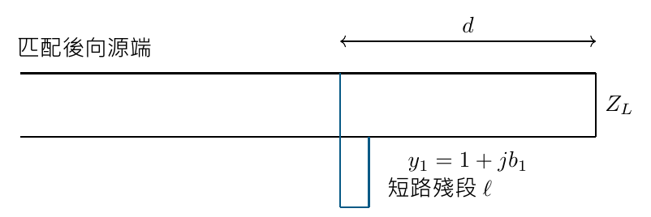
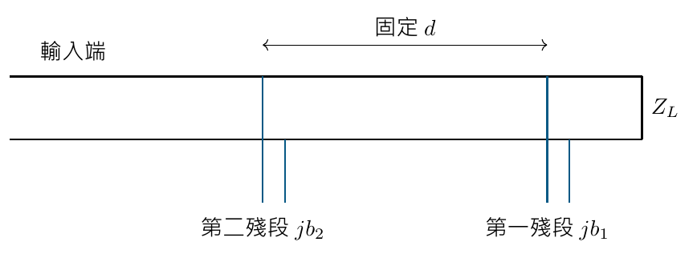

# 單元 13｜傳輸線殘段匹配法

用線長代替集總電抗

原始影片：[陳晏笙老師「天線」單元 13](https://www.youtube.com/watch?v=zIH-mj9NF78)

影片長度：約 75 分鐘　建議閱讀：約 25 分鐘

前置單元：05–12。能在阻抗、導納與反射係數之間轉換，並理解「無損匹配網路」的用途。

> **核心觀念：** 短路或開路的傳輸線殘段，在輸入端可以呈現純電抗／純電納。先用主線距離改變負載所呈現的實部，再用殘段消掉虛部，就能在指定頻率匹配。

## 本單元的五個目標

1.  用 $`\tan`$、$`\cot`$ 求開路與短路殘段的阻抗、導納。

2.  設計並聯單殘段：先到 $`g=1`$，再消電納。

3.  設計串聯單殘段：先到 $`r=1`$，再消電抗。

4.  設計間距固定的雙殘段，求兩組解。

5.  說明雙殘段的 forbidden region，避免假定任何負載都可匹配。

## 三個長度分清楚

主線上，從負載往源端移動的距離記為 $`d`$；接出去的殘段長度記為 $`\ell`$；波長 $`\lambda`$ 是線內波長。在同一頻率，主線與殘段的相速若不同，也不能共用一個波長。 以下重算例題先令所有線的 $`Z_0=50\,\Omega`$、相速相同且無損，採 $`e^{j\omega t}`$。小寫 $`z=Z/Z_0`$、$`y=YZ_0`$ 都無單位。

## 閱讀地圖

第 2 頁：開短路公式；第 3 頁：並聯單殘段流程；第 4 頁：影片例題重算；第 5 頁：串聯單殘段；第 6 頁：頻率與實作；第 7 頁：雙殘段流程；第 8 頁：雙殘段例題與禁區；第 9 頁：自測。 板書的讀圖數字與代數重算可能不同；額外推導與限制以補充標示。

## 1．開路、短路殘段：線長決定電抗

影片對照：[約 00:00](https://www.youtube.com/watch?v=zIH-mj9NF78&t=0s)－[20:00](https://www.youtube.com/watch?v=zIH-mj9NF78&t=1200s)

一小段傳輸線，遠端接開路或短路，稱為 stub。它有分布的電感、電容；在指定頻率，從近端看進去可用一個等效純電抗描述。 令殘段特性阻抗為 $`Z_s`$、相位常數為 $`\beta_s`$：

```math
Z_{\mathrm{short}}=jZ_s\tan(\beta_s\ell),\qquad
Z_{\mathrm{open}}=-jZ_s\cot(\beta_s\ell).
```

取倒數得到並聯時更自然的導納：

```math
Y_{\mathrm{short}}=-j\frac1{Z_s}\cot(\beta_s\ell),\qquad
Y_{\mathrm{open}}=j\frac1{Z_s}\tan(\beta_s\ell).
```

若 $`Z_s=Z_0`$，正規化後便只剩 $`j\tan`$ 或 $`-j\cot`$；若不同，仍須保留 $`Z_s/Z_0`$ 或 $`Z_0/Z_s`$。

### 一個四分之一波長內的符號

| 在 $`0<\ell<\lambda_s/4`$ | 輸入阻抗     | 輸入導納 |
|:------------------------|:-------------|:---------|
| 短路殘段                | 正虛部，感性 | 負虛部   |
| 開路殘段                | 負虛部，容性 | 正虛部   |

長度跨過 $`\lambda_s/4`$，符號會交換；殘段並不是永遠像同一種集總元件。每增加 $`\lambda_s/2`$，理想輸入阻抗重複。

### 短路經四分之一波長，輸入端看起來開路

在 $`\beta_s\ell=\pi/2`$，短路殘段的 $`\tan`$ 發散，輸入導納趨近 0；開路殘段則輸入阻抗趨近 0。這是傳輸線變換，不是遠端接法改變了。

### 影片比較的實作選擇

並聯殘段通常容易接到主線。微帶開路殘段可省去接地導通孔；短路殘段則要可靠接地。同軸結構的開短路便利性又不同，須依結構選擇。 **補充解說／重算例題：**微帶開路端有邊緣場，相當於額外電氣長度；短路端的導通孔也有寄生電感。上式是設計起點，實體製作後仍需校正。

> **核心觀念：** 串聯時使用阻抗；並聯時使用導納。不要把短路殘段的 $`j\tan`$ 直接當成並聯電納。

## 2．並聯單殘段：兩個自由度分工

影片對照：[約 18:00](https://www.youtube.com/watch?v=zIH-mj9NF78&t=1080s)－[37:00](https://www.youtube.com/watch?v=zIH-mj9NF78&t=2220s)

設計變數有主線距離 $`d`$ 與殘段長度 $`\ell`$。殘段只提供電納，所以它不能直接修改所在位置的電導。



1.  把負載正規化，算 $`z_L`$ 與 $`y_L=1/z_L`$。

2.  往源端沿等 $`|\Gamma|`$ 圓移動，找與導納圖 $`g=1`$ 圓的交點。

3.  在交點讀 $`y_1=1+jb_1`$；主線距離由旋轉角或線長刻度求得。

4.  並聯殘段提供 $`y_s=-jb_1`$，使總導納 $`y_{\mathrm{in}}=1`$。

5.  由開路或短路殘段的公式，選出最短的非負長度；最後代回驗證。

### 代數驗算，不必完全依賴讀圖

主線特性阻抗等於參考阻抗時：

```math
y_1(d)=\frac{y_L+j\tan(\beta d)}{1+jy_L\tan(\beta d)}.
```

先求 $`\Re y_1=1`$，再消掉 $`\Im y_1`$。負載已有耗能實部、且 $`0<|\Gamma|<1`$ 時，通常每半波長有兩個交點，對應兩組主線／殘段長度。 **補充解說／重算例題：**對理想純電抗負載，$`\Re Z_L=0`$，整個網路又無損，不能突然變成吸收實功率的 $`Z_0`$ 負載。圖上的邊界特殊情況不能硬套一般兩解流程。

> **核心觀念：** 主線距離用來找到正確電導；殘段只負責補償電納。兩個變數各解一個匹配條件。

## 3．影片 Ex 3.5：兩組短路並聯解

影片對照：[20:00](https://www.youtube.com/watch?v=zIH-mj9NF78&t=1200s)－[37:00](https://www.youtube.com/watch?v=zIH-mj9NF78&t=2220s)

影片正規化負載為

```math
z_L=1.2-j1.6,\qquad y_L=0.3+j0.4.
```

在 $`50\,\Omega`$ 系統相當於 $`Z_L=60-j80\,\Omega`$。先將主線變換到 $`g=1`$，再並聯短路殘段。

### 直接求出主線長度

**補充解說／重算例題：**令 $`t=\tan(\beta d)`$。由 $`\Re y_1=1`$ 得到

```math
\frac{0.3(1+t^2)}{(1-0.4t)^2+(0.3t)^2}=1
\quad\Longrightarrow\quad
0.05t^2+0.8t-0.7=0.
```

兩個根約 $`t=0.831761`$、$`-16.831761`$。將 $`\beta d=\tan^{-1}t`$ 取在 $`[0,\pi)`$，得到以下兩解：

| 解  | 主線 $`d/\lambda`$ | 主線輸入 $`y_1`$ | 所需殘段 $`b_s`$ |
|:----|:-----------------|:---------------|:---------------|
| A   | 0.110423         | $`1+j1.471960`$  | $`-1.471960`$    |
| B   | 0.259445         | $`1-j1.471960`$  | $`+1.471960`$    |

### 再求短路殘段長度

因為 $`y_s=-j\cot(\beta\ell)=jb_s`$，解

```math
-\cot(\beta\ell)=b_s.
```

在半波長內選最短正長度：

```math
\boxed{\ell_A/\lambda\approx0.094975,\qquad
\ell_B/\lambda\approx0.405025.}
```

影片讀圖的電納約為 $`\pm1.44`$，殘段長約 $`0.095\lambda`$、$`0.405\lambda`$；本頁將同一負載精確重算，實際設計應使用一套一致的數字。

### 末步驗證

解 A：$`y_1+y_s=(1+j1.471960)-j1.471960=1`$；解 B 同樣等於 1。因此兩者在設計頻率都呈現 $`Z_{\mathrm{in}}=Z_0`$、$`\Gamma_{\mathrm{in}}=0`$。 若改用開路殘段，$`\tan(\beta\ell)=b_s`$，兩個殘段長改為約 $`0.344975\lambda`$、$`0.155025\lambda`$，主線距離不變。

> **核心觀念：** 開路與短路可產生相同目標電納，但所需長度不同；先找電納，再選實作方式。

## 4．串聯單殘段：把導納流程換成阻抗

影片對照：[約 37:00](https://www.youtube.com/watch?v=zIH-mj9NF78&t=2220s)－[46:00](https://www.youtube.com/watch?v=zIH-mj9NF78&t=2760s)

並聯加導納，串聯加阻抗。串聯設計先沿主線移動到 $`r=1`$ 圓，再串聯等量反號的電抗：

```math
z_1=1+jx_1,\qquad z_s=-jx_1,\qquad
z_{\mathrm{in}}=z_1+z_s=1.
```

主線輸入阻抗由

```math
z_1(d)=\frac{z_L+j\tan(\beta d)}{1+jz_L\tan(\beta d)}
```

求得。與並聯流程相比，交點條件由 $`g=1`$ 改為 $`r=1`$，不可以沿用同一組主線距離。

### 影片 Ex 3.6：$`Z_L=100+j80\,\Omega`$

此處換了負載：$`Z_0=50\,\Omega`$，故 $`z_L=2+j1.6`$。解 $`\Re z_1=1`$，再以開路殘段 $`z_s=-j\cot(\beta\ell)`$ 補償。 令 $`t=\tan(\beta d)`$，實部條件整理為 $`4.56t^2-3.2t-1=0`$。兩個主線位置與開路殘段長度重算如下：

| 解  | 主線 $`d/\lambda`$ | $`z_1`$         | 開路 $`\ell/\lambda`$ |
|:----|:-----------------|:--------------|:--------------------|
| A   | 0.119744         | $`1-j1.334166`$ | 0.397631            |
| B   | 0.463373         | $`1+j1.334166`$ | 0.102369            |

解 A 的開路殘段提供正電抗，長度超過四分之一波長；解 B 提供負電抗，在四分之一波長內。投影片讀圖的 $`d_A\approx0.120\lambda`$、$`x_A\approx-1.33`$，與重算一致。 要驗證，將表中殘段的 $`-\cot(2\pi\ell/\lambda)`$ 加到 $`x_1`$，應得到零。不要把上一頁並聯題的負載或 $`g=1`$ 交點直接拿來使用。

### 為什麼有時並聯比較容易製作？

並聯可以從主線接出支線，保持主路徑連續。串聯要讓主路徑的電流經過殘段等效阻抗，結構連接較費工。影片並列兩種方法，是要讓你知道其電路運算不同，不是只有一種能達成匹配。

### 圖上找點的核對方式

-   沿主線旋轉的是等 $`|\Gamma|`$ 圓；串聯元件移動的是等 $`r`$ 圓。

-   到達 $`r=1`$ 後，若 $`x_1<0`$，殘段須提供正電抗。

-   匹配後應同時滿足 $`r=1`$、$`x=0`$；只消掉電抗還不夠。

> **核心觀念：** 串聯單殘段先找 $`r=1`$；並聯單殘段先找 $`g=1`$。殘段長度決定第二步的虛部補償。

## 5．中心頻率匹配，不代表整個頻帶匹配

影片對照：[約 42:00](https://www.youtube.com/watch?v=zIH-mj9NF78&t=2520s)－[55:00](https://www.youtube.com/watch?v=zIH-mj9NF78&t=3300s)

影片比較同一負載、不同殘段解的反射頻率響應。各解在設計頻率都可回到中心，離開該頻率後卻走出不同軌跡。

### 影片的負載頻率模型

用 $`R=60\,\Omega`$ 串聯 $`C\approx0.995`$ pF 表示負載：

```math
Z_L(f)=60-\frac{j}{2\pi fC}.
```

在 $`f_0=2`$ GHz，電抗約 $`-80\,\Omega`$，與前面的 $`z_L=1.2-j1.6`$ 相符。掃頻時必須讓負載的電抗也隨頻率改變，不能把 $`60-j80`$ 當成全頻帶的固定負載。

### 固定物理線長，重新計算每個頻率

**補充解說／重算例題：**若相速近似固定，在 $`f_0`$ 選定 $`d=m\lambda_0`$、$`\ell=n\lambda_0`$，其他頻率的電氣長度為

```math
\beta(f)d=2\pi m\frac f{f_0},\qquad
\beta(f)\ell=2\pi n\frac f{f_0}.
```

並聯短路解的完整計算順序：

```math
y_L(f)=\frac{Z_0}{Z_L(f)},\qquad
y_1(f)=\frac{y_L(f)+j\tan[\beta(f)d]}
                  {1+jy_L(f)\tan[\beta(f)d]},
```

```math
y_{\mathrm{in}}(f)=y_1(f)-j\cot[\beta(f)\ell],\qquad
\Gamma_{\mathrm{in}}(f)=\frac{1-y_{\mathrm{in}}(f)}
                             {1+y_{\mathrm{in}}(f)}.
```

若選開路，最後一項改為 $`+j\tan[\beta(f)\ell]`$。以相同反射門檻找兩個交點，才能比較匹配頻寬；不能只比較中心谷底。

### 單殘段的優點與限制

它可以直接以傳輸線實作，也不需要額外集總 L、C。代價是尺寸可能較大；設計改變負載後，最佳接入位置 $`d`$ 也可能改變，對已製作好的主線不易調整。 **補充解說／重算例題：**同一組設計加上半波長，理想中心匹配不變，但尺寸、損耗與頻率斜率可能改變。選最短線段是常見起點，仍須依頻寬與布局比較。

> **核心觀念：** 比較兩組匹配解時，要同時改變負載模型與各條線的電氣長度；只重算殘段或只重算負載都不完整。

## 6．雙並聯殘段：固定距離，調兩個殘段

影片對照：[約 50:00](https://www.youtube.com/watch?v=zIH-mj9NF78&t=3000s)－[66:00](https://www.youtube.com/watch?v=zIH-mj9NF78&t=3960s)

單殘段須調接入位置。雙殘段把兩個接入點固定，只調兩個殘段的電納。影片 Ex 3.7 的兩點間距為 $`d=\lambda/8`$，殘段使用開路。



這裡按從負載回推的順序命名：第一殘段先與負載並聯，經過主線 $`d`$，再到第二殘段。

1.  負載 $`y_L=g+jb_L`$；加第一殘段後，$`y_A=g+j(b_L+b_1)`$。

2.  經主線變換到 $`y_B`$，要求 $`\Re y_B=1`$。

3.  第二殘段提供 $`b_2=-\Im y_B`$，所以 $`y_{\mathrm{in}}=1`$。

4.  將 $`b_1,b_2`$ 分別換成開路／短路殘段長度，並代回全部網路。

### 史密斯圖的幾何操作

從負載沿等 $`g`$ 圓移動；目標是經過固定距離旋轉後，恰好落到 $`g=1`$ 圓。可先把 $`g=1`$ 圓逆向旋轉 $`2\beta d`$，找它與負載等 $`g`$ 圓的交點，再正向變換驗證。 **補充解說／重算例題：**固定間距減少了自由度；這兩個圓可能沒有交點。雙殘段雖容易調整兩個線長，並不能保證所有負載都存在解。

> **核心觀念：** 第一殘段決定經過固定主線後的電導；第二殘段只消掉剩餘電納。

## 7．雙殘段例題，以及不能匹配的禁區

影片對照：[約 56:00](https://www.youtube.com/watch?v=zIH-mj9NF78&t=3360s)－[75:00](https://www.youtube.com/watch?v=zIH-mj9NF78&t=4500s)

影片 Ex 3.7 沿用 $`y_L=0.3+j0.4`$、$`d=\lambda/8`$。令第一殘段後的總電納為 $`B=0.4+b_1`$，因 $`\tan(\beta d)=1`$：

```math
y_B=\frac{0.3+jB+j}{1+j(0.3+jB)}.
```

令 $`\Re y_B=1`$，得到 $`(1-B)^2=0.51`$，所以 $`B=1\pm\sqrt{0.51}`$。

### 兩組開路殘段解的精確重算

**補充解說／重算例題：**對開路殘段 $`b_i=\tan(2\pi\ell_i/\lambda)`$，在 $`[0,\lambda/2)`$ 選長度：

| 解  | $`b_1`$       | $`b_2`$       | $`\ell_1/\lambda`$ | $`\ell_2/\lambda`$ |
|:----|:------------|:------------|:-----------------|:-----------------|
| A   | $`+1.314143`$ | $`+3.380476`$ | 0.146474         | 0.204225         |
| B   | $`-0.114143`$ | $`-1.380476`$ | 0.481912         | 0.349775         |

解 A 經主線後 $`y_B=1-j3.380476`$，與影片讀圖約 $`1-j3.38`$ 一致；再加第二殘段的 $`+j3.380476`$，總導納等於 1。

### 禁區不是畫圖失誤，而是方程沒有實數解

**補充解說／重算例題：**對一般 $`y_L=g+jb_L`$，令 $`t=\tan(\beta d)`$、第一殘段後電納為 $`B`$：

```math
\Re y_B=\frac{g(1+t^2)}{(1-Bt)^2+(gt)^2}=1.
```

所以

```math
(1-Bt)^2=g[1+(1-g)t^2]\ge0.
```

當 $`g>0`$、$`t`$ 有限且不為零，存在解須滿足

```math
\boxed{g\le\frac{1+t^2}{t^2}=\csc^2(\beta d).}
```

本例 $`d=\lambda/8`$，故 $`g\le2`$ 可有解，$`g>2`$ 是禁區。在導納史密斯圖上，是 $`g=2`$ 圓內側靠近短路的區域；此處指電導 $`g`$，不是正規化電阻 $`r`$。 **補充解說／重算例題：**若 $`d`$ 為半波長的整數倍，兩個殘段相當於在同一參考面加電納，不能獨立調整電導；此時只能匹配已有 $`g=1`$ 的負載。若落入禁區，可改間距或增加前置主線等設計自由度。

> **核心觀念：** 固定間距的雙殘段有負載禁區；先檢查存在解，再求兩個線長。

## 8．五題自測與答案

建議用 5 分鐘作答；再用公式檢查。

1.  $`Z_s=Z_0`$，長度 $`\lambda/8`$ 的短路殘段，正規化阻抗與導納為何？

2.  在並聯殘段接入點，主線導納為 $`1+j0.5`$。殘段須提供哪個電納？若選短路，求 $`0<\ell<\lambda/2`$ 的線長。

3.  串聯殘段接入點的阻抗為 $`1-j0.8`$。應提供正還是負電抗？若改用並聯殘段直接加 $`+j0.8`$，能否照樣匹配？

4.  雙並聯殘段間距 $`\lambda/8`$，負載 $`y_L=2.5+j0.2`$。有沒有實數線長解？若 $`y_L=0.3+j0.4`$，兩解是否都能在設計頻率匹配？

5.  固定物理長度 $`\ell=0.1\lambda_0`$，頻率從 $`f_0`$ 增為 $`1.2f_0`$，相速不變。新的 $`\beta\ell`$ 是多少？原來的殘段電納會維持不變嗎？

### 答案與理由

1.  $`\beta\ell=\pi/4`$，$`z_s=j`$，$`y_s=-j`$。並聯時必須用後者。

2.  須 $`b_s=-0.5`$。由 $`-\cot(\beta\ell)=-0.5`$ 得 $`\tan(\beta\ell)=2`$，故 $`\ell/\lambda=\tan^{-1}(2)/(2\pi)\approx0.17621`$。

3.  串聯應提供 $`+j0.8`$，使總阻抗為 1。不能直接改成並聯加電納；$`y=1/(1-j0.8)\approx0.609756+j0.487805`$，電導不等於 1。

4.  $`g=2.5>2`$，在禁區，沒有解。$`g=0.3`$ 則有兩組解；各自加入正確第二殘段後都可在中心頻率匹配，頻帶表現未必相同。

5.  $`\beta\ell=2\pi(0.1)(1.2)=0.24\pi`$，約 $`43.2^\circ`$，不是原來的 $`36^\circ`$。$`\tan`$ 或 $`\cot`$ 也會跟著變，所以電納通常改變。

### 操作速記

```math
\text{單並聯：到 }g=1\ \to\ \text{加 }-jb;\qquad
\text{單串聯：到 }r=1\ \to\ \text{加 }-jx.
```

```math
\text{雙並聯：第一殘段}\ \to\ \text{固定主線}\ \to\
g=1\ \to\ \text{第二殘段消虛部}.
```

**下一單元：**寬頻匹配網路與額外損耗分析。把「單一頻率能匹配」擴展到整段頻帶的性能與代價。
