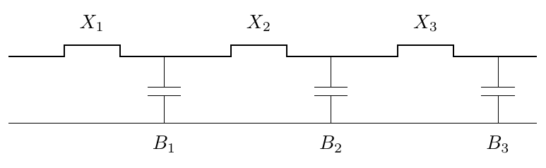

# 單元 14｜寬頻匹配網路與額外損耗分析

[下載原始 PDF](../pdf/014_寬頻匹配網路與額外損耗分析.pdf)

**寬頻匹配網路**

與額外損耗分析

原始影片：[陳晏笙老師「天線」單元 14](https://www.youtube.com/watch?v=QJ8xXUkxdAQ)

影片長度：約 63 分鐘　建議閱讀：約 25 分鐘

前置單元：05–13。已能求單頻匹配，了解反射係數、L 型與殘段設計。

> **核心觀念：** 寬頻設計要讓整段頻帶的反射都合格；可用多段匹配調整響應，卻受負載與無損被動網路的理論限制。實際網路還會耗能，應比較送到負載的功率，而非只看反射谷底。

## 五個學習目標

1.  用 Q 理解頻率響應的陡緩，辨識公式的適用條件。

2.  分清多段 L 型、最大平坦與等漣波匹配。

3.  用 Bode–Fano 不等式檢查寬頻匹配是否可能。

4.  用操作功率增益 $G_P$ 與轉換功率增益 $G_T$ 分析損耗。

5.  說明整流器匹配為何與工作功率有關。

## 這一單元的設計問題

「能否在一段頻帶都讓 $|\Gamma|$ 很小？」與「接受的功率有多少送到負載？」是兩個問題。理想 LC 匹配網路不耗能；實體電感、電容、基板、導體都可能產生損耗。

## 閱讀地圖

第 2 頁：Q 與頻寬；第 3 頁：史密斯圖路徑；第 4 頁：多段變壓器；第 5 頁：Bode–Fano；第 6 頁：影片例題；第 7 頁：兩種功率增益；第 8 頁：整流器與實作比較；第 9 頁：自測。 依影片圖示與公式重整；額外條件、推導與數值以補充標示。以下 S 參數使用相同正實數參考阻抗。

## 1．Q：儲能與耗能，以及頻寬的尺度

影片對照：[約 00:00](https://www.youtube.com/watch?v=QJ8xXUkxdAQ&t=0s)－[14:00](https://www.youtube.com/watch?v=QJ8xXUkxdAQ&t=840s)

品質因數原始定義為每一週期：

$$
Q=2\pi\frac{\text{儲存的能量}}{\text{每週期耗散的能量}}.
$$

在共振系統，也常寫成 $Q=\omega_0 W/P_{\mathrm{loss}}$。高 Q 表示能量維持較多週期，響應通常較尖銳；低 Q 的能量衰減快，響應通常較寬。

### 熟悉的 RLC 共振電路

對串聯 RLC，在 $\omega_0=1/\sqrt{LC}$：

$$
Q_{\mathrm{series}}=\frac{\omega_0L}{R}
=\frac1{\omega_0RC}.
$$

對並聯 RLC：

$$
Q_{\mathrm{parallel}}=\omega_0RC
=\frac R{\omega_0L}.
$$

這裡的 $R$ 必須是該共振模型的總耗能電阻；加入訊號源或外部負載後，載入 Q 可能改變。

### 影片的頻寬關係，要先確認定義

影片以 $Q\approx f_0/(f_H-f_L)$ 表達 Q 與半功率頻寬成反比，也給出共振附近的電抗斜率觀點：

$$
Q_Z\approx\frac{\omega_0}{2R(\omega_0)}
\left|\frac{dX}{d\omega}\right|_{\omega_0}.
$$

**補充解說／重算例題：**上式用於共振附近、電阻變化較小的單共振模型；一般天線的多模態響應不能一概用一個斜率 Q 描述。半功率的量也須指定：電流響應、接受功率與反射曲線的門檻，不能任意混用。影片分享曾以低 Q 作為效率最佳化的觀察指標，但這不是普遍等價：增加耗損也能降低 Q、拓寬反射頻帶，卻降低輻射效率。

### 重算示範：門檻不同，頻寬係數也不同

**補充解說／重算例題：**若 $Z/Z_0\approx1+j2Q_Z\delta$、$\delta=(f-f_0)/f_0$，則

$$
|\Gamma|=\frac{|2Q_Z\delta|}
{\sqrt{4+(2Q_Z\delta)^2}}.
$$

以 $|\Gamma|\le\Gamma_m$ 找頻段，可得近似

$$
\mathrm{FBW}\approx\frac{2\Gamma_m}
{Q_Z\sqrt{1-\Gamma_m^2}}.
$$

RL 至少 10 dB 時，$\Gamma_m=\sqrt{0.1}$，FBW 約 $0.667/Q_Z$；反射功率為一半的門檻則約 $2/Q_Z$。因此不能把任何匹配頻寬直接稱為 $1/Q$。

> **核心觀念：** Q 越高通常越窄；真正代入公式前，要先說清楚共振模型、載入條件與頻寬門檻。

## 2．匹配路徑：用多個小轉換取代一個大轉換

影片對照：[約 06:00](https://www.youtube.com/watch?v=QJ8xXUkxdAQ&t=360s)－[20:00](https://www.youtube.com/watch?v=QJ8xXUkxdAQ&t=1200s)

對串聯電抗模型 $z=r+jx$，影片用

$$
Q_{\mathrm{path}}=\frac{|x|}{r}
$$

描述史密斯圖上的儲能／耗能比例。對導納模型，對應的尺度為 $|b|/g$；由 $y=1/z$ 可驗證兩個比值相同。

### 等 Q 路徑的意義

在阻抗平面 $|x|=Qr$，是從原點出發的兩條射線；映射到史密斯圖後成為彎曲軌跡。掃頻路徑若經過電抗相對電阻很大的區域，常伴隨較強儲能與較陡頻率變化。 **補充解說／重算例題：**路徑上的 $|x|/r$ 是局部電路尺度，不等同整個網路的共振 Q。不能只挑圖上一個低 Q 點，就宣稱全頻帶一定寬。

### 影片的多段 L 型設計

一個 L 型網路用一串聯、一並聯電抗，完成一次阻抗轉換。多個 L 型串接，可把大轉換拆成數個較小轉換，選擇在圖上較靠近低 Q 區域的路徑。

影片示意三個串聯元件與三個並聯元件的路徑。這張圖表示操作次序；每個 $X,B$ 的正負，仍須由實際負載與所選軌跡決定。

### 增加元件不是免費的頻寬

-   可調參數增加，能塑造更多共振與頻帶起伏。

-   元件、板面積與調整難度增加，實體寄生也增加。

-   電感、電容有限 Q，使額外網路耗能；後半單元要一併檢查。

> **核心觀念：** 多段匹配可改善響應形狀，但不能僅以元件數量判斷頻寬與效率。

## 3．多段四分之一波變壓器：兩種頻帶目標

影片對照：[約 20:00](https://www.youtube.com/watch?v=QJ8xXUkxdAQ&t=1200s)－[28:00](https://www.youtube.com/watch?v=QJ8xXUkxdAQ&t=1680s)

單段 $\lambda/4$ 變壓器在中心頻率匹配兩個純電阻。多段變壓器以不同特性阻抗的線段串接；每段在設計頻率約為四分之一波長。

$$
Z_0\ \longrightarrow\ Z_1\ \longrightarrow\ Z_2
\ \longrightarrow\ \cdots\ \longrightarrow\ Z_N
\ \longrightarrow\ R_L.
$$

各接口的反射波帶有不同傳播相位。設計各段阻抗，可以讓這些反射在一段頻帶相互抵銷。

### 影片對照的兩類設計

| 設計               | 目標形狀                           | 接受的代價                               |
|:-------------------|:-----------------------------------|:-----------------------------------------|
| Binomial，最大平坦 | 中心附近反射曲線平坦，沒有等幅起伏 | 同一階數、同一門檻下，可用頻帶通常較保守 |
| Chebyshev，等漣波  | 頻帶內允許有界的等幅反射起伏       | 藉允許漣波換取較寬合格頻帶               |

### 中心谷底不是唯一設計目標

最大平坦設計集中改善中心附近；等漣波設計則把允許誤差分配到整段頻帶。比較時，須固定負載、階數與允許最大 $|\Gamma|$；不能拿不同門檻下的寬度直接比較。

### 如何重算一個給定的多段網路？

**補充解說／重算例題：**即使不做完整合成，也可由負載往回遞推每段的輸入阻抗：

$$
Z_{\mathrm{in},k}=
Z_k\frac{Z_{\mathrm{in},k+1}+jZ_k\tan\theta_k}
{Z_k+jZ_{\mathrm{in},k+1}\tan\theta_k},\qquad
\theta_k=\beta_k\ell_k,
$$

最末段的負載為 $R_L$。最後在主線參考阻抗 $Z_0$ 求反射係數。掃頻時，每段 $\theta_k$ 都要重算。 **補充解說／重算例題：**別把每段設為 $\sqrt{Z_0R_L}$，那會重複同一個單段設計，而不是多段頻率響應的合成。影片在此介紹形狀與原理，未逐步推導完整的各階阻抗合成表。

> **核心觀念：** 最大平坦與等漣波，分別追求中心平坦與頻帶內有界起伏；設計目標不同，元件值也不同。

## 4．Bode–Fano：匹配品質與頻寬的上限

影片對照：[約 28:00](https://www.youtube.com/watch?v=QJ8xXUkxdAQ&t=1680s)－[38:00](https://www.youtube.com/watch?v=QJ8xXUkxdAQ&t=2280s)

即使元件理想、網路無損，含有儲能的負載也不能任意寬頻完美匹配。影片以 RC 負載說明這個限制。

### 並聯 RC 負載

對電阻 $R$ 與電容 $C$ 並聯，透過被動、線性、時不變且無損的匹配網路，反射係數受到

$$
\boxed{\int_0^\infty\ln\frac1{|\Gamma(\omega)|}\,d\omega
\le\frac{\pi}{RC}.}
$$

這裡是自然對數，頻率積分使用 rad/s。$|\Gamma|$ 越小，$\ln(1/|\Gamma|)$ 越大；寬頻與深匹配都會增加積分，不能同時無限增加。

### 串聯 RC 負載

對串聯 RC，影片給出另一個加權限制：

$$
\boxed{\int_0^\infty\frac1{\omega^2}
\ln\frac1{|\Gamma(\omega)|}\,d\omega\le\pi RC.}
$$

不能把並聯與串聯的右側互換，也不能漏掉 $1/\omega^2$。

### 圖上的理想矩形

假設頻帶內 $|\Gamma|=\Gamma_m<1$，頻帶外全反射 $|\Gamma|=1$，外部不占積分。這個矩形是用來推上限的理想響應；有限元件網路不會直接做出完全陡直的兩個邊緣。 **補充解說／重算例題：**對並聯 RC，至少要滿足

$$
\Delta\omega\ln(1/\Gamma_m)\le\frac{\pi}{RC}.
$$

對串聯 RC，對應為

$$
\ln(1/\Gamma_m)\left(\frac1{\omega_L}-\frac1{\omega_H}\right)
\le\pi RC.
$$

### 限制告訴你什麼，沒有告訴你什麼？

-   某個要求若超過上限，增加更多理想元件也不能達成。

-   沒超過上限，只代表必要條件未被違反；不保證有限元件數、實際寄生與損耗都能滿足。

-   允許較大反射可換取較寬頻帶；要更深的匹配，頻帶必須更保守。

補充原始理論來源：[R. M. Fano，MIT《Theoretical limitations on the broadband matching of arbitrary impedances》](https://dspace.mit.edu/entities/publication/6942d56a-13b3-4f41-9516-cfc99d6cf55d)。

> **核心觀念：** 此限制針對指定負載模型與無損匹配；不能靠加入耗能電阻得到很低反射，就宣稱改善了功率傳送的理論極限。

## 5．影片 Ex 3.8：超寬頻能匹配得多深？

影片對照：[約 35:00](https://www.youtube.com/watch?v=QJ8xXUkxdAQ&t=2100s)－[38:00](https://www.youtube.com/watch?v=QJ8xXUkxdAQ&t=2280s)

影片設定並聯 RC 負載，$R=75\,\Omega$、$C=0.6$ pF，目標頻帶為 3.1–10.6 GHz。用理想矩形反射響應，估算頻帶內可達的最小反射幅度。

### 第一步：先換成角頻寬

$$
\Delta f=10.6-3.1=7.5\ \mathrm{GHz},
$$

$$
\Delta\omega=2\pi\Delta f
=2\pi(7.5\times10^9)\ \mathrm{rad/s}.
$$

不能把 $7.5$ GHz 直接當成 $\Delta\omega$，否則會差一個 $2\pi$。

### 第二步：求允許的對數深度

$$
\ln\frac1{\Gamma_m}\le
\frac{\pi}{\Delta\omega RC}
=\frac{\pi}
{2\pi(7.5\times10^9)(75)(0.6\times10^{-12})}
\approx1.48148.
$$

因此

$$
\boxed{\Gamma_m\ge e^{-1.48148}\approx0.2273.}
$$

影片約讀為 $0.228$；這個下限表示，理想矩形頻帶也不能整段都比它更低。

### 第三步：轉成工程常看的回返損失

$$
\mathrm{RL}_m=-20\log_{10}\Gamma_m
\le20\log_{10}(e)\,(1.48148)
\approx12.87\ \mathrm{dB}.
$$

影片數值約 12.86 dB。正值 RL 越大越好；負值反射 dB 的符號相反。

### 重算比較：若要求整段至少 20 dB

**補充解說／重算例題：**$\Gamma_m=0.1$，所以 $\ln(1/\Gamma_m)=\ln10$。最大角頻寬須滿足

$$
\Delta f\le\frac1{2RC\ln10}
\approx4.83\ \mathrm{GHz}.
$$

因此，同一負載要在整個 7.5 GHz 寬度達到至少 20 dB，已違反這個必要條件。這與中心某一點做出很深的谷底是不同要求。

> **核心觀念：** 先把反射門檻與整段頻寬放進上限，確認需求可行，再投入網路合成與元件調整。

## 6．額外損耗：三個功率參考量

影片對照：[約 38:00](https://www.youtube.com/watch?v=QJ8xXUkxdAQ&t=2280s)－[46:00](https://www.youtube.com/watch?v=QJ8xXUkxdAQ&t=2760s)

影片以 S 參數二埠表示匹配網路。先分清三個功率： **影片的三次模擬：**先量天線／負載單獨的 $\Gamma_L$；再量匹配網路接負載後的 $\Gamma_{\rm in}$；最後把網路當二埠，取得 $S_{21},S_{22}$。三次須使用相同頻率、端口參考阻抗與負載參考面，才能代入下式。只看網路單獨的 $|S_{21}|^2$，無法一般地代表接上失配負載後的傳送比例。

|                    |                                                        |
|:-------------------|:-------------------------------------------------------|
| $P_{\mathrm{avs}}$ | 訊號源在共軛匹配條件下的最大可用功率。                 |
| $P_{\mathrm{in}}$  | 匹配網路輸入端實際接受的淨功率：入射減反射。           |
| $P_L$              | 負載實際接受的淨功率；天線負載還會分成輻射與內部耗能。 |

### 操作功率增益 $G_P$：接受後送到負載的比例

$$
G_P=\frac{P_L}{P_{\mathrm{in}}}
=\frac{|S_{21}|^2(1-|\Gamma_L|^2)}
{(1-|\Gamma_{\mathrm{in}}|^2)|1-S_{22}\Gamma_L|^2},
$$

$$
\Gamma_{\mathrm{in}}=S_{11}
+\frac{S_{12}S_{21}\Gamma_L}{1-S_{22}\Gamma_L}.
$$

對被動耗能網路，$G_P\le1$；理想無損且有負載接受功率時，$P_L=P_{\mathrm{in}}$，所以 $G_P=1$。 **補充解說／重算例題：**以 $-10\log_{10}G_P$ 表示接受功率到負載之間的損失，可避免把輸入失配又算一次。直接套 $-20\log|S_{21}|$，一般需要端口匹配等條件。

### 轉換功率增益 $G_T$：相對源的最大可用功率

$$
G_T=\frac{P_L}{P_{\mathrm{avs}}}.
$$

若訊號源與共同參考阻抗匹配，$\Gamma_S=0$：

$$
G_T=(1-|\Gamma_{\mathrm{in}}|^2)G_P
=\frac{|S_{21}|^2(1-|\Gamma_L|^2)}
{|1-S_{22}\Gamma_L|^2}.
$$

一般未匹配源須保留源端反射與來回波：

$$
G_T=\frac{(1-|\Gamma_S|^2)|S_{21}|^2(1-|\Gamma_L|^2)}
{|(1-S_{11}\Gamma_S)(1-S_{22}\Gamma_L)
-S_{12}S_{21}\Gamma_S\Gamma_L|^2}.
$$

**補充解說／重算例題：**以上各 $\Gamma$ 都以同一正實數阻抗定義，$S_{21}$ 是網路傳輸，不是天線的輻射效率。要估輻射功率，仍須再乘天線效率。

> **核心觀念：** 反射說明接受了多少；$G_P$ 說明接受後傳到負載多少；$G_T$ 把源端失配與網路損耗一起計入。

## 7．整流器匹配：必須指定工作功率

影片對照：[約 46:00](https://www.youtube.com/watch?v=QJ8xXUkxdAQ&t=2760s)－[62:40](https://www.youtube.com/watch?v=QJ8xXUkxdAQ&t=3760s)

影片展示整流器在多個頻率的輸入阻抗隨輸入功率改變。二極體是非線性元件，工作點改變後，等效 RF 電阻、電抗也會改變。

### 為什麼一次量測的阻抗不夠？

若按一個功率下的整流器阻抗設計匹配，換另一個功率，負載已經不同。匹配網路又會改變整流器真正接受的功率，因此設計與量測應使用一致工作點。 影片比較 LC、單殘段與雙殘段網路，並以指定的約 $-10$ dBm 工作點進行設計。實際元件與不同基板都會造成額外損耗，不能把理想匹配結果當成最終效率。

### 重算例：反射較低的設計，未必送得較多

**補充解說／重算例題：**使用已匹配源，$P_{\mathrm{avs}}=1$ mW。比較兩個被動網路：

| 設計 | $\vert \Gamma_{\mathrm{in}}\vert$ | $G_P$ | $G_T$  | $P_L$     |
|:-----|:----------------------------------|:------|:-------|:----------|
| A    | 0.10                              | 0.50  | 0.495  | 0.495 mW  |
| B    | 0.30                              | 0.95  | 0.8645 | 0.8645 mW |

A 的反射較低，接受源的比例為 99%；但其中一半在網路耗散。B 雖只接受 91%，卻能把較高比例送到負載，因此負載得到更多功率。

### 從 RF 功率再到 DC 輸出

**補充解說／重算例題：**若整流器在該工作點的 RF-to-DC 效率為 $\eta_{\mathrm{rect}}$：

$$
P_{\mathrm{DC}}=P_{\mathrm{avs}}G_T\eta_{\mathrm{rect}}.
$$

這個效率一般也是功率、頻率與 DC 負載的函數。較小反射、較高 $G_T$、較高 DC 轉換效率，是彼此有關但不同的指標。

### 影片實驗比較應怎麼讀？

-   先確認源可用功率、頻率與整流器的 DC 負載。

-   看反射曲線，判斷源端失配；再看 $G_T$，判斷實際 RF 傳送。

-   最後看總 RF-to-DC 效率，確認設計目的是否達成。

影片最後另展示以多個開關重構匹配網路、把原天線延伸到新工作頻帶的案例。每一組開關狀態除了反射，還須檢查 $G_T$；若網路與源、負載皆被動，$G_T$ 不超過 1。例如 $G_T=-2$ dB 代表約 63.1% 的源可用功率到達負載，並不等於輻射效率 63.1%。

> **核心觀念：** 非線性整流器的「負載阻抗」不是固定常數；匹配與效率都要在同一工作點比較。

## 8．五題自測與答案

先做題；特別注意自然對數、角頻率與功率參考面。

1.  哪個設計追求中心附近最大平坦？哪個允許頻帶內有界漣波，換取較寬頻帶？

2.  並聯 RC 的 $R=50\,\Omega,C=10$ pF，要在寬度 1 GHz 內維持理想矩形反射，求最小 $\Gamma_m$ 與最大可保證 RL。

3.  某單共振模型 $Q_Z=10$，按第 2 頁近似式，RL 至少 10 dB 的分數頻寬約多少？

4.  已匹配源有 $P_{\mathrm{avs}}=10$ mW，$|\Gamma_{\mathrm{in}}|=0.2$、$G_P=0.8$。求 $P_{\mathrm{in}}$、$P_L$ 與 $G_T$。

5.  整流器在 $-20$ dBm 的阻抗已匹配，是否能直接保證 $0$ dBm 也匹配？Bode–Fano 沒超上限，是否保證能以兩顆元件實作？

### 答案與解析

1.  Binomial 最大平坦；Chebyshev 等漣波。比較須固定階數、負載及反射門檻。

2.  $\pi/(\Delta\omega RC)=1$，故 $\Gamma_m\ge e^{-1}\approx0.3679$；RL 不超過 $20\log_{10}e\approx8.686$ dB。這是矩形最優情境的理論上限。

3.  $\mathrm{FBW}\approx0.667/10=6.67\%$。若改用另一個門檻或另一種 Q 定義，係數也要改。

4.  $P_{\mathrm{in}}=10(1-0.2^2)=9.6$ mW；$P_L=9.6(0.8)=7.68$ mW；$G_T=0.768$。接受功率與負載功率不是同一個量。

5.  不能；整流器非線性，阻抗隨工作功率改變。也不能保證兩元件實作：理論上限只是必要條件，尚須滿足網路階數、寄生與實際損耗限制。

### 計算前的四個檢查

-   是串聯還是並聯 RC？使用正確的積分與常數。

-   積分是 $\omega$ 還是 $f$？$\ln$ 還是 $\log_{10}$？

-   功率分母是入射、淨接受，還是源的最大可用功率？

-   阻抗、S 參數與整流效率是否在同一頻率與工作功率？

**下一單元：**極化。從端口電路轉向空間中的電磁場，理解發射與接收方向如何影響接收功率。
