# 單元 14｜寬頻匹配網路與額外損耗分析

原始影片：[陳晏笙老師「天線」單元 14](https://www.youtube.com/watch?v=QJ8xXUkxdAQ)

老師講義：[Lecture 3 — Impedance Matching Networks](https://drive.google.com/file/d/1fVGbNCHfqeGabsR-2ABXvOkeuYlyDFzq/view)，第 105–129 頁（3.5 擴展匹配頻寬、3.6 額外損耗）

影片長度：62 分 45 秒　建議閱讀：約 35 分鐘

前置單元：05–13。先熟悉反射係數、史密斯圖、L 型與殘段匹配。

> **核心觀念：** 寬頻設計要讓整段頻帶的反射都合格；多段網路能調整響應，仍受指定負載的理論極限約束。實作時還要追蹤功率：匹配網路接受多少、其中多少真正送到負載，以及負載最後如何利用這些功率。

## 學習重點

1. 分辨儲能 Q、史密斯圖上的等 Q 軌跡與頻寬的關係。
2. 理解多段 L 型、最大平坦與等漣波匹配的設計方向。
3. 依負載拓樸選用 Bode–Fano 上限，完成老師的 EX 3.8。
4. 用四個頻段的整流器實驗，理解匹配損耗與工作功率的關係。
5. 區分回返損失、操作功率增益 $`G_P`$、轉換功率增益 $`G_T`$ 與遠場效率。

## 講義與影片對照

以下依老師 PDF 的頁序編排；第 105、118 頁是章節目錄。時間經影片口述、影片縮圖與部分實際畫面核對，是**主題定位點或約略區間**，不是精確換頁時刻。影片後段會回翻前頁；第 126 頁的功率比較則依 PDF 補齊，尚未在核對畫面中確認獨立講解。

| 老師講義 | 原英文主題 | 中文內容 | 影片定位 |
|:--|:--|:--|:--|
| 105–107 | Improving the Matching Bandwidth / Q Factor / Constant Q Path | 寬頻匹配起點、Q 定義、等 Q 軌跡 | [約 01:00–09:00](https://www.youtube.com/watch?v=QJ8xXUkxdAQ&t=60s) |
| 108 | The Relation between Q and Bandwidth | Q 與頻寬、電抗斜率 | [約 10:00](https://www.youtube.com/watch?v=QJ8xXUkxdAQ&t=600s) |
| 109–110 | How to Expand the Impedance Bandwidth? / Multi-L-Section Matching Circuit | 低 Q 路徑與多段 L 型網路 | [約 13:30–19:00](https://www.youtube.com/watch?v=QJ8xXUkxdAQ&t=810s) |
| 111 | Multi-Section Matching Transformers | 多段變壓器、最大平坦與等漣波 | [約 20:00](https://www.youtube.com/watch?v=QJ8xXUkxdAQ&t=1200s)；其後有板書曲線 |
| 112–115 | Matching Circuits Have Their Limits / The Bode-Fano Criterion / Tradeoff Between BW and Γm | 四種負載的匹配上限、頻寬取捨 | [約 27:30–34:00](https://www.youtube.com/watch?v=QJ8xXUkxdAQ&t=1650s) |
| 116–117 | The Bode-Fano Criterion — EX 3.8 | 3.1–10.6 GHz 的並聯 RC 例題 | [約 35:00](https://www.youtube.com/watch?v=QJ8xXUkxdAQ&t=2100s) |
| 118–119 | Additional Loss / Insertion Loss Characterization | 功率參考面與操作功率增益 | [約 39:50](https://www.youtube.com/watch?v=QJ8xXUkxdAQ&t=2390s) |
| 120–121 | Input Impedance of the Rectifier / Topology of Matching Circuits | 整流器阻抗、三種網路與材料 | [背景約 46:15–51:30](https://www.youtube.com/watch?v=QJ8xXUkxdAQ&t=2775s)；[阻抗與網路 51:30–54:45](https://www.youtube.com/watch?v=QJ8xXUkxdAQ&t=3090s) |
| 122–125 | Results of 900-MHz / 1.8-GHz / 2.4-GHz / 5.8-GHz Networks | 四頻段的損耗比較 | [約 54:45–58:20](https://www.youtube.com/watch?v=QJ8xXUkxdAQ&t=3285s)；後段回翻 1.8 GHz 結果 |
| 126 | Associated Return Loss | 改變設計功率後，反射與損耗如何變化 | 依講義整理；影片未確認獨立講解 |
| 127 | Transducer Power Gain | 整體功率傳送指標 | [約 58:40–60:10](https://www.youtube.com/watch?v=QJ8xXUkxdAQ&t=3520s) |
| 128–129 | Reconfigurable Matching Network / Performance Characterization | 重構網路、數值表與遠場效率 | [約 60:10–片尾](https://www.youtube.com/watch?v=QJ8xXUkxdAQ&t=3610s) |

## 1．Q 因數：能量比較喜歡儲存，還是耗散？（Q Factor，p.106）

品質因數（quality factor，Q）的能量定義為

```math
Q=2\pi\frac{\text{儲存的能量}}
{\text{每週期耗散的能量}}
=\frac{\omega_0 W}{P_{\mathrm{loss}}}.
```

$`W`$ 是相應共振模型的儲能，$`P_{\mathrm{loss}}`$ 是平均耗散功率。高 Q 表示每週期耗散的比例較小，能量可維持較多週期；低 Q 則表示能量較快衰減。

老師也以阻尼解釋高、低 Q。在標準二階 RLC 模型，$`Q>1/2`$ 為欠阻尼、$`Q<1/2`$ 為過阻尼，$`Q=1/2`$ 是臨界阻尼。這是特定二階模型的分類，不能直接套到任意多共振天線。

### 從電路的 R、L、C 看 Q

對串聯 RLC，在 $`\omega_0=1/\sqrt{LC}`$：

```math
Q_{\mathrm{series}}
=\frac{\omega_0L}{R}
=\frac{1}{\omega_0RC}.
```

對並聯 RLC：

```math
Q_{\mathrm{parallel}}
=\omega_0RC
=\frac{R}{\omega_0L}.
```

串聯電感的電抗大小為 $`\omega_0L`$，串聯電容為 $`1/(\omega_0C)`$；因此可用「反應性部分／耗能部分」理解這些比值。並聯時改用電納與電導比較。

**符號提醒：**這裡比較的是儲能支路的電抗或電納；串聯 RLC 在共振時的**總電抗**為零，不能把它代入 $`|X|/R`$，就說共振器的 Q 為零。電阻也應包含模型中的實際耗能；加入源或負載後，載入 Q 會改變。

## 2．史密斯圖上的等 Q 軌跡（Constant Q Path on Smith Chart，p.107）

老師把負載寫成正規化阻抗 $`z=r+jx`$，以

```math
Q_{\mathrm{path}}=\frac{|x|}{r}
```

標示「電抗相對電阻有多大」。下標 $`\mathrm{path}`$ 是本筆記為了區別整體共振 Q 所加；投影片統一寫成 Q。

若使用導納 $`y=g+jb=1/z`$，則

```math
g=\frac{r}{r^2+x^2},\qquad
b=-\frac{x}{r^2+x^2},
\qquad
\frac{|b|}{g}=\frac{|x|}{r}.
```

所以改讀 Z 圖或 Y 圖，不會改變這個比值。

| 老師的正規化阻抗例子 | $`\lvert x\rvert/r`$ | 所在軌跡 |
|:--|:--|:--|
| $`1+j1`$ | 1 | Q = 1 |
| $`0.5+j0.5`$ | 1 | Q = 1 |
| $`2+j2`$ | 1 | Q = 1 |
| $`0.1-j0.1`$ | 1 | Q = 1，電容性半部 |
| $`1+j2`$ | 2 | Q = 2 |

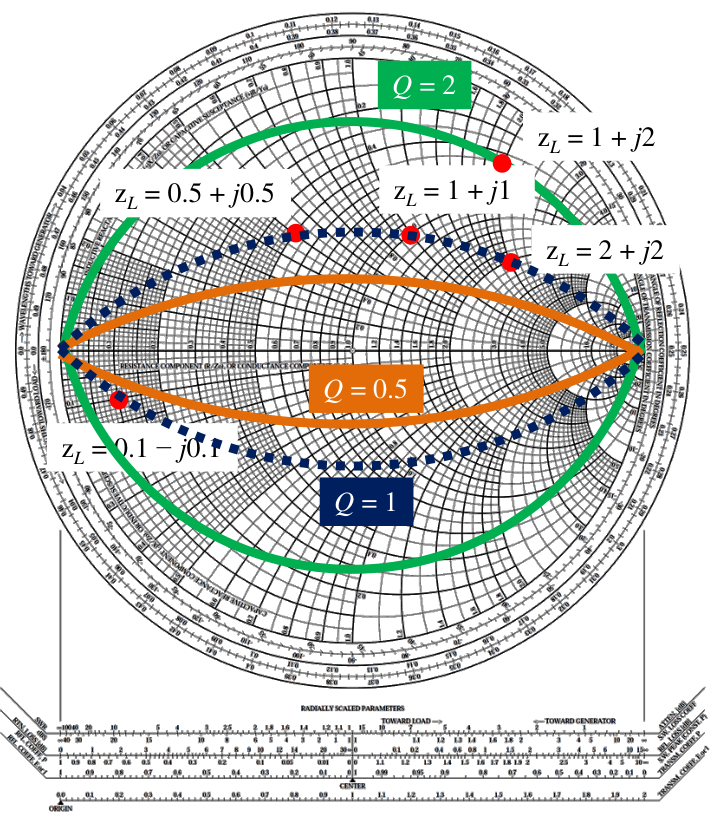

圖源：老師講義 p.107 局部。深藍點線為 Q = 1，橘線為 Q = 0.5，綠線為 Q = 2。

在阻抗平面，$`|x|=Qr`$ 是兩條射線；映射到史密斯圖後變成上下對稱的弧線。較低的比值表示反應性部分較小，但**單一阻抗點的比值，不能單獨決定整個網路的頻寬**；下一頁還要看阻抗隨頻率怎麼變。

## 3．Q 與頻寬：抓住趨勢，也辨明門檻（The Relation between Q and Bandwidth，p.108）

投影片先給出熟悉的關係：

```math
Q\approx\frac{f_{\mathrm{res}}}{f_2-f_1},
\qquad Q\gg1.
```

其意思是：在相應單共振模型與半功率頻寬定義下，Q 越高，頻率響應通常越尖；Q 越低，響應通常越寬。

接著老師從共振附近的阻抗斜率觀察：

```math
Q(\omega_0)\approx
\frac{\omega_0}{2R(\omega_0)}X'(\omega_0),
\qquad
X'(\omega_0)=
\left.\frac{dX}{d\omega}\right|_{\omega_0}.
```

當電阻變化不大、且處於適用的單共振區域，較小的電抗斜率表示頻率偏離中心後，阻抗與反射係數改變得較慢。對一般阻抗斜率尺度，可寫成含 $`|X'|`$ 的正值形式；不能不分模型地把這個近似當成任意天線的精確 Q。

### 講義的「3 dB」要怎麼理解？

**講義校註：**p.108 同時使用「3 dB 回返損失」與「半功率頻寬」描述 $`f_1,f_2`$。兩者不能在所有電路條件下直接等同：

- 回返損失 $`\mathrm{RL}=-20\log_{10}|\Gamma|`$ 為 3 dB，指反射功率約占入射功率的一半。
- 共振器的半功率頻寬，則要指定觀察的響應、源與負載，以及使用載入 Q 或未載入 Q。
- 同一模型改用 10 dB 回返損失門檻，頻寬公式的係數也會改變。

本章保留老師的「低 Q 有利寬頻」設計方向；需要數值時，使用章末補充 A 的明確模型與門檻。增加耗損也會降低 Q，因此低 Q 本身並不保證輻射效率更高。

**老師的研究經驗（約 10:00–13:20）：**曾在特定天線最佳化中觀察到，從阻抗斜率估得的 Q 與輻射效率呈反向趨勢，便以較快的阻抗計算協助搜尋設計。這是該模型下的經驗，不能直接以最小化 Q 取代所有天線的效率計算；最後仍要檢查輻射功率與損耗。

## 4．擴展頻寬：把大幅轉換拆成多個小步驟（pp.109–110）

### 比較兩條匹配路徑（How to Expand the Impedance Bandwidth?，p.109）

一個 L 型網路只有一個串聯電抗與一個並聯電納。當負載和目標已給定，可選路徑有限；若必須走到電抗相對電阻很大的區域，頻率偏移後通常較容易失配。

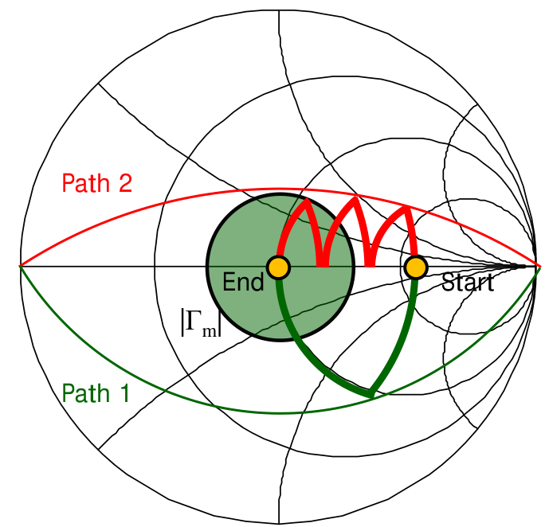

圖源：老師講義 p.109 局部。黃色點為起點與終點，中心綠色圓表示允許的反射範圍；紅色多段路徑把一次大轉換拆成數個較小轉換。

多段匹配增加可調參數，可選擇較低 Q 的中間阻抗，以較平緩的頻率響應接近目標。老師以三組串聯電抗 $`jX`$、並聯電納 $`jB`$ 示意。

**講義校註：**p.109 的圖及上方文字把紅色低 Q 多段路徑標為 Path 2，但下方標題寫「如何選 Path 1」。依圖與三組 LC 的說明，下方應指 Path 2；本筆記以「紅色多段路徑」避免混淆。

### 三段 L 型網路的實際軌跡（Multi-L-Section Matching Circuit，p.110）

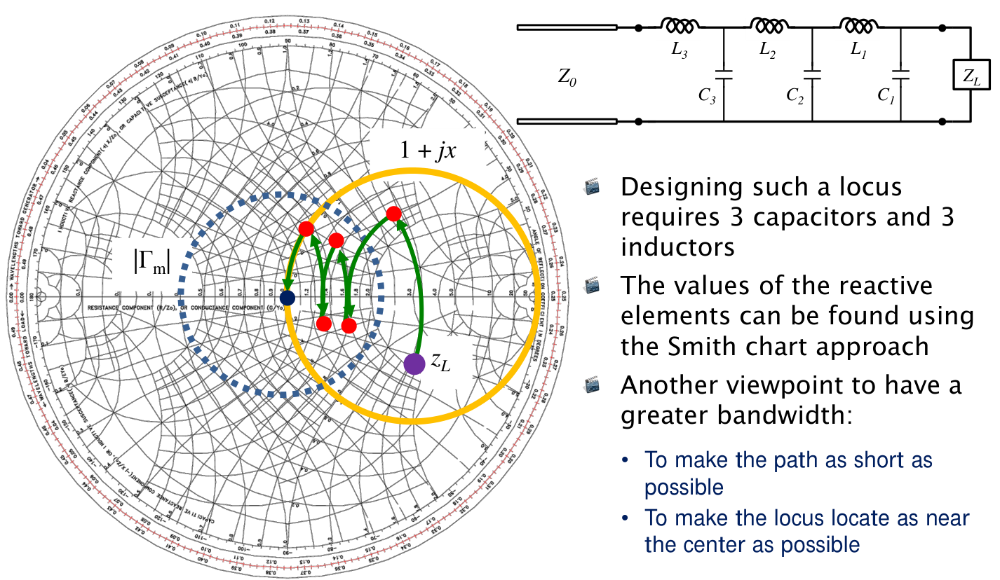

圖源：老師講義 p.110。由負載 $`Z_L`$ 往訊號源方向讀，依序經過 $`C_1,L_1,C_2,L_2,C_3,L_3`$。

在這個例子中，每次並聯電容都在 Y 圖上沿等電導圓移動；每次串聯電感則在 Z 圖上沿等電阻圓移動。最後回到中心 $`z_{\mathrm{in}}=1`$。

老師給出的幾何方向是：讓匹配路徑較短、盡量靠近中心，以減少過大的中間反應性阻抗。這是設計方向；真正的頻寬仍須掃頻確認，不能把圖上元件接續的軌跡直接當成同一電路的掃頻曲線。

多段網路也有代價：元件、面積與調整難度增加，寄生效應與有限元件 Q 會帶來額外耗損。因此本單元後半段會繼續檢查功率是否真的送到負載。

## 5．多段四分之一波長變壓器（Multi-Section Matching Transformers，p.111）

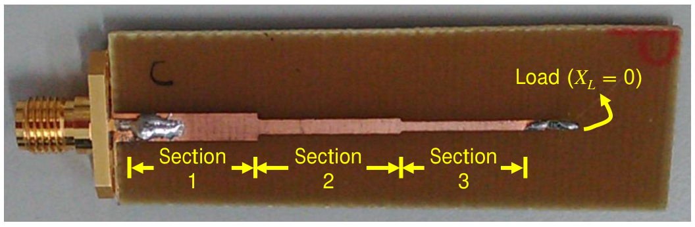

圖源：老師講義 p.111 局部。三段線寬不同，代表不同的特性阻抗；末端負載為純電阻。

單段變壓器在設計頻率 $`f_0`$ 使用長度 $`\lambda_g/4`$ 的傳輸線；多段設計則串接不同特性阻抗的線段：

```math
Z_0\longrightarrow Z_1\longrightarrow Z_2
\longrightarrow\cdots\longrightarrow Z_N
\longrightarrow R_L.
```

各段在 $`f_0`$ 都長約四分之一導波波長。每個接口產生的反射帶有不同傳播相位；透過各段阻抗的選擇，可讓合成反射在一段頻帶內維持較低。

| 設計方式 | 老師強調的響應形狀 | 設計取捨 |
|:--|:--|:--|
| 二項式，Binomial | 設計頻率附近盡量平坦，稱最大平坦（maximally flat） | 將設計自由度用於中心附近的平坦程度 |
| 柴比雪夫，Chebyshev | 頻帶內允許有界的等漣波（equal ripple） | 在相同階數與反射門檻等條件下，以漣波換取較寬的合格頻帶 |

影片約 [21:00–27:00](https://www.youtube.com/watch?v=QJ8xXUkxdAQ&t=1260s) 的板書對照這兩種反射曲線：最大平坦著重中心附近，等漣波則把允許誤差分配到整段頻帶。比較頻寬前，必須先固定允許的 $`|\Gamma_m|`$，不能只比較中心谷底深度。

各段特性阻抗須依指定響應合成；不能把所有段都重複設成單段的 $`\sqrt{Z_0R_L}`$。老師此頁介紹概念，未列完整合成表；已知元件值後的掃頻遞推方法，整理在章末補充 B。

## 6．匹配有理論極限：Bode–Fano 準則（pp.112–115）

### 先問四個問題（Matching Circuits Have Their Limits，p.112）

指定負載後，匹配網路的設計問題包括：能否整段完美匹配、最佳反射可多低、頻寬與反射門檻如何交換，以及達成規格需要多複雜的網路。

對含有儲能的負載，即使匹配元件理想且無損，也不能任意要求「頻帶無限寬、反射處處為零」。Bode–Fano 準則把這個限制寫成頻率積分。

### 四種負載，對應四個上限（The Bode-Fano Criterion，pp.113–114）

以下假設被動、線性、時不變的負載模型，搭配無損匹配網路。$`\Gamma(\omega)`$ 指從輸入端看到的反射係數；$`\omega`$ 使用 rad/s，$`\ln`$ 是自然對數。

為了便於對照，先定義兩個積分：

```math
I_0=\int_0^\infty
\ln\frac{1}{|\Gamma(\omega)|}\,d\omega,
\qquad
I_2=\int_0^\infty
\frac{1}{\omega^2}
\ln\frac{1}{|\Gamma(\omega)|}\,d\omega.
```

| 老師講義 | 負載拓樸 | 負載阻抗 | Bode–Fano 上限 |
|:--|:--|:--|:--|
| p.113 上圖 | 並聯 RC | $`Z_L=(1/R+j\omega C)^{-1}`$ | $`I_0\le\pi/(RC)`$ |
| p.113 下圖 | 串聯 RC | $`Z_L=R+1/(j\omega C)`$ | $`I_2\le\pi RC`$ |
| p.114 上圖 | 並聯 RL | $`Z_L=(1/R+1/(j\omega L))^{-1}`$ | $`I_2\le\pi L/R`$ |
| p.114 下圖 | 串聯 RL | $`Z_L=R+j\omega L`$ | $`I_0\le\pi R/L`$ |

老師投影片使用嚴格小於號 $`<`$；此處以 $`\le`$ 表示包含理想極限的上界，**不表示有限元件網路一定能達到等號**。

如何讀懂積分：反射越小，$`\ln(1/|\Gamma|)`$ 越大；維持小反射的頻帶越寬，積分也越大。負載卻只允許固定上限，因此深匹配與寬頻不能同時無限增加。串聯 RC 與並聯 RL 另有 $`1/\omega^2`$ 權重，不能漏掉或與另外兩式交換。

### 理想矩形、整段零反射與可實現曲線（Tradeoff Between BW and Γm，p.115）

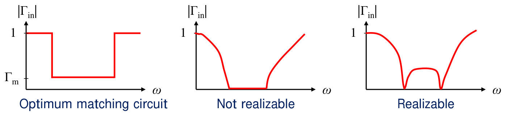

圖源：老師講義 p.115 局部；由左至右為估算極限的矩形模型、非零頻寬內處處零反射的要求，以及有限頻點匹配的示意。

左圖假設頻帶內 $`|\Gamma|=\Gamma_m<1`$，頻帶外 $`|\Gamma|=1`$。以並聯 RC 為例：

```math
\int_0^\infty\ln\frac1{|\Gamma|}\,d\omega
=\int_{\omega_L}^{\omega_H}
\ln\frac1{\Gamma_m}\,d\omega
=\Delta\omega\ln\frac1{\Gamma_m}
\le\frac{\pi}{RC}.
```

因此，若要求整段頻帶的反射不超過 $`\Gamma_m`$，至少要滿足這個條件。矩形模型把所有匹配能力集中在目標頻帶，適合估上限；真實有限階網路會有過渡區，不能直接做出理想垂直邊緣。

對串聯 RC，同樣的矩形假設給出

```math
\ln\frac1{\Gamma_m}
\left(\frac1{\omega_L}-\frac1{\omega_H}\right)
\le\pi RC.
```

若在非零寬度頻帶要求 $`\Gamma_m=0`$，對數會發散，違反上述有限上限。對本節的反應性負載，可在一些離散頻點做到完全匹配，但不能據此宣稱整段都完美匹配。

**講義校註：**p.115 最後一句把「R 或 X 增加」概括為匹配頻寬下降，必須連同負載拓樸與固定條件理解。例如並聯 RC 在 C 固定時，R 增大會使 $`\pi/(RC)`$ 變小；串聯 RL 在 L 固定時，R 增大反而使 $`\pi R/L`$ 變大。計算時以上表的模型為準。

沒超過上限，只代表必要條件尚未被違反；不保證指定的兩顆或三顆元件就能實作。用電阻吸收功率雖可降低反射，也不代表功率傳送改善；無損匹配的假設已經改變。

## 7．老師例題 EX 3.8：UWB 匹配能做多深？（pp.116–117）

**題目：**發射器工作於 3.1–10.6 GHz，負載為 $`R=75\,\Omega`$ 與 $`C=0.6\,\mathrm{pF}`$ 並聯。若採最佳化的理想矩形反射模型，可取得多大的回返損失？

### 第一步：頻寬換成角頻率

```math
\Delta f=10.6-3.1=7.5\ \mathrm{GHz},
\qquad
\Delta\omega=2\pi\Delta f
=2\pi(7.5\times10^9)\ \mathrm{rad/s}.
```

### 第二步：代入並聯 RC 的上限

```math
\ln\frac1{\Gamma_m}
\le\frac{\pi}{\Delta\omega RC}
=\frac{\pi}
{2\pi(7.5\times10^9)(75)(0.6\times10^{-12})}
=1.48148\ldots
```

所以

```math
\boxed{\Gamma_m\ge e^{-1.48148\ldots}
\approx0.2273.}
```

這是整段頻帶的反射幅度門檻下限；不能解讀成每一個頻點的反射都不得低於 0.2273。個別頻點可以更低，只是無法整段都維持比此上限允許的匹配更深。

### 第三步：轉成回返損失

```math
\mathrm{RL}_m=-20\log_{10}\Gamma_m
\le20\log_{10}(e)\,(1.48148\ldots)
\approx12.868\ \mathrm{dB}.
```

老師講義寫約 $`0.228`$、12.86 dB；保留較多位數重算則為約 $`0.2273`$、12.87 dB，差別是近似取值。正值回返損失越大越好；若畫的是 $`20\log_{10}|\Gamma|`$，則越負越好。

> **例題結論：** 同一個並聯 RC 負載，在 7.5 GHz 寬的頻帶內，即使採理想矩形模型，也不能保證整段 20 dB 的回返損失。先驗算理論上限，才有必要投入網路合成。

## 8．額外損耗：接受的功率有多少送到負載？（Insertion Loss Characterization，pp.118–119）

前半單元著重反射；實際元件與基板會耗能，因此「反射很小」仍不足以說明匹配網路好不好。老師改用二埠網路，明確區分功率參考面。

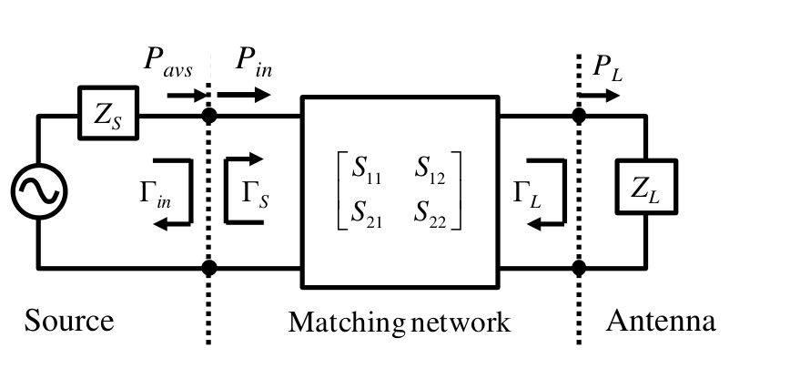

圖源：老師講義 p.119 局部。圖中的負載標為天線，後面也將同一方法用於整流器。

| 符號 | 意義 |
|:--|:--|
| $`P_{\mathrm{avs}}`$ | 訊號源在共軛匹配條件下能提供的最大可用功率 |
| $`P_{\mathrm{in}}`$ | 匹配網路輸入端接受的淨功率，即入射功率減反射功率 |
| $`P_L`$ | 負載接受的淨功率 |
| $`\Gamma_S,\Gamma_L`$ | 源與負載相對共同參考阻抗的反射係數 |
| $`\Gamma_{\mathrm{in}}`$ | 匹配網路接上負載後，從輸入端看到的反射係數 |
| $`S_{ij}`$ | 匹配網路本身的二埠 S 參數 |

以下 S 參數與反射係數使用相同的正實數參考阻抗，並在相同頻率與參考面定義。

### 操作功率增益

操作功率增益（operational power gain；投影片也用 operating power gain）定義為

```math
\boxed{
G_P=\frac{P_L}{P_{\mathrm{in}}}
=\frac{1}{1-|\Gamma_{\mathrm{in}}|^2}
|S_{21}|^2
\frac{1-|\Gamma_L|^2}{|1-S_{22}\Gamma_L|^2}.
}
```

本筆記的 $`G_P`$ 與投影片 $`G_p`$ 是同一個量。式子的三部分分別處理輸入接受功率的正規化、二埠傳輸，以及負載失配與來回反射。

對被動網路且功率比有定義時，$`0\le G_P\le1`$。理想無損網路有 $`P_L=P_{\mathrm{in}}`$，故 $`G_P=1`$；實際 $`G_P=0.3`$ 則表示已接受的功率中，只有 30% 到負載，另外 70% 在匹配網路耗散。 **口述數值校註：**約 55:30 的 0.3 應換成 $`10\log_{10}(0.3)\approx-5.23`$ dB；−10 dB 對應 0.1，兩者不能混用。

**影片操作流程（約 42:20–45:20）：**先拿掉匹配網路，求負載端口的反射；再接回網路，求整體輸入反射；最後拿掉負載，只保留匹配網路，在兩端設埠取得二埠 S 參數。三次分析的參考面必須一致。前兩次通常已在設計過程完成，額外要做的是網路本身的二埠分析。

**實作所需的三組資料：**負載單獨的 $`\Gamma_L`$、網路接負載後的 $`\Gamma_{\mathrm{in}}`$，以及網路本身的 $`S_{21},S_{22}`$。若由完整二埠資料計算，

```math
\Gamma_{\mathrm{in}}
=S_{11}+
\frac{S_{12}S_{21}\Gamma_L}{1-S_{22}\Gamma_L}.
```

只拿網路單獨的 $`|S_{21}|^2`$，通常無法代表接上失配負載後的功率傳送比例。

## 9．整流器：負載阻抗會隨工作功率變（Input Impedance of the Rectifier，p.120）

**影片背景（約 46:15–51:30）：**老師區分近場耦合充電、專用發射源對準接收端的遠場傳能，以及收集環境射頻的能量擷取。此例關心最後一種：可用功率本來就低，整流效率又隨工作功率改變，匹配網路再損失一部分，DC 輸出便更少。因此不能只看反射谷很深，就推論可替高耗電裝置充電。

整流器含有非線性的二極體。輸入功率改變時，其等效 RF 阻抗也改變；同一個匹配網路不會在所有功率下都看到同一個負載。

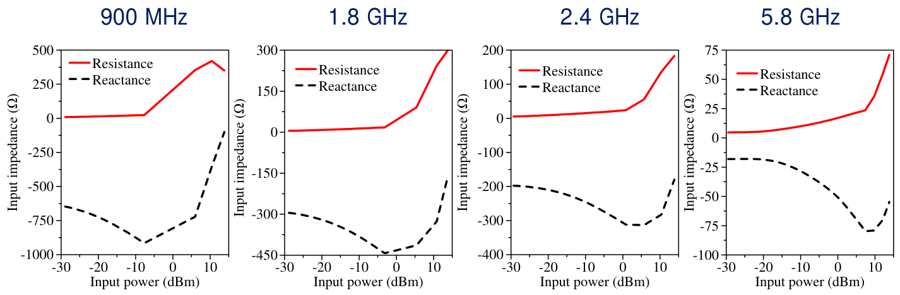

圖源：老師講義 p.120 上半部。紅實線是電阻，黑虛線是電抗；橫軸為輸入功率 dBm，縱軸為阻抗 Ω。四圖的縱軸尺度不同。

讀圖時先看三件事：

1. 在所關注的低輸入功率區，電阻相對電抗大小很小，負載高度電容性，與源阻抗相差很大。
2. 四個頻率中，900 MHz 的負電抗幅度最大，5.8 GHz 較小；比較時須看刻度，不能只看曲線在圖中的高度。
3. 增加功率時，電阻與電抗都會改變，且不保證單調；所以設計條件至少要包括頻率、輸入功率及整流器的 DC 負載。

p.120 下方的史密斯圖把各頻率從 $`-30`$ dBm 到 $`0`$ dBm 的阻抗變化畫成軌跡：低頻的點更接近高度電容性區域。它是**功率掃描**，不能當成同一功率下的頻率掃描。

## 10．用三種網路、兩種基板比較實際損耗（Topology of Matching Circuits，p.121）

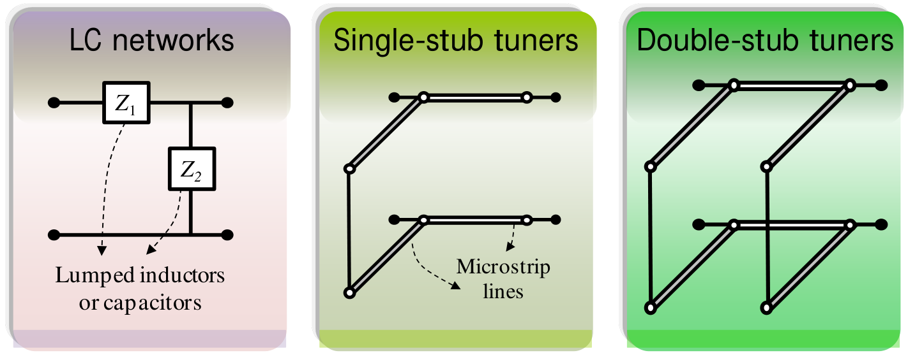

圖源：老師講義 p.121 局部。由左至右為 LC 集中元件網路、單殘段、雙殘段；後兩種以微帶線實作。

這組研究的共同設計目標是：在指定頻率、$`P_{\mathrm{in}}=-10`$ dBm 的設計條件下，盡量降低輸入反射 $`|\Gamma_{\mathrm{in}}|`$。

| 比較項目 | 講義採用的實作或模型 |
|:--|:--|
| LC 網路 | Murata GRM 15 系列電容、LQP 15M 系列電感的模型 |
| 單殘段／雙殘段 | 微帶傳輸線 |
| 微帶基板 | FR4，或損耗較低的 Rogers Duroid 5880 |
| 比較結果 | 各工作功率下的 $`G_P`$；部分 FR4 網路另有實測點 |

這些元件與基板形成後面曲線的比較條件：同樣可以在設計點降低反射，不同元件與基板卻可能把非常不同的功率比例耗掉。

## 11．四個頻段的實驗結果（Results of … Networks，pp.122–125）

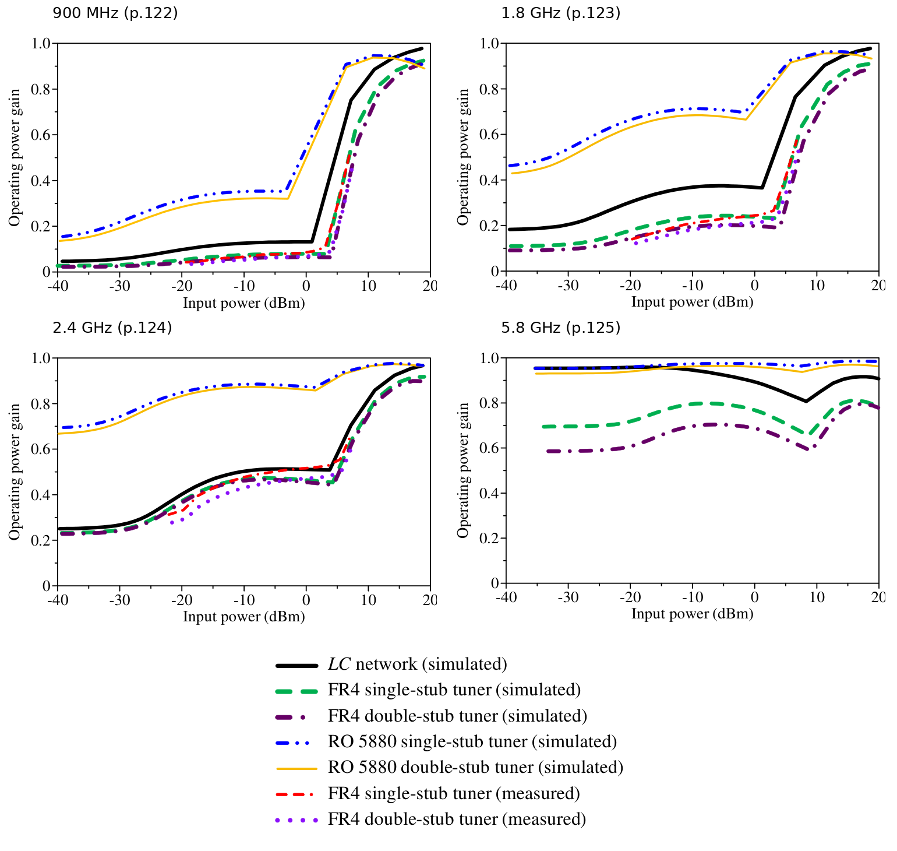

圖源：依老師講義 pp.122–125 的原曲線擷取排列，共用 p.122 圖例；未重算或重畫量測曲線。黑線為 LC 模擬；綠／紫線為 FR4 單／雙殘段模擬；藍／黃線為 Duroid 5880 單／雙殘段模擬；紅／紫色點線為相應 FR4 量測。沒有量測點的曲線不可當成實測。

### 逐頻段對照

下表約略數值取自圖中 $`-10`$ dBm 附近，僅用來掌握量級，不是原始量測資料。

| 頁碼／頻率 | LC 的 $`G_P`$ | FR4 殘段的 $`G_P`$ | Duroid 5880 殘段的 $`G_P`$ | 老師要指出的現象 |
|:--|:--|:--|:--|:--|
| p.122／900 MHz | 約 0.1 | 約 0.05–0.1 | 約 0.3–0.35 | 低功率時即使反射改善，仍可能大部分功率耗在網路 |
| p.123／1.8 GHz | 約 0.37 | 約 0.2 | 約 0.7 | LC 與 FR4 仍耗散超過一半；低損耗基板有明顯改善 |
| p.124／2.4 GHz | 約 0.48 | 約 0.4–0.5 | 約 0.87 | 同樣拓樸的損耗表現隨頻率與負載改變 |
| p.125／5.8 GHz | 約 0.95 | 約 0.7–0.8 | 約 0.96–0.98 | 此組案例的匹配損耗較小，但不代表整流效率最高 |

**900 MHz：**在低功率區，FR4 網路多只有一成以下的已接受功率到達整流器，LC 也只有約一成的量級。即使用 Duroid 5880，設計功率附近仍耗散約 65% 或更多。較高功率時負載阻抗改變，圖中的傳送比例才顯著上升。投影片文字的「不到 10%」是低功率區的概括；LC 曲線在部分功率點略高於 0.1，不能把它當成全區間的硬門檻。

**1.8 GHz：**LC 與 FR4 在低功率區仍有很大的額外損耗；Duroid 5880 曲線較高。這說明降低介質損耗有幫助，但改善幅度還取決於負載與電路。

**2.4 GHz：**LC、FR4 與 Duroid 5880 之間依然有差距。比較前三個頻段可見，不能拿某一頻率的「插入損失」數字，直接代表同類匹配網路在所有頻率的表現。

**5.8 GHz：**LC 與 Duroid 5880 的 $`G_P`$ 接近 1，FR4 的損耗仍較大；老師同時提醒，這組整流器在 5.8 GHz 的 RF-to-DC 效率反而最差。因此匹配網路送得進去，還不等於最後得到最多 DC 功率。

以上都是**老師這組整流器、元件與基板的比較**；不是「頻率越高，匹配網路一定越低損」的通則。

### 公式沒有功率，曲線為什麼會隨功率變？

p.125 強調：固定線性二埠的 S 參數與固定負載後，$`G_P`$ 公式沒有獨立的輸入功率項。但整流器不是固定負載：

```math
P_{\mathrm{RF}}\ \text{改變}
\ \Rightarrow\ Z_L\ \text{改變}
\ \Rightarrow\ \Gamma_L,\Gamma_{\mathrm{in}}\ \text{改變}
\ \Rightarrow\ G_P\ \text{改變}.
```

所以「公式未顯式含功率」與「這組實驗的 $`G_P`$ 隨工作功率變化」並不矛盾。若匹配元件本身也進入非線性區，更須重新檢查二埠模型。

## 12．換一個設計功率，就能解決額外損耗嗎？（Associated Return Loss，p.126）

此節依 PDF 補齊；已核對的影片畫面未確認本頁獨立講解。

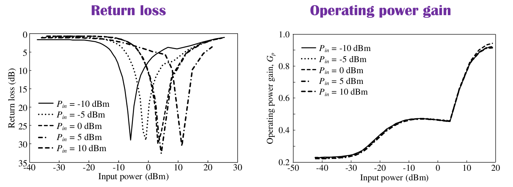

圖源：老師講義 p.126 局部。左圖為回返損失，右圖為操作功率增益；各曲線圖例表示設計所用功率，橫軸則是實際掃描的工作功率。

老師將匹配電路的設計條件改為 $`-10,-5,0,5,10`$ dBm，比較結果：

- **左圖：**不同設計功率使良好匹配的位置移動。縱軸把較大的正值回返損失畫在下方，所以向下的谷底代表匹配改善。
- **右圖：**不同設計功率的 $`G_P`$ 曲線大致重疊；在同一實際工作功率附近，額外損耗仍相近。
- **結論：**這組案例的損耗觀察不只存在於 $`-10`$ dBm 的設計。把反射最佳點移到另一功率，並不自動消除元件與基板的耗能。

圖例中的「設計功率」與橫軸「正在操作的功率」是兩個不同角色；閱讀時不要把五條曲線誤認成五個不同頻率。

## 13．轉換功率增益：從源到負載的整體表現（Transducer Power Gain，p.127）

在看完實驗後，老師再引入轉換功率增益：

```math
\boxed{
G_T=\frac{P_L}{P_{\mathrm{avs}}}
=\frac{1-|\Gamma_S|^2}
{|1-\Gamma_{\mathrm{in}}\Gamma_S|^2}
|S_{21}|^2
\frac{1-|\Gamma_L|^2}
{|1-S_{22}\Gamma_L|^2}.
}
```

$`G_P`$ 的分母是網路**已接受的功率**，$`G_T`$ 的分母是源的**最大可用功率**。因此 $`G_T`$ 能把源端失配及網路耗損一起反映出來。

當訊號源與共同參考阻抗匹配，$`\Gamma_S=0`$：

```math
G_T=(1-|\Gamma_{\mathrm{in}}|^2)G_P
=\frac{|S_{21}|^2(1-|\Gamma_L|^2)}
{|1-S_{22}\Gamma_L|^2}.
```

這個關係可以直接讀成兩步：

```math
\text{源最大可用功率}
\xrightarrow{\ 1-|\Gamma_{\mathrm{in}}|^2\ }
\text{網路接受功率}
\xrightarrow{\ G_P\ }
\text{負載接受功率}.
```

| 指標 | 回答的問題 |
|:--|:--|
| 回返損失／$`\Gamma_{\mathrm{in}}`$ | 輸入端反射多少？ |
| $`G_P=P_L/P_{\mathrm{in}}`$ | 已經接受的功率，有多少通過匹配網路？ |
| $`G_T=P_L/P_{\mathrm{avs}}`$ | 源最多可供應的功率，有多少最後到達負載？ |
| 負載的轉換效率 | 負載接受功率後，有多少成為輻射或 DC 輸出？ |

對被動網路與被動負載，$`G_T\le1`$。用 dB 表示時，$`G_{T,\mathrm{dB}}=10\log_{10}G_T`$；例如 $`-2`$ dB 代表約 63.1% 的源可用功率到達負載，不是「天線輻射效率 63.1%」。

## 14．可重構匹配網路：延伸頻帶後仍要檢查效率（pp.128–129）

### 案例與結構（Reconfigurable Matching Network，p.128）

老師以原本工作於約 140–170 MHz 的對講機天線為例，希望透過可切換的匹配網路，把良好匹配位置移到約 170–240 MHz 的目標頻段。投影片也在原阻抗圖上標出 136、170、174、240 MHz 等位置。

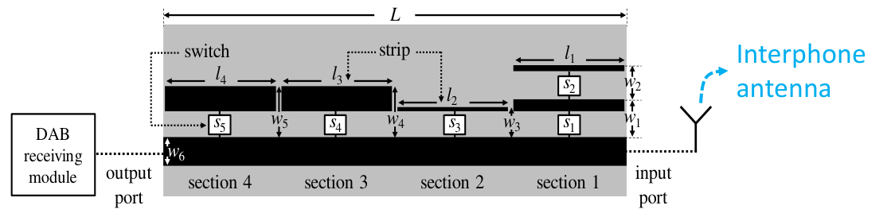

圖源：老師講義 p.128 下圖。右側接天線，左側接 DAB 接收模組；$`s_1\ldots s_5`$ 改變網路的連接狀態。

不同開關狀態形成不同的等效電路，因此可把反射谷底移到不同目標頻率。這是多個狀態的可調匹配，**不表示單一狀態同時覆蓋整段 170–240 MHz**。

### 逐頻點的數值對照（Performance Characterization，p.129）

以下依老師原表整理；頻寬採原表數值，該頁未明列其判定門檻，因此不自行改稱 10 dB 頻寬。

| 目標頻率（MHz） | 回返損失（dB） | $`G_T`$（dB） | 頻寬（MHz） |
|--:|--:|--:|--:|
| 170 | 11.61 | −1.83 | 30.1 |
| 180 | 16.71 | −1.52 | 17.3 |
| 190 | 17.08 | −1.51 | 12.5 |
| 200 | 17.74 | −1.48 | 9.2 |
| 210 | 17.36 | −0.97 | 22.7 |
| 220 | 22.09 | −0.79 | 26.3 |
| 230 | 17.44 | −1.66 | 12.6 |
| 240 | 18.49 | −0.84 | 10.8 |

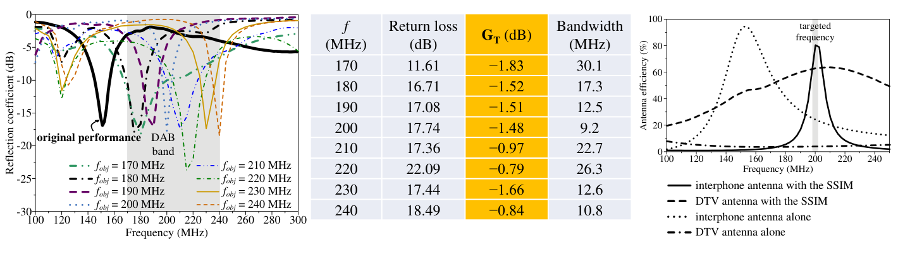

圖源：老師講義 p.129 下半部。右圖另比較對講機與 DTV 天線加裝匹配網路前後的遠場效率，圖中以 SSIM 標示所用網路。

這頁要一起讀三種結果：

1. **反射曲線：**確認各狀態是否把匹配改善到指定頻點。
2. **$`G_T`$ 表：**確認改善反射的同時，多少源可用功率到達天線。表內約 $`-1.83`$ 至 $`-0.79`$ dB，換算約為 66%–83%。
3. **遠場效率圖：**再確認這些功率有多少成為輻射。匹配可改善目標頻率的表現，但加裝網路也帶來耗損；不能以低反射或單一 $`G_T`$ 數字代替整體天線效能。

> **本單元的設計判準：** 先用頻寬與反射門檻定義需求，再檢查負載的理論上限，最後用實際元件、工作功率與效率量測判斷是否達成目的。

## 補充解說與重算例題

以下是幫助理解的補充，與老師講義原例題 EX 3.8 分開。

### A．反射門檻不同，Q 與頻寬的係數也不同

考慮已在 $`f_0`$ 匹配的單共振模型，近似

```math
\frac{Z}{Z_0}\approx1+j2Q_Z\delta,
\qquad
\delta=\frac{f-f_0}{f_0}.
```

由 $`\Gamma=(z-1)/(z+1)`$ 得

```math
|\Gamma|=
\frac{|2Q_Z\delta|}
{\sqrt{4+(2Q_Z\delta)^2}}.
```

若要求 $`|\Gamma|\le\Gamma_m`$，解出兩側邊界：

```math
|\delta|\le
\frac{\Gamma_m}{Q_Z\sqrt{1-\Gamma_m^2}},
\qquad
\mathrm{FBW}\approx
\frac{2\Gamma_m}{Q_Z\sqrt{1-\Gamma_m^2}}.
```

因此 RL 至少 10 dB 時，$`\Gamma_m=\sqrt{0.1}`$，有 $`\mathrm{FBW}\approx0.667/Q_Z`$；反射功率為一半時，則約為 $`2/Q_Z`$。這也說明為何不能把任意回返損失門檻的頻寬都直接寫成 $`1/Q`$。

此近似要求單共振、共振附近的電阻變化較小；不適合直接描述任意多模態天線。

### B．已知多段傳輸線時，怎麼重算反射頻率響應？

從負載端往源端遞推：

```math
Z_{\mathrm{in},k}
=Z_k\frac{Z_{\mathrm{in},k+1}
+jZ_k\tan\theta_k}
{Z_k+jZ_{\mathrm{in},k+1}\tan\theta_k},
\qquad
\theta_k=\beta_k\ell_k.
```

最末端的 $`Z_{\mathrm{in},N+1}=R_L`$。算到第一段後，再求

```math
\Gamma_{\mathrm{in}}
=\frac{Z_{\mathrm{in},1}-Z_0}
{Z_{\mathrm{in},1}+Z_0}.
```

掃頻時要更新所有 $`\theta_k`$；只有設計頻率的每段電長為 $`\pi/2`$。剛好四分之一波長時，可用極限式 $`Z_{\mathrm{in},k}=Z_k^2/Z_{\mathrm{in},k+1}`$，避免數值計算直接代入發散的正切函數。

### C．EX 3.8 若要求整段至少 20 dB，最多多寬？

沿用老師的 $`R=75\,\Omega`$、$`C=0.6`$ pF，20 dB 對應 $`\Gamma_m=0.1`$：

```math
2\pi\Delta f\ln10\le\frac{\pi}{RC}
\quad\Rightarrow\quad
\Delta f\le\frac{1}{2RC\ln10}
\approx4.83\ \mathrm{GHz}.
```

要求 7.5 GHz 的整段頻寬維持 20 dB，已違反必要條件；增加網路階數不能消除這個指定負載的無損匹配極限。

### D．反射較低的網路，負載未必收到更多功率

設源已匹配，$`P_{\mathrm{avs}}=1`$ mW：

| 設計 | $`\lvert\Gamma_{\mathrm{in}}\rvert`$ | $`G_P`$ | $`G_T=(1-\lvert\Gamma_{\mathrm{in}}\rvert^2)G_P`$ | $`P_L`$ |
|:--|--:|--:|--:|--:|
| A | 0.10 | 0.50 | 0.495 | 0.495 mW |
| B | 0.30 | 0.95 | 0.8645 | 0.8645 mW |

A 接受了 99% 的源可用功率，但接受後又耗掉一半；B 雖只接受 91%，仍把較多功率送到負載。兩個比較需要同一頻率、工作功率與負載條件。

接受功率到負載之間的耗損可用 $`-10\log_{10}G_P`$ dB 表示。直接用 $`-20\log_{10}|S_{21}|`$，通常需要端口匹配等條件，不能一概取代此處計算。

若整流器本身的 RF-to-DC 效率為 $`\eta_{\mathrm{rect}}`$，則

```math
P_{\mathrm{DC}}
=P_{\mathrm{avs}}G_T\eta_{\mathrm{rect}}.
```

$`\eta_{\mathrm{rect}}`$ 也隨頻率、工作功率與 DC 負載改變，須與 $`G_T`$ 使用一致工作點。

### E．功率增益公式的短推導與一般源端

若用功率波理解，輸出端的負載關係為 $`a_2=\Gamma_L b_2`$，而

```math
b_2=S_{21}a_1+S_{22}a_2
\quad\Rightarrow\quad
b_2=\frac{S_{21}a_1}{1-S_{22}\Gamma_L}.
```

以 $`P_{\mathrm{in}}=|a_1|^2(1-|\Gamma_{\mathrm{in}}|^2)`$、
$`P_L=|b_2|^2(1-|\Gamma_L|^2)`$ 相除，就得到老師的 $`G_P`$ 公式。

把第 8 節的 $`\Gamma_{\mathrm{in}}`$ 代入第 13 節的老師公式，可整理為

```math
G_T=
\frac{(1-|\Gamma_S|^2)|S_{21}|^2(1-|\Gamma_L|^2)}
{|(1-S_{11}\Gamma_S)(1-S_{22}\Gamma_L)
-S_{12}S_{21}\Gamma_S\Gamma_L|^2}.
```

此式與正文的乘積形式等價。若 $`\Gamma_S\ne0`$，不可直接套用 $`G_T=(1-|\Gamma_{\mathrm{in}}|^2)G_P`$；源端往返反射仍須保留。

## 自測與解析

### 題目

1. 老師 p.107 的 $`z=0.1-j0.1`$ 為什麼仍在 Q = 1 軌跡？這是否表示任何具有該阻抗的天線，都有相同頻寬？
2. 最大平坦與等漣波分別追求什麼？比較兩者頻寬時要固定哪些條件？
3. 並聯 RC 負載 $`R=50\,\Omega`$、$`C=10`$ pF，要在 1 GHz 寬的頻帶維持理想矩形反射，求最小 $`\Gamma_m`$ 與回返損失上限。
4. 補充 A 的模型若 $`Q_Z=10`$，RL 至少 10 dB 的分數頻寬約多少？
5. 已匹配源 $`P_{\mathrm{avs}}=10`$ mW，$`|\Gamma_{\mathrm{in}}|=0.2`$、$`G_P=0.8`$。求 $`P_{\mathrm{in}},P_L,G_T`$。
6. 整流器在 $`-20`$ dBm 已匹配，能否保證 $`0`$ dBm 也匹配？老師 p.126 為何同時比較 RL 與 $`G_P`$？
7. p.129 的 $`G_T=-0.79`$ dB 是否等於 83.4% 的遠場效率？各狀態的反射谷底合起來覆蓋 170–240 MHz，是否代表任一狀態都覆蓋整段？

### 答案

1. $`|x|/r=0.1/0.1=1`$，負號只表示電容性。單一點的比值不能決定阻抗隨頻率的變化，也不能直接指定整體共振 Q 或頻寬。
2. 最大平坦追求中心附近平坦；等漣波允許頻帶內有界起伏。比較須固定負載、階數、中心頻率及反射門檻等條件。
3. $`\pi/(\Delta\omega RC)=1`$，故 $`\Gamma_m\ge e^{-1}\approx0.3679`$，RL 上限約 8.686 dB。這是理想矩形下的理論上限，不是有限元件實作保證。
4. $`\mathrm{FBW}\approx0.667/10=6.67\%`$。改變門檻或 Q 的定義時，係數也要重算。
5. $`P_{\mathrm{in}}=10(1-0.2^2)=9.6`$ mW；$`P_L=9.6\times0.8=7.68`$ mW；$`G_T=0.768`$。
6. 不能，整流器的阻抗隨功率變。p.126 顯示最佳反射位置可隨設計功率移動，而相同工作功率下的額外損耗仍可能相近，兩個指標應一起看。
7. $`10^{-0.79/10}\approx0.834`$ 是源可用功率到達負載的比例，還不是遠場效率。不同開關狀態的良好匹配頻段也不能視為同一狀態的寬頻響應。

**計算前檢查：**負載是串聯還是並聯、積分用 $`\omega`$ 還是 $`f`$、對數是 $`\ln`$ 還是 $`\log_{10}`$、功率分母是哪一個參考量，以及阻抗與效率是否對應同一頻率和工作點。

**下一單元：**[單元 15｜極化](015_極化.md)。從端口功率轉向空間電場，理解收發極化如何影響接收功率。
