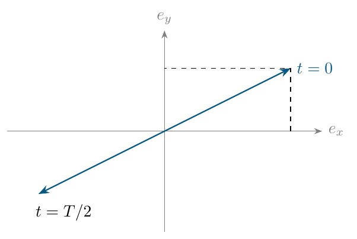
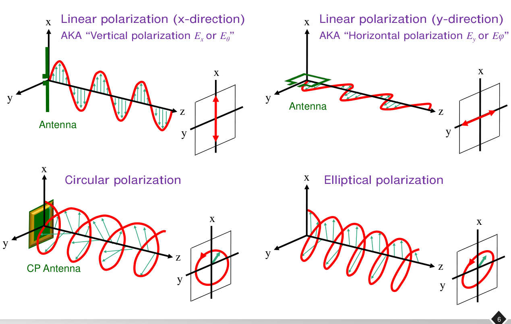
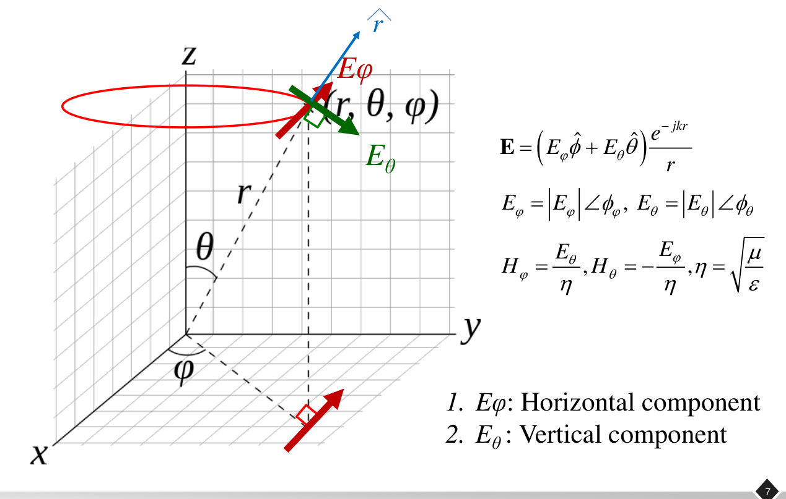
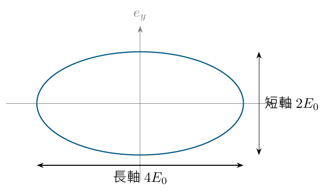

# 單元 15｜極化

電場如何擺動，接收天線能接到多少

原始影片：[陳晏笙老師「天線」單元 15](https://www.youtube.com/watch?v=H0-L07pKrjw)

老師講義：[Lecture 4 — Radiation Parameters](https://drive.google.com/file/d/18mtgr-C9XaZz3r2wJWh29ZXxWADFx7yV/view)，第 3–8 頁

影片長度：約 73 分鐘　建議閱讀：約 25 分鐘

前置知識：複數相量、向量投影。單元 01–14 處理端口電路，本單元開始討論空間中的電場。

> **核心觀念：** 極化是固定空間位置的電場向量，隨時間畫出的軌跡。兩個互相垂直的分量，其振幅比與相位差決定線性、圓形或橢圓軌跡；接收模式與入射波的極化重疊，決定極化耦合的功率比例。

## 五個學習目標

1.  從相量還原電場，固定位置觀察一個週期。

2.  用振幅比與相位差判斷線性、圓形、橢圓極化。

3.  指定觀察方向，區分左旋與右旋。

4.  求線性、圓形極化的耦合比例與極化失配損失。

5.  轉換球座標與圓極化分量，正確計算軸比。

## 全講義的慣例

使用 $`e^{j\omega t}`$、右手座標，平面波沿 $`+z`$ 傳播。$`E_x,E_y`$ 是複數峰值分量，實際電場為

```math
\mathbf e(z,t)=\Re\!\left\{
(E_x\hat{\mathbf x}+E_y\hat{\mathbf y})e^{j(\omega t-kz)}
\right\}.
```

旋向採電波通訊慣例：**沿傳播方向看**，電場隨時間順時針旋轉為 RHCP，逆時針為 LHCP。反向觀看，視覺上的順逆也反轉。

## 講義與影片對照

第 3 頁為章節目錄。正文按老師講義的「極化定義與類型 → 圖示 → 球座標 → 基底轉換與軸比」排列；極化耦合是老師在類型介紹後的板書延伸，放在對應圖示之後。以下時間依影片口述校準；第 5 頁的橢圓極化在影片中延後至約 63:30，正文仍按講義頁序。

| 老師講義 | 原英文主題 | 中文內容 | 影片定位 |
|:--|:--|:--|:--|
| 3–4 | Contents / Polarization (1/3) | 輻射參數起點、複數電場與線極化 | [約 00:00–28:00](https://www.youtube.com/watch?v=H0-L07pKrjw&t=0s) |
| 5–6 | Polarization (2/3–3/3) | 圓／橢圓極化、收發旋向與四種圖示 | [圓極化約 27:00–42:30](https://www.youtube.com/watch?v=H0-L07pKrjw&t=1620s)；[橢圓約 63:30–65:30](https://www.youtube.com/watch?v=H0-L07pKrjw&t=3810s) |
| 對照 5–6 的口述／板書 | Polarization coupling | 向量投影與 80%、0%、50% 例題 | [約 42:30–63:30](https://www.youtube.com/watch?v=H0-L07pKrjw&t=2550s) |
| 7 | Spherical Coordinate System | 球座標的兩個橫向分量 | [約 65:30–66:40](https://www.youtube.com/watch?v=H0-L07pKrjw&t=3930s) |
| 8 | Conversion Between Polarization Basis | 線／圓基底、範例校正與軸比 | [約 66:40–片尾](https://www.youtube.com/watch?v=H0-L07pKrjw&t=4000s) |

## 1．極化描述電場的時間軌跡（Polarization 1/3，p.4）

影片對照：[約 00:00](https://www.youtube.com/watch?v=H0-L07pKrjw&t=0s)－[14:00](https://www.youtube.com/watch?v=H0-L07pKrjw&t=840s)

影片先區分反應近場、輻射近場與遠場，再以平面波討論極化。遠場局部的電場與傳播方向垂直，可用兩個橫向分量描述。

**開場口述提醒（約 01:50–05:30）：**先確認收發距離是否在遠場，再使用後續的場型、指向性與增益。老師以「近場耦合」對比「遠場輻射」；嚴格地說，反應近場是儲能項占優勢，並非該區域完全沒有輻射項或能量傳遞。遠場也不是場強不隨距離變，而是正規化角度分布趨於穩定，場幅仍約隨距離倒數衰減。

老師先用相對地面的電場方向說明極化，再以兩個複數橫向分量表示一般情況。對圓與橢圓極化，方向會隨時間變化，因此完整定義須觀察固定位置上，一整個週期的電場向量軌跡。

**講義模型校註：**p.4 將波稱為平面波，式子卻帶有 $`e^{-jkz}/z`$。其中 $`1/z`$ 是遠離天線時的球面擴散振幅尺度；理想均勻平面波本身沒有這個幾何衰減因子。在固定觀察點，這個共同實數倍不影響極化軌跡形狀，本章先以局部橫向場判斷極化。

### 每個複數分量都包含振幅與相位

```math
E_x=Ae^{j\phi_x},\qquad E_y=Be^{j\phi_y}.
```

在固定 $`z=z_0`$，令 $`\psi=\omega t-kz_0+\phi_x`$、$`\delta=\phi_y-\phi_x`$：

```math
e_x=A\cos\psi,\qquad e_y=B\cos(\psi+\delta).
```

共同相位只改變你從週期的哪個時刻開始看；決定軌跡形狀的是 $`A,B,\delta`$。

### 「固定位置看時間」和「固定時間看整條波」不同

極化軌跡是在某一點，把向量末端隨時間描出來。若畫沿傳播方向的瞬間空間形狀，可看到螺旋；那是另一種切法，不能混用其順逆來命名旋向。 **補充解說／重算例題：**天線的極化也會隨觀察方向與頻率改變；通常指定某個遠場方向，例如主波束方向。不能只看金屬外形，就保證全部方向具有同一極化。

> **核心觀念：** 先選定方向、空間位置與時間慣例；再用兩個橫向電場分量判斷極化。

## 2．線極化：同相或反相的兩個分量（Polarization 1/3，p.4）

影片對照：[約 14:00](https://www.youtube.com/watch?v=H0-L07pKrjw&t=840s)－[28:00](https://www.youtube.com/watch?v=H0-L07pKrjw&t=1680s)

p.4 以同相作為例子；完整條件是：若 $`\delta=0`$ 或 $`\pi`$，兩分量同相或反相，向量始終沿固定直線擺動；若其中一個分量為零，也屬線極化。

```math
\delta=0:\quad
\mathbf e=\cos\psi\,(A\hat{\mathbf x}+B\hat{\mathbf y}).
```

方向角滿足 $`\tan\chi=B/A`$。振幅改變甚至反號，都不改變這條直線本身。

### 板書例題：x 分量是 y 分量的兩倍

令 $`E_x=2E_0`$、$`E_y=E_0`$，共同相位為零。在固定位置：

```math
\mathbf e(t)=E_0\cos\omega t\,(2\hat{\mathbf x}+\hat{\mathbf y}).
```

四分之一週期時整個向量變為零；半週期時向量反向，但仍在同一直線。

```math
\hat{\boldsymbol\rho}=\frac{2\hat{\mathbf x}+\hat{\mathbf y}}{\sqrt5},
\qquad \chi=\tan^{-1}(1/2)\approx26.565^\circ.
```

$`\hat{\boldsymbol\rho}`$ 是單位極化向量；分母用 $`\sqrt5`$，不是用分量的算術和 3。



### 垂直、水平、斜向都可以是線極化

$`E_y=0`$ 是 x 線極化；$`E_x=0`$ 是 y 線極化。水平／垂直必須另對照圖的座標，不能單憑 x、y 字母判斷。兩者都有非零分量而同相，則是斜向線極化。反相時只是斜線的斜率換號。

> **核心觀念：** 電場方向反轉不代表極化改變；線極化關注的是固定的擺動軸。

## 3．圓極化：等振幅與正交相位（Polarization 2/3，p.5）

影片對照：[約 27:00–42:30](https://www.youtube.com/watch?v=H0-L07pKrjw&t=1620s)

圓極化同時需要

```math
A=B,\qquad \delta=\pm90^\circ.
```

只有兩個分量等大但同相，仍是線極化；只有相差 90° 但振幅不同，則是橢圓。

老師原頁列出 $`E_x=1,E_y=j`$ 為 LHCP，$`E_x=1,E_y=-j`$ 為 RHCP，與本章時間及傳播方向慣例一致。下列板書換了共同相位，但仍是同一個 RHCP 模式。

### 影片 RHCP 例：$`E_x=jE_0,E_y=E_0`$

在 $`z=0`$：

```math
e_x=-E_0\sin\omega t,\qquad
e_y=E_0\cos\omega t.
```

| 時間   | $`e_x/E_0`$ | $`e_y/E_0`$ | 向量方向           |
|:-------|:----------|:----------|:-------------------|
| 0      | 0         | $`+1`$      | $`+\hat{\mathbf y}`$ |
| $`T/4`$  | $`-1`$      | 0         | $`-\hat{\mathbf x}`$ |
| $`T/2`$  | 0         | $`-1`$      | $`-\hat{\mathbf y}`$ |
| $`3T/4`$ | $`+1`$      | 0         | $`+\hat{\mathbf x}`$ |

電場大小始終是 $`E_0`$，末端走圓形。不要只看某張 xy 圖是順時針或逆時針；還要確認圖的觀看方向與波的傳播方向。

### 去掉共同相位後的單位基底

```math
\hat{\boldsymbol\rho}_R=\frac{\hat{\mathbf x}-j\hat{\mathbf y}}{\sqrt2},
\qquad
\hat{\boldsymbol\rho}_L=\frac{\hat{\mathbf x}+j\hat{\mathbf y}}{\sqrt2}.
```

影片的 $`(j\hat{\mathbf x}+\hat{\mathbf y})`$ 等於 $`j(\hat{\mathbf x}-j\hat{\mathbf y})`$；共同的 $`j`$ 只移動時間起點，不改變旋向。 **補充解說／重算例題：**以上基底與名稱依本講義的 $`e^{j\omega t}`$、沿 $`+z`$ 傳播定義。若換成 $`e^{-j\omega t}`$，相量符號也要一起換，不能沿用某一個 $`j`$ 的正負就判斷。 旋向定義補充：[ITU-R Space Services Preface 的極化定義](https://www.itu.int/en/ITU-R/space/Preface/preface_e.pdf)。

> **核心觀念：** 圓極化要同時滿足等振幅與正交相位；RHCP／LHCP 必須連同傳播方向與觀察方向描述。

## 4．橢圓極化與四幅圖的讀法（Polarization 2/3–3/3，pp.5–6）

一般情況下，兩個橫向分量的末端形成橢圓。圓是長短軸相等的特例；線是短軸退化為零的特例。p.5 的「Else」是在把前面線性與圓形以外的情況歸入橢圓。



*來源：老師 Lecture 4，第 6 頁局部。每幅圖同時畫出沿傳播方向的空間波形，以及固定截面上的電場軌跡。*

| p.6 圖示 | 老師圖中的軸與名稱 | 要看的特徵 |
|:--|:--|:--|
| 左上 | x 方向；標成垂直極化 | 電場末端沿固定直線上下變化 |
| 右上 | y 方向；標成水平極化 | 擺動軸換到另一個橫向方向 |
| 左下 | 圓極化 | 固定截面的向量末端走圓，場大小不變 |
| 右下 | 橢圓極化 | 固定截面的向量末端走橢圓，大小會變 |

**座標對照：**本筆記既有直角座標示意圖把 x 畫在紙面橫向；老師 p.6 的立體圖則把 x 畫成垂直。這只是畫法與座標選擇不同，不能把「x 永遠水平、y 永遠垂直」當成規則。下一頁改用球座標，老師把 $`E_\theta`$ 稱為垂直分量、$`E_\phi`$ 稱為水平分量，仍須看指定觀察方向。

p.5 提醒收發天線要採相容的極化旋向。對線型天線，金屬方向可幫助建立直覺；一般天線仍須由該方向的實際電場判斷，不能僅憑外觀決定所有方向的極化。極化耦合的定量意義由以下板書補足。

## 5．課堂板書：極化耦合（對照 pp.5–6 收發極化提醒）

影片對照：[約 44:00](https://www.youtube.com/watch?v=H0-L07pKrjw&t=2640s)－[62:00](https://www.youtube.com/watch?v=H0-L07pKrjw&t=3720s)

影片用極化向量之間的重疊，說明發射、接收極化不一致時，只能耦合部分功率。

### 先說清楚接收向量如何定義

本講義令 $`\hat{\boldsymbol\rho}_w`$ 表示入射波極化，$`\hat{\boldsymbol\rho}_r`$ 表示接收器能夠完全接收的**入射模式**。兩者在同一座標、同一傳播方向定義，並滿足

```math
\hat{\boldsymbol\rho}^{\,H}\hat{\boldsymbol\rho}=1.
```

上標 $`H`$ 表示複共軛轉置。極化耦合的功率比例為

```math
\boxed{\eta_{\mathrm{pol}}=
\left|\hat{\boldsymbol\rho}_r^{\,H}
\hat{\boldsymbol\rho}_w\right|^2,\qquad
0\le\eta_{\mathrm{pol}}\le1.}
```

**補充解說／重算例題：**影片以發射／接收天線的極化向量表示，也會遇到無共軛的點積寫法。若用「接收天線向反方向發射」的向量，方向與共軛關係須一起處理；不能把該向量直接當成此處的入射模式。

### 線極化：熟悉的向量投影

兩個線性極化軸相差 $`\alpha`$：

```math
\eta_{\mathrm{pol}}=\cos^2\alpha.
```

同向 0°，比例為 1；45° 為 1/2；90° 理想正交，比例為 0。

### 失配損失

```math
L_{\mathrm{pol}}=-10\log_{10}\eta_{\mathrm{pol}}.
```

這是功率比，所以用 $`10\log`$。若投影振幅為 $`1/\sqrt2`$，平方後比例是 1/2，損失約 3.01 dB。

### 同一名稱不保證圖上的複數坐標相同

發射與接收天線面對面，其發射方向相反；兩端各自命名的 RHCP，換到同一實驗室座標時，要確認方向與基底。最可靠的方法是先用本頁一致定義的入射模式，再計算重疊。

> **核心觀念：** 複數極化不能只靠兩根箭頭的實數夾角處理；先統一方向和向量定義，再做複數投影。

## 6．課堂板書例題：80%、0%、50% 從哪裡來？

影片對照：[44:00](https://www.youtube.com/watch?v=H0-L07pKrjw&t=2640s)－[62:00](https://www.youtube.com/watch?v=H0-L07pKrjw&t=3720s)

以下保留影片的向量關係，用前節的入射模式定義重算。

### 斜向線極化與 x 方向接收模式

```math
\hat{\boldsymbol\rho}_w=\frac1{\sqrt5}(2,1),\qquad
\hat{\boldsymbol\rho}_r=(1,0).
```

投影振幅 $`=2/\sqrt5`$，故 $`\eta_{\mathrm{pol}}=4/5=80\%`$。若換成 y 方向接收模式 $`(0,1)`$，比例為 $`1/5=20\%`$。 投影振幅約 0.894，不能直接說接到 89.4% 功率；必須先平方。 **板書校註（約 48:20–49:10）：**老師以內積的絕對值口算「約九折」；那是振幅比例。若比較接收功率，須補上平方，應為八折。本節因此保留原向量、以功率定義重算。

### 同軸、正交，以及 45° 線極化

| 入射模式     | 接收模式           | $`\eta_{\mathrm{pol}}`$ | 損失       |
|:-------------|:-------------------|:----------------------|:-----------|
| x 線性 $`(1,0)`$ | x 線性 $`(1,0)`$       | 100%                  | 0 dB       |
| x 線性 $`(1,0)`$ | y 線性 $`(0,1)`$       | 0                     | 理想無窮大 |
| x 線性 $`(1,0)`$ | 45° $`(1,1)/\sqrt2`$ | 50%                   | 約 3.01 dB |

### 圓極化對任意方向的線極化

令圓極化 $`\hat{\boldsymbol\rho}_R=(1,-j)/\sqrt2`$，線性接收軸為 $`(\cos\alpha,\sin\alpha)`$：

```math
\eta_{\mathrm{pol}}
=\frac12|\cos\alpha-j\sin\alpha|^2
=\frac12.
```

理想圓極化對任何線性軸都是 50%，不因接收器繞傳播軸旋轉而掉到零；代價是比完全極化匹配少 3.01 dB。

### 同旋與反旋圓模式

依同一傳播方向定義，$`\hat{\boldsymbol\rho}_R^H\hat{\boldsymbol\rho}_R=1`$，而

```math
\hat{\boldsymbol\rho}_L^H\hat{\boldsymbol\rho}_R
=\frac12(1+(-j)(-j))=0.
```

因此同模式可完全耦合；相反旋向的理想圓模式正交。 **補充解說／重算例題：**影片提醒不要誤用相反旋向，但「收發不能都用圓極化」不是一般規則。若兩端選擇匹配的圓極化模式，可有 100% 極化耦合；方向不可控時，圓對線才是固定損失 3 dB 的折衷。 **補充解說／重算例題：**以上只表示極化因素。實際接收還要考慮入射方向、天線增益、端口匹配及實際極化純度；正交模式也可能因環境、反射或交叉極化而有殘餘耦合。

**課堂選型例（約 58:00–61:00）：**若發射極化已知、接收天線也可自行擺正，線對線可追求匹配，沒有必要固定承受圓對線的 3 dB 損失。若線極化姿態難以控制，圓對線則可避開正交時的理想零接收。選擇依收發系統條件而定。

> **核心觀念：** 線對線為 $`\cos^2\alpha`$；理想圓對線為 1/2；同一方向定義的相反圓模式為 0。

## 7．球座標的橫向分量（Spherical Coordinate System，p.7）

影片對照：[約 65:30–66:40](https://www.youtube.com/watch?v=H0-L07pKrjw&t=3930s)

遠場沿 $`\hat{\mathbf r}`$ 往外傳播，電場可寫成

```math
\mathbf E(r,\theta,\phi)=
(E_\theta\hat{\boldsymbol\theta}
+E_\phi\hat{\boldsymbol\phi})\frac{e^{-jkr}}{r}.
```

其中 $`\hat{\boldsymbol\theta}\times\hat{\boldsymbol\phi}=\hat{\mathbf r}`$。影片在量測方向把它們連結到垂直／水平分量；實際仍須先查天線坐標與方向。



*來源：老師 Lecture 4，第 7 頁局部；$`\theta`$ 從 +z 軸量起，$`\phi`$ 是 xy 平面上的方位角。*

原頁另列出電場與磁場的遠場關係：

```math
H_\phi=\frac{E_\theta}{\eta},\qquad
H_\theta=-\frac{E_\phi}{\eta},\qquad
\eta=\sqrt{\mu/\varepsilon}.
```

負號來自向量方向：$`\mathbf H=\hat{\mathbf r}\times\mathbf E/\eta`$。不能只把兩個分量分別除以 $`\eta`$ 而忽略其中一個方向反轉。

## 8．在相同電場上更換極化基底（Conversion Between Polarization Basis，p.8）

老師的 $`E_{LHP},E_{RHP}`$ 在以下簡寫成 $`E_L,E_R`$；分別為 LHCP、RHCP 基底的複數係數。

### 把線性基底換成圓形基底

```math
\hat{\boldsymbol\rho}_R=
\frac{\hat{\boldsymbol\theta}-j\hat{\boldsymbol\phi}}{\sqrt2},
\qquad
\hat{\boldsymbol\rho}_L=
\frac{\hat{\boldsymbol\theta}+j\hat{\boldsymbol\phi}}{\sqrt2}.
```

由複數投影，得到影片列出的轉換：

```math
E_R=\frac{E_\theta+jE_\phi}{\sqrt2},\qquad
E_L=\frac{E_\theta-jE_\phi}{\sqrt2}.
```

反向還原：

```math
E_\theta=\frac{E_R+E_L}{\sqrt2},\qquad
E_\phi=\frac{j(E_L-E_R)}{\sqrt2}.
```

### 投影片範例的分量次序要核對

**講義公式校正（p.8）：**頁面文字取 $`E_\phi=E_0,E_\theta=jE_0`$，依上式應得 $`E_L=0`$、$`E_R=j\sqrt2E_0`$，是本慣例的 RHCP。若改為 $`E_\theta=E_0,E_\phi=jE_0`$，才得到 $`E_L=\sqrt2E_0,E_R=0`$。老師 p.8 的文字與代入次序不一致；請逐項代入，別只背範例最後標籤。

### 用兩個圓形分量求軸比

```math
\boxed{\mathrm{AR}
=\frac{|E_R|+|E_L|}{\bigl||E_R|-|E_L|\bigr|}.}
```

分母必須取非負值。只有一個圓形分量時 AR = 1；兩個分量等大時是線極化，分母為零、AR 趨近無窮大。若兩者都為零，沒有場，軸比不定義。 **補充解說／重算例題：**同時也有 $`|E_\theta|^2+|E_\phi|^2=|E_R|^2+|E_L|^2`$；更換基底不改變總電場強度，只改變分量表示。

> **核心觀念：** 先固定時間慣例與基底，分量轉換就只是複數代數；軸比的分母使用兩幅度差的絕對值。

### 軸比必須是振幅比

```math
\mathrm{AR}=\frac{\text{長軸長度}}{\text{短軸長度}}\ge1,\qquad
\mathrm{AR}_{\mathrm{dB}}=20\log_{10}\mathrm{AR}.
```

章末 2:1 橢圓例的 AR $`=2`$，即約 6.02 dB。圓極化 AR $`=1=0`$ dB；理想線極化短軸為零，AR 趨近無窮大。

### 3 dB 是工程門檻，不是幾何定義

影片以 AR $`\le3`$ dB 標記圓極化的工作條件。其實 AR $`=3`$ dB 對應長短軸比約 1.413，仍是橢圓；這是「足夠接近圓形」的實務判準。 **補充解說／重算例題：**匹配頻帶與 3 dB 軸比頻帶是不同範圍。若設計要求圓極化且匹配，應取兩個合格頻帶的交集；低反射不能保證軸比也合格。

> **核心觀念：** AR 使用長短軸的電場振幅比與 $`20\log`$；AR 越接近 0 dB，越接近理想圓極化。

## 9．補充解說與重算例題

### 不等振幅、相差 90° 的簡單例

**補充解說／重算例題：**若 $`E_x=2E_0`$、$`E_y=jE_0`$：

```math
e_x=2E_0\cos\omega t,\qquad e_y=-E_0\sin\omega t,
```

```math
\left(\frac{e_x}{2E_0}\right)^2+
\left(\frac{e_y}{E_0}\right)^2=1.
```

長半軸 $`2E_0`$，短半軸 $`E_0`$。因兩分量相差 90°，主軸剛好沿 x、y；其他相位差時，橢圓一般會傾斜。



### 近場、遠場為什麼會不同？

靠近天線，反應場的儲能影響較大，場的分量與距離變化不能全用平面波近似。到了遠場，角度場型近似不再隨量測距離改變，輻射場主要以 $`1/r`$ 衰減。 近場並非完全沒有輻射；下列經驗邊界描述哪一類場占優勢，不能視為「輻射開始的位置」。 影片使用常見尺度

```math
r_{\mathrm{FF}}\approx\frac{2D^2}{\lambda},
```

其中 $`D`$ 是天線最大尺寸。 **補充解說／重算例題：**此尺度常用於電氣尺寸較大的孔徑；完整遠場條件也要讓距離足夠大於尺寸與波長。它不是適用所有天線的精確分界。小天線也不能因 $`D`$ 很小，就把任何近距離都當遠場。

## 10．自測與解析

用 5 分鐘作答；注意相位差、觀看方向與功率平方。

1.  $`E_x=3`$、$`E_y=3`$，共同相位為零，是線極化還是圓極化？若改成 $`E_y=j3`$ 呢？

2.  本講義 $`e^{j\omega t}`$、沿 $`+z`$ 傳播，$`E_x=1,E_y=-j`$，求 $`t=0,T/4,T/2`$ 的電場方向，並判斷旋向。

3.  線性入射波與接收軸相差 60°，極化耦合比例與損失各是多少？圓極化對線性模式又是多少？

4.  $`E_\theta=1,E_\phi=j0.5`$，求 $`E_R,E_L`$ 與 AR（線性比值、dB）。

5.  天線 S$`_{11}`$ 合格頻帶為 2.3–2.6 GHz，AR $`\le3`$ dB 頻帶為 2.4–2.7 GHz；同時滿足匹配與圓極化門檻的頻帶為何？

### 答案與解析

1.  同相是 45° 線極化；改成 $`j3`$ 後等振幅且相差 90°，是圓極化。依本慣例為 LHCP。

2.  實際電場 $`(\cos\omega t,\sin\omega t)`$，方向依序為 $`+\hat x,+\hat y,-\hat x`$。沿傳播方向看為右旋，RHCP；不要把從相反方向觀看的順逆套入。

3.  $`\eta_{\mathrm{pol}}=\cos^260^\circ=0.25`$，損失約 6.02 dB。理想圓對線為 0.5，損失約 3.01 dB。

4.  $`E_R=(1-0.5)/\sqrt2=0.5/\sqrt2`$，$`E_L=(1+0.5)/\sqrt2=1.5/\sqrt2`$。AR $`=(1.5+0.5)/(1.5-0.5)=2`$，約 6.02 dB。

5.  取兩個頻帶交集，為 2.4–2.6 GHz。匹配與軸比都是合格條件，不能只選其中較寬的一段。

### 設計速記

```math
\text{線：}\delta=0,\pi\ \text{或一分量為零};\qquad
\text{圓：}A=B,\ \delta=\pm\pi/2.
```

```math
\eta_{\mathrm{pol}}=|\rho_r^H\rho_w|^2,\qquad
L_{\mathrm{pol}}=-10\log_{10}\eta_{\mathrm{pol}},\qquad
\mathrm{AR}_{\mathrm{dB}}=20\log_{10}\mathrm{AR}.
```

**下一單元：**[場型](016_場型.md)。把不同觀察方向的輻射強弱畫出來，理解主瓣、旁瓣與波束寬度。
