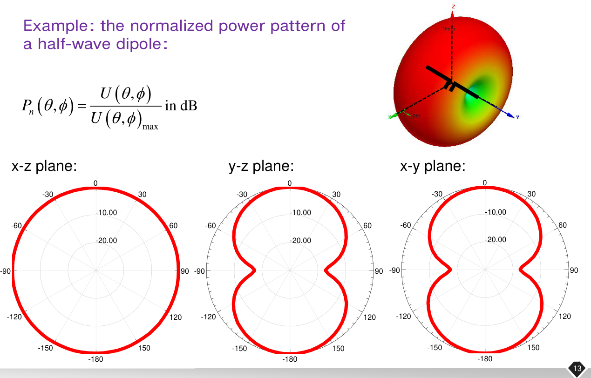
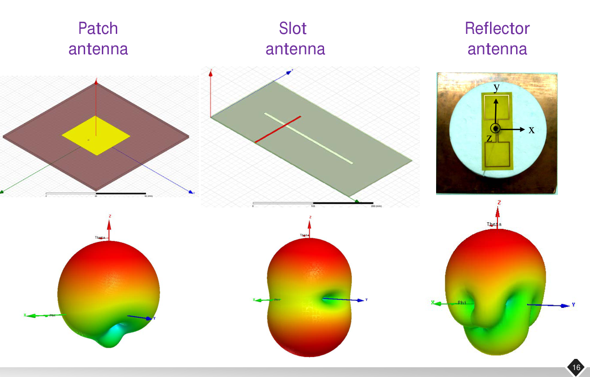
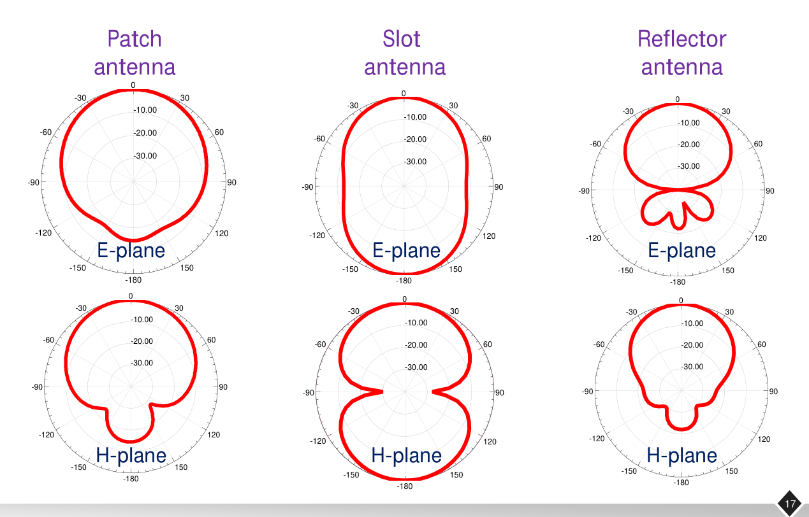
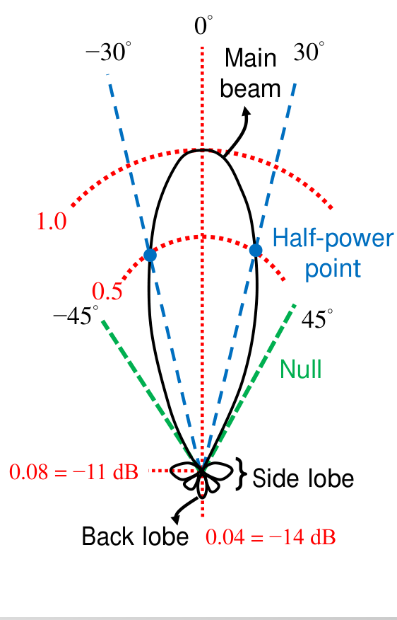

# 單元 16｜場型

看懂天線把能量送往哪些方向

原始影片：[陳晏笙老師「天線」單元 16](https://www.youtube.com/watch?v=_ezvCLglNQk)

老師講義：[Lecture 4 — Radiation Parameters](https://drive.google.com/file/d/18mtgr-C9XaZz3r2wJWh29ZXxWADFx7yV/view)，第 9–18 頁；影片前段延續第 8 頁極化資料處理

影片長度：約 69 分鐘　建議閱讀：約 30 分鐘

前置單元：15。需認識場相量、極化、球座標與 dB。

> **核心觀念：** 場型描述「方向」和「相對強弱」。讀圖前先看三件事：畫的是哪個場分量、幅值還是功率、哪一個切面與正規化方式。

## 你會學到什麼？

1.  將複數場資料分成共極化與交叉極化。

2.  區分電場、功率密度、輻射強度與正規化場型。

3.  正確換算線性幅值、線性功率與 dB。

4.  讀懂三維場型、主切面、E 面與 H 面。

5.  從場型找出波束寬度、旁瓣、前後比與極化純度。

## 講義與影片對照

正文按老師 PDF 頁序編排。影片前約 24 分鐘延續單元 15 的複數場與極化量測，這部分保留在章末「口述複習與補充」，方便直接進入本章場型主線。以下定位依影片口述核對；影片先回顧共／交叉極化，再用複數場表格推進場型主題。

| 老師講義 | 原英文主題 | 中文內容 | 影片定位 |
|:--|:--|:--|:--|
| 回顧 p.8 的口述延伸 | Co-polarization / Cross-polarization | 基底、量測號角與圓極化論文圖 | [約 00:30–14:20](https://www.youtube.com/watch?v=_ezvCLglNQk&t=30s) |
| 9 | Pattern: Definition | 場／功率、絕對／正規化及 dB | [約 14:20–37:20，含場資料表](https://www.youtube.com/watch?v=_ezvCLglNQk&t=860s) |
| 10–11 | Pattern: 3D Normalized Power Patterns | 三種方向分布、主瓣與旁瓣 | [約 37:20–44:00](https://www.youtube.com/watch?v=_ezvCLglNQk&t=2240s) |
| 12–15 | Pattern: Principal Plane Pattern (1/4–4/4) | 三主切面、半波偶極、E/H 面 | [約 44:00–59:40](https://www.youtube.com/watch?v=_ezvCLglNQk&t=2640s) |
| 16–17 | Pattern: Some Examples of 3D / 2D Patterns | 貼片、槽縫與反射面圖例 | 依講義補齊；與前後場型主題對照 |
| 18 | Pattern: Related Terminologies | 波束寬度、旁瓣、前後比、XPD | [約 59:40–片尾](https://www.youtube.com/watch?v=_ezvCLglNQk&t=3580s) |

## 0．影片銜接：共極化、交叉極化與複數場資料（回顧 p.8）

影片對照：[約 00:00](https://www.youtube.com/watch?v=_ezvCLglNQk&t=0s)－[24:00](https://www.youtube.com/watch?v=_ezvCLglNQk&t=1440s)

影片先以固定的標準號角為參考，將待測天線的場拆成共極化與交叉極化。Cross 常縮寫成 X，此 X 不代表直角座標的 x 軸。共極化表示指定的參考模式，不保證振幅比交叉極化更大。

**定義範圍：**老師以兩支天線的量測配置說明參考基底；一般也可先約定設計所需的極化，再對單一天線定義 co／cross，並非必須實際放上另一支天線才能計算。每個頻率、每個方向的遠場，可寫成

```math
\mathbf E=E_\theta\hat{\boldsymbol\theta}
+E_\phi\hat{\boldsymbol\phi}.
```

兩個係數都是複數；實部、虛部或幅值、相位，都可用來儲存同一個相量。只保留幅值，會遺失決定極化的重要資訊。

### 共極化與交叉極化，要先指定基底

設希望使用的接收極化為單位向量 $`\boldsymbol\rho_{\rm co}`$，另一個與它正交的單位極化為 $`\boldsymbol\rho_{\rm cross}`$。沿用單元 15 的入射波接收模式定義：

```math
E_{\rm co}=\boldsymbol\rho_{\rm co}^{H}\mathbf E,\qquad
E_{\rm cross}=\boldsymbol\rho_{\rm cross}^{H}\mathbf E.
```

對正交、正規化基底，$`|E_{\rm co}|^2+|E_{\rm cross}|^2`$ 等於總橫向場幅值平方。co-pol 不一定就是 $`E_\theta`$，cross-pol 也不一定就是 $`E_\phi`$；須看量測所用探頭與座標定義。

### 影片中的圓極化論文圖（約 07:30–12:00）

若兩條曲線是 $`E_\theta`$、$`E_\phi`$，振幅相差很大就不符合圓極化的等幅條件；若是 LHCP 與 RHCP 分量，一大一小反而可能表示旋向很純。因此看到 co／cross 圖例，先查基底與座標，再判讀是否合理。線極化探頭量得的兩個複數橫向分量，也可經基底轉換得到圓分量，不能單憑探頭外形斷言資料錯誤。

### 同樣幅值，仍可能有不同極化

**補充解說／重算例題：**在同一個方向：

```math
\mathbf E_1=E_0(\hat{\boldsymbol\theta}+\hat{\boldsymbol\phi}),\qquad
\mathbf E_2=E_0(\hat{\boldsymbol\theta}+j\hat{\boldsymbol\phi}).
```

兩者都滿足 $`|E_\theta|=|E_\phi|=E_0`$，總場功率也相同；第一個為線極化，第二個為圓極化。若只有兩列幅值，無法分辨這個差異。

### 圓極化分量與軸比的復習

以 $`e^{j\omega t}`$、沿外向傳播方向的單元 15 慣例：

```math
E_R=\frac{E_\theta+jE_\phi}{\sqrt2},\qquad
E_L=\frac{E_\theta-jE_\phi}{\sqrt2}.
```

```math
{\rm AR}=\frac{|E_R|+|E_L|}
{\bigl||E_R|-|E_L|\bigr|}.
```

分母為零且場不為零時，是線極化，AR 趨近無限大；若只有一個圓極化分量，AR = 1。零場點沒有可定義的極化。

### 閱讀量測表格的流程

先確認頻率、$`\theta,\phi`$、單位與實虛部，再轉成複數相量，依所需極化投影，最後才畫幅值或功率場型。要計算軸比，還需要兩分量之間的相對相位。

> **核心觀念：** 總功率場型可以相同，極化卻不同；判斷軸比或圓極化，不能只看兩分量幅值。

## 1．先分清畫的是什麼量（Pattern: Definition，p.9）

場型（radiation pattern）是一個函數或圖，描述天線在不同方向的輻射強弱。老師在 p.9 分成兩個維度：場幅值與功率；帶單位的絕對值與無單位的正規化值。

| 類型 | 絕對尺度 | 正規化尺度 |
|:--|:--|:--|
| 電場場型 | 指定分量或總橫向場幅值，單位 V/m | 除以同一量的最大值 |
| 功率場型 | 輻射強度 $`U(\theta,\phi)`$，單位 W/sr | $`P_n=U/U_{\max}`$ |

影片對照：[約 24:00](https://www.youtube.com/watch?v=_ezvCLglNQk&t=1440s)－[36:00](https://www.youtube.com/watch?v=_ezvCLglNQk&t=2160s)

在遠場、均勻無損介質，固定方向的場隨距離近似 $`1/r`$ 衰減。將距離因子寫明：

```math
\mathbf E(r,\theta,\phi)=
\frac{e^{-jkr}}r
\left[F_\theta(\theta,\phi)\hat{\boldsymbol\theta}
+F_\phi(\theta,\phi)\hat{\boldsymbol\phi}\right].
```

本頁採峰值場相量。實際 $`E_\theta,E_\phi`$ 單位為 V/m；將 $`1/r`$ 抽出後，$`F_\theta,F_\phi`$ 單位為 V。不同教材的 $`E_\theta`$ 符號可能指這兩種量，須檢查定義。

### 老師的資料整理順序（約 14:20–25:30）

每 10° 取樣一次，方位角取 36 個不重複方向，極角從 0° 到 180° 有 19 筆。老師把兩個複數分量各拆成實部、虛部，得到四張 $`36\times19`$ 表格，再依序計算兩分量幅值、總輻射強度、正規化功率，最後畫成場型。這是儲存網格的大小；兩極的不同方位角其實對應同一個空間方向。

方位角可採 $`-180^\circ\le\phi<180^\circ`$，也可採 $`0^\circ\le\phi<360^\circ`$；兩者都是有效慣例。老師偏好前者，重點是換算一致、不要把週期首尾重複算進積分。表格的最大值除以自己得到 1，其對應方向就是正規化場型的峰值方向。

### 平均功率密度：通過每單位面積的功率

```math
S_{\rm av}(r,\theta,\phi)=
\frac{|E_\theta|^2+|E_\phi|^2}{2\eta}
\quad({\rm W/m^2}).
```

$`\eta`$ 是介質波阻抗；自由空間約 $`120\pi\,\Omega`$。若使用 RMS 場，分母的 2 應移除。

### 輻射強度：每單位立體角的功率

```math
\boxed{U(\theta,\phi)=r^2S_{\rm av}
=\frac{|F_\theta|^2+|F_\phi|^2}{2\eta}}
\quad({\rm W/sr}).
```

老師在約 26:00–32:50 用探照燈說明：較遠的屏幕較暗，並不表示光源本身變弱；必須消去幾何擴散，才能公平描述光源。板書先用一維弧長比喻，實際三維功率密度隨距離平方反比衰減。

球面一小塊面積 $`dA=r^2d\Omega`$，因此 $`U\,d\Omega`$ 是向該角區送出的功率。在遠場模型下，$`U`$ 不隨 $`r`$ 改變。

### 正規化後可以比較形狀

用總橫向場定義 $`F_n=|\mathbf E|/\max|\mathbf E|`$；用總輻射強度定義 $`P_n=U/U_{\max}`$。同頻率、相同距離、相同極化內容：

```math
\boxed{P_n=F_n^2.}
```

若電場曲線只畫 co-pol，功率曲線卻畫 co-pol + cross-pol，就不能直接用此平方關係互換。

**講義符號校註：**p.9 的場表示式先把 $`1/r`$ 提到外面，功率式又寫 $`r^2(|E_\theta|^2+|E_\phi|^2)/(2\eta)`$，混用了「已含距離衰減的場」與「抽掉距離因子的方向係數」。以上分別以 $`E`$、$`F`$ 區分；用前者須乘 $`r^2`$，用後者不再乘，才能保持 $`U`$ 與距離無關。講義的 W/Ω 表示每單位立體角，本筆記改寫標準單位 W/sr，避免與電阻歐姆混淆。

### 1.1 線性尺度與 dB 尺度：同一資料的兩種讀法

影片對照：[約 28:00](https://www.youtube.com/watch?v=_ezvCLglNQk&t=1680s)－[38:00](https://www.youtube.com/watch?v=_ezvCLglNQk&t=2280s)

正規化場型最大值為 1；換成 dB 後，最大值為 0 dB。幅值與功率使用不同倍數：

```math
F_{n,{\rm dB}}=20\log_{10}F_n,\qquad
P_{n,{\rm dB}}=10\log_{10}P_n.
```

當 $`P_n=F_n^2`$，兩個 dB 曲線完全重合。線性圖則有不同外形，這不是算錯，而是平方運算的結果。

### 三個常用檢查值

| 幅值 $`F_n`$              | 功率 $`P_n`$ | 相對 dB   |
|:------------------------|:-----------|:----------|
| $`1/\sqrt2\approx0.7071`$ | 0.5        | $`-3.0103`$ |
| 0.5                     | 0.25       | $`-6.0206`$ |
| 0.1                     | 0.01       | $`-20`$     |

> **核心觀念：** 半功率是幅值的 $`1/\sqrt2`$，不是幅值的一半。dB 圖必須附參考值，0 dB 並不表示零功率。

## 2．三維場型的基本形狀（3D Normalized Power Patterns，pp.10–11）

| 名稱                 | 正確理解                                             |
|:---------------------|:-----------------------------------------------------|
| 各向同性 isotropic   | 所有空間方向的功率相同；作為理想參考                 |
| 全向 omnidirectional | 通常指某個平面內各方位近似相同；其他仰角仍可能有零點 |
| 指向性 directional   | 能量集中於部分方向；可有主瓣、旁瓣和背瓣             |

垂直偶極的三維功率場型像甜甜圈，水平面內全向，沿天線軸向卻有零點；它不是各向同性天線。

第 11 頁再把一個具有主瓣、旁瓣、背瓣的三維圖拆開看。圖上徑向長度表示該方向的場型數值，並不是波前真的只傳到那個位置；零點是該模型中輻射相消或為零的方向。該頁插圖本身標作「3-D field pattern」，因此讀圖時仍須確認使用場幅值還是功率，不能只由頁首的 power patterns 推定全部刻度。

主瓣峰值旁的 $`E_\theta,E_\phi`$ 表示同一方向上可拆成兩個橫向場分量。主瓣形狀、極化與總強度是相關但不同的資訊，不能只留一條總幅值曲線就宣稱掌握所有極化。

## 3．依座標切出三個主平面（Principal Plane Pattern 1/4，p.12）

採 $`\theta`$ 從 $`+z`$ 軸量起、$`\phi`$ 在 $`xy`$ 面從 $`+x`$ 向 $`+y`$ 量。主切面包括：

-   $`xy`$ 面：固定 $`\theta=90^\circ`$，掃 $`\phi=0^\circ`$ 至 $`360^\circ`$。

-   $`xz`$ 面：$`\phi=0^\circ`$ 的半平面與 $`\phi=180^\circ`$ 的半平面合成一整圈。

-   $`yz`$ 面：$`\phi=90^\circ`$ 和 $`270^\circ`$ 的兩個半平面合成一整圈。

**口述幾何校註：**固定 $`\theta=80^\circ`$ 掃方位角，可畫出一條角度切線，但那些從原點射出的方向構成圓錐，並非通過天線的平面；$`\theta=90^\circ`$ 才是 xy 平面。

標準球座標的 $`\theta`$ 只取 $`0^\circ`$ 至 $`180^\circ`$。軟體若把切面角畫成 $`-180^\circ`$ 至 $`180^\circ`$，那是平面內的掃描角；要先確認它如何對應球座標。

**講義角度校註：**p.12 在固定 $`\phi`$ 的圖上使用 $`-180^\circ\le\theta\le180^\circ`$，應理解成整個平面內的繪圖掃描角；它與標準球座標 $`0\le\theta\le\pi`$ 的定義不同。要把數據拿去做球面積分時，必須還原正確的 $`\theta,\phi`$，不能重複計入半球。

## 4．老師的半波偶極：先看天線沿哪個軸（Principal Plane Pattern 2/4，p.13）



*來源：老師 Lecture 4，第 13 頁局部；原圖為正規化功率場型，採 dB 刻度。*

| p.13 原圖切面 | 圖形 | 對應意義 |
|:--|:--|:--|
| xz | 圓形 | 垂直於偶極軸的平面內，各方位近似相同 |
| yz | 八字／雙瓣 | 含偶極軸，沿軸有零點 |
| xy | 八字／雙瓣 | 另一個含偶極軸的平面，具有相同對稱性 |

從這三張圖可以確認老師此例的偶極軸沿 **y 軸**。舊筆記自畫的偶極則沿 z 軸；兩者物理結果一致，但圓形切面分別是 xz 與 xy。為便於直接比投影片，正文採老師的軸向，舊重畫放在章末並明示座標。

## 5．依電磁場定義 E 面與 H 面（Principal Plane Pattern 3/4–4/4，pp.14–15）

對線極化天線：

```math
\text{E 面包含最大輻射方向與電場向量；}\qquad
\text{H 面包含最大輻射方向與磁場向量。}
```

自由空間遠場中 $`\mathbf E,\mathbf H`$ 與傳播方向互相垂直。兩個主面常互相垂直，但不一定固定為某組座標平面。 影片的號角天線示範兩個主面曲線；兩切面可以有不同波束寬度。對圓或橢圓極化，電場方向隨時間變化，不能直接套用同一個固定線極化 E 面定義。

老師 p.14 以號角口徑上的電場、磁場分布說明這兩個平面；選擇依據是場向量與最大輻射方向，不是「任何天線的 E 面必定等於 xz」。

p.15 回到前頁的半波偶極：**E 面為八字、H 面為圓形**。對沿 y 軸的偶極，xz 是 H 面；選最大輻射方向 +x 時，包含電場 y 方向的 xy 是一個 E 面。因軸對稱，其他含 y 軸的垂直切面具有相同形狀。

只看到一個切面是圓形，不能推論整個三維空間各向同性；只看某主面旁瓣低，也不能保證其他切面相同。

## 6．把三維外形與 E/H 切面配對（Some Examples of 3D / 2D Patterns，pp.16–17）



*來源：老師 Lecture 4，第 16 頁局部；依原圖順序為貼片、槽縫、反射面天線。*



*來源：老師 Lecture 4，第 17 頁局部，皆為相對 dB 圖。*

| 圖例 | 三維圖的重點 | 二維切面要比較的項目 |
|:--|:--|:--|
| 貼片（patch） | 地板使前後輻射不對稱，主要朝上半空間 | E、H 面寬度與背向抑制可不同 |
| 槽縫（slot） | 此圖呈雙側輻射，與有地板的貼片不同 | 一個切面較圓、另一個呈雙瓣，不能只選較漂亮的一面 |
| 反射面（reflector） | 存在主要輻射方向與較弱的後向波瓣 | 看主瓣集中程度、旁瓣與背瓣，E/H 面可有不同細節 |

以上是老師選定結構與座標下的圖例；不能把某張圖的前後對稱或波束寬度，當成同類所有天線的固定值。讀實測圖還必須一起查頻率、極化分量、角度、正規化基準與量測底噪。

## 7．場型參數與老師讀圖例（Related Terminologies，p.18）

影片末段介紹常用場型參數。以下以正規化功率最大值為 1、主瓣峰值為 0 dB 解釋。

| 參數                  | 怎麼讀                                           |
|:----------------------|:-------------------------------------------------|
| 主瓣 main lobe        | 包含主要輻射峰值的瓣；峰值方向常稱 boresight     |
| HPBW 半功率波束寬度   | 同一切面內，主瓣兩側功率降到一半的方向夾角       |
| FNBW 第一零點波束寬度 | 主瓣兩側第一個零點方向的夾角                     |
| SLL 旁瓣電平          | 指定旁瓣峰值，相對於主瓣峰值的 dB；常取最高旁瓣  |
| F/B 前後比            | 正向與反向功率比，須說明取反向正對角或背瓣最大值 |
| XPD 交叉極化鑑別度    | 同一方向共極化功率／交叉極化功率的 dB            |



*來源：老師 Lecture 4，第 18 頁局部，紅色數值以主瓣功率峰值 1 為參考。*

依原圖讀出：

```math
\begin{aligned}
{\rm HPBW}&=30^\circ-(-30^\circ)=60^\circ,\\
{\rm FNBW}&=45^\circ-(-45^\circ)=90^\circ,\\
{\rm SLL}&=10\log_{10}(0.08)\approx-10.97\ {\rm dB},\\
F/B&=10\log_{10}(1/0.04)\approx13.98\ {\rm dB}.
\end{aligned}
```

**與原筆記對照：**p.18 的旁瓣是 **0.08，約 −11 dB**；0.04、約 −14 dB 標的是背瓣。不能將兩者互換。半功率方向是 ±30°；原筆記 ±20° 的 40° 寬度屬另設算例，不是這張原圖的讀值。

前後比是正向除以反向，通常報正值；背瓣電平是反向相對主瓣，報負值，兩者符號不同。XPD 則比較同方向的共極化與交叉極化，在一致 dB 尺度上取差；若原數據是線性場幅值，應用幅值比的 $`20\log_{10}`$。

**XPD 口述校註（約 65:20–66:20）：**30 dB 表示功率比 1000、場幅值比約 31.62。老師將高 XPD 作為極化純度的嚴格要求；30 dB 並非所有線極化天線通用的定義門檻，實際規格還要列明頻帶、角度與基底。

## 8．補充解說與重算例題

### 8.2 距離改變，輻射強度保持不變

#### 重算：功率密度變化，輻射強度不變

**補充解說／重算例題：**某方向在 $`r=10`$ m，峰值總場幅值為 1 V/m：

```math
S_{\rm av}\approx\frac1{2(377)}=1.326\ {\rm mW/m^2},
\qquad U\approx0.1326\ {\rm W/sr}.
```

改到 20 m，場約 0.5 V/m，功率密度降為四分之一；乘上 $`r^2`$ 後仍得到相同 $`U`$。

> **核心觀念：** 場幅值隨距離約 $`1/r`$，功率密度約 $`1/r^2`$，輻射強度描述方向上的功率分配。

### 8.3 沿 z 軸的半波偶極重畫

考慮沿 $`z`$ 軸的細線半波偶極，在自由空間、遠場、忽略實際饋線影響。其主要電場為 $`E_\theta`$，功率不隨方位角 $`\phi`$ 改變。此處保留原筆記沿 z 軸的自學重畫；它與老師 p.13 的 y 軸偶極相差一個座標旋轉，切面名稱也必須跟著改。


補充重繪：左圖為 $`xz`$ 切面，0° 在 $`+z`$，90° 在 $`+x`$；右圖為 $`xy`$ 切面，0° 在 $`+x`$，90° 在 $`+y`$。圖上的整圈角度是切面角，並非把球座標 $`\theta`$ 延長至 360°。

#### 為什麼 $`xz`$ 是 E 面，$`xy`$ 是 H 面？

選最大輻射方向 $`+x`$。此處電場沿 $`\pm z`$、磁場沿 $`\mp y`$，所以包含傳播方向與電場的平面是 $`xz`$；包含傳播方向與磁場的平面是 $`xy`$。 對軸對稱偶極，其他包含 $`z`$ 軸的垂直切面也有相同外形。

#### 補充數學模型：別把半波偶極當成電短偶極

為了把影片的示意場型畫成可核算的曲線，本講義採理想細線、正弦電流的半波偶極：

```math
F_n(\theta)=\left|
\frac{\cos[(\pi/2)\cos\theta]}{\sin\theta}
\right|,\qquad P_n=F_n^2.
```

$`\theta=0,\pi`$ 處以極限取零；$`\theta=\pi/2`$ 取最大值 1。 電短偶極常用 $`F_n=\sin\theta`$，同樣有八字外形，但不是完全相同的曲線。補充模型核對：[Palace 半波偶極模型](https://awslabs.github.io/palace/stable/examples/antenna/)。

#### 先用對稱性判讀

沿 $`z`$ 軸有零點，繞 $`z`$ 軸轉動方位角，理想場型不變。若實際量測的 $`xy`$ 面有明顯凹陷，需考慮饋線、地板、附近物體與量測條件；理想模型只提供比較基準。

> **核心觀念：** 「H 面是圓形」只描述水平切面；偶極沿自身軸向仍不輻射，整個三維場型不是球形。


補充重繪：理想細線半波偶極的總場型。上圖藍線為場幅值、橘線為功率；下圖展示兩者正確換算後的共同 dB 曲線。低於 $`-30`$ dB 的部分未顯示，零點實際為 $`-\infty`$ dB。

### 8.4 前後比與 XPD 重算

**補充解說／重算例題：**正向功率是反向的 100 倍，F/B = 20 dB。另在同一方向，設共極化幅值 1、交叉極化幅值 0.1：

```math
{\rm XPD}=20\log_{10}\frac{|E_{\rm co}|}{|E_{\rm cross}|}
=10\log_{10}(100)=20\ {\rm dB}.
```

XPD 越大，表示該方向的交叉極化較小；它會隨方向與頻率改變。圓極化的 co／cross 可用所需手性與相反手性作定義，不能直接將 XPD 當成軸比。

## 9．自測與解析

先檢查圖的分量、尺度與參考值，再使用公式。

1.  某方向正規化場幅值為 0.5，正規化功率與相對 dB 各是多少？它是半功率點嗎？

2.  10 m 遠的功率密度為 2 mW/m$`^2`$。遠場中移到 20 m，功率密度與輻射強度各多少？

3.  天線在 $`xy`$ 面是圓形場型，能否據此稱為各向同性？垂直半波偶極的 $`xz`$ 面與 $`xy`$ 面分別如何？

4.  一個主瓣半功率方向為 $`35^\circ`$、$`65^\circ`$，最高旁瓣功率為主瓣的 0.01。求 HPBW 與 SLL。

5.  $`E_\theta=1`$、$`E_\phi=1`$ 與 $`E_\theta=1`$、$`E_\phi=j`$，總場功率相同嗎？極化相同嗎？只有幅值可計算 AR 嗎？

### 答案與理由

1.  $`P_n=0.25`$，相對 $`-6.0206`$ dB；不是半功率點。半功率點的幅值為 $`1/\sqrt2`$。

2.  功率密度為 0.5 mW/m$`^2`$；$`U=r^2S=0.2`$ W/sr，在兩個距離相同。

3.  不能。只能說此切面全向；理想垂直半波偶極的 $`xz`$ 面為八字，$`xy`$ 面為圓，沿軸仍有零點。

4.  HPBW = $`30^\circ`$；SLL = $`10\log_{10}0.01=-20`$ dB。

5.  總場幅值平方都為 2，因此功率相同。第一個是線極化，第二個是圓極化；只有兩分量幅值而沒有相對相位，無法判定 AR。

### 公式速記

```math
U=r^2S_{\rm av},\qquad P_n=F_n^2,\qquad
20\log F_n=10\log P_n.
```

```math
{\rm HPBW}=\text{兩側半功率角之差},\qquad
{\rm SLL}=10\log\frac{P_{\rm side,max}}{P_{\rm main,max}}.
```

**下一單元：**[指向性](017_指向性.md)，由整個三維場型的總功率，量化某方向的能量集中程度。
