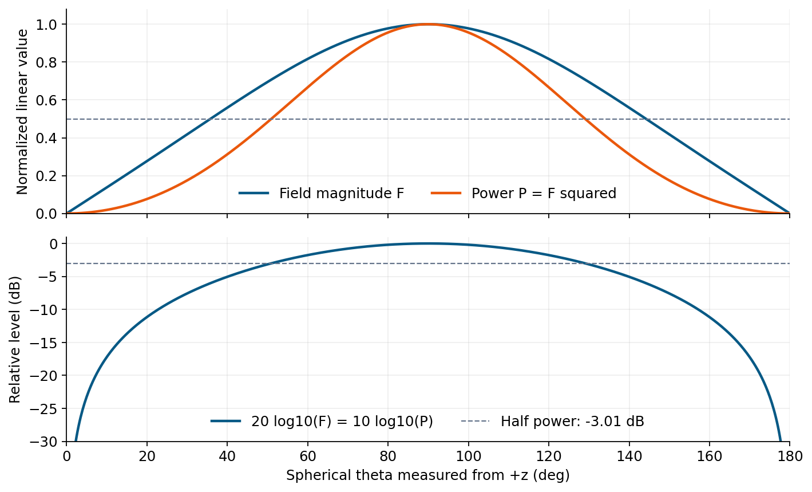
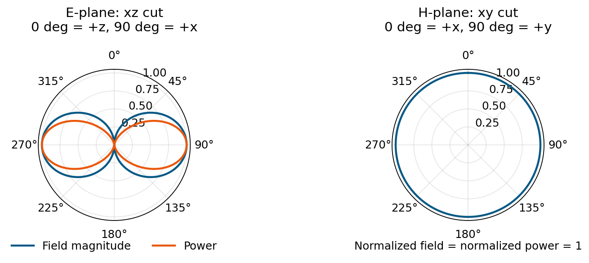

# 單元 16｜場型

[下載原始 PDF](../pdf/016_場型.pdf)

看懂天線把能量送往哪些方向

原始影片：[陳晏笙老師「天線」單元 16](https://www.youtube.com/watch?v=_ezvCLglNQk)

影片長度：約 69 分鐘　建議閱讀：約 20 分鐘

前置單元：15。需認識場相量、極化、球座標與 dB。

> **核心觀念：** 場型描述「方向」和「相對強弱」。讀圖前先看三件事：畫的是哪個場分量、幅值還是功率、哪一個切面與正規化方式。

## 你會學到什麼？

1.  將複數場資料分成共極化與交叉極化。

2.  區分電場、功率密度、輻射強度與正規化場型。

3.  正確換算線性幅值、線性功率與 dB。

4.  讀懂三維場型、主切面、E 面與 H 面。

5.  從場型找出波束寬度、旁瓣、前後比與極化純度。

## 影片前半段為何還在談極化？

場型不只是「總能量隨角度」。接收端只接收特定極化，因此常要分開畫共極化與交叉極化，才知道主瓣方向的能量是否具有所需極化。 前一單元的複數場分解，是本單元處理量測資料的起點。

## 一張場型圖至少要附哪些資訊？

| 標示              | 原因                                                   |
|:------------------|:-------------------------------------------------------|
| 頻率與角度定義    | 不同頻率、不同切面可能完全不同                         |
| 場分量或極化      | 總場、$E_\theta$、$E_\phi$、co-pol、cross-pol 不可混看 |
| 線性／dB 與參考值 | 決定曲線的物理意義與換算方式                           |
| 正規化或絕對尺度  | 正規化圖不提供實際輸出功率或增益                       |

## 閱讀地圖

第 2 頁：複數場與極化資料；第 3 頁：場與功率的定義；第 4 頁：線性與 dB；第 5 頁：切面與方向性；第 6 頁：半波偶極場型；第 7 頁：場型參數；第 8 頁：自測。 依影片投影片與量測示範重寫。示意曲線重新繪製；補充模型、數值均有標示。

## 1．從複數場資料讀出極化

影片對照：[約 00:00](https://www.youtube.com/watch?v=_ezvCLglNQk&t=0s)－[24:00](https://www.youtube.com/watch?v=_ezvCLglNQk&t=1440s)

影片接續圓極化分解，展示量測與表格資料。每個頻率、每個方向的遠場，可寫成

$$
\mathbf E=E_\theta\hat{\boldsymbol\theta}
+E_\phi\hat{\boldsymbol\phi}.
$$

兩個係數都是複數；實部、虛部或幅值、相位，都可用來儲存同一個相量。只保留幅值，會遺失決定極化的重要資訊。

### 共極化與交叉極化，要先指定基底

設希望使用的接收極化為單位向量 $\boldsymbol\rho_{\rm co}$，另一個與它正交的單位極化為 $\boldsymbol\rho_{\rm cross}$。沿用單元 15 的入射波接收模式定義：

$$
E_{\rm co}=\boldsymbol\rho_{\rm co}^{H}\mathbf E,\qquad
E_{\rm cross}=\boldsymbol\rho_{\rm cross}^{H}\mathbf E.
$$

對正交、正規化基底，$|E_{\rm co}|^2+|E_{\rm cross}|^2$ 等於總橫向場幅值平方。co-pol 不一定就是 $E_\theta$，cross-pol 也不一定就是 $E_\phi$；須看量測所用探頭與座標定義。

### 同樣幅值，仍可能有不同極化

**補充解說／重算例題：**在同一個方向：

$$
\mathbf E_1=E_0(\hat{\boldsymbol\theta}+\hat{\boldsymbol\phi}),\qquad
\mathbf E_2=E_0(\hat{\boldsymbol\theta}+j\hat{\boldsymbol\phi}).
$$

兩者都滿足 $|E_\theta|=|E_\phi|=E_0$，總場功率也相同；第一個為線極化，第二個為圓極化。若只有兩列幅值，無法分辨這個差異。

### 圓極化分量與軸比的復習

以 $e^{j\omega t}$、沿外向傳播方向的單元 15 慣例：

$$
E_R=\frac{E_\theta+jE_\phi}{\sqrt2},\qquad
E_L=\frac{E_\theta-jE_\phi}{\sqrt2}.
$$

$$
{\rm AR}=\frac{|E_R|+|E_L|}
{\bigl||E_R|-|E_L|\bigr|}.
$$

分母為零且場不為零時，是線極化，AR 趨近無限大；若只有一個圓極化分量，AR = 1。零場點沒有可定義的極化。

### 閱讀量測表格的流程

先確認頻率、$\theta,\phi$、單位與實虛部，再轉成複數相量，依所需極化投影，最後才畫幅值或功率場型。要計算軸比，還需要兩分量之間的相對相位。

> **核心觀念：** 總功率場型可以相同，極化卻不同；判斷軸比或圓極化，不能只看兩分量幅值。

## 2．電場、功率密度與輻射強度

影片對照：[約 24:00](https://www.youtube.com/watch?v=_ezvCLglNQk&t=1440s)－[36:00](https://www.youtube.com/watch?v=_ezvCLglNQk&t=2160s)

在遠場、均勻無損介質，固定方向的場隨距離近似 $1/r$ 衰減。將距離因子寫明：

$$
\mathbf E(r,\theta,\phi)=
\frac{e^{-jkr}}r
\left[F_\theta(\theta,\phi)\hat{\boldsymbol\theta}
+F_\phi(\theta,\phi)\hat{\boldsymbol\phi}\right].
$$

本頁採峰值場相量。實際 $E_\theta,E_\phi$ 單位為 V/m；將 $1/r$ 抽出後，$F_\theta,F_\phi$ 單位為 V。不同教材的 $E_\theta$ 符號可能指這兩種量，須檢查定義。

### 平均功率密度：通過每單位面積的功率

$$
S_{\rm av}(r,\theta,\phi)=
\frac{|E_\theta|^2+|E_\phi|^2}{2\eta}
\quad({\rm W/m^2}).
$$

$\eta$ 是介質波阻抗；自由空間約 $120\pi\,\Omega$。若使用 RMS 場，分母的 2 應移除。

### 輻射強度：每單位立體角的功率

$$
\boxed{U(\theta,\phi)=r^2S_{\rm av}
=\frac{|F_\theta|^2+|F_\phi|^2}{2\eta}}
\quad({\rm W/sr}).
$$

球面一小塊面積 $dA=r^2d\Omega$，因此 $U\,d\Omega$ 是向該角區送出的功率。在遠場模型下，$U$ 不隨 $r$ 改變。

### 正規化後可以比較形狀

用總橫向場定義 $F_n=|\mathbf E|/\max|\mathbf E|$；用總輻射強度定義 $P_n=U/U_{\max}$。同頻率、相同距離、相同極化內容：

$$
\boxed{P_n=F_n^2.}
$$

若電場曲線只畫 co-pol，功率曲線卻畫 co-pol + cross-pol，就不能直接用此平方關係互換。

### 重算：功率密度變化，輻射強度不變

**補充解說／重算例題：**某方向在 $r=10$ m，峰值總場幅值為 1 V/m：

$$
S_{\rm av}\approx\frac1{2(377)}=1.326\ {\rm mW/m^2},
\qquad U\approx0.1326\ {\rm W/sr}.
$$

改到 20 m，場約 0.5 V/m，功率密度降為四分之一；乘上 $r^2$ 後仍得到相同 $U$。

> **核心觀念：** 場幅值隨距離約 $1/r$，功率密度約 $1/r^2$，輻射強度描述方向上的功率分配。

## 3．線性場型與 dB 場型：同一資料的兩種讀法

影片對照：[約 28:00](https://www.youtube.com/watch?v=_ezvCLglNQk&t=1680s)－[38:00](https://www.youtube.com/watch?v=_ezvCLglNQk&t=2280s)

正規化場型最大值為 1；換成 dB 後，最大值為 0 dB。幅值與功率使用不同倍數：

$$
F_{n,{\rm dB}}=20\log_{10}F_n,\qquad
P_{n,{\rm dB}}=10\log_{10}P_n.
$$

當 $P_n=F_n^2$，兩個 dB 曲線完全重合。線性圖則有不同外形，這不是算錯，而是平方運算的結果。

補充重繪：理想細線半波偶極的總場型。上圖藍線為場幅值、橘線為功率；下圖展示兩者正確換算後的共同 dB 曲線。低於 $-30$ dB 的部分未顯示，零點實際為 $-\infty$ dB。

### 三個常用檢查值

| 幅值 $F_n$              | 功率 $P_n$ | 相對 dB   |
|:------------------------|:-----------|:----------|
| $1/\sqrt2\approx0.7071$ | 0.5        | $-3.0103$ |
| 0.5                     | 0.25       | $-6.0206$ |
| 0.1                     | 0.01       | $-20$     |

> **核心觀念：** 半功率是幅值的 $1/\sqrt2$，不是幅值的一半。dB 圖必須附參考值，0 dB 並不表示零功率。

## 4．三維場型與切面：全向不等於各向同性

影片對照：[約 38:00](https://www.youtube.com/watch?v=_ezvCLglNQk&t=2280s)－[52:00](https://www.youtube.com/watch?v=_ezvCLglNQk&t=3120s)

影片先比較三維外形，再示範主切面與 E、H 面。三維圖的徑向距離代表某種場型大小，並不是真正波前到達的位置；每個方向上的遠場都持續向外傳播。

### 三種常見描述

| 名稱                 | 正確理解                                             |
|:---------------------|:-----------------------------------------------------|
| 各向同性 isotropic   | 所有空間方向的功率相同；作為理想參考                 |
| 全向 omnidirectional | 通常指某個平面內各方位近似相同；其他仰角仍可能有零點 |
| 指向性 directional   | 能量集中於部分方向；可有主瓣、旁瓣和背瓣             |

垂直偶極的三維功率場型像甜甜圈，水平面內全向，沿天線軸向卻有零點；它不是各向同性天線。

### 球座標：先固定哪個角？

採 $\theta$ 從 $+z$ 軸量起、$\phi$ 在 $xy$ 面從 $+x$ 向 $+y$ 量。主切面包括：

-   $xy$ 面：固定 $\theta=90^\circ$，掃 $\phi=0^\circ$ 至 $360^\circ$。

-   $xz$ 面：$\phi=0^\circ$ 的半平面與 $\phi=180^\circ$ 的半平面合成一整圈。

-   $yz$ 面：$\phi=90^\circ$ 和 $270^\circ$ 的兩個半平面合成一整圈。

標準球座標的 $\theta$ 只取 $0^\circ$ 至 $180^\circ$。軟體若把切面角畫成 $-180^\circ$ 至 $180^\circ$，那是平面內的掃描角；要先確認它如何對應球座標。

### E 面、H 面：依極化與主輻射方向定義

對線極化天線：

$$
\text{E 面包含最大輻射方向與電場向量；}\qquad
\text{H 面包含最大輻射方向與磁場向量。}
$$

自由空間遠場中 $\mathbf E,\mathbf H$ 與傳播方向互相垂直。兩個主面常互相垂直，但不一定固定為某組座標平面。 影片的號角天線示範兩個主面曲線；兩切面可以有不同波束寬度。對圓或橢圓極化，電場方向隨時間變化，不能直接套用同一個固定線極化 E 面定義。

### 二維切面圖的限制

只看到一個切面平坦，不能推論整個三維空間都是全向；只看到主面有低旁瓣，也不能保證其他切面沒有高旁瓣。

> **核心觀念：** 切面圖是三維方向分佈的截面。方向、極化與角度定義要一起看，不能只看曲線外形。

## 5．影片的半波偶極：E 面八字，H 面圓形

影片對照：[約 52:00](https://www.youtube.com/watch?v=_ezvCLglNQk&t=3120s)－[58:00](https://www.youtube.com/watch?v=_ezvCLglNQk&t=3480s)

考慮沿 $z$ 軸的細線半波偶極，在自由空間、遠場、忽略實際饋線影響。其主要電場為 $E_\theta$，功率不隨方位角 $\phi$ 改變。影片用此例說明三維甜甜圈與兩個主面切圖的關係。

補充重繪：左圖為 $xz$ 切面，0° 在 $+z$，90° 在 $+x$；右圖為 $xy$ 切面，0° 在 $+x$，90° 在 $+y$。圖上的整圈角度是切面角，並非把球座標 $\theta$ 延長至 360°。

### 為什麼 $xz$ 是 E 面，$xy$ 是 H 面？

選最大輻射方向 $+x$。此處電場沿 $\pm z$、磁場沿 $\mp y$，所以包含傳播方向與電場的平面是 $xz$；包含傳播方向與磁場的平面是 $xy$。 對軸對稱偶極，其他包含 $z$ 軸的垂直切面也有相同外形。

### 補充數學模型：別把半波偶極當成電短偶極

為了把影片的示意場型畫成可核算的曲線，本講義採理想細線、正弦電流的半波偶極：

$$
F_n(\theta)=\left|
\frac{\cos[(\pi/2)\cos\theta]}{\sin\theta}
\right|,\qquad P_n=F_n^2.
$$

$\theta=0,\pi$ 處以極限取零；$\theta=\pi/2$ 取最大值 1。 電短偶極常用 $F_n=\sin\theta$，同樣有八字外形，但不是完全相同的曲線。補充模型核對：[Palace 半波偶極模型](https://awslabs.github.io/palace/stable/examples/antenna/)。

### 先用對稱性判讀

沿 $z$ 軸有零點，繞 $z$ 軸轉動方位角，理想場型不變。若實際量測的 $xy$ 面有明顯凹陷，需考慮饋線、地板、附近物體與量測條件；理想模型只提供比較基準。

> **核心觀念：** 「H 面是圓形」只描述水平切面；偶極沿自身軸向仍不輻射，整個三維場型不是球形。

## 6．波束寬度、旁瓣、前後比與極化純度

影片對照：[約 58:00](https://www.youtube.com/watch?v=_ezvCLglNQk&t=3480s)－[69:00](https://www.youtube.com/watch?v=_ezvCLglNQk&t=4140s)

影片末段介紹常用場型參數。以下以正規化功率最大值為 1、主瓣峰值為 0 dB 解釋。

| 參數                  | 怎麼讀                                           |
|:----------------------|:-------------------------------------------------|
| 主瓣 main lobe        | 包含主要輻射峰值的瓣；峰值方向常稱 boresight     |
| HPBW 半功率波束寬度   | 同一切面內，主瓣兩側功率降到一半的方向夾角       |
| FNBW 第一零點波束寬度 | 主瓣兩側第一個零點方向的夾角                     |
| SLL 旁瓣電平          | 指定旁瓣峰值，相對於主瓣峰值的 dB；常取最高旁瓣  |
| F/B 前後比            | 正向與反向功率比，須說明取反向正對角或背瓣最大值 |
| XPD 交叉極化鑑別度    | 同一方向共極化功率／交叉極化功率的 dB            |

### 補充重算：由角度與比例找參數

某主瓣峰值在切面角 0°，兩側半功率方向為 $-20^\circ,+20^\circ$，第一零點為 $-45^\circ,+45^\circ$：

$$
{\rm HPBW}=40^\circ,\qquad {\rm FNBW}=90^\circ.
$$

旁瓣峰值功率為主瓣的 0.04（影片使用的示例比例）：

$$
{\rm SLL}=10\log_{10}(0.04)\approx-13.98\ {\rm dB}.
$$

如果 0.04 指的是場幅值，則應用 $20\log_{10}$ 得到 $-27.96$ dB；必須先查單位與定義。

### 前後比與交叉極化

**補充解說／重算例題：**正向功率是反向的 100 倍，F/B = 20 dB。另在同一方向，設共極化幅值 1、交叉極化幅值 0.1：

$$
{\rm XPD}=20\log_{10}\frac{|E_{\rm co}|}{|E_{\rm cross}|}
=10\log_{10}(100)=20\ {\rm dB}.
$$

XPD 越大，表示該方向的交叉極化較小；它會隨方向與頻率改變。圓極化的 co／cross 可用所需手性與相反手性作定義，不能直接將 XPD 當成軸比。

### 讀參數也需要指定切面

E 面和 H 面可能有不同 HPBW。旁瓣是否涵蓋整個三維空間、背瓣取哪個方向，以及低於量測底噪的零點如何處理，都會影響數字。

> **核心觀念：** HPBW 用半功率門檻；旁瓣電平用主瓣作參考；XPD 比較同方向的兩種極化。每個比值都要寫清楚分子、分母。

## 7．五題自測與答案

先檢查圖的分量、尺度與參考值，再使用公式。

1.  某方向正規化場幅值為 0.5，正規化功率與相對 dB 各是多少？它是半功率點嗎？

2.  10 m 遠的功率密度為 2 mW/m$^2$。遠場中移到 20 m，功率密度與輻射強度各多少？

3.  天線在 $xy$ 面是圓形場型，能否據此稱為各向同性？垂直半波偶極的 $xz$ 面與 $xy$ 面分別如何？

4.  一個主瓣半功率方向為 $35^\circ$、$65^\circ$，最高旁瓣功率為主瓣的 0.01。求 HPBW 與 SLL。

5.  $E_\theta=1$、$E_\phi=1$ 與 $E_\theta=1$、$E_\phi=j$，總場功率相同嗎？極化相同嗎？只有幅值可計算 AR 嗎？

### 答案與理由

1.  $P_n=0.25$，相對 $-6.0206$ dB；不是半功率點。半功率點的幅值為 $1/\sqrt2$。

2.  功率密度為 0.5 mW/m$^2$；$U=r^2S=0.2$ W/sr，在兩個距離相同。

3.  不能。只能說此切面全向；理想垂直半波偶極的 $xz$ 面為八字，$xy$ 面為圓，沿軸仍有零點。

4.  HPBW = $30^\circ$；SLL = $10\log_{10}0.01=-20$ dB。

5.  總場幅值平方都為 2，因此功率相同。第一個是線極化，第二個是圓極化；只有兩分量幅值而沒有相對相位，無法判定 AR。

### 公式速記

$$
U=r^2S_{\rm av},\qquad P_n=F_n^2,\qquad
20\log F_n=10\log P_n.
$$

$$
{\rm HPBW}=\text{兩側半功率角之差},\qquad
{\rm SLL}=10\log\frac{P_{\rm side,max}}{P_{\rm main,max}}.
$$

### 回看影片的位置

[24:00](https://www.youtube.com/watch?v=_ezvCLglNQk&t=1440s)：場與功率場型；[44:00](https://www.youtube.com/watch?v=_ezvCLglNQk&t=2640s)：主切面； [52:00](https://www.youtube.com/watch?v=_ezvCLglNQk&t=3120s)：偶極場型；[62:00](https://www.youtube.com/watch?v=_ezvCLglNQk&t=3720s)：場型參數。 **下一單元：**從整個三維場型的總功率，量化某方向的能量集中程度：指向性。
