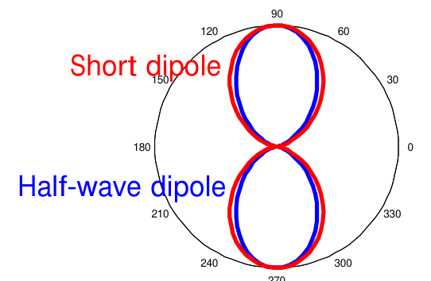
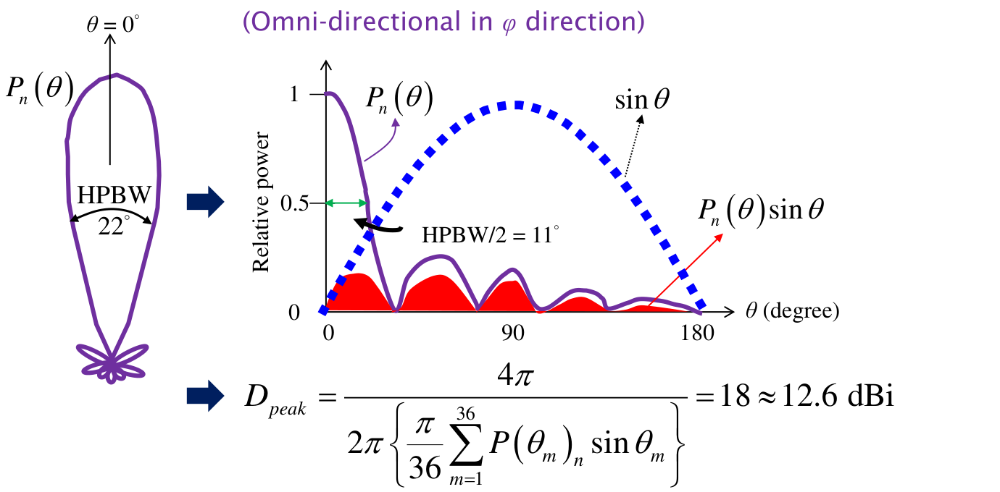
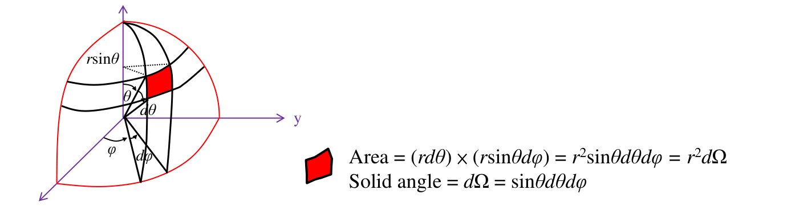
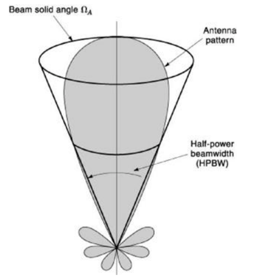

# 單元 17｜指向性

由全空間功率分配，求天線把能量集中到某方向的程度。

原始影片：[陳晏笙老師「天線」單元 17](https://www.youtube.com/watch?v=IBood8ipth4)（約 71 分鐘）

老師講義：[Lecture 4 — Antenna Parameters，PDF 第 19–29 頁](https://drive.google.com/file/d/18mtgr-C9XaZz3r2wJWh29ZXxWADFx7yV/view)

前置單元：16 的輻射強度、正規化功率場型與主切面。建議閱讀：約 30 分鐘。

本單元依講義順序，先計算峰值指向性與指向性場型，再解釋各向同性參考的意義，最後整理波束立體角、波束效率與半功率寬度近似。重點是分清楚「場型形狀」、「相對於各向同性的尺度」與「主瓣取得的功率比例」。

## 講義與影片對照

下表是影片口述與畫面核對後的約略定位，不代表精確換頁時刻。影片開頭約 0–7 分鐘回顧第 18 頁的 HPBW、旁瓣與背瓣；正文從第 19 頁開始。老師在片尾先講第 28–29 頁，再回到第 27 頁，本筆記仍按 PDF 頁序排列。

| 講義頁碼 | 原英文主題 | 中文內容 | 影片定位 |
|:---|:---|:---|:---|
| 19 | Directivity: Definition | 峰值指向性、方向函數與正規化場型 | 約 [07:00–21:00](https://www.youtube.com/watch?v=IBood8ipth4&t=420s)，含板書 |
| 20 | Computational Example (1/2) | 電短偶極、半波偶極 | 約 [21:00–23:00](https://www.youtube.com/watch?v=IBood8ipth4&t=1260s) |
| 21 | Computational Example (2/2) | 5° 取樣的數值積分 | 約 [23:00–30:00](https://www.youtube.com/watch?v=IBood8ipth4&t=1380s)，中間切到資料表 |
| 22–23 | Directivity Pattern (1/2–2/2) | 立體角、兩種算法與半球算例 | 約 [31:00–34:00](https://www.youtube.com/watch?v=IBood8ipth4&t=1860s)；約 60–63 分鐘再回顧球面積分 |
| 24–25 | Why This Definition? (1/2–2/2) | 同樣輻射 1 W，比較峰值強度 | 約 [34:00–42:00](https://www.youtube.com/watch?v=IBood8ipth4&t=2040s) |
| 19、25 的延伸 | 影片補充畫面 | 方向集中程度、平頂波束模擬／量測比較 | 約 [42:00–54:00](https://www.youtube.com/watch?v=IBood8ipth4&t=2520s)，部分圖不在此版 PDF |
| 26 | Beam Area | 波束立體角及兩主面寬度 | 約 [54:00–65:00](https://www.youtube.com/watch?v=IBood8ipth4&t=3240s)，穿插立體角板書 |
| 27 | Beam Efficiency | 主瓣功率占總輻射功率的比例 | 約 [68:15–70:40](https://www.youtube.com/watch?v=IBood8ipth4&t=4095s) |
| 28–29 | Beam Area and Directivity (1/2–2/2) | 寬度乘積近似與五種係數 | 約 [65:00–69:00](https://www.youtube.com/watch?v=IBood8ipth4&t=3900s)，約 71 分鐘再顯示第 29 頁 |

## 1．先分清峰值與方向函數（Directivity: Definition，p.19）

指向性（directivity）描述天線的能量集中程度。比較時，待測天線（antenna under test，AUT）與理想各向同性天線必須有**相同總輻射功率**。講義先區分兩個用法：

| 名稱 | 講義記號 | 比較什麼？ |
|:---|:---|:---|
| 峰值指向性（peak directivity） | $`D_{\rm peak}`$ | 最強輻射方向，相對於各向同性參考的強度 |
| 指向性場型（directivity pattern） | $`D(\theta,\phi)`$ | 每個方向，相對於同一參考的強度 |

本筆記統一沿用 $`D_{\rm peak}`$。正規化功率場型為 $`P_n=U/U_{\max}`$，峰值等於 1；講義給出的峰值公式是

```math
\boxed{D_{\rm peak}=
\frac{4\pi}{\displaystyle\int_0^{2\pi}\int_0^\pi
P_n(\theta,\phi)\sin\theta\,d\theta\,d\phi}.}
```

知道**完整正規化功率場型**就能算指向性，不必先知道發射多少瓦。分母必須包含主瓣、旁瓣與背瓣；兩張主切面通常不足以取代完整球面資料。公式的物理推導依講義放在第 5 節。

線性比值轉為相對各向同性的分貝值：

```math
D_{\rm dBi}=10\log_{10}D.
```

各向同性 $`D=1`$，為 0 dBi。正規化場型的峰值固定為 0 dB，並不表示峰值指向性只有 0 dBi：前者以自身峰值為參考，後者以各向同性為參考。

## 2．兩個解析算例：電短與半波偶極（Computational Example 1/2，p.20）

講義用電短偶極與半波偶極，示範由解析功率場型求峰值指向性。兩者都沿 $`z`$ 軸，方位角 $`\phi`$ 全向，功率只隨 $`\theta`$ 改變。



圖源：老師 Lecture 4，PDF 第 20 頁局部。紅線為電短偶極，藍線為半波偶極；半波偶極的主瓣略窄。

### 電短偶極：$`P_n=\sin^2\theta`$

```math
I=2\pi\int_0^\pi\sin^2\theta\sin\theta\,d\theta.
```

此處先將積分分母記為 $`I`$；第 26 頁會將它命名為波束立體角。令 $`u=\cos\theta`$，$`du=-\sin\theta\,d\theta`$：

```math
\int_0^\pi\sin^3\theta\,d\theta
=\int_{-1}^1(1-u^2)\,du=\frac43.
```

因此

```math
\boxed{D_{\rm peak}=\frac{4\pi}{2\pi(4/3)}=1.5
\quad\Rightarrow\quad1.761\ {\rm dBi}.}
```

水平面各方位相同，仍有 1.5 的峰值指向性：因為能量沒有均勻分到所有仰角。

### 半波偶極：使用它自己的功率式

在 $`\theta=0,\pi`$ 處以下式的極限取零。

```math
P_n(\theta)=
\left[\frac{\cos[(\pi/2)\cos\theta]}{\sin\theta}\right]^2.
```

球面積分結果約

```math
I\approx7.658\ {\rm sr},\qquad
\boxed{D_{\rm peak}\approx1.64\quad\Rightarrow\quad2.15\ {\rm dBi}.}
```

它的主面外形與電短偶極很接近，但主瓣略集中。兩者的功率曲線和球面積分不完全相同，不能因為都像八字就使用相同指向性。

### 只知道一張切面圖，何時足夠？

本例因已知繞 $`z`$ 軸對稱，可將 $`\phi`$ 積分直接變成 $`2\pi`$，一張完整的 $`\theta`$ 切面已足夠。一般不對稱天線仍需要 $`P_n(\theta,\phi)`$ 的整個三維資料。

> **核心觀念：** 全向切面與各向同性全空間不同。場型相似的天線，也可能有不同球面功率積分。

## 3．數值積分不能漏掉球面權重（Computational Example 2/2，p.21）

講義以數值積分求分母，給出一個軸對稱場型的近似結果：HPBW 約 22°，$`D_{\rm peak}\approx18`$，約 12.6 dBi。計算依賴整條功率曲線，包含旁瓣，而不是只看 22°。



圖源：老師 Lecture 4，PDF 第 21 頁局部。紫線為 $`P_n`$、藍虛線為 $`\sin\theta`$，紅色部分示意兩者乘積；累加的是加權後的功率。

### 若 $`\phi`$ 方向全向

均勻 $`\theta`$ 網格可近似：

```math
I\approx
2\pi\sum_m P_n(\theta_m)\sin\theta_m\,\Delta\theta,
\qquad D_{\rm peak}\approx\frac{4\pi}{I}.
```

**取樣校註：**影片約 23:30–24:40 口述「每 10°」並穿插另一個資料表，但本頁公式的 $`\pi/36`$ 明確對應 5°，不可混用。講義用 36 段將 $`0`$ 至 $`\pi`$ 分割；步長 $`\Delta\theta=\pi/36`$，為 5°。代入後為

```math
D_{\rm peak}\approx
\frac{4\pi}{2\pi\left[\frac{\pi}{36}
\sum_{m=1}^{36}P_n(\theta_m)\sin\theta_m\right]}
\approx18\approx12.6\ {\rm dBi}.
```

數值積分步長要用弧度。球面靠近兩極的小區域，面積比赤道的同角度區域小，所以要乘 $`\sin\theta`$；不能把每列資料當成相同球面面積。

### 一般的三維角度網格

```math
I\approx\sum_i\sum_j
P_n(\theta_i,\phi_j)\sin\theta_i\,
\Delta\theta\,\Delta\phi.
```

影片約 25–29 分鐘切換到角度資料表。一般三維資料處理時：

1.  先合成總功率，或清楚指定僅分析某個極化。

2.  若輸入為相對功率 dB，先轉 $`P_n=10^{P_{\rm dB}/10}`$。

3.  若輸入為幅值，先平方，再按全球最大值正規化。

4.  把角度轉成弧度，乘球面權重；$`\phi=0`$ 與 $`360^\circ`$ 不可重複計一圈。

5.  加密角度網格，確認峰值與積分結果是否穩定。

### 影片資料表的計算結果（約 25:00–30:00）

老師先找出原資料最大值約 127.78，將所有值除以它，再乘 $`\sin\theta`$ 與兩方向的弧度步長。該表最後得到分母約 2.83 sr，因此

```math
D_{\rm peak}\approx\frac{4\pi}{2.83}\approx4.44
\quad\Rightarrow\quad6.47\ {\rm dBi}.
```

這是影片另開表格的例子，與 p.21 的 18、12.6 dBi 不同。老師也提醒：若量測各方向只共同差一個固定比例，正規化會消去該比例；但角度相關誤差、反射或漏測方向不會消失，不能將「可由相對場型求指向性」當成不需校準的通則。

### 講義結果的數值檢查

$`D_{\rm peak}=18`$ 對應 $`I=4\pi/18\approx0.6981`$ sr，$`10\log_{10}18=12.553`$ dBi，投影片四捨五入為 12.6 dBi。講義沒有逐列列出全部 36 個樣本，因此這是在核對結果的換算；不能只用 HPBW = 22° 重建整條曲線與旁瓣。

> **核心觀念：** 積分線性功率、乘上球面面積權重、避免重複端點。兩張主切面通常不能取代整個三維場型。

## 4．每個方向的指向性與半球算例（Directivity Pattern，pp.22–23）

### 第 22 頁：從立體角與輻射強度開始

某方向的輻射強度為 $`U(\theta,\phi)`$，單位 W/sr。球面微小面積 $`dA=r^2\sin\theta\,d\theta\,d\phi`$，對應立體角：

```math
d\Omega=\sin\theta\,d\theta\,d\phi,\qquad
\oint d\Omega=4\pi\ {\rm sr}.
```

總輻射功率是各方向功率的和：

```math
P_{\rm rad}=\int_0^{2\pi}\int_0^\pi
U(\theta,\phi)\sin\theta\,d\theta\,d\phi.
```

此積分要用線性功率，不能把 dB 數字直接相加。講義將總輻射功率記為 $`P_r`$，本筆記的 $`P_{\rm rad}`$ 是同一個量。



圖源：老師 Lecture 4，PDF 第 22 頁局部。

> **講義記號校正：**第 22 頁文字寫成 $`\Omega=\sin\theta\times\theta\times\phi`$，但下方示意圖正確使用微分式 $`d\Omega=\sin\theta\,d\theta\,d\phi`$。有限角域必須積分，不能直接把兩個終點角度相乘。講義的 radian² 在本筆記統一寫為 sr（立體弧度）。

第一種算法直接由輻射強度計算每個方向的指向性：

```math
\boxed{D(\theta,\phi)=\frac{4\pi U(\theta,\phi)}{P_{\rm rad}}.}
```

第二種算法是先求峰值，再乘上正規化場型：

```math
\boxed{D(\theta,\phi)=D_{\rm peak}P_n(\theta,\phi).}
```

分母是總輻射功率，不是源的供應功率，也不是天線端口接受功率。下一單元才會將耗損與失配加入比較。

### 第 23 頁：半球算例

講義例題給出軸對稱輻射強度

```math
U(\theta)=U_{\max}\cos^2\theta,\qquad
0\le\theta\le\frac\pi2.
```

為得到講義答案，題目未列出的下半球取零；這個範圍是必要條件。如果把同一公式延伸至整個球面，答案會改變。

### 方法一：先算總輻射功率

```math
P_{\rm rad}=2\pi U_{\max}
\int_0^{\pi/2}\cos^2\theta\sin\theta\,d\theta.
```

令 $`u=\cos\theta`$，積分由 $`u=1`$ 至 0：

```math
\int_0^{\pi/2}\cos^2\theta\sin\theta\,d\theta
=\int_0^1u^2du=\frac13.
```

```math
P_{\rm rad}=\frac{2\pi}{3}U_{\max},\qquad
D(\theta)=\frac{4\pi U_{\max}\cos^2\theta}
{(2\pi/3)U_{\max}}=6\cos^2\theta.
```

所以

```math
\boxed{D_{\rm peak}=6=7.782\ {\rm dBi}}
```

最大方向為 $`\theta=0`$。在下半球 $`D=0`$。

### 方法二：先求峰值，再乘正規化場型

```math
I=\frac{2\pi}{3},\qquad
D_{\rm peak}=\frac{4\pi}{2\pi/3}=6,
```

```math
D(\theta,\phi)=D_{\rm peak}P_n(\theta,\phi)
=6\cos^2\theta.
```

兩種方法等價；第二種便於將正規化量測場型加上絕對指向性尺度。

> **核心觀念：** 正規化場型的 0 dB 是自己的最大值；指向性 dBi 的 0 dBi 是各向同性參考。兩者的參考不同。

## 5．為什麼是這個定義？用相同的 1 W 比較（Why This Definition?，pp.24–25）

第 24 頁重列 $`P_n=U/U_{\max}`$ 與總功率積分，接著比較各向同性天線與待測天線的**最大輻射強度**。第 25 頁令兩者都輻射 $`P_r=1`$ W，排除單純提高發射功率的影響。

各向同性天線將 1 W 均分到 $`4\pi`$ sr：

```math
U_{\rm iso}=\frac{1}{4\pi}\quad{\rm W/sr}.
```

待測天線滿足

```math
1=\oint U\,d\Omega=U_{\max}\oint P_n\,d\Omega,
\qquad U_{\max}=\frac{1}{\oint P_n\,d\Omega}\quad{\rm W/sr}.
```

兩者峰值相除，就得到第 19 頁的公式：

```math
D_{\rm peak}=\frac{U_{\max}}{U_{\rm iso}}
=\frac{1/\oint P_n\,d\Omega}{1/(4\pi)}
=\frac{4\pi}{\oint P_n\,d\Omega}.
```

選 1 W 只是為了讓算式簡單；換成任何共同的輻射功率，分子、分母都會約掉。場型不變而發射功率加倍，指向性仍然不變。

### dBi 的差值是 dB（約 39:20–40:50）

老師用 10 dBi 與 6 dBi 比較：差值是 **4 dB**，即線性指向性約差 $`10^{4/10}=2.512`$ 倍；差值不寫成 4 dBi。峰值指向性必須至少為 0 dBi，但某個較弱方向的指向性可以小於 0 dBi。

### 板書：把均勻輻射角域逐次減半（約 42:00–46:00）

先用理想「角域內固定、角域外為零」場型建立尺度感：

| 有輻射的角域 | 等效立體角 | 峰值指向性 |
|:--|:--|:--|
| 全空間 | $`4\pi`$ sr | 1，0 dBi |
| 半球 | $`2\pi`$ sr | 2，約 3.01 dBi |
| 全空間的四分之一 | $`\pi`$ sr | 4，約 6.02 dBi |
| 全空間的八分之一 | $`\pi/2`$ sr | 8，約 9.03 dBi |

每將角域減半，正規化場型積分減半，指向性加倍。這是理想角域遮罩的比較；實際加上導體板會改變電流、反射與場型，不能保證恰好切掉一半而其餘全部不變。

### 影片論文讀圖：兩個 150° 的平頂波束（約 46:00–53:00）

老師另展示平頂波束的模擬／量測圖：兩個主切面的寬度各約 150°，同時宣稱約 10 dBi 以上的增益，因此要求回查能量分配與資料。若**另外假設**整個三維波束可由這兩個寬度作矩形近似，$`41253/(150\times150)\approx1.83`$，只有約 2.63 dBi，與宣稱差距很大。

這是值得追查的合理性線索；兩個切面本身沒有提供其間所有方向的功率，寬角度也超出窄波束近似的良好範圍，因此不能只靠這個快估值嚴格判定不可能。應取得完整三維場型，積分求指向性，再查增益、效率與量測基準。相關論文圖未收在此版 PDF。

## 6．波束面積其實是波束立體角（Beam Area，p.26）

前面反覆出現的正規化功率積分，現在正式命名為波束立體角（beam solid angle），講義也稱波束面積（beam area）：

```math
\boxed{\Omega_A=\oint P_n\,d\Omega
=\int_0^{2\pi}\int_0^\pi
P_n(\theta,\phi)\sin\theta\,d\theta\,d\phi.}
```

$`\Omega_A`$ 的單位是 sr（立體弧度）；不是 m$`^2`$，也不是單一平面的弧度。



圖源：老師 Lecture 4，PDF 第 26 頁局部。$`\Omega_A`$ 是保持總積分相同的等效角域，不是球面的實際面積。

### 它不是只量「主瓣張開多少度」

想像將實際正規化功率搬進一個高度為 1 的等效區域，使總積分不變；該等效區域的立體角就是 $`\Omega_A`$。 實際旁瓣、背瓣的功率也會計入，並非只積分半功率輪廓內的面積。

### 相同主瓣，旁瓣增大會如何？

若保持峰值與主瓣形狀相同，只增加旁瓣，$`\oint P_n d\Omega`$ 增加，$`D_{\rm peak}`$ 下降。 所以相同 HPBW 的兩個天線，可能有不同指向性；單一切面的主瓣寬度，並沒有涵蓋所有功率。

> **核心觀念：** 波束立體角是全空間「正規化功率的積分」；它將主瓣、旁瓣、背瓣都納入同一個集中程度指標。

講義把它稱作 HPBW 的二維版本，幫助理解「一條切面的角寬」如何推廣成「全空間的角域」。對單一、集中的窄主瓣，可以粗估

```math
\Omega_A\approx\theta_{\rm HP}\phi_{\rm HP},
```

其中 $`\theta_{\rm HP}`$、$`\phi_{\rm HP}`$ 分別是 E 面與 H 面的 HPBW，兩者都用弧度。此式省略實際波束形狀與其他瓣的影響，不是一般場型的精確定義。

## 7．總功率有多少落在主瓣？（Beam Efficiency，p.27）

將波束立體角拆成主瓣區與其餘方向：

```math
\Omega_A=\Omega_M+\Omega_m,\qquad
\Omega_M=\int_{\rm main}P_n\,d\Omega.
```

講義定義波束效率：

```math
\boxed{\eta_B=\frac{\Omega_M}{\Omega_A}
=\frac{P_{\rm main}}{P_{\rm rad}},\qquad0\le\eta_B\le1.}
```

主瓣與其他區域要涵蓋全空間且不重疊；其他小瓣也包括背瓣。主瓣區域的邊界須說明，例如以第一零點包住的主瓣為範圍；不同範圍會得到不同效率。

### 三種容易混用的「效率」

| 量             | 回答的問題                         |
|:---------------|:-----------------------------------|
| 匹配／失配因素 | 入射功率有多少進入天線端口？       |
| 輻射效率       | 接受功率有多少真正輻射到空間？     |
| 波束效率       | 已輻射的功率有多少落在指定主瓣區？ |

本單元的波束效率只談方向分配，不會辨別導體或介質發熱。一支耗損很高的天線，仍可能有高波束效率，但實際向目標送出的功率很小。

### 旁瓣抑制的用途與取捨

降低旁瓣可減少向其他方向送出的功率，也可降低接收非目標方向訊號的程度。但饋入權重改變時，主瓣寬度、峰值與旁瓣會一起變化；後續陣列單元將說明這些取捨。

> **核心觀念：** 高指向性表示峰值集中，高波束效率表示多數輻射功率在主瓣；兩者相關，但不是同一個定義。

## 8．由兩個主面寬度估指向性（Beam Area and Directivity，pp.28–29）

### 第 28 頁：定義式與矩形波束近似

由前面兩個定義可得

```math
\boxed{D_{\rm peak}=\frac{4\pi}{\Omega_A}.}
```

### 三個立即可檢查的情境

| 情境                        | $`\Omega_A`$  | $`D_{\rm peak}`$ |
|:----------------------------|:------------|:-----------|
| 各向同性 $`P_n=1`$            | $`4\pi`$ sr   | 1          |
| 電短偶極 $`P_n=\sin^2\theta`$ | $`8\pi/3`$ sr | 1.5        |
| 影片半球 $`\cos^2\theta`$     | $`2\pi/3`$ sr | 6          |

越多功率集中在較小角區，$`\Omega_A`$ 越小，$`D_{\rm peak}`$ 越高。

對集中在同一方向的窄主瓣，若旁瓣很低，可由兩個互相垂直主面的半功率寬度粗估波束立體角：

```math
\Omega_A\approx\theta_{\rm HP}\phi_{\rm HP}
\quad\text{（寬度用弧度）}.
```

再代入 $`D_{\rm peak}=4\pi/\Omega_A`$。若用度數：

```math
\boxed{D_{\rm peak}\approx
\frac{4\pi(180/\pi)^2}
{\theta_{\rm HP,deg}\phi_{\rm HP,deg}}
\approx\frac{41253}{\theta_{\rm HP,deg}\phi_{\rm HP,deg}}.}
```

41253 的單位換算不是 dB；計算得到的 $`D`$ 仍是線性比值。

### 第 29 頁：五種指向性與波束寬度乘積

講義將不同波束或孔徑的係數記成 $`DB`$（directivity-beamwidth product），也就是「指向性 × 兩個角寬」的乘積；這個大寫 $`DB`$ **不是分貝 dB**，其角度單位為 degree²。以下保留講義記號：

各模型使用 $`D_{\rm peak}\approx DB/(\theta_{\rm HP,deg}\phi_{\rm HP,deg})`$。

| 模型／用途             | 係數 $`DB`$（degree²） |
|:-----------------------|:-----------------------------------------------------------|
| 無旁瓣、矩形波束       | $`DB=41253`$                                                  |
| 均勻矩形孔徑           | $`DB=32383`$                                                  |
| 一方向餘弦、另一方向均勻照明矩形孔徑（如開口波導） | $`DB=35230`$                                                  |
| 均勻圓孔徑             | $`DB=33709`$                                                  |
| 投影片給實際天線的粗估 | $`DB\approx26000`$                                            |

係數差異反映波束形狀和其他方向功率。不能將其中一個數字當成所有天線的精確定律；知道完整場型時，應回到積分。

### 不適合直接套用的情境

大旁瓣、多主瓣、平頂波束、寬角度主瓣，或一個主面近乎全向時，兩寬度乘積可能不代表全空間積分。尤其不能只從某一窄切面，推論三維指向性很高。兩張切面只能提供合理性線索，嚴格判定仍需要完整球面資料、角度定義與量測基準。

> **核心觀念：** 兩個寬度能提供快估值；完整三維線性功率積分，才是指向性的定義。

## 補充解說與重算例題

以下延伸以方便重算與檢查為目的，不是新增的老師講義頁面。

### A．粗網格改用有限角度小格的精確面積

角度格子的精確立體角是

```math
\Delta\Omega_{ij}=
(\cos\theta_{i,\rm low}-\cos\theta_{i,\rm high})\,\Delta\phi_j.
```

用 $`P_n\,\Delta\Omega`$ 加總，可避免粗網格在極區的面積近似偏差。峰值若落在取樣點之間，仍需要更密取樣。

前述影片的 2.83 sr 範例用的是簡單角度加總；若改用有限小格權重，仍應加密網格確認積分收斂。

### B．將正規化 dB 場型換成各方向的 dBi

線性表示是相乘；對非零場，dB 表示變成

```math
D_{\rm dBi}(\theta,\phi)
=D_{\rm peak,dBi}+P_{n,\rm dB}(\theta,\phi).
```

例如 $`\theta=60^\circ`$ 時，$`P_n=1/4=-6.021`$ dB，$`D=1.5=1.761`$ dBi。由 7.782 dBi 減去 6.021 dB，得到相同答案。

### C．同樣兩個寬度，換係數可差多少？

假設兩個 HPBW 分別為 10° 與 20°，使用 41253 得 $`D\approx206.3`$，約 23.14 dBi；使用 26000 得 $`D\approx130`$，約 21.14 dBi。僅換近似係數，就差約 2 dB，說明模型選擇會影響結果。

### D．同時計算集中程度與主瓣功率比例

若 $`\Omega_M=0.20`$ sr、其他瓣 $`\Omega_m=0.05`$ sr：

```math
\Omega_A=0.25\ {\rm sr},\qquad
D_{\rm peak}=\frac{4\pi}{0.25}\approx50.27=17.01\ {\rm dBi},
```

```math
\eta_B=0.20/0.25=80\%.
```

若總輻射功率為 10 W，主瓣區域取得其中 8 W，其餘方向 2 W。

由定義還可驗證

```math
\frac{1}{4\pi}\oint D(\theta,\phi)\,d\Omega=1.
```

所以某些方向可以有負 dBi，但全空間平均的線性指向性一定為 1，峰值必須滿足 $`D_{\rm peak}\ge1`$。

## 自測與解析

所有指向性先算線性比值，再換成 dBi。

1.  $`P_n=\sin^2\theta`$，在 $`\phi`$ 方向全向。求 $`\Omega_A`$ 與峰值指向性。

2.  影片半球 $`\cos^2\theta`$ 場型，在 $`\theta=60^\circ`$ 的指向性是多少？若改成上下兩個半球均有 $`\cos^2\theta`$，峰值會如何？

3.  某正規化總功率場型積分 $`\Omega_A=0.5`$ sr。求 $`D_{\rm peak}`$；若某方向為相對 $`-10`$ dB，該方向的 $`D`$ 是多少？

4.  E、H 面 HPBW 都為 10°。以 41253 估指向性是多少？這能當成精確答案嗎？

5.  $`\Omega_M=0.3`$ sr，$`\Omega_m=0.1`$ sr。求波束效率；能否由此判定輻射效率為 75%？

### 答案與檢查點

1.  $`\Omega_A=8\pi/3`$ sr；$`D_{\rm peak}=1.5=1.761`$ dBi。

2.  $`D=6(1/4)=1.5=1.761`$ dBi。若上下半球都輻射，總積分加倍，峰值降為 3，約 4.771 dBi。

3.  $`D_{\rm peak}=8\pi\approx25.133=14.002`$ dBi；該方向 $`P_n=0.1`$，故 $`D\approx2.513=4.002`$ dBi。

4.  $`D\approx412.53=26.15`$ dBi。這只是特定窄波束、低旁瓣模型的近似；真實答案要由完整場型積分。

5.  波束效率 $`0.3/(0.3+0.1)=75\%`$。不能判定輻射效率；後者還要知道端口接受功率和耗損。

### 公式速記

```math
D_{\rm peak}=\frac{4\pi}{\Omega_A},\quad
D(\theta,\phi)=D_{\rm peak}P_n(\theta,\phi),\quad
\eta_B=\frac{\Omega_M}{\Omega_A}.
```

下一單元：[18｜增益](018_效率、增益與綜合評析.md)，將端口耗損與失配加入功率比較。
