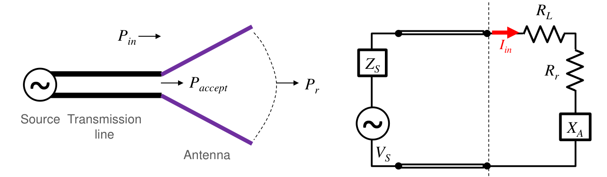
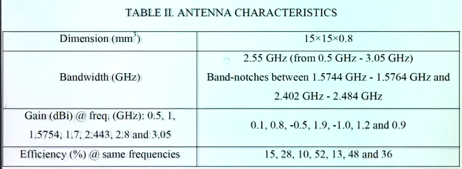
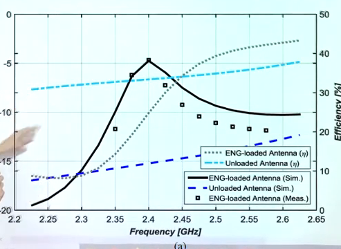
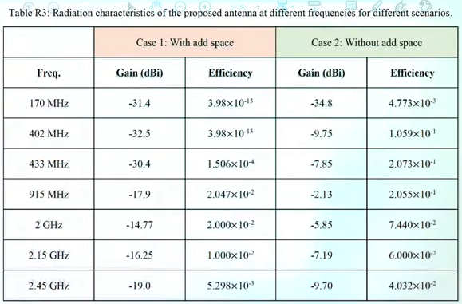
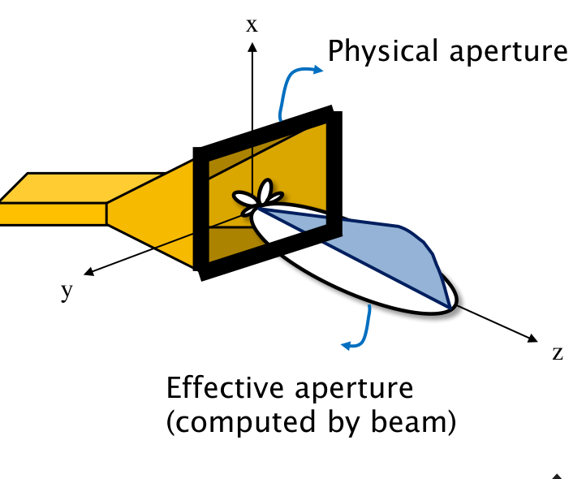
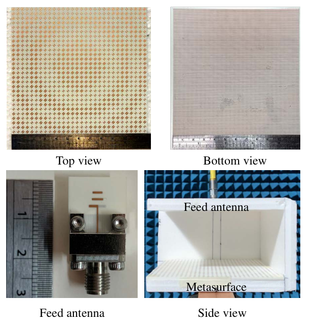
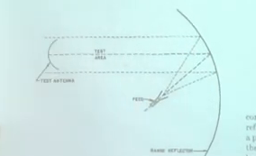

# 單元 18｜效率、增益與綜合評析

把反射、耗損與方向性接成一條功率鏈，再用它檢查接收功率與量測結果。

原始影片：[陳晏笙老師「天線」單元 18](https://www.youtube.com/watch?v=KH6Rcy2qd24)
老師講義：[Lecture 4：Antenna Parameters](https://drive.google.com/file/d/18mtgr-C9XaZz3r2wJWh29ZXxWADFx7yV/view)，**PDF 第 30–39 頁**；影片開頭回顧第 29 頁，文獻評讀與末段量測為影片另外展示的補充資料。

影片長度：約 80 分鐘　建議閱讀：約 40 分鐘
前置單元：11、15–17。需理解輻射電阻、極化與指向性。

這一章要掌握三件事：用功率分母分清指向性、增益與實現增益；用有效孔徑理解接收能力；把增益、極化與失配放進 Friis 公式，並檢查文獻或量測數字是否一致。

## 講義與影片對照

下表時間已依全片口述與關鍵畫面校準，仍以約略範圍方便回看；頁碼指上方 PDF 的實際頁碼。老師的文獻討論接在增益之後，量測討論接在 Friis 公式之後，本筆記保留這兩段位置並標明影片補充。

| 講義頁碼 | 原英文主題 | 中文內容 | 影片定位 |
|:--|:--|:--|:--|
| p.29（前章回顧） | Beam Area and Directivity (2/2) | 波束寬度與指向性估計 | [約 00:30–04:00](https://www.youtube.com/watch?v=KH6Rcy2qd24&t=30s) |
| pp.30–31 | Radiation Efficiency: Definition / Properties | 輻射效率、等效電阻與耗損 | [約 04:00–07:50](https://www.youtube.com/watch?v=KH6Rcy2qd24&t=240s) |
| p.32 | Gain | 峰值增益、增益場型與效率的 dB 換算 | [約 07:50–12:00](https://www.youtube.com/watch?v=KH6Rcy2qd24&t=480s) |
| 影片補充 | 文獻表格與圖 | 寬頻小天線、增益／效率曲線、植入式案例 | [約 12:00–34:20](https://www.youtube.com/watch?v=KH6Rcy2qd24&t=720s) |
| p.33 | Effective Aperture | 有效孔徑與增益的關係 | [約 34:20–38:50](https://www.youtube.com/watch?v=KH6Rcy2qd24&t=2060s) |
| p.34 | Aperture Efficiency | 28 GHz 透射陣列例題 | [約 38:50–44:30](https://www.youtube.com/watch?v=KH6Rcy2qd24&t=2330s) |
| p.35 | Realized Gain | 三種功率分母與失配效率 | [約 44:30–50:20](https://www.youtube.com/watch?v=KH6Rcy2qd24&t=2670s) |
| pp.36–37 | Friis Transmission Formula (1/4–2/4) | 自由空間公式、GSM-900 算例 | [約 50:20–55:00](https://www.youtube.com/watch?v=KH6Rcy2qd24&t=3020s) |
| pp.38–39 | Friis Transmission Formula (3/4–4/4) | 極化、端口失配與方向修正 | [約 55:00–59:00](https://www.youtube.com/watch?v=KH6Rcy2qd24&t=3300s) |
| 影片補充 | Antenna Measurements / Compact Range | 遠場、近場、兩天線校正與緊縮場 | [約 59:00–80:00](https://www.youtube.com/watch?v=KH6Rcy2qd24&t=3540s) |

老師用 $`e_{\rm rad}`$ 表示輻射效率、$`A_{\rm eff}`$ 表示有效孔徑、$`\eta_A`$ 表示孔徑效率、$`RG`$ 表示實現增益；本文分別寫作 $`\eta_{\rm rad}`$、$`A_e`$、$`\eta_{\rm ap}`$、$`G_{\rm realized}`$。另外，pp.30–35 的 $`P_r`$ 指輻射功率，pp.36–39 的 $`P_r`$ 改指接收功率；本文把前者明寫為 $`P_{\rm rad}`$，避免混淆。

### 開頭回顧：用波束寬度估計指向性（p.29，約 00:30–04:00）

老師引用〈Estimating Directivity and Gain of Antennas〉，比較 $`26000/(\theta_{\rm HP}\phi_{\rm HP})`$ 的經驗估計與 $`41253/(\theta_{\rm HP}\phi_{\rm HP})`$ 的理想模型，角度皆用度。課堂把後者稱為理想無旁瓣、平頂主波束的「上限」；要連同這個場型模型理解。**只知道兩個主切面的半功率波束寬度，並不足以建立任意三維場型的嚴格上限**；可靠的指向性仍由全空間功率積分求得。相關推導接續單元 17。

## 1．輻射效率：接受功率的去向（Radiation Efficiency，pp.30–31）



圖源：老師講義 p.30。左圖分清端口入射功率、天線接受功率與輻射功率；右圖以輻射電阻與耗損電阻表示接受功率的去向。

天線接受的平均實功率，分成輻射與內部耗損：

```math
P_{\rm acc}=P_{\rm rad}+P_{\rm loss},\qquad
\boxed{\eta_{\rm rad}=\frac{P_{\rm rad}}{P_{\rm acc}}.}
```

對被動天線，$`0\le\eta_{\rm rad}\le1`$。它不包括端口沒有接受的反射功率。

**老師的模擬提醒（約 04:55–05:55）：**若被動天線算出大於 100% 的輻射效率，應檢查數值結果；老師建議檢查開放邊界，並嘗試將 Radiation boundary 改為完全匹配層（PML）。這是排查方向，不能取代網格收斂、功率平衡與邊界位置的驗證。

### 利用等效電阻

沿用單元 11 的同一端口電流與阻抗。老師 p.30 採峰值相量 $`I_{\rm in}`$，因此平均功率有 $`1/2`$；若改採 RMS 電流，分子與分母都不需 $`1/2`$，比值相同：

```math
Z_A=R_r+R_\ell+jX_A,\qquad
\eta_{\rm rad}=\frac{\tfrac12 R_r|I_{\rm in}|^2}
{\tfrac12(R_r+R_\ell)|I_{\rm in}|^2}
=\frac{R_r}{R_r+R_\ell}.
```

輻射電阻 $`R_r`$ 表示向外傳走的功率；耗損電阻 $`R_\ell`$（原圖寫 $`R_L`$）表示導體、介質等轉成熱的功率。不能把整個實部都叫成輻射電阻。

**p.31 的兩種耗損：**導體的有限導電率造成焦耳熱；基板等介質的損耗則把部分場能轉成熱。理想電抗只儲存、歸還能量，不直接消耗平均實功率。效率與接受功率的關係為 $`P_{\rm rad}=\eta_{\rm rad}P_{\rm acc}`$。

> **核心觀念：** 改善反射能增加接受功率；改善輻射效率能減少接受功率中的發熱。兩者需要不同的診斷。

## 2．增益：指向性乘上輻射效率（Gain，p.32）

影片對照：[約 08:00](https://www.youtube.com/watch?v=KH6Rcy2qd24&t=480s)－[12:00](https://www.youtube.com/watch?v=KH6Rcy2qd24&t=720s)

影片將指向性修正為增益：

```math
\boxed{G(\theta,\phi)=\frac{4\pi U(\theta,\phi)}{P_{\rm acc}}
=\eta_{\rm rad}D(\theta,\phi).}
```

```math
G_{\max}=\eta_{\rm rad}D_{\max}.
```

同一方向，被動天線 $`G\le D`$；但 $`G`$ 不必小於 1，因為方向上的集中程度可以大於效率的損失。

### dB 表示：乘法變加法（影片約 15:30–20:00 板書）

```math
\boxed{G_{\rm dBi}=D_{\rm dBi}+10\log_{10}\eta_{\rm rad}.}
```

效率先用 0–1 的線性比例，不能直接把 80 代進 $`\log`$ 當成 80%。

| 效率 | $`10\log_{10}\eta_{\rm rad}`$ 重算 | 課堂心算值 |
|:--|--:|--:|
| 90% | −0.458 dB | 約 −0.5 dB |
| 80% | −0.969 dB | 約 −1 dB |
| 60% | −2.218 dB | 約 −2 dB |
| 50% | −3.010 dB | 約 −3 dB |
| 40% | −3.979 dB | 約 −4 dB |
| 30% | −5.229 dB | 約 −5 dB |
| 25% | −6.021 dB | 約 −6 dB |
| 12.5% | −9.031 dB | 約 −9 dB |
| 10% | −10 dB | −10 dB |

老師的心算法是「比例每減半，再減約 3 dB」：50% → 25% → 12.5%。遇到約 70%，可用 $`0.9\times0.8=0.72`$ 估算約 −1.5 dB；70% 的精確換算是 −1.549 dB。這些近似方便快速檢查表格，正式重算仍用原始比例。

### 負增益不等於沒有輻射

若 $`D_{\max}=1.5`$、效率 10%，$`G_{\max}=0.15`$，約 $`-8.239`$ dBi。 這表示相同接受功率下，其最大方向強度也低於理想各向同性、無耗損參考；並不表示功率為負，也不表示它不能接收訊號。

### 正規化增益場型

效率在同一頻率是整支天線的總功率比，故

```math
\frac{G(\theta,\phi)}{G_{\max}}
=\frac{D(\theta,\phi)}{D_{\max}}
=P_n(\theta,\phi)=|F_n(\theta,\phi)|^2.
```

因此正規化的增益場型、指向性場型與功率場型相同，並等於正規化場振幅的平方；比較場振幅與功率時，不能把兩者線性數值混用。

> **核心觀念：** dBi 是相對各向同性的對數比值；負 dBi 是小於參考值，不是負功率。

### 影片補充：用增益與效率評讀文獻（約 12:00–34:20）

這段不在所提供的 pp.30–39，老師另外開啟論文圖表，示範不能只看頻帶很寬或 $`S_{11}`$ 很低。以下圖片擷取自影片；重算是本筆記依畫面數值所做，並非替原論文更改數據。

**案例一：小尺寸、寬頻與低效率要一起看。**[約 14:45 的表格](https://www.youtube.com/watch?v=KH6Rcy2qd24&t=885s)列出尺寸 15 × 15 × 0.8 mm、頻帶 0.5–3.05 GHz，且在約 1.575 GHz 與 2.44 GHz 附近有帶阻。其增益與效率必須同一頻率配對：



圖源：本單元影片約 14:45，老師開啟的文獻 Table II。

| 頻率（GHz） | 增益（dBi） | 效率（%） |
|:--|--:|--:|
| 0.5 | 0.1 | 15 |
| 1.0 | 0.8 | 28 |
| 1.5754 | −0.5 | 10 |
| 1.7 | 1.9 | 52 |
| 2.443 | −1.0 | 13 |
| 2.8 | 1.2 | 48 |
| 3.05 | 0.9 | 36 |

若表列為普通增益與輻射效率，則同一方向有

```math
D_{\rm dBi}=G_{\rm dBi}-10\log_{10}\eta_{\rm rad}.
```

老師約 19:50–22:00 依序檢查兩個頻點：

| 頻點 | 課堂算法與重算 | 要和場型核對的問題 |
|:--|:--|:--|
| 1 GHz | 把 28% 約成 30%，再用約 −5 dB，心算 $`D\approx0.8+5=5.8`$ dBi；直接用 28% 重算為 **6.33 dBi** | 心算只判斷量級，不能把 5.8 當原始數據的精確結果 |
| 1.5754 GHz | $`D=-0.5-(-10)=\mathbf{9.5}`$ dBi | 老師展示一個近全向、另一個近 8 字形的切面，質疑它如何對應這麼高的峰值指向性 |

老師用典型偶極子約 2 dBi 的指向性作直觀比較；**兩張切面相似，仍不能保證完整三維場型相同**，應回查全空間積分。另以表中 0.5 GHz 重算約為 8.34 dBi；1.7 GHz 約為 4.74 dBi。若表中增益是峰值，反推的才是峰值指向性。這些數字還必須與該頻率的尺寸／波長、完整三維場型及量測定義一起檢查，不能用一個頻率的最高增益配另一頻率的最高效率。

**案例二：負 dBi 可以存在，但峰值仍受一致性限制。**[約 25:35 的圖](https://www.youtube.com/watch?v=KH6Rcy2qd24&t=1535s)左軸是增益（dBi），右軸是效率（%）；不同線型還區分載入／未載入及模擬／量測，讀圖時不能任意交叉配對。



圖源：本單元影片約 25:35，文獻的 ENG-loaded / Unloaded antenna 比較。黑色實線與方點為載入天線的增益模擬／量測，綠色點線為其效率；藍色線型屬另一組未載入天線。

在約 2.55–2.60 GHz，載入天線的模擬增益約 −10 dBi，對應效率約 40%。若它們分別是同頻率的**峰值普通增益**與**線性輻射效率**，則

```math
D_{\max,\rm dBi}\approx-10-10\log_{10}(0.4)
=-6.02\ {\rm dBi}.
```

然而全空間指向性的平均值為 1，因此有輻射時必須 $`D_{\max}\ge1`$（至少 0 dBi）。這表示上述定義或數據需要回查。若圖只是指定方向的增益，或者用的是實現增益、總效率及不同參考面，須先轉成相容的定義，不能直接下結論。

**案例三：效率的指數與比例單位也要查。**老師約 28–31 分鐘以植入式／膠囊裝置說明：天線縮小之外，周邊高耗損組織也會吸收電磁能，因此應把天線與實際使用環境一起評估。[約 31:55 的植入式天線比較表](https://www.youtube.com/watch?v=KH6Rcy2qd24&t=1915s)分成「With add space」與「Without add space」兩種情境。第一組 170 MHz 列為 −31.4 dBi 與 $`3.98\times10^{-13}`$；表頭只寫 Efficiency，沒有在這張表上註明百分比。



圖源：本單元影片約 31:55，老師展示的文獻 Table R3。

若把該效率視為線性比例：

```math
D_{\rm dBi}=-31.4-10\log_{10}(3.98\times10^{-13})
\approx92.60\ {\rm dBi}.
```

這是需要追查的巨大值；若原數字其實是百分比，還會再差 20 dB。應回查效率的單位、指數、欄位、頻率與增益定義，不替原表猜一個「正確數字」。植入組織的耗損也必須納入模型說明。

評讀時依序確認：頻帶用哪個門檻定義；效率含不含失配與周邊材料耗損；增益是否為峰值／實現增益；模擬與量測是否採相同頻率、環境、參考面與角度範圍。若用實現增益除以輻射效率，得到的是 $`D(1-|\Gamma|^2)`$，還不能直接當成 $`D`$。


## 3．有效孔徑：把接收能力換成等效面積（Effective Aperture，p.33）



圖源：老師講義 p.33。黑框是實體口徑；藍色區域是接收能力的等效面積示意，並非另一塊實際金屬。

接收天線照到局部近似平面波，入射平均功率密度為 $`S_{\rm inc}`$。在極化匹配、接收端共軛匹配的條件下：

```math
P_{r,\rm available}=S_{\rm inc}A_e.
```

$`A_e`$ 是有效孔徑，也稱有效面積，單位 m$`^2`$。它是接收能力的等效表示，不是將尺放在天線上量到的尺寸。 對線性、被動、互易天線：

```math
\boxed{A_e(\theta,\phi)=\frac{\lambda^2}{4\pi}G(\theta,\phi).}
```

峰值有效孔徑用峰值增益。$`\lambda`$ 是傳播介質中的波長；本課的自由空間案例使用 $`\lambda=c/f`$。

### 從公式讀出兩個條件

-   同頻率，增益越高，對應的有效孔徑越大。

-   不同頻率，還須考慮 $`\lambda^2`$；不能只看兩個 dBi 值相同，就判斷接收等效面積相同。

有效面積與實際實心導體面積不必相同。細線偶極也有有效孔徑；對它用金屬表面積計算「孔徑效率」通常沒有合適意義。

### 對孔徑天線的直觀

號角、反射面、透射陣列等有明確物理口徑。它們的相位、振幅照明不均，邊緣繞射、溢出與耗損，通常使有效面積小於物理口徑面積。 後續孔徑天線單元會把口徑上的場分佈，連結到遠場與指向性。

> **核心觀念：** 有效孔徑由增益換算而來，描述在指定方向、極化與負載條件下的接收能力。

## 4．孔徑效率與透射陣列例題（Aperture Efficiency，p.34）



圖源：老師講義 p.34。上排為陣列表面與背面，下排為饋入天線與側視圖；計算的物理口徑是 15 cm × 15 cm 的陣列面積。

對有明確物理口徑 $`A_{\rm phy}`$ 的孔徑天線，影片定義

```math
\boxed{\eta_{\rm ap}=\frac{A_e}{A_{\rm phy}}.}
```

這個效率回答「口徑利用得如何」，不是輻射效率的另一個名字。若 $`A_e`$ 由普通增益換算，就已包含天線耗損。

### 老師例題完整重算：28 GHz、18 dBi、15 cm $`\times`$ 15 cm

```math
\lambda=\frac{3\times10^8}{28\times10^9}
\approx0.010714\ {\rm m},\qquad G=10^{18/10}\approx63.096,
```

```math
A_e=\frac{\lambda^2}{4\pi}G
\approx5.764\times10^{-4}\ {\rm m^2},
\qquad A_{\rm phy}=0.15^2=0.0225\ {\rm m^2}.
```

```math
\boxed{\eta_{\rm ap}\approx0.02562=2.562\%.}
```

這與投影片約 2.56% 一致。18 dBi 本身看來不低，但相對於此頻率的 15 cm 口徑（每邊約 $`14\lambda`$），等效面積只占很小比例；評估要把尺寸與波長一起看。

老師約 41:55–42:59 以反射陣列、透鏡等設計經驗說明：20% 已有一定表現，40% 是更好的口徑利用。這是課堂特定設計背景的經驗值，不能當成所有孔徑天線的合格門檻。

約 43:25–44:30 又以八木天線提醒：若對不具明確口面的天線，任取幾何面積當分母，$`A_e/A_{\rm phy}`$ 可能大於 1；此比值不等於「輸出功率超過輸入功率」。選定的面積必須有可比較的物理意義，才適合與大型孔徑天線的孔徑效率比較。

## 5．實現增益：分母改成端口入射功率（Realized Gain，p.35）

正實數參考阻抗下，$`P_{\rm acc}=P_{\rm inc}(1-|\Gamma|^2)`$：

```math
\boxed{G_{\rm realized}(\theta,\phi)=
\frac{4\pi U(\theta,\phi)}{P_{\rm inc}}
=(1-|\Gamma|^2)\eta_{\rm rad}D(\theta,\phi).}
```

**老師的半功率例子（約 45–47 分鐘）：**若 $`S_{11}`$ 約 −3 dB，反射功率比例約一半，端口只接受另一半。普通增益仍以已接受功率為分母；實現增益才把這約 3 dB 的失配損失納入。精確「一半」對應 $`20\log_{10}|\Gamma|=-3.0103`$ dB。

以同一端口與同一方向比較，被動天線有

```math
G_{\rm realized}\le G\le D.
```


圖為本筆記整理。與老師 p.35 對照，三種參數的分母不同：

| 參數 | 功率分母 | 計入什麼 |
|:--|:--|:--|
| 指向性 $`D=4\pi U/P_{\rm rad}`$ | 真正向外輻射的總功率 | 方向集中程度 |
| 增益 $`G=4\pi U/P_{\rm acc}`$ | 天線端口接受功率 | 方向性與天線耗損 |
| 實現增益 $`G_{\rm realized}=4\pi U/P_{\rm inc}`$ | 指定參考面的入射功率 | 再計入該端口失配 |

### 整體效率需要把參考面寫清楚

以端口入射功率為分母的總效率：

```math
\eta_{\rm total}=(1-|\Gamma|^2)\eta_{\rm rad}.
```

若效率含饋線、匹配網路，還要考慮它們的耗損。量測儀器或論文把數值叫作「efficiency」時，先確認它指輻射效率還是總效率。老師約 48–50 分鐘強調：由端口入射功率出發的量測，若未另外移除失配，得到的增益與效率便包含失配；片尾量測流程會再用到這點。

> **核心觀念：** 同一方向、同一頻率、同一參考面下，才可直接比較這三種參數。

## 6．自由空間傳輸與 GSM-900 算例（Friis Transmission Formula 1/4–2/4，pp.36–37）

### p.36：發射端的功率如何傳到接收端

自由空間、遠場、方向對準、極化匹配，並採相容的功率與增益定義：

```math
\boxed{P_r=P_tG_tG_r\left(\frac{\lambda}{4\pi R}\right)^2.}
```

本頁 $`P_t`$ 為發射天線接受功率，$`P_r`$ 為接收天線共軛匹配時的可用功率，$`G_t,G_r`$ 是普通增益；先不加入額外端口失配。

從有效孔徑可接起這條關係：發射天線在距離 $`R`$ 的功率密度為 $`S=P_tG_t/(4\pi R^2)`$，接收端的 $`A_{e,r}=\lambda^2G_r/(4\pi)`$，所以 $`P_r=SA_{e,r}`$ 就得到 Friis 公式。這也說明了兩個增益與距離平方各從哪裡來。

老師約 51 分鐘由此指出：**固定兩端增益與距離**，頻率提高、波長變短，公式中的接收功率隨 $`\lambda^2`$ 下降。若改成固定物理孔徑，增益本身會隨頻率改變，不能只看這一項。

### p.37：老師的 GSM-900 上行例題

手機發射 33 dBm，手機天線約 1.76 dBi，基地台天線 10 dBi，相距 100 m。影片以 $`\lambda\approx0.33`$ m：

```math
P_t\approx2\ {\rm W},\qquad G_t\approx1.5,\qquad G_r=10,
```

```math
P_r\approx2(1.5)(10)
\left(\frac{0.33}{4\pi(100)}\right)^2
\approx2.07\ \mu{\rm W}.
```

投影片線性列寫約 2.11 $`\mu`$W；採 $`\lambda\approx1/3`$ m，結果約 2.11 $`\mu`$W。差異來自波長等數值的取位。

### dB 版本

自由空間路徑損耗是正值：

```math
L_{\rm FS}=20\log_{10}\frac{4\pi R}{\lambda}
\approx71.61\ {\rm dB}\quad(\lambda=0.33\ {\rm m}).
```

```math
\boxed{P_r({\rm dBm})=33+1.76+10-71.61
\approx-26.85\ {\rm dBm}.}
```

功率換算：

```math
P({\rm mW})=10^{P_{\rm dBm}/10}.
```

$`-26.85`$ dBm 約為 0.002065 mW，即 2.065 $`\mu`$W，與本頁用 0.33 m 的線性計算一致。

### 這不是實際城市通訊的完整預測

這是影片用來解釋公式的自由空間基準。遮蔽、反射、多路徑、饋線和方向誤差等需要額外評估。下一單元會把公式擴成鏈路預算。

> **核心觀念：** dBm 是功率的絕對參考尺度，dBi 是天線增益比值，dB 是增減量；三種單位在公式中各有角色。

## 7．極化、端口失配與方向修正（Friis Transmission Formula 3/4–4/4，pp.38–39）

### p.38：極化損失因素

接收端不一定接受入射波的全部極化成分。沿用單元 15：以同一傳播方向與座標，令 $`\boldsymbol\rho_w`$ 為入射波的單位極化，$`\boldsymbol\rho_r`$ 為接收端接受的入射極化模式：

```math
\eta_{\rm pol}=
|\boldsymbol\rho_r^{H}\boldsymbol\rho_w|^2.
```

老師原式是 $`e_{\rm pol}=|\hat{\mathbf e}_t\cdot\hat{\mathbf e}_r|^2`$。此處把它改寫成兩個同向入射極化模式的 Hermitian 內積，將複數共軛的慣例明寫出來。影片用發射／接收極化向量表達；兩端可能以相反傳播方向定義基底。要先對齊慣例，不能只對兩個名稱相同的圓極化向量直接套算。

老師約 55:30 提醒，極化內積要取**絕對值平方**；它是功率比例，不能漏掉平方。

### 老師的兩個極化例子與線極化一般式

-   p.38 第一例：發射為 x 軸線極化、接收為 y 軸線極化，兩者正交，理想情況 $`\eta_{\rm pol}=0`$，接收功率為 0。

-   線極化夾角 $`\psi`$：$`\eta_{\rm pol}=\cos^2\psi`$。45° 時只有一半，損失 3.010 dB。

-   理想圓極化入射配線極化接收：$`\eta_{\rm pol}=1/2`$；線天線旋轉仍維持此比例。

**口述釐清（約 55:30–57:00）：**圓極化配線極化可避免只因線天線轉向就完全正交，但固定損失約 3 dB。兩端都用圓極化也能正常傳輸：在共同傳播方向的接收模式定義下，相同旋向可匹配、正交旋向理想上為零。老師對兩端圓極化的提醒應理解為「旋向／觀看方向不能弄錯」，並非圓極化不能搭配圓極化。

### p.39：端口以相同正實數參考阻抗工作

若發射端功率是其端口入射功率，接收負載等於所用參考阻抗，影片的額外失配因素可寫為

```math
\eta_{\rm mis}=(1-|\Gamma_t|^2)(1-|\Gamma_r|^2).
```

因此用普通增益時：

```math
P_{r,\rm load}=P_{t,\rm inc}G_tG_r
\left(\frac{\lambda}{4\pi R}\right)^2
\eta_{\rm pol}\eta_{\rm mis}.
```

若改用兩端同參考面的實現增益：

```math
P_{r,\rm load}=P_{t,\rm inc}G_{t,\rm realized}G_{r,\rm realized}
\left(\frac{\lambda}{4\pi R}\right)^2\eta_{\rm pol}.
```

此時不再重複加入 $`\eta_{\rm mis}`$。一般複數接收負載的失配，需用具體天線源阻抗／負載公式計算；不能一律以 $`1-|\Gamma_A|^2`$ 代表共軛匹配損失。

### p.39 最後一式：把兩端實際方向也放進去

天線沒有對準各自的主波束時，必須使用連線方向上的增益，而不是直接代峰值：

```math
P_{r,\rm load}=P_{t,\rm inc}
G_t(\theta_t,\phi_t)G_r(\theta_r,\phi_r)
\left(\frac{\lambda}{4\pi R}\right)^2
\eta_{\rm pol}(1-|\Gamma_t|^2)(1-|\Gamma_r|^2).
```

$`(\theta_t,\phi_t)`$ 與 $`(\theta_r,\phi_r)`$ 各以該天線的座標為準。端口匹配不代表方向或極化也匹配，三者要分開檢查。

> **核心觀念：** 普通增益要另考慮指定端口失配；實現增益已包含它。極化因素還要看所用增益是否已對該接收極化投影。

## 8．影片補充：從兩天線傳輸求場型與增益（約 59–80 分鐘）

影片對照：[約 59:00](https://www.youtube.com/watch?v=KH6Rcy2qd24&t=3540s)－[80:00](https://www.youtube.com/watch?v=KH6Rcy2qd24&t=4800s)

這段是老師另外開啟量測文獻並配合板書的補充，不在本份講義 pp.30–39 中。畫面可見〈An overview of near-field antenna measurements〉與〈Compact Range Techniques and Measurements〉等文件。

影片末段介紹量測方式：直接遠場、近場量測，以及使用緊縮場 CATR 的間接遠場。共同目標是取得天線在各方向、各極化的輻射資料。

### 近場量測：先量複數場，再轉換到遠場（約 60:30–63:00）

老師以 HFSS 在包圍天線的面上取得場、再計算遠場作類比，並展示 Arthur D. Yaghjian 的〈An Overview of Near-Field Antenna Measurements〉。重點是：近場量測先取得空間上的振幅、相位與極化資料，再用電磁場轉換求遠場，不能直接把某個近場點的場強當成遠場增益。

**口述適用範圍：**老師區分反應近場與輻射近場，建議在輻射近場做量測；「反應近場完全無法推遠場」則不能當成普遍定理。轉換能否成立，取決於量測面、完整場資料、探頭修正與方法假設；靠得過近還會增加探頭與天線的交互作用。Yaghjian 的原始近場理論以包圍天線的掃描面及探頭響應建立轉換，並非只靠一條近／遠場距離界線判定。[理論依據：NBS Technical Note 696](https://nvlpubs.nist.gov/nistpubs/Legacy/TN/nbstechnicalnote696r.pdf)

### 直接遠場的兩天線法（約 63:00–69:55）

參考天線與待測天線 AUT 相距 $`R`$，在吸波環境中對準，使用網路分析儀量 $`S_{21}`$。理想自由空間、端口與儀器校正一致時：

```math
|S_{21}|^2=
G_{\rm ref,realized}\,G_{\rm AUT,realized}
\left(\frac{\lambda}{4\pi R}\right)^2\eta_{\rm pol}.
```

老師的板書分成「先校正路徑，再換待測天線」兩步。將固定路徑的線性功率傳輸因子寫成 $`L_{\rm path}`$（不是正值 dB 路徑損耗），且兩次極化匹配：

```math
L_{\rm path}=
\frac{|S_{21,\rm std}|^2}
{G_{t,\rm realized}G_{\rm std,realized}},\qquad
G_{\rm AUT,realized}=
\frac{|S_{21,\rm AUT}|^2}
{G_{t,\rm realized}L_{\rm path}}.
```

校正時，發射與接收兩支標準天線的增益皆已知；換上 AUT 後，發射天線與校正過的路徑因子已知，只剩 AUT 的增益待求。若標準與 AUT 分別放在同一位置，保持另一端天線、距離、極化與儀器設定不變，可合併成替代量測公式：

```math
G_{\rm AUT,realized}
=G_{\rm std,realized}
\frac{|S_{21,\rm AUT}|^2}{|S_{21,\rm std}|^2}.
```

因此已知參考天線的實現增益，可反推出待測天線的實現增益。注意參考資料若給的是普通增益，要先處理其端口失配。電纜、轉接頭與放大器若未在校正中移除，也會進入量測的傳輸結果。

網路分析儀顯示 $`S_{21}(\mathrm{dB})=20\log_{10}|S_{21}|`$，這也等於功率比 $`10\log_{10}|S_{21}|^2`$。所以用 dB 代入替代公式時，直接相減兩次顯示值即可，不要再平方一次 dB 數字。

### 場型與效率的後處理

1.  旋轉 AUT，量測各方向，並取得所需共／交叉極化資料。

2.  相對最大值正規化，得到功率場型 $`P_n`$。

3.  用全空間線性功率積分，算 $`D_{\max}`$。

4.  若量到普通增益，$`\eta_{\rm rad}=G_{\max}/D_{\max}`$。

5.  若量到實現增益，$`G_{\max,realized}/D_{\max}=\eta_{\rm total}`$；若要輻射效率，再除以同參考面的 $`1-|\Gamma|^2`$。

老師約 68:45–69:30 先口稱「輻射效率」，隨即更正為含失配的「天線效率」。這個更正正是實現增益與普通增益不能混用的實際例子。積分前需將 dB 轉回線性功率，並把所需兩個正交極化的功率相加。

僅測一張主切面，一般不足以得到完整三維效率；少測極化分量也可能低估總輻射。

### 為什麼有近場與緊縮場？（約 69:55–79:40）

吸波體的作用是壓低房間中的反射與多路徑，使直接遠場量測接近 Friis 的單一路徑假設。還要確認兩天線相距足夠遠；單有吸波體，並不保證任何尺寸或頻率的天線都能在這個場地量測。

老師用口徑中心與邊緣的路徑差說明遠場距離。令 $`D_{\rm size}`$ 是最大口徑尺寸，軸向距離 $`R\gg D_{\rm size}`$，則

```math
\Delta R=\sqrt{R^2+(D_{\rm size}/2)^2}-R
\approx\frac{D_{\rm size}^2}{8R}.
```

要求最大相位差不超過 $`\pi/8`$（22.5°），有

```math
\frac{2\pi}{\lambda}\Delta R\le\frac{\pi}{8}
\quad\Longrightarrow\quad
R\gtrsim\frac{2D_{\rm size}^2}{\lambda}.
```

這是口徑相位誤差標準，仍須配合兩端尺寸與波長等條件。影片板書採 10 GHz、5 m × 5 m 大型天線：$`\lambda=0.03`$ m，以 5 m 尺度估算已有約 1.67 km；若依方形口徑的最大對角尺寸 $`5\sqrt2`$ m，則約 3.33 km。它用來說明室內直接遠場的空間困難。老師也提到自己的透射陣列曾算出兩百多公尺的遠場距離，藉此引出緊縮場；這是課堂經驗，沒有在影片中提供完整尺寸／頻率供重算。

| 量測方式 | 老師的縮寫 | 核心作法與要注意的量 |
|:--|:--|:--|
| 近場量測 | NF | 在近處量複數場，再轉成遠場；需要相位、取樣範圍與探頭修正 |
| 直接遠場 | DFF | 把兩天線拉到足夠距離，直接量角度與傳輸；需控制環境反射 |
| 間接遠場／緊縮場 | IFF / CATR | 用反射面準直球面波，在較短場地形成近似平面波測試區 |



圖源：影片約 78:45 展示的〈Compact Range Techniques and Measurements〉。饋入天線照射主反射面，反射後的射線近似平行，待測天線放在左側測試區。測試區大小以及振幅／相位均勻度仍須確認，不能只因使用反射面就忽略量測誤差。

這個可用的近似平面波區域稱為靜區（quiet zone），AUT 必須放在合適的靜區內。老師約 79:10 又提到雙反射面配置：可先把饋入波導向另一個反射面，再形成測試區，讓系統以不同方式安排路徑與尺寸。具體能縮小多少取決於設計，並非所有雙反射面系統都固定減半。

### 結果不一致時先檢查什麼？

先對齊參考面、功率分母、極化、方向與頻率，再檢查反射、電纜校正、背景反射和取樣範圍。用 $`G\le D`$ 或 $`G_{\rm realized}\le G`$ 檢查時，也必須確保兩邊採相同定義。

> **核心觀念：** 量測最先得到的是某條傳輸路徑的結果；要換成天線增益與效率，必須清楚移除或保留各項因素。

## 9．補充解說與重算例題

以下是本筆記為串接概念而保留的補充計算；老師 p.34 與 p.37 的原題已留在正文相應頁次。

### 補充重算：匹配與效率可獨立變差

設 $`R_r=40\,\Omega`$、$`R_\ell=10\,\Omega`$、$`X_A=0`$。接 50 $`\Omega`$ 介面時沒有反射，但效率只有 80%。 入射 1 W，接受 1 W，輻射 0.8 W，內部耗損 0.2 W。 若相同天線在另一頻率有 $`|\Gamma|=0.5`$，且該頻率效率仍為 80%：

```math
P_{\rm acc}=1(1-0.5^2)=0.75\ {\rm W},
\qquad P_{\rm rad}=0.75(0.8)=0.60\ {\rm W}.
```

此時反射 0.25 W、天線耗損 0.15 W。總和仍為 1 W。

### 補充重算：指向性高，不代表最後增益高

天線 A 的 $`D_{\max}=10`$、效率 50%，故 $`G_{\max}=5`$，約 6.99 dBi。天線 B 的 $`D_{\max}=8`$、效率 90%，故 $`G_{\max}=7.2`$，約 8.57 dBi。 B 的指向性較低，實際增益卻較高；比較必須看用途與功率分母。

### 補充重算：2.4 GHz、6 dBi

```math
\lambda=0.125\ {\rm m},\qquad G=10^{6/10}\approx3.981,
```

```math
A_e=\frac{0.125^2}{4\pi}(3.981)
\approx0.004950\ {\rm m^2}=49.50\ {\rm cm^2}.
```

若 $`S_{\rm inc}=1`$ mW/m$`^2`$，極化與負載匹配時，可用接收功率約 4.950 $`\mu`$W。若接收極化因素只有 0.5，得到的功率再減半。

### 補充重算：10 dBi 指向性、80% 效率、VSWR = 3

VSWR = 3 對應 $`|\Gamma|=0.5`$。普通增益為 $`10(0.8)=8`$，約 9.031 dBi；實現增益為 $`8(0.75)=6`$，約 7.782 dBi。 當實現增益已納入失配因素，後續鏈路公式不能再乘一次同一因素。

### 補充重算：在 GSM-900 案例的 2.07 $`\mu`$W 上加入損失

若 $`\eta_{\rm pol}=0.5`$、$`|\Gamma_t|=0.2`$、$`|\Gamma_r|=0.3`$：

```math
\eta_{\rm pol}\eta_{\rm mis}=0.5(0.96)(0.91)=0.4368,
```

接收功率約 $`2.07(0.4368)=0.904`$ $`\mu`$W；額外降低約 3.60 dB。

## 10．自測與解析

先說明功率分母，再算數字。

1.  $`R_r=30\,\Omega`$、$`R_\ell=20\,\Omega`$、$`X_A=0`$，接 50 $`\Omega`$。求輻射效率；入射 1 W 時輻射多少？

2.  $`D_{\max}=8`$、輻射效率 50%、$`|\Gamma|=0.5`$。求普通增益與實現增益的線性值、dBi。

3.  2.4 GHz 天線增益 3 dBi。求峰值有效孔徑；入射功率密度 1 mW/m$`^2`$，匹配時可用接收功率約多少？

4.  影片 28 GHz、18 dBi、15 cm $`\times`$ 15 cm 的口徑效率約 2.56%。若同尺寸、同頻率增益提高 3 dB，口徑效率約如何改變？

5.  Friis 計算已使用兩端的實現增益，是否還要乘兩個 $`1-|\Gamma|^2`$？線極化 45° 不合又需如何處理？

### 答案與理由

1.  $`\eta_{\rm rad}=30/50=60\%`$。端口匹配，接受 1 W，輻射 0.6 W、耗損 0.4 W。

2.  $`G=4=6.021`$ dBi；$`G_{\rm realized}=4(0.75)=3=4.771`$ dBi。效率與失配都沒有改變 $`D`$ 的功率分母。

3.  $`G\approx1.995`$，$`A_e\approx0.002481`$ m$`^2`$，即約 24.81 cm$`^2`$；功率約 2.481 $`\mu`$W。

4.  增益與 $`A_e`$ 同比例增大，3 dB 約為 1.995 倍，效率約 5.11%。不是直接加 3 個百分點。

5.  不再重複乘端口失配；若所用增益還沒有計入這個極化投影，仍需乘 $`\cos^245^\circ=0.5`$，降低 3.010 dB。

### 公式速記

```math
\eta_{\rm rad}=\frac{R_r}{R_r+R_\ell},\quad
G=\eta_{\rm rad}D,\quad
G_{\rm realized}=(1-|\Gamma|^2)G,
```

```math
A_e=\frac{\lambda^2G}{4\pi},\qquad
\eta_{\rm ap}=\frac{A_e}{A_{\rm phy}}.
```

**下一單元：**[單元 19｜鏈路預算](019_鏈路預算分析.md)，把發射功率、天線增益、路徑損耗與接收需求接成完整鏈路。
