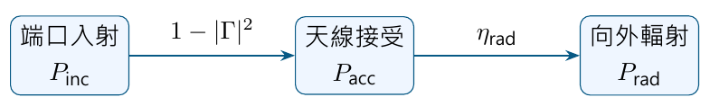

# 單元 18｜效率、增益與綜合評析

[下載原始 PDF](../pdf/018_效率、增益與綜合評析.pdf)

把反射、耗損與方向性接成一條功率鏈

原始影片：[陳晏笙老師「天線」單元 18](https://www.youtube.com/watch?v=KH6Rcy2qd24)

影片長度：約 80 分鐘　建議閱讀：約 25 分鐘

前置單元：11、15–17。需理解輻射電阻、極化與指向性。

> **核心觀念：** 指向性描述輻射集中程度；增益再計入天線耗損；實現增益還計入指定端口的失配。三者對應不同功率分母。

## 這一單元的五個問題

1.  接受的功率，有多少真正輻射出去？

2.  低於 0 dBi 的增益代表什麼？如何檢查文獻數字？

3.  有效孔徑如何連結接收功率與增益？

4.  失配與極化不合，如何降低鏈路功率？

5.  實際量測如何從兩天線間的傳輸得到場型與增益？

## 先記住功率流程

這張圖採正實數參考阻抗；天線若包含額外饋線／匹配網路，需說明效率與反射的參考面。

## 閱讀地圖

第 2 頁：輻射效率；第 3 頁：增益；第 4 頁：文獻判讀；第 5 頁：有效孔徑；第 6 頁：孔徑效率與實現增益；第 7 頁：Friis 算例；第 8 頁：極化與失配；第 9 頁：量測；第 10 頁：自測。 依影片的公式、案例與板書重整。文獻數值只作影片中的判讀案例；補充推算與假設均有標示。

## 1．輻射效率：接受功率的去向

影片對照：[約 03:00](https://www.youtube.com/watch?v=KH6Rcy2qd24&t=180s)－[08:00](https://www.youtube.com/watch?v=KH6Rcy2qd24&t=480s)

天線接受的平均實功率，分成輻射與內部耗損：

$$
P_{\rm acc}=P_{\rm rad}+P_{\rm loss},\qquad
\boxed{\eta_{\rm rad}=\frac{P_{\rm rad}}{P_{\rm acc}}.}
$$

對被動天線，$0\le\eta_{\rm rad}\le1$。它不包括端口沒有接受的反射功率。

### 利用等效電阻

沿用單元 11 的同一端口電流與阻抗：

$$
Z_A=R_r+R_\ell+jX_A,\qquad
\eta_{\rm rad}=\frac{R_r|I_{\rm rms}|^2}
{(R_r+R_\ell)|I_{\rm rms}|^2}
=\frac{R_r}{R_r+R_\ell}.
$$

輻射電阻表示向外傳走的功率；耗損電阻表示導體、介質等轉成熱的功率。不能把整個實部都叫成輻射電阻。

### 補充重算：匹配與效率可獨立變差

設 $R_r=40\,\Omega$、$R_\ell=10\,\Omega$、$X_A=0$。接 50 $\Omega$ 介面時沒有反射，但效率只有 80%。 入射 1 W，接受 1 W，輻射 0.8 W，內部耗損 0.2 W。 若相同天線在另一頻率有 $|\Gamma|=0.5$，且該頻率效率仍為 80%：

$$
P_{\rm acc}=1(1-0.5^2)=0.75\ {\rm W},
\qquad P_{\rm rad}=0.75(0.8)=0.60\ {\rm W}.
$$

此時反射 0.25 W、天線耗損 0.15 W。總和仍為 1 W。

### 整體效率需要把參考面寫清楚

以端口入射功率為分母的總效率：

$$
\eta_{\rm total}=(1-|\Gamma|^2)\eta_{\rm rad}.
$$

若效率含饋線、匹配網路，還要考慮它們的耗損。量測儀器或論文把數值叫作「efficiency」時，先確認它指輻射效率還是總效率。

> **核心觀念：** 改善反射能增加接受功率；改善輻射效率能減少接受功率中的發熱。兩者需要不同的診斷。

## 2．增益：指向性乘上輻射效率

影片對照：[約 08:00](https://www.youtube.com/watch?v=KH6Rcy2qd24&t=480s)－[12:00](https://www.youtube.com/watch?v=KH6Rcy2qd24&t=720s)

影片將指向性修正為增益：

$$
\boxed{G(\theta,\phi)=\frac{4\pi U(\theta,\phi)}{P_{\rm acc}}
=\eta_{\rm rad}D(\theta,\phi).}
$$

$$
G_{\max}=\eta_{\rm rad}D_{\max}.
$$

同一方向，被動天線 $G\le D$；但 $G$ 不必小於 1，因為方向上的集中程度可以大於效率的損失。

### dB 表示：乘法變加法

$$
\boxed{G_{\rm dBi}=D_{\rm dBi}+10\log_{10}\eta_{\rm rad}.}
$$

效率先用 0–1 的線性比例，不能直接把 80 代進 $\log$ 當成 80%。

| 效率 | $\eta_{\rm rad}$ | 增益相對指向性的降低 |
|:-----|:-----------------|:---------------------|
| 90%  | 0.9              | 約 $-0.458$ dB       |
| 80%  | 0.8              | 約 $-0.969$ dB       |
| 50%  | 0.5              | 約 $-3.010$ dB       |
| 10%  | 0.1              | $-10$ dB             |

### 補充重算：指向性高，不代表最後增益高

天線 A 的 $D_{\max}=10$、效率 50%，故 $G_{\max}=5$，約 6.99 dBi。天線 B 的 $D_{\max}=8$、效率 90%，故 $G_{\max}=7.2$，約 8.57 dBi。 B 的指向性較低，實際增益卻較高；比較必須看用途與功率分母。

### 負增益不等於沒有輻射

若 $D_{\max}=1.5$、效率 10%，$G_{\max}=0.15$，約 $-8.239$ dBi。 這表示相同接受功率下，其最大方向強度也低於理想各向同性、無耗損參考；並不表示功率為負，也不表示它不能接收訊號。

### 正規化增益場型

效率在同一頻率是整支天線的總功率比，故

$$
\frac{G(\theta,\phi)}{G_{\max}}
=\frac{D(\theta,\phi)}{D_{\max}}=P_n(\theta,\phi).
$$

因此正規化形狀可相同，絕對尺度不同。

> **核心觀念：** dBi 是相對各向同性的對數比值；負 dBi 是小於參考值，不是負功率。

## 3．影片文獻案例：用一致性檢查數字

影片對照：[約 12:00](https://www.youtube.com/watch?v=KH6Rcy2qd24&t=720s)－[34:00](https://www.youtube.com/watch?v=KH6Rcy2qd24&t=2040s)

影片閱讀小型、寬頻、帶阻或植入式天線的表格，示範不能只看「可工作頻帶很寬」或「S11 很低」。這些結果仍須配合增益、效率與使用環境。

### 例一：增益與效率要在同一頻率比

影片第一份文獻表格，0.5 GHz 列出增益約 0.1 dBi、效率 15%；1.7 GHz 則為 1.9 dBi、52%。在兩者分別代表 $G$ 與 $\eta_{\rm rad}$ 的前提下：

$$
D_{\max,\rm dBi}=G_{\max,\rm dBi}
-10\log_{10}\eta_{\rm rad}.
$$

重算得 0.5 GHz 約 8.34 dBi，1.7 GHz 約 4.74 dBi。不同頻率可以有不同指向性；若想判斷合理性，還要看完整場型、是否同一功率定義，以及尺寸和材料。 只拿某頻率的最高增益，配另一頻率的最高效率，沒有物理意義。

### 例二、三：負增益、效率與峰值的檢查

影片一例給 peak gain 約 $-10$ dBi、效率約 40%；若是同一頻率的普通峰值增益，反推 $D_{\max}\approx-6.02$ dBi，與 $D_{\max}\ge0$ dBi 不一致。但指定方向的非峰值、實現增益或不同功率參考，需先換算才能判斷。 影片另一張表在 170 MHz 的某案例，列出 $-31.4$ dBi 與 $3.98\times10^{-13}$ 的效率數字。若後者為線性輻射效率，直接反推：

$$
D_{\max,\rm dBi}
=-31.4-10\log_{10}(3.98\times10^{-13})
\approx92.60\ {\rm dBi}.
$$

這是應回查的異常結果，不能默認整張表都使用相同百分比／比例與功率定義。可能需要確認效率單位、指數、欄位或增益定義；講義不替原始表格猜一個「正確數字」。

### 評讀時問四件事

1.  頻帶是以反射、增益、效率，還是極化門檻定義？

2.  表列效率是否包含失配、饋線或周邊組織耗損？

3.  增益是普通增益，還是實現增益？測試方向是峰值嗎？

4.  模擬與量測是否在相同環境、參考面與角度範圍？

**補充解說／重算例題：**若報告的是實現增益，除以輻射效率得到的是 $D(1-|\Gamma|^2)$，不能直接當成 $D$。先確認定義，才使用數值檢查。

> **核心觀念：** 好看的反射曲線只回答接受功率的問題；增益、效率與方向資料必須互相對得起來。

## 4．有效孔徑：把接收能力換成等效面積

影片對照：[約 34:00](https://www.youtube.com/watch?v=KH6Rcy2qd24&t=2040s)－[40:00](https://www.youtube.com/watch?v=KH6Rcy2qd24&t=2400s)

接收天線照到局部近似平面波，入射平均功率密度為 $S_{\rm inc}$。在極化匹配、接收端共軛匹配的條件下：

$$
P_{r,\rm available}=S_{\rm inc}A_e.
$$

$A_e$ 是有效孔徑，也稱有效面積，單位 m$^2$。它是接收能力的等效表示，不是將尺放在天線上量到的尺寸。 對線性、被動、互易天線：

$$
\boxed{A_e(\theta,\phi)=\frac{\lambda^2}{4\pi}G(\theta,\phi).}
$$

峰值有效孔徑用峰值增益。$\lambda$ 是傳播介質中的波長；本課的自由空間案例使用 $\lambda=c/f$。

### 從公式讀出兩個條件

-   同頻率，增益越高，對應的有效孔徑越大。

-   不同頻率，還須考慮 $\lambda^2$；不能只看兩個 dBi 值相同，就判斷接收等效面積相同。

有效面積與實際實心導體面積不必相同。細線偶極也有有效孔徑；對它用金屬表面積計算「孔徑效率」通常沒有合適意義。

### 補充重算：2.4 GHz、6 dBi

$$
\lambda=0.125\ {\rm m},\qquad G=10^{6/10}\approx3.981,
$$

$$
A_e=\frac{0.125^2}{4\pi}(3.981)
\approx0.004950\ {\rm m^2}=49.50\ {\rm cm^2}.
$$

若 $S_{\rm inc}=1$ mW/m$^2$，極化與負載匹配時，可用接收功率約 4.950 $\mu$W。若接收極化因素只有 0.5，得到的功率再減半。

### 對孔徑天線的直觀

號角、反射面、透射陣列等有明確物理口徑。它們的相位、振幅照明不均，邊緣繞射、溢出與耗損，通常使有效面積小於物理口徑面積。 後續孔徑天線單元會把口徑上的場分佈，連結到遠場與指向性。

> **核心觀念：** 有效孔徑由增益換算而來，描述在指定方向、極化與負載條件下的接收能力。

## 5．孔徑效率與實現增益：兩種修正的參考不同

影片對照：[約 40:00](https://www.youtube.com/watch?v=KH6Rcy2qd24&t=2400s)－[50:00](https://www.youtube.com/watch?v=KH6Rcy2qd24&t=3000s)

對有明確物理口徑 $A_{\rm phy}$ 的孔徑天線，影片定義

$$
\boxed{\eta_{\rm ap}=\frac{A_e}{A_{\rm phy}}.}
$$

這個效率回答「口徑利用得如何」，不是輻射效率的另一個名字。若 $A_e$ 由普通增益換算，就已包含天線耗損。

### 影片重算：28 GHz、18 dBi、15 cm $\times$ 15 cm

$$
\lambda=\frac{3\times10^8}{28\times10^9}
\approx0.010714\ {\rm m},\qquad G=10^{18/10}\approx63.096,
$$

$$
A_e=\frac{\lambda^2}{4\pi}G
\approx5.764\times10^{-4}\ {\rm m^2},
\qquad A_{\rm phy}=0.15^2=0.0225\ {\rm m^2}.
$$

$$
\boxed{\eta_{\rm ap}\approx0.02562=2.562\%.}
$$

這與投影片約 2.56% 一致。18 dBi 本身看來不低，但相對於此頻率的 15 cm 口徑，等效面積只占很小比例；評估要把尺寸與波長一起看。 **補充解說／重算例題：**輻射效率一定不超過 100%。有效面積與任意選定實體面積的比值則不是同一回事；若用小天線的金屬表面積作分母，比值可大於 1，但不代表產生了額外能量，也不能與大型孔徑的效率直接比較。

### 實現增益：分母改成端口入射功率

正實數參考阻抗下，$P_{\rm acc}=P_{\rm inc}(1-|\Gamma|^2)$：

$$
\boxed{G_{\rm realized}(\theta,\phi)=
\frac{4\pi U(\theta,\phi)}{P_{\rm inc}}
=(1-|\Gamma|^2)\eta_{\rm rad}D(\theta,\phi).}
$$

以同一端口與同一方向比較，被動天線有

$$
G_{\rm realized}\le G\le D.
$$

### 補充重算：10 dBi 指向性、80% 效率、VSWR = 3

VSWR = 3 對應 $|\Gamma|=0.5$。普通增益為 $10(0.8)=8$，約 9.031 dBi；實現增益為 $8(0.75)=6$，約 7.782 dBi。 當實現增益已納入失配因素，後續鏈路公式不能再乘一次同一因素。

> **核心觀念：** 孔徑效率比較有效面積與實體口徑；實現增益比較方向強度與端口入射功率。先指定參考，才能避免重複扣損耗。

## 6．影片的 Friis 算例：用線性與 dB 交叉檢查

影片對照：[約 50:00](https://www.youtube.com/watch?v=KH6Rcy2qd24&t=3000s)－[56:00](https://www.youtube.com/watch?v=KH6Rcy2qd24&t=3360s)

自由空間、遠場、方向對準、極化匹配，並採相容的功率與增益定義：

$$
\boxed{P_r=P_tG_tG_r\left(\frac{\lambda}{4\pi R}\right)^2.}
$$

本頁 $P_t$ 為發射天線接受功率，$P_r$ 為接收天線共軛匹配時的可用功率，$G_t,G_r$ 是普通增益；先不加入額外端口失配。

### 影片 GSM-900 上行案例

手機發射 33 dBm，手機天線約 1.76 dBi，基地台天線 10 dBi，相距 100 m。影片以 $\lambda\approx0.33$ m：

$$
P_t\approx2\ {\rm W},\qquad G_t\approx1.5,\qquad G_r=10,
$$

$$
P_r\approx2(1.5)(10)
\left(\frac{0.33}{4\pi(100)}\right)^2
\approx2.07\ \mu{\rm W}.
$$

投影片線性列寫約 2.11 $\mu$W；採 $\lambda\approx1/3$ m，結果約 2.11 $\mu$W。差異來自波長等數值的取位。

### dB 版本

自由空間路徑損耗是正值：

$$
L_{\rm FS}=20\log_{10}\frac{4\pi R}{\lambda}
\approx71.61\ {\rm dB}\quad(\lambda=0.33\ {\rm m}).
$$

$$
\boxed{P_r({\rm dBm})=33+1.76+10-71.61
\approx-26.85\ {\rm dBm}.}
$$

功率換算：

$$
P({\rm mW})=10^{P_{\rm dBm}/10}.
$$

$-26.85$ dBm 約為 0.002065 mW，即 2.065 $\mu$W，與本頁用 0.33 m 的線性計算一致。

### 這不是實際城市通訊的完整預測

這是影片用來解釋公式的自由空間基準。遮蔽、反射、多路徑、饋線和方向誤差等需要額外評估。下一單元會把公式擴成鏈路預算。

> **核心觀念：** dBm 是功率的絕對參考尺度，dBi 是天線增益比值，dB 是增減量；三種單位在公式中各有角色。

## 7．極化與阻抗失配：避免同一損失算兩次

影片對照：[約 56:00](https://www.youtube.com/watch?v=KH6Rcy2qd24&t=3360s)－[60:00](https://www.youtube.com/watch?v=KH6Rcy2qd24&t=3600s)

接收端不一定接受入射波的全部極化成分。沿用單元 15：以同一傳播方向與座標，令 $\boldsymbol\rho_w$ 為入射波的單位極化，$\boldsymbol\rho_r$ 為接收端接受的入射極化模式：

$$
\eta_{\rm pol}=
|\boldsymbol\rho_r^{H}\boldsymbol\rho_w|^2.
$$

影片用發射／接收極化向量表達；兩端可能以相反傳播方向定義基底。要先對齊慣例，不能只對兩個名稱相同的圓極化向量直接套算。

### 兩個簡單比例

-   線極化夾角 $\psi$：$\eta_{\rm pol}=\cos^2\psi$。45° 時只有一半，損失 3.010 dB。

-   理想圓極化入射配線極化接收：$\eta_{\rm pol}=1/2$；線天線旋轉仍維持此比例。

### 端口以相同正實數參考阻抗工作

若發射端功率是其端口入射功率，接收負載等於所用參考阻抗，影片的額外失配因素可寫為

$$
\eta_{\rm mis}=(1-|\Gamma_t|^2)(1-|\Gamma_r|^2).
$$

因此用普通增益時：

$$
P_{r,\rm load}=P_{t,\rm inc}G_tG_r
\left(\frac{\lambda}{4\pi R}\right)^2
\eta_{\rm pol}\eta_{\rm mis}.
$$

若改用兩端同參考面的實現增益：

$$
P_{r,\rm load}=P_{t,\rm inc}G_{t,\rm realized}G_{r,\rm realized}
\left(\frac{\lambda}{4\pi R}\right)^2\eta_{\rm pol}.
$$

此時不再重複加入 $\eta_{\rm mis}$。一般複數接收負載的失配，需用具體天線源阻抗／負載公式計算；不能一律以 $1-|\Gamma_A|^2$ 代表共軛匹配損失。

### 補充重算：在上一頁的 2.07 $\mu$W 上加入損失

若 $\eta_{\rm pol}=0.5$、$|\Gamma_t|=0.2$、$|\Gamma_r|=0.3$：

$$
\eta_{\rm pol}\eta_{\rm mis}=0.5(0.96)(0.91)=0.4368,
$$

接收功率約 $2.07(0.4368)=0.904$ $\mu$W；額外降低約 3.60 dB。

> **核心觀念：** 普通增益要另考慮指定端口失配；實現增益已包含它。極化因素還要看所用增益是否已對該接收極化投影。

## 8．量測：從兩天線傳輸求場型與增益

影片對照：[約 60:00](https://www.youtube.com/watch?v=KH6Rcy2qd24&t=3600s)－[80:00](https://www.youtube.com/watch?v=KH6Rcy2qd24&t=4800s)

影片末段介紹量測方式：直接遠場、近場量測，以及使用緊縮場 CATR 的間接遠場。共同目標是取得天線在各方向、各極化的輻射資料。

### 直接遠場的兩天線法

參考天線與待測天線 AUT 相距 $R$，在吸波環境中對準，使用網路分析儀量 $S_{21}$。理想自由空間、端口與儀器校正一致時：

$$
|S_{21}|^2=
G_{\rm ref,realized}\,G_{\rm AUT,realized}
\left(\frac{\lambda}{4\pi R}\right)^2\eta_{\rm pol}.
$$

因此已知參考天線的實現增益，可反推出待測天線的實現增益。注意參考資料若給的是普通增益，要先處理其端口失配。 電纜、轉接頭與放大器若未在校正中移除，也會進入量測的傳輸結果。

### 場型與效率的後處理

1.  旋轉 AUT，量測各方向，並取得所需共／交叉極化資料。

2.  相對最大值正規化，得到功率場型 $P_n$。

3.  用全空間線性功率積分，算 $D_{\max}$。

4.  若量到普通增益，$\eta_{\rm rad}=G_{\max}/D_{\max}$。

5.  若量到實現增益，先除以同參考面的失配因素，再與 $D_{\max}$ 比較。

僅測一張主切面，一般不足以得到完整三維效率；少測極化分量也可能低估總輻射。

### 為什麼有近場與緊縮場？

影片最後用中心與口徑邊緣的路徑差解釋遠場尺度。正對口徑、$R\gg D_{\rm size}$ 時，$\Delta R\approx D_{\rm size}^2/(8R)$；要求 $k\Delta R\le\pi/8$（22.5°），得 $R\gtrsim2D_{\rm size}^2/\lambda$。這是相位誤差標準，仍須配合兩端尺寸等條件。 影片的 10 GHz、5 m 尺度例子，$\lambda=0.03$ m，距離約 1.67 km；若取方形口徑對角線，要求更長，顯示室內直接遠場的困難。 近場法量測複數場並轉換為遠場，需要相位與探頭修正。緊縮場以反射面準直波，在較短空間製造近似平面波測試區；測試區大小與振幅／相位均勻度仍需校核。

### 結果不一致時先檢查什麼？

先對齊參考面、功率分母、極化、方向與頻率，再檢查反射、電纜校正、背景反射和取樣範圍。用 $G\le D$ 或 $G_{\rm realized}\le G$ 檢查時，也必須確保兩邊採相同定義。

> **核心觀念：** 量測最先得到的是某條傳輸路徑的結果；要換成天線增益與效率，必須清楚移除或保留各項因素。

## 9．五題自測與答案

先說明功率分母，再算數字。

1.  $R_r=30\,\Omega$、$R_\ell=20\,\Omega$、$X_A=0$，接 50 $\Omega$。求輻射效率；入射 1 W 時輻射多少？

2.  $D_{\max}=8$、輻射效率 50%、$|\Gamma|=0.5$。求普通增益與實現增益的線性值、dBi。

3.  2.4 GHz 天線增益 3 dBi。求峰值有效孔徑；入射功率密度 1 mW/m$^2$，匹配時可用接收功率約多少？

4.  影片 28 GHz、18 dBi、15 cm $\times$ 15 cm 的口徑效率約 2.56%。若同尺寸、同頻率增益提高 3 dB，口徑效率約如何改變？

5.  Friis 計算已使用兩端的實現增益，是否還要乘兩個 $1-|\Gamma|^2$？線極化 45° 不合又需如何處理？

### 答案與理由

1.  $\eta_{\rm rad}=30/50=60\%$。端口匹配，接受 1 W，輻射 0.6 W、耗損 0.4 W。

2.  $G=4=6.021$ dBi；$G_{\rm realized}=4(0.75)=3=4.771$ dBi。效率與失配都沒有改變 $D$ 的功率分母。

3.  $G\approx1.995$，$A_e\approx0.002481$ m$^2$，即約 24.81 cm$^2$；功率約 2.481 $\mu$W。

4.  增益與 $A_e$ 同比例增大，3 dB 約為 1.995 倍，效率約 5.11%。不是直接加 3 個百分點。

5.  不再重複乘端口失配；若所用增益還沒有計入這個極化投影，仍需乘 $\cos^245^\circ=0.5$，降低 3.010 dB。

### 公式速記

$$
\eta_{\rm rad}=\frac{R_r}{R_r+R_\ell},\quad
G=\eta_{\rm rad}D,\quad
G_{\rm realized}=(1-|\Gamma|^2)G,
$$

$$
A_e=\frac{\lambda^2G}{4\pi},\qquad
\eta_{\rm ap}=\frac{A_e}{A_{\rm phy}}.
$$

### 回看影片

[08:00](https://www.youtube.com/watch?v=KH6Rcy2qd24&t=480s)：增益；[18:00](https://www.youtube.com/watch?v=KH6Rcy2qd24&t=1080s)：文獻表格； [40:00](https://www.youtube.com/watch?v=KH6Rcy2qd24&t=2400s)：孔徑效率例題；[52:00](https://www.youtube.com/watch?v=KH6Rcy2qd24&t=3120s)：Friis 算例； [64:00](https://www.youtube.com/watch?v=KH6Rcy2qd24&t=3840s)：量測。 **下一單元：**將發射功率、天線增益、路徑損耗與接收需求，整理成鏈路預算。
