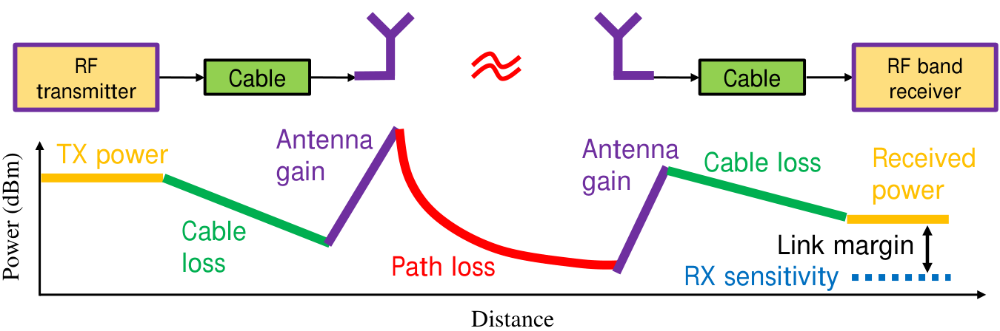
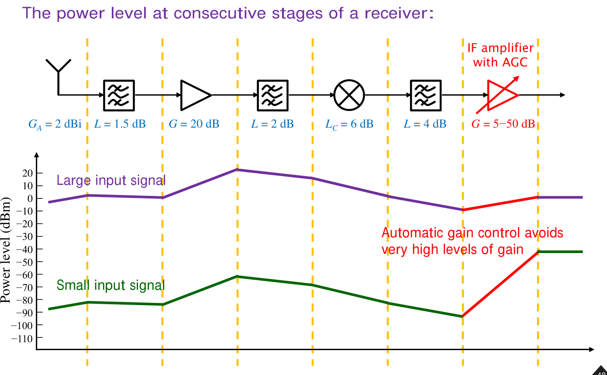

# 單元 19｜鏈路預算分析

沿著老師講義的功率流程，計算接收功率、雙向鏈路餘裕與最低發射功率。

原始影片：[陳晏笙老師「天線」單元 19](https://www.youtube.com/watch?v=OxrXOsNwCc4)
原始講義：[Lecture 4 — Antenna Parameters and Figures of Merit](https://drive.google.com/file/d/18mtgr-C9XaZz3r2wJWh29ZXxWADFx7yV/view)，PDF 第 40–48 頁。
影片長度：約 57 分鐘；建議閱讀：約 30 分鐘。前置：[單元 18：效率、增益與綜合評析](018_效率、增益與綜合評析.md)。

本章依序回答三個問題：現有設備能通訊多遠、發射功率至少需要多少、接收機需要多好的靈敏度。先學會 dBm／dBW 與路徑模型，再完整重算老師的 Ex 4.1、Ex 4.2，最後看接收鏈與自動增益控制。

> **核心觀念：** 在 dB 預算中，增益相加、損耗相減；算出的訊號與接收門檻必須位於同一個參考面。天線增益、失配、極化與線纜損耗都要避免漏算或重複計算。

## 講義與影片對照

以下定位依影片口述、講義與板書畫面交叉核對，為方便尋找的約略時間，不是精確換頁時刻。影片前約 7 分鐘複習 Friis 公式與「距離加倍，功率少約 6 dB」；p40 為本節目錄。

| 講義頁碼 | 原英文主題 | 中文內容 | 影片定位 |
|:--|:--|:--|:--|
| 40–41 | Link Budget / Objective of Link Budget Calculation | 目標、功率流程與鏈路餘裕 | [約 07:30–16:00](https://www.youtube.com/watch?v=OxrXOsNwCc4&t=450s) |
| 42 | Power in Log Scale | W、mW、dBW、dBm 與四個換算例 | [約 16:00–19:30](https://www.youtube.com/watch?v=OxrXOsNwCc4&t=960s) |
| 43 | Path Loss Estimation | Friis、斷點模型、環境指數與板書比較 | [約 19:30–28:00](https://www.youtube.com/watch?v=OxrXOsNwCc4&t=1170s) |
| 44–46 | Link Budget Calculation (1/3)–(3/3), EX 4.1 | 5 km AP／client 雙向鏈路；36:20 起補充 EIRP | [約 28:00–43:00](https://www.youtube.com/watch?v=OxrXOsNwCc4&t=1680s) |
| 47 | Calculation of the Required TX Power, EX 4.2 | 反求發射功率；50:45 起釐清方向增益與被動天線的增益 | [約 43:00–56:50](https://www.youtube.com/watch?v=OxrXOsNwCc4&t=2580s) |
| 48 | A Closer Look to the Receiver Structure | 接收鏈各級功率與 AGC | 講義補充；本單元未獨立講解此頁，片尾仍為 Ex 4.2 板書 |

## 1．為什麼做鏈路預算？（p41）

### 1.1 功率流程的每一段代表什麼？



*來源：老師 Lecture 4，p41。折線的橫軸沿系統位置前進；它不是時間波形。*

從發射機輸出開始，經過線纜會損失功率；發射天線在指定方向提供增益；傳播到接收端後，再考慮接收天線增益與接收線纜損耗。老師在 [約 09:10–10:40](https://www.youtube.com/watch?v=OxrXOsNwCc4&t=550s) 把預算比成每月收入與支出：先列出功率的起點，再逐項記錄增益、損耗，最後看是否仍高於接收門檻。這張圖對應三種設計問題：

1. 設備規格已知，反求可通訊距離。
2. 距離與接收條件已知，反求最低發射功率。
3. 發射端與距離已知，反求接收機需要的靈敏度。

整理成符號式：


```math
\boxed{P_r=P_t-L_t+G_t-L_{\rm path}+G_r-L_r.}
```

這裡 $`P_t,P_r`$ 為 dBm，$`G_t,G_r`$ 為指定傳播方向的天線增益（dBi），$`L_t,L_r,L_{\rm path}`$ 都採**正值損耗 dB**。天線增益反映方向性與輻射效率，不代表天線創造了總功率。峰值增益只適用於兩端主瓣正確對準的情況。

### 1.2 接收靈敏度、鏈路餘裕與衰落餘裕

接收靈敏度 $`P_{\rm sens}`$ 是達到指定資料率、調變與錯誤率等要求的最低接收輸入功率；它需要附帶工作條件。

```math
M_{\rm raw}=P_r-P_{\rm sens}.
```

老師提醒：預算得到的是模型下的平均功率，還要預留衰落餘裕 $`M_f`$。本章統一把扣除這項預留後的剩餘量稱為鏈路餘裕：

```math
\boxed{M_{\rm link}=P_r-P_{\rm sens}-M_f.}
```

$`M_{\rm link}\ge0`$ 表示這個模型與預留條件下滿足門檻。也可像老師 p45–46 的表格，把 $`M_f`$ 先放進通道欄，得到較保守的功率 $`P_{r,\rm design}=P_r-M_f`$，再減去靈敏度。**兩種記帳得到同一餘裕，不可重複扣兩次。**

老師在 [約 13:10–16:10](https://www.youtube.com/watch?v=OxrXOsNwCc4&t=790s) 把衰落餘裕比成「買保險」：例如原估路損 130 dB，再預留 10 dB，以 140 dB 設計。實際上這個預留應對應可接受的中斷機率；固定 10 dB 並不保證能涵蓋任何深衰落。

**口述用語釐清：** 影片約 12:10 以 noise level 說明靈敏度，約 33:30–34:30 又把鏈路餘裕類比成 SNR。這有助理解「訊號須高於門檻」，但兩者定義不同。若所有量都位於同一參考面，且 $`P_{\rm sens}=N+{\rm SNR}_{\min}`$，則

```math
P_r-P_{\rm sens}={\rm SNR}-{\rm SNR}_{\min},\qquad
M_{\rm link}={\rm SNR}-{\rm SNR}_{\min}-M_f.
```

因此靈敏度一般不等於噪聲底，餘裕也不直接等於 SNR。影片以「低於靈敏度就無法辨識」提醒可靠解調的限制；計算仍應保留低於門檻的預測功率，例如 $`-85`$ dBm，不能把它改寫成靈敏度 $`-82`$ dBm。此時的正確結論是未滿足指定接收要求。

## 2．功率的對數表示（Power in Log Scale，p42）

### 2.1 dBW 與 dBm 的參考功率

```math
P_{\rm dBW}=10\log_{10}\frac{P}{1\ {\rm W}},\qquad
P_{\rm dBm}=10\log_{10}\frac{P}{1\ {\rm mW}}.
```

因為 1 W = 1000 mW：

```math
\boxed{P_{\rm dBm}=P_{\rm dBW}+30.}
```

dBm／dBW 表示絕對功率；dB 表示比值。例如 10 mW 相對 1 mW 是 10 dB，但 10 mW 本身是 10 dBm。兩個 dBm 功率相減得到 dB；把兩個 dBm 直接相加，通常沒有所需的功率意義。

### 2.2 老師的四個換算例

| p42 的例子 | 線性功率 | dBW | dBm |
|:--|--:|--:|--:|
| GSM 接收靈敏度 | $`6.3\times10^{-14}`$ W | 約 $`-132.01`$ | 約 $`-102.01`$ |
| Bluetooth 發射功率 | 10 mW | $`-20`$ | 10 |
| 吸塵器用電功率 | 1600 W | 約 32.04 | 約 62.04 |
| GSM 基地台發射功率 | 40 W | 約 16.02 | 約 46.02 |

這些數字是老師用來示範對數換算的講義例子，並非所有同類設備的固定規格。吸塵器也能用 dBm 表示，說明 dBm 是功率單位，並不專屬於微弱射頻訊號。

常用反算式：

```math
P({\rm W})=10^{[P({\rm dBm})-30]/10}.
```

例如 $`-30`$ dBm 是 1 $`\mu`$W；2 W 是約 33.01 dBm。

## 3．路徑損耗估算（Path Loss Estimation，p43）

### 3.1 Friis 的自由空間模型

接續前一單元，當兩天線位於彼此遠場、在自由空間直接傳播且極化／接收負載匹配時：

```math
P_{r,\rm av}=P_{t,\rm acc}\,G_tG_r
\left(\frac{\lambda}{4\pi d}\right)^2.
```

本式的功率與增益採**線性值**：$`P_{t,\rm acc}`$ 為發射天線接受功率；$`P_{r,\rm av}`$ 為接收天線在共軛匹配下可提供的功率；普通增益 $`G=\eta_{\rm rad}D`$ 已包含輻射效率。要與實際發射機／接收機端口連接，還須一致處理線纜、失配、極化與方向偏移，詳見章末補充。

老師 p43 把

```math
H_{\rm path}=\left(\frac{\lambda}{4\pi d}\right)^2
```

標成「Path Loss」。它是小於 1 的功率傳輸比例，取對數通常得到負值；為避免在預算中扣錯正負號，本章使用正值損耗：

```math
\boxed{L_{\rm FS}=-10\log_{10}H_{\rm path}
=20\log_{10}\frac{4\pi d}{\lambda}.}
```

老師在 [約 04:50–06:50](https://www.youtube.com/watch?v=OxrXOsNwCc4&t=290s) 特別提醒：看到「加倍」不能直接套用 3 dB，先看它在公式中是一次方還是平方。固定頻率與兩端增益時，接收功率依 $`1/d^2`$ 衰減，距離加倍約多損失 6.021 dB。固定距離與兩端增益時，頻率加倍也約多損失 6.021 dB；「固定增益」是這個比較的重要條件。

這是遠場模型，不能向 $`d\to0`$ 外推。常用 $`2D^2/\lambda`$ 檢查大型天線的遠場距離，還應確保距離相對天線尺寸與波長足夠大；近場耦合要另用適合的模型。

### 3.2 老師的斷點模型（breakpoint model）

以 $`d_b`$ 表示老師的 $`d_{\rm break}`$，斷點前沿用自由空間，斷點後改用路徑損耗指數 $`n`$：

```math
H_{\rm path}(d)=
\begin{cases}
\left(\dfrac{\lambda}{4\pi d}\right)^2,&d\le d_b,\\[4pt]
\left(\dfrac{\lambda}{4\pi d_b}\right)^2
\left(\dfrac{d_b}{d}\right)^n,&d>d_b.
\end{cases}
```

因此正值 dB 損耗為：

```math
\boxed{L_{\rm path}(d)=L_{\rm FS}(d_b)
+10n\log_{10}\frac{d}{d_b}\quad(d>d_b).}
```

在 $`d=d_b`$ 兩式相接；$`n=2`$ 回到自由空間。超過斷點後，距離增加十倍，損耗增加 $`10n`$ dB。

### 3.3 p43 的環境指數對照表

| 老師表列環境 | 路徑損耗指數 $`n`$ |
|:--|:--|
| 自由空間（Free space） | 2 |
| 都市（Urban） | 2.7–3.5 |
| 都市遮蔽（Shadowed urban） | 3–5 |
| 建築內直視路徑（In-building LOS） | 1.6–1.8 |
| 建築內遮蔽（In-building shadowed） | 4–6 |
| 工廠遮蔽（Factory shadowed） | 2–3 |
| 零售商店（Retail store） | 2.2 |
| 辦公室輕隔間（Office-soft partitions） | 2.4 |

這些是講義提供的經驗尺度，實際 $`d_b,n`$ 應由環境與量測決定。建築內 LOS 可能出現 $`n<2`$，可理解為反射與導引使該距離範圍的平均衰減慢於自由空間；不能據此把這個指數外推到任意距離。

### 3.4 影片板書比較：900 MHz、3 km

[約 23:30–28:00](https://www.youtube.com/watch?v=OxrXOsNwCc4&t=1410s) 的板書比較使用 $`d_b=100`$ m、$`n=3.5`$，取 $`\lambda\approx1/3`$ m：

```math
L_{\rm FS}(100\,{\rm m})\approx71.527\ {\rm dB},
```

```math
L_{\rm breakpoint}(3\,{\rm km})
=71.527+35\log_{10}30
\approx123.226\ {\rm dB}.
```

直接用自由空間估算 3 km 則約為 101.069 dB，兩者差約 22.16 dB。老師板書的 $`-123`$ dB、$`-101`$ dB 是通道傳輸比例取對數後的負值，與本章正值損耗相容。

## 4．Ex 4.1：AP 與 client 的雙向鏈路（pp44–46）

### 4.1 題目與自由空間損耗（p44）

兩台設備相距 5 km，工作頻率 2.4 GHz，兩端各有 2 dB 線纜損耗，預留 5 dB 衰落餘裕。

| 參數 | AP | Client |
|:--|:--|:--|
| 發射功率 | 20 dBm | 15 dBm |
| 天線增益 | 10 dBi | 14 dBi |
| 接收靈敏度 | $`-89`$ dBm | $`-82`$ dBm |

老師要求先求自由空間損耗，再分別求兩個方向的鏈路餘裕。取 $`c=3\times10^8`$ m/s：

```math
\lambda=0.125\ {\rm m},\qquad
H_{\rm path}=\left(\frac{0.125}{4\pi(5000)}\right)^2
\approx3.958\times10^{-12},
```

```math
L_{\rm FS}\approx114.025\ {\rm dB}\approx114\ {\rm dB}.
```

### 4.2 AP 發送、client 接收（p45）

平均模型預測的接收功率：

```math
P_r=20-2+10-114.025+14-2
=-74.025\ {\rm dBm}.
```

依老師表格的順序，使用取整後 114 dB 路損填入各級：

| 項目 | 增減或門檻 | 累計功率 |
|:--|:--|:--|
| AP 發射 | 20 dBm | 20 dBm |
| TX 線纜 | $`-2`$ dB | 18 dBm |
| TX 天線 | $`+10`$ dBi | 等效方向功率 28 dBm |
| 通道 | $`-114`$ dB | 等效各向同性接收功率 $`-86`$ dBm |
| 預留衰落 | $`-5`$ dB | $`-91`$ dBm |
| RX 天線 | $`+14`$ dBi | $`-77`$ dBm |
| RX 線纜 | $`-2`$ dB | 設計接收功率 $`-79`$ dBm |
| client 靈敏度 | $`-82`$ dBm | 剩餘鏈路餘裕 3 dB |

保留較精確路損時：

```math
\boxed{M_{\rm AP\to client}
=-74.025-(-82)-5=2.975\ {\rm dB}.}
```

p45 的「Received power」空格若已照通道欄扣了 5 dB，應填約 $`-79`$ dBm；未扣衰落的平均預測則約 $`-74`$ dBm。兩者差在預留方式。

### 4.3 Client 發送、AP 接收（p46）

```math
P_r=15-2+14-114.025+10-2
=-79.025\ {\rm dBm}.
```

| 老師表格分段 | 以取整路損計算 |
|:--|:--|
| TX 端 | $`15-2+14=27`$ dBm |
| 通道與衰落預留 | $`-114-5=-119`$ dB |
| RX 端天線與線纜 | $`+10-2=+8`$ dB |
| 已扣衰落的設計接收功率 | $`27-119+8=-84`$ dBm |
| AP 靈敏度 | $`-89`$ dBm |
| 剩餘鏈路餘裕 | $`-84-(-89)=5`$ dB |

保留較精確路損時：

```math
\boxed{M_{\rm client\to AP}
=-79.025-(-89)-5=4.975\ {\rm dB}.}
```

兩方向在題設下都有正餘裕。Client 發射功率雖少 5 dB，AP 的接收靈敏度卻好 7 dB，因此反向多 2 dB 餘裕。**通道與天線可互易，兩端設備的功率與門檻仍可能不對稱；雙向通訊由餘裕較小的方向限制。**

### 4.4 老師的口述延伸：為什麼使用 EIRP？

[約 36:20–43:00](https://www.youtube.com/watch?v=OxrXOsNwCc4&t=2180s)，老師在雙向預算之後介紹等效各向同性輻射功率（effective isotropic radiated power, EIRP）。它表示：要由理想各向同性天線在指定方向產生相同的遠場功率密度，需要多大的發射功率？

```math
{\rm EIRP}=P_{t,\rm acc}G_t,\qquad
{\rm EIRP(dBm)}=P_t({\rm dBm})-L_t({\rm dB})+G_t({\rm dBi}).
```

線性式使用天線接受功率與普通增益；右式沿用本題的匹配假設。老師舉例：4 W 配 10 dBi 天線，在主瓣方向的 EIRP 是 40 W；這是與各向同性輻射源的等效比較，並非天線真的把總功率變成 40 W。只約束發射機功率而忽略方向增益，無法約束某方向的輻射強度。

老師又以 $`15+14=29`$ dBm 示範把功率與增益合併。若完整沿用 Ex 4.1 的 client **2 dB 線纜損耗**，其實際 EIRP 應為 $`15-2+14=27`$ dBm；29 dBm 是尚未扣該線纜的合併值。影片提到的 RFID／4 W 用作課堂情境例子，不能當成所有頻段、地區或近場讀卡系統通用的限值。

## 5．Ex 4.2：反求最低發射功率（p47）

### 5.1 老師題目給定的條件

| 參數 | 值 |
|:--|:--|
| 工作頻率／覆蓋距離 | 900 MHz／2 km |
| TX／RX 天線增益 | 8 dBi／$`-2`$ dBi |
| TX 線纜、合路器等損耗 | 2 dB |
| 接收端噪聲／需求 SNR | $`-123`$ dBm／18 dB |
| 接收機 IF 增益 | 30 dB |
| 斷點距離／斷點後指數 | 10 m／3.8 |
| 衰落餘裕 | 10 dB |

本例 RX 天線的 $`-2`$ dBi 是天線增益，並非另給一條 2 dB 接收線纜。題目未另外指定 RX 線纜損耗。

### 5.2 先求斷點模型損耗

```math
L_{\rm FS}(10\,{\rm m})
=20\log_{10}\frac{4\pi(10)}{1/3}
\approx51.527\ {\rm dB},
```

```math
L_{\rm path}(2000\,{\rm m})
=51.527+38\log_{10}\frac{2000}{10}
\approx138.966\ {\rm dB}\approx139\ {\rm dB}.
```

### 5.3 依老師板書反求 $`X`$（約 45:00–50:45）

令發射功率為 $`X`$ dBm，依序加總到 IF 放大器輸出：

```math
P_{\rm IF,design}
=X-2+8-138.966-10-2+30
=X-114.966\ {\rm dBm}.
```

其中已預留 10 dB 衰落。老師在 [約 49:30–50:45](https://www.youtube.com/watch?v=OxrXOsNwCc4&t=2970s) 說明板書條件 $`X-115\ge-123+18`$；依這個算法，噪聲 $`-123`$ dBm 須與 IF 輸出訊號位於同一參考面：

```math
P_{\rm IF,min}=-123+18=-105\ {\rm dBm},
```

```math
X-114.966\ge-105
\quad\Longrightarrow\quad
\boxed{X_{\min}\approx9.966\ {\rm dBm}\approx10\ {\rm dBm}.}
```

最低發射功率約 10 mW，與老師取整後的板書答案一致。

### 5.4 本例的噪聲參考面要讀清楚

p47 只寫噪聲在「RX side」，沒有明確畫出是在 IF 放大前或放大後。因此上面的 10 dBm 答案是**依老師板書，把噪聲視為 IF 輸出同一參考面**的結果。

若 $`-123`$ dBm 實際指接收機輸入端的噪聲，IF 增益同時放大訊號和原有噪聲，不能只替訊號加 30 dB；在其餘相同條件下，所需發射功率會變成約 40 dBm。這個差異不是計算誤差，而是噪聲定義不同。章末補充保留兩種參考面的完整推算。

### 5.5 片尾總結：負增益與被動天線的增益

[約 50:45–52:50](https://www.youtube.com/watch?v=OxrXOsNwCc4&t=3045s)，老師提醒本題給的是峰值增益，隱含主瓣相互對準。峰值增益為 $`-2`$ dBi 可以由較低輻射效率造成；若談的是任意方向的 $`G(\theta,\phi)`$，偏離主瓣也可能得到負 dBi，不能一律歸因於效率差。計算鏈路時要代入真正傳播方向的增益。

[約 52:50–片尾](https://www.youtube.com/watch?v=OxrXOsNwCc4&t=3170s) 的口試問題是：「天線是被動元件，為什麼仍然有 gain？」放大器功率增益比較輸出與輸入；天線增益則以相同接受功率的理想各向同性輻射為基準，比較指定方向的輻射強度。集中方向可以提高 dBi，同時總輻射功率仍不超過接受功率，所以不違反被動性。報告天線增益時，應明列 dBi 等參考基準，不只寫一個沒有說明基準的 dB。

## 6．接收鏈各級功率與 AGC（p48，講義補充）



*來源：老師 Lecture 4，p48。本單元片尾仍在 p47 板書；此圖依 PDF 順序整理，供對照接收機實際結構。*

老師把接收機展開成以下各級：

| 階段 | 講義標示 | 對訊號的作用 |
|:--|:--|:--|
| 接收天線 | $`G_A=2`$ dBi | 決定該入射方向可接收的功率 |
| 第一個濾波器 | $`L=1.5`$ dB | 插入損耗 |
| RF 放大器 | $`G=20`$ dB | 提高訊號電平 |
| 第二個濾波器 | $`L=2`$ dB | 插入損耗 |
| 混頻器 | $`L_C=6`$ dB | 轉換損耗，將訊號搬移到 IF |
| IF 濾波器 | $`L=4`$ dB | 插入損耗 |
| 含 AGC 的 IF 放大器 | $`G=5\text{–}50`$ dB | 依輸入大小調整增益 |

若以天線輸出端、第一個濾波器之前的電功率 $`P_A`$ 為起點，依標示數值加總：

```math
P_{\rm IF,out}
=P_A-1.5+20-2-6-4+G_{\rm IF}
=P_A+6.5+G_{\rm IF}\quad({\rm dBm}).
```

天線的 2 dBi 已反映在 $`P_A`$ 與入射波的關係中，不能再視為天線端口後的一級電路增益重複相加。圖中折線用來呈現增減趨勢；精確計算應依各元件標示的 dB，而非把折線的每個高度當成一致比例的量測點。

紫線表示大訊號，綠線表示小訊號。自動增益控制（automatic gain control, AGC）在強訊號時降低 IF 增益，避免後級電平過大；弱訊號時提高增益，讓後級有可處理的訊號範圍。它調整的是訊號電平，不能憑空改善天線端的 SNR，也不能修復已在前級放大器發生的飽和失真。

## 補充解說與重算例題

### A．效率、失配與極化如何放入預算？

```math
{\rm EIRP(dBm)}=P_t({\rm dBm})-L_t({\rm dB})+G_t({\rm dBi}).
```

這是指定方向的等效各向同性輻射功率。若 $`P_t-L_t`$ 是天線接受功率，使用普通增益；若它是天線端的入射功率，則要再處理反射，或改用相同參考阻抗下的實現增益（realized gain）。

| 已採用的量 | 預算中的處理 |
|:--|:--|
| 指向性 $`D`$ | 還要乘輻射效率，才能成為普通增益 $`G=\eta_{\rm rad}D`$ |
| 普通增益 $`G`$ | 已含輻射效率，不再重複扣導體／介質的天線內部損耗 |
| 實現增益 $`G_{\rm realized}=(1-\lvert\Gamma\rvert^2)G`$ | 已含相應參考阻抗的端口失配，不再扣同一失配一次 |
| 共軛匹配下的接收可用功率 | 若接收負載未共軛匹配，還要乘負載功率傳輸比例 |
| 極化完全匹配的 Friis 結果 | 實際極化不合時，再乘極化損失因子 PLF |

以線性功率寫，若 $`P_{t,\rm inc}`$ 是發射天線端的入射功率，$`\tau_t`$ 為發射接受比例，$`\tau_r`$ 為接收可用功率送入負載的比例：

```math
P_{r,\rm load}
=P_{t,\rm inc}\,\tau_tG_tG_r
\left(\frac{\lambda}{4\pi d}\right)^2
{\rm PLF}\,\tau_r.
```

對發射端實數參考阻抗，$`\tau_t=1-\lvert\Gamma_t\rvert^2`$。對接收天線阻抗 $`Z_A`$、負載 $`Z_L`$：

```math
\tau_r=\frac{4\mathop{\mathrm{Re}}\nolimits (Z_A)\mathop{\mathrm{Re}}\nolimits (Z_L)}
{\lvert Z_A+Z_L\rvert^2}.
```

共軛匹配時 $`\tau_r=1`$。若接收負載為實數參考阻抗，才可直接用相應 $`1-\lvert\Gamma\rvert^2`$ 形式。兩個線極化天線的極化夾角為 $`\psi`$ 時，$`{\rm PLF}=\cos^2\psi`$；其正值 dB 損耗為 $`-10\log_{10}{\rm PLF}`$。

前述因子都要對照實際資料表的增益定義，不能只看到「gain」就假設它已包含所有項目。遠場、自由空間與極化條件不符時，先修正通道模型，再做 dB 加總。

### B．反求可容許損耗、距離與改進方向

補充推算：沿用影片 Ex 4.1 的全部參數。

從 $`M_{\rm link}\ge0`$，整理出最大可容許路徑損耗：

```math
\boxed{L_{\rm path,max}=
P_t-L_t+G_t+G_r-L_r-P_{\rm sens}-M_f.}
```

這是系統提供的損耗額度，不代表環境必定有這個損耗。

**兩個方向分別算**

```math
L_{\max,\rm AP\to client}
=20-2+10+14-2+82-5=117\ {\rm dB},
```

```math
L_{\max,\rm client\to AP}
=15-2+14+10-2+89-5=119\ {\rm dB}.
```

原本 5 km 的自由空間損耗約 114.025 dB，因此分別留下 2.975 dB、4.975 dB。

**自由空間最大距離**

```math
d_{\max}=\frac{\lambda}{4\pi}
10^{L_{\max}/20}.
```

用 $`\lambda=0.125`$ m，兩方向約為 7.04 km 與 8.87 km；需要雙向成立時，較小的約 7.04 km 才是此模型的距離上限。 這仍是自由空間示例；遮蔽或其他損耗增加時，距離會縮短。

**超過斷點，距離增益取決於 $`n`$**

```math
d_{\max}=d_b\,
10^{[L_{\max}-L_{\rm FS}(d_b)]/(10n)}.
```

額度改善 3 dB，距離增為 $`10^{3/(10n)}`$ 倍。自由空間 $`n=2`$ 約 1.413 倍；$`n=3.8`$ 時只有約 1.199 倍。增加 3 dB 並不一定讓距離加倍。

**改善鏈路的選項**

-   減少線纜損耗，提高相應方向的接收功率。

-   改善天線增益與方向對準；但更窄主瓣需要更好的指向控制。

-   改善接收門檻，可能涉及頻寬、資料率、調變與噪聲性能。

-   改善高度、遮蔽物與傳播路徑，而不只調電路功率。

每個選項都應回到兩方向重新計算；只增加 AP 發射功率，不會提升 client 發射回 AP 的那一條鏈路。

> **核心觀念：** 先找出限制方向與主要損耗，再選改進項目。每增加 1 dB 會影響哪一段鏈路，要放回功率表檢查。

### C．IF 增益、噪聲與 SNR 的參考面

補充判讀：釐清影片 Ex 4.2 的噪聲參考面。

理想增益為 $`A`$ 的放大器，輸入訊號、噪聲功率為 $`P_s,P_n`$：

```math
P_{s,\rm out}=AP_s,\qquad P_{n,\rm out}=AP_n.
```

因此

```math
{\rm SNR}_{\rm out}=\frac{AP_s}{AP_n}
={\rm SNR}_{\rm in}.
```

在 dB 上兩邊都加同一增益，訊號與噪聲的差不變。實際放大器還有附加噪聲；單純增益不能自行改善天線收到的 SNR。

**同一個 $`-123`$ dBm，兩種定義相差 30 dB**

| 噪聲參考面                     | 接收輸入最低訊號      | 本例最低 TX 功率 |
|:-------------------------------|:----------------------|:-----------------|
| IF 輸出 $`-123`$ dBm，增益 30 dB | $`-123+18-30=-135`$ dBm | 約 10 dBm        |
| 接收輸入 $`-123`$ dBm            | $`-123+18=-105`$ dBm    | 約 40 dBm        |

第二種讀法，含衰落後接收輸入訊號為

```math
P_{r,\rm input}=X-2+8-138.966-10-2
=X-144.966\ {\rm dBm},
```

故 $`X-144.966\ge-105`$，$`X_{\min}\approx39.966`$ dBm。不是同一個物理條件得到兩個答案，而是噪聲的定義改變了。

**設計時如何使用接收增益？**

增益可把低電平訊號提高到後續電路可處理的範圍，並影響後級噪聲的相對重要性；但噪聲指數、線性範圍與前級損失也要一起考慮。 若已使用接收機輸入靈敏度，這個門檻通常已涵蓋其內部接收鏈，不要再額外加上 IF 增益，宣稱輸入靈敏度直接改善同樣的 dB。

**從模型餘裕走向可靠度**

影片預留的 5 或 10 dB 是例題條件。實際衰落餘裕要依通道變動與可靠度目標設定；平均路徑損耗加上一個固定數字，仍不足以描述所有遮蔽與瞬間衰落。

> **核心觀念：** 增益能改變訊號的絕對電平；SNR 還需要同一參考面的噪聲。使用輸入靈敏度時，不再重複計接收機內部增益。

## 自測與解析

所有損耗採正值 dB；所有功率以同一參考面比較。

1.  2 W 是多少 dBm、dBW？$`-30`$ dBm 是多少 W？

2.  影片 Ex 4.1 的 AP 到 client，若 AP 發射提高 3 dB，兩個方向的鏈路餘裕各如何改變？

3.  $`d_b=100`$ m、$`n=3.5`$，在斷點外距離增加十倍，路徑損耗增加多少？如果誤用自由空間，會低估多少？

4.  某方向 $`P_t=10`$ dBm、$`L_t=1`$ dB、$`G_t=3`$ dBi、$`L_{\rm path}=80`$ dB、$`G_r=2`$ dBi、$`L_r=1`$ dB；靈敏度 $`-75`$ dBm，衰落餘裕 5 dB。求接收功率與鏈路餘裕。

5.  接收輸入訊號 $`-100`$ dBm、噪聲 $`-120`$ dBm，經理想 30 dB 增益。輸出兩者與 SNR 各是多少？

### 答案與理由

1.  約 33.010 dBm、3.010 dBW；$`-30`$ dBm = 1 $`\mu`$W = $`10^{-6}`$ W。

2.  AP 到 client 由約 2.975 dB 增為 5.975 dB；反向仍為約 4.975 dB，因 client 發射與 AP 接收條件未改。

3.  增加 35 dB；自由空間只增加 20 dB，因此相對低估 15 dB。

4.  $`P_r=10-1+3-80+2-1=-67`$ dBm；餘裕 $`-67-(-75)-5=3`$ dB。

5.  訊號 $`-70`$ dBm、噪聲 $`-90`$ dBm；SNR 仍為 20 dB。若只替訊號加增益，會得到錯誤的 50 dB。

### 公式速記

```math
M_{\rm link}=P_r-P_{\rm sens}-M_f,\qquad
L_{\rm FS}=20\log_{10}\frac{4\pi d}{\lambda},
```

```math
L(d>d_b)=L_{\rm FS}(d_b)+10n\log_{10}(d/d_b).
```


**下一單元：**[單元 20：天線參數的理論極限](020_天線參數的理論極限.md)。
