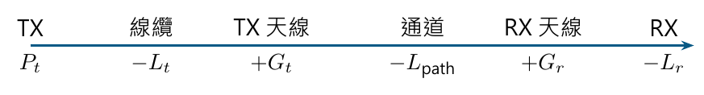

# 單元 19｜鏈路預算分析

[下載原始 PDF](../pdf/019_鏈路預算分析.pdf)

算出送達功率、餘裕與需要的發射功率

原始影片：[陳晏笙老師「天線」單元 19](https://www.youtube.com/watch?v=OxrXOsNwCc4)

影片長度：約 57 分鐘　建議閱讀：約 25 分鐘

前置單元：18。需理解 Friis、增益、dBm 與失配。

> **核心觀念：** 鏈路預算把增益相加、損耗相減，再把接收功率與靈敏度比較。每個量都要放在正確的參考點；雙向鏈路也要分別計算。

## 本單元的四個目標

1.  用一張功率表串起發射機、電纜、天線、通道與接收機。

2.  區分自由空間損耗與影片的 breakpoint 模型。

3.  完整重算影片 AP／client 兩個方向的鏈路。

4.  從噪聲、SNR、接收增益與衰落餘裕反求發射功率。

## 最常用的 dB 形式

$$
P_r=P_t-L_t+G_t-L_{\rm path}+G_r-L_r,
$$

其中 $P_t,P_r$ 用 dBm，天線 $G_t,G_r$ 用 dBi，其餘損耗為正值 dB。若增益已包含指定端口的失配，就不要再重複扣同一損失。

## 餘裕不是接收功率本身

若接收靈敏度為 $P_{\rm sens}$，預留衰落餘裕 $M_f$：

$$
\boxed{M_{\rm link}=P_r-P_{\rm sens}-M_f.}
$$

$M_{\rm link}\ge0$ 表示在此模型與預留餘裕下滿足門檻；不保證所有實際環境都能通訊。

## 閱讀地圖

第 2 頁：單位與功率流程；第 3 頁：路徑模型；第 4 頁：影片 AP／client 例題；第 5 頁：可容許損耗與距離；第 6 頁：反求發射功率；第 7 頁：IF 增益與噪聲參考面；第 8 頁：自測。 依影片公式與板書例題整理。影片的傳播模型為課堂示例；補充推算與參考面判讀另行標示。

## 1．功率流程與 dB 單位

影片對照：[約 00:00](https://www.youtube.com/watch?v=OxrXOsNwCc4&t=0s)－[20:00](https://www.youtube.com/watch?v=OxrXOsNwCc4&t=1200s)

影片先復習增益與 Friis，再用起伏折線表示每一級功率的增加或降低。折線的橫軸是系統位置，縱軸是該參考點的功率；不是時間波形。

### dBm 與 dBW：不同的功率參考值

$$
P_{\rm dBm}=10\log_{10}\frac{P}{1\ {\rm mW}},\qquad
P_{\rm dBW}=10\log_{10}\frac{P}{1\ {\rm W}},
$$

$$
\boxed{P_{\rm dBm}=P_{\rm dBW}+30.}
$$

| 線性功率 | dBm       | dBW      |
|:---------|:----------|:---------|
| 1 mW     | 0         | $-30$    |
| 1 W      | 30        | 0        |
| 2 W      | 約 33.010 | 約 3.010 |
| 1 $\mu$W | $-30$     | $-60$    |

兩個絕對功率相除，在對數上是相減，結果為 dB。例如 10 mW / 1 mW = 10，對應 $10-0=10$ dB。

### EIRP：發射端的方向等效量

$$
{\rm EIRP(dBm)}=P_t({\rm dBm})-L_t({\rm dB})+G_t({\rm dBi}).
$$

它將特定方向的輻射強度表示成等效各向同性發射功率，不是天線創造了額外的總能量。這裡先按影片模型使用峰值方向與普通增益，匹配／線纜的處理須一致。

### 接收靈敏度需要工作條件

靈敏度是達到指定性能門檻的最低接收功率。調變、頻寬、資料率、錯誤率等不同，門檻可能不同；不是只看某顆晶片名稱就有唯一靈敏度。 鏈路餘裕是接收功率減靈敏度，SNR 則是訊號功率減同一參考面的噪聲功率；兩者通常不是同一個值。低於靈敏度的預測功率仍可保留在預算中，表示無法達到指定性能，不必把它截成靈敏度。

> **核心觀念：** dBm/dBW 是功率值，dB 是增減量，dBi 是相對各向同性的天線增益。功率鏈的每一項都要附單位。

## 2．自由空間與 breakpoint 路徑模型

影片對照：[約 20:00](https://www.youtube.com/watch?v=OxrXOsNwCc4&t=1200s)－[28:00](https://www.youtube.com/watch?v=OxrXOsNwCc4&t=1680s)

投影片把 $(\lambda/4\pi d)^2$ 稱作 path loss，但它實際是小於 1 的傳輸比例。本講義分開命名：

$$
H_{\rm path}=\left(\frac{\lambda}{4\pi d}\right)^2,\qquad
L_{\rm FS}=-10\log_{10}H_{\rm path}
=20\log_{10}\frac{4\pi d}{\lambda}.
$$

$L_{\rm FS}$ 以正值 dB 放入預算。固定兩端增益，距離加倍多損失約 6.021 dB；頻率加倍也多約 6.021 dB。

### 影片的斷點模型

斷點為 $d_b$，超過後採路徑損耗指數 $n$：

$$
H_{\rm path}(d)=
\begin{cases}
(\lambda/4\pi d)^2,&d\le d_b,\\
(\lambda/4\pi d_b)^2(d_b/d)^n,&d>d_b.
\end{cases}
$$

換成正值 dB：

$$
\boxed{L_{\rm path}(d)=L_{\rm FS}(d_b)
+10n\log_{10}(d/d_b)\quad(d>d_b).}
$$

模型在 $d=d_b$ 連續。$n=2$ 就回到自由空間；每增加十倍距離，超過斷點的損耗增加 $10n$ dB。

### 影片比較：900 MHz、3 km

板書設定 $d_b=100$ m、$n=3.5$，以 $\lambda\approx1/3$ m：

$$
L_{\rm FS}(100\,{\rm m})\approx71.527\ {\rm dB},
$$

$$
L_{\rm breakpoint}(3\,{\rm km})
=71.527+35\log_{10}30\approx123.226\ {\rm dB}.
$$

自由空間直接估 3 km 則為約 101.069 dB，兩者差約 22.16 dB。板書的負值 $-123$ dB、$-101$ dB 是通道傳輸比例的對數；本頁正值損耗與它們相容。

### 經驗參數不是任意環境的常數

影片表列城市、建築內等常見的 $n$ 範圍，作為模型尺度示例。實際 $d_b,n$ 應配合地形、遮蔽、距離範圍和量測；衰落餘裕則處理模型平均值以外的變動。

> **核心觀念：** 先決定損耗用正值還是通道比例用負值。兩者可互換，但不能把負的 path gain 再扣一次。

## 3．影片 Ex 4.1：5 km 的 AP 與 client

影片對照：[約 28:00](https://www.youtube.com/watch?v=OxrXOsNwCc4&t=1680s)－[42:00](https://www.youtube.com/watch?v=OxrXOsNwCc4&t=2520s)

影片設定 2.4 GHz、距離 5 km、自由空間；兩端線纜損耗各 2 dB，衰落餘裕 5 dB。

| 參數       | AP        | Client    |
|:-----------|:----------|:----------|
| 發射功率   | 20 dBm    | 15 dBm    |
| 天線增益   | 10 dBi    | 14 dBi    |
| 接收靈敏度 | $-89$ dBm | $-82$ dBm |

$$
\lambda=0.125\ {\rm m},\qquad
L_{\rm FS}=20\log_{10}\frac{4\pi(5000)}{0.125}
\approx114.025\ {\rm dB}.
$$

### AP $\rightarrow$ client

$$
P_r=20-2+10-114.025+14-2
=-74.025\ {\rm dBm}.
$$

client 的門檻為 $-82$ dBm，扣除衰落餘裕後：

$$
\boxed{M_{\rm AP\to client}=-74.025-(-82)-5
=2.975\ {\rm dB}.}
$$

### Client $\rightarrow$ AP

$$
P_r=15-2+14-114.025+10-2
=-79.025\ {\rm dBm}.
$$

AP 的接收靈敏度較好：

$$
\boxed{M_{\rm client\to AP}=-79.025-(-89)-5
=4.975\ {\rm dB}.}
$$

兩方向在此模型下均有正餘裕。按投影片把路徑損耗取 114 dB，得到約 3 dB 與 5 dB。

### 為什麼較低發射功率那端，鏈路餘裕反而較大？

client 發射功率低 5 dB，但 AP 的接收靈敏度比 client 好 7 dB，因此反向最後多 2 dB 餘裕。通道可互易，兩端設備規格卻不必對稱。

> **核心觀念：** 雙向通訊由較弱方向限制。天線可互易，不表示發射功率、線纜與接收門檻也相同。

## 4．反求可容許損耗、距離與改進方向

補充推算：沿用影片 Ex 4.1 的全部參數。

從 $M_{\rm link}\ge0$，整理出最大可容許路徑損耗：

$$
\boxed{L_{\rm path,max}=
P_t-L_t+G_t+G_r-L_r-P_{\rm sens}-M_f.}
$$

這是系統提供的損耗額度，不代表環境必定有這個損耗。

### 兩個方向分別算

$$
L_{\max,\rm AP\to client}
=20-2+10+14-2+82-5=117\ {\rm dB},
$$

$$
L_{\max,\rm client\to AP}
=15-2+14+10-2+89-5=119\ {\rm dB}.
$$

原本 5 km 的自由空間損耗約 114.025 dB，因此分別留下 2.975 dB、4.975 dB。

### 自由空間最大距離

$$
d_{\max}=\frac{\lambda}{4\pi}
10^{L_{\max}/20}.
$$

用 $\lambda=0.125$ m，兩方向約為 7.04 km 與 8.87 km；需要雙向成立時，較小的約 7.04 km 才是此模型的距離上限。 這仍是自由空間示例；遮蔽或其他損耗增加時，距離會縮短。

### 超過斷點，距離增益取決於 $n$

$$
d_{\max}=d_b\,
10^{[L_{\max}-L_{\rm FS}(d_b)]/(10n)}.
$$

額度改善 3 dB，距離增為 $10^{3/(10n)}$ 倍。自由空間 $n=2$ 約 1.413 倍；$n=3.8$ 時只有約 1.199 倍。增加 3 dB 並不一定讓距離加倍。

### 改善鏈路的選項

-   減少線纜損耗，提高相應方向的接收功率。

-   改善天線增益與方向對準；但更窄主瓣需要更好的指向控制。

-   改善接收門檻，可能涉及頻寬、資料率、調變與噪聲性能。

-   改善高度、遮蔽物與傳播路徑，而不只調電路功率。

每個選項都應回到兩方向重新計算；只增加 AP 發射功率，不會提升 client 發射回 AP 的那一條鏈路。

> **核心觀念：** 先找出限制方向與主要損耗，再選改進項目。每增加 1 dB 會影響哪一段鏈路，要放回功率表檢查。

## 5．影片 Ex 4.2：由需求反求發射功率

影片對照：[約 42:00](https://www.youtube.com/watch?v=OxrXOsNwCc4&t=2520s)－[56:50](https://www.youtube.com/watch?v=OxrXOsNwCc4&t=3410s)

影片設定 900 MHz、覆蓋 2 km、斷點 10 m、$n=3.8$。TX 天線 8 dBi、RX 天線 $-2$ dBi，TX 線纜等損耗 2 dB，衰落餘裕 10 dB；另給噪聲 $-123$ dBm、需求 SNR 18 dB、IF 增益 30 dB。

### 先重算通道損耗

$$
L_{\rm FS}(10\,{\rm m})\approx51.527\ {\rm dB},
$$

$$
L_{\rm path}(2000\,{\rm m})
=51.527+38\log_{10}200
\approx138.966\ {\rm dB}\approx139\ {\rm dB}.
$$

### 依影片板書的功率加總

令發射功率為 $X$ dBm。將 10 dB 衰落扣在通道後，再加入接收天線與 IF 增益：

$$
P_{\rm IF}=X-2+8-138.966-10-2+30
=X-114.966\ {\rm dBm}.
$$

若 $-123$ dBm 是與 $P_{\rm IF}$ 相同參考面的噪聲，需求訊號功率：

$$
P_{\rm IF,min}=-123+18=-105\ {\rm dBm}.
$$

因此

$$
X-114.966\ge-105,\qquad
\boxed{X_{\min}\approx9.966\ {\rm dBm}\approx10\ {\rm dBm}.}
$$

這與影片板書取整數的答案一致，約為 10 mW。

### 這個答案依賴噪聲參考面

投影片只寫噪聲「at RX side」，沒有明確標出它在 IF 放大前或放大後。上面的 10 dBm，**是按照板書加上 30 dB IF 增益的算法，將噪聲視為 IF 輸出同一參考面**。 若噪聲其實給在接收輸入端，IF 增益會同時放大訊號與原有噪聲，不能只對訊號加 30 dB，再跟原來的輸入噪聲比較。下一頁把這兩種讀法分清楚。

> **核心觀念：** 先將訊號與噪聲放到同一參考面，再相減求 SNR。鏈路預算的加總正確，不代表參考面一定正確。

## 6．IF 增益、噪聲與 SNR：放大不是白送的餘裕

補充判讀：釐清影片 Ex 4.2 的噪聲參考面。

理想增益為 $A$ 的放大器，輸入訊號、噪聲功率為 $P_s,P_n$：

$$
P_{s,\rm out}=AP_s,\qquad P_{n,\rm out}=AP_n.
$$

因此

$$
{\rm SNR}_{\rm out}=\frac{AP_s}{AP_n}
={\rm SNR}_{\rm in}.
$$

在 dB 上兩邊都加同一增益，訊號與噪聲的差不變。實際放大器還有附加噪聲；單純增益不能自行改善天線收到的 SNR。

### 同一個 $-123$ dBm，兩種定義相差 30 dB

| 噪聲參考面                     | 接收輸入最低訊號      | 本例最低 TX 功率 |
|:-------------------------------|:----------------------|:-----------------|
| IF 輸出 $-123$ dBm，增益 30 dB | $-123+18-30=-135$ dBm | 約 10 dBm        |
| 接收輸入 $-123$ dBm            | $-123+18=-105$ dBm    | 約 40 dBm        |

第二種讀法，含衰落後接收輸入訊號為

$$
P_{r,\rm input}=X-2+8-138.966-10-2
=X-144.966\ {\rm dBm},
$$

故 $X-144.966\ge-105$，$X_{\min}\approx39.966$ dBm。不是同一個物理條件得到兩個答案，而是噪聲的定義改變了。

### 設計時如何使用接收增益？

增益可把低電平訊號提高到後續電路可處理的範圍，並影響後級噪聲的相對重要性；但噪聲指數、線性範圍與前級損失也要一起考慮。 若已使用接收機輸入靈敏度，這個門檻通常已涵蓋其內部接收鏈，不要再額外加上 IF 增益，宣稱輸入靈敏度直接改善同樣的 dB。

### 從模型餘裕走向可靠度

影片預留的 5 或 10 dB 是例題條件。實際衰落餘裕要依通道變動與可靠度目標設定；平均路徑損耗加上一個固定數字，仍不足以描述所有遮蔽與瞬間衰落。

> **核心觀念：** 增益能改變訊號的絕對電平；SNR 還需要同一參考面的噪聲。使用輸入靈敏度時，不再重複計接收機內部增益。

## 7．五題自測與答案

所有損耗採正值 dB；所有功率以同一參考面比較。

1.  2 W 是多少 dBm、dBW？$-30$ dBm 是多少 W？

2.  影片 Ex 4.1 的 AP 到 client，若 AP 發射提高 3 dB，兩個方向的鏈路餘裕各如何改變？

3.  $d_b=100$ m、$n=3.5$，在斷點外距離增加十倍，路徑損耗增加多少？如果誤用自由空間，會低估多少？

4.  某方向 $P_t=10$ dBm、$L_t=1$ dB、$G_t=3$ dBi、$L_{\rm path}=80$ dB、$G_r=2$ dBi、$L_r=1$ dB；靈敏度 $-75$ dBm，衰落餘裕 5 dB。求接收功率與鏈路餘裕。

5.  接收輸入訊號 $-100$ dBm、噪聲 $-120$ dBm，經理想 30 dB 增益。輸出兩者與 SNR 各是多少？

### 答案與理由

1.  約 33.010 dBm、3.010 dBW；$-30$ dBm = 1 $\mu$W = $10^{-6}$ W。

2.  AP 到 client 由約 2.975 dB 增為 5.975 dB；反向仍為約 4.975 dB，因 client 發射與 AP 接收條件未改。

3.  增加 35 dB；自由空間只增加 20 dB，因此相對低估 15 dB。

4.  $P_r=10-1+3-80+2-1=-67$ dBm；餘裕 $-67-(-75)-5=3$ dB。

5.  訊號 $-70$ dBm、噪聲 $-90$ dBm；SNR 仍為 20 dB。若只替訊號加增益，會得到錯誤的 50 dB。

### 公式速記

$$
M_{\rm link}=P_r-P_{\rm sens}-M_f,\qquad
L_{\rm FS}=20\log_{10}\frac{4\pi d}{\lambda},
$$

$$
L(d>d_b)=L_{\rm FS}(d_b)+10n\log_{10}(d/d_b).
$$

### 回看影片

[20:00](https://www.youtube.com/watch?v=OxrXOsNwCc4&t=1200s)：路徑模型；[28:00](https://www.youtube.com/watch?v=OxrXOsNwCc4&t=1680s)：AP／client 例題； [44:00](https://www.youtube.com/watch?v=OxrXOsNwCc4&t=2640s)：反求 TX 功率；[50:00](https://www.youtube.com/watch?v=OxrXOsNwCc4&t=3000s)：功率流程板書。 **下一單元：**天線尺寸、Q、頻寬與增益的理論限制。
