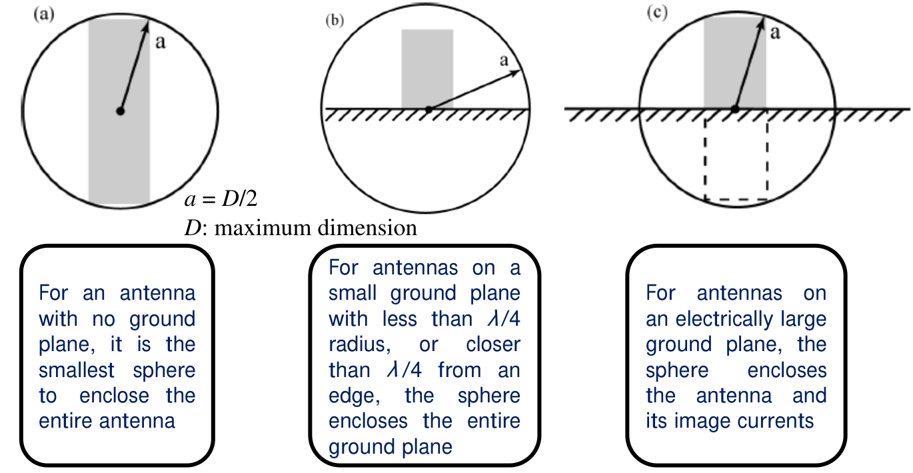
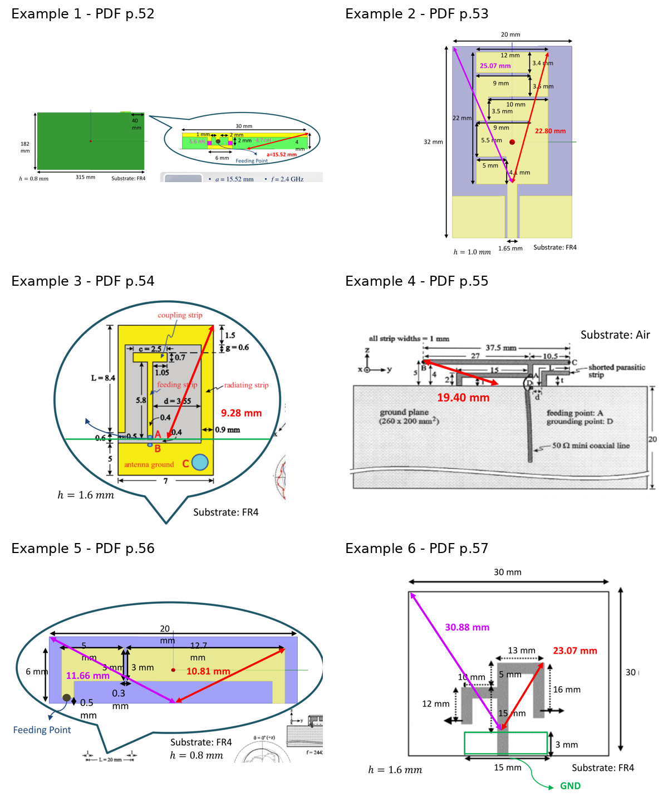
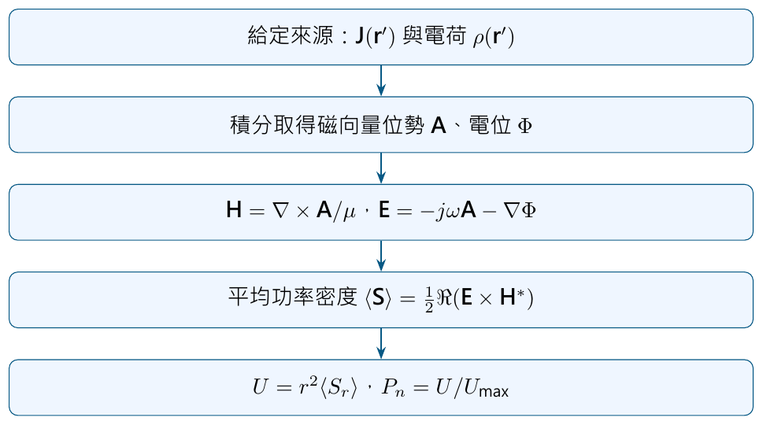
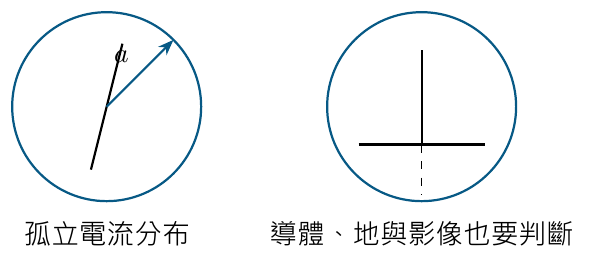

# 單元 20｜天線參數的理論極限

從尺寸、儲能與六個論文例，連到電流如何產生場。

原始影片：[陳晏笙老師「天線」單元 20](https://www.youtube.com/watch?v=mzPEfkrHd5k)
原始講義：[Lecture 4 — 輻射參數](https://drive.google.com/file/d/18mtgr-C9XaZz3r2wJWh29ZXxWADFx7yV/view)，pp.49–64。

影片約 87 分 29 秒；建議閱讀約 35 分鐘。前置單元：14、16–18。

學習重點：看懂 Q／頻寬／增益／效率估計的條件；正確圈出天線的電氣尺寸；逐例對照老師的六個 WLAN 天線；從來源電流算出位勢、場、平均功率與場型。全篇採 $`e^{j\omega t}`$、峰值相量。

## 講義與影片對照

以下時間依影片口述、講義與畫面交叉定位，約略時間不是精確換頁秒數。

| 講義頁 | 原英文主題 | 中文重點 | 影片定位 |
|:--|:--|:--|:--|
| 49–50 | Performance Limits | 四種性能估計及假設 | 約 00:30–12:30；17:00 回看 |
| 51 | Maximum Dimension | 包圍球與地平面 | 約 12:30–17:30 |
| 52 | WLAN Notebook Antenna | 論文例 1 | 約 18:30–27:20 |
| 53 | Dual-Band Planar Monopole Antenna | 論文例 2 | 約 27:20–31:20 |
| 54 | WLAN Laptop Computer Antenna | 論文例 3 | 約 31:20–36:20 |
| 55–57 | Flat-Plate / Monopole / Branched Monopole | 論文例 4–6 | 約 36:20–43:20 |
| 58–59 | Procedure for Finding the Pattern | 電流到場型的流程 | 約 43:20–50:00 |
| 60–61 | Relating I(r′) with E and H | 位勢、短電流元、黑板推導 | 約 50:00–82:20 |
| 62–63 | Power Density / Radiation Intensity | 功率密度與輻射強度 | 約 82:20–片尾 |
| 64 | Total Radiated Power | 球面積分與立體角積分 | 講義接續頁，補充整理 |

## 1．性能極限總表（Performance Limits，pp.49–50）

p.49 是章節封面；p.50 把品質因數、頻寬、峰值增益與輻射效率放在同一張表。它們的假設不同：Q 的球面模態下限、由 Q 換算的窄頻近似、正常指向性估計及介質損耗模型，不能一律視為任意天線的絕對界限。先用 $`ka=2\pi a/\lambda`$ 表示電氣尺寸，$`a`$ 的幾何定義依下一節 p.51 說明。

老師在 [約 01:55–05:15](https://www.youtube.com/watch?v=mzPEfkrHd5k&t=115s) 以產品開發情境說明用途：當設計區域已固定，先估計尺寸所允許的性能尺度，再評估主管提出的雙頻、20% 頻寬、6 dBi 等要求是否合理。這些數字是情境示例。它們用來定位設計難度；要宣稱規格「不可能」，仍須先確認下面各界限的適用條件。

### 品質因數與匹配頻寬

調諧共振系統的輻射 Q，可寫為 $`Q_{\rm rad}=\omega W_{\rm stored}/P_{\rm rad}`$；電、磁儲能的定義須與調諧條件一致。損耗後的 Q 以 $`P_{\rm rad}+P_{\rm loss}`$ 為分母，通常更低；低 Q 也可能只是能量被耗散。

#### 最低階模態公式

```math
\boxed{Q_{\rm LP,min}\simeq\frac1{ka}+\frac1{(ka)^3}.}
```

此為常用的最低階單一電／磁偶極模態、無損並調諧模型的 Chu 型結果，不是任何場型、任何材料、任何 Q 定義都可無條件套用的式子。 影片另列

```math
Q_{\rm CP,course}=\frac12\left[\frac2{ka}+\frac1{(ka)^3}\right].
```

**條件與解讀：** 此式對應理想電、磁模態組合的估算；**只把兩支電偶極接成圓極化，不保證自動取得這個較低 Q**。是否達到下限，還取決於能量平衡、模態與球內儲能。

#### 為什麼尺寸縮小，頻寬急遽收縮？

$`ka\ll1`$ 時 $`(ka)^{-3}`$ 主導。同一頻率下 $`a`$ 減半，主導項增加約 8 倍。這反映較強的近場儲能，並不表示天線完全不能輻射。

#### 用 VSWR 門檻換算分數頻寬

在單一共振、中心匹配、阻抗隨頻率平滑的窄頻模型：

```math
\boxed{\mathrm{FBW}\approx
\frac{\mathrm{VSWR}_{\max}-1}{Q\sqrt{\mathrm{VSWR}_{\max}}}.}
```

影片設定 VSWR $`\le2`$，所以 $`\mathrm{FBW}\approx0.7071/Q`$。門檻改成 RL 至少 10 dB，係數約為 $`0.667`$，見單元 14。 **條件與解讀：** $`ka=0.5`$ 時 $`Q_{\min}=2+8=10`$，VSWR 2 的理想窄頻估計約 $`7.07\%`$。實際 Q 大於最低值，或有額外匹配儲能，頻寬通常更小。

> **核心觀念：** Q 下限與頻寬近似是兩步推論。寬頻、多共振、強損耗情況不可把 $`0.7071/Q`$ 當成精確頻寬定理。

### 正常指向性與介質效率

#### 投影片的峰值 gain 式子

```math
D_{\rm normal}\approx(ka)^2+2ka.
```

**條件與解讀：** Harrington 的推導是在球面波模態只取到階數 $`N`$ 時，最大指向性為 $`N^2+2N`$，再令正常模態階數約 $`N\sim ka`$。這是正常指向性的估計；**不是禁止所有天線超過它的普遍上限**。特別是 $`ka<1`$ 時，連續代入的值須謹慎解讀。 同一場型的普通增益為 $`G=\eta_{\rm rad}D`$；失配後的 realized gain 還要乘接受功率比例。不能把指向性、增益與實現增益混在一張表直接比較。

#### 超指向性要付什麼代價？

更高階模態與適當電流權重可形成更窄波束；通常伴隨較高儲能、較窄可用頻帶、較強損耗影響及對製造／饋入誤差的敏感性。因此實務問題是：在指定頻寬、效率與容差下，增益能做多高？

#### 影片的介質損耗模型

```math
\eta_{\rm rad}\approx\frac1{1+Q\tan\delta}.
```

這個式子把損耗比近似為 $`P_{\rm loss}/P_{\rm rad}\approx Q\tan\delta`$，需損耗主要來自參與儲能的介質。它未普遍計入導體、集總元件、饋線等耗能，也未區分所有儲能的介質參與比例。 **條件與解讀：** 若實際 $`\tan\delta=0.02`$、相關 $`Q=10`$，模型估 $`\eta=83.3\%`$。把金屬或匹配網路損失加進來後，總輻射效率還可能更低。

#### 低 Q 與高效率要一起看

加耗能電阻會降低以總接受功率為分母的 Q，卻降低輻射效率。正確目標不是只降低任意一種 Q，而是在所需頻寬保住可用輻射功率。 原始理論校核：[Harrington (1960)，Effect of Antenna Size on Gain, Bandwidth, and Efficiency](https://nvlpubs.nist.gov/nistpubs/jres/64D/jresv64Dn1p1_A1b.pdf)。後續研究仍討論界限的定義：[Pfeiffer 與 Wu，球面天線的頻寬與指向性界限](https://www.jpier.org/issues/volume.html?paper=24082205)。

> **核心觀念：** 超過正常指向性估計，應檢查球的範圍、模態、頻寬、效率與增益定義；不能只憑這一個數字宣布結果不可能。

## 2．最大尺寸：包圍球包含什麼？（Maximum Dimension，p.51）

```math
\boxed{ka=\frac{2\pi a}{\lambda},\qquad k=\omega\sqrt{\mu\epsilon}.}
```

$`a`$ 是包住相關輻射電流系統的最小球半徑；$`ka`$ 無單位。常以 $`ka<1`$ 描述電氣小天線，此時球直徑小於 $`\lambda/\pi`$。公釐小不小，要和工作波長比較。



圖：原講義 p.51 局部，依序為無地平面、小地平面、大地平面與鏡像。

### 影片的地平面判讀

老師在 [約 12:30–17:00](https://www.youtube.com/watch?v=mzPEfkrHd5k&t=750s) 把線型輻射結構分成三類：

| 課堂分類 | 選取包圍範圍的做法 |
|:--|:--|
| 沒有地平面 | 包住實際輻射結構，理想不輻射的饋線不列入 |
| 地平面較小 | 把有限地平面所參與的輻射一起考慮；不能只看細小天線圖案 |
| 可近似大地平面 | 以影像法，包住上方結構與其鏡像，而非把理想無窮地整片包進球 |

影片以從天線附近向外延伸約 $`\lambda/4`$ 作為大、小地平面的工程分界；這不是精確截斷所有電流的定理。若實際饋線有共模輻射，便不能套用「饋線一律排除」；要看哪些電流確實參與整個系統的輻射。小地平面與結構也應一起包住，不能只比較兩個各自包圍球的半徑就保證包住整個系統。

### 自由空間波長與導波波長

影片表格用 $`\lambda_g=\lambda_0/\sqrt{\epsilon_{\rm eff}}`$。這是課堂工程估算。**球面場的嚴格限制使用球外均勻介質的波數**；天線在空氣中、內部有基板，不代表可直接用饋線的 $`\lambda_g`$ 取代球外的 $`\lambda_0`$。

**老師如何估算 $`\epsilon_{\rm eff}`$？** [約 20:00–22:40](https://www.youtube.com/watch?v=mzPEfkrHd5k&t=1200s) 說明不能直接把 FR4 的材料介電常數 4.4 代進所有天線，因為場同時分布在空氣與基板中。他先在指定板材、厚度上模擬偶極，利用近似共振長度 $`L\approx0.475\lambda_g`$ 反推 $`\lambda_g`$，再估 $`\epsilon_{\rm eff}\approx(\lambda_0/\lambda_g)^2`$。課堂三個 FR4 厚度 0.8、1.0、1.6 mm 分別採 1.40、1.47、1.62。這是針對示例幾何的校準法；不能當成所有 FR4 天線共用的常數表，也不能直接取代嚴格球面界限的外部波數。

> **核心觀念：** 先定義整個輻射系統的球，再選正確的外部介質與波長；漏算地電流或混用導波波長，會改變你得到的「限制」。

## 3．六個 WLAN 天線論文例（Examples 1–6，pp.52–57）

### Example 1：WLAN Notebook Antenna（p.52）

投影片給 $`a=15.52`$ mm、$`f=2.4`$ GHz、$`\epsilon_{\rm eff}=1.40`$、$`\lambda_0=125`$ mm。沿用課堂導波估算：

```math
ka=\frac{2\pi(15.52)}{125}\sqrt{1.40}
\approx0.923,\qquad Q_{\min}\approx2.35,
```

```math
\mathrm{FBW}_{\rm est}\approx30.0\%,\qquad
10\log_{10}[(ka)^2+2ka]\approx4.31\ {\rm dB}.
```

影片表格的論文欄為 Q 12.04、頻寬 8.33%、gain 5.10 dBi、效率 63%。它說明實際性能未達理想 Q／頻寬，但也暴露「gain 超過表格估計」不能只靠小銅箔的圈就判定違反物理；整個筆電地電流及前頁模態假設都要檢查。

老師在 [約 24:10–26:50](https://www.youtube.com/watch?v=mzPEfkrHd5k&t=1450s) 進一步交叉檢查：$`D_{\rm dBi}=5.10-10\log_{10}(0.63)\approx7.11`$ dBi，再問三個主切面的場型是否支持這麼強的集中效果。這是一個值得重新檢查增益校準、效率定義與完整三維場型的訊號；只憑幾張切面，還不足以確定誤差來源。

### Example 2：Dual-Band Planar Monopole Antenna（p.53）

影片比較實際結構球半徑約 22.8 mm 與設計區域約 25.07 mm；同一模型下，圈得較大就會得到較寬鬆的估計。表列設計區域頻寬約 75%、正常指向性估計約 7.3 dB，而論文頻寬為 16.6%、gain 1.6 dBi，未附效率。此例用來評估尚有多少設計餘地，不能只憑區域估計反推實際效率。

### Example 3：WLAN Laptop Computer Antenna（p.54）

投影片 $`a=9.28`$ mm、$`ka=0.594`$、$`\epsilon_{\rm eff}=1.62`$：

```math
Q_{\min}=\frac1{0.594}+\frac1{0.594^3}\approx6.45.
```

影片表格列 6.64；表中 $`ka`$ 與 Q 不能由這個公式精確互相重現，可能來自取值或表格誤差。**下表保留原表數值並標示重算差異，不把兩者偽裝成完全一致。**

| 參數           | 影片估計欄 | 本頁重算                   | 影片論文欄   |
|:---------------|:-----------|:---------------------------|:-------------|
| Q              | 6.64       | 6.45                       | 17.92        |
| VSWR 2 頻寬    | 10.94%     | 10.96%                     | 5.58%        |
| 正常指向性估計 | 1.87 dB    | 1.88 dB                    | gain 4.0 dBi |
| 介質效率模型   | 89%        | 約 89%（$`\tan\delta=.02`$） | 88%          |

若先採表列 Q 6.64，$`0.7071/Q`$ 應為約 10.65%，也不是表列 10.94%。讀論文時須核對實際工作頻率、門檻與測得 Q 的定義。


### Example 4：Dual-Band Flat-Plate Antenna（p.55）

這是空氣基板的平板天線，旁接短路寄生元件。老師以 $`a=19.40`$ mm、$`\epsilon_{\rm eff}=1`$、$`f=2.4`$ GHz，得 $`ka\approx0.975`$。原表的設計空間與天線尺寸兩欄相同：Q 2.10、頻寬 33.61%、峰值增益估計 4.63 dBi、效率估計 96%；論文欄為 Q 12.62、頻寬 7.92%、gain 2.8 dBi，未提供效率。

注意 p.50 的介質損耗模型若以理想空氣 $`\tan\delta=0`$ 代入，應得 100%。因此 p.55 的「96%」不能直接解讀成空氣介質損耗的計算結果；講義沒有交代這個數字另包含哪些損耗。保留原數值供對照，不把它當成已驗證的物理界限。

[約 35:20–38:00](https://www.youtube.com/watch?v=mzPEfkrHd5k&t=2120s)，老師來回比較例 1、3、4 的場型與增益，並提出線纜校準可能使量測增益偏高的疑問；他也明說不確定原因。筆記保留這個交叉核對方法，並不把可能原因寫成已證實結論。

### Example 5：Dual-Band Monopole Antenna（p.56）

平面單極結構的設計空間與實際天線輪廓不同，老師分別圈出 $`a=11.66`$ 與 10.81 mm；$`\epsilon_{\rm eff}=1.40`$，對應 $`ka\approx0.69`$ 與 0.64。

| 參數 | 設計空間估計 | 天線尺寸估計 | 論文結果 |
|:--|--:|--:|--:|
| Q | 4.44 | 5.32 | 12.00 |
| 頻寬 | 15.92% | 13.30% | 8.33% |
| 峰值增益欄 | 2.71 dBi | 2.30 dBi | 3.00 dBi |
| 效率 | 92% | 90% | 84% |

圈的尺寸縮小時，估計 Q 升高、頻寬縮小。論文 gain 高於這個正常模態估計值，仍須連同完整地電流與模態條件解讀，不能只把表格相減判斷對錯。

### Example 6：Dual-Band Branched Monopole Antenna（p.57）

分枝單極由較大的 30 mm × 30 mm 設計區域向內縮；設計空間半徑 30.88 mm、天線輪廓半徑 23.07 mm，$`\epsilon_{\rm eff}=1.62`$，原表 $`ka=1.98/1.47`$。

| 參數 | 設計空間估計 | 天線尺寸估計 | 論文結果 |
|:--|--:|--:|--:|
| Q | 0.64 | 0.99 | 11.13 |
| 頻寬 | 111.21% | 71.53% | 8.98% |
| 峰值增益欄 | 8.95 dBi | 7.10 dBi | 2.1 dBi |
| 效率 | 99% | 98% | 未提供 |

原表把窄頻公式延伸到 111.21%；這個數字只能當該模型的尺度比較，不能視為實際可達的精確頻寬保證。此例的兩個 $`ka`$ 也都超過 1，已不屬於嚴格的電氣小天線範圍。



圖：原講義 pp.52–57 的天線結構局部，依 Example 1–6 排列。完整性能數字以本節表格及原講義為準。

### 原表數值與同一公式重算的差別

以 p.50 的 LP 公式、VSWR = 2，並直接使用各頁列出的 $`ka`$ 重算：

| 例題／取值 | $`ka`$ | 重算 $`Q=1/(ka)+1/(ka)^3`$ | 重算頻寬 | 原表 Q／頻寬 |
|:--|--:|--:|--:|:--|
| 例 1 | 0.92 | 2.371 | 29.82% | 2.35／30.03% |
| 例 2／設計空間 | 1.531 | 0.932 | 75.88% | 0.93／75.92% |
| 例 2／天線尺寸 | 1.393 | 1.088 | 65.00% | 1.09／64.99% |
| 例 3 | 0.594 | 6.455 | 10.95% | 6.64／10.94% |
| 例 4 | 0.975 | 2.105 | 33.60% | 2.10／33.61% |
| 例 5／設計空間 | 0.69 | 4.493 | 15.74% | 4.44／15.92% |
| 例 5／天線尺寸 | 0.64 | 5.377 | 13.15% | 5.32／13.30% |
| 例 6／設計空間 | 1.98 | 0.634 | 111.55% | 0.64／111.21% |
| 例 6／天線尺寸 | 1.47 | 0.995 | 71.06% | 0.99／71.53% |

部分小差異可由半徑與 $`ka`$ 的四捨五入解釋；例 3 的 Q 與頻寬則無法用原表 Q 一致重現。原表「This paper」欄的 Q 也未交代完整擷取方式，不應直接假設皆由同一個 $`0.7071/\mathrm{FBW}`$ 換算。

## 4．從電流分布求場型（Procedure for Finding the Pattern，pp.58–59）



講義的四步是：電流分布 $`I(\mathbf r')`$ → 電、磁場 → 平均功率密度 → 輻射強度與正規化場型。中間先引入磁向量位勢 $`\mathbf A`$，可讓來源積分更容易計算。位置向量的撇號表示「電流所在的來源點」；沒有撇號表示「觀察點」。

## 5．電流與電磁場的關係（Relating I(r′) with E and H，pp.60–61）

p.60 先寫出相量 Maxwell 方程：

```math
\nabla\cdot\mathbf D=\rho,\quad \nabla\cdot\mathbf B=0,\quad
\nabla\times\mathbf E=-j\omega\mu\mathbf H,\quad
\nabla\times\mathbf H=\mathbf J+j\omega\epsilon\mathbf E.
```

因為旋度的散度恆為零，可令 $`\mathbf B=\nabla\times\mathbf A`$；先求 $`\mathbf A`$，再用 $`\mathbf H=\mu^{-1}\nabla\times\mathbf A`$ 取得磁場。

### 位勢與 Lorenz 條件的完整推導

老師在 [約 51:50–79:00](https://www.youtube.com/watch?v=mzPEfkrHd5k&t=3110s) 用黑板補足 p.60 的推導。先複習三個向量恆等式，再把 Maxwell 方程改寫成位勢方程：

```math
\nabla\cdot(\nabla\times\mathbf A)=0,\quad
\nabla\times(\nabla\Phi)=0,\quad
\nabla\times(\nabla\times\mathbf A)
=\nabla(\nabla\cdot\mathbf A)-\nabla^2\mathbf A.
```

#### 為什麼引入 $`\mathbf A`$？

Maxwell 方程 $`\nabla\cdot\mathbf B=0`$，而向量恆等式 $`\nabla\cdot(\nabla\times\mathbf A)=0`$。因此令

```math
\mathbf B=\nabla\times\mathbf A,\qquad
\mathbf H=\frac1\mu\nabla\times\mathbf A
```

便自動滿足磁場無散度。不是說 $`\mathbf A`$ 是磁場；它是一個讓求解更方便的位勢。

#### 由 Faraday 方程得到 $`\mathbf E`$

```math
\nabla\times\mathbf E=-j\omega\mathbf B
\quad\Rightarrow\quad
\nabla\times(\mathbf E+j\omega\mathbf A)=0.
```

無旋部分可表示為電位的負梯度：

```math
\boxed{\mathbf E=-j\omega\mathbf A-\nabla\Phi.}
```

只取 $`-j\omega\mathbf A`$ 會漏掉一般近場的電位貢獻。遠場橫向分量可進一步簡化，但要先說明近似。

> **核心觀念：** 位勢是計算工具；最後要用它求出可觀察的 $`\mathbf E,\mathbf H`$，再算功率與場型。

在均勻線性介質、$`e^{j\omega t}`$ 約定下，

```math
\nabla\times\mathbf H=\mathbf J+j\omega\epsilon\mathbf E.
```

將上述位勢代入，使用 $`\nabla\times\nabla\times\mathbf A=\nabla(\nabla\cdot\mathbf A)-\nabla^2\mathbf A`$：

```math
\nabla^2\mathbf A+k^2\mathbf A
=-\mu\mathbf J+\nabla(\nabla\cdot\mathbf A+j\omega\mu\epsilon\Phi).
```

再由 $`\nabla\cdot\mathbf E=\rho/\epsilon`$，得到另一條耦合方程：

```math
\nabla^2\Phi+j\omega\nabla\cdot\mathbf A=-\rho/\epsilon.
```

此時未知數已集中在 $`\mathbf A,\Phi`$，但兩者仍互相耦合。選擇 Lorenz gauge

```math
\boxed{\nabla\cdot\mathbf A=-j\omega\mu\epsilon\Phi}
```

後，括號項消失：

```math
\boxed{(\nabla^2+k^2)\mathbf A=-\mu\mathbf J,\qquad
(\nabla^2+k^2)\Phi=-\rho/\epsilon.}
```

這個規範是在位勢的自由度中選擇方便的表示，不是對可觀察的電磁場額外強加一項物理限制。老師強調，最後兩式與傳輸線章的波動方程具有相同結構，只是現在要解三維空間中的來源與外傳波。

### 外傳波的積分解

令 $`R=|\mathbf r-\mathbf r'|`$，來源座標有撇號，觀察點沒有：

```math
\boxed{\mathbf A(\mathbf r)=\frac{\mu}{4\pi}
\int_V\mathbf J(\mathbf r')\frac{e^{-jkR}}R\,dV'.}
```

```math
\Phi(\mathbf r)=\frac1{4\pi\epsilon}
\int_V\rho(\mathbf r')\frac{e^{-jkR}}R\,dV'.
```

$`e^{-jkR}`$ 與本講義的 $`e^{j\omega t}`$ 配對，表示朝外傳播。若改時間約定，相關 $`j`$ 與空間相位也須一起改。

### 細線天線改為線積分

線方向單位向量 $`\hat{\mathbf t}'`$、線電流 $`I(s')`$：

```math
\mathbf A(\mathbf r)=\frac{\mu}{4\pi}
\int_{\rm wire} I(s')\hat{\mathbf t}'\frac{e^{-jkR}}R\,ds'.
```

### 一個容易漏掉的來源條件

投影片寫 $`\mathbf E=(j\omega\epsilon)^{-1}\nabla\times\mathbf H`$。此式用於**觀察點沒有導電來源電流 $`\mathbf J`$**的區域；一般情況需先從 $`\nabla\times\mathbf H`$ 減去 $`\mathbf J`$。

> **核心觀念：** 先求 Helmholtz 方程，再以外傳核積分每一段來源的振幅、方向與相位；不是把所有電流大小直接相加。

### 老師例題：沿 z 軸的均勻短電流元

沿 $`z`$ 方向長度 $`\ell\ll\lambda`$ 的理想均勻電流元，峰值電流 $`I_0`$。在遠處，可把線積分近似為

```math
\mathbf A\simeq\hat{\mathbf z}\frac{\mu I_0\ell}{4\pi r}e^{-jkr}.
```

老師在 [約 78:25–79:00](https://www.youtube.com/watch?v=mzPEfkrHd5k&t=4705s) 主動指出：開路端的電流應趨近零，因此均勻電流只是便於推導的理想化。真實中心饋入短線的電流通常不是均勻分布；單元 21 會區分兩者。

### 球座標分量

$`\hat{\mathbf z}=\hat{\mathbf r}\cos\theta-\hat{\boldsymbol\theta}\sin\theta`$，所以

```math
A_r=C(r)\cos\theta,\qquad A_\theta=-C(r)\sin\theta,
\quad C(r)=\frac{\mu I_0\ell e^{-jkr}}{4\pi r}.
```

由旋度的 $`\phi`$ 分量

```math
H_\phi=\frac1{\mu r}
\left[\frac{\partial(rA_\theta)}{\partial r}
-\frac{\partial A_r}{\partial\theta}\right]
=\frac{I_0\ell e^{-jkr}}{4\pi}
\left(\frac{jk}r+\frac1{r^2}\right)\sin\theta.
```

完整電場還包含

```math
E_r=\frac{\eta I_0\ell\cos\theta}{2\pi}
\left(\frac1{r^2}+\frac1{jkr^3}\right)e^{-jkr},
```

```math
E_\theta=\frac{jk\eta I_0\ell\sin\theta}{4\pi}
\left(\frac1r+\frac1{jkr^2}-\frac1{k^2r^3}\right)e^{-jkr},
\qquad E_\phi=0.
```

**原稿校正（p.61）：**該頁完整場式的 $`E_\theta`$ 括號漏了 $`-1/(k^2r^3)`$。由前式 $`H_\phi`$ 代入 $`\mathbf E=(j\omega\epsilon)^{-1}\nabla\times\mathbf H`$ 可得到此項。它不影響該頁最後的遠場近似，但會影響近場。

遠場 $`kr\gg1`$ 時保留 $`1/r`$ 的輻射項：

```math
\boxed{H_\phi\simeq
\frac{jkI_0\ell}{4\pi r}e^{-jkr}\sin\theta,\qquad
E_\theta\simeq\eta H_\phi,}
```

其中 $`\eta=\sqrt{\mu/\epsilon}`$，空氣中約 $`120\pi\,\Omega`$。近場其他分量也有 $`1/r^2,1/r^3`$；不能將遠場平面波關係套遍所有位置。

### 可直接看出的三件事

-   振幅隨 $`1/r`$ 衰減，平均功率密度隨 $`1/r^2`$ 衰減。

-   沿軸 $`\theta=0,\pi`$ 有零點，垂直軸的 $`\theta=\pi/2`$ 最強。

-   遠場 $`\mathbf E,\mathbf H`$ 互相垂直且橫向，平均能量朝外。

> **核心觀念：** 電流積分給出位勢，微分取得場；相位、方向與近／遠場階數都不能省略。

## 6．由電磁場求功率密度（The Power Density from E and H，p.62）

對峰值相量，時間平均 Poynting 向量：

```math
\boxed{\langle\mathbf S\rangle
=\tfrac12\Re(\mathbf E\times\mathbf H^*)}.
```

**原稿用詞校正：**p.62 把 $`\mathbf E\times\mathbf H^*`$ 描述為瞬時功率密度；這不是瞬時向量。瞬時功率是實際時間場 $`\mathbf e(t)\times\mathbf h(t)`$；相量乘共軛後取實部並乘 $`1/2`$，才是週期平均。若採 RMS 相量，公式則沒有此 $`1/2`$。老師也在 [約 82:40–83:15](https://www.youtube.com/watch?v=mzPEfkrHd5k&t=4960s) 明確區分兩種相量約定；這個因子來自時間平均與振幅定義，不表示物理功率固定被分掉一半。

### 短電流元的遠場功率

在無損介質、橫向外傳遠場，

```math
\langle S_r\rangle=\frac{|E_\theta|^2}{2\eta}
=\frac{\eta k^2|I_0|^2\ell^2}{32\pi^2r^2}\sin^2\theta.
```

單位 W/m$`^2`$，與 p.62 的 $`\eta |I_0|^2\ell^2\sin^2\theta/(8\lambda^2r^2)`$ 相同。

## 7．功率密度轉為輻射強度（Turning |Sav| into Radiation Intensity，p.63）

球面小面積為

```math
dA=(r\,d\theta)(r\sin\theta\,d\phi)=r^2d\Omega,\qquad
d\Omega=\sin\theta\,d\theta\,d\phi.
```

同一束能量往外傳，截面隨 $`r^2`$ 放大，功率密度隨 $`1/r^2`$ 降低；乘回 $`r^2`$ 就改成每單位立體角的輻射功率：

```math
\boxed{U(\theta)=r^2\langle S_r\rangle
=\frac{\eta k^2|I_0|^2\ell^2}{32\pi^2}\sin^2\theta.}
```

$`U`$ 的單位 W/sr，遠場不隨 $`r`$ 改變，正規化功率場型 $`P_n=\sin^2\theta`$。

## 8．積分總輻射功率（Total Radiated Power，p.64）

p.64 將兩種積分列在一起，供本單元末尾延伸對照；影片末段可確認到 p.63。第一種積分封閉球面的功率密度，第二種直接積分輻射強度：

```math
P_{\rm rad}=\oint_S\langle\mathbf S\rangle\cdot d\mathbf a
=\int_0^{2\pi}\int_0^\pi U(\theta,\phi)\sin\theta\,d\theta\,d\phi.
```

以均勻短電流元驗算：

```math
P_{\rm rad}=\int U\,d\Omega
=\frac{\eta k^2|I_0|^2\ell^2}{32\pi^2}
(2\pi)\int_0^\pi\sin^3\theta\,d\theta
=\frac{\eta k^2|I_0|^2\ell^2}{12\pi}.
```

再用峰值端口電流 $`P_{\rm rad}=\tfrac12|I_0|^2R_r`$，於自由空間：

```math
\boxed{R_r=80\pi^2(\ell/\lambda)^2\ \Omega.}
```

> **核心觀念：** 場型、指向性與輻射電阻都來自同一個電流模型；峰值／RMS、電流形狀與積分權重保持一致，結果才會吻合。

## 補充解說與重算例題

### 包圍球的幾何與波數選擇

### 三維外形不一定是「最長邊的一半」

**補充解說／重算例題：**若電流分布填滿 $`L\times W\times H`$ 的矩形盒，對角線的一半

```math
a=\tfrac12\sqrt{L^2+W^2+H^2}
```

可以包住整盒；只用最大邊的一半可能漏掉角落。實際最小球可依電流所在幾何更緊地求取。

### 重算要註明用哪個 $`k`$

**補充解說／重算例題：**例一若採空氣球外 $`k_0`$，$`ka\approx0.780`$、單模態 Q 約 3.39，VSWR 2 的窄頻估計約 20.9%。這是改用另一個模型的推算，不是宣稱此結構的嚴格全系統界限已求得。



圖：原筆記的幾何示意重畫，與老師 p.51 的三種情況一起閱讀。

### 短電流元的數值檢查

**補充解說／重算例題：**$`\ell=\lambda/50`$ 的均勻電流元，$`R_r\approx0.316\,\Omega`$；峰值 $`I_0=1`$ A 時，$`P_{\rm rad}\approx0.158`$ W。若實際電流是三角形分布，不能沿用相同均勻模型的結果。

## 自測與解析

先算題，再看答案；辨認公式的條件也算學習成果。

1.  空氣中 $`f=1`$ GHz、最小包圍球 $`a=10`$ mm。求 $`ka`$、單模態 $`Q_{\min}`$ 與 VSWR 2 的窄頻分數頻寬估計。

2.  在 $`ka\ll1`$、同一頻率與單一模態下，半徑減半，主導 Q 與理想窄頻寬大約如何改變？

3.  某天線的測得 gain 超過 $`(ka)^2+2ka`$ 的 dB 值，是否能只憑此式認定不可能？要先核對哪些條件？

4.  採 $`e^{j\omega t}`$，外傳核用 $`e^{+jkR}`$ 還是 $`e^{-jkR}`$？在有來源電流的位置，可否直接用 $`\mathbf E=\nabla\times\mathbf H/(j\omega\epsilon)`$？

5.  自由空間均勻電流元長 $`\lambda/100`$，峰值電流 2 A。求輻射電阻與功率；其正規化功率場型與最大指向性為何？

### 答案與解析

1.  $`\lambda\simeq300`$ mm、$`ka\simeq0.2094`$。Q 約 113.63；$`\mathrm{FBW}\simeq0.622\%`$。此為理想單模態窄頻估計。

2.  主導 $`(ka)^{-3}`$ 增為約 8 倍，頻寬縮為約 $`1/8`$；這不表示實際所有損耗或多共振模型都照同樣比例。

3.  不能。先核對包圍球是否含相關地電流、外部介質、gain／D／realized gain 的定義、模態與頻寬效率條件。正常指向性估計不是普遍禁止超過的硬界線。

4.  用 $`e^{-jkR}`$。有 $`\mathbf J`$ 的位置需 $`\mathbf E=(\nabla\times\mathbf H-\mathbf J)/(j\omega\epsilon)`$。

5.  $`R_r=80\pi^2/10000\approx0.07896\,\Omega`$；$`P_{\rm rad}=\tfrac12(2)^2R_r\approx0.1579`$ W。$`P_n=\sin^2\theta`$，$`D_{\max}=1.5`$，約 1.76 dBi。

### 影片定位備忘

[08:00](https://www.youtube.com/watch?v=mzPEfkrHd5k&t=480s)：性能表格；[16:00](https://www.youtube.com/watch?v=mzPEfkrHd5k&t=960s)：包圍球與地平面；[20:00](https://www.youtube.com/watch?v=mzPEfkrHd5k&t=1200s)：論文示例；[50:00](https://www.youtube.com/watch?v=mzPEfkrHd5k&t=3000s)：位勢流程；[74:00](https://www.youtube.com/watch?v=mzPEfkrHd5k&t=4440s)：規範條件；[86:00](https://www.youtube.com/watch?v=mzPEfkrHd5k&t=5160s)：輻射強度與面積。

**下一單元：**線型天線。把不同線電流分布代進積分，求出短偶極、半波偶極與單極的場型及輻射電阻。
