# 單元 21｜線型天線

從電流路徑理解偶極、單極、迴路，以及擴大頻寬的方法。

原始影片：[陳晏笙老師「天線」單元 21](https://www.youtube.com/watch?v=fTeOAukTnoI)（74:48）。
老師講義：[Lecture 5 — Antenna Family](https://drive.google.com/file/d/1Qs5TCf37f4gz39FlhkYn0MjDhVoyuclD/view)，**第 3–22 頁**。本篇依老師講義頁序編排，板書放在對應主題，重算例題集中於章末。

建議閱讀：約 45 分鐘。前置單元：11、16–18、20。

學習重點：分清均勻電流元與實際短偶極；把電流分布、阻抗、場型一起看；用影像法理解單極；辨認小迴路模型的限制；理解擴頻寬的三種設計思路。

## 講義與影片對照

下列時間整合影片畫面與影片口述，取方便回看的約略主題區間，包含板書及插講，並非逐頁切換的精確秒數。影片開頭為 Lecture 5 封面；第 3 頁是本節目錄。

| 講義頁碼 | 原英文主題 | 中文內容 | 影片定位 |
|:---|:---|:---|:---|
| 3–5 | Wire Structures / Popular Antennas | 天線家族與本節範圍 | 約 00:27–05:51 |
| 6 | Short Dipole Antennas | 短偶極、阻抗與極化 | 約 [05:51](https://www.youtube.com/watch?v=fTeOAukTnoI&t=351s)–10:42 |
| 7 | Half-Wavelength Dipole Antennas | 半波偶極、共振與涵蓋方向 | 約 10:42–15:33 |
| 8 | Other Dipole Lengths | 不同長度的電流、指向性與阻抗 | 約 15:33–18:55 |
| 9 | Impedance Response of Dipole | 共振、反共振與基模判讀 | 約 18:55–23:52 |
| 10 | Popular Forms of Dipole Antennas (1/2) | 平衡饋入、balun 插講、曲折線 | 約 [23:53](https://www.youtube.com/watch?v=fTeOAukTnoI&t=1433s)–34:06 |
| 11 | Popular Forms of Dipole Antennas (2/2) | 雙錐、蝴蝶結、折疊與套筒 | 約 34:06–40:37 |
| 12 | Image Theorem | 電荷移動、影像電流與 PEC | 約 40:37–45:40 |
| 13 | λ/4 Monopole | 單極、有限地板與影像厚度誤解 | 約 45:41–54:35 |
| 14 | Other Monopole Lengths | 單極長度比較 | 約 54:36–55:55 |
| 15 | Popular Forms of Monopoles | ILA、IFA、PIFA 的演變 | 約 [55:55](https://www.youtube.com/watch?v=fTeOAukTnoI&t=3355s)–63:49 |
| 16 | UWB Planar Monopole Antennas | 超寬頻平面單極 | 約 63:49–65:32 |
| 17 | Small Loop Antennas | 小迴路、極化與阻抗對照 | 約 65:32–68:06 |
| 18 | Other Loop Circumferences | 圓迴路尺寸與模型條件 | 約 68:06–70:05 |
| 19 | Patterns of Square Loop Antennas | 方迴路與兩支電流的陣列觀點 | 約 70:05–72:40 |
| 20 | How to Expand the Bandwidth? (1/3) | 多重共振 | 約 72:40–73:10 |
| 21 | How to Expand the Bandwidth? (2/3) | 加寬金屬 | 約 73:10–73:50；[73:50](https://www.youtube.com/watch?v=fTeOAukTnoI&t=4430s) 畫面確認 |
| 22 | How to Expand the Bandwidth? (3/3) | 碎形結構 | 約 73:50–74:46；[74:20](https://www.youtube.com/watch?v=fTeOAukTnoI&t=4460s) 畫面確認 |

## 1．從天線家族看設計問題（Popular Antennas，講義第 3–5 頁）

前面學過阻抗、極化、場型、指向性、效率與頻寬，這一章開始把它們用在實際結構。老師希望我們看懂：某種天線為什麼常用、優缺點是什麼，以及應該如何決定尺寸與饋入。

| 家族 | 講義列出的主要結構 | 本單元的重點 |
|:---|:---|:---|
| 線型天線（wire-type） | 偶極、單極、迴路、螺旋 | 本節詳談前三類；螺旋另見家族總覽與寬頻例圖 |
| 孔徑型天線（aperture-type） | 狹縫、微帶貼片、號角、反射面、透鏡 | 留待下一單元 |

老師在約 01:58–03:54 用「控制哪一種分布」區分兩類：線型天線主要控制導體上的電流；孔徑天線主要控制開口上的電場與磁場。偶極是本章的基礎，後續會用影像、電磁對偶及等效場源連到單極、迴路、狹縫與貼片，但各結構仍有自己的成立條件。

**先固定符號：**沿用老師的 $`L`$，偶極總長為 $`2L`$、每臂長為 $`L`$；單極的實體高度／線長為 $`L`$。若用 $`\ell`$，僅作為偶極總長的簡寫：$`\ell=2L`$。迴路半徑用 $`b`$，導線半徑用 $`a`$，周長用 $`C`$，正規化周長為 $`C_\lambda=C/\lambda`$。

以下場型公式中的 $`E_\theta`$、$`E_\phi`$ 主要表示**角度因子**，已略去距離、傳播相位及電流振幅。功率場型須再取絕對值平方；不能把正規化場型的峰值當作絕對增益。

## 2．短偶極：場型簡單，端口卻不容易匹配（Short Dipole，講義第 6 頁）

老師定義電氣短偶極為總長 $`2L\ll\lambda`$，常取 $`2L<\lambda/10`$。中心饋入、兩端開路的細線，其電流在中央最大、兩端趨近零，可用三角形近似：

```math
I(z')\approx I_f\left(1-\frac{|z'|}{L}\right),
\qquad -L\le z'\le L.
```

老師的輸入阻抗近似式為

```math
Z_a\approx
20\left(\frac{2\pi L}{\lambda}\right)^2
-j120\frac{\ln(2L/d)-1}{2\pi L/\lambda}\quad\Omega,
```

其中 $`d`$ 為導線直徑。這是細線、短尺寸且忽略導體損耗的模型；輸入電阻主要是輻射電阻，電抗則高度電容性。縮短時，輻射電阻按長度平方下降，而電容性電抗的絕對值增加，因此直接接 $`50\,\Omega`$ 系統常有很大失配。

### 均勻電流元與短偶極不能共用同一個端口電阻

短偶極的有效電流積分為

```math
\int_{-L}^{L}I(z')\,dz'=I_fL=\frac{I_f\ell}{2}.
```

相同總長、相同參考電流下，這只有均勻電流元的一半；遠場振幅一半，輻射功率為四分之一。以峰值參考電流定義 $`P_{\rm rad}=\tfrac12R_r|I_f|^2`$：

| 模型 | 電流分布 | 輻射電阻 |
|:---|:---|:---|
| 理想均勻電流元 | 沿總長 $`\ell`$ 均勻 | $`80\pi^2(\ell/\lambda)^2`$ |
| 中心饋入短偶極 | 三角形 | $`20\pi^2(\ell/\lambda)^2=20(2\pi L/\lambda)^2`$ |

沿 $`z`$ 軸放置時，$`E_\theta\propto\sin\theta`$，功率 $`\propto\sin^2\theta`$。最大指向性為 $`D=1.5`$，即 1.76 dBi；$`xy`$ 水平切面全向，沿線軸為零點。這是甜甜圈形的三維場型，電場為 $`\theta`$ 方向的線極化。

影片約 08:13–10:12 要我們同時讀出兩件事：$`E_\phi=0`$ 說明極化，場型與 $`\phi`$ 無關則說明水平面全向，兩者不可混為一談。老師把垂直偶極稱為垂直極化；更精確地說，遠場沿導線方向在垂直於傳播方向平面上的投影。只有在水平觀察面，$`\hat\theta`$ 才平行於 $`z`$ 軸，不能把所有方向的遠場都寫成固定的 $`E_z`$。

## 3．半波偶極：尺寸、阻抗與場型的折衷（Half-Wavelength Dipole，講義第 7 頁）

總長 $`2L=\lambda/2`$ 的細線偶極，電流近似正弦，在中央最大、兩端為零。其遠場角度因子為

```math
F(\theta)=\frac{\cos[(\pi/2)\cos\theta]}{\sin\theta}.
```

軸上的極限為零，功率場型為 $`|F|^2`$。最大指向性約 1.64，即 2.15 dBi，半功率波束寬約 $`78^\circ`$。

講義列出

```math
Z_a\approx73+j42\quad\Omega.
```

這代表**幾何長度正好半波仍有感性電抗**。要得到零電抗的共振，實際細線通常要略短於半波，並考慮線徑、端部、介質及鄰近導體。老師所說輸入阻抗對線徑較不敏感，是在這個細線半波模型附近的比較，不表示線徑與頻寬完全無關。

> **講義數值校正：**第 7 頁將 $`73+j42\,\Omega`$ 與「接 50 或 75 Ω，VSWR < 2」並列。完整複數阻抗接 50 Ω 時，$`|\Gamma|=0.3684`$、VSWR 約 **2.17**；接 75 Ω 約 **1.75**。若電抗已調掉而為 $`73+j0\,\Omega`$，接 50 Ω 才是約 **1.46**。匹配計算要保留電抗。

影片約 11:41–12:10、19:56–20:27 舉出**總長約 $`0.475\lambda`$、阻抗約 $`67+j0\,\Omega`$** 的調諧例，幫助區分「幾何半波」和「零電抗共振」。這是老師所用細線案例的近似值，不能直接當作所有線徑、基板與外殼的尺寸常數。

影片約 12:40–15:04 用基地台說明場型：理想垂直偶極沿軸向有零點，水平附近較強，因此涵蓋地面使用者時會用下傾角調整主瓣。這是理解方向性的例子；真實基地台有陣列、機械／電氣下傾及建物散射，不能只靠單一偶極圖推論某棟樓的實際場強。

半波偶極常用的理由是：電阻在一般饋線容易處理的量級、尺寸適中、場型仍簡單。這些優點同時成立，才使它成為常見的基準天線。

## 4．長度改變時，電流、場型、阻抗一起變（Other Dipole Lengths，講義第 8 頁）

| 偶極總長 $`2L`$ | $`\lambda/10`$ | $`\lambda/2`$ | $`\lambda`$ | $`1.5\lambda`$ |
|:---|:---|:---|:---|:---|
| 電流特徵 | 近三角形 | 中央最大、端點零 | 中央近節點 | 多段電流，部分反相 |
| 最大指向性，線性值 | 1.5 | 1.64 | 2.4 | 約 2.3 |
| 最大指向性，dBi | 1.76 | 2.15 | 3.8 | 約 3.6 |
| HPBW | 約 90° | 約 78° | 約 47° | 多瓣，須指定哪個主瓣 |
| 輸入電阻 | 約 2 Ω | 約 73 Ω | 約 2000 Ω | 約 106 Ω |
| 輸入電抗 | 電容性 | 約 $`+j42\,\Omega`$ | 講義列感性 | 細線近似下約為零 |

表中數值是講義的典型模型值，並非任意線徑、饋入與安裝環境下都固定成立。尤其整波長附近的高阻抗峰值及電抗非常敏感。

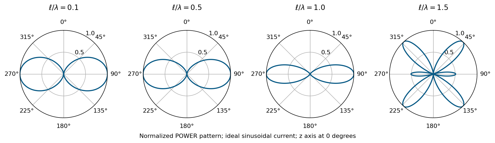

圖為依正弦電流模型重畫，$`\ell=2L`$，每張功率峰值都正規化為 1。角度從 $`z`$ 軸起算；正規化只比較形狀，不能用圖上的同高峰值判斷四者有相同增益。

整波長偶極的中央接近電流節點；相同端口電壓下，饋入電流較小，輸入阻抗因此很高。這不是輻射功率無限大。長到 $`1.5\lambda`$ 時，反相電流段使不同方向發生相長與相消，最大方向離開原本的正側向，形成多個波瓣。

## 5．掃頻看共振與反共振（Impedance Response，講義第 9 頁）

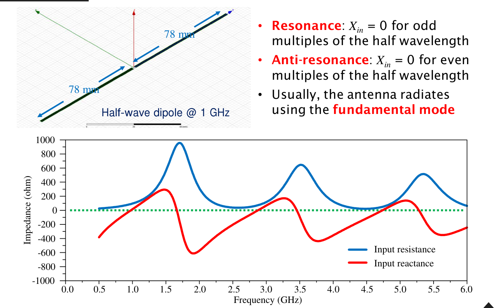

來源：老師講義第 9 頁。圖中兩臂各 78 mm，以約 1 GHz 的半波偶極為例，藍線為輸入電阻、紅線為輸入電抗。

影片約 18:55–20:27 把前頁「固定頻率、改變長度」連到本頁「固定長度、改變頻率」：在其餘條件相同的模型下，兩者都在改變電氣尺寸 $`2L/\lambda`$。頻率升高、波長縮短，同一支天線就容納更多個波長。

圖上應一起看 $`R_{\rm in}`$ 與 $`X_{\rm in}`$：

- 接近奇數個半波長時，常有較低輸入電阻的共振，$`X_{\rm in}`$ 過零。
- 接近偶數個半波長、也就是整波長倍數時，會出現高阻抗的反共振，$`X_{\rm in}`$ 也可能過零。
- 高階模態可以輻射，但場型與頻率一起改變；一般使用基模，是為了取得較容易控制的阻抗與場型。

講義用整數倍波長描述趨勢；真實的零電抗點會偏移。**「電抗為零」只表示端口在該頻率呈純電阻，仍須檢查電阻大小、效率與所需方向的增益。**

約 20:55–23:52 的設計提醒是：本圖基模附近的電抗由負轉正，整波長反共振附近則由正轉負、變化較陡且電阻很大。只看到 $`S_{11}`$ 在目標頻率下降，還不能判定設計完成；應向更低頻掃描，確認是否誤用了高階模態，並檢查電流與場型。對本章要做小尺寸、水平全向涵蓋的偶極，基模通常較合適；刻意利用高階模態則須有明確的場型需求，不能把老師的設計提醒解讀成所有天線都禁止高階模態。

## 6．實際偶極：先處理饋入，再看形狀（Popular Forms，講義第 10 頁）

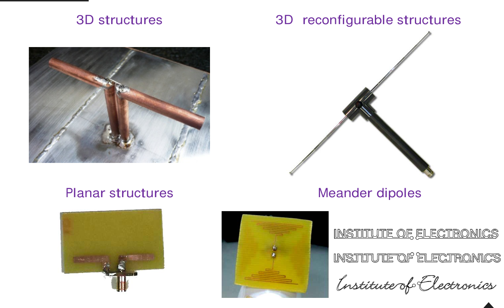

來源：老師講義第 10 頁。依序展示三維結構、可調整的三維結構、PCB 平面結構與曲折線偶極。

### 影片板書：平衡天線如何接非平衡饋線

影片約 24:50–31:11 配合板書討論饋入，並暫時跳到後頁的印刷饋入例。理想偶極兩端構成平衡端口；同軸線是非平衡饋線。直接相接時，同軸外導體的**外表面**可能流共模電流，讓饋線也參與輻射，改變阻抗、場型與極化。

老師以共平面雙線（coplanar strip，CPS）作為平衡傳輸線：兩條同平面的導線承載一去一回的差動電流，下方沒有微帶線那樣的接地面。微帶線與同軸則是常見的非平衡結構；影片稱它們「單線」，是指訊號路徑的結構分類，**不代表沒有回流導體**。平衡也要看端口相對地的電氣對稱性，不能只靠外觀左右對稱判斷。

平衡／非平衡轉換器（balun）要依實作檢查振幅平衡、相位差與共模抑制；名稱叫 balun，不代表一定有 4:1 阻抗比。影片展示的印刷饋入，把一路分成兩路，讓其中一路多走約半個導波波長：

```math
\Delta\ell=\frac{\lambda_g}{2},
\qquad \Delta\phi=\beta\Delta\ell=\pi.
```

這個例子結合功率分配與相位延遲，兩端於設計頻率相差 180°；並非所有 balun 都必須採用這種路徑差結構。頻率改變後，相位差與振幅平衡也會變，因此饋入本身可能限制天線可用頻寬。

### 影片板書：曲折線優先放在末端

影片約 31:11–34:06 討論曲折偶極。中央電流較大；若在中央密集折返，相鄰反向電流的輻射容易抵銷。先在電流較小的末端彎折，較能保留中央主要輻射區。曲折能縮小外框，卻也會改變儲能、損耗與匹配，不能把導線路徑變長直接視為效率提高。

老師舉自己做過的曲折偶極：輸入電阻約只剩 **10 Ω**，因此需要額外匹配或提高電阻的設計；這是該結構的案例，不是所有曲折偶極的固定值。圖上的文字形偶極則說明 RFID 標籤可把電流路徑做成標誌或字樣，但字體外觀仍須服從可用的電流分布與輻射效率。

## 7．雙錐、蝴蝶結、折疊與套筒（Popular Forms，講義第 11 頁）

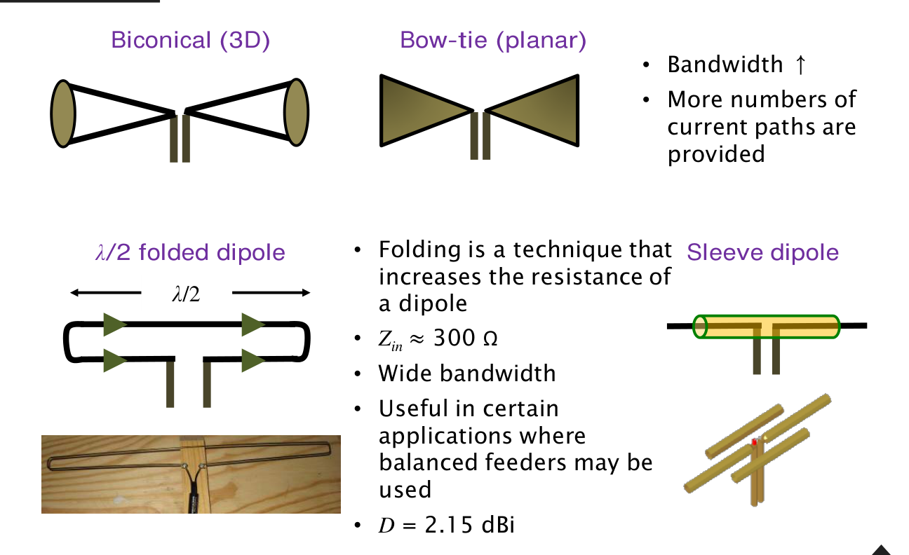

來源：老師講義第 11 頁。

| 結構 | 講義的設計意義 | 理解時要保留的條件 |
|:---|:---|:---|
| 雙錐（biconical） | 三維加寬，提供較寬頻的阻抗特性 | 錐角、端部與饋入共同決定阻抗 |
| 蝴蝶結（bow-tie） | 雙錐的平面化思路，金屬逐漸展開 | 基板及有限尺寸仍影響頻寬 |
| 半波折疊偶極（folded dipole） | 提高輸入電阻，適合平衡饋線；講義列約 300 Ω | 約 4 倍電阻對應等線徑、接近且對稱的平行導線 |
| 套筒偶極（sleeve dipole） | 用套筒形成另一臂／饋入結構 | 須分辨輻射用套筒與共模扼流功能 |

約 34:06–35:36，老師用「短路徑支援較高頻、長路徑支援較低頻」解釋雙錐與蝴蝶結加寬後的效果；這是理解分布電流的直觀方式，實際電流仍由整個導體及饋入共同決定。

折疊偶極的近似原理：若兩條等線徑導線的輻射電流各約為饋點電流 $`I_f`$，等效總輻射電流約為 $`2I_f`$；場振幅加倍，功率約四倍。因此，以相同饋點電流定義的輸入電阻約為

```math
R_{\rm folded}\approx4R_{\rm dipole}\approx4(73)=292\ \Omega,
```

講義取約 300 Ω。其場型接近半波偶極，指向性仍約 2.15 dBi；**阻抗乘四並不表示指向性乘四。**不同線徑、間距與模態會改變阻抗比；頻寬也不能只由乘四的電阻決定。

### 影片板書：用儲能與輻射理解頻寬

約 35:36–38:08，老師強調折疊偶極的長邊約半波長，繞行整圈的導線長則約一波長；窄間距的兩條長邊有同向輻射電流，不能只因外觀封閉就套用後面的均勻小迴路模型。老師再用電場／磁場儲能 $`W_e`$、$`W_m`$ 與輻射功率連到前章的 $`Q`$：

```math
Q\approx\frac{\omega(W_e+W_m)}{P_{\rm rad}},
\qquad \mathrm{BW}\propto\frac{1}{Q}.
```

在老師「儲能約兩倍、輻射功率約四倍」的示意估算下，可得 $`Q_{\rm folded}\approx Q/2`$、頻寬約兩倍。這是近共振、低損耗且採相同頻寬判準的直觀比較；兩線互耦、線徑、間距、參考電流及饋入匹配都會改變結果，不能只由 $`R_{\rm in}`$ 乘四證明任意折疊偶極的頻寬恆為兩倍。

## 8．影像定理：單極的另一半從哪裡來？（Image Theorem，講義第 12 頁）

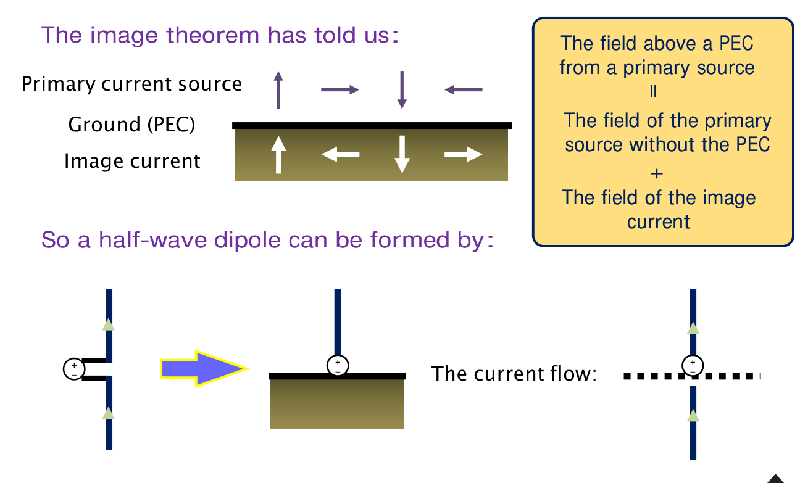

來源：老師講義第 12 頁。對電流源而言，垂直 PEC 的電流影像同向，平行 PEC 的電流影像反向。這些方向是為了滿足 PEC 表面切向電場為零的邊界條件。

影片約 41:36–43:41 用移動電荷說明方向：PEC 上方的正電荷，對應下方同距離的負影像電荷。若正電荷向上移動，負影像向下移動，兩者的傳統電流同向；若正電荷水平向右，負影像也向右移動，兩者電流就反向。這正好得到表面垂直／平行兩種情況。

影像法把「源＋PEC」換成「原源＋影像源、移除 PEC」。**等效場只要求在原來 PEC 上方的物理區域相同**，下方的影像不是另一支真實天線。

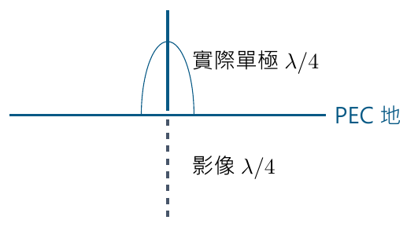

上圖為影像法示意。垂直單極長 $`L`$，與下方同向影像形成總長 $`2L`$ 的等效偶極；對 $`L=\lambda/4`$ 而言，對應的就是半波偶極。

## 9．四分之一波長單極的阻抗與指向性（λ/4 Monopole，講義第 13 頁）

理想單極是把偶極從中心饋點切半，一半保留、另一半以無限 PEC 地平面取代，從導體與地之間饋入。

在相同饋入電流下，上半空間的場與對應偶極相同，但只向上半球輻射，所以總輻射功率減半：

```math
P_{{\rm rad},m}=\frac12P_{{\rm rad},d},
\qquad R_{r,m}=\frac12R_{r,d}.
```

由完整影像邊界關係，端口阻抗也為對應偶極的一半：

```math
Z_m=\frac{Z_d}{2}.
```

因此幾何長度正好 $`\lambda/4`$ 的細線模型，對應 $`73+j42\,\Omega`$，應為約 $`36.5+j21\,\Omega`$。講義第 13 頁列的 $`36.5\,\Omega`$ 是電阻部分；第 14 頁也列出 $`j21\,\Omega`$。若說純電阻 $`36.5\,\Omega`$ 的匹配，須另外假設已調諧電抗。

指向性用全空間 $`4\pi`$ 的標準定義：

```math
D_{m,\max}=\frac{4\pi U_{\max}}{P_{{\rm rad},d}/2}
=2D_{d,\max}\approx3.28,
```

即 $`2.15+3.01\approx5.16`$ dBi，講義以 3 dB 近似為 **5.15 dBi**。增加來自只在半球輻射，並不是在相同電流下讓上方場振幅加倍。

單極的實體長度較短，也方便從同軸的內導體接輻射體、外導體接地；但地平面仍是天線系統的一部分。有限地板、地線損耗、外殼與饋線會改變場型及效率，不能直接保證理想的 5.15 dBi 增益。

約 48:11–50:06，老師特別比較 PCB 上的印刷單極：有限、同板面的地不會像無限水平 PEC 那樣完整遮住下半空間，場型可能較接近偶極。因此不能一看到 monopole 名稱就填 5.15 dBi，也不能固定填 2.15 dBi；實際值取決於整個結構的電流與場型。

### 影片提醒：影像電流不需要另一塊金屬承載

約 51:34–54:35，老師以學生把地板延長成「與天線另一臂一樣大」的案例，說明影像是等效源。就像鏡子不必有整間房間那麼厚，理想 PEC 後方也不用另放一支實體導線承載影像電流。**金屬厚度與地板的平面尺寸是兩個問題**：足夠導電、相對集膚深度足夠厚，只關係到良導體近似；有限地板的邊緣、面積及回流仍會影響天線，不能由這個比喻推論「任意小塊地都等同無限 PEC」。

## 10．不同長度的單極（Other Monopole Lengths，講義第 14 頁）

對照第 8 頁，把單極長 $`L`$ 對應到總長 $`2L`$ 的偶極：電流與上半空間場型相同、阻抗約減半、指向性線性值加倍。

| 單極長 $`L`$ | $`\lambda/20`$ | $`\lambda/4`$ | $`\lambda/2`$ | $`0.75\lambda`$ |
|:---|:---|:---|:---|:---|
| 對應偶極總長 | $`\lambda/10`$ | $`\lambda/2`$ | $`\lambda`$ | $`1.5\lambda`$ |
| 最大指向性，線性值 | 3 | 3.28 | 4.8 | 約 4.6 |
| 最大指向性，dBi | 4.76 | 5.15 | 6.8 | 約 6.6 |
| 講義列的 HPBW | 45° | 39° | 23.5° | 未列單一值 |
| 輸入電阻 | 約 1 Ω | 約 37 Ω | 約 1000 Ω | 約 50 Ω |
| 輸入電抗 | 電容性 | 約 $`+j21\,\Omega`$ | 感性 | 薄線近似約為零 |

**波束寬的讀法：**講義把偶極的 90°、78°、47° 各除以二，得到表中的 45°、39°、23.5°。對主瓣最大值在地平線的理想單極，這是「地平線至上方半功率點」的單側角度。不要將它與完整偶極切面跨兩個半功率點的 HPBW 混為同一量。

長單極也會有反相電流與多個仰角波瓣。若應用需要沿地平線通訊，不能只看到最大指向性提高，還要確認最大值出現在哪個仰角。

## 11．把單極降低高度：ILA、IFA 與 PIFA（Popular Forms，講義第 15 頁）

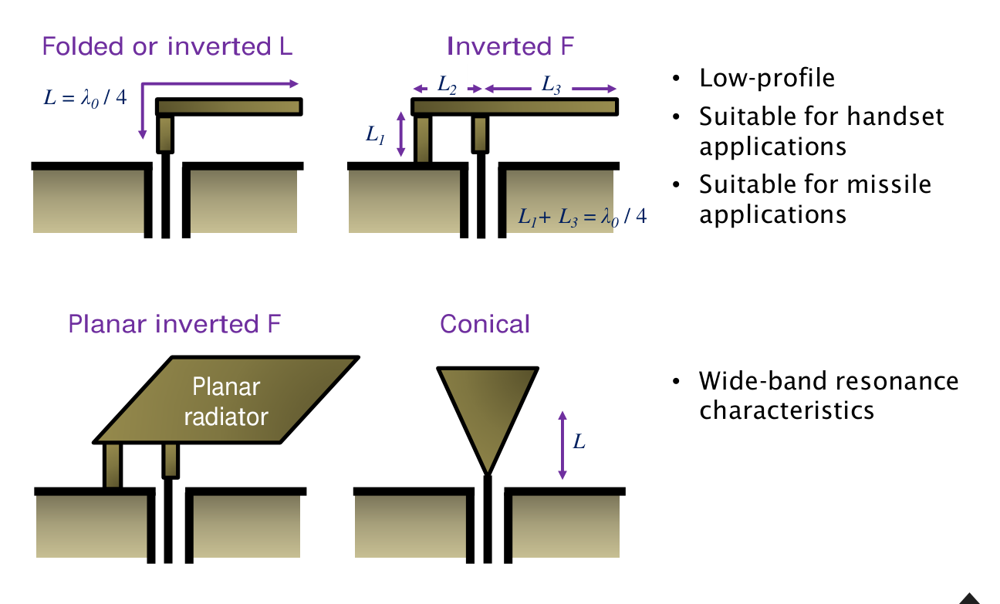

來源：老師講義第 15 頁。圖中的短路點、饋點與尺寸符號應一起看。

| 結構 | 改了哪個電流條件？ | 主要設計變數 |
|:---|:---|:---|
| 倒 L（ILA） | 將單極折彎，把部分電流路徑改成水平 | 垂直與水平總路徑、離地高度 |
| 倒 F（IFA） | 在倒 L 上加接地短路支路，饋點與短路點分開 | 短路到開路的路徑，以及饋點偏移 |
| 平面倒 F（PIFA） | 用平面上板取代細線上臂 | 上板、板高、短路板／針、饋點、地板 |
| 錐形單極（conical） | 導體逐漸加寬 | 錐角、長度、饋入過渡；用於較寬頻的阻抗特性 |

老師圖中 ILA 的 $`L\approx\lambda_0/4`$ 指折彎後的主要電流路徑。IFA 圖把高度標成 $`L_1`$、饋點左邊的小段標成 $`L_2`$、饋點到右端標成 $`L_3`$，並列出 $`L_1+L_3\approx\lambda_0/4`$ 的尺寸初估。這是圖中幾何的設計起點，**不是任意 IFA 都能忽略 $`L_2`$ 的精確共振式**；$`L_2`$ 所表示的饋點與短路點間距也會改變端口阻抗。

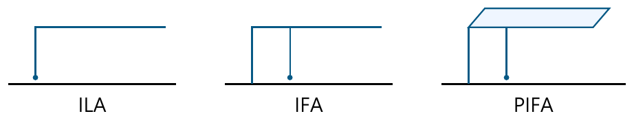

上圖為簡化重畫：下方橫線為地，圓點為饋入；IFA／PIFA 另有短路接地支路。影片約 56:05–63:49 的板書由直立單極逐步畫到低姿態結構，57:40 畫面可對照；饋入與地的連接也隨之改變。

老師的演變順序可整理為：

1. 先把直立單極改由導體側邊、靠近底部的位置饋入，下方另接地，形成可用來調阻抗的短路支段。影片說「中心饋入」，是相對原來的末端饋入而言，並非幾何正中央。
2. 將直立段折彎成倒 L，降低突出高度，保留約四分之一波長的主要路徑；但水平臂靠近地，近場儲能增加，加上折返電流效應，阻抗與頻寬可能更難處理。
3. 在倒 L 加回短路支路、把饋點和短路點分開，得到倒 F；調整兩者間距，相當於增加一個匹配自由度，可改善倒 L 的低電阻問題。這並不保證任意高度下都能恢復原直立單極的頻寬與效率。

PIFA 的 planar 指上方輻射板；整體仍有板高，是立體結構。印刷 IFA 可以做在同一平面上，不能只因 PCB 天線很平就把它叫 PIFA。降低高度有利於手機等產品整合，卻可能增加儲能、壓縮可用頻寬；須連同地板與外殼一起設計。

## 12．超寬頻平面單極：外形與饋入要一起看（UWB Planar Monopoles，講義第 16 頁）

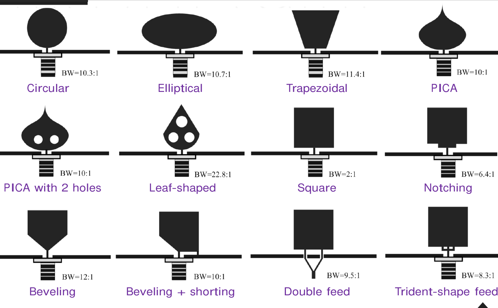

來源：老師講義第 16 頁，原圖引自 M. A. Matin，*Ultra Wideband — Current Status and Future Trends*（2012）。圖上 BW 為各文獻案例的頻率比，不是所有同形天線的保證值。

| 改變位置 | 圖中的例子 | 設計意義 |
|:---|:---|:---|
| 輻射體輪廓 | 圓形、橢圓、梯形、PICA、葉形、方形 | 改變可支持的電流分布與共振 |
| 輻射體局部 | 開孔、缺口、斜切角 | 調整局部路徑與饋點附近阻抗 |
| 饋入與接地 | 斜切加短路、雙饋入、三叉形饋入 | 改善能量由饋線進入輻射體的過渡 |

講義案例中，單純方形約為 2:1，加入缺口約 6.4:1，斜切角案例約 12:1；這是在提醒**同樣是平面單極，細節可以大幅改變頻帶**。要比較實際設計，仍須確認相同的反射門檻、地板、材料與量測條件，並在頻帶內檢查場型和效率。

約 64:12–65:32，老師以 **3.1–10.6 GHz** 的 UWB 應用頻帶說明「超寬頻」要落到具體頻率數字。以算術中心頻率 $`f_c=(f_H+f_L)/2`$ 計算，

```math
\mathrm{FBW}=\frac{f_H-f_L}{(f_H+f_L)/2}
=\frac{10.6-3.1}{6.85}\approx109.5\%.
```

這也說明分數頻寬可以超過 100%；此處採算術中心的定義，不能與前表的頻率比 $`f_H/f_L`$ 混用。這是老師舉的應用頻帶，不是說所有 UWB 天線都只能工作在這一段。

## 13．小迴路：與短偶極場型相似，極化不同（Small Loop，講義第 17 頁）

老師定義小迴路為周長 $`C\ll\lambda`$，常取 $`C<\lambda/10`$。圓形迴路的半徑為 $`b`$、導線直徑為 $`2a`$。均勻電流近似還要求迴路足夠小，講義提醒 $`kb<0.2`$；因 $`kb=C/\lambda=C_\lambda`$，兩種條件可以直接互相檢查。

對位於 $`xy`$ 平面的迴路：

```math
E_\theta=0,\qquad E_\phi\propto\sin\theta,
\qquad D_{\max}=1.5\;(1.76\ {\rm dBi}).
```

功率場型仍為 $`\sin^2\theta`$，法線方向是零點。但短電偶極的電場沿 $`\theta`$，小迴路的電場沿 $`\phi`$；**場型大小相同，不代表極化相同**。小迴路可視為磁偶極的輻射模型。

約 65:32–68:06，老師以「場型相同、極化相反、阻抗互補」作記憶法：相同是指正規化功率場型；「相反」應理解為同一觀察方向下的 $`\theta`$／$`\phi`$ **正交線極化**，並非相差 180°；阻抗互補指短偶極高度電容性、小迴路高度電感性，不表示兩者端口阻抗互為倒數。

### 輻射電阻、電抗與損耗不能漏掉任何一項

對單匝、均勻電流的小圓迴路，面積 $`A=\pi b^2`$：

```math
R_r\approx31200\left(\frac{A}{\lambda^2}\right)^2
\approx197\left(\frac{C}{\lambda}\right)^4\quad\Omega.
```

它按線性尺寸的四次方下降，因此縮得很小時，輻射電阻會非常小。輸入電抗為電感性，導體損耗則來自有限導電率：

```math
X\approx\omega\mu_0 b\left[\ln\left(\frac{8b}{a}\right)-1.75\right]
=k_0\eta_0 b\left[\ln\left(\frac{8b}{a}\right)-1.75\right],
```

```math
R_{\rm loss}\approx\frac{b}{a}\sqrt{\frac{\omega\mu_0}{2\sigma}},
\qquad Z_{\rm in}\approx R_r+R_{\rm loss}+jX.
```

其中 $`\sigma`$ 是導電率，損耗式使用薄導線、強集膚效應近似；實際近接效應與接點還可能增加損耗。

> **講義公式校正：**第 17 頁的 $`X=k_0\eta_0[\ln(8b/a)-1.75]`$ 漏了半徑 $`b`$。$`k_0\eta_0`$ 的量綱是 Ω/m，乘上 $`b`$ 才是電抗的 Ω。保留講義的 1.75 常數，這裡補回必要的長度因子。

約 66:33 的口述以一波長說明約 200 Ω 的量級，但 $`197C_\lambda^4`$ 是小迴路式，不能直接令 $`C_\lambda=1`$ 當成可靠的輸入阻抗；一波長迴路須另外指定形狀、電流分布與饋點。

## 14．圓迴路變大後，先確認電流模型（Other Loop Circumferences，講義第 18 頁）

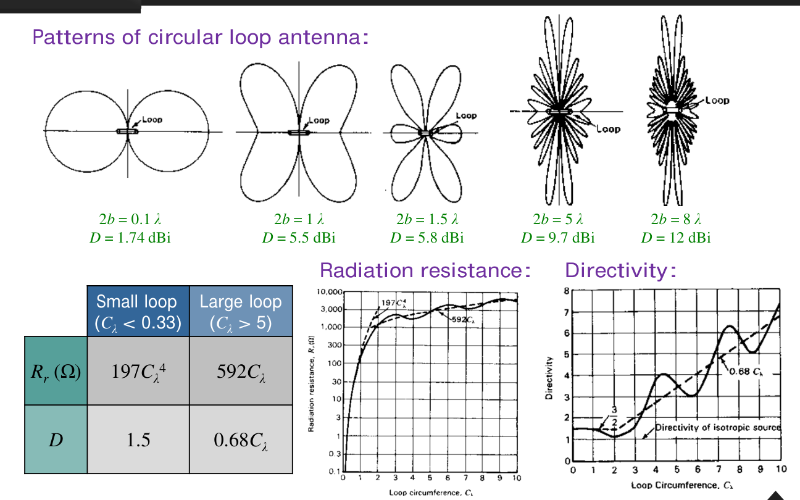

來源：老師講義第 18 頁，原圖引自 Kraus 與 Marhefka，*Antennas for All Applications*。上排標的是**直徑 $`2b`$**，下方圖表橫軸則是**正規化周長 $`C_\lambda=2\pi b/\lambda`$**，兩者不可互換。

| 上排圖的直徑 $`2b`$ | 講義列出的最大指向性 |
|:---|:---|
| $`0.1\lambda`$ | 1.74 dBi，接近小迴路 |
| $`1\lambda`$ | 5.5 dBi |
| $`1.5\lambda`$ | 5.8 dBi |
| $`5\lambda`$ | 9.7 dBi |
| $`8\lambda`$ | 12 dBi |

**本頁圖表沿用均勻、同相環流的理想模型。**即使電流保持均勻，尺寸增加後，各環段到觀察點的傳播相位差也會使波瓣變多；不能仍用小尺寸的 $`\sin^2\theta`$ 場型。實際單點饋入的大迴路往往另有沿線電流的振幅與相位變化，需重新求解，不能直接視為本頁理想模型。原圖的電流假設可由 [Kraus《Antennas》第 6 章，pp.252–254](https://lso.fe.uni-lj.si/literatura/ar/Antennas_mcgraw-hill_2nd_ed_1988-john_d_kraus.pdf) 的原式與同一組曲線確認。

講義下方另列兩端尺寸範圍的近似：

| 模型範圍 | 輻射電阻 $`R_r`$ | 最大指向性 $`D`$，線性值 |
|:---|:---|:---|
| 小迴路，表列 $`C_\lambda<0.33`$ | $`197C_\lambda^4\,\Omega`$ | 1.5 |
| 大迴路，表列 $`C_\lambda>5`$ | $`592C_\lambda\,\Omega`$ | $`0.68C_\lambda`$ |

這是**均勻同相電流模型**的兩端近似；中間區域應讀完整曲線或計算其場積分。前頁的 $`kb<0.2`$ 是普通小迴路可近似均勻電流的條件，本頁 $`C_\lambda<0.33`$ 則描述理想模型的漸近式適用範圍，不能把它們當成同一種精確分界。

影片約 68:36–69:06 說圓環沿軸向都是零點，應限於這一類環流模型。均勻圓環的角度因子含 $`J_1(kb\sin\theta)`$，沿軸 $`\theta=0`$ 時因 $`J_1(0)=0`$ 而消失。**圓形外觀本身不保證軸向為零**；有其他電流模態的圓迴路也可能朝法線輻射。下一頁方形迴路要同時比較幾何與電流，不能把差異全歸因於「圓變方」。

## 15．方形迴路：大尺寸時連形狀都重要（Square Loop，講義第 19 頁）

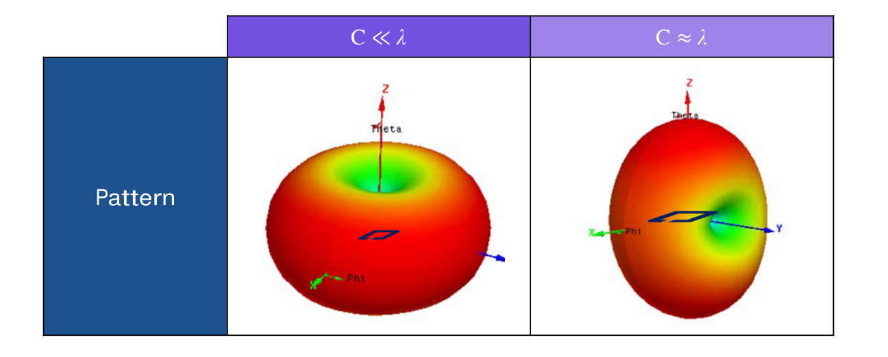

來源：老師講義第 19 頁。左圖為 $`C\ll\lambda`$，右圖為 $`C\approx\lambda`$；小尺寸的法線方向是零點，一波長方形迴路則可朝法線兩側形成主瓣。

講義對周長約一波長的方形迴路列出：

```math
D_{\max}\approx1.7\approx2.3\ {\rm dBi},
\qquad R_r\approx200\ \Omega.
```

小尺寸時主要看磁偶極矩，也就是電流與面積的乘積；尺寸變大後，除了面積，還要看形狀、饋點與電流沿線的相位。因此方形迴路的場型通常同時依賴 $`\theta`$ 與 $`\phi`$，不能直接套用前頁均勻圓環模型的軸對稱性。

約 70:35–72:40，老師沿周長約一波長的方環畫電流，將互相抵銷的側邊分量略去，留下兩段同向的主要輻射電流。方環每邊約 $`\lambda/4`$，這兩段可直觀視為相隔約 $`\lambda/4`$ 的一對線段；朝環面法線觀察時，到遠場的路徑差為零，同相場相加，因而能形成法線方向主瓣。這個觀點會接到下一章的「元素因子 × 陣列因子」；它是讀圖用的近似，不是把耦合與連接邊完全刪除後的精確解。

## 16．擴大頻寬方法一：建立多重共振（講義第 20 頁）

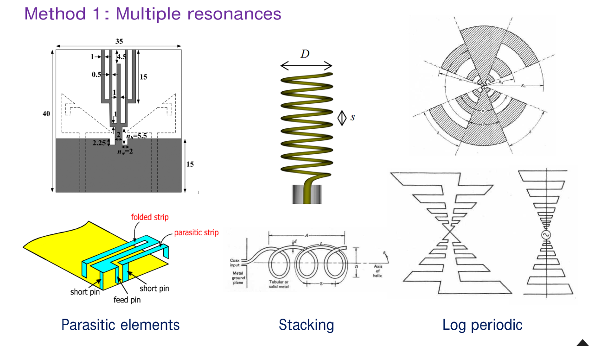

來源：老師講義第 20 頁，原圖列於該頁參考文獻。老師把方法整理成寄生元件（parasitic elements）、堆疊（stacking）與對數週期（log periodic）。約 72:40–73:10 的口述依次指向多條電流路徑、螺旋結構與對數週期結構。

共同思路是讓不同尺寸／不同路徑支持不同共振，再用耦合與饋入把可用頻帶連接起來：

- **寄生元件：**不直接接饋線，利用與主輻射體的耦合產生額外響應；長度與間距控制共振位置和耦合強度。
- **堆疊：**本頁中間實際畫的是螺旋（helix）的多圈結構，並非貼片堆疊剖面。它以重複單元及沿線相位形成可用的寬頻輻射；不能只把每一圈視為互不耦合的獨立共振器。
- **對數週期：**讓結構具有多個按比例變化的尺度，頻率改變時，主要工作的區域也隨之轉移。

多個共振點不必然形成連續寬頻；若中間的反射超過規格，仍然只是多頻帶。應看整段頻率內的匹配、場型、極化與效率是否都可用。

## 17．擴大頻寬方法二：加寬金屬（講義第 21 頁）

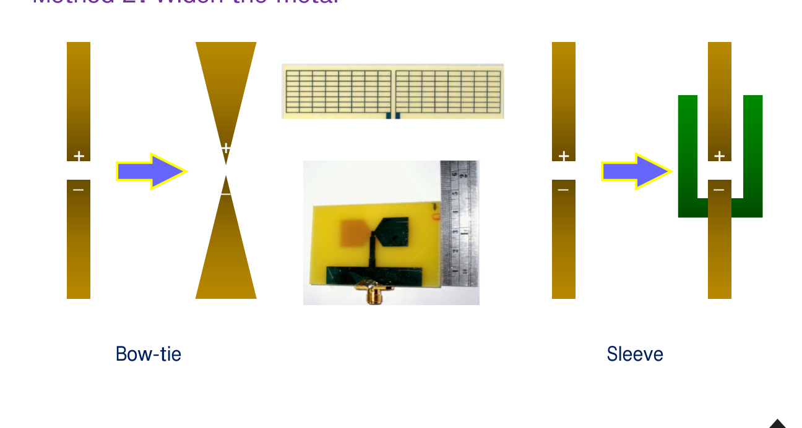

來源：老師講義第 21 頁。左側將細線展寬為蝴蝶結，右側以套筒形成較寬的導體／饋入區。

加寬導體可改變電流分布與端口附近的儲能，使阻抗對頻率的變化較平緩；輪廓、端部與饋入過渡仍需要一起調整。它和前頁「增加幾個共振路徑」是不同的設計切入點，實際結構也可以同時使用兩者。

約 73:10–73:50，老師也指出中間的網格可作為較寬金屬面的實作，以及右側套筒可提供額外的耦合路徑。網格近似實心金屬須有足夠細的網格、良好的導電連接及合適的電流方向，不能把任意稀疏網格都當成完全相同的實心板。

## 18．擴大頻寬方法三：碎形結構（講義第 22 頁）

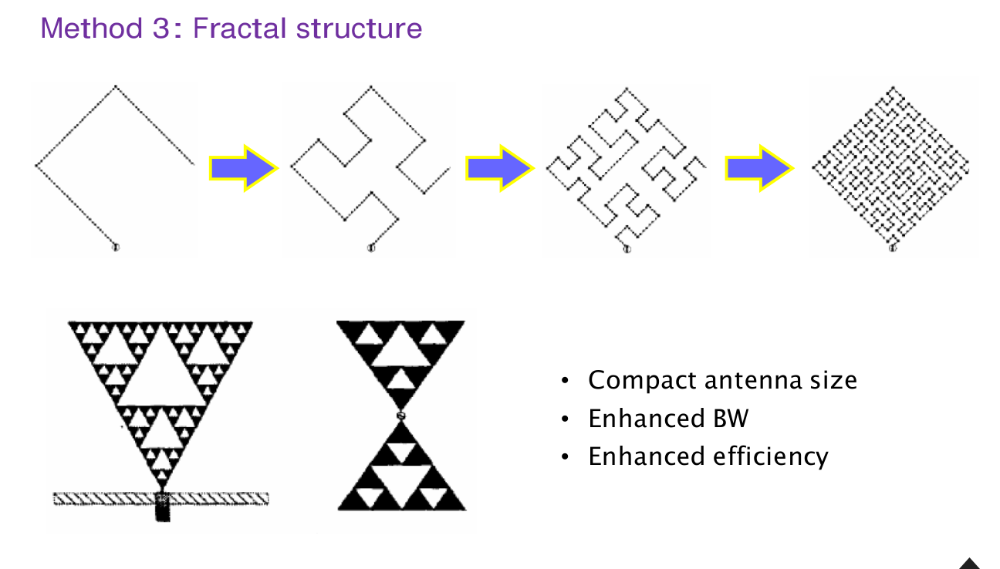

來源：老師講義第 22 頁；該頁引用 S. R. Best（2002）比較 Hilbert 曲線碎形與曲折單極的研究。

約 73:50–74:46，老師展示反覆迭代的曲線，以及具有多個幾何尺度的三角形結構，並列出縮小尺寸、改善頻寬與效率三項設計目標。理解重點是：折曲可以在較小外框內容納較長路徑，多尺度結構也可能形成多個共振。

**這三項是需要驗證的設計效果，並非「只要是碎形就同時提升」的通則。**縮小後的相鄰反向電流、導體損耗與儲能仍須計算；比較時要固定尺寸、工作頻率、材料與匹配門檻，回到前面學過的效率及頻寬限制。

## 補充解說與重算例題

以下為理解講義而保留的推導與重算，不是老師投影片另列的例題。

### A．任意長度細線偶極的場型從哪裡來？

對總長 $`2L`$ 的細線，使用近似正弦電流

```math
I(z')=I_m\sin[k(L-|z'|)],\qquad |z'|\le L.
```

遠場方向因子來自沿線電流積分與各來源到觀察方向的相位差：

```math
E_\theta\propto\sin\theta\int_{-L}^{L}
I(z')e^{jkz'\cos\theta}\,dz'
\propto\frac{\cos(kL\cos\theta)-\cos(kL)}{\sin\theta}.
```

這可重畫第 8 頁的長度比較。積分中 $`I_m`$ 是模型的電流振幅係數，饋點電流為 $`I_f=I_m\sin(kL)`$；接近整波長時兩者差很多。計算端口輻射電阻要用 $`I_f`$，計算指向性則用總輻射功率正規化。

### B．短偶極與小迴路的低效率從哪裡來？

總長為 $`\lambda/10`$ 的短偶極：

```math
R_r\approx20\pi^2(0.1)^2=1.974\ \Omega.
```

若導體與調諧元件的等效耗能電阻共 1 Ω，

```math
\eta_{\rm rad}=\frac{1.974}{1.974+1}\approx66.4\%.
```

周長為 $`\lambda/10`$ 的小迴路：

```math
R_r\approx197(0.1)^4=0.0197\ \Omega.
```

若損耗電阻為 0.1 Ω，

```math
\eta_{\rm rad}=\frac{0.0197}{0.0197+0.1}\approx16.5\%.
```

兩者都是在指定各自總長／周長下的算例，並非相同外框尺寸的公平性能排名。它們共同說明：把反射調到零，只能改善送進天線的功率比例，不能消除天線裡的耗能電阻。理想同向多匝小迴路有 $`R_r\propto N^2`$，但實際線損、近接效應與分布電容也會改變。

### C．把匹配重算一次

對實數 $`Z_0`$：

```math
\Gamma=\frac{Z_a-Z_0}{Z_a+Z_0},
\qquad \mathrm{VSWR}=\frac{1+|\Gamma|}{1-|\Gamma|}.
```

| 天線端口阻抗 | 饋線阻抗 | $`\lvert\Gamma\rvert`$ | VSWR |
|:---|:---|:---|:---|
| $`73+j42\,\Omega`$ | 50 Ω | 0.3684 | 2.17 |
| $`73+j42\,\Omega`$ | 75 Ω | 0.2733 | 1.75 |
| $`73+j0\,\Omega`$ | 50 Ω | 0.1870 | 1.46 |
| 已調諧單極 $`36.5+j0\,\Omega`$ | 50 Ω | 0.1561 | 1.37 |

### D．2.4 GHz 的初始尺寸

取空氣中 $`\lambda_0\approx125`$ mm，半波偶極總長先由 62.5 mm 起估，每臂約 31.25 mm；四分之一波單極的路徑尺度約 31.25 mm。

這是初始電氣尺寸。PCB、外殼、地板、線寬與饋入都會改變共振；ILA／IFA 的機械路徑也不能無條件等同某個固定導波波長。實際調整要同時觀察阻抗、效率與場型。

## 自測與解析

1. 相同總長與相同參考峰值電流下，三角形電流短偶極的輻射功率是均勻電流元的幾分之幾？
2. 正好半波長的細線偶極若為 $`73+j42\,\Omega`$，接 50 Ω 是否符合 VSWR < 2？
3. 理想單極的指向性比對應偶極高約 3 dB，是上方場振幅加倍造成的嗎？
4. 第 14 頁單極表列的 39°，與半波偶極的 78° 要如何對照？
5. 圓形小迴路周長為 $`\lambda/20`$ 時，輻射電阻多少？半徑增加一倍且仍符合小尺寸條件，電阻增加幾倍？
6. 同軸接上對稱偶極，是否就保證饋線不輻射？PIFA 是否只需看上板長度？
7. 有兩個共振谷、或採用碎形外形，是否就能直接宣稱寬頻且高效率？

**解析：**

1. 四分之一。電流積分有效長度減半，場振幅減半，功率為振幅平方。
2. 不符合，完整複數阻抗的 VSWR 約 2.17。若已調成 $`73+j0\,\Omega`$，才是約 1.46。
3. 不是。相同電流下上方場相同，總輻射功率減半，所以使用 $`4\pi U/P_{\rm rad}`$ 定義的指向性加倍；成立條件包含理想無限 PEC 地。
4. 39° 是地平線到上方半功率點的單側角；78° 是對應偶極主瓣跨兩個半功率點的完整角寬。
5. $`R_r\approx197(0.05)^4=0.00123\,\Omega`$。半徑變兩倍，面積變四倍，輻射電阻約變 16 倍。
6. 都不保證。偶極與非平衡饋線可能激發共模；PIFA 還要看短路、饋點、板高、地板與周圍環境。
7. 不行。兩個共振間的反射仍可能超標；碎形也仍受耗損與儲能限制。應比較整段頻率內的匹配、效率、極化與場型。

**下一單元：**[單元 22｜孔徑天線](022_孔徑天線.md)。先接續講義的陣列與八木天線，再進入孔徑結構及設計流程。
