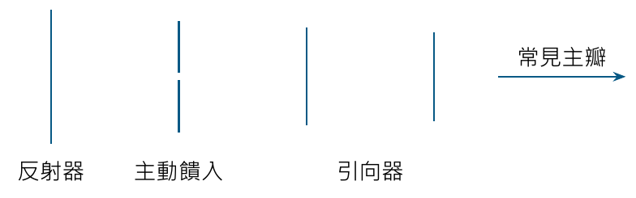
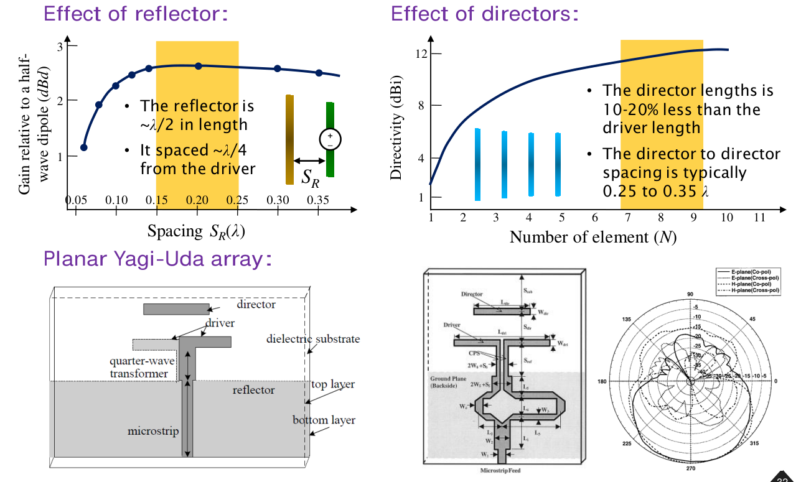
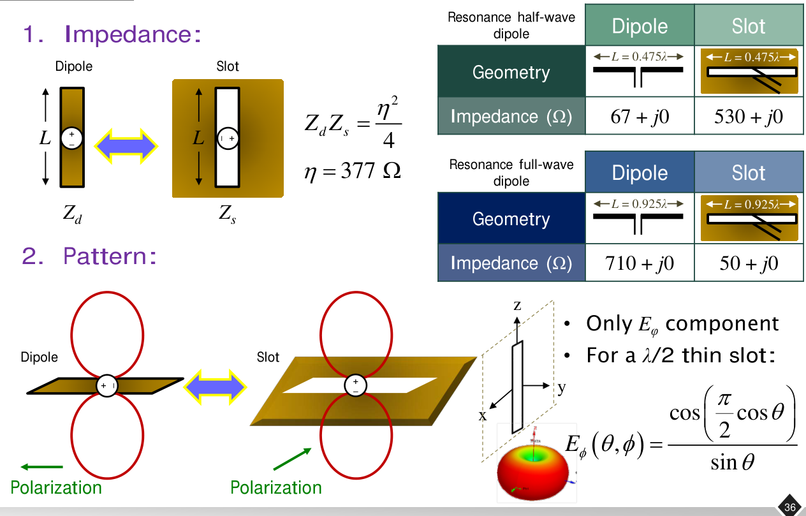
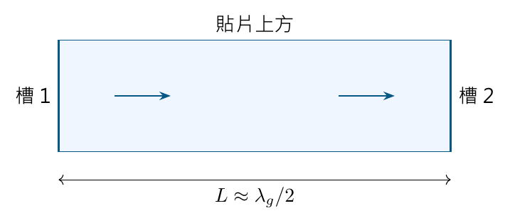
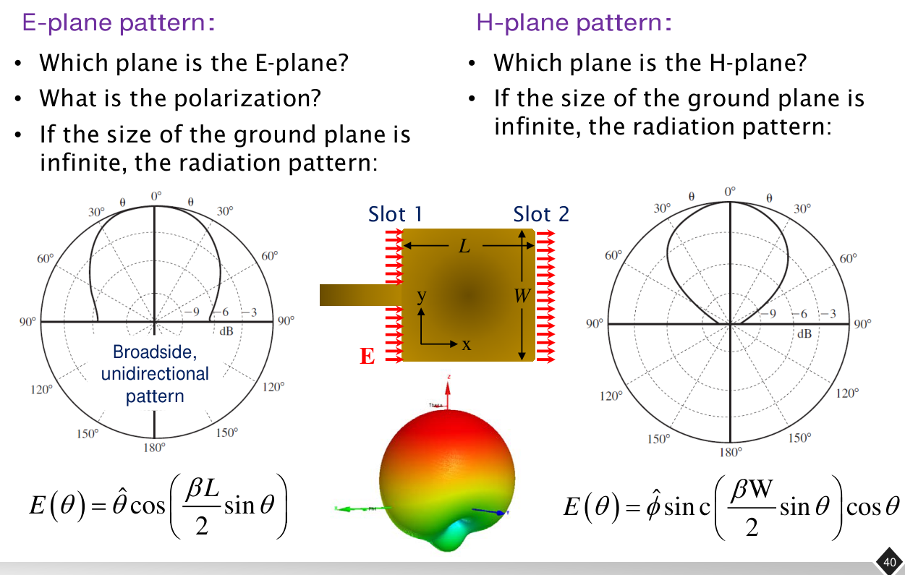
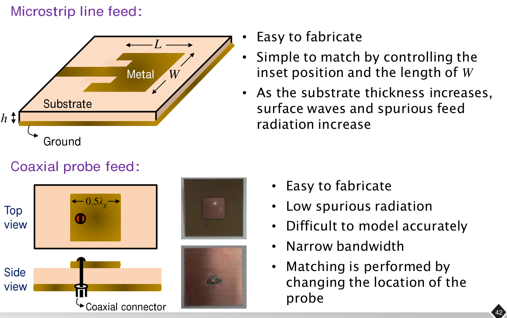
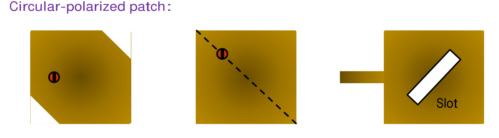
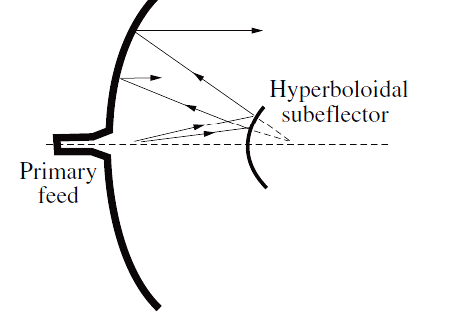
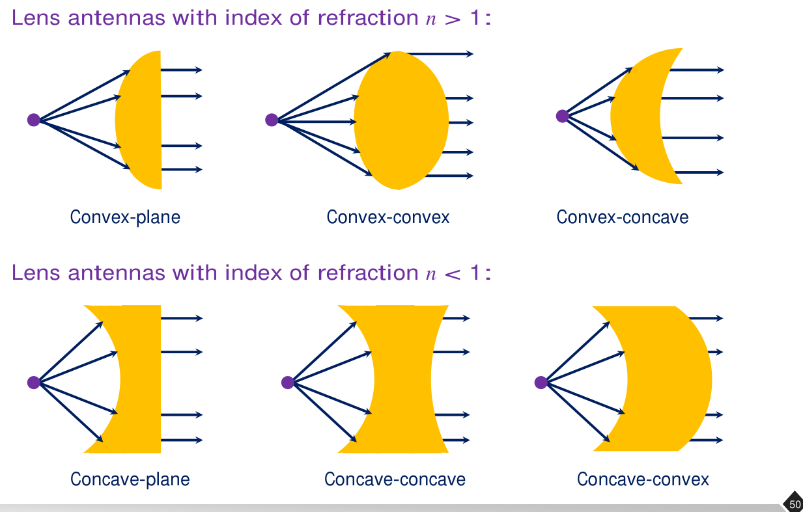

# 單元 22｜孔徑天線：從陣列、槽縫到反射面與透鏡

原始影片：[陳晏笙老師「天線」單元 22](https://www.youtube.com/watch?v=EKOY-YAh6Q8)（約 76 分 27 秒）

老師講義：[Lecture 5：Basic Antenna Structures](https://drive.google.com/file/d/1Qs5TCf37f4gz39FlhkYn0MjDhVoyuclD/view)，PDF 第 23–53 頁。

建議閱讀：約 50 分鐘。前置單元：15–18、21。

本單元先承接線型天線，介紹陣列與 Yagi–Uda，再依講義進入槽縫、貼片、號角、反射面及透鏡，最後整理設計流程。理解時抓住兩件事：**輻射源的振幅與相位如何分布，以及饋入結構如何將功率送到這些來源。**

學完應能用互補關係判斷槽縫的極化與阻抗，以兩槽模型理解貼片場型，分清阻抗頻寬與圓極化頻寬，並用孔徑面積初估大型天線的指向性。

## 講義與影片對照

頁碼均指老師 PDF 的實際頁碼。影片定位已對照影片口述、投影片與關鍵板書畫面，以下時間為主題定位，並非精確換頁秒數。正文依 PDF 排列：影片先講第 37 頁饋入，再回到第 36 頁 Booker 關係。

| 講義頁碼 | 原英文主題 | 本筆記內容 | 影片定位 |
|:--|:--|:--|:--|
| 23–30 | Array Structures; Put More Antennas Together | 陣列照片、控制參數、優缺點與 ALMA 範例 | [約 00:30](https://www.youtube.com/watch?v=EKOY-YAh6Q8&t=30s)–08:40 |
| 31–32 | Introduction to / Parameters of Yagi-Uda Array | 主動元件、反射器、引向器及參數曲線 | [約 09:00](https://www.youtube.com/watch?v=EKOY-YAh6Q8&t=540s)–19:30 |
| 33–35 | Aperture-Type Antennas; λ/2 Slot Antennas | 孔徑結構分類、半波槽縫與偏移饋入 | [約 20:00](https://www.youtube.com/watch?v=EKOY-YAh6Q8&t=1200s)–28:30 |
| 36 | Booker's Relation | 互補阻抗、場型與兩組共振比較 | [約 31:00](https://www.youtube.com/watch?v=EKOY-YAh6Q8&t=1860s)–33:10；23–28 分鐘已先講互補與極化 |
| 37–38 | Feeding Structures; λ/4 Slot Antennas | 槽縫饋入、四分之一波長槽與 Vivaldi | [約 28:40](https://www.youtube.com/watch?v=EKOY-YAh6Q8&t=1720s)–31:10、[33:10](https://www.youtube.com/watch?v=EKOY-YAh6Q8&t=1990s)–37:10 |
| 39–40 | Construction of Patch Antennas; Radiation Patterns | 貼片兩槽模型、極化與 E/H 面 | [約 37:10](https://www.youtube.com/watch?v=EKOY-YAh6Q8&t=2230s)–48:20；45–46 分鐘回顧互補槽縫 |
| 41–43 | Other Characteristics; Feeding Methods; Turning LP into CP | 貼片公式、饋入、圓極化 | [約 48:20](https://www.youtube.com/watch?v=EKOY-YAh6Q8&t=2900s)–55:10 |
| 44 | Introduction to Horn Antennas | 號角及孔徑效率 | [約 55:00](https://www.youtube.com/watch?v=EKOY-YAh6Q8&t=3300s)–58:30 |
| 45–48 | Reflector Antennas; Offset / Dual-Reflector Antennas | 拋物面、其他反射面、偏置及雙反射器 | [約 59:00](https://www.youtube.com/watch?v=EKOY-YAh6Q8&t=3540s)–65:30 |
| 49–50 | Dielectric Lens Antennas; Index of Refraction | 透鏡及折射率分類 | [約 65:30](https://www.youtube.com/watch?v=EKOY-YAh6Q8&t=3930s)–71:00，含板書；第 50 頁分類圖作講義補充 |
| 51–53 | Procedure for Antenna Design | 從規格到驗證的四步流程 | [約 71:00](https://www.youtube.com/watch?v=EKOY-YAh6Q8&t=4260s)–片尾 |

## 1．把多個天線組合起來：陣列（pp. 23–30）

### 1.1 陣列控制的是整組場，而非單一天線的增益

第 24–27 頁用大型反射器、Vivaldi 與線型結構的照片引入陣列。老師在[約 01:30–05:20](https://www.youtube.com/watch?v=EKOY-YAh6Q8&t=90s)以射電望遠鏡說明：光學望遠鏡收可見光，天線則可收其他頻段的微弱電磁訊號；不同頻段可以選不同天線，再組成較大的有效孔徑。第 25 頁看似張開的小口面，在口述中辨認為 Vivaldi 陣列；其寬頻、端射特性會在第 38 頁回頭解釋。

第 28 頁 *Put More Antennas Together* 的線型陣列，則將多個元件沿空間排列，經移相器與放大器分配各元件的激發。老師在[約 05:30–06:30](https://www.youtube.com/watch?v=EKOY-YAh6Q8&t=330s)用波前動畫說明：改變各元件的激發相位，會改變各方向上的相加關係，因此可以把主瓣指向指定方向。

老師列出五組可調參數：

| 可調項目 | 符號／例子 | 對總場的作用 |
|:--|:--|:--|
| 幾何配置與元件數 | 線型、圓形、矩形、球形；$`N`$ | 決定可用孔徑與可形成的波束形狀 |
| 相對位置 | 元件間距 $`d`$ | 改變不同觀察方向上的路徑相位差 |
| 激發振幅 | $`I_1,I_2,I_3,\ldots`$ | 調整主瓣與旁瓣的分配 |
| 激發相位 | $`\phi_1,\phi_2,\phi_3,\ldots`$ | 使指定方向的場相加，可用於電子掃描 |
| 個別元件場型 | 偶極、貼片、號角等 | 限制總場可輻射的方向與極化 |

圖中的時域激發是 $`I_n\cos(\omega t+\phi_n)`$。遠場要先將各元件的**複數電場**相加，再取平方求功率；不能直接把各支天線的 dBi 相加。後續單元 23 會正式推導場型相乘法則。

### 1.2 動機、優點與代價（p. 29）

陣列能提高指向性、形成指定場型，並用電性相位控制波束方向。相對製造一個大型單體天線，分散的小元件有時較容易製作，也適合遠距通訊。

代價在於饋入網路的複雜度、功率損耗與頻寬限制；不同頻率的饋入相位不一定維持原設計關係。第 30 頁的 ALMA 射電望遠鏡照片，展示多個大型天線組合工作的尺度；它在本節是陣列應用的例子，不能單憑照片推定所有天線共用同一種饋入網路。

## 2．Yagi–Uda：寄生元件也參與輻射（pp. 31–32）

### 2.1 三種元件的任務（p. 31）



*既有重繪示意；元件功能對照老師講義第 31 頁，尺寸不按照片比例。*

| 元件 | 如何激發 | 主要作用 |
|:--|:--|:--|
| 主動元件（driven element） | 直接連接饋源 | 決定主要極化與中心頻率，並與其他元件共同決定端口阻抗 |
| 反射器（reflector） | 由互耦感應電流 | 影響輸入阻抗與後瓣 |
| 引向器（directors） | 由互耦感應電流 | 塑造朝引向器一側的主瓣，提高指向性 |

第 31 頁用約 $`0.47\lambda`$ 的偶極作主動元件，說明匹配 $`50\,\Omega`$ 饋線的設計起點。實際互耦會改變阻抗，不能只憑這個長度保證整組 Yagi 已匹配。

老師在[約 09:10–10:50](https://www.youtube.com/watch?v=EKOY-YAh6Q8&t=550s)特別拿它和前一節的逐元件饋入陣列比較：Yagi–Uda 只需直接饋入一支主動元件，其他元件由互耦激發，可大幅簡化饋入網路。主動元件也能選折合偶極；常見配置中，反射器略長、引向器略短於主動元件，主瓣朝引向器一側。這裡的「反射／引向」是整組感應電流作用的直覺名稱。

### 2.2 老師的參數曲線（p. 32）



*來源：老師講義第 32 頁的參數曲線與平面 Yagi 示例；曲線引用 Kraus 與 Marhefka《Antennas for All Applications》，平面設計引用 Kaneda 等人的 quasi-Yagi 論文。曲線是該組條件下的趨勢，並非所有 Yagi 的通用設計表。*

左圖橫軸是反射器與主動元件間距 $`S_R/\lambda`$，縱軸為相對半波偶極的增益 **dBd**。由很小間距增加至約 $`0.15\lambda`$–$`0.20\lambda`$ 時，曲線上升後趨平；再拉遠並沒有持續增加。圖中文字給反射器長度約 $`\lambda/2`$、間距約 $`\lambda/4`$ 作設計起點。

右圖以講義的 $`N`$ 表示引向器數，縱軸是指向性 **dBi**。增加引向器能提高指向性，但邊際收益逐漸減小。講義給的典型起點是：引向器比主動元件短約 10–20%，引向器間距約 $`0.25\lambda`$–$`0.35\lambda`$。元件長度、間距及數量仍須一起調整。

兩張圖使用不同基準，讀圖時要先辨認單位。同一增益換算為：

```math
G_{\rm dBi}=G_{\rm dBd}+2.15.
```

因此 10 dBd 約為 12.15 dBi。圖中的「每增加一根引向器」也不對應固定的 dB 增量。

**老師的讀圖提醒（[約 13:20–16:20](https://www.youtube.com/watch?v=EKOY-YAh6Q8&t=800s)）：** 左圖使用 dBd，是為了直接看出加反射器後，相對原半波偶極增加多少增益。板書另算 $`10\,\mathrm{dBi}=7.85\,\mathrm{dBd}`$。口述以約 15 dBi 說明這類簡單 Yagi 的實用增益尺度，並提醒增加引向器會逐漸不划算；這不是所有長度、孔徑與配置的 Yagi 都不能超過的物理上限。右圖的特定曲線在 $`N\approx7`$–9 時約為 12 dBi，應按圖上的 dBi 刻度讀值。

第 32 頁下方再展示印刷式 quasi-Yagi：以平面金屬、介質基板、阻抗轉換及饋入過渡實現相同概念。老師在[約 18:00–19:30](https://www.youtube.com/watch?v=EKOY-YAh6Q8&t=1080s)指出，下方金屬可兼任微帶饋線的接地面與主動元件的反射器；另一個圖則用 balun 將微帶饋入轉成適合偶極的平衡激發。重點仍是整組電流的振幅與相位，而非外形看起來像幾根平行金屬條就具有相同場型。

## 3．孔徑結構與半波槽縫（pp. 33–35）

### 3.1 本節的五類孔徑天線（pp. 33–34）

講義依序介紹半波／四分之一波長槽縫、線極化／圓極化貼片、號角、反射面及透鏡。孔徑上的電、磁場可以作為等效輻射來源；實體結構不一定是一個挖空的孔，例如貼片以邊緣場輻射，反射面則將較大的等效孔徑照明成所需相位。

### 3.2 半波槽縫的模型（p. 35：λ/2 Slot Antennas）

理想模型是在無限大、無限薄的 PEC 金屬面上，切出長約 $`\lambda/2`$ 的狹長矩形槽。跨槽電壓建立槽內電場，因此沒有突出的金屬棒也能輻射。

| 講義項目 | 半波槽的結果 | 理解方式 |
|:--|:--|:--|
| 輸入阻抗 | 約 $`363-j212\,\Omega`$ | 正好半波長不代表電抗已為零 |
| 功率場型 | 與對應半波偶極相似 | 電、磁角色互換，極化改為相互正交 |
| 指向性 | $`D=1.64`$，約 2.15 dBi | 理想互補模型的值 |
| 外形 | 低突出、可配合載具表面 | 仍須考慮實際有限地板及饋入 |

按第 35 頁座標，槽沿 $`z`$ 方向，跨縫電場沿 $`y`$；它的極化與槽長方向垂直。不能因為槽是「直立的」，就把電場也判成直立。

半波槽中央的跨縫電壓較大，中央饋入通常呈現較高阻抗。將同軸饋點往端部移動，可降低看到的輸入阻抗；移動後也要重看對稱性與匹配頻寬。

> **講義圖文校正：** 第 35 頁文字寫「電流在中央最大」，但同頁藍色 *Current* 圖將中央標為 **Min**、端部標為 **Max**，紅色跨縫電場則在中央較強。此處不能將金屬表面的電流與正比於槽內電場的等效磁流混用；理解高阻抗與偏移饋入時，以跨縫電壓分布及下一頁的互補關係為準。

老師在[約 28:10–29:10](https://www.youtube.com/watch?v=EKOY-YAh6Q8&t=1690s)採「中央電流較小，所以 $`Z_{\rm in}=V/I`$ 較大」的直覺解釋偏移饋入。這不能解讀為實際端口電流嚴格等於零，否則阻抗會無限大，與講義的有限複數阻抗不符；定量值應回到端口定義及 Booker 關係。

## 4．Booker 互補關係（p. 36）

### 4.1 電、磁角色互換，也交換阻抗性質



*來源：老師講義第 36 頁局部。圖中的金屬偶極與同形狀狹槽構成互補結構。*

在相同均勻介質、理想薄 PEC 互補結構及對應端口下：

```math
\boxed{Z_d Z_s=\frac{\eta^2}{4}},
\qquad
Z_s=\frac{\eta^2}{4Z_d}.
```

自由空間的波阻抗 $`\eta\approx377\,\Omega`$。這是**完整複數阻抗**的關係；若 $`Z_d=R_d+jX_d`$，則

```math
Z_s=\frac{\eta^2}{4}
\frac{R_d-jX_d}{R_d^2+X_d^2}.
```

因此電抗符號會改變，不能只將兩個電阻相乘。有限地、金屬厚度、非均勻基板及不同端口結構，都可能使實際結果偏離理想互補模型。

### 4.2 老師的兩組共振比較

| 近共振長度 | 偶極 $`Z_d`$ | 互補槽 $`Z_s`$ | 結論 |
|:--|:--|:--|:--|
| $`L=0.475\lambda`$ | $`67+j0\,\Omega`$ | 約 $`530+j0\,\Omega`$ | 半波附近的低阻抗偶極對應高阻抗槽 |
| $`L=0.925\lambda`$ | $`710+j0\,\Omega`$ | 約 $`50+j0\,\Omega`$ | 全波附近的高阻抗偶極可對應約 50 Ω 的槽 |

用 $`377^2/(4\cdot67)=530.3\,\Omega`$、$`377^2/(4\cdot710)=50.05\,\Omega`$，可重現表中四捨五入結果。這也說明調整槽長度，是除了偏移饋入以外另一條改變阻抗的路徑。

老師在[約 31:00–33:20](https://www.youtube.com/watch?v=EKOY-YAh6Q8&t=1860s)將兩個選擇一起比較：半波槽偏移饋入可降低阻抗，但對稱性及原本零點可能變差；接近全波的槽較容易從中央匹配到 50 Ω，代價是結構變長。下一頁的四分之一波長槽，則繼續處理尺寸問題。

正好 $`\lambda/2`$ 的槽在前頁列為 $`363-j212\,\Omega`$；若用前單元的偶極近似值 $`73+j42\,\Omega`$ 代入，得到約 $`365.7-j210.4\,\Omega`$。兩組近似的量級與電抗符號一致，不應將不同近似模型的末位數字強行視為相同。

### 4.3 場型相似，極化不同

老師以槽長沿 $`z`$ 的模型，寫出只有 $`E_\phi`$ 的角度因子：

```math
F_\phi(\theta)=
\frac{\cos\left(\frac{\pi}{2}\cos\theta\right)}{\sin\theta}.
```

此處寫成 $`F_\phi`$，表示已省略距離、相位及振幅常數的場型因子；不是具有 V/m 單位的完整電場。沿槽軸 $`\theta=0,\pi`$ 的極限為零，在垂直槽軸方向最強。它與半波偶極的角度形狀相似，但主要電場分量由對偶關係改變，極化互相正交。

### 4.4 課堂收發例：平行擺放反而極化失配

在[約 25:40–27:50](https://www.youtube.com/watch?v=EKOY-YAh6Q8&t=1540s)，老師用一支偶極發射、一個槽接收來複習極化損失因子。以下考慮遠場、理想線極化，並先選在兩者場型都非零的方向：

| 擺放方式 | 極化關係 | 極化損失因子 |
|:--|:--|:--|
| 偶極長軸與槽長軸平行 | 槽接收的電場方向與偶極電場垂直 | $`\mathrm{PLF}=0`$ |
| 將槽旋轉，使接收極化與來波電場對齊 | 極化匹配 | $`\mathrm{PLF}=1`$ |

老師所說的「100%」是**沒有極化失配損失**，不代表接收全部發射功率，也不代表天線效率為 100%。若發射方向剛好落在偶極軸向零點，旋轉接收天線仍無法補回原本就沒有的來波；場型方向與極化方向要分別檢查。

## 5．槽縫的饋入、縮小與寬頻變形（pp. 37–38）

### 5.1 饋入結構與應用（p. 37）

講義畫出同軸跨槽饋入，以及共平面波導（CPW）饋入。槽旋轉 90°，相應的電場極化也旋轉：水平槽可產生垂直極化，垂直槽可產生水平極化。判斷時應看跨槽電場方向。

低突出與可貼合載具的特性，使槽縫可用於飛機、飛彈、筆電等結構。講義列出的 300 MHz–25 GHz 是**不同槽縫設計的應用頻率範圍**，並非單一共振半波槽能覆蓋的連續頻寬。

槽縫也常開在波導壁上形成陣列。每個槽的位置、形狀與方向影響其耦合及輻射，所有槽的振幅與相位再共同形成總場型。

老師在[約 29:10–31:10](https://www.youtube.com/watch?v=EKOY-YAh6Q8&t=1750s)補充實作上的取捨：低突出是槽縫的優勢，但若饋入結構本身又做成立體突出，就會折損這項優勢；偏移饋入改善匹配的同時，也要觀察原本對稱的場型及零點是否改變。

### 5.2 四分之一波長槽（p. 38）

將槽的一端延伸至金屬邊緣，形成開放終端，可改變原本兩端的邊界，使主要共振長度約由半波縮為四分之一波。講義再展示電容負載，利用附加的電氣長度進一步縮短實體長度。

這類有限地板的開邊結構，不能直接等同於把無限平面中的半波槽切去一半。小型化後仍需檢查頻寬、效率及地板電流。

**老師的調整順序（[約 34:10–35:40](https://www.youtube.com/watch?v=EKOY-YAh6Q8&t=2050s)）：** 槽長 $`L`$ 主要決定共振頻率，微帶饋線相對槽的位置、以及越過槽後的延伸長度，則可調整耦合和輸入阻抗。可以先把它理解為「調頻率位置」與「調匹配深度」兩組工作；實際參數仍會互相影響。加電容縮短槽長時，老師也提醒要付出頻寬代價。

### 5.3 Vivaldi：漸變槽、端射波束（p. 38）

Vivaldi 又稱漸變槽天線（tapered slot antenna）。槽逐漸張開，使導波場逐步轉成外傳場，因此不只靠單一半波共振取得工作頻帶。

講義列其優點為寬頻、高效率、端射（end-fire）、結構較簡單。這些是結構的設計潛力；實際低頻端仍受口徑及長度限制，最窄區域、張開規律與饋入過渡也會影響匹配及場型。寬反射頻帶不保證整段的增益、極化與波束都同樣良好。

## 6．貼片結構與兩槽模型（p. 39）

### 6.1 矩形貼片的基本尺寸

微帶貼片天線（microstrip patch antenna）由上層金屬貼片、厚度 $`h`$ 的介質基板，以及下方接地面構成；貼片長度為 $`L`$、寬度為 $`W`$。

講義的初估式為：

```math
L\approx0.49\lambda_g
\approx\frac{0.49\lambda_0}{\sqrt{\epsilon_r}}.
```

這是基本模式的尺寸起點，反映沿長度方向約半波共振。低姿態、便宜、容易製作並與 MMIC 整合，是其優點；基本薄基板設計通常頻寬較窄，效率與交叉極化也需要留意。講義列出的缺點是常見設計限制，不表示所有貼片都必然低效率。

### 6.2 邊緣場為何能相加？



*既有重繪示意；對照老師講義第 39 頁的傳輸線模型與兩槽模型。*

沿長度的基本共振使兩端產生邊緣場（fringing field），可等效成兩個相隔約 $`0.5\lambda_g`$ 的輻射槽。兩側非主要輻射邊的場在此近似中互相抵銷；兩個主要輻射槽則在 broadside 方向同相相加。

判斷符號時，要同時看腔內兩端的電場與邊界法向方向。只看到腔內電壓有正負號，就認為上方輻射一定相消，會漏掉等效來源的方向。更精細的有效介電常數與邊緣延長修正，整理在章末補充。

**老師從剖面到俯視圖的推理（[約 39:00–43:40](https://www.youtube.com/watch?v=EKOY-YAh6Q8&t=2340s)）：** 先看基本駐波的正、負號所代表的電流／電場方向；在剖面中，腔內兩端的垂直電場方向相反，中間經過零點。接著沿邊緣場的彎曲方向往外追，兩端對外的水平電場分量卻指向同一方向。從俯視圖看，這兩排同向電場正像兩個槽，所以可以用兩槽模型分析輻射。這也解釋了為何有效共振長度包含邊緣場，實體金屬長度需略短於半個導波波長。

老師再於[約 44:00–44:50](https://www.youtube.com/watch?v=EKOY-YAh6Q8&t=2640s)區分幾何參數：$`L`$ 主要控制共振頻率，縮短通常往高頻移；$`W`$ 會影響槽的等效輻射、輸入阻抗及頻寬。匹配不是只把 $`L`$ 調到半波長便結束。

## 7．貼片的 E 面、H 面與指向性（pp. 40–41）

### 7.1 先固定座標，再判斷切面（p. 40）



*來源：老師講義第 40 頁局部。按該頁俯視圖，$`L`$ 沿 $`x`$、$`W`$ 沿 $`y`$、法向為 $`+z`$，broadside 電場沿 $`x`$。*

因此 E 面為 $`xz`$ 面，H 面為 $`yz`$ 面。令 $`\theta`$ 從 $`+z`$ 起算、$`k_0=2\pi/\lambda_0`$，講義以 $`\beta`$ 表示的空間相位項，可在本模型寫成：

```math
F_E(\theta)=
\cos\left(\frac{k_0L}{2}\sin\theta\right),
```

```math
F_H(\theta)=
\mathop{\mathrm{sinc}}\nolimits \left(\frac{k_0W}{2}\sin\theta\right)
\cos\theta,
\qquad \mathop{\mathrm{sinc}}\nolimits x=\frac{\sin x}{x}.
```

E 面的餘弦項反映兩槽的路徑相位差；H 面則包含有限槽寬的振幅因子與角度投影。這些是**電場振幅**，功率場型需取其模平方。式中的空間波數採外部介質的波數，不能直接代入基板傳輸線的導波常數。

圖與公式採理想無限大接地面，主要輻射位於上半空間，是 broadside、單向的場型；不能把上半空間的簡化角度式直接延伸到地板下方，宣稱存在相同背瓣。實際有限地板會改變邊緣繞射與背向輻射。

**老師的判斷方法（[約 45:10–48:20](https://www.youtube.com/watch?v=EKOY-YAh6Q8&t=2710s)）：** 先找主輻射方向，再找該方向的電場極化，兩者決定 E 面；不要只背座標字母。老師回到單槽時，使用槽長沿 $`z`$、金屬在 $`xz`$ 面的例子，選法向 $`y`$ 作觀察方向，此時 E 面為 $`xy`$、H 面為 $`yz`$。回到第 40 頁貼片的座標，才是本節的 $`xz/yz`$。單槽的 E 面近全向、H 面有軸向零點；兩槽排列使貼片 E 面進一步集中，接地面再限制向下輻射。

### 7.2 講義的指向性估計（p. 41）

```math
D\approx
\begin{cases}
6.6\quad (8.2\ {\rm dBi}), & W\ll\lambda_0,\\
8W/\lambda_0, & W\gg\lambda_0.
\end{cases}
```

這是特定基本模式、理想地板與尺寸極限下的估計。較寬孔徑可縮窄一個切面的波束，但一般尺寸介於兩個極限之間時，不能將兩條式子當成無條件精準公式。

老師在[約 43:10–44:10](https://www.youtube.com/watch?v=EKOY-YAh6Q8&t=2590s)用 $`2.15+3+3\approx8.15\,\mathrm{dBi}`$ 建立直覺：從一個槽、兩槽同相組合，再考慮接地面把場集中到上半空間。這是解釋基本貼片約 8 dBi 尺度的粗估；陣列間距、互耦、基板及寬度都影響結果，不能把每個結構一律當成固定加 3 dB，更不能把 8.2 dBi 當作所有貼片的上限。

在[約 48:20–50:00](https://www.youtube.com/watch?v=EKOY-YAh6Q8&t=2900s)，老師進一步區分**指向性與增益**：貼片有較多場儲存在基板內，低損耗材料尤其重要。若某設計的輻射效率只有 50%，則

```math
G=\eta_{\rm rad}D,\qquad
G_{\rm dBi}=D_{\rm dBi}+10\log_{10}(0.5)
\approx D_{\rm dBi}-3.01.
```

因此 8.2 dBi 指向性只對應約 5.2 dBi 普通增益；若還要算端口失配，實現增益會再降低。50% 是老師說明損耗影響的情境，不是所有貼片固定具有的效率。

## 8．貼片阻抗、頻寬與 E 形設計（p. 41）

### 8.1 講義的工程近似

```math
Z_A\approx90\frac{\epsilon_r^2}{\epsilon_r-1}
\left(\frac{L}{W}\right)^2\ \Omega,
```

```math
\mathrm{FBW}_{\mathrm{VSWR}<2}\approx
3.77\frac{\epsilon_r-1}{\epsilon_r^2}
\frac{W}{L}\frac{h}{\lambda_0}.
```

第一式針對該基本貼片模型的端口近似；實際饋點移動會改變看到的阻抗。第二式算出的是分數頻寬，轉成百分比才乘 100。依此模型，增加基板厚度或 $`W/L`$ 可增加頻寬，但還須考慮表面波、饋入寄生效應與交叉極化。

老師在[約 50:00–51:50](https://www.youtube.com/watch?v=EKOY-YAh6Q8&t=3000s)要大家從公式讀趨勢，不必死背係數：常見介電基板範圍內，較低的介電常數、較厚的基板通常有利於頻寬，但阻抗、尺寸與頻寬要一起取捨。口述也提出空氣層設計；上述介電基板近似式不能無條件外推至 $`\epsilon_r=1`$。

### 8.2 老師算例與重算校正

講義取 $`\epsilon_r=2.2`$、$`W/L=2.7`$，得到：

```math
Z_A\approx90\frac{2.2^2}{2.2-1}
\left(\frac{1}{2.7}\right)^2
=49.79\,\Omega.
```

再取 $`h=1.6\,\mathrm{mm}`$、$`f_0=2.2\,\mathrm{GHz}`$，則 $`\lambda_0\approx136.36\,\mathrm{mm}`$，代入同頁公式：

```math
\mathrm{FBW}\approx
3.77\frac{1.2}{2.2^2}(2.7)
\frac{1.6}{136.36}
=0.02961\approx2.96\%.
```

**第 41 頁原列 1.9%，無法由同頁的上述參數與公式直接重現。** 此處保留原值供對照，計算則採 2.96%；缺少其他設計條件時，不應將兩值說成相同結果。

### 8.3 E 形貼片範例

講義列圓形、三角形、E 形及開槽等形狀。E 形範例是在貼片內加入兩條平行槽，使額外的路徑與模式共同形成較寬工作頻帶。

第 41 頁引用的設計展示頻寬可達約 30%，在 1.9–2.4 GHz 內的指向性約 4–8.5 dBi。這是該論文結構的結果，並非所有 E 形貼片都保證同樣性能；圖中還包含空氣層與同軸饋入，不能只複製外框形狀。

老師在[約 51:50–52:50](https://www.youtube.com/watch?v=EKOY-YAh6Q8&t=3110s)明說這是他求學時熟悉的寬頻代表，並保留後續研究可能突破的空間。因此這裡記住「開槽可引入額外模式來拓寬頻帶」，不把 30% 寫成貼片天線的普遍頻寬上限。

## 9．貼片的兩種饋入方法（p. 42）



*來源：老師講義第 42 頁局部。上圖調整內嵌位置，下圖調整探針位置，兩者都在改變端口所取樣的共振場。*

| 方法 | 如何匹配 | 講義列出的優點 | 需要留意的限制 |
|:--|:--|:--|:--|
| 微帶線饋入（microstrip line feed） | 改變內嵌深度及貼片寬度等幾何量 | 容易製作，饋線與貼片可平面整合 | 基板變厚時，表面波與饋線寄生輻射增加 |
| 同軸探針饋入（coaxial probe feed） | 改變探針在貼片上的位置 | 容易製作，饋入寄生輻射較低 | 探針寄生效應使精確建模較難，基本設計頻寬較窄 |

不能只看貼片外框便斷定阻抗。接頭、探針長度、接地方式及饋線過渡，都屬於實際天線端口的一部分。

## 10．由線極化轉為圓極化（p. 43）



*來源：老師講義第 43 頁上方局部；圖中饋點與擾動方向都與模式激發有關。*

單饋圓極化貼片的主線，是適當激發兩個正交模式，使所需方向的兩個電場分量近似等幅且相差 $`\pm90^\circ`$：

```math
\lvert E_1\rvert\approx\lvert E_2\rvert,
\qquad
\arg E_2-\arg E_1\approx\pm90^\circ.
```

切角、略微改變長寬比或開槽，會使原本接近的兩個模式產生適當頻率差；在兩共振之間選工作點與饋入位置，才可能取得需要的幅度與相位。旋向的判斷仍須固定相量慣例與觀察方向，見單元 15。

老師在[約 53:40–54:30](https://www.youtube.com/watch?v=EKOY-YAh6Q8&t=3220s)依序指出相對兩角切去等腰直角三角形、對角線附近饋入、以及斜向開槽等做法，並提醒實際調到圓極化並不容易。這些幾何變更是調整兩個模式的手段，仍須核對等幅與相差 90°，不能把「有切角」或「饋點在對角線」直接當成圓極化的充分條件。

講義用 GPS 貼片作例，列出 L1 = 1575.42 MHz、L2 = 1227.60 MHz，並比較小型陶瓷貼片：

| 講義的尺寸範例 | 相對介電常數 $`\epsilon_r`$ |
|:--|:--|
| 25 × 25 mm | 15–25 |
| 19 × 19 mm | 35–40 |
| 13 × 13 mm | 80–100 |

表格說明提高介電常數可以縮小共振尺寸；這些是講義示例的尺度，不能視為只憑尺寸即可反推出所有商用貼片的材料。較高介電常數也會改變儲能、效率及頻寬。

圓極化的實用頻帶還要同時符合阻抗與軸比要求：

| 頻寬 | 常用判準 | 判斷內容 |
|:--|:--|:--|
| 阻抗頻寬 | VSWR ≤ 2，或另訂 RL ≥ 10 dB | 源端接受功率是否足夠；兩種門檻並非完全等價 |
| 軸比頻寬 | AR ≤ 3 dB | 指定方向的圓極化程度 |

可用頻帶應取各項要求的交集，並核對旋向、增益與角域。只見到貼片切角，或只量得良好的 $`S_{11}`$，都不足以證明圓極化。

## 11．號角與孔徑效率（p. 44）

號角將波導逐步張開，讓導波場向自由空間過渡。講義展示金字塔形（pyramidal）、圓錐形（conical）及四脊（quad-ridge）號角。它們容易與波導饋線整合，可控制性能，並能取得高增益、較低 VSWR 與相對寬頻的工作範圍，因此常作增益／場強量測標準天線，或反射器的饋源。

### 11.1 面積與效率的關係

講義以實體孔徑面積 $`A_p`$ 及孔徑效率 $`e_{\rm ap}`$ 估算指向性：

```math
D\approx\frac{4\pi A_p}{\lambda_0^2}e_{\rm ap}.
```

此式的 $`e_{\rm ap}`$ 描述口面照明與相位等因素對指向性的影響。若要換成普通增益，還須計入輻射效率；有些資料會將損耗一起併入「整體孔徑效率」，比較公式前要先確認定義。

### 11.2 講義的兩個形狀估計

```math
D_{\rm pyramidal}\approx7.5\frac{wh}{\lambda_0^2},
\qquad
D_{\rm conical}\approx6.5\frac{\pi r^2}{\lambda_0^2}.
```

金字塔號角口徑為 $`w\times h`$；圓錐號角口徑半徑為 $`r`$。結果是線性指向性，換成 dBi 才取 $`10\log_{10}D`$。相對理想 $`4\pi A_p/\lambda_0^2`$，兩式隱含的孔徑效率約為 0.597、0.517。

口面振幅不均、相位不平整及邊緣場都會改變有效孔徑。因此上述係數包含特定照明與張角條件，不能套在任何長度、張角的號角上；章末保留一個尺寸重算例子。

老師在[約 56:40–58:20](https://www.youtube.com/watch?v=EKOY-YAh6Q8&t=3400s)以量測用寬頻號角及四脊雙極化結構作例，接著指出尺寸大、不易整合到消費性電子的限制。也因此有把波導、槽陣列及號角平面化的研究；其中 SIW 是基板整合波導（substrate integrated waveguide），目的是把波導形式納入基板製程，並不表示一片普通微帶線就具有相同模態。

## 12．反射面：把球面波整理成波束（pp. 45–48）

### 12.1 拋物面與較小的饋源（p. 45）

高指向性天線可以使用陣列、反射面或透鏡。反射器由較大的反射面與較小的饋源組成，最常見的外形是拋物面。理想焦點的饋源發出的球面波，經反射後在口徑方向具有一致相位，形成狹窄的筆形波束（pencil beam）。

老師在[約 58:20–60:40](https://www.youtube.com/watch?v=EKOY-YAh6Q8&t=3500s)把它連回陣列：離散陣列將有限個元件的場相加；反射面或透鏡則可視為連續孔徑上的等效來源。計算形式從對元件求和轉成對孔徑積分，但都是把各處的複數場相加。較大的孔徑提供形成窄波束的空間，還須把振幅與相位分布安排好，才會有效提高指向性。

講義列其優點為高增益、低旁瓣及良好的交叉極化表現；實際是否達成，仍取決於饋源照明與幾何精度。按第 45 頁圖中的**半徑** $`a`$：

```math
D\approx28\left(\frac{a}{\lambda_0}\right)^2.
```

因 $`A_p=\pi a^2`$，上式隱含孔徑效率約 $`28/(4\pi^2)=0.709`$。若誤將直徑代入 $`a`$，會把指向性高估四倍。

照明效率關心口徑是否充分利用；溢出效率關心饋源功率有多少落在反射面內。饋源波束、焦距與口徑必須配合。任意移動饋源以「照到更多面積」，可能同時破壞焦點條件與口徑相位。

老師在[約 61:00–62:40](https://www.youtube.com/watch?v=EKOY-YAh6Q8&t=3660s)用兩種損失說明焦距取捨：照明過度集中在中央，邊緣面積就沒有充分利用；波束擴到反射面以外，則有功率溢出。焦距、曲率與饋源場型應一起設計，這不是在已固定的拋物面前任意前後移動饋源就能得到最佳解。

### 12.2 其他反射面形狀（p. 46）

| 講義結構 | 要辨認的特徵 |
|:--|:--|
| 網格反射器（meshed reflector） | 以網格減重；網格尺度需相對波長足夠小，不能只看外觀認定可當連續金屬面 |
| 角反射器（corner reflector） | 利用相交反射面改變場型；講義範例標 $`D\approx20`$，是線性值，約 13 dBi |
| 橘皮形拋物面（orange-peel paraboloid） | 以不同方向的孔徑尺度形成所需波束，不一定是圓對稱筆形波束 |
| 反射陣列（reflectarray） | 由平面反射單元分配反射相位，使口徑形成所需波前 |

口述在[約 63:00–64:10](https://www.youtube.com/watch?v=EKOY-YAh6Q8&t=3780s)強調平面反射陣列的製作動機：用單元相位分布取代實體曲面，可降低製作精密曲面的困難。另須留意角反射器圖上是 $`D\approx20`$ 的線性值；它等於約 13 dBi，不能因口語中的 dB 省略或混用而改讀成 20 dBi。

### 12.3 偏置拋物面（p. 47：Offset Parabolic Reflectors）

將饋源安排在口徑之外，可以減少饋源與支架遮擋，同時維持可接受的機械剛性；常用於指定覆蓋輪廓的波束。

代價是幾何不對稱可能增加交叉極化。講義提到搭配合適的旋轉對稱饋源場型可改善交叉極化；不應解讀為任何偏置結構只換上對稱饋源，就必然完全消除所有交叉極化。

### 12.4 雙反射器與 Cassegrain 饋入（p. 48）



*來源：老師講義第 48 頁光路示意局部。*

Cassegrain 結構有主反射器、副反射器及饋源。圖中的饋源位於主反射器頂點附近，先照向雙曲面副反射器，再由副反射器照射主拋物面，最後形成向外的波束。

如此可將饋源與波導安排在較容易支撐及施工的位置，提升機械穩固性。它仍須處理副反射器與支架造成的遮擋，以及兩次照明的相位和振幅分布。

## 13．介質透鏡與折射率（pp. 49–50）

### 13.1 透鏡是反射器的對應作法（p. 49）

反射器用反射整理光程，透鏡則藉介質中的路徑長度與傳播相位，將饋源的發散波轉成近似平面波。講義指出在較高頻率，例如超過 100 GHz 的應用，透鏡常是可考慮的結構；這是設計方向，並非所有高頻系統都應使用透鏡。

第 49 頁以半徑 $`r`$ 的孔徑給出相同量級估計：

```math
D\approx28\left(\frac{r}{\lambda_0}\right)^2.
```

這也隱含特定孔徑效率，而非只由透鏡半徑決定的精確定律。材料耗能、界面反射、照明不均及相位誤差，都會降低實際性能。

**老師的反射／折射板書（[約 65:40–70:40](https://www.youtube.com/watch?v=EKOY-YAh6Q8&t=3940s)）：** 反射器的各條射線遵守相對局部法線的入射角等於反射角；透鏡則在「空氣進入介質」和「介質回到空氣」兩個界面都遵守 Snell 定律。以各界面法線量角，關係為

```math
n_1\sin\theta_1=n_2\sin\theta_2.
```

這條式子是把口述的折射規則寫清楚；板書重點是選擇材料與曲率，讓出射波在共同的波前具有一致相位。不能只把幾條箭頭畫成平行就算設計完成，還須滿足各路徑的相位條件。老師以「替天線戴眼鏡」比喻透鏡的聚焦作用，並提到可與號角組合；和反射面一樣，焦距、照明及溢出仍會影響孔徑利用。

### 13.2 折射率決定聚焦形狀（p. 50）



*來源：老師講義第 50 頁局部；此分類圖依 PDF 頁序補入，影片在相鄰段落主要以第 49 頁及板書說明。*

| 相對周圍介質的折射率 | 講義列出的形狀 | 相位調整的直覺 |
|:--|:--|:--|
| $`n>1`$ | 平凸、雙凸、凸凹 | 通過較厚材料的相位延遲較多，可用中央較厚的形狀補償路徑差 |
| $`n<1`$ | 平凹、雙凹、凹凸 | 相位條件相反，聚焦輪廓也隨之改變 |

圖中的凸凹、凹凸外形仍需符合兩面的曲率及焦距條件，不能只看名稱判斷聚焦能力。微波的 $`n<1`$ 也可指波導或人工結構的等效相位折射率，並不表示訊息可以超光速傳遞。

## 14．天線設計的四步流程（pp. 51–53）

講義最後將前面各種結構收回到實際規格。先確定可用條件，再選擇天線與饋入組合。

| 步驟 | 要具體回答的問題 | 產出 |
|:--|:--|:--|
| 1．定義設計空間（p. 52） | 2D 或 3D？可用面積／體積多大？材料成本 BOM 與製程複雜度如何？ | 外形、材料及製作限制 |
| 2．定義頻率與端口（p. 52） | 使用哪種接頭／傳輸線？參考阻抗多少？RL／VSWR 門檻、工作頻率及頻寬為何？ | 可量測的端口規格 |
| 3．定義所需場型（p. 53） | 全向或單向？Broadside 或 end-fire？所需指向性、效率及峰值增益為何？ | 輻射與覆蓋需求 |
| 4．執行設計與驗證（p. 53） | 天線種類與接頭結構是否能達成？需要何種改良？ | 解析計算、等效電路、模擬、最佳化及實驗驗證 |

只達到反射門檻，還不能宣告天線完成。最終驗證需要回到同一組頻率、角度、極化、效率與尺寸規格；若規格互相衝突，應調整結構或需求，而非只把單一曲線的谷底做得更深。

老師在[約 71:40–75:20](https://www.youtube.com/watch?v=EKOY-YAh6Q8&t=4300s)強調順序：**先確認能用的設計空間與資源，再選天線形態。** 有可用高度時，可以考慮 IFA／PIFA 等結構；只能平面製作時，候選方案就不同。再以包含整個天線的尺寸求電氣尺度 $`ka`$，對照前面單元的頻寬、效率及 $`Q`$ 限制，先判斷需求是否合理；這項檢查不只適用於二維結構。接著確認實際饋線的特徵阻抗，不能預設任何端口都是 50 Ω。

最後在[約 75:20–76:20](https://www.youtube.com/watch?v=EKOY-YAh6Q8&t=4520s)，老師把解析估算、由量測／模擬建立等效電路、最佳化與實驗連成一套流程。模擬曲線的用途是指導設計，做出成品並用同一組規格驗證，才知道工作是否完成。

## 補充解說與重算例題

以下保留有助理解的延伸，與老師講義主線分開閱讀。

### A．貼片的有效介電常數與邊緣延長

實際場有一部分在基板內、一部分在空氣中，應以模式的有效介電常數 $`\epsilon_{\rm eff}`$ 描述；邊緣場還會增加電氣長度：

```math
L_{\rm eff}\approx\frac{\lambda_0}{2\sqrt{\epsilon_{\rm eff}}},
\qquad L\approx L_{\rm eff}-2\Delta L.
```

$`\Delta L`$ 是每端的等效延長。若 $`f=2.4\,\mathrm{GHz}`$、$`\epsilon_{\rm eff}=2.0`$，得 $`L_{\rm eff}\approx44.2\,\mathrm{mm}`$；每端延長 0.7 mm 時，實際長度約 42.8 mm。寬度、基板厚度、有限地及饋入仍須一起選定。

### B．號角面積重算

在 10 GHz，$`\lambda_0\approx3\,\mathrm{cm}`$。對 10 cm × 8 cm 的金字塔號角口徑，用講義估計式：

```math
D\approx7.5\frac{0.10(0.08)}{0.03^2}
=66.67,
\qquad D_{\rm dBi}\approx18.24.
```

若輻射效率為 90%，普通增益約 $`G=60`$，即 17.78 dBi；若再考慮端口失配，實現增益還要乘上相應的接受功率比例。

### C．反射面直徑與增益

直徑 0.6 m、頻率 10 GHz，若將整體孔徑效率取為 0.60：

```math
G\approx0.60\left(\frac{\pi(0.6)}{0.03}\right)^2
\approx2369,
\qquad G_{\rm dBi}\approx33.75.
```

固定頻率且效率不變時，直徑加倍使面積四倍，增益增加約 6.02 dB。這裡使用含損耗的整體孔徑效率，與主文只估指向性時的效率定義分開。

### D．如何確認貼片真的達到圓極化？

在需求角域取得複數 $`E_\theta,E_\phi`$，算出軸比與左右旋分量，或使用已知極化的標準天線量測。量測結果還需與阻抗頻寬取交集。例如反射合格於 2.30–2.55 GHz、軸比合格於 2.40–2.46 GHz，則至少兩者都合格的頻帶為 2.40–2.46 GHz，仍須檢查旋向與增益。

## 自測與解析

1. **12 dBd 是多少 dBi？Yagi 的引向器是否需各接一個源？**
   約 14.15 dBi。引向器是寄生元件，靠互耦誘發電流，不需各自接獨立源。

2. **理想互補偶極的共振阻抗為 $`100\,\Omega`$，自由空間的槽阻抗為何？若偶極帶電抗呢？**
   $`Z_s=377^2/(4\cdot100)\approx355.3\,\Omega`$。帶電抗時須代入完整複數阻抗，不能只用電阻。

3. **按第 40 頁座標，貼片的 E 面與 H 面各是哪個面？**
   Broadside 沿 $`+z`$、電場沿 $`x`$，所以 E 面為 $`xz`$，H 面為 $`yz`$。切面名稱必須跟極化及主輻射方向一起判斷。

4. **貼片 $`\epsilon_{\rm eff}=2.25`$、$`f=3\,\mathrm{GHz}`$，先忽略邊緣延長，$`L_{\rm eff}`$ 約多少？**
   $`\lambda_0\approx100\,\mathrm{mm}`$，因此 $`L_{\rm eff}\approx100/(2\sqrt{2.25})=33.33\,\mathrm{mm}`$。實際長度再扣邊緣延長。

5. **金字塔號角的 $`wh/\lambda_0^2=4`$，講義估計的指向性為何？**
   $`D\approx7.5(4)=30`$，即約 14.77 dBi；30 是線性值，不是 30 dBi。

6. **偏置反射器與 Cassegrain 各解決什麼結構問題？**
   偏置反射器將饋源移出有效口徑，以減少遮擋；Cassegrain 用副反射器讓饋源可位於主反射器頂點附近，方便支撐與波導安排。兩者都仍需檢查照明、極化與遮擋。

**下一單元：**[單元 23｜場型相乘法則](023_場型相乘法則.md)，將個別元件場型與陣列空間配置的作用分開分析。
