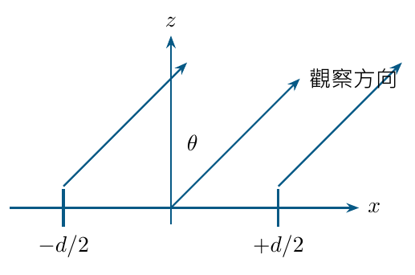
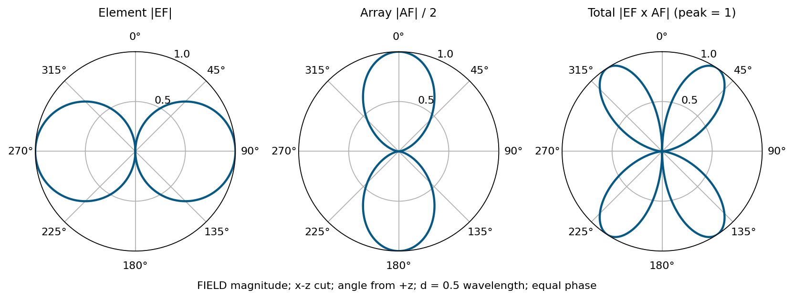

# 單元 23｜場型相乘法則

把單一天線與空間配置的作用分開看

原始影片：[陳晏笙老師「天線」單元 23](https://www.youtube.com/watch?v=VkT1zUQtH98)

影片長度：約 41 分鐘　建議閱讀：約 20 分鐘

前置單元：16、17、21。

> **核心觀念：** 相同、同向天線的遠場可拆成「元件場型 $`\times`$ 陣列因子」。但陣列因子最強的方向，不一定是實際總場型最強的方向；元件零點可以把它完全消掉。

## 本單元的四個目標

1.  由距離差解釋為何幾何位置會產生相位差。

2.  推導兩支短偶極的 EF 與 AF，不只背乘積。

3.  跟著影片把兩張場型相乘，算出總場型的零點與波瓣。

4.  辨認相乘法的條件，及幅度、功率、正規化的差異。

## 影片的示例座標

兩支短偶極均沿 $`z`$，放在 $`x=-d/2`$ 與 $`x=+d/2`$；觀察 $`xz`$ 切面，$`\theta`$ 從 $`+z`$ 起算。距離差與 $`\sin\theta`$ 有關。 下一單元改觀察 $`xy`$ 面、以 $`\phi`$ 從 $`+x`$ 起算，會出現 $`\cos\phi`$；**這是角度定義改變，不是公式矛盾。**

## 閱讀地圖

第 2 頁：幾何相位；第 3 頁：兩源推導；第 4 頁：影片乘圖示例；第 5 頁：數值重算；第 6 頁：條件及資料處理；第 7 頁：自測。 依影片兩短偶極推導與場型圖重寫。全篇採 $`e^{j\omega t}`$，$`k=2\pi/\lambda`$；補充重算明確標示。

## 1．先疊加複數場：位置會變成相位

影片對照：[00:00](https://www.youtube.com/watch?v=VkT1zUQtH98&t=0s)－[約 22:00](https://www.youtube.com/watch?v=VkT1zUQtH98&t=1320s)

影片列出的陣列控制因素：元件類型、配置、間距、數目、電流振幅與相位。真正控制遠場的是各元件**朝同一觀察方向產生的複數場**。

### 兩個近似要分開處理

觀察點 $`r\gg d`$，兩元件的場方向近似平行；振幅分母可近似 $`r_1\approx r_2\approx r`$。但波長尺度的距離差仍會造成重要相位：

```math
r_1\approx r+\frac d2\sin\theta,\qquad
r_2\approx r-\frac d2\sin\theta.
```

```math
r_1-r_2\approx d\sin\theta.
```

因此不能把 $`e^{-jkr_1},e^{-jkr_2}`$ 也直接都改成 $`e^{-jkr}`$。在 $`d=\lambda/2`$ 時，最大距離差已造成 $`\pi`$ 相位差。



### 一般位置的相位因子

**補充解說／重算例題：**元件位於 $`\mathbf r_n`$、觀察方向為 $`\hat{\mathbf r}`$：

```math
|\mathbf r-\mathbf r_n|\approx r-\hat{\mathbf r}\cdot\mathbf r_n,
\quad
e^{-jk|\mathbf r-\mathbf r_n|}
\approx e^{-jkr}e^{+jk\hat{\mathbf r}\cdot\mathbf r_n}.
```

同一方向的幾何相位，再加上饋入電流的電性相位，才能決定增強或相消。

> **核心觀念：** 遠場可以忽略相對很小的振幅差，不能忽略對波長仍然重要的距離相位差。

## 2．影片推導：兩短偶極的乘積形式

影片對照：[約 22:00](https://www.youtube.com/watch?v=VkT1zUQtH98&t=1320s)－[30:00](https://www.youtube.com/watch?v=VkT1zUQtH98&t=1800s)

兩支均勻短電流元長 $`\ell`$，電流等幅、差相位 $`\delta`$。按影片對稱命名：

```math
I_1=I_0e^{-j\delta/2},\qquad
I_2=I_0e^{+j\delta/2},\qquad
\delta=\arg I_2-\arg I_1.
```

單一元件 $`E_\theta=(j\eta kI_0\ell/4\pi r)e^{-jkr}\sin\theta`$。代入前頁距離與電流相位：

```math
E_{\theta,\rm total}\approx
\frac{j\eta kI_0\ell}{4\pi r}e^{-jkr}\sin\theta
\left[
e^{-j(kd\sin\theta+\delta)/2}
+e^{+j(kd\sin\theta+\delta)/2}
\right].
```

使用 $`e^{-j\psi/2}+e^{+j\psi/2}=2\cos(\psi/2)`$：

```math
\boxed{E_{\theta,\rm total}\approx
\frac{j\eta kI_0\ell}{4\pi r}e^{-jkr}
\underbrace{\sin\theta}_{\rm EF}
\underbrace{2\cos\!\left(\frac{kd\sin\theta+\delta}{2}\right)}_{\rm AF}.}
```

### EF：element factor

描述單一元件的方向與極化。短 $`z`$ 偶極的幅度形狀是 $`|\sin\theta|`$；改為半波偶極，EF 也要改，不能一直用短偶極的 $`\sin\theta`$。

### AF：array factor

描述位置、電流權重與相位的干涉，這裡取決於 $`d/\lambda`$、$`\theta,\delta`$。它不包含元件自己的軸向零點。

### 幅度與功率的相乘

```math
|E_{\rm total}|\propto|\mathrm{EF}|\,|\mathrm{AF}|,\qquad
P_{\rm total}\propto|\mathrm{EF}|^2|\mathrm{AF}|^2.
```

「相乘」來自先做複數場相加、再提取共同項。若先把兩源功率相加，會漏掉干涉項，無法得到正確 AF。

> **核心觀念：** AF 是複數疊加之後得到的因子；它的相位約定必須與元件位置及 $`e^{j\omega t}`$ 一致。

## 3．影片的乘圖例：一半波長、同相

影片對照：[約 30:00](https://www.youtube.com/watch?v=VkT1zUQtH98&t=1800s)－[40:59](https://www.youtube.com/watch?v=VkT1zUQtH98&t=2459s)

取 $`d=\lambda/2`$、$`\delta=0`$，$`kd=\pi`$：

```math
\mathrm{EF}=\sin\theta,\qquad
\mathrm{AF}/2=\cos[(\pi/2)\sin\theta].
```



圖畫**場幅度**；EF 峰值 1，AF 除以 2，總圖另外正規化為峰值 1。各曲線比例尺已標示。

### 沿 $`z`$ 的方向

$`\theta=0^\circ,180^\circ`$，AF 取得等幅同相的最大值，但元件 EF 為零。因此總場為零。**AF 主瓣被元件的零點消掉。**

### 沿 $`x`$ 的方向

$`\theta=90^\circ,270^\circ`$，元件 EF 最大，但幾何差相位為 $`\pi`$，AF 為零。因此總場也為零。

### 中間方向

EF 與 AF 都不為零，產生四個斜向波瓣。它們既不在 EF 原來的峰值，也不在 AF 原來的峰值上；真正最大值要對乘積求極大。

### 不要把這個切面當成整個三維場型

本頁是 $`xz`$ 面。另一個垂直面可能有完全不同的切線；若要算指向性，仍需整個球面的總功率積分。

> **核心觀念：** 乘圖時，任何一個因子的零點都成為總場型零點；兩個因子的最大方向不一致時，總峰值常會移到兩者之間。

## 4．重算例：如何真正求出波瓣方向？

補充計算：沿用影片 $`d=\lambda/2,\delta=0`$、短 $`z`$ 偶極。

第一象限 $`0\le\theta\le90^\circ`$，先不含共同常數，以

```math
f(\theta)=\sin\theta\cos[(\pi/2)\sin\theta]
```

表示幅度。在第一象限為非負，最大化它等同最大化 $`f^2`$。

| $`\theta`$   | EF     | AF/2   | $`f`$    | $`f^2`$   |
|:-----------|:-------|:-------|:-------|:--------|
| $`0^\circ`$  | 0      | 1      | 0      | 0       |
| $`30^\circ`$ | 0.5000 | 0.7071 | 0.3536 | 0.1250  |
| $`45^\circ`$ | 0.7071 | 0.4440 | 0.3140 | 0.09858 |
| $`60^\circ`$ | 0.8660 | 0.2089 | 0.1809 | 0.03273 |
| $`90^\circ`$ | 1      | 0      | 0      | 0       |

### 求極大：一個小方程就夠了

令 $`a=\pi/2`$、$`u=\sin\theta`$：

```math
\frac{d}{du}[u\cos(au)]=\cos(au)-au\sin(au)=0.
```

令 $`x=au`$，得到 $`x\tan x=1`$。在 $`0<x<\pi/2`$ 的解：

```math
x\approx0.860334,\quad
u\approx0.547706,\quad
\boxed{\theta_{\max}\approx33.21^\circ.}
```

其餘三個對稱峰值約 $`146.79^\circ,213.21^\circ,326.79^\circ`$；$`f_{\max}\approx0.357205`$。**手畫示意圖的「斜向」不表示峰值必然在 $`45^\circ`$。**

### 總圖正規化要再做一次

```math
F_n(\theta)=\frac{|f(\theta)|}{0.357205},
\qquad
P_n(\theta)=F_n^2.
```

直接把两個各自峰值 1 的因子相乘，其峰值不一定為 1。要比较波束寬度，須以總圖自己的峰值為參考。

> **核心觀念：** 乘積可以先判零點與波瓣數量；要準確峰值、半功率點與指向性，還須計算或積分。

## 5．相乘法的條件、dB 與實際陣列

影片對照：[約 04:00](https://www.youtube.com/watch?v=VkT1zUQtH98&t=240s)－[12:00](https://www.youtube.com/watch?v=VkT1zUQtH98&t=720s)；以下補充條件。

### 什麼時候能提出一個共同 EF？

如果各支天線的遠場方向函數相同、朝向與極化相同，只差權重及位置：

```math
\mathbf E_n(\hat{\mathbf r})
=C(r)\,\mathbf F_e(\hat{\mathbf r})\,w_n
e^{jk\hat{\mathbf r}\cdot\mathbf r_n},
```

就有

```math
\boxed{\mathbf E_{\rm total}
=C(r)\mathbf F_e(\hat{\mathbf r})
\sum_nw_ne^{jk\hat{\mathbf r}\cdot\mathbf r_n}.}
```

若每支朝向不同、極化不同或場型不同，須先以共同坐標做完整複數向量和；不能直接拿每支的幅度圖相乘。

### 互耦會改變實際電流與元件場

饋入端口的入射波相同，不保證每支天線的電流相同。鄰近元件、有限地與端部效應可能改變 embedded element pattern。理想 AF 分析是起點，最終須把互耦及實際饋入帶回。

### dB 中怎樣相乘？

相同參考且不在零點時：

```math
20\log_{10}|EF\cdot AF|
=20\log_{10}|EF|+20\log_{10}|AF|.
```

等價的功率表達為 $`10\log_{10}(|EF|^2|AF|^2)`$。總圖再正規化時，要減去總峰值對應的 dB，不能以圖上半徑直接相乘。

### 場型的平方不等於無條件的總功率倍數

两支同相的某方向場可能加倍，使該方向密度四倍；總輻射功率須對整個球面積分，也與實際電流、互耦及接受功率有關。因此「場加倍」不能直接宣布 gain 增加 6 dB。

> **核心觀念：** 共同 EF 來自相同方向函數的因式分解；實際陣列若不滿足假設，應回到複數向量疊加。

## 6．五題自測與答案

先判幾何與相位，再判總場；一律沿用本講義座標。

1.  $`d=\lambda/4`$，$`\theta=90^\circ`$，两元件的幾何相位差 $`kd\sin\theta`$ 為多少？

2.  两支短 $`z`$ 偶極沿 $`x`$ 相隔 $`\lambda/2`$、同相；在 $`\theta=0^\circ`$ 為何總場為零？在 $`\theta=90^\circ`$ 又是哪個因子為零？

3.  某方向 $`|EF|=0.5`$、$`|AF|/2=0.4`$，按這些尺度的幅度乘積與功率乘積各為多少？幅度 dB 是多少？

4.  EF 與 AF 各自峰值為 1，它們的乘積是否必定峰值為 1？若两支天線分別為 $`x`$ 與 $`y`$ 極化，可否把各自幅度直接塞進共同 EF？

5.  本片例题的第一象限最大波瓣在 $`45^\circ`$ 嗎？僅有此 $`xz`$ 切面，是否可求完整指向性？

### 答案與解析

1.  $`kd=2\pi(\lambda/4)/\lambda=\pi/2`$，即 $`90^\circ`$。

2.  沿 $`z`$ 時 EF 為零，AF 最大；沿 $`x`$ 時 AF 為零，EF 最大。總場都是零，但來源不同。

3.  幅度乘積 0.2，功率乘積 0.04；$`20\log_{10}(0.2)\approx-13.98`$ dB。這是指定尺度的值，不必然已按總峰值正規化。

4.  不必，峰值方向可能不同。不同極化的天線也不能直接用同一個標量 EF，應做複數向量疊加。

5.  約 $`33.21^\circ`$，不是必定 $`45^\circ`$。此切面不足以積分整球，除非另有可验證的對稱模型。

### 回看影片

[04:00](https://www.youtube.com/watch?v=VkT1zUQtH98&t=240s)：陣列參數；[16:00](https://www.youtube.com/watch?v=VkT1zUQtH98&t=960s)：距離差；[22:00](https://www.youtube.com/watch?v=VkT1zUQtH98&t=1320s)：複數場相加；[26:00](https://www.youtube.com/watch?v=VkT1zUQtH98&t=1560s)：EF 與 AF；[38:00](https://www.youtube.com/watch?v=VkT1zUQtH98&t=2280s)：乘圖結果。

**下一單元：**兩單元陣列，改變間距、相位與振幅，分析主瓣、零點及掃描。
