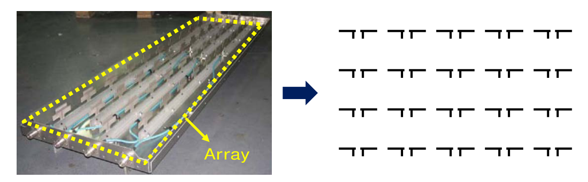
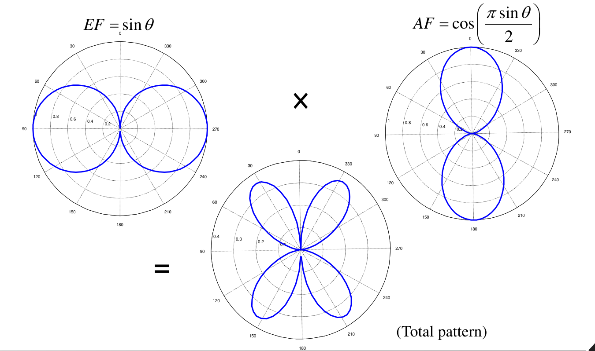

# 單元 23｜場型相乘法則

從兩支短偶極，分清楚元件本身的場型與陣列干涉的作用。

原始影片：[陳晏笙老師「天線」單元 23](https://www.youtube.com/watch?v=VkT1zUQtH98)（40:59）
老師講義：[Lecture 6：Antenna Arrays](https://drive.google.com/file/d/1R3MSohfcRyOONnIcZhn96AkJDZwSqRJv/view)，PDF 第 **3–9 頁**。第 3 頁為本節目錄；影片片尾切到第 10 頁的下一節目錄。
建議閱讀：約 25 分鐘。前置單元：[16 場型與輻射功率密度](016_場型.md)、[21 常見的線型天線](021_線型天線.md)。

本單元依老師「陣列目的 → 控制參數 → 兩短偶極四頁例題」的順序整理。讀完應能由距離差推得相位差，辨認元件因子（element factor, EF）與陣列因子（array factor, AF），並正確處理幅度、功率、零點與正規化。額外的極值計算與一般陣列公式放在章末。

## 講義與影片對照

時間為完整口述、講義與畫面交叉核對後的約略範圍，可用來定位主題；不代表逐秒換頁紀錄。

| 講義頁碼 | 原英文主題 | 中文內容 | 影片定位 |
|:--|:--|:--|:--|
| 3 | Principle of Pattern Multiplication | 本節目錄 | 開頭約 1 分鐘 |
| 4 | Objective of Antenna Array | 增大孔徑、提升增益、縮窄及轉向波束 | 約 [01:20](https://www.youtube.com/watch?v=VkT1zUQtH98&t=80s)–04:00 |
| 5 | Parameters of Antenna Array | 配置、間距、數目、振幅與相位 | 約 [04:00](https://www.youtube.com/watch?v=VkT1zUQtH98&t=240s)–12:00 |
| 6 | Put Two Short Dipoles Together (1/4) | 座標、電流及遠場距離近似 | 約 [12:00](https://www.youtube.com/watch?v=VkT1zUQtH98&t=720s)–22:00；13 分鐘畫面為此頁 |
| 7 | Put Two Short Dipoles Together (2/4) | 將兩個複數電場相加 | 約 [22:00](https://www.youtube.com/watch?v=VkT1zUQtH98&t=1320s)–26:00 |
| 8 | Put Two Short Dipoles Together (3/4) | 提出共同 EF，得到 AF 與相乘法則 | 約 [26:00](https://www.youtube.com/watch?v=VkT1zUQtH98&t=1560s)–30:00 |
| 9 | Put Two Short Dipoles Together (4/4) | 半波長間距、同相激發的場型相乘 | 約 [30:00](https://www.youtube.com/watch?v=VkT1zUQtH98&t=1800s)–40:40，含幅度場型板書 |

## 1．為什麼把天線組成陣列？（Objective of Antenna Array，p.4）

老師先展示一組實際陣列，再將它抽象成多支小天線的排列。設計陣列的目的，是利用較大的空間孔徑及可控制的干涉，把能量集中到需要的方向。



*來源：老師 Lecture 6，p.4 局部；原投影片註明圖片取自 4G Americas 2012 年白皮書。*

講義列出三個直接效果：孔徑變大、增益提高、適合較長距離通訊。其依據是先前學過的有效孔徑與增益關係：

```math
A_e=A_p e_{\rm ap},
\qquad
A_e(\theta,\phi)=\frac{\lambda^2}{4\pi}G(\theta,\phi).
```

其中 $`A_p`$ 為實體孔徑，$`e_{\rm ap}`$ 為孔徑效率；$`A_e`$ 是有效孔徑。**在頻率及效率等條件相當時，有效孔徑越大，增益越高。** 實際改善程度仍由饋入、損耗及場的相位分布決定，不能只數天線支數。

老師在 [約 03:00–03:55](https://www.youtube.com/watch?v=VkT1zUQtH98&t=180s) 把另一大類目標稱為塑造場型：縮小波束寬度、讓主瓣轉向、把零點對準干擾，或壓低旁瓣。固定實體位置後，也可以調整饋入相位，使不同觀察方向的場相加或相消。

## 2．哪些參數決定陣列場型？（Parameters of Antenna Array，p.5）

每支天線的輻射由它的電流分布決定；整個陣列的場則是各元件電磁場的**複數向量和**。同一方向、同一頻率的相干場必須先相加，不能直接把功率相加。

在使用相同元件的前提下，老師列出五個控制參數：

| 參數 | 改變的物理量 | 對場型的影響 |
|:--|:--|:--|
| 整體配置 | 線形、矩形、圓形等空間位置 | 決定各方向的幾何路徑差 |
| 元件間距 $`d`$ | 以波長衡量的相對距離 | 改變幾何相位及干涉方向 |
| 元件數目 $`N`$ | 參與疊加的元件個數 | 配合間距改變孔徑及波束形狀 |
| 激發振幅 $`I_1,I_2,\ldots`$ | 各支元件的電流大小 | 改變主瓣與旁瓣的權重 |
| 激發相位 $`\phi_1,\phi_2,\ldots`$ | 各支元件的電性相位 | 改變各方向的相長或相消條件 |

老師約 7–12 分鐘的板書另外列出「相同天線型式、固定間距 $`d`$、等差相角 $`\delta`$（progressive phase）」，作為接下來便於分析的規則陣列設定。這些條件要分開理解：相同、同向的元件讓我們能提出共同 EF；等間距與等差相位則讓 AF 更容易化簡，並非一般場型相乘法一定要等間距。

**相位一定要先問參考點。** [約 08:10–10:20](https://www.youtube.com/watch?v=VkT1zUQtH98&t=490s)，老師用 $`0^\circ,30^\circ,60^\circ,90^\circ`$ 說明等差相位。真正影響相對干涉的是每兩支的相位差；全部一起加 $`40^\circ`$ 成為 $`40^\circ,70^\circ,100^\circ,130^\circ`$，只多一個共同相位因子，幅度場型不變。相位亦以 $`360^\circ`$ 為週期；「零度在哪裡」要先說明。

頻率也會影響結果。即使實體間距不變，$`kd=2\pi d/\lambda`$ 仍隨頻率改變，因此同一組陣列在不同頻率下可能有不同場型。

## 3．例題 1/4：先定義座標與距離（p.6）

兩支相同的短偶極都沿 $`z`$ 方向，分別放在 $`x=-d/2`$ 與 $`x=+d/2`$。以下採 $`e^{j\omega t}`$ 相量慣例，波數 $`k=2\pi/\lambda`$，並先觀察 **$`xz`$ 切面**。

老師以對稱方式指定兩支電流：

```math
I_1=I_0e^{-j\delta/2},\qquad
I_2=I_0e^{+j\delta/2},\qquad
\delta=\arg I_2-\arg I_1.
```

$`I_0`$ 是共同電流振幅；$`\delta`$ 是元件 2 相對元件 1 的電性相位差。角度 $`\theta`$ 由 $`+z`$ 軸量起，因此距離差含有 $`\sin\theta`$。


*依講義 p.6 幾何重畫；線段表示遠場中近似平行的觀察方向。*

### 振幅近似與相位近似不能混為一談

觀察點離陣列很遠，$`r\gg d`$ 時，$`\mathbf r_1,\mathbf r_2,\mathbf r`$ 的方向近似平行；在振幅分母可取 $`r_1\approx r_2\approx r`$。但距離本身仍須保留一階路徑差：

```math
r_1\approx r+\frac d2\sin\theta,\qquad
r_2\approx r-\frac d2\sin\theta,
```

```math
r_1-r_2\approx d\sin\theta.
```

所以 $`e^{-jkr_1}`$ 與 $`e^{-jkr_2}`$ **不能一起直接改成** $`e^{-jkr}`$。例如 $`d=\lambda/2`$，沿 $`x`$ 軸的路徑差雖然遠小於 $`r`$，卻足以造成 $`\pi`$ 的相位差。

[約 19:30–21:30](https://www.youtube.com/watch?v=VkT1zUQtH98&t=1170s)，老師再次用 $`100\lambda`$ 與 $`100.2\lambda`$ 比較：距離相差只有約 0.2%，放在 $`1/r`$ 的振幅因子可近似相等；相位卻相差 $`2\pi(0.2)=72^\circ`$，不可略去。這與單元 02 的多路徑衰落是同一個觀念。

本推導也使用各短偶極的輻射遠場形式。對更大的陣列，除了距離相對尺寸夠大，也要滿足遠場相位近似；不能只憑 $`r>d`$ 就忽略波前曲率。

## 4．例題 2/4：疊加兩個複數電場（p.7）

沿用老師符號 $`L`$ 表示短偶極長度，且使用均勻電流元模型。單一短偶極的遠場為

```math
E_\theta=\frac{jk\eta IL}{4\pi r}e^{-jkr}\sin\theta.
```

$`\eta`$ 是介質的波阻抗，$`\sin\theta`$ 描述短偶極的方向性。代入兩個位置與兩支電流，在方向近似相同的前提下可直接加總 $`E_\theta`$：

```math
E_{\theta,\rm total}\approx
\frac{jk\eta I_0L\sin\theta}{4\pi r}
\left[
 e^{-j\delta/2}e^{-jk(r+\frac d2\sin\theta)}
 +e^{+j\delta/2}e^{-jk(r-\frac d2\sin\theta)}
\right].
```

提出共同的傳播項 $`e^{-jkr}`$：

```math
E_{\theta,\rm total}\approx
\frac{jk\eta I_0L}{4\pi r}e^{-jkr}\sin\theta
\left[
 e^{-j(kd\sin\theta+\delta)/2}
 +e^{+j(kd\sin\theta+\delta)/2}
\right].
```

括號中的相位包含兩部分：

```math
\psi=\underbrace{kd\sin\theta}_{\text{幾何路徑造成的相位}}
+\underbrace{\delta}_{\text{饋入電流的相位差}}.
```

因為 $`e^{-j\psi/2}+e^{+j\psi/2}=2\cos(\psi/2)`$，兩個正弦虛部會互相抵消，得到下一頁的乘積形式。若一開始就加兩支天線的功率，會漏掉這個干涉項。

## 5．例題 3/4：提出 EF 與 AF（p.8）

整理後：

```math
\boxed{
E_{\theta,\rm total}\approx
\underbrace{\frac{jk\eta I_0L}{4\pi r}e^{-jkr}\sin\theta}_{\text{單一元件的場：EF}}
\underbrace{2\cos\!\left(\frac{kd\sin\theta+\delta}{2}\right)}_{\text{陣列因子：AF}}.
}
```

老師在 p.8 的 EF 括號包含單一短偶極的完整電場；若只討論角度形狀，可把共同常數與距離因子另外提出，將形狀寫成 $`EF(\theta)=\sin\theta`$。這兩種寫法只是尺度的選擇不同。

| 因子 | 描述什麼 | 本例的式子 |
|:--|:--|:--|
| 元件因子 EF | 單一天線本身的方向性與極化 | 形狀為 $`\sin\theta`$；沿偶極軸為零 |
| 陣列因子 AF | 不同位置及激發電流的干涉 | $`2\cos[(kd\sin\theta+\delta)/2]`$ |

老師的場型相乘法則為：相同、同向元件的共同場型可以提出，剩下的空間與激發權重相加成 AF。因此

```math
|E_{\rm total}|\propto |EF|\,|AF|,
\qquad
U_{\rm total}\propto |EF|^2|AF|^2.
```

$`U`$ 是輻射強度。**場幅度乘場幅度，功率場型則乘兩個幅度因子的平方。** 若換成半波偶極，EF 必須換成半波偶極的場型；不能仍套短偶極的 $`\sin\theta`$。

## 6．例題 4/4：同相、間距半波長的場型（p.9）

取 $`d=0.5\lambda`$、$`\delta=0`$，則 $`kd=\pi`$。p.9 為了繪圖，將 AF 除以它的最大值 2：

```math
EF=\sin\theta,
\qquad
AF_n=\frac{AF}{2}=\cos\!\left(\frac{\pi\sin\theta}{2}\right).
```

總圖畫的是兩個幅度的乘積：

```math
f(\theta)=\left|\sin\theta\,
\cos\!\left(\frac{\pi\sin\theta}{2}\right)\right|.
```



*來源：老師 Lecture 6，p.9 局部。兩個因子的峰值各為 1，但原投影片下方總圖並未再正規化，峰值約 0.357；總圖的徑向刻度上限為 0.4。*

### 同一個總場零點，可能有不同原因

| 觀察方向 | 元件幅度 $`\lvert EF\rvert`$ | $`\lvert AF_n\rvert`$ | 相乘結果 |
|:--|:--|:--|:--|
| 沿 $`\pm z`$，切面角 $`0^\circ,180^\circ`$ | 0 | 1 | 元件本來就不向其軸向輻射 |
| 沿 $`\pm x`$，切面角 $`90^\circ,270^\circ`$ | 1 | 0 | 路徑差半波長，兩源反相抵消 |
| 軸向之間的斜方向 | 介於 0 與 1 | 介於 0 與 1 | 兩因子均非零，形成四個斜向波瓣 |

因此 AF 最大的方向，不一定是總場最大的方向；本例 AF 在 $`z`$ 軸方向最強，卻被元件零點完全消掉。四個波瓣的最大方向約在 $`33.21^\circ`$ 及其對稱方向，章末給出計算。

### 板書對照：極座標畫的是幅度

老師約 [32:00–37:00](https://www.youtube.com/watch?v=VkT1zUQtH98&t=1920s) 的板書把正弦函數與幅度圖分開，並標示 $`EF=|\sin\theta|`$。負的實數場值代表相位反轉，不是負的輻射功率；畫幅度場型時要取絕對值。因此全圈有正負正弦區域，幅度圖仍是向外的雙瓣。

此處用 $`0^\circ`$ 到 $`360^\circ`$ 是把一個平面切面畫完一圈；標準球座標中的極角 $`\theta`$ 仍是 $`0`$ 到 $`\pi`$，另外半圈對應不同的方位角。

### 原投影片的切面名稱須校正

p.9 寫「E-plane ($`x-z`$ or $`y-z`$)」，但依 p.6 **元件沿 $`x`$ 軸排列**的座標，兩個切面的 AF 不相同。將方位角 $`\phi`$ 納入後，完整 AF 為

```math
AF(\theta,\phi)=2\cos\!\left(
\frac{kd\sin\theta\cos\phi+\delta}{2}\right).
```

在 $`xz`$ 面，$`\cos\phi=\pm1`$，本例得到講義所畫的四瓣圖；在 $`yz`$ 面，$`\cos\phi=0`$ 且 $`\delta=0`$，故 $`AF=2`$，總場形狀仍為短偶極的 $`|\sin\theta|`$ 雙瓣。**p.9 的四瓣結果應讀成此配置的 $`xz`$ 切面，不能同時套到 $`yz`$ 面。**

### 需要比較波束形狀時，再把總圖正規化


*依上述公式重算；第三圖另除以總乘積峰值，使峰值為 1。這張重畫圖的第三圖尺度不同於老師 p.9 的原圖。*

先各自將 EF 與 AF 正規化，再相乘，所得峰值不保證為 1。總圖正規化應除以**乘積自己的最大值**，而不是假設兩因子的最大值出現在同一方向。

### 片尾銜接：哪個切面可以只看 AF？

[約 39:20–40:40](https://www.youtube.com/watch?v=VkT1zUQtH98&t=2360s)，老師指出：若所選切面的單一元件 EF 為常數，總場型形狀就由 AF 決定。例如本例 $`z`$ 向短偶極的 $`xy`$ 切面，$`\theta=90^\circ`$，EF 幅度處處相同，因此可專看隨 $`\phi`$ 變化的 AF；換回 $`xz`$ 切面，則必須乘回短偶極的 EF。後續先專心分析 AF，是利用這個分解方式，不表示元件方向性在所有切面都能略去。

## 補充解說與重算例題

### A．如何真正求出波瓣方向？

補充計算：沿用影片 $`d=\lambda/2,\delta=0`$、短 $`z`$ 偶極。

第一象限 $`0\le\theta\le90^\circ`$，先不含共同常數，以

```math
f(\theta)=\sin\theta\cos[(\pi/2)\sin\theta]
```

表示幅度。在第一象限為非負，最大化它等同最大化 $`f^2`$。

| $`\theta`$   | EF     | AF/2   | $`f`$    | $`f^2`$   |
|:-----------|:-------|:-------|:-------|:--------|
| $`0^\circ`$  | 0      | 1      | 0      | 0       |
| $`30^\circ`$ | 0.5000 | 0.7071 | 0.3536 | 0.1250  |
| $`45^\circ`$ | 0.7071 | 0.4440 | 0.3140 | 0.09858 |
| $`60^\circ`$ | 0.8660 | 0.2089 | 0.1809 | 0.03273 |
| $`90^\circ`$ | 1      | 0      | 0      | 0       |

#### 求極大：一個小方程就夠了

令 $`a=\pi/2`$、$`u=\sin\theta`$：

```math
\frac{d}{du}[u\cos(au)]=\cos(au)-au\sin(au)=0.
```

令 $`x=au`$，得到 $`x\tan x=1`$。在 $`0<x<\pi/2`$ 的解：

```math
x\approx0.860334,\quad
u\approx0.547705,\quad
\boxed{\theta_{\max}\approx33.21^\circ.}
```

其餘三個對稱峰值約 $`146.79^\circ,213.21^\circ,326.79^\circ`$；$`f_{\max}\approx0.357205`$。**手畫示意圖的「斜向」不表示峰值必然在 $`45^\circ`$。**

#### 總圖正規化要再做一次

```math
F_n(\theta)=\frac{|f(\theta)|}{0.357205},
\qquad
P_n(\theta)=F_n^2.
```

直接把兩個各自峰值 1 的因子相乘，其峰值不一定為 1。要比較波束寬度，須以總圖自己的峰值為參考。

> **核心觀念：** 乘積可以先判零點與波瓣數量；要準確峰值、半功率點與指向性，還須計算或積分。

### B．什麼時候能提出一個共同 EF？

如果各支天線的遠場方向函數相同、朝向與極化相同，只差權重及位置：

```math
\mathbf E_n(\hat{\mathbf r})
=C(r)\,\mathbf F_e(\hat{\mathbf r})\,w_n
e^{jk\hat{\mathbf r}\cdot\mathbf r_n},
```

就有

```math
\boxed{\mathbf E_{\rm total}
=C(r)\mathbf F_e(\hat{\mathbf r})
\sum_nw_ne^{jk\hat{\mathbf r}\cdot\mathbf r_n}.}
```

若每支朝向不同、極化不同或場型不同，須先以共同坐標做完整複數向量和；不能直接拿每支的幅度圖相乘。

### C．互耦會改變實際電流與元件場

饋入端口的入射波相同，不保證每支天線的電流相同。鄰近元件、有限地與端部效應可能改變 embedded element pattern。理想 AF 分析是起點，最終須把互耦及實際饋入帶回。

### D．dB 中怎樣相乘？

相同參考且不在零點時：

```math
20\log_{10}|EF\cdot AF|
=20\log_{10}|EF|+20\log_{10}|AF|.
```

等價的功率表達為 $`10\log_{10}(|EF|^2|AF|^2)`$。總圖再正規化時，要減去總峰值對應的 dB，不能以圖上半徑直接相乘。

### E．場型的平方不等於無條件的總功率倍數

兩支同相的某方向場可能加倍，使該方向密度四倍；總輻射功率須對整個球面積分，也與實際電流、互耦及接受功率有關。因此「場加倍」不能直接宣布 gain 增加 6 dB。

> **核心觀念：** 共同 EF 來自相同方向函數的因式分解；實際陣列若不滿足假設，應回到複數向量疊加。

## 自測與解析

先判幾何與相位，再判總場；一律沿用本講義座標。

1.  $`d=\lambda/4`$，$`\theta=90^\circ`$，兩元件的幾何相位差 $`kd\sin\theta`$ 為多少？

2.  兩支短 $`z`$ 偶極沿 $`x`$ 相隔 $`\lambda/2`$、同相；在 $`\theta=0^\circ`$ 為何總場為零？在 $`\theta=90^\circ`$ 又是哪個因子為零？

3.  某方向 $`|EF|=0.5`$、$`|AF|/2=0.4`$，按這些尺度的幅度乘積與功率乘積各為多少？幅度 dB 是多少？

4.  EF 與 AF 各自峰值為 1，它們的乘積是否必定峰值為 1？若兩支天線分別為 $`x`$ 與 $`y`$ 極化，可否把各自幅度直接塞進共同 EF？

5.  本片例題的第一象限最大波瓣在 $`45^\circ`$ 嗎？僅有此 $`xz`$ 切面，是否可求完整指向性？

### 答案與解析

1.  $`kd=2\pi(\lambda/4)/\lambda=\pi/2`$，即 $`90^\circ`$。

2.  沿 $`z`$ 時 EF 為零，AF 最大；沿 $`x`$ 時 AF 為零，EF 最大。總場都是零，但來源不同。

3.  幅度乘積 0.2，功率乘積 0.04；$`20\log_{10}(0.2)\approx-13.98`$ dB。這是指定尺度的值，不必然已按總峰值正規化。

4.  不必，峰值方向可能不同。不同極化的天線也不能直接用同一個標量 EF，應做複數向量疊加。

5.  約 $`33.21^\circ`$，不是必定 $`45^\circ`$。此切面不足以積分整球，除非另有可驗證的對稱模型。

**下一單元：**[單元 24｜兩單元陣列](024_兩單元陣列.md)，改變間距、相位與振幅，分析主瓣、零點及波束指向。
