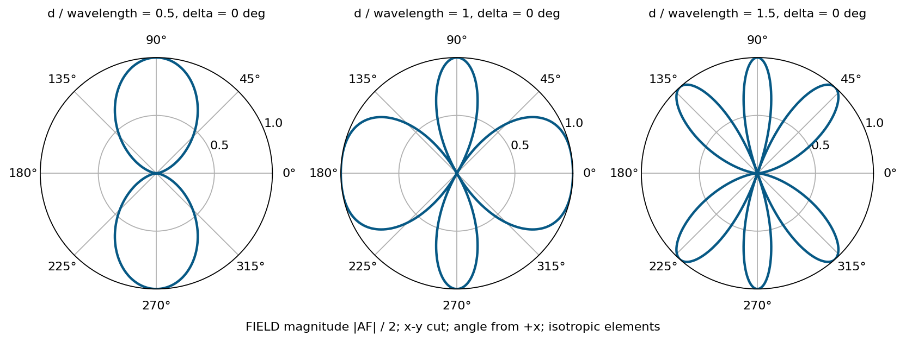
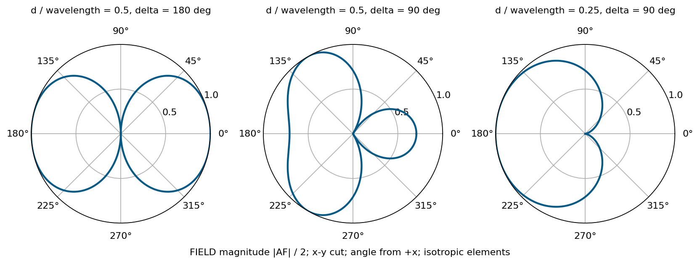

# 單元 24｜兩單元陣列

用間距、相位、振幅控制干涉

原始影片：[陳晏笙老師「天線」單元 24](https://www.youtube.com/watch?v=2x7kMjztzCQ)

影片長度：約 91 分鐘　建議閱讀：約 25 分鐘

前置單元：23。需理解複數場疊加與場型相乘。

> **核心觀念：** 兩源的方向性由「幾何相位 $`kd\cos\phi`$ 加上饋入相位 $`\delta`$」決定。同相不一定只朝正側向輻射；間距增加可能產生多個等高波瓣，振幅不等則無法完全相消。

## 本單元的四個目標

1.  不依賴手畫圖，直接算出最大值與零點的方向。

2.  看懂影片同相、反相、90° 相差與任意相差的案例。

3.  由目標方向反推相位，並檢查其他同樣強的方向。

4.  分清電流不等、座標原點、場的相位和功率場型。

## 全篇固定一組座標

兩個相同元件位在 $`x=-d/2,+d/2`$，觀察 $`xy`$ 切面；$`\phi`$ 從 $`+x`$ 向 $`+y`$ 起算。$`\phi=0^\circ,180^\circ`$ 是沿陣列軸的端射方向，$`90^\circ,270^\circ`$ 是正側向。 採 $`e^{j\omega t}`$、$`k=2\pi/\lambda`$，$`\delta=\arg I_2-\arg I_1`$。先算等向點源的 AF；實際天線仍要乘上 EF。

## 閱讀地圖

第 2 頁：核心公式；第 3 頁：同相與間距；第 4 頁：反相與 90°；第 5 頁：任意相位與掃描；第 6 頁：不等幅；第 7 頁：原點與三維；第 8 頁：自測。 依影片五種案例及末段相位中心推導重寫。圖為公式重繪；補充數值重算明確標記。

## 1．一個變數 $`\psi`$，串起所有案例

影片對照：[00:00](https://www.youtube.com/watch?v=2x7kMjztzCQ&t=0s)－[約 16:00](https://www.youtube.com/watch?v=2x7kMjztzCQ&t=960s)

先用單元 23 的遠場幾何，但把觀察角改成 $`xy`$ 面的 $`\phi`$：

```math
r_1\approx r+\frac d2\cos\phi,\qquad
r_2\approx r-\frac d2\cos\phi.
```

等幅電流為 $`I_1=I_0e^{-j\delta/2}`$、$`I_2=I_0e^{+j\delta/2}`$。提取共同的單源場，可得

```math
\mathrm{AF}=e^{-j\psi/2}+e^{+j\psi/2}
=2\cos(\psi/2),\qquad
\boxed{\psi=kd\cos\phi+\delta.}
```

```math
F_n(\phi)=\frac{|\mathrm{AF}|}{2}=|\cos(\psi/2)|,\qquad
P_n(\phi)=F_n^2.
```

這個正規化以理論最大幅值 2 為基準；若可見角度沒有達到該值，還需按實際峰值另做正規化。

### 先在 $`\psi`$ 軸上找答案，再換回方向

| 條件               | $`\psi`$      | 換成方向條件                       |
|:-------------------|:------------|:-----------------------------------|
| 兩場同相，幅值為 2 | $`2m\pi`$     | $`\cos\phi=(2m\pi-\delta)/(kd)`$     |
| 兩場反相，幅值為 0 | $`(2m+1)\pi`$ | $`\cos\phi=((2m+1)\pi-\delta)/(kd)`$ |

$`m`$ 為整數。每個算出的餘弦都必須在 $`[-1,1]`$ 中；超過範圍的是不可見的解，不能硬畫成波瓣。

### 例：半波間距、同相

$`kd=\pi,\delta=0`$。最大值要求 $`\cos\phi=2m`$，只有 $`m=0`$ 可見，所以 $`\phi=90^\circ,270^\circ`$。零點要求 $`\cos\phi=2m+1`$，得到 $`\phi=0^\circ,180^\circ`$。

> **核心觀念：** 正負的 AF 是場的相位差，不是負功率。畫幅度取絕對值，畫功率再平方。

## 2．案例一：同相時，間距如何增加波瓣？

影片對照：[約 16:00](https://www.youtube.com/watch?v=2x7kMjztzCQ&t=960s)－[41:00](https://www.youtube.com/watch?v=2x7kMjztzCQ&t=2460s)

同相 $`\delta=0`$，最大值與零點可直接寫成

```math
\cos\phi_{\max}=m\frac{\lambda}{d},\qquad
\cos\phi_{\rm null}=\left(m+\frac12\right)\frac{\lambda}{d}.
```



圖畫 $`|\mathrm{AF}|/2`$，不是功率；元件為等向源，因此沒有 EF 的額外零點。

| $`d/\lambda`$ | 可見的最大值條件    | 方向                                   |
|:------------|:--------------------|:---------------------------------------|
| $`1/2`$       | $`\cos\phi=0`$        | $`90^\circ,270^\circ`$                   |
| $`1`$         | $`\cos\phi=-1,0,1`$   | $`0^\circ,90^\circ,180^\circ,270^\circ`$ |
| $`3/2`$       | $`\cos\phi=0,\pm2/3`$ | 六個等高方向                           |

### 不要把所有其他波瓣都當成低旁瓣

影片也畫 $`d=3\lambda/4`$：同相最大值仍只在正側向，但端射幅度已為峰值的 $`1/\sqrt2`$，功率為一半。到 $`d=\lambda`$，沿軸與正側向都是幅值 2、功率相同，這些重複同相最大不能稱為「很小的旁瓣」；它們是額外的同等強度響應。

### 影片手繪法的數字版本

先畫 $`\cos(\psi/2)`$，可見區間是 $`-kd+\delta\le\psi\le kd+\delta`$。把 $`\cos\phi`$ 的非線性映射套回去，才得到角度場型。$`d`$ 越大，$`\psi`$ 掃過的範圍越廣，通常容納更多最大值與零點；數目由可見解判定。

> **核心觀念：** 間距增加不只是把單一波束變窄，還可能讓能量朝多個方向形成同等最大值。

## 3．案例二、三：反相與 90° 相差

影片對照：[約 41:00](https://www.youtube.com/watch?v=2x7kMjztzCQ&t=2460s)－[64:00](https://www.youtube.com/watch?v=2x7kMjztzCQ&t=3840s)



### $`d=\lambda/2,\delta=180^\circ`$

$`F_n=|\sin((\pi/2)\cos\phi)|`$。$`\phi=0^\circ,180^\circ`$ 為最大值，$`\phi=90^\circ,270^\circ`$ 為零。與同相案例互換方向；兩端都強，並不是單向端射。

### $`d=\lambda/2,\delta=+90^\circ`$

```math
\psi=\pi\cos\phi+\pi/2.
```

最大值要求 $`\cos\phi=-1/2`$，所以是 $`120^\circ,240^\circ`$；零點要求 $`\cos\phi=+1/2`$，所以是 $`60^\circ,300^\circ`$。在正側向與兩個端射方向，幅度都是 $`1/\sqrt2`$，功率為峰值一半。

### $`d=\lambda/4,\delta=+90^\circ`$

此時 $`\psi=(\pi/2)(\cos\phi+1)`$，可見區間為 $`0\le\psi\le\pi`$。

```math
F_n(180^\circ)=1,\quad
F_n(0^\circ)=0,\quad
F_n(90^\circ)=F_n(270^\circ)=1/\sqrt2.
```

最大值沿 $`-x`$，零點沿 $`+x`$。若改為 $`\delta=-90^\circ`$，則最大值沿 $`+x`$，零點沿 $`-x`$。 **補充解說／重算例題：**相位正負與哪一支稱為元件 2、時間因子都有關。交換元件標號，$`\delta`$ 的符號也會改；不能只記「+90° 一定朝右」。

> **核心觀念：** 相位可控制方向；間距與相位必須一起指定，單講「90° 相差」不能決定場型。

## 4．案例四：任意相位及反推掃描

影片對照：[約 64:00](https://www.youtube.com/watch?v=2x7kMjztzCQ&t=3840s)－[72:00](https://www.youtube.com/watch?v=2x7kMjztzCQ&t=4320s)

影片選 $`d=\lambda,\delta=30^\circ`$。令相位換成弧度，$`\delta=\pi/6`$：

```math
\psi=2\pi\cos\phi+\pi/6.
```

### 求所有最大值

```math
\cos\phi=m-\frac1{12}.
```

$`m=0`$ 得 $`-1/12`$；$`m=1`$ 得 $`11/12`$；其他整數超出可見區間。 **補充解說／重算例題：**數值重算：四個等高方向約為

```math
23.56^\circ,\quad94.78^\circ,\quad
265.22^\circ,\quad336.44^\circ.
```

### 求所有零點

```math
\cos\phi=m+\frac5{12}.
```

$`m=0,-1`$ 可見，對應約 $`65.38^\circ,125.69^\circ,234.31^\circ,294.62^\circ`$。這一例顯示：相位偏移不一定只有一個「主方向」。

### 指定目標角 $`\phi_0`$，求饋入相位

讓目標角同相：

```math
\boxed{\delta=-kd\cos\phi_0\pmod{2\pi}.}
```

算完仍要檢查 $`\cos\phi=\cos\phi_0+m\lambda/d`$ 的所有可見解。間距過大可能出現額外等高方向；單元 25 會系統化討論柵瓣。

### 一條線陣有鏡像方向的限制

AF 只取決於 $`\cos\phi`$，因此 $`\phi`$ 與 $`360^\circ-\phi`$ 得到相同 AF。僅靠沿 $`x`$ 的位置與權重，不能分辨這對鏡像；需元件方向性、二維布局或其他結構。

> **核心觀念：** 先使目標方向同相，再枚舉其他整數解；「設定一個方向」不保證只有一個強波束。

## 5．案例五：電流振幅不等，零點會填起來

影片對照：[約 72:00](https://www.youtube.com/watch?v=2x7kMjztzCQ&t=4320s)－[78:00](https://www.youtube.com/watch?v=2x7kMjztzCQ&t=4680s)

令第二元件振幅為第一元件的 $`a`$ 倍，$`0\le a\le1`$：

```math
\mathrm{AF}=e^{-j\psi/2}+a e^{+j\psi/2}.
```

展開實、虛部：

```math
\mathrm{AF}=(1+a)\cos(\psi/2)
+j(a-1)\sin(\psi/2).
```

```math
\boxed{|\mathrm{AF}|^2=1+a^2+2a\cos\psi.}
```

### 最大值與最小值

若相應相位都可見，

```math
|\mathrm{AF}|_{\max}=1+a,\qquad
|\mathrm{AF}|_{\min}=1-a.
```

只有 $`a=1`$ 才可能完全相消。$`a=0`$ 只剩一個等向源，AF 幅度為 1，與角度無關。

### 補充算例：$`a=0.5`$

最大幅度 1.5、最小幅度 0.5。按峰值正規化：

```math
F_{n,\min}=\frac13,\qquad
P_{n,\min}=\frac19,\qquad
10\log_{10}(1/9)\approx-9.54\ {\rm dB}.
```

原先的理想零點變成約 $`-9.54`$ dB 的谷底。若希望壓低干擾，振幅誤差可能使零點深度不夠。

### 場的相位不能只用普通反正切

```math
\arg\mathrm{AF}=
\mathop{\mathrm{atan2}}\!\left(
(a-1)\sin(\psi/2),\,(1+a)\cos(\psi/2)
\right).
```

影片的分式反正切需補上象限判斷；分母為零也不能直接除。等幅時 AF 可為負，代表相位跳 $`\pi`$，並不是幅值為負。

> **核心觀念：** 等幅反相才能完全取消。功率場型與場的相位，是同一複數 AF 的兩個不同面向。

## 6．三維、原點與相位中心

影片對照：[約 78:00](https://www.youtube.com/watch?v=2x7kMjztzCQ&t=4680s)－[91:22](https://www.youtube.com/watch?v=2x7kMjztzCQ&t=5482s)

### 把切面公式還原成三維

以兩元件間的位移向量 $`\mathbf d`$ 表示：

```math
\mathrm{AF}=2\cos\left(
\frac{k\hat{\mathbf r}\cdot\mathbf d+\delta}{2}\right).
```

在本單元 $`\mathbf d=d\hat{\mathbf x}`$、$`xy`$ 面得到 $`d\cos\phi`$；陣列沿 $`z`$ 時則得到 $`d\cos\theta`$。等向點源的三維場型繞陣列軸對稱，但乘上實際 EF 後未必保持此對稱。

### 把原點由中間移到第一元件

中間作原點的因子是 $`2\cos(\psi/2)`$。以位置 $`0,d`$、第一源相位 0、第二源相位 $`\delta`$ 表示：

```math
1+e^{j\psi}=e^{j\psi/2}\,2\cos(\psi/2).
```

共同因子 $`e^{j\psi/2}`$ 幅值為 1。因此在這個理想遠場模型，兩種寫法的幅度、功率、最大值與零點相同，複數場相位不同。

### 平移參考位置的相位

**補充解說／重算例題：**全陣列位置共同增加 $`\mathbf r_0`$，AF 多出

```math
e^{jk\hat{\mathbf r}\cdot\mathbf r_0}.
```

在固定觀察距離的遠場近似下，它改變方向相位，不改變幅度場型。若討論量測相位或波前，這一項不能丟掉。

### 相位中心不是「波束指向哪裡」

相位中心描述在一段角域、頻帶中，波前近似從哪個位置發出；波束指向描述幅度最大的方向。對稱等幅陣列的中間位置是一個自然參考，但不等幅、互耦或元件本身的相位會讓等效相位中心依角度與頻率變化。

> **核心觀念：** 改原點可能改相位，卻不改功率場型。做場型設計與做相位量測時，要保留的資訊不同。

## 7．五題自測與答案

先自行作答，再看解析。

1.  等向兩源 $`d=\lambda/2,\delta=0`$，最大值及零點在哪？若換為短 $`x`$ 偶極，能直接沿用 AF 當總場型嗎？

2.  $`d=\lambda,\delta=0`$，除了正側向，還有哪些等高方向？

3.  $`d=\lambda/4,\delta=+90^\circ`$，哪邊最大、哪邊為零？正側向的正規化功率是多少？

4.  兩源 $`a=0.8`$，理想反相谷底相對峰值的功率與 dB 為何？

5.  把陣列的原點換位置，為何複數 AF 可能改變，但 $`|\mathrm{AF}|^2`$ 不變？

### 答案與解析

1.  最大 $`90^\circ,270^\circ`$；零點 $`0^\circ,180^\circ`$。換元件仍需乘 EF；短 $`x`$ 偶極的軸向零點必須納入。

2.  $`0^\circ,180^\circ`$ 也同樣強；最大值條件為 $`\cos\phi=0,\pm1`$。

3.  本講義約定下，$`-x`$ 最大、$`+x`$ 為零；正側向功率為 $`1/2`$，約 $`-3.01`$ dB。

4.  幅值比 $`(1-0.8)/(1+0.8)=1/9`$，功率比 $`1/81`$，約 $`-19.08`$ dB；不是完全零點。

5.  相差一個幅值為 1 的共同相位因子，取絕對值平方後消失。相位量測仍需指定參考。

### 一頁解題流程

固定座標與時間因子；寫 $`\psi=kd\cos\phi+\delta`$；按需要算最大、零點或任意角；剔除不可見解；加入 EF；最後標清幅度／功率／dB。

### 回看影片

[30:00：同相間距](https://www.youtube.com/watch?v=2x7kMjztzCQ&t=1800s)；[54:00：反相](https://www.youtube.com/watch?v=2x7kMjztzCQ&t=3240s)；[60:00：90°](https://www.youtube.com/watch?v=2x7kMjztzCQ&t=3600s)；[74:00：不等幅](https://www.youtube.com/watch?v=2x7kMjztzCQ&t=4440s)；[88:00：原點與相位中心](https://www.youtube.com/watch?v=2x7kMjztzCQ&t=5280s)。

**下一單元：**均勻 $`N`$ 單元線性陣列（一），把兩源的干涉推廣到很多元件。
