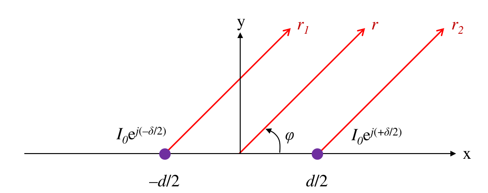
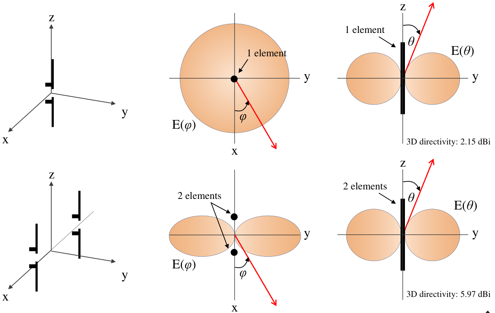
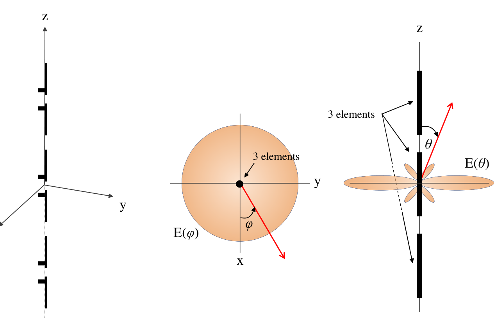
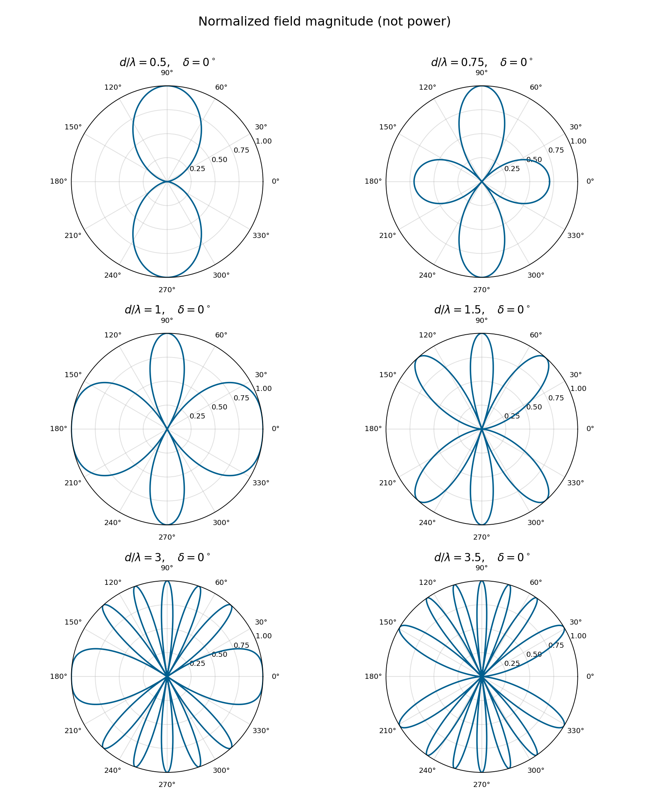
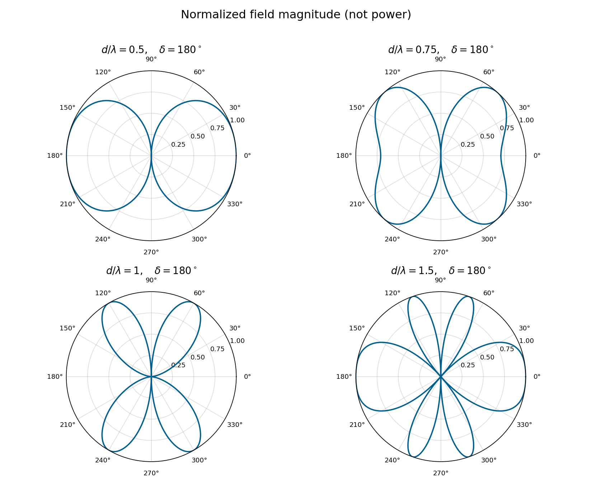

# 單元 24｜兩單元陣列

用間距、相位、振幅控制干涉

原始影片：[陳晏笙老師「天線」單元 24](https://www.youtube.com/watch?v=2x7kMjztzCQ)

老師講義：[Lecture 6 — Antenna Arrays](https://drive.google.com/file/d/1R3MSohfcRyOONnIcZhn96AkJDZwSqRJv/view)，PDF pp.10–25。

影片長度：約 91 分鐘　建議閱讀：約 30 分鐘

前置單元：23。需理解複數場疊加與場型相乘。

> **核心觀念：** 兩源的方向性由「幾何相位 $`kd\cos\phi`$ 加上饋入相位 $`\delta`$」決定。同相不一定只朝正側向輻射；間距增加可能產生多個等高波瓣，振幅不等則無法完全相消。

## 講義與影片對照

正文依老師 PDF 頁序，保留五種饋入案例與相位中心；影片會穿插板書、回看投影片。時間為主題約略定位。

| 講義頁 | 原英文主題 | 中文重點 | 影片定位 |
|:--|:--|:--|:--|
| 10–11 | Two-Element Arrays / 2 Point Sources on x-y Plane | 座標、五種案例、陣列因子 | 開頭約 00:00–09:00 的複習與引入 |
| 12 | Case 1: Same Amplitude & Phase | 手繪法、同相正側向 | 約 09:00–35:00；46:00 回看 |
| 13–14 | Case 1 (2/6–3/6) | 1／2 支並排偶極與 3 支共線偶極 | 約 79:10–86:10；影片在 Case 5 之後回看 |
| 15–17 | Case 1 (4/6–6/6) | 六種間距與波瓣數量 | 約 35:35–38:40；49:00 左右再比較 |
| 18–20 | Case 2: Opposite Phase | 反相及四種間距 | 約 38:40–53:15 的反相板書與比較 |
| 21–22 | Case 3: In-Phase Quadrature | 90° 相差，雙向與單向 | 約 53:15–73:24，含最大值、HPBW、零點及旁瓣 |
| 23 | Case 4: Any Phase Difference | 30°、一波長間距 | 約 73:24–77:15 |
| 24 | Case 5: The Most General Case | 不等幅與任意相位 | 約 77:15–79:10 |
| 25 | Movement of Phase Center | 參考位置與共同相位 | 約 86:10–91:21；緊接並排／共線示範後 |

## 1．兩個點源的共同公式（2 Point Sources on x-y Plane，pp.10–11）

### 沿用老師的座標

兩個相同元件位在 $`x=-d/2,+d/2`$，觀察 $`xy`$ 切面；$`\phi`$ 從 $`+x`$ 向 $`+y`$ 起算。$`\phi=0^\circ,180^\circ`$ 是沿陣列軸的端射方向，$`90^\circ,270^\circ`$ 是正側向。 採 $`e^{j\omega t}`$、$`k=2\pi/\lambda`$，$`\delta=\arg I_2-\arg I_1`$。先算等向點源的 AF；實際天線仍要乘上 EF。

[影片約 01:55–03:55](https://www.youtube.com/watch?v=2x7kMjztzCQ&t=115s)：本節把「點源」當成理想等向源，以便只看 AF。由前節的 $`\theta`$ 改用本節 $`\phi`$，是因為排列軸與觀察切面改變；不能把球座標的兩個角在所有情境下都當成互餘。



圖：原講義 p.11 幾何局部；兩源沿 x 軸，正相位差定義為右邊元件相位減左邊元件相位。

### 一個變數 $`\psi`$，串起所有案例

先用單元 23 的遠場幾何，但把觀察角改成 $`xy`$ 面的 $`\phi`$：

```math
r_1\approx r+\frac d2\cos\phi,\qquad
r_2\approx r-\frac d2\cos\phi.
```

等幅電流為 $`I_1=I_0e^{-j\delta/2}`$、$`I_2=I_0e^{+j\delta/2}`$。提取共同的單源場，可得

```math
\mathrm{AF}_{\Sigma}=e^{-j\psi/2}+e^{+j\psi/2}
=2\cos(\psi/2),\qquad
\boxed{\psi=kd\cos\phi+\delta.}
```

```math
F_n(\phi)=\frac{|\mathrm{AF}_{\Sigma}|}{2}=|\cos(\psi/2)|,\qquad
P_n(\phi)=F_n^2.
```

**對照老師符號：**上式 $`\mathrm{AF}_{\Sigma}`$ 保留兩個場相加的係數 2；講義 p.11 的 $`AF=\cos(\psi/2)`$ 已除以 2。本文的 $`F_n=\lvert AF\rvert`$ 正好對應老師圖中的半徑。負的餘弦表示相位翻轉，不是負的輻射功率。

這個正規化以理論最大幅值 2 為基準；若可見角度沒有達到該值，還需按實際峰值另做正規化。

### 先在 $`\psi`$ 軸上找答案，再換回方向

| 條件               | $`\psi`$      | 換成方向條件                       |
|:-------------------|:------------|:-----------------------------------|
| 兩場同相，幅值為 2 | $`2m\pi`$     | $`\cos\phi=(2m\pi-\delta)/(kd)`$     |
| 兩場反相，幅值為 0 | $`(2m+1)\pi`$ | $`\cos\phi=((2m+1)\pi-\delta)/(kd)`$ |

$`m`$ 為整數。每個算出的餘弦都必須在 $`[-1,1]`$ 中；超過範圍的是不可見的解，不能硬畫成波瓣。

### 例：半波間距、同相

$`kd=\pi,\delta=0`$。最大值要求 $`\cos\phi=2m`$，只有 $`m=0`$ 可見，所以 $`\phi=90^\circ,270^\circ`$。零點要求 $`\cos\phi=2m+1`$，得到 $`\phi=0^\circ,180^\circ`$。

> **核心觀念：** 正負的 AF 是場的相位差，不是負功率。畫幅度取絕對值，畫功率再平方。

## 2．案例一：等幅、同相（Case 1，pp.12–17）

同相 $`\delta=0`$，最大值與零點可直接寫成

```math
\cos\phi_{\max}=m\frac{\lambda}{d},\qquad
\cos\phi_{\rm null}=\left(m+\frac12\right)\frac{\lambda}{d}.
```

### p.12：從相位軸畫到角度場型

先畫 $`\cos(\psi/2)`$，可見區間是 $`-kd+\delta\le\psi\le kd+\delta`$。把 $`\cos\phi`$ 的非線性映射套回去，才得到角度場型。$`d`$ 越大，$`\psi`$ 掃過的範圍越廣，通常容納更多最大值與零點；數目由可見解判定。


老師的手繪步驟可整理為：先畫 $`\lvert\cos(\psi/2)\rvert`$；對指定 $`\phi`$ 算 $`\psi=kd\cos\phi`$；讀取該相位的幅度；最後把幅度當半徑畫在極座標的 $`\phi`$ 方向。不能把 $`\psi`$ 的橫軸直接當作觀察角。

先列四個基準方向，再補最大值、零點與中間的變化：

| 觀察角 $`\phi`$ | $`0^\circ`$ | $`90^\circ`$ | $`180^\circ`$ | $`270^\circ`$ |
|:--|:--|:--|:--|:--|
| 一般 $`\psi`$ | $`kd+\delta`$ | $`\delta`$ | $`-kd+\delta`$ | $`\delta`$ |
| 同相、半波間距的 $`\psi`$ | $`\pi`$ | $`0`$ | $`-\pi`$ | $`0`$ |
| 對應 $`F_n`$ | 0 | 1 | 0 | 1 |

[影片約 59:15–61:50](https://www.youtube.com/watch?v=2x7kMjztzCQ&t=3555s) 用「尺」解釋這套手繪法：可見區間的**寬度是 $`2kd`$，中心是 $`\delta`$**。改間距會改變取用的相位範圍；改饋入相位則移動這段範圍。因為還要經過 $`\cos\phi`$，相位區間平移不代表極座標圖形作等角度的剛性旋轉。幅度曲線 $`|\cos(\psi/2)|`$ 的週期為 $`2\pi`$；未取絕對值的餘弦週期才是 $`4\pi`$。


### pp.13–14：先分辨「並排」與「共線」



圖：原講義 p.13 局部。偶極沿 $`z`$ 軸，兩元件沿 $`x`$ 排列。單元數、排列方向與觀察切面必須一起看。

| 結構 | xy 切面 | yz 切面 | 讀圖結論 |
|:--|:--|:--|:--|
| 一支 z 向半波偶極 | 圓形 | 偶極雙瓣 | 原稿 3D 指向性約 2.15 dBi |
| 兩支沿 x 並排、同相、相距半波長 | AF 使圖形沿 ±y 收束 | 此面幾何路徑差為零，形狀仍由 EF 決定 | 原稿 3D 指向性約 5.97 dBi |

用理想半波偶極的 $`EF(\theta)=\cos[(\pi/2)\cos\theta]/\sin\theta`$ 乘三維 AF，再積分 $`4\pi U_{\max}/\int U\,d\Omega`$，可重現約 2.151 與 5.978 dBi。這不是把單元指向性直接乘 2 得到；總輻射功率也取決於兩場干涉。

[影片約 80:00–83:40](https://www.youtube.com/watch?v=2x7kMjztzCQ&t=4800s) 以麥克風排隊比喻切面的差異。數學上，沿 x 排列時，yz 切面有 $`\hat{\mathbf r}\cdot\hat{\mathbf x}=0`$，AF 對該切面的角度為常數，因此正規化形狀仍由 EF 決定。這是路徑相位的結果，不是前一支天線實際遮蔽了後一支；某個切面維持八字形，也不能推論整個三維場型仍是甜甜圈。



圖：原講義 p.14 局部。這頁改成沿 **z 軸共線**排列，並非把前頁沿 x 的並排陣列直接加成三支。xy 面因旋轉對稱仍是圓形，yz 面則出現較窄主瓣與額外瓣。單元越多時，哪個切面變窄取決於排列方向。

### pp.15–17：同相的六種間距


圖畫 $`|\mathrm{AF}_{\Sigma}|/2`$，不是功率；元件為等向源，因此沒有 EF 的額外零點。

| $`d/\lambda`$ | 同相最大值條件 | xy 面等高最大方向數 | 原講義 |
|:--|:--|--:|:--|
| $`1/2`$ | $`\cos\phi=0`$ | 2 | p.15 |
| $`3/4`$ | $`\cos\phi=0`$ | 2 | p.15 |
| $`1`$ | $`\cos\phi=0,\pm1`$ | 4 | p.16 |
| $`3/2`$ | $`\cos\phi=0,\pm2/3`$ | 6 | p.16 |
| $`3`$ | $`\cos\phi=0,\pm1/3,\pm2/3,\pm1`$ | 12 | p.17 |
| $`7/2`$ | $`\cos\phi=0,\pm2/7,\pm4/7,\pm6/7`$ | 14 | p.17 |

此表數的是達到相干相加峰值的方向；不是把每個較低的局部瓣都算成等高主瓣。$`\cos\phi=\pm1`$ 各只有一個方向，介於其間的每個值通常對應上下兩個方向。



圖：依講義 pp.15–17 公式重算，半徑為正規化**場幅度**，不是功率。零點與最大方向可用前述整數條件逐一驗證。

### 不要把所有其他波瓣都當成低旁瓣

影片也畫 $`d=3\lambda/4`$：同相最大值仍只在正側向，但端射幅度已為峰值的 $`1/\sqrt2`$，功率為一半。其零點由 $`\cos\phi=\pm2/3`$ 得到約 $`48.19^\circ,131.81^\circ,228.19^\circ,311.81^\circ`$。到 $`d=\lambda`$，沿軸與正側向都是幅值 2、功率相同，這些重複同相最大不能稱為「很小的旁瓣」；它們是額外的同等強度響應。老師在約 35:35–38:40 強調，若同等強度的額外波瓣朝向干擾源，即使想要的波束變窄，接收表現仍可能變差。

> **核心觀念：** 間距增加不只是把單一波束變窄，還可能讓能量朝多個方向形成同等最大值。

## 3．案例二：等幅、反相（Case 2，pp.18–20）


### $`d=\lambda/2,\delta=180^\circ`$

$`F_n=|\sin((\pi/2)\cos\phi)|`$。$`\phi=0^\circ,180^\circ`$ 為最大值，$`\phi=90^\circ,270^\circ`$ 為零。與同相案例互換方向；兩端都強，並不是單向端射。

老師約 45:00–51:00 用結構方向幫助辨識：broadside 是垂直陣列軸，end-fire 是沿陣列軸；名稱要相對於排列方向判斷。反相只是饋入條件，是否端射還要連同間距檢查。

### pp.19–20：反相也要連同間距一起看

反相時，$`\delta=\pi`$，所以

```math
\cos\phi_{\max}=\left(m-\frac12\right)\frac{\lambda}{d},\qquad
\cos\phi_{\rm null}=m\frac{\lambda}{d}.
```

| $`d/\lambda`$ | 最大方向的 $`\cos\phi`$ | 零點的 $`\cos\phi`$ |
|:--|:--|:--|
| $`1/2`$ | $`\pm1`$ | $`0`$ |
| $`3/4`$ | $`\pm2/3`$ | $`0`$ |
| $`1`$ | $`\pm1/2`$ | $`0,\pm1`$ |
| $`3/2`$ | $`\pm1,\pm1/3`$ | $`0,\pm2/3`$ |



圖：依講義 pp.19–20 公式重算。講義 p.18 的「End-fire」描述半波間距案例；其他間距的強波瓣可移到斜方向，不能把所有反相陣列都概括成單向端射。

## 4．案例三：等幅、90° 相差（Case 3，pp.21–22）

### $`d=\lambda/2,\delta=+90^\circ`$

```math
\psi=\pi\cos\phi+\pi/2.
```

最大值要求 $`\cos\phi=-1/2`$，所以是 $`120^\circ,240^\circ`$；零點要求 $`\cos\phi=+1/2`$，所以是 $`60^\circ,300^\circ`$。講義 p.21 標成「Bidirectional end-fire」，但本頁參數的精確最大方向為上述兩個斜向角度；它們不在陣列軸 $`0^\circ,180^\circ`$ 上。

在正側向與兩個端射方向，幅度都是 $`1/\sqrt2`$，功率為峰值一半。

**老師板書的讀圖練習（約 63:00–72:55）：**先在 $`\psi`$ 軸找出特徵，再解回 $`\phi`$。$`\psi=0`$ 雖位在 $`-\pi/2`$ 與 $`+\pi/2`$ 的正中間，對應的 $`\phi`$ 卻是 $`120^\circ`$，不能直接取 $`90^\circ`$ 與 $`180^\circ`$ 的中點 $`135^\circ`$。這正是非線性映射需要解方程式的原因。

| 場型特徵 | 先在相位軸判斷 | 換回角度／數值 |
|:--|:--|:--|
| 主瓣最大值 | $`\psi=0`$ | $`\cos\phi=-1/2`$，即 120°、240° |
| 零點 | 可見區間內的 $`\psi=\pi`$ | $`\cos\phi=1/2`$，即 60°、300° |
| 主瓣的半功率位置 | $`F_n=1/\sqrt2`$，不是場幅度 1/2 | 主瓣兩側落在 90°、180°、270°；個別主瓣的 HPBW 為 90° |
| 朝 +x 的較低波瓣 | 端點 $`\psi=3\pi/2`$ | 場幅度 $`1/\sqrt2`$，相對主瓣的功率位準約 −3.01 dB |

表中的 HPBW 是沿本節 xy 切面、以個別主瓣計算；180° 恰是兩個主峰之間降到半功率的谷底。實際總場型還需乘上 EF。


### $`d=\lambda/4,\delta=+90^\circ`$

此時 $`\psi=(\pi/2)(\cos\phi+1)`$，可見區間為 $`0\le\psi\le\pi`$。

```math
F_n(180^\circ)=1,\quad
F_n(0^\circ)=0,\quad
F_n(90^\circ)=F_n(270^\circ)=1/\sqrt2.
```

最大值沿 $`-x`$，零點沿 $`+x`$。若改為 $`\delta=-90^\circ`$，則最大值沿 $`+x`$，零點沿 $`-x`$。 **補充解說／重算例題：**相位正負與哪一支稱為元件 2、時間因子都有關。交換元件標號，$`\delta`$ 的符號也會改；不能只記「+90° 一定朝右」。

> **核心觀念：** 相位可控制方向；間距與相位必須一起指定，單講「90° 相差」不能決定場型。

## 5．案例四：等幅、任意相位（Case 4，p.23）

影片選 $`d=\lambda,\delta=30^\circ`$。令相位換成弧度，$`\delta=\pi/6`$：

```math
\psi=2\pi\cos\phi+\pi/6.
```

### 求所有最大值

```math
\cos\phi=m-\frac1{12}.
```

$`m=0`$ 得 $`-1/12`$；$`m=1`$ 得 $`11/12`$；其他整數超出可見區間。 **補充解說／重算例題：**數值重算：四個等高方向約為

```math
23.56^\circ,\quad94.78^\circ,\quad
265.22^\circ,\quad336.44^\circ.
```

### 求所有零點

```math
\cos\phi=m+\frac5{12}.
```

$`m=0,-1`$ 可見，對應約 $`65.38^\circ,125.69^\circ,234.31^\circ,294.62^\circ`$。這一例顯示：相位偏移不一定只有一個「主方向」。

> **核心觀念：** 先使目標方向同相，再枚舉其他整數解；「設定一個方向」不保證只有一個強波束。

## 6．案例五：振幅與相位都可不同（Case 5，p.24）

令第二元件振幅為第一元件的 $`a`$ 倍，$`0\le a\le1`$：

```math
\mathrm{AF}_{\Sigma}=e^{-j\psi/2}+a e^{+j\psi/2}.
```

展開實、虛部：

```math
\mathrm{AF}_{\Sigma}=(1+a)\cos(\psi/2)
+j(a-1)\sin(\psi/2).
```

```math
\boxed{|\mathrm{AF}_{\Sigma}|^2=1+a^2+2a\cos\psi.}
```

### 最大值與最小值

若相應相位都可見，

```math
|\mathrm{AF}_{\Sigma}|_{\max}=1+a,\qquad
|\mathrm{AF}_{\Sigma}|_{\min}=1-a.
```

只有 $`a=1`$ 才可能完全相消。$`a=0`$ 只剩一個等向源，AF 幅度為 1，與角度無關。

### 場的相位不能只用普通反正切

```math
\arg\mathrm{AF}_{\Sigma}=
\mathop{\mathrm{atan2}}\!\left(
(a-1)\sin(\psi/2),\,(1+a)\cos(\psi/2)
\right).
```

講義 p.24 的分式反正切需補上象限判斷；分母為零也不能直接除。等幅時 AF 可為負，代表相位跳 $`\pi`$，並不是幅值為負。

> **核心觀念：** 等幅反相才能完全取消。功率場型與場的相位，是同一複數 AF 的兩個不同面向。

## 7．特例：移動相位參考位置（Movement of Phase Center，p.25）

### 把原點由中間移到第一元件

中間作原點的因子是 $`2\cos(\psi/2)`$。以位置 $`0,d`$、第一源相位 0、第二源相位 $`\delta`$ 表示：

```math
1+e^{j\psi}=e^{j\psi/2}\,2\cos(\psi/2).
```

講義 p.25 的 $`AF_{\rm original}`$ 是已提取共同單源場後的原陣列因子；如使用 p.11 的除以 2 定義，總場另有係數 2，須前後一致。

這個因子可拆成 $`e^{jkd\cos\phi/2}e^{j\delta/2}`$：前者來自位置參考改變，後者來自把第一源相位由 $`-\delta/2`$ 改記為 0 的共同相位參考。

共同因子 $`e^{j\psi/2}`$ 幅值為 1。因此在這個理想遠場模型，兩種寫法的幅度、功率、最大值與零點相同，複數場相位不同。

影片以「起點與終點一起平移」比喻相對關係不變。這裡的共同相位含 $`\cos\phi`$，通常隨觀察方向改變；不能把它當成對所有角度都固定加上同一個 30°。

> **核心觀念：** 改原點可能改相位，卻不改功率場型。做場型設計與做相位量測時，要保留的資訊不同。

## 補充解說與重算例題

### 指定目標角 $`\phi_0`$，求饋入相位

讓目標角同相：

```math
\boxed{\delta=-kd\cos\phi_0\pmod{2\pi}.}
```

算完仍要檢查 $`\cos\phi=\cos\phi_0+m\lambda/d`$ 的所有可見解。間距過大可能出現額外等高方向；單元 25 會系統化討論柵瓣。

### 一條線陣有鏡像方向的限制

AF 只取決於 $`\cos\phi`$，因此 $`\phi`$ 與 $`360^\circ-\phi`$ 得到相同 AF。僅靠沿 $`x`$ 的位置與權重，不能分辨這對鏡像；需元件方向性、二維布局或其他結構。

### 補充算例：$`a=0.5`$

最大幅度 1.5、最小幅度 0.5。按峰值正規化：

```math
F_{n,\min}=\frac13,\qquad
P_{n,\min}=\frac19,\qquad
10\log_{10}(1/9)\approx-9.54\ {\rm dB}.
```

原先的理想零點變成約 $`-9.54`$ dB 的谷底。若希望壓低干擾，振幅誤差可能使零點深度不夠。

### 把切面公式還原成三維

以兩元件間的位移向量 $`\mathbf d`$ 表示：

```math
\mathrm{AF}_{\Sigma}=2\cos\left(
\frac{k\hat{\mathbf r}\cdot\mathbf d+\delta}{2}\right).
```

在本單元 $`\mathbf d=d\hat{\mathbf x}`$、$`xy`$ 面得到 $`d\cos\phi`$；陣列沿 $`z`$ 時則得到 $`d\cos\theta`$。等向點源的三維場型繞陣列軸對稱，但乘上實際 EF 後未必保持此對稱。

### 平移參考位置的相位

**補充解說／重算例題：**全陣列位置共同增加 $`\mathbf r_0`$，AF 多出

```math
e^{jk\hat{\mathbf r}\cdot\mathbf r_0}.
```

在固定觀察距離的遠場近似下，它改變方向相位，不改變幅度場型。若討論量測相位或波前，這一項不能丟掉。

### 相位中心不是「波束指向哪裡」

相位中心描述在一段角域、頻帶中，波前近似從哪個位置發出；波束指向描述幅度最大的方向。對稱等幅陣列的中間位置是一個自然參考，但不等幅、互耦或元件本身的相位會讓等效相位中心依角度與頻率變化。

## 自測與解析

先自行作答，再看解析。

1.  等向兩源 $`d=\lambda/2,\delta=0`$，最大值及零點在哪？若換為短 $`x`$ 偶極，能直接沿用 AF 當總場型嗎？

2.  $`d=\lambda,\delta=0`$，除了正側向，還有哪些等高方向？

3.  $`d=\lambda/4,\delta=+90^\circ`$，哪邊最大、哪邊為零？正側向的正規化功率是多少？

4.  兩源 $`a=0.8`$，理想反相谷底相對峰值的功率與 dB 為何？

5.  把陣列的原點換位置，為何複數 AF 可能改變，但 $`|\mathrm{AF}_{\Sigma}|^2`$ 不變？

### 答案與解析

1.  最大 $`90^\circ,270^\circ`$；零點 $`0^\circ,180^\circ`$。換元件仍需乘 EF；短 $`x`$ 偶極的軸向零點必須納入。

2.  $`0^\circ,180^\circ`$ 也同樣強；最大值條件為 $`\cos\phi=0,\pm1`$。

3.  本講義約定下，$`-x`$ 最大、$`+x`$ 為零；正側向功率為 $`1/2`$，約 $`-3.01`$ dB。

4.  幅值比 $`(1-0.8)/(1+0.8)=1/9`$，功率比 $`1/81`$，約 $`-19.08`$ dB；不是完全零點。

5.  相差一個幅值為 1 的共同相位因子，取絕對值平方後消失。相位量測仍需指定參考。

### 一頁解題流程

固定座標與時間因子；寫 $`\psi=kd\cos\phi+\delta`$；按需要算最大、零點或任意角；剔除不可見解；加入 EF；最後標清幅度／功率／dB。

**下一單元：**均勻 $`N`$ 單元線性陣列（一），把兩源的干涉推廣到很多元件。
