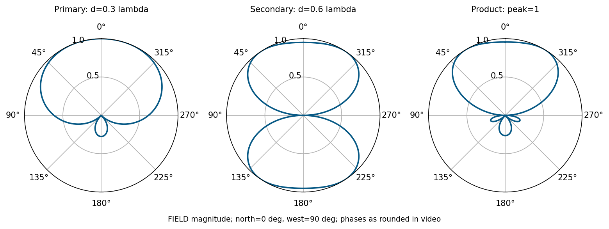
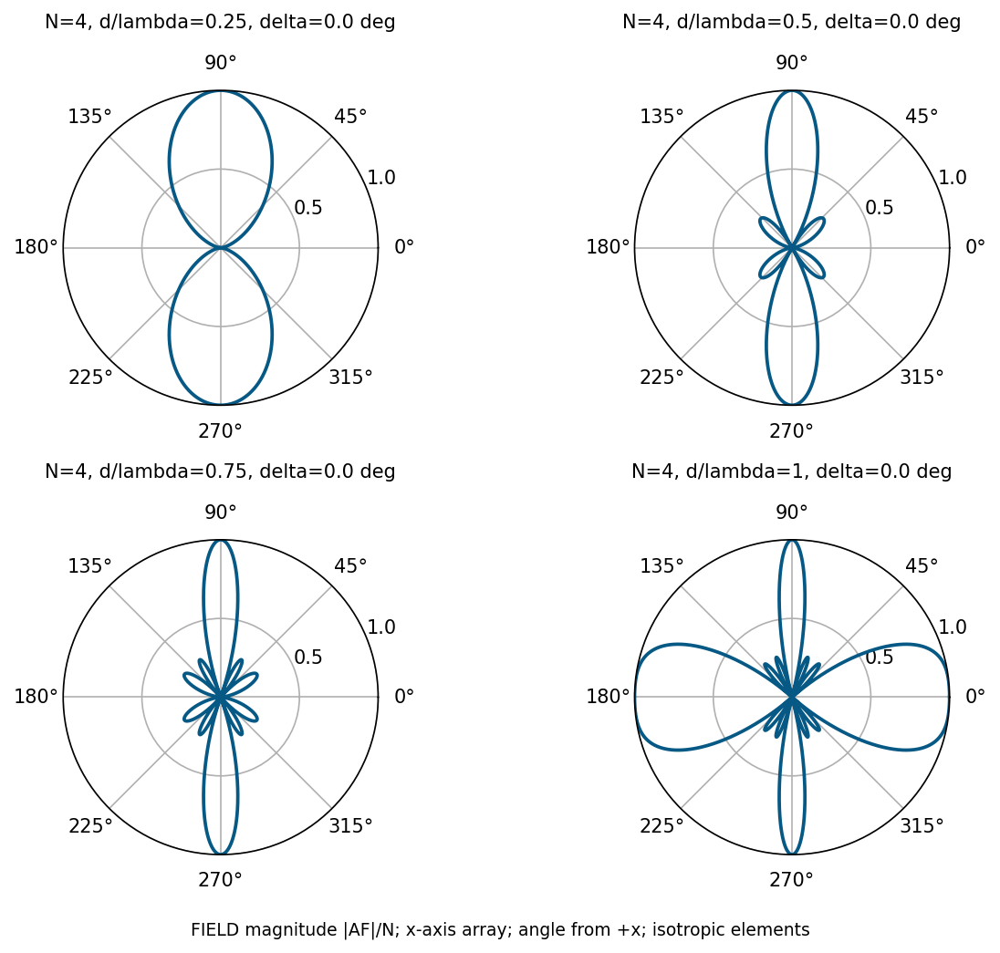

# 單元 25｜均勻N單元線性陣列（一）

[下載原始 PDF](../pdf/025_均勻N單元線性陣列（一）.pdf)

**均勻 $N$ 單元線性陣列（一）**

從四座廣播塔，走到等比級數

原始影片：[陳晏笙老師「天線」單元 25](https://www.youtube.com/watch?v=S33cl3PQQ0Q)

影片長度：約 84 分鐘　建議閱讀：約 25 分鐘

前置單元：23、24。

> **核心觀念：** 多單元陣列不是把單元功率直接相加，而是相加帶有位置與饋入相位的複數場。均勻線陣把這個和簡化成正弦比值；但遇到 $0/0$ 時，原本的複數和仍然有有限最大值。

## 本單元的四個目標

1.  跟著影片把兩組兩源場型相乘，合成四塔場型。

2.  推導 $N$ 個等幅、等間距、漸進相位元件的 AF。

3.  知道陣列中心相位項與正規化代表什麼。

4.  比較正側向陣列的間距、主瓣、旁瓣與柵瓣。

## 「均勻」要逐項說清楚

本課這段模型採等間距 $d$、電流等幅、相鄰電流相位固定差 $\delta$。等幅不代表同相；只有 $\delta=0$ 才是同相正側向案例。饋入權重不等的設計留到單元 27。

## 本單元有兩組角度約定

廣播塔案例以北方為 $\phi=0^\circ$，向西為正角，西南為 $135^\circ$、東方為 $270^\circ$。後半線陣以 $+x$ 為 $\phi=0^\circ$。兩者都用「與陣列軸的夾角」計算距離投影。

## 閱讀地圖

第 2～3 頁：四塔合成；第 4～5 頁：AF 推導與中心；第 6～7 頁：正側向案例與設計判斷；第 8 頁：自測。 依影片廣播塔例與 $N$ 元件板書重寫；圖由公式重繪，近似與補充重算明確標記。

## 1．影片的四塔設計：先拆成兩個任務

影片對照：[約 02:00](https://www.youtube.com/watch?v=S33cl3PQQ0Q&t=120s)－[18:00](https://www.youtube.com/watch?v=S33cl3PQQ0Q&t=1080s)

廣播站欲在北方 NE～NW 的 90° 扇區提供盡量均勻的強訊號，該區不得有零點；東方與西南要有零點。可用四支垂直塔，電流等幅，只能調相位與間距。垂直半波偶極的水平切面近乎全向，先處理水平 AF。 影片以 500–1500 kHz 廣播作背景；下列是選定頻率的電氣間距設計。同一實體塔距的 $d/\lambda$ 會隨頻率改變，不能直接保證整段頻帶都有相同場型，頻率響應見單元 28。

### 第一組兩源：先消掉西南

影片選 $d_1=0.3\lambda$，令

$$
F_1=\cos\left(\frac{0.6\pi\cos\phi+\delta_1}{2}\right).
$$

西南 $\phi=135^\circ$ 要為零，可選總相差為 $-\pi$：

$$
0.6\pi\cos135^\circ+\delta_1=-\pi
\Rightarrow
\delta_1=-\pi+0.6\pi/\sqrt2\approx-103.63^\circ.
$$

影片四捨五入為 $-104^\circ$。北方的總相差約 $108^\circ-104^\circ=4^\circ$，所以北方幅度接近 1。 影片老師另建議把正北最大與西南零點一起聯立，而非先猜間距。**補充解說／重算例題：**同時令 $kd_1+\delta_1=0$、$kd_1\cos135^\circ+\delta_1=-\pi$，可得另一組精確兩源解：$d_1\approx0.292893\lambda$、$\delta_1\approx-105.44^\circ$；完整四塔仍需另配第二組。本講義後續沿用影片教科書的 $0.3\lambda$ 數字。

### 第二組兩源：再消掉東方

選 $d_2=0.6\lambda$，相差 $\delta_2=180^\circ$：

$$
F_2=\cos\left(\frac{1.2\pi\cos\phi+\pi}{2}\right).
$$

東方 $\phi=270^\circ$，$\cos\phi=0$，因此 $F_2=0$。這組的北方場幅也較大；它自己不必做到所有目標，只需與第一組相乘後符合需求。 影片老師指出，改用 $d_2=0.5\lambda$、$\delta_2=180^\circ$，可讓北方精確同相最大。本講義保留教科書的 $0.6\lambda$ 四塔例，供對照影片結果。

### 為什麼乘積可以把兩個零點都保留？

$$
F_{\rm total}=F_1F_2.
$$

只要其中一個因子為零，總場就為零。設計時先讓各因子負責不同零點，再驗證希望覆蓋的扇區沒有新增零點。

> **核心觀念：** 場型合成是由需求反推電流與位置。乘積方法讓不同子陣列各負責一部分需求。

## 2．由乘積展開：四塔的相位怎麼得到？

影片對照：[約 18:00](https://www.youtube.com/watch?v=S33cl3PQQ0Q&t=1080s)－[25:00](https://www.youtube.com/watch?v=S33cl3PQQ0Q&t=1500s)

圖使用影片的 $-104^\circ$；四捨五入會讓西南的零點有極小殘值。

要得到精確零點，使用前頁 $-103.63^\circ$。

### 直接展開兩個兩源複數和

令 $q=kd_1\cos\phi$；因 $d_2=2d_1$，

$$
(1+e^{j(q+\delta_1)})
(1+e^{j(2q+\delta_2)})
$$

完整展開為

$$
\boxed{(1+e^{j(q+\delta_1)})(1+e^{j(2q+\delta_2)})
=1+e^{j\delta_1}e^{jq}
+e^{j\delta_2}e^{j2q}
+e^{j(\delta_1+\delta_2)}e^{j3q}.}
$$

因此以朝北為位置正方向、按位置依序寫出係數：

| 塔  | 位置         | 相位（影片取整數）             | 相對振幅 |
|:----|:-------------|:-------------------------------|:---------|
| 1   | $0$          | $0^\circ$                      | 1        |
| 2   | $0.3\lambda$ | $-104^\circ$                   | 1        |
| 3   | $0.6\lambda$ | $180^\circ$，等同 $-180^\circ$ | 1        |
| 4   | $0.9\lambda$ | $76^\circ$，等同 $-284^\circ$  | 1        |

相鄰相位差不是固定值，所以這是**等幅四塔合成例，還不是後半的漸進相位均勻線陣**。兩因子的共同相位不影響幅度乘積。

### 不要只驗證兩個指定零點

還需檢查北方 90° 扇區的起伏、其他零點與後方殘餘波瓣。影片展示的乘積是可行的初步合成；它不是對所有角度均勻度都已最佳化的證明。

> **核心觀念：** 把因子展開成各位置的複數係數，就得到四支天線真正需要的饋入相位。

## 3．$N$ 源推導：為什麼 AF 是等比級數？

影片對照：[約 25:00](https://www.youtube.com/watch?v=S33cl3PQQ0Q&t=1500s)－[40:00](https://www.youtube.com/watch?v=S33cl3PQQ0Q&t=2400s)

令元件位於 $x_n=nd$，$n=0,\ldots,N-1$；電流為 $I_n=I_0e^{jn\delta}$。在 $xy$ 切面，幾何相位為 $e^{jnkd\cos\phi}$：

$$
\psi=kd\cos\phi+\delta,\qquad
\boxed{\mathrm{AF}=\sum_{n=0}^{N-1}e^{jn\psi}.}
$$

把 $\mathrm{AF}$ 乘 $e^{j\psi}$ 再相減，中間項消掉：

$$
\mathrm{AF}(1-e^{j\psi})=1-e^{jN\psi}.
$$

$$
\mathrm{AF}=\frac{1-e^{jN\psi}}{1-e^{j\psi}}
=e^{j(N-1)\psi/2}
\frac{\sin(N\psi/2)}{\sin(\psi/2)}.
$$

### 共同 EF 從哪裡來？

相同、同向元件在遠場可寫成

$$
E_{\rm total}=C(r)\,\mathrm{EF}(\theta,\phi)\,\mathrm{AF}.
$$

影片以兩種推導展示：等向點源只有 AF；短偶極有共同 $\sin\theta$。換成其他元件，只要可提取同一個複數 EF，陣列和不變。

### 檢查 $N=2$ 是否回到上個單元

$$
1+e^{j\psi}=e^{j\psi/2}\,2\cos(\psi/2).
$$

去掉因原點而有的共同相位，就回到兩源對稱表示。這也驗證正弦比的公式不是另一種無關的規則。

> **核心觀念：** AF 的原始定義是有限個複數數字的和；正弦比是簡寫，不能在分母為零時誤判為發散。

## 4．中心、極限與正規化

影片對照：[約 40:00](https://www.youtube.com/watch?v=S33cl3PQQ0Q&t=2400s)－[51:00](https://www.youtube.com/watch?v=S33cl3PQQ0Q&t=3060s)

把位置中心移到原點：

$$
x_n=\left(n-\frac{N-1}{2}\right)d.
$$

如果電流的相位基準也設在中心，AF 可寫成

$$
\mathrm{AF}_{\rm c}=\frac{\sin(N\psi/2)}{\sin(\psi/2)}.
$$

原式的 $e^{j(N-1)\psi/2}$ 表示原點與相位基準的差異；其幅值為 1，功率圖相同。

### 全同相時的 $0/0$

當 $\psi=2m\pi$，原始和每項都為 1，故 $\mathrm{AF}=N$。正弦比的絕對值極限也是 $N$：

$$
\boxed{F_n=\frac1N\left|
\frac{\sin(N\psi/2)}{\sin(\psi/2)}\right|,\qquad
P_n=F_n^2.}
$$

分母近零時，數值程式用複數和、解析極限或穩定的 sinc 比，避免直接除出 NaN。

### 兩個尺度不要混在一起

| 量                          | 全同相可見方向 | 意義                         |
|:----------------------------|:---------------|:-----------------------------|
| $\vert \mathrm{AF}\vert$    | $N$            | 相對單元場振幅               |
| $\vert \mathrm{AF}\vert ^2$ | $N^2$          | 固定每源電流下的相對局部功率 |
| $F_n$                       | 1              | 正規化振幅形狀               |
| $P_n$                       | 1              | 正規化功率形狀               |

局部功率 $N^2$ 不代表固定總輸入功率時，天線增益必為 $N^2$。還要算總輻射功率、EF、互耦與損耗；常見理想陣列增益約隨 $N$ 增加，是另一組功率基準。

### $\psi$ 圖不等於角度圖

同一 $\psi$ 曲線套不同 $kd,\delta$，會得到不同的角度場型。元件數增多讓中央 $\psi$ 波瓣縮窄；角度波束是否縮窄、是否多瓣，還取決於可見區間與映射。 影片固定 $d=0.75\lambda,\delta=0$，把 $N$ 從 4 增到 10：可見 $\psi$ 區間仍為 $[-1.5\pi,1.5\pi]$，但曲線的零點更密，所以主瓣變窄、旁瓣變多；正側向的兩個峰值方向維持不變。旁瓣較多不代表每個旁瓣都變高。

> **核心觀念：** 正規化後看不到絕對場值或效率，卻能清楚比較形狀；算增益時必須恢復功率的參考。

## 5．影片正側向案例：固定 $N=4$ 改間距

影片對照：[約 51:00](https://www.youtube.com/watch?v=S33cl3PQQ0Q&t=3060s)－[83:33](https://www.youtube.com/watch?v=S33cl3PQQ0Q&t=5013s)

正側向為 $\phi=90^\circ,270^\circ$，$\cos\phi=0$。要這裡全同相，取 $\delta=0$；$\psi=kd\cos\phi$。

圖為等向元件、振幅場型。$d$ 從 $0.25\lambda$ 到 $\lambda$，主瓣通常變窄，但其他波瓣更容易進入可見角域。到 $d=\lambda$，端射方向也變成全同相最大值。

> **核心觀念：** 選間距不能只看主瓣寬度。必須檢查所有可見最大值，才能判斷是否出現柵瓣。

## 6．零點、柵瓣與設計檢查

影片對照：[約 60:00](https://www.youtube.com/watch?v=S33cl3PQQ0Q&t=3600s)－[83:33](https://www.youtube.com/watch?v=S33cl3PQQ0Q&t=5013s)；公式條件補充

### 零點不是所有分子為零的點

$$
N\psi/2=m\pi\Rightarrow\psi=\frac{2m\pi}{N}.
$$

但 $m$ 不可為 $N$ 的整數倍，否則分子與分母同時為零，是全同相最大值。

$$
\cos\phi_{\rm null}
=\frac{2m\pi/N-\delta}{kd},
\quad m\notin N\mathbb Z,\quad |\cos\phi_{\rm null}|\le1.
$$

影片 $N=4,d=\lambda/2,\delta=0$：$\cos\phi=m/2$。

可見零點的餘弦為 $-1,-1/2,1/2,1$。

全圈方向為 $0^\circ,60^\circ,120^\circ,180^\circ,240^\circ,300^\circ$。

### 柵瓣：另一方向也全同相

$$
\cos\phi_{\max}=\frac{2m\pi-\delta}{kd}.
$$

同相正側向時，$m=0$ 為目標，$m\ne0$ 若可見就有重複最大值。對此特定目標，$d<\lambda$ 可避免額外全同相解；但對可掃到端射的全角度線陣，通常需 $d<\lambda/2$，半波臨界點需檢查邊界。 影片採更保守的「相鄰主瓣連邊緣也不進入可見區」條件。該主瓣的第一零點在 $\psi=2\pi-2\pi/N$；正側向可見範圍為 $|\psi|\le kd$，所以要求 $d\le(N-1)\lambda/N$。$N=4$ 得 $d\le0.75\lambda$；這與只排除等高峰值的 $d<\lambda$ 是不同標準。

### 「旁瓣變多」與「柵瓣出現」分開判斷

旁瓣是主最大值間的局部次峰，均勻權重時通常較低；柵瓣是另一個全同相方向，AF 可以和目標峰值一樣高。$d=0.75\lambda$ 的正側向例有旁瓣，但還沒有等高端射柵瓣。

### 實作時的五個檢查

1.  $d$ 用實際距離，$\lambda$ 用正在分析的頻率。

2.  相位要用弧度代入；正負與元件標號固定。

3.  分母零點用極限；列零點時剔除同時為零的情形。

4.  明確區分 AF、EF 和總場；確認元件零點是否遮住目標方向。

5.  場幅取 $20\log$、功率取 $10\log$，最後再按總場峰值正規化。

> **核心觀念：** 均勻線陣的公式很短；大多數錯誤發生在可見解、分母零點、角度與功率基準。

## 7．五題自測與答案

先做題，再看解答。

1.  $N=6,\psi=0$，未正規化 AF 及正規化功率是多少？

2.  $N=4,d=\lambda/2,\delta=0$，$\phi=60^\circ$ 是否為零點？$\phi=90^\circ$ 呢？

3.  $N=4,d=\lambda,\delta=0$，$\phi=0^\circ$ 是旁瓣還是全同相最大值？

4.  廣播塔兩組相位為 $-104^\circ$ 與 $180^\circ$，四個展開係數的相位為何？它們是漸進相位嗎？

5.  $|\mathrm{AF}|$ 在某方向為 $N$，可否直接宣布陣列增益為 $20\log_{10}N$ dBi？

### 答案與解析

1.  AF $=6$；$P_n=1$。不是把正弦比的 $0/0$ 當成零。

2.  $60^\circ$ 時 $\psi=\pi/2$，分子為零、分母非零，是零點。$90^\circ$ 時 $\psi=0$，是最大值。

3.  $\psi=2\pi$，是全同相最大值。若不希望端射，這是柵瓣。

4.  $0^\circ,-104^\circ,180^\circ,76^\circ$（可加減 360°）；相鄰相差不固定，並非漸進相位。

5.  不可。這只給固定每元件電流時的場疊加，增益還需要總功率與效率。

### 回看影片

[04:00：廣播站需求](https://www.youtube.com/watch?v=S33cl3PQQ0Q&t=240s)；[22:00：四塔結果](https://www.youtube.com/watch?v=S33cl3PQQ0Q&t=1320s)；[38:00：複數和](https://www.youtube.com/watch?v=S33cl3PQQ0Q&t=2280s)；[42:00：中心原點](https://www.youtube.com/watch?v=S33cl3PQQ0Q&t=2520s)；[76:00：間距案例](https://www.youtube.com/watch?v=S33cl3PQQ0Q&t=4560s)。

**下一單元：**端射與掃描；由均勻陣列求零點、旁瓣與半功率寬度。
