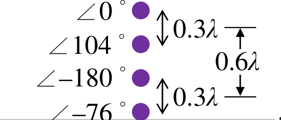
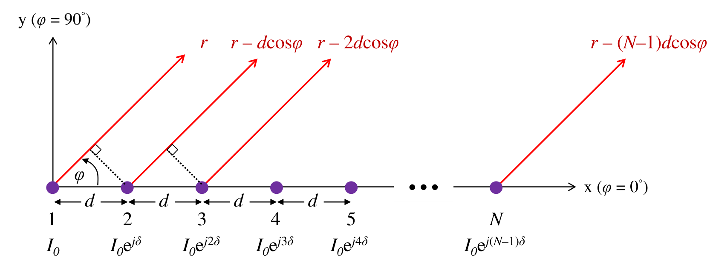
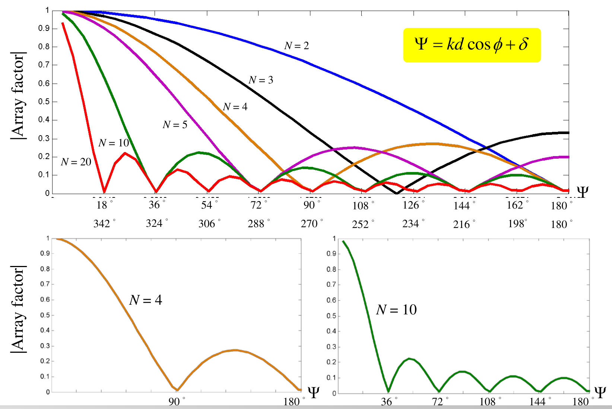

# 單元 25｜均勻N單元線性陣列（一）

從四座廣播塔，走到等比級數

原始影片：[陳晏笙老師「天線」單元 25](https://www.youtube.com/watch?v=S33cl3PQQ0Q)

老師講義：[Lecture 6 — Antenna Arrays](https://drive.google.com/file/d/1R3MSohfcRyOONnIcZhn96AkJDZwSqRJv/view)，PDF pp.26–45。

影片長度：約 84 分鐘　建議閱讀：約 30 分鐘

前置單元：23、24。

> **核心觀念：** 多單元陣列不是把單元功率直接相加，而是相加帶有位置與饋入相位的複數場。均勻線陣把這個和簡化成正弦比值；但遇到 $`0/0`$ 時，原本的複數和仍然有有限最大值。

## 講義與影片對照

正文依 PDF 頁序；老師先以四塔設計說明場型相乘，再推導均勻線陣。下列時間依完整口述、講義與畫面交叉核對，為主題約略定位，不代表逐頁換頁秒數。

| 講義頁 | 原英文主題 | 中文重點 | 影片定位 |
|:--|:--|:--|:--|
| 26–28 | Pattern Synthesis / Design Example of Base Station Antenna | 四塔需求、設計限制、兩階段策略 | 約 02:00–10:00 |
| 29–30 | Primary Pattern | 西南零點、向北強輻射 | 約 10:00–17:00 的板書 |
| 31–32 | Secondary Pattern | 東方零點、第二因子 | 約 17:00–22:00 |
| 33 | Total Pattern | 四塔相位、兩因子相乘 | 約 22:00–25:00 |
| 34–36 | Uniform N-Element Linear Arrays / Rewritten AF (1/2) | 幾何、複數和、等比級數 | 約 26:00–41:00 |
| 37 | Rewritten AF (2/2) | 中心原點、最大值與正規化 | 約 42:00 起 |
| 38–39 | Normalized AF / Array Factor Plotted by Hand | 相位軸曲線、六單元手繪法 | 約 43:15–53:20；75:30 起回看 N 的影響 |
| 40–44 | Case 1: Broadside Array | 四單元、四種間距 | 約 53:20–69:50；影片先詳解 0.25、0.75、1λ |
| 45 | How Do We Avoid Second Main Beam? | 限制可見相位區間 | 約 69:50–75:30 |

## 「均勻」要逐項說清楚

本課這段模型採等間距 $`d`$、電流等幅、相鄰電流相位固定差 $`\delta`$。等幅不代表同相；只有 $`\delta=0`$ 才是同相正側向案例。饋入權重不等的設計留到單元 27。

## 本單元有兩組角度約定

廣播塔案例以北方為 $`\phi=0^\circ`$，向西為正角，西南為 $`135^\circ`$、東方為 $`270^\circ`$。後半線陣以 $`+x`$ 為 $`\phi=0^\circ`$。兩者都用「與陣列軸的夾角」計算距離投影。

## 1．四塔設計需求與限制（Design Example of Base Station Antenna，pp.26–28）

廣播站欲在北方 NE～NW 的 90° 扇區提供盡量均勻的強訊號，該區不得有零點；東方與西南要有零點。可用四支垂直塔，電流等幅，只能調相位與間距。老師在 [約 05:30–06:30](https://www.youtube.com/watch?v=S33cl3PQQ0Q&t=330s) 數出六個獨立變數：三段間距，加上固定一塔為零度後的三個相對相位；本例放寬了所有相鄰相位都須成等差的限制。講義 p.27 的「任意場型」是在說明合成目標；有限元件、指定幾何與等幅限制下，並不保證能精確實現任何連續角度函數。垂直半波偶極的水平切面近乎全向，先處理水平 AF。 影片以 500–1500 kHz 廣播作背景；下列是選定頻率的電氣間距設計。同一實體塔距的 $`d/\lambda`$ 會隨頻率改變，不能直接保證整段頻帶都有相同場型，頻率響應見單元 28。

## 2．第一組場型：西南零點（Primary Pattern，pp.29–30）

影片選 $`d_1=0.3\lambda`$，令

```math
F_1=\cos\left(\frac{0.6\pi\cos\phi+\delta_1}{2}\right).
```

西南 $`\phi=135^\circ`$ 要為零，可選總相差為 $`-\pi`$：

```math
0.6\pi\cos135^\circ+\delta_1=-\pi
\Rightarrow
\delta_1=-\pi+0.6\pi/\sqrt2\approx-103.63^\circ.
```

影片四捨五入為 $`-104^\circ`$。北方的總相差約 $`108^\circ-104^\circ=4^\circ`$，所以北方幅度接近 1。 老師在 [約 15:00–17:00](https://www.youtube.com/watch?v=S33cl3PQQ0Q&t=900s) 另外建議把正北最大與西南零點一起聯立，而非先猜間距。**依老師建議重算：**同時令 $`kd_1+\delta_1=0`$、$`kd_1\cos135^\circ+\delta_1=-\pi`$，可得另一組精確兩源解：$`d_1\approx0.292893\lambda`$、$`\delta_1\approx-105.44^\circ`$；完整四塔仍需另配第二組。本講義後續沿用影片教科書的 $`0.3\lambda`$ 數字。

## 3．第二組場型：東方零點（Secondary Pattern，pp.31–32）

選 $`d_2=0.6\lambda`$，相差 $`\delta_2=180^\circ`$：

```math
F_2=\cos\left(\frac{1.2\pi\cos\phi+\pi}{2}\right).
```

東方 $`\phi=270^\circ`$，$`\cos\phi=0`$，因此 $`F_2=0`$。這組的北方場幅也較大；它自己不必做到所有目標，只需與第一組相乘後符合需求。 老師在 [約 21:00–21:45](https://www.youtube.com/watch?v=S33cl3PQQ0Q&t=1260s) 指出，改用 $`d_2=0.5\lambda`$、$`\delta_2=180^\circ`$，可讓北方精確同相最大。本講義保留教科書的 $`0.6\lambda`$ 四塔例，供對照影片結果。

**為何可選 $`\pi`$，也可選 $`-\pi`$？** [約 18:10–20:40](https://www.youtube.com/watch?v=S33cl3PQQ0Q&t=1090s)，老師提醒兩源零點的總相位是任意奇數倍 $`\pi`$，全同相最大值則是任意整數倍 $`2\pi`$。在相同間距與指定方向下，改選相差 $`2\pi`$ 的分支，只讓算出的饋入相位差多一整圈，物理激發不變；但若同時聯立求未知間距，不同分支可能給出不同的實體幾何。

### 為什麼乘積可以把兩個零點都保留？

```math
F_{\rm total}=F_1F_2.
```

只要其中一個因子為零，總場就為零。設計時先讓各因子負責不同零點，再驗證希望覆蓋的扇區沒有新增零點。

> **核心觀念：** 場型合成是由需求反推電流與位置。乘積方法讓不同子陣列各負責一部分需求。

## 4．總場型與四塔饋入（Total Pattern，p.33）


圖使用影片的 $`-104^\circ`$；四捨五入會讓西南的零點有極小殘值。

要得到精確零點，使用前節 $`-103.63^\circ`$。

### 直接展開兩個兩源複數和

令 $`q=kd_1\cos\phi`$；因 $`d_2=2d_1`$，

```math
(1+e^{j(q+\delta_1)})
(1+e^{j(2q+\delta_2)})
```

完整展開為

```math
\boxed{(1+e^{j(q+\delta_1)})(1+e^{j(2q+\delta_2)})
=1+e^{j\delta_1}e^{jq}
+e^{j\delta_2}e^{j2q}
+e^{j(\delta_1+\delta_2)}e^{j3q}.}
```

因此以朝北為位置正方向、按位置依序寫出係數：

| 塔  | 位置         | 相位（影片取整數）             | 相對振幅 |
|:----|:-------------|:-------------------------------|:---------|
| 1   | $`0`$          | $`0^\circ`$                      | 1        |
| 2   | $`0.3\lambda`$ | $`-104^\circ`$                   | 1        |
| 3   | $`0.6\lambda`$ | $`180^\circ`$，等同 $`-180^\circ`$ | 1        |
| 4   | $`0.9\lambda`$ | $`76^\circ`$，等同 $`-284^\circ`$  | 1        |

相鄰相位差不是固定值，所以這是**等幅四塔合成例，還不是後半的漸進相位均勻線陣**。兩因子的共同相位不影響幅度乘積。

### 對回老師圖上的四塔相位



圖：原講義 p.33 右下角局部。原稿由北到南的相位是 $`0^\circ,104^\circ,-180^\circ,-76^\circ`$，相鄰間距皆為 $`0.3\lambda`$。

它與前表並不矛盾：前表從南到北排序；先反序得到 $`76^\circ,180^\circ,-104^\circ,0^\circ`$，再共同減去 76°，就成為老師圖上的數字。共同相位只改變場的整體相位，不改變功率場型。比對圖與公式時，必須一起檢查排列方向與相位基準。

### 不要只驗證兩個指定零點

還需檢查北方 90° 扇區的起伏、其他零點與後方殘餘波瓣。使用講義取整數相位 −104° 重算，北方幅度約 0.9505；整個 NE–NW 扇區沒有零點，幅度約落在 0.9437–0.9940，峰谷差約 0.45 dB，符合「盡量均勻」的設計方向。

第一因子的精確零點若採未取整數的 −103.632°，在西南 135°；原稿 −104° 則移到約 134.72°。第二因子不只在東方 270° 為零，西方 90° 也為零。影片展示的是可行的初步合成，不是對所有角度均勻度都已最佳化的證明。

> **核心觀念：** 把因子展開成各位置的複數係數，就得到四支天線真正需要的饋入相位。

## 5．均勻 N 單元線陣與等比級數（Linear Array / Rewritten AF，pp.34–36）



圖：原講義 p.35 局部。老師以元件 1–N 編號；以下改用 $`n=0,\ldots,N-1`$，讓第一項相位直接為零。

老師在 [約 28:30–36:55](https://www.youtube.com/watch?v=S33cl3PQQ0Q&t=1710s) 從各單元的電流與路徑長重新推導，而非直接背等比級數。第一支為原點，最後一支距離原點是 $`(N-1)d`$；他在約 36:30 也把板書漏掉的 $`N-1`$ 補回。

令元件位於 $`x_n=nd`$，$`n=0,\ldots,N-1`$；電流為 $`I_n=I_0e^{jn\delta}`$。在 $`xy`$ 切面，幾何相位為 $`e^{jnkd\cos\phi}`$：

```math
\psi=kd\cos\phi+\delta,\qquad
\boxed{\mathrm{AF}=\sum_{n=0}^{N-1}e^{jn\psi}.}
```

把 $`\mathrm{AF}`$ 乘 $`e^{j\psi}`$ 再相減，中間項消掉：

```math
\mathrm{AF}(1-e^{j\psi})=1-e^{jN\psi}.
```

```math
\mathrm{AF}=\frac{1-e^{jN\psi}}{1-e^{j\psi}}
=e^{j(N-1)\psi/2}
\frac{\sin(N\psi/2)}{\sin(\psi/2)}.
```

### 共同 EF 從哪裡來？

相同、同向元件在遠場可寫成

```math
E_{\rm total}=C(r)\,\mathrm{EF}(\theta,\phi)\,\mathrm{AF}.
```

影片以兩種推導展示：等向點源只有 AF；短偶極有共同 $`\sin\theta`$。換成其他元件，只要可提取同一個複數 EF，陣列和不變。

### 檢查 $`N=2`$ 是否回到上個單元

```math
1+e^{j\psi}=e^{j\psi/2}\,2\cos(\psi/2).
```

去掉因原點而有的共同相位，就回到兩源對稱表示。這也驗證正弦比的公式不是另一種無關的規則。

> **核心觀念：** AF 的原始定義是有限個複數數字的和；正弦比是簡寫，不能在分母為零時誤判為發散。

## 6．中心、極限與正規化（Rewritten AF，p.37）

把位置中心移到原點：

```math
x_n=\left(n-\frac{N-1}{2}\right)d.
```

如果電流的相位基準也設在中心，AF 可寫成

```math
\mathrm{AF}_{\rm c}=\frac{\sin(N\psi/2)}{\sin(\psi/2)}.
```

原式的 $`e^{j(N-1)\psi/2}`$ 表示原點與相位基準的差異；其幅值為 1，功率圖相同。老師在約 39:00–41:40 說明：先把第一支設為原點，推導索引較簡單，再移回中心；若一開始以中心編號，奇數與偶數單元的索引形式需要另行處理。

### 全同相時的 $`0/0`$

當 $`\psi=2m\pi`$，原始和每項都為 1，故 $`\mathrm{AF}=N`$。正弦比的絕對值極限也是 $`N`$：

```math
\boxed{F_n=\frac1N\left|
\frac{\sin(N\psi/2)}{\sin(\psi/2)}\right|,\qquad
P_n=F_n^2.}
```

分母近零時，數值程式用複數和、解析極限或穩定的 sinc 比，避免直接除出 NaN。

### 兩個尺度不要混在一起

| 量                          | 全同相可見方向 | 意義                         |
|:----------------------------|:---------------|:-----------------------------|
| $`\vert \mathrm{AF}\vert`$    | $`N`$            | 相對單元場振幅               |
| $`\vert \mathrm{AF}\vert ^2`$ | $`N^2`$          | 固定每源電流下的相對局部功率 |
| $`F_n`$                       | 1              | 正規化振幅形狀               |
| $`P_n`$                       | 1              | 正規化功率形狀               |

局部功率 $`N^2`$ 不代表固定總輸入功率時，天線增益必為 $`N^2`$。還要算總輻射功率、EF、互耦與損耗；常見理想陣列增益約隨 $`N`$ 增加，是另一組功率基準。

## 7．相位軸曲線與手繪法（Normalized AF / Array Factor Plotted by Hand，pp.38–39）

同一 $`\psi`$ 曲線套不同 $`kd,\delta`$，會得到不同的角度場型。元件數增多讓中央 $`\psi`$ 波瓣縮窄；角度波束是否縮窄、是否多瓣，還取決於可見區間與映射。 影片固定 $`d=0.75\lambda,\delta=0`$，把 $`N`$ 從 4 增到 10：可見 $`\psi`$ 區間仍為 $`[-1.5\pi,1.5\pi]`$，但曲線的零點更密，所以主瓣變窄、旁瓣變多；正側向的兩個峰值方向維持不變。旁瓣較多不代表每個旁瓣都變高。



圖：原講義 p.38，包含 $`N=2,3,4,5,10,20`$，以及 $`N=4,10`$ 的放大圖。橫軸是相鄰元件的**總相位差 $`\psi`$**；其角度標記不是直接的觀察角 $`\phi`$。若要找空間方向，仍須經 $`\psi=kd\cos\phi+\delta`$ 換算。

### p.39：N = 6 的手繪步驟

先在 $`0\le\psi\le\pi`$ 畫出

```math
F_n(\psi)=\frac16\left|\frac{\sin(3\psi)}{\sin(\psi/2)}\right|.
```

1. 將 $`0\sim\pi`$ 分為 6 份，每份 30°。
2. 從 $`\psi=0`$ 的峰值 1 畫到第一零點 60°；這是主瓣的**正半邊**，占兩份。
3. 後續零點在 120°、180°，相鄰零點間每個旁瓣也占兩份。
4. 對負 $`\psi`$ 鏡射，並按幅度的 $`2\pi`$ 週期延伸。完整中央主瓣為 −60° 到 +60°，不是只有 60° 寬。

老師在 [約 46:20–52:50](https://www.youtube.com/watch?v=S33cl3PQQ0Q&t=2780s) 用「主瓣占兩格、旁瓣占兩格」作手畫口訣，並以 N = 10 再練一次。此處從零相位往單邊走時，「主瓣兩格」指主瓣的一半；N = 10 每格18°，相鄰真正零點相隔兩格，即36°，不是每18°都有零點。

這個方法可靠地定位零點與波瓣區間。老師允許先把旁瓣高度約畫在0.2，以建立參數影響的直覺；精確旁瓣峰值仍要由公式計算，不能用手繪高度宣稱精確 SLL。單元26會進一步計算旁瓣。

> **核心觀念：** 正規化後看不到絕對場值或效率，卻能清楚比較形狀；算增益時必須恢復功率的參考。

## 8．正側向陣列：四單元、四種間距（Broadside Array，pp.40–44）

正側向為 $`\phi=90^\circ,270^\circ`$，$`\cos\phi=0`$。要這裡全同相，取 $`\delta=0`$；$`\psi=kd\cos\phi`$。


圖為等向元件、振幅場型。$`d`$ 從 $`0.25\lambda`$ 到 $`\lambda`$，主瓣通常變窄，但其他波瓣更容易進入可見角域。到 $`d=\lambda`$，端射方向也變成全同相最大值。

| 講義頁 | $`d/\lambda`$ | 可見 $`\psi`$ 區間 | 正側向中央瓣 FNBW | 額外等高方向 |
|:--|--:|:--|--:|:--|
| 41 | 0.25 | $`[-\pi/2,\pi/2]`$ | 180° | 無 |
| 42 | 0.50 | $`[-\pi,\pi]`$ | 60° | 無 |
| 43 | 0.75 | $`[-3\pi/2,3\pi/2]`$ | 約 38.94° | 無 |
| 44 | 1.00 | $`[-2\pi,2\pi]`$ | 約 28.96° | 0°、180° 的端射柵瓣 |

FNBW 由距離正側向最近的兩個零點重算，$`2\arcsin[\lambda/(4d)]`$。這裡比較的是**第一零點波束寬度**，並非半功率波束寬度。

### 影片板書：四個方向，分四段映回極座標

在 [約 54:30–63:30](https://www.youtube.com/watch?v=S33cl3PQQ0Q&t=3270s)，老師先選 $`\phi=0^\circ,90^\circ,180^\circ,270^\circ`$，得到 $`\psi=kd,0,-kd,0`$。每個象限都沿著這條相位路徑讀取 $`F_n(\psi)`$，再把函數值當作該方向的半徑。$`d=0.25\lambda`$ 只掃入中央主瓣；$`d=0.75\lambda`$ 則掃入旁瓣，完整平面有兩個正側向主瓣與八個旁瓣。

[約 63:30–66:00](https://www.youtube.com/watch?v=S33cl3PQQ0Q&t=3810s)，老師用能量分配說明主瓣與旁瓣的取捨。精確判讀仍要回到上述相位映射：**正規化二維圖的曲線下面積不等於總輻射功率**；主瓣變窄也不能僅由「旁瓣變多，所以能量守恆」單獨推出。完整功率需積分三維輻射強度，且先說清楚固定的是每元件電流，還是整體接受功率。

### 片尾比較：固定間距，增加 N

[約 75:30–片尾](https://www.youtube.com/watch?v=S33cl3PQQ0Q&t=4530s)，老師固定 $`d=0.75\lambda,\delta=0`$，把 N 從4改為10。可見相位區間不變，但 $`F_n(\psi)`$ 的零點更密：四單元有8個旁瓣，十單元的此平面切面有26個旁瓣，兩者仍各有兩個正側向主瓣。在相位軸相鄰的等高主峰之間，共有 $`N-2`$ 個旁瓣；間距決定角度映射會取入哪一段。

老師用這個差異練習從場型檢查宣稱的單元數，並明說不能只數量測圖的旁瓣就唯一反推出 N。這裡的瓣數依賴等幅、等間距、指定相位、全向切面與足夠可見範圍；改變 EF、權重或間距後，要重新判讀。

> **核心觀念：** 選間距不能只看主瓣寬度。必須檢查所有可見最大值，才能判斷是否出現柵瓣。

## 9．怎樣避免第二主波束？（How Do We Avoid Second Main Beam?，p.45）

### 零點不是所有分子為零的點

```math
N\psi/2=m\pi\Rightarrow\psi=\frac{2m\pi}{N}.
```

但 $`m`$ 不可為 $`N`$ 的整數倍，否則分子與分母同時為零，是全同相最大值。

```math
\cos\phi_{\rm null}
=\frac{2m\pi/N-\delta}{kd},
\quad m\notin N\mathbb Z,\quad |\cos\phi_{\rm null}|\le1.
```

影片 $`N=4,d=\lambda/2,\delta=0`$：$`\cos\phi=m/2`$。

可見零點的餘弦為 $`-1,-1/2,1/2,1`$。

全圈方向為 $`0^\circ,60^\circ,120^\circ,180^\circ,240^\circ,300^\circ`$。

### 柵瓣：另一方向也全同相

```math
\cos\phi_{\max}=\frac{2m\pi-\delta}{kd}.
```

同相正側向時，$`m=0`$ 為目標，$`m\ne0`$ 若可見就有重複最大值。對此特定目標，$`d<\lambda`$ 可避免額外全同相解；影片採更保守的「相鄰主瓣連邊緣也不進入可見區」條件。該主瓣的第一零點在 $`\psi=2\pi-2\pi/N`$；正側向可見範圍為 $`|\psi|\le kd`$，所以要求 $`d\le(N-1)\lambda/N`$。$`N=4`$ 得 $`d\le0.75\lambda`$；這與只排除等高峰值的 $`d<\lambda`$ 是不同標準。

### 「旁瓣變多」與「柵瓣出現」分開判斷

旁瓣是主最大值間的局部次峰，均勻權重時通常較低；柵瓣是另一個全同相方向，AF 可以和目標峰值一樣高。$`d=0.75\lambda`$ 的正側向例有旁瓣，但還沒有等高端射柵瓣。

> **核心觀念：** 均勻線陣的公式很短；大多數錯誤發生在可見解、分母零點、角度與功率基準。

## 補充解說與實作檢查

### 固定正側向與掃描陣列，間距條件不同

本章的 $`d<\lambda`$ 是固定正側向、排除額外等高峰值的條件；若要掃描到接近端射，通常需 $`d<\lambda/2`$，半波臨界情況仍要檢查另一端射方向。更完整的掃描與間距條件接續單元 26。

### 實作時的五個檢查

1.  $`d`$ 用實際距離，$`\lambda`$ 用正在分析的頻率。

2.  相位要用弧度代入；正負與元件標號固定。

3.  分母零點用極限；列零點時剔除同時為零的情形。

4.  明確區分 AF、EF 和總場；確認元件零點是否遮住目標方向。

5.  場幅取 $`20\log`$、功率取 $`10\log`$，最後再按總場峰值正規化。

## 自測與解析

先做題，再看解答。

1.  $`N=6,\psi=0`$，未正規化 AF 及正規化功率是多少？

2.  $`N=4,d=\lambda/2,\delta=0`$，$`\phi=60^\circ`$ 是否為零點？$`\phi=90^\circ`$ 呢？

3.  $`N=4,d=\lambda,\delta=0`$，$`\phi=0^\circ`$ 是旁瓣還是全同相最大值？

4.  廣播塔兩組相位為 $`-104^\circ`$ 與 $`180^\circ`$，四個展開係數的相位為何？它們是漸進相位嗎？

5.  $`|\mathrm{AF}|`$ 在某方向為 $`N`$，可否直接宣布陣列增益為 $`20\log_{10}N`$ dBi？

### 答案與解析

1.  AF $`=6`$；$`P_n=1`$。不是把正弦比的 $`0/0`$ 當成零。

2.  $`60^\circ`$ 時 $`\psi=\pi/2`$，分子為零、分母非零，是零點。$`90^\circ`$ 時 $`\psi=0`$，是最大值。

3.  $`\psi=2\pi`$，是全同相最大值。若不希望端射，這是柵瓣。

4.  $`0^\circ,-104^\circ,180^\circ,76^\circ`$（可加減 360°）；相鄰相差不固定，並非漸進相位。

5.  不可。這只給固定每元件電流時的場疊加，增益還需要總功率與效率。

### 回看影片

[04:00：廣播站需求](https://www.youtube.com/watch?v=S33cl3PQQ0Q&t=240s)；[22:00：四塔結果](https://www.youtube.com/watch?v=S33cl3PQQ0Q&t=1320s)；[38:00：複數和](https://www.youtube.com/watch?v=S33cl3PQQ0Q&t=2280s)；[42:00：中心原點](https://www.youtube.com/watch?v=S33cl3PQQ0Q&t=2520s)；[76:00：間距案例](https://www.youtube.com/watch?v=S33cl3PQQ0Q&t=4560s)。

**下一單元：**端射與掃描；由均勻陣列求零點、旁瓣與半功率寬度。
