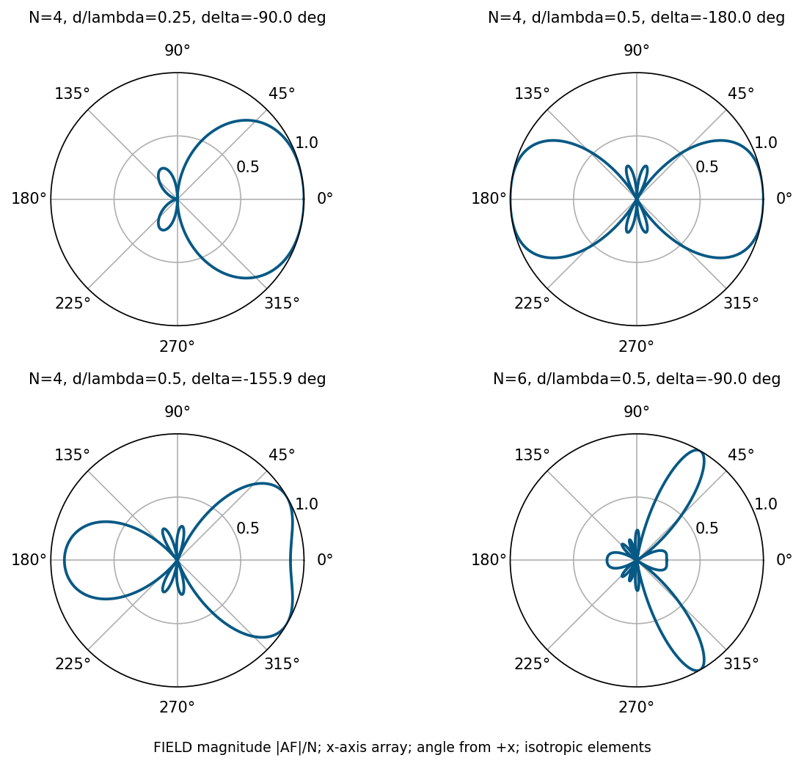

# 單元 26｜均勻N單元線性陣列（二）

**均勻 $`N`$ 單元線性陣列（二）**

端射、掃描、零點與波束寬度

原始影片：[陳晏笙老師「天線」單元 26](https://www.youtube.com/watch?v=m8uEEdFwRtk)

影片長度：約 64 分鐘　建議閱讀：約 25 分鐘

前置單元：25。需會使用均勻線陣的正規化 AF。

> **核心觀念：** 把目標方向的幾何相位消掉，就能讓所有元件在那個方向同相。相位可以掃描，但不能消除由過大間距造成的柵瓣；旁瓣位置與波束寬度也要區分精確解與大陣列近似。

## 本單元的四個目標

1.  由同一個 $`\delta=-kd\cos\phi_0`$ 統一正側向、端射與掃描。

2.  算出零點與主最大值，並剔除不可見解。

3.  看懂影片的旁瓣近似，知道何時需要數值重算。

4.  由半功率條件求 HPBW，避免把振幅 0.5 當半功率。

## 公式與座標

沿 $`x`$ 軸放 $`N`$ 個元件，$`xy`$ 切面角 $`\phi`$ 從 $`+x`$ 起算。等幅，漸進相位 $`\delta=\arg I_{n+1}-\arg I_n`$，採 $`e^{j\omega t}`$：

```math
\psi=kd\cos\phi+\delta,\quad
F_n=\frac1N\left|\frac{\sin(N\psi/2)}{\sin(\psi/2)}\right|,
\quad P_n=F_n^2.
```

分母為零時用極限。以下先談 AF；真實總場仍要乘 EF。

## 閱讀地圖

第 2 頁：端射；第 3 頁：掃描案例圖；第 4 頁：零點與主峰；第 5 頁：旁瓣；第 6～7 頁：HPBW；第 8 頁：自測。 依影片案例與推導重寫；精確重算及近似限制明確標記。

## 1．端射：讓相位剛好抵消距離差

影片對照：[00:00](https://www.youtube.com/watch?v=m8uEEdFwRtk&t=0s)－[25:00](https://www.youtube.com/watch?v=m8uEEdFwRtk&t=1500s)

希望 $`+x`$ 方向 $`\phi_0=0^\circ`$ 全同相：

```math
kd+\delta=0\pmod{2\pi}
\Rightarrow \boxed{\delta=-kd.}
```

往 $`-x`$ 則 $`\phi_0=180^\circ`$，取 $`\delta=+kd`$。這是影片的普通端射條件；並不是所有最大指向性端射設計的最優相位。

### 影片：$`N=4,d=0.25\lambda`$

$`kd=\pi/2,\delta=-\pi/2`$：

```math
\psi=\frac\pi2(\cos\phi-1).
```

$`+x`$ 的 $`\psi=0`$，$`F_n=1`$。正側向 $`\psi=-\pi/2`$、反向 $`-x`$ 的 $`\psi=-\pi`$ 都是本例零點；其間仍可能有較小旁瓣。

### 間距半波時的反向歧義

若 $`d=\lambda/2,\delta=-\pi`$，則

```math
\psi(0^\circ)=0,\qquad \psi(180^\circ)=-2\pi.
```

兩個方向都全同相，AF 都為 1，所以**不是單向端射**。影片的間距案例正是在提醒：相位設定成立，不代表只有那一方向最大。

### 更大的間距

取 $`\delta=-kd`$ 時，可見最大值滿足

```math
\cos\phi=1+m\frac{\lambda}{d}.
```

例如 $`d=\lambda`$：$`m=0,-1,-2`$ 給出 $`\cos\phi=1,0,-1`$，端射和正側向都出現等高最大值。

### 影片的更保守條件：排除相鄰主瓣邊緣

端射可見區為 $`-2kd\le\psi\le0`$。相鄰主瓣的第一零點是 $`-2\pi+2\pi/N`$；要其內部不進入可見區：

```math
\boxed{d\le\frac{N-1}{2N}\lambda.}
```

$`N=4`$ 得 $`d\le3\lambda/8`$，大 $`N`$ 趨近半波長。這比僅排除等高峰值的 $`d<\lambda/2`$ 更嚴；也不表示後半空間完全沒有較小旁瓣或輻射。

> **核心觀念：** 端射是相位條件；單向性還需檢查反向與其他可見最大值，以及元件自己的方向性。

## 2．掃描：正側向與端射都是特例

影片對照：[約 25:00](https://www.youtube.com/watch?v=m8uEEdFwRtk&t=1500s)－[49:00](https://www.youtube.com/watch?v=m8uEEdFwRtk&t=2940s)

讓目標 $`\phi_0`$ 的 $`\psi=0`$：

```math
\boxed{\delta=-kd\cos\phi_0\pmod{2\pi}.}
```

正側向 $`\phi_0=90^\circ`$ 得 $`\delta=0`$；端射 $`\phi_0=0^\circ`$ 得 $`\delta=-kd`$。



上排比較兩個端射間距；下排是影片 $`N=4,d=0.5\lambda,\phi_0=30^\circ`$（$`\delta=-155.88^\circ`$），以及板書 $`N=6,d=0.5\lambda,\phi_0=60^\circ`$（$`\delta=-90^\circ`$）。角度全從 $`+x`$ 起算，圖為場幅。

> **核心觀念：** 線陣 AF 對鏡像角相同。圖中的 30° 與 330° 都強，實際總場是否兩邊都強還取決於 EF。

## 3．精確方向：零點與全同相最大值

影片對照：[約 49:00](https://www.youtube.com/watch?v=m8uEEdFwRtk&t=2940s)－[54:00](https://www.youtube.com/watch?v=m8uEEdFwRtk&t=3240s)

### 零點

分子為零、分母不能同時為零：

```math
\boxed{\cos\phi_{\rm null}
=\frac{2m\pi/N-\delta}{kd},
\quad m\in\mathbb Z,\quad m\notin N\mathbb Z.}
```

還要 $`|\cos\phi_{\rm null}|\le1`$。頻率、$`N`$、間距 $`d`$、相位 $`\delta`$ 四項缺一不可；「第幾個零點」不能脫離這些條件。

### 影片例：$`N=4,d=0.5\lambda,\delta=0`$

$`\cos\phi=m/2`$，可見零點為 $`0^\circ,\pm60^\circ,\pm120^\circ,180^\circ`$；正側向 $`90^\circ,270^\circ`$ 為峰值。

### 主最大值與柵瓣

```math
\boxed{\cos\phi_{\max}=\frac{2m\pi-\delta}{kd}.}
```

目標採 $`\delta=-kd\cos\phi_0`$ 時：

```math
\cos\phi_{\max}=\cos\phi_0+m\lambda/d.
```

任何額外可見的整數解都是重複全同相方向。對一個指定目標，沒有其他解的條件為

```math
\frac d\lambda<\frac1{1+|\cos\phi_0|}.
```

這個嚴格不等式也避開恰好落在端點的柵瓣；若只要求特定有限掃描範圍，要按最不利的目標角檢查。

### 代入影片掃描例

$`d=0.5\lambda,\phi_0=30^\circ`$：$`u_0=\cos30^\circ=0.8660`$。其他最大值候選為 $`u_0\pm2`$，均不可見，故無額外柵瓣；鏡像的 $`330^\circ`$ 是同一餘弦，不是新的整數解。

> **核心觀念：** 先算餘弦，再檢查可見性。零點公式排除 $`m`$ 為 $`N`$ 倍數，是必要條件。

## 4．旁瓣：影片近似與精確值差在哪？

影片對照：[約 54:00](https://www.youtube.com/watch?v=m8uEEdFwRtk&t=3240s)－[59:00](https://www.youtube.com/watch?v=m8uEEdFwRtk&t=3540s)

次峰位於相鄰零點之間。影片用「分子接近 $`\pm1`$」估計位置：

```math
\psi_{\rm SL}\approx\frac{(2m+1)\pi}{N},
\qquad m=1,2,\ldots
```

```math
F_{\rm SL}\approx
\frac1{N\left|\sin((2m+1)\pi/(2N))\right|}.
```

當 $`N`$ 遠大於旁瓣序號，分母可用小角近似：

```math
F_{\rm SL}\approx\frac2{(2m+1)\pi}.
```

第一旁瓣得 $`2/(3\pi)=0.2122`$，約 $`-13.46`$ dB；第二旁瓣 $`2/(5\pi)=0.1273`$，約 $`-17.90`$ dB，與影片一致。

### 這不是精確的次峰條件

正弦比的分母也隨 $`\psi`$ 改變，所以分子最大時，整個比值不一定最大。對非零值取導數可得

```math
N\cot(N\psi/2)=\cot(\psi/2).
```

或直接在相鄰零點內數值找峰，避開分母零點與主最大值。

### 補充重算

| 均勻陣列 | 第一旁瓣精確幅比 | 峰值相對 dB    |
|:---------|:-----------------|:---------------|
| $`N=4`$    | 約 0.27217       | 約 $`-11.30`$ dB |
| $`N=6`$    | 約 0.23918       | 約 $`-12.43`$ dB |
| $`N`$ 很大 | 約 0.21723       | 約 $`-13.26`$ dB |

大陣列精確極限來自 sinc 的第一個次峰（$`x\approx4.4934`$），不是 $`\sin x`$ 的最大點 $`3\pi/2`$。因此影片 $`-13.46`$ dB 是有用近似；小 $`N`$ 必須保留有限陣列效應。

### 增加 $`N`$ 不能任意壓低旁瓣

均勻權重的旁瓣比值有其極限。若要更低旁瓣，通常需調振幅權重，代價之一是主瓣變寬；下一單元會說明。

> **核心觀念：** 主最大值與零點可以解析求得；旁瓣峰值通常需要解導數或數值尋峰。

## 5．HPBW：半功率對應場幅 $`1/\sqrt2`$

影片對照：[約 59:00](https://www.youtube.com/watch?v=m8uEEdFwRtk&t=3540s)－[63:55](https://www.youtube.com/watch?v=m8uEEdFwRtk&t=3835s)

主瓣兩邊的功率降到峰值一半，才是半功率點：

```math
P_n=\frac12\quad\Longleftrightarrow\quad F_n=\frac1{\sqrt2}.
```

精確條件為

```math
\left|\frac{\sin(N\psi/2)}
{N\sin(\psi/2)}\right|=\frac1{\sqrt2}.
```

小 $`N`$ 或寬波束，應數值解主峰兩側的交點。影片用主瓣近似 $`\sin(\psi/2)\approx\psi/2`$：

```math
F_n\approx\left|\frac{\sin x}{x}\right|,
\qquad x=N\psi/2.
```

注意本頁 $`\mathop{\mathrm{sinc}}x=\sin x/x`$；一些軟體定義為 $`\sin(\pi x)/(\pi x)`$，代入時要換尺度。

### 解主瓣的半功率值

$`\sin x/x=1/\sqrt2`$ 的第一個正解約 $`x=1.3916`$，因此

```math
\psi_\pm\approx\pm\frac{2.7831}{N}.
```

影片使用 2.782，為相同近似的取位數差異。若主峰選 $`\psi=0`$，

```math
\cos\phi_\pm\approx
\frac{-\delta\pm2.7831/N}{kd}.
```

在同一個主瓣分支上求出兩個角，再取差值。若餘弦超出 $`[-1,1]`$，不可直接算反餘弦；例如端射需要跨越角度 0° 的左右邊界來取寬度。

### 場幅 0.5 會發生什麼錯誤？

$`F_n=0.5`$ 的功率為 0.25，即 $`-6.02`$ dB，會得到比 HPBW 更寬的數字。用圖表前，先確認縱軸是場幅、功率還是相對 dB。

> **核心觀念：** 精確條件是 $`P_n=0.5`$；sinc 是大陣列主瓣近似，不能當成完整場型或小陣列的精確公式。

## 6．重算波束寬度：掃到端射為何變寬？

影片公式的數值補充；AF、等向元件、無互耦

### 影片例：四元件掃向 60°

$`N=4,d=0.5\lambda,\delta=-\pi/2`$。用影片的 sinc 近似，半功率角約為 43.82°、73.83°，相差 30.00°。保留有限陣列的精確正弦比，則約為 43.31°、74.20°，HPBW 約 30.89°；這個差異來自近似，不是相位掃錯。

### 正側向窄主瓣

若 $`\phi_0=90^\circ`$，兩半功率角在正側向附近，近似

```math
\boxed{\mathrm{HPBW}_{\rm rad}\approx
0.886\,\frac{\lambda}{Nd}.}
```

$`N=6,d=0.5\lambda`$，得 0.2953 rad，約 16.92°。用有限和的精確半功率條件重算是約 17.19°。

### 一般掃描且遠離端射

在 $`\phi_0`$ 附近線性化 $`\cos\phi`$：

```math
\mathrm{HPBW}_{\rm rad}\approx
0.886\,\frac{\lambda}{Nd|\sin\phi_0|}.
```

掃離正側向，$`|\sin\phi_0|`$ 變小，角度波束擴寬。靠近端射分母趨近零，表示一次近似失效，並不表示真實寬度無窮大。

### 端射用角度的二次關係

$`\delta=-kd`$、$`\psi=kd(\cos\phi-1)`$。若主瓣半功率相位大小為 $`\psi_h`$，

```math
\mathrm{HPBW}=2\cos^{-1}\left(1-\frac{\psi_h}{kd}\right).
```

寬度跨越 $`+x`$ 軸兩側。$`N=4,d=0.25\lambda`$ 的精確 $`\psi_h\approx0.715329`$，得到約 114.00°；同間距正側向的精確 HPBW 約 54.18°。

### 長度用 $`Nd`$ 還是 $`(N-1)d`$？

有限陣列的物理首尾距離是 $`(N-1)d`$。均勻和推導出的主瓣近似卻出現 $`Nd`$；不可隨手用前者替換公式，尤其小 $`N`$ 差異大。大 $`N`$ 才近乎相同。

> **核心觀念：** 波束寬度由相位曲線映射到角度。掃描角、元件數、間距與近似階數都會影響答案。

## 7．五題自測與答案

先作答，再看解析。

1.  $`d=0.5\lambda`$ 要掃向 $`\phi_0=60^\circ`$，漸進相位是多少？

2.  $`N=4,d=0.5\lambda,\delta=-\pi`$，沿 $`-x`$ 是否為零點？

3.  $`\psi=2\pi`$ 在均勻陣列的正弦比中是 $`0/0`$，為何不是零點？

4.  均勻 $`N=4`$ 可否直接引用「第一旁瓣 $`-13.46`$ dB」當精確值？

5.  $`N=6,d=0.5\lambda`$ 的正側向 HPBW 快估是多少？半功率的場幅門檻是多少？

### 答案與解析

1.  $`\delta=-\pi\cos60^\circ=-\pi/2=-90^\circ`$。鏡像 300° 也有相同 AF。

2.  不是。$`\psi=-2\pi`$，沿 $`-x`$ 也是全同相最大值。

3.  原始和每一項都為 1，幅值為 $`N`$；極限有限。零點必須分子為零而分母非零。

4.  不可，那是大陣列近似；$`N=4`$ 的第一旁瓣精確約 $`-11.30`$ dB，還要檢查其方向是否可見。

5.  約 16.92°；精確有限陣列約 17.19°。場幅門檻 $`1/\sqrt2\approx0.7071`$，不是 0.5。

### 回看影片

[06:00：四分之一波長端射](https://www.youtube.com/watch?v=m8uEEdFwRtk&t=360s)；[30:00：掃向 30°](https://www.youtube.com/watch?v=m8uEEdFwRtk&t=1800s)；[52:00：零點](https://www.youtube.com/watch?v=m8uEEdFwRtk&t=3120s)。

[56:00：旁瓣近似](https://www.youtube.com/watch?v=m8uEEdFwRtk&t=3360s)；[62:00：HPBW](https://www.youtube.com/watch?v=m8uEEdFwRtk&t=3720s)。

**下一單元：**不等幅權重、波束形成與智慧型天線。
