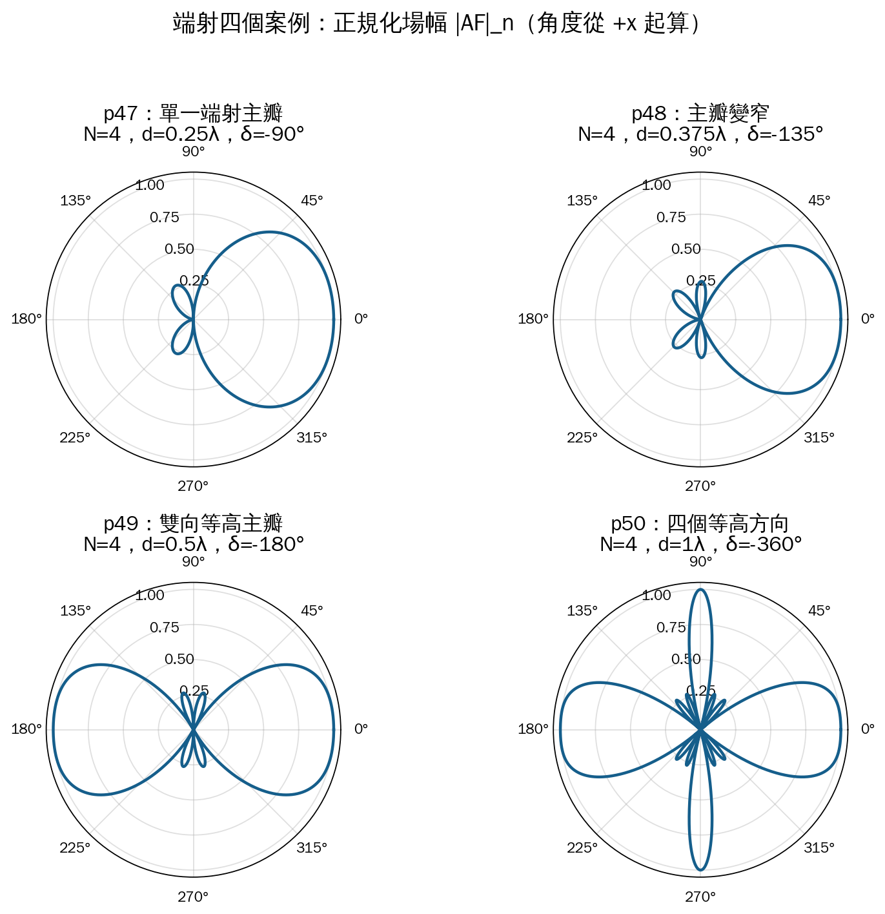
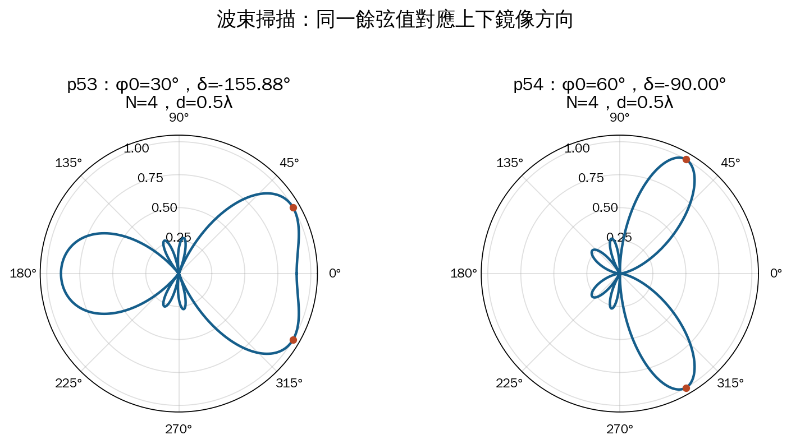
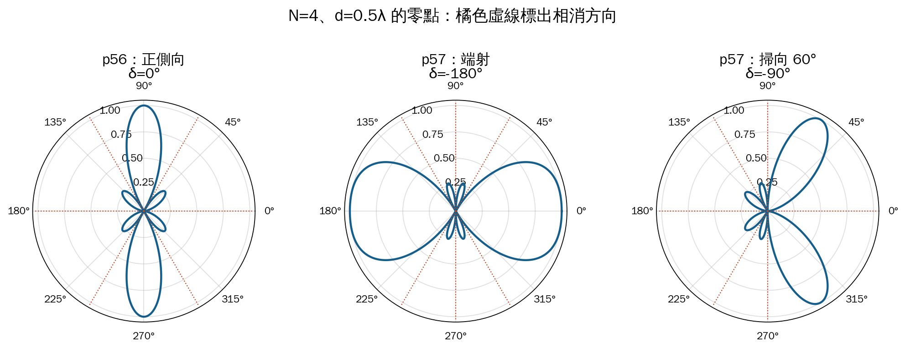
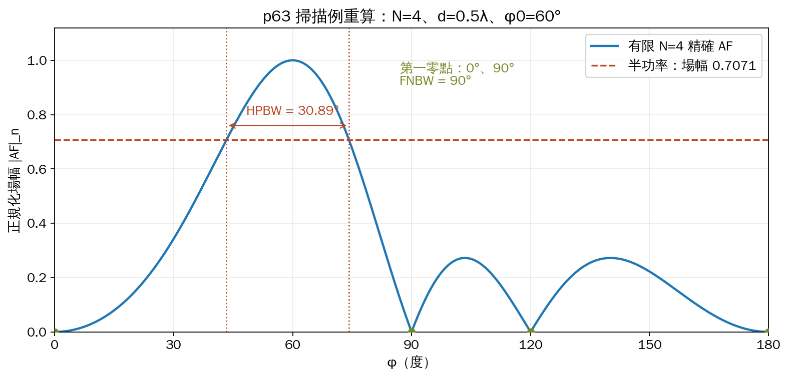

# 單元 26｜均勻 N 單元線性陣列（二）

原始影片：[陳晏笙老師「天線」單元 26](https://www.youtube.com/watch?v=m8uEEdFwRtk)（約 64 分鐘）

原始講義：[Lecture 6 — Antenna Arrays](https://drive.google.com/file/d/1R3MSohfcRyOONnIcZhn96AkJDZwSqRJv/view)，PDF 第 46–63 頁。

建議閱讀：約 35 分鐘。前置單元：[025｜均勻 N 單元線性陣列（一）](025_均勻N單元線性陣列（一）.md)。

本單元接續正側向陣列，依老師講義順序討論端射、波束掃描、零點、主峰與旁瓣，最後計算主瓣寬度。讀完應能從指定方向反求饋入相位，判斷其他可見主峰，並分清講義的近似公式與有限陣列的精確結果。

## 講義與影片對照

影片時間已依完整口述與可辨識畫面校準，方便回看；不是逐頁精確換頁時間。講義的四元件案例與影片額外使用的六元件板書，以下分別註明。

| 講義頁碼 | 原英文主題 | 中文內容 | 影片定位 |
|:--|:--|:--|:--|
| 46 | Case 2: End-Fire Array (1/5) | 端射的相位條件 | [約 00:30–04:35](https://www.youtube.com/watch?v=m8uEEdFwRtk&t=30s) |
| 47–50 | Case 2: End-Fire Array (2/5–5/5) | 四個間距案例與雙向主瓣 | [約 04:35–14:30](https://www.youtube.com/watch?v=m8uEEdFwRtk&t=275s) 討論 p47–49；[約 18:45–21:00](https://www.youtube.com/watch?v=m8uEEdFwRtk&t=1125s) 回到 p50 |
| 51 | How Do We Avoid Bidirectional Radiation? | 限制可見區，排除相鄰主瓣 | [約 14:30–18:45](https://www.youtube.com/watch?v=m8uEEdFwRtk&t=870s) 板書；[約 21:00–25:00](https://www.youtube.com/watch?v=m8uEEdFwRtk&t=1260s) 延伸雙頻間距 |
| 52–54 | Case 3: Beamsteered Array (1/3–3/3) | 一般掃描條件、30° 與 60° 案例 | [約 25:00–40:20](https://www.youtube.com/watch?v=m8uEEdFwRtk&t=1500s)；29:50 起改算六元件 60°，39:40 起回看四元件投影片 |
| 55–57 | What Direction Do Nulls Occur? | 零點公式及三組案例 | [約 42:50–46:35](https://www.youtube.com/watch?v=m8uEEdFwRtk&t=2570s) 六元件板書；[約 48:50–52:05](https://www.youtube.com/watch?v=m8uEEdFwRtk&t=2930s) 正式公式與四元件例 |
| 58–60 | What Direction Does Maxima Occur? | 主最大值、旁瓣方向與高度 | [約 52:40–58:50](https://www.youtube.com/watch?v=m8uEEdFwRtk&t=3160s)；46:35–48:50 已先由板書預告 |
| 61–63 | Beamwidth of Main Beam | 半功率條件、sinc 近似及算例 | [約 58:50–62:30](https://www.youtube.com/watch?v=m8uEEdFwRtk&t=3530s)；62:30–片尾總結 N、d 與相位的影響 |

### 沿用老師的座標與符號

元件沿 $`x`$ 軸等距排列，$`xy`$ 切面的角度 $`\phi`$ 從 $`+x`$ 軸起算；各元件等幅，漸進相位為 $`\delta=\arg I_{n+1}-\arg I_n`$。沿用老師的大寫 $`\Psi`$：

```math
k=\frac{2\pi}{\lambda},\qquad
\Psi=kd\cos\phi+\delta,
\qquad I_n=I_0e^{j(n-1)\delta}.
```

```math
F_n(\phi)\equiv |AF|_n
=\frac1N\left|\sum_{n=0}^{N-1}e^{jn\Psi}\right|
=\frac1N\left|\frac{\sin(N\Psi/2)}{\sin(\Psi/2)}\right|,
\qquad P_n=F_n^2.
```

$`F_n`$ 是本筆記為便於閱讀使用的正規化「場幅」，對應老師的 $`|AF|_n`$；$`P_n`$ 才是相對功率。分母為零時須回到有限和或取極限。以下先討論陣列因子 AF，真實總場仍要乘上元件場型 EF。

### 老師的「尺」比喻：分清三個控制量（約 00:30–01:30）

當 $`\phi`$ 走過 0°–180°，$`\Psi`$ 會由 $`\delta+kd`$ 走到 $`\delta-kd`$；再走到 360° 時沿原路返回。老師把這個可見相位區間想成放在 $`|AF|(\Psi)`$ 圖上的尺：

| 控制量 | 在相位圖上的作用 | 對方向場型的影響 |
|:--|:--|:--|
| 元件數 $`N`$ | 改變固定周期內的零點間隔與旁瓣數 | 一般使主瓣變窄、可見旁瓣數增多 |
| 間距 $`d`$ | 改變尺的總長 $`2kd`$ | 可見區變長，可能包含更多旁瓣甚至額外主峰 |
| 漸進相位 $`\delta`$ | 移動尺的中心 | 改變哪個方向對應同相主峰，達成波束掃描 |

$`\Psi`$ 是相鄰元件的總相位差，$`\phi`$ 是空間方向角；兩者都可以用角度表示，物理意義卻不同。手繪時先算四個方位的 $`\Psi`$，再把相位圖映回方向圖。

## 1．端射陣列：把主峰移到陣列軸向（p46）

老師從上一單元的 $`|AF|`$ 對 $`\Psi`$ 曲線出發：$`\Psi=0`$ 時，各項同相，正規化場幅為 1。若希望這個主峰落在 $`+x`$ 方向，設定 $`\phi_0=0^\circ`$：

```math
0=kd\cos0^\circ+\delta
\quad\Longrightarrow\quad
\boxed{\delta=-kd\pmod{2\pi}.}
```

若往 $`-x`$ 方向，即 $`\phi_0=180^\circ`$，則取 $`\delta=+kd`$。這是普通端射陣列（ordinary end-fire array）的條件；本節尚未討論以其他相位提高指向性的特殊端射設計。

相位條件保證「目標方向同相」，但是否只有一個主瓣，還得看可見區是否包含其他同相點。

## 2．四個端射間距案例（p47–50）

四例均為 $`N=4`$、$`\delta=-kd`$，因此

```math
\Psi=kd(\cos\phi-1),\qquad -2kd\le\Psi\le0.
```

老師的手繪方法是：先在固定的 $`|AF|(\Psi)`$ 曲線上圈出可見區，再把各個 $`\Psi`$ 值映回方向角。改變 $`d`$，既改變可見區長度，也改變從相位到角度的映射。

| 講義 | $`d/\lambda`$ | $`\delta`$ | 可見的 $`\Psi`$ 範圍 | 圖形重點 |
|:--|:--|:--|:--|:--|
| p47 | 0.25 | $`-\pi/2`$ | $`[-\pi,0]`$ | 主瓣朝 0°；端射主瓣比同間距的正側向主瓣寬 |
| p48 | 0.375 | $`-3\pi/4`$ | $`[-3\pi/2,0]`$ | 主瓣變窄；可見區邊界剛好碰到相鄰主瓣旁的第一零點 |
| p49 | 0.5 | $`-\pi`$ | $`[-2\pi,0]`$ | 0° 與 180° 都同相，成為雙向等高主瓣 |
| p50 | 1 | $`-2\pi`$ | $`[-4\pi,0]`$ | 0°、90°、180°、270° 都出現等高最大值 |



依老師 p47–50 的參數，以有限陣列和重畫；徑向座標為場幅，所有曲線的峰值同樣正規化為 1，並非增益比較圖。

### p47：四分之一波長端射

$`d=0.25\lambda`$ 時 $`\Psi=(\pi/2)(\cos\phi-1)`$，所以

```math
\begin{array}{c|c|c}
\phi & \Psi & F_n\\ \hline
0^\circ & 0 & 1\\
90^\circ,270^\circ & -\pi/2 & 0\\
180^\circ & -\pi & 0
\end{array}
```

這幾個方向足以抓到主瓣方向和主要零點，但零點之間仍有小旁瓣。老師約 05:00–09:00 的板書沿 0° → 90° → 180° → 270° → 360°，把相位曲線先走一次、再反向走回來，因此整張方向圖會呈現上下鏡像。06:40 附近口算曾把 180° 的相位說錯，隨後改為 $`-\pi`$；表中採更正後的值。

### p48：增至 $`0.375\lambda`$

間距增大後，主瓣角寬縮小；反向 $`\phi=180^\circ`$ 對應 $`\Psi=-3\pi/2`$，仍是零點。投影片稱為「單向輻射」，此處應理解為主要波束朝單一端射方向，不能解讀成後半空間處處沒有場。

### p49–50：為何又冒出主瓣？

$`d=0.5\lambda`$ 時，反向的 $`\Psi=-2\pi`$；$`e^{-j2\pi n}=1`$，各元件又全部同相，所以反向也達到 $`F_n=1`$。

$`d=\lambda`$ 時，正側向的 $`\Psi=-2\pi`$、反向的 $`\Psi=-4\pi`$ 也都是同相點。因此，不能只檢查 $`\Psi=0`$ 的方向，就宣稱其餘方向都沒有主瓣。

## 3．如何避免雙向主瓣？（p51）

老師在 p51 用 $`N=4`$ 說明：要讓相鄰主瓣連邊緣都不進入可見區，左邊界 $`-2kd`$ 不能越過 $`-2\pi`$ 旁邊的第一零點 $`-3\pi/2`$：

```math
2kd\le\frac{3\pi}{2}
\quad\Longrightarrow\quad
\boxed{d\le\frac38\lambda\qquad(N=4).}
```

這正是 p48 的 $`0.375\lambda`$ 案例。影片約 14:30–18:45 的板書也把它延伸到一般 $`N`$：最近的相鄰主瓣邊緣在 $`-2\pi+2\pi/N`$，因此

```math
2kd\le2\pi-\frac{2\pi}{N}
\quad\Longrightarrow\quad
\boxed{d\le\frac{N-1}{2N}\lambda.}
```

$`N`$ 很大時，此上限趨近 $`\lambda/2`$。要分清兩種要求：

| 要求 | 朝 $`+x`$ 的普通端射條件 |
|:--|:--|
| 排除另一個等高同相峰值（柵瓣） | $`d<\lambda/2`$ |
| 連相鄰主瓣的邊緣都不讓它進入可見區 | $`d\le (N-1)\lambda/(2N)`$ |

後者是老師 p51 採用的較嚴條件，並不是「只要大於 $`3\lambda/8`$，立刻出現等高反向峰值」。講義以基地台說明其影響：若同樣輻射功率分到不需要的方向，目標方向的指向性與有效涵蓋距離可能降低；實際結果還要看 EF 及完整三維場型。老師約 12:30–13:30 也從接收角度說明：若後方有干擾源，背向高響應會增加收到的干擾，可能降低訊號對干擾加雜訊的比值。

### 影片工程例：28／38 GHz 雙頻陣列（約 21:00–25:00）

老師提到毫米波基地台的雙頻陣列：元件實體間距固定，但電波看到的是 $`d/\lambda=df/c`$。同一間距對 38 GHz 的電氣長度，是對 28 GHz 的 $`38/28\approx1.357`$ 倍；高頻端可能先碰到可見區的限制。

因此應先以**最高操作頻率及所需掃描範圍**檢查間距，再回查低頻端。老師的例子是：若間距為 38 GHz 的 $`0.8\lambda`$，到 28 GHz 就只約為 $`0.589\lambda`$；這說明電氣長度變化，不代表 $`0.8\lambda`$ 對所有元件數與掃描方向都安全。

這段主要回顧正側向設計：若要連相鄰主瓣邊緣都排除，其條件為 $`d\le(N-1)\lambda/N`$；只排除額外等高峰值則是 $`d<\lambda`$。本節普通端射的條件更嚴，不能把正側向的上限直接套來掃到端射。

## 4．波束掃描：相位決定指向（p52–54）

### 一般條件（p52）

希望主峰朝 $`\phi_0`$，令該方向 $`\Psi=0`$：

```math
\boxed{\delta=-kd\cos\phi_0\pmod{2\pi}.}
```

正側向 $`\phi_0=90^\circ`$ 得 $`\delta=0`$；端射 $`\phi_0=0^\circ`$ 得 $`\delta=-kd`$。所以兩者都是相位陣列（phased array）的一般波束掃描特例。

**老師的雷達掃描例（約 27–29 分鐘）：**逐次改變各元件間的漸進相位，就能把主波束移往下一個方向，接收目標散射回來的訊號。這裡改的是整列電流相位的「等差量」，不是把所有元件一起加上同一相位。指定相位差與掃描角之間由餘弦關係連接，不能把相同的相位步進直接當成相同的方向角步進；下一單元再把饋入振幅也列入設計。

### 講義的兩個四元件案例（p53–54）

均取 $`N=4,d=0.5\lambda`$，所以 $`kd=\pi`$：

| 講義 | 目標方向 | 漸進相位 | 相位函數 |
|:--|:--|:--|:--|
| p53 | $`\phi_0=30^\circ`$ | $`\delta=-\sqrt3\pi/2\approx-0.866\pi=-155.88^\circ`$ | $`\Psi=\pi(\cos\phi-\sqrt3/2)`$ |
| p54 | $`\phi_0=60^\circ`$ | $`\delta=-\pi/2=-90^\circ`$ | $`\Psi=\pi(\cos\phi-1/2)`$ |



依老師 p53–54 的四元件參數重畫。30° 與 330°、60° 與 300° 各有相同 AF，因為餘弦值相同。這些是同一線陣幾何的鏡像方向；總場會再受到元件方向性影響。

### 影片板書：六元件掃向 60°

約 29:50–39:40 可見老師使用 $`N=6,d=0.5\lambda,\phi_0=60^\circ`$ 的板書，仍有 $`\delta=-\pi/2`$。**設定主峰方向的相位不含 $`N`$；改變 $`N`$ 會改變主瓣寬度、零點與旁瓣。** 因此別把這個六元件板書與 p54 的四元件場型混成同一張圖。

此時 $`\Psi=\pi\cos\phi-\pi/2`$，可見區為 $`[-3\pi/2,\pi/2]`$。沿四個方位讀相位圖：

| $`\phi`$ | 0° | 90° | 180° | 270° |
|:--|:--|:--|:--|:--|
| $`\Psi`$ | $`\pi/2`$ | $`-\pi/2`$ | $`-3\pi/2`$ | $`-\pi/2`$ |

這四個方向都不是主峰；目標 $`\phi=\pm60^\circ`$ 才有 $`\Psi=0`$。老師提醒，手繪主瓣看起來不恰好落在 60° 並不改變代入公式的結果。

**鏡像波束與元件場型（約 35:35–39:40）：**只看這個線陣的 AF，$`+60^\circ`$ 與 $`-60^\circ`$ 的餘弦相同，兩邊必定具有同樣的 AF。老師在黑板保留 $`E=EF\times AF`$，說明還可以靠 EF 抑制不需要的方向：若元件在 −60° 有零點，總場在該方向仍為零；但若 EF 的零點落在想要的 +60°，AF 再大也無法形成該方向的波束。實際陣列還須確認元件場型與相乘假設，不宜把只算 AF 的圖直接當成天線總場。

老師約 40:20–42:50 因此要求用數字描述場型：主峰角度、HPBW、零點方向、旁瓣高度及前後比，比「波束斜斜的」更有用。比較模擬與量測時，也應給出相同頻率的實際數值，再讓讀者判斷差異。

## 5．零點出現在哪裡？（p55–57）

### 零點公式與使用條件（p55）

要讓 AF 為零，分子需為零，但分母不能同時為零：

```math
\sin\frac{N\Psi}{2}=0
\quad\Longrightarrow\quad
\Psi=\frac{2m\pi}{N},
\qquad m\in\mathbb Z,\quad m\notin N\mathbb Z.
```

```math
\boxed{\cos\phi_{\rm null}
=\frac{2m\pi/N-\delta}{kd}.}
```

這等價於老師以 $`\pm m`$ 表示的寫法，但明確排除了 $`m=0,\pm N,\pm2N,\ldots`$。那些位置是 $`0/0`$ 的可去奇點，原始有限和卻是最大值，不是零點。

此外，反餘弦內的數值必須在 $`[-1,1]`$；算完整個 $`xy`$ 切面還要納入上下鏡像角。p56 特別提醒，求零點必須知道頻率 $`f`$、元件數 $`N`$、間距 $`d`$ 與漸進相位 $`\delta`$。

### 影片板書：六元件掃描的十個零點（約 42:50–46:35）

沿用 $`N=6,d=0.5\lambda,\delta=-\pi/2`$，零點相位間隔為 $`2\pi/N=\pi/3`$。在可見區內，排除主峰 $`\Psi=0`$ 後，只剩五個零點相位：

```math
\Psi\in\left\{-\frac{4\pi}{3},-\pi,-\frac{2\pi}{3},-\frac\pi3,\frac\pi3\right\}.
```

逐一解 $`\pi\cos\phi-\pi/2=\Psi`$，每個餘弦值各有上下鏡像解。老師留給計算機求出的十個方向，重算為

```math
\phi_{\rm null}\approx
\pm33.56^\circ,\quad\pm80.41^\circ,\quad
\pm99.59^\circ,\quad\pm120^\circ,\quad\pm146.44^\circ.
```

負角加 360° 即可改寫成 0°–360°。這組十個零點屬於影片六元件案例，與下面講義的四元件案例不同。

### 三個四元件案例（p56–57）

下表均取 $`N=4,d=0.5\lambda`$。用帶正負號的整數 $`m`$，逐一檢查可見性：

| 案例 | 相位 | 零點的餘弦條件 | 可見零點（0°–360°） |
|:--|:--|:--|:--|
| 正側向，p56 | $`\delta=0`$ | $`\cos\phi=m/2`$ | 0°、60°、120°、180°、240°、300° |
| 朝 0° 端射，p57 上半 | $`\delta=-\pi`$ | $`\cos\phi=m/2+1`$ | 60°、90°、120°、240°、270°、300° |
| 掃向 60°，p57 下半 | $`\delta=-\pi/2`$ | $`\cos\phi=m/2+1/2`$ | 0°、90°、120°、180°、240°、270° |



依老師 p56–57 的參數與有限陣列和重畫；橘色虛線是零點方向。端射案例的 180° 是另一個主峰，並非零點；掃向 60° 的 60°／300° 當然也不能列為零點。

> **p57 公式校正：** 下半的掃描例已設定 $`\delta=-0.5\pi`$，因此 $`2m\pi/N-\delta`$ 應代入 **$`2m\pi/N+0.5\pi`$**；原頁印成減 $`0.5\pi`$。投影片最後列出的 0°、180°、$`\pm120^\circ`$、$`\pm90^\circ`$ 則與校正後的公式相符。上半端射採 $`\delta=+\pi`$ 或 $`-\pi`$ 相差 $`2\pi`$，物理上等效。

## 6．主最大值與旁瓣最大值（p58–60）

### 主最大值：所有元件同相（p58）

老師先取 $`\Psi=0`$，得到 $`\phi_{\rm GM}=\cos^{-1}(-\delta/kd)`$。若要檢查所有同相方向，須保留周期性：

```math
\Psi=2m\pi
\quad\Longrightarrow\quad
\boxed{\cos\phi_{\rm GM}=\frac{2m\pi-\delta}{kd},
\qquad m\in\mathbb Z.}
```

在這些方向，有限和每一項都等於 1，因此 $`F_n=1`$。這也說明「分母為零」為何不能直接當作無限大。

對 $`\delta=-kd\cos\phi_0`$，上式變成

```math
\cos\phi_{\rm GM}=\cos\phi_0+m\frac\lambda d.
```

除了目標的 $`m=0`$，其他可見整數解就是額外等高主峰。p49 的反向峰值和 p50 的多個主峰，正是這個規則的實例。

### 旁瓣方向的近似（p59）

老師用「分子的絕對值約為 1」估計旁瓣峰值位置：

```math
\left|\sin\frac{N\Psi}{2}\right|\approx1
\quad\Longrightarrow\quad
\Psi_{\rm LM}\approx\pm\frac{(2m+1)\pi}{N},
\qquad m=1,2,\ldots
```

```math
\phi_{\rm LM}\approx
\cos^{-1}\left[\frac{\pm(2m+1)\pi/N-\delta}{kd}\right].
```

須檢查可見性，並把主峰附近的半波峰排除。這是近似，因為分母 $`\sin(\Psi/2)`$ 也隨方向變化，分子最大不等於整個比值精確最大。

**p59 算例：** $`N=4,d=0.5\lambda,\delta=0`$。

```math
\phi_{\rm GM}=90^\circ,270^\circ,
\qquad
\cos\phi_{\rm LM}\approx\pm\frac34.
```

因此老師給出旁瓣方向 $`\phi_{\rm LM}\approx\pm41.4^\circ,\pm138.6^\circ`$。有限四元件的精確值約為 $`\pm42.92^\circ,\pm137.08^\circ`$；推導與數值重算放在章末。

### 旁瓣有多高？（p60）

把近似旁瓣位置代回正規化場幅：

```math
F_{\rm LM}\approx
\frac1{N\left|\sin\left((2m+1)\pi/(2N)\right)\right|}.
```

若是大陣列的前幾個旁瓣，$`N\gg m`$，再用 $`\sin x\approx x`$：

```math
\boxed{F_{\rm LM}\approx\frac2{(2m+1)\pi}.}
```

| 旁瓣 | 講義近似場幅 | 相對主峰的 dB 值 |
|:--|:--|:--|
| 第一旁瓣，$`m=1`$ | $`2/(3\pi)\approx0.2122`$ | $`20\log_{10}0.2122\approx-13.46`$ dB |
| 第二旁瓣，$`m=2`$ | $`2/(5\pi)\approx0.1273`$ | $`20\log_{10}0.1273\approx-17.90`$ dB |

這裡有兩層近似：先估旁瓣位置，再把分母做小角近似。**$`-13.46`$ dB 不能直接當成所有均勻陣列的精確第一旁瓣。** 增加 $`N`$ 可以讓主瓣變窄，但均勻權重的第一旁瓣比例不會因此任意趨近零；下一單元才討論調整饋入權重。

**老師說的「約 5%」指什麼？（約 57:00–58:50）**按講義的場幅近似，第一旁瓣峰值功率比為 $`[2/(3\pi)]^2\approx4.50\%`$，第二旁瓣約 $`[2/(5\pi)]^2\approx1.62\%`$。這是各旁瓣**最高方向的功率密度相對主峰**，不是第一旁瓣已分走總輻射功率的 5%；若要算整片旁瓣拿走多少功率，仍須對相應立體角積分。老師用它強調均勻權重的旁瓣抑制有限，會向不需要的方向輻射，接收時也可能引入干擾。

## 7．主瓣寬度：從半功率條件求角度（p61–63）

### HPBW 與 FNBW（p61）

主瓣越窄，越有機會把相近方向分開。老師先介紹第一零點間波束寬度 FNBW，再用半功率波束寬度 HPBW 描述主瓣的有效寬度。

兩個半功率點的條件是

```math
P_n=\frac12
\quad\Longleftrightarrow\quad
F_n=\frac1{\sqrt2}\approx0.7071.
```

因此精確問題是：在同一主瓣兩側，解

```math
\frac1N\left|\frac{\sin(N\Psi/2)}{\sin(\Psi/2)}\right|
=\frac1{\sqrt2},
\qquad \Psi=kd\cos\phi+\delta.
```

場幅 0.5 的功率是 0.25，即 $`-6.02`$ dB；拿它當半功率門檻，算出的波束會過寬。

p61 把 FNBW 約估成 $`2\times\mathrm{HPBW}`$，適合當粗略量級認識，不能當通用等式。兩者應各自找「第一零點」與「半功率點」；即使大陣列正側向的 sinc 近似，比例也約是 2.26，寬波束或靠近端射時差異可以更大。

### sinc 近似（p62）

老師約 61 分鐘強調，大型陣列較適合下面的近似；四元件、六元件是便於手算的例子，元件數少時仍應檢查誤差。主峰附近 $`\Psi`$ 很小，令 $`\sin(\Psi/2)\approx\Psi/2`$，得到

```math
F_n\approx\left|\frac{\sin x}{x}\right|,
\qquad x=\frac{N\Psi}{2}.
```

老師使用 $`\mathrm{sinc}(x)=\sin x/x`$。部分軟體則把 sinc 定義為 $`\sin(\pi x)/(\pi x)`$，使用時要換尺度。

由 $`\sin x/x=1/\sqrt2`$ 得 $`x\approx\pm1.3916`$。老師取 $`\pm1.391`$，因此投影片使用

```math
\frac N2(kd\cos\phi_\pm+\delta)\approx\pm1.391,
```

```math
\boxed{\phi_\pm\approx
\cos^{-1}\left[\frac1{kd}\left(\pm\frac{2.782}{N}-\delta\right)\right],
\qquad \mathrm{HPBW}=|\phi_+-\phi_-|.}
```

此式要取同一主瓣上的兩個交點。反餘弦內超出 $`[-1,1]`$ 時，表示該相位支線沒有對應的可見角，不能強行代入；端射需跨越 0° 的兩側求寬度。

### p63 算例：四元件掃向 60°

取 $`N=4,d=0.5\lambda,\phi_0=60^\circ`$，所以 $`\delta=-\pi/2`$：

```math
\phi_\pm\approx
\cos^{-1}\left(\frac{\pm2.782}{4\pi}+\frac12\right)
\approx43.8^\circ,73.8^\circ.
```

```math
\boxed{\mathrm{HPBW}\approx73.8^\circ-43.8^\circ=30^\circ.}
```

老師特別提醒先檢查 $`kd\cos\phi+\delta`$ 是否夠小。保留有限陣列精確式重算，半功率角為約 43.31°、74.20°，HPBW 約 30.89°；與講義 30° 的差異來自近似。



依 p63 參數重算。這個主瓣的第一零點在 0°、90°，所以 FNBW 為 90°，並不是精確 HPBW 的兩倍。例子也顯示大角度掃描時，不宜只用固定倍數換算兩種波束寬度。

### p63 留下的問題：半波間距端射呢？

仍取 $`N=4`$，改為 $`d=0.5\lambda,\delta=-\pi`$。朝 0° 的主瓣滿足

```math
\Psi=\pi(\cos\phi-1).
```

以老師的 sinc 近似，只有 $`\Psi=-2.782/4`$ 對應這個主瓣的可見半功率相位，因此

```math
\phi_h\approx\cos^{-1}\left(1-\frac{2.782}{4\pi}\right)
\approx38.87^\circ,
\qquad\mathrm{HPBW}\approx2\phi_h\approx77.73^\circ.
```

兩個半功率方向是 $`+\phi_h`$ 與 $`-\phi_h`$，寬度跨過 0°。用有限陣列精確式則約為 78.88°。此外，本例在 180° 還有另一個等高主瓣；這個 HPBW 描述的是其中一個主瓣，不能拿兩個主峰之間的 180° 當波束寬度。

## 補充解說與重算例題

以下是用完整公式補充的解釋與數值比較，與前面的講義主線分開。

### A．指定掃描方向時，如何檢查柵瓣？

其他最大值滿足 $`\cos\phi=\cos\phi_0+m\lambda/d`$。要讓 $`m\ne0`$ 全落在 $`[-1,1]`$ 外：

```math
\boxed{\frac d\lambda<\frac1{1+|\cos\phi_0|}.}
```

嚴格不等式也排除了恰好落在端點的額外峰值。掃描一段角度範圍時，要用其中最嚴格的目標方向檢查。

例如 p53 的 $`d=0.5\lambda,\phi_0=30^\circ`$，其他候選餘弦為 $`0.8660\pm2`$，均不可見，所以沒有額外整數解造成的柵瓣。330° 與 30° 的鏡像則來自同一餘弦值，應與新增的整數解分開理解。

### B．旁瓣精確位置與有限元件數效應

對非零旁瓣的正弦比微分，精確峰值需滿足

```math
N\cot(N\Psi/2)=\cot(\Psi/2).
```

求根時要限定在相鄰零點之間，避開分母奇點。數值結果如下：

| 均勻陣列 | 第一旁瓣精確場幅比 | 相對主峰 dB |
|:--|:--|:--|
| $`N=4`$ | 0.27217 | $`-11.30`$ dB |
| $`N=6`$ | 0.23918 | $`-12.43`$ dB |
| $`N`$ 很大 | 0.21723 | $`-13.26`$ dB |

大陣列精確極限來自 sinc 第一個次峰，$`x\approx4.4934`$，不是分子正弦達峰的 $`3\pi/2`$。因此講義的 $`-13.46`$ dB 與精確極限 $`-13.26`$ dB 不同。

四元件還可直接化簡為

```math
F_n=\left|\cos\frac\Psi2\cos\Psi\right|.
```

第一旁瓣有 $`\cos^2(\Psi/2)=1/6`$，得 $`\Psi\approx2.30052`$ rad。代入 p59 的 $`\Psi=\pi\cos\phi`$，得到 $`\phi\approx42.92^\circ`$，再加上對稱方向。

### C．為何掃向端射時主瓣變寬？

遠離端射且波束夠窄時，將 $`\cos\phi`$ 在 $`\phi_0`$ 附近線性化：

```math
\mathrm{HPBW}_{\rm rad}\approx
0.886\,\frac{\lambda}{Nd|\sin\phi_0|}.
```

正側向 $`\phi_0=90^\circ`$ 即 $`0.886\lambda/(Nd)`$。例如 $`N=6,d=0.5\lambda`$ 得約 16.92°，有限陣列精確解約 17.19°。

往端射移動，$`|\sin\phi_0|`$ 變小，角度波束變寬；接近 0° 時，這個一次近似失效，並不是實際波束無窮寬。端射應使用

```math
\mathrm{HPBW}=2\cos^{-1}\left(1-\frac{\Psi_h}{kd}\right),
```

其中 $`\Psi_h>0`$ 是有限陣列主峰附近的半功率相位大小。$`N=4`$ 時 $`\Psi_h\approx0.715329`$ rad；取 $`d=0.25\lambda`$ 得端射 HPBW 約 114.00°，同間距正側向則約 54.18°。

有限陣列的首尾物理距離是 $`(N-1)d`$，但陣列和推導出的近似公式出現 $`Nd`$；小 $`N`$ 時不能任意替換兩者。


保留既有重算圖供橫向比較：上排為兩種端射間距，下排分別是講義的四元件 30° 案例，以及影片板書的六元件 60° 案例。它不是 p53–54 兩個四元件案例的原圖。

## 自測與解析

1. $`d=0.5\lambda`$ 要掃向 $`\phi_0=60^\circ`$，漸進相位是多少？把 $`N=4`$ 改成 6，要改相位嗎？
2. $`N=4,d=0.5\lambda,\delta=-\pi`$，180° 為何不是零點？
3. p51 的 $`d\le3\lambda/8`$ 與排除等高柵瓣的 $`d<\lambda/2`$，分別限制什麼？
4. p57 的 60° 掃描例中，$`2m\pi/N-\delta`$ 應代入加 $`0.5\pi`$ 還是減 $`0.5\pi`$？
5. 均勻四元件的第一旁瓣能直接當成精確的 $`-13.46`$ dB 嗎？
6. 半功率的場幅門檻是多少？p63 為何得到約 30°，而精確重算為約 30.89°？

### 答案與解析

1. $`\delta=-\pi\cos60^\circ=-\pi/2=-90^\circ`$。改變 $`N`$ 不改目標方向的相位條件，但會改變波束寬度與零點。
2. 該方向 $`\Psi=-2\pi`$，原始有限和各項都是 1，是全同相主峰。正弦比的 $`0/0`$ 要取極限。
3. 前者連相鄰主瓣邊緣都排除；後者只排除另一個同相峰值，未保證相鄰主瓣的邊緣不進入可見區。
4. 加 $`0.5\pi`$，因為 $`\delta=-0.5\pi`$。零點為 0°、90°、120°、180°、240°、270°。
5. 不能。$`-13.46`$ dB 是講義的大陣列近似；四元件精確第一旁瓣約 $`-11.30`$ dB，且仍要檢查該旁瓣方向是否可見。
6. 場幅 $`1/\sqrt2\approx0.7071`$。老師以 $`\sin(\Psi/2)\approx\Psi/2`$ 化為 sinc，再取半功率解；保留完整有限陣列式會有小幅差異。

**下一單元：**[027｜饋入權重的分析與智慧型天線](027_饋入權重的分析與智慧型天線.md)。
