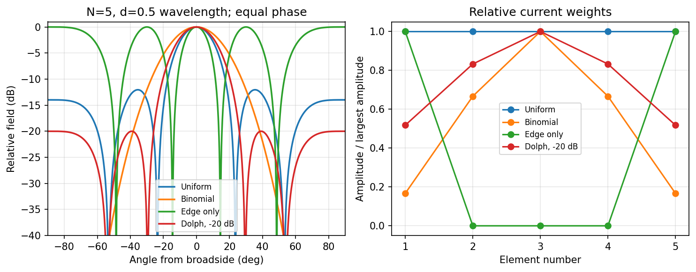
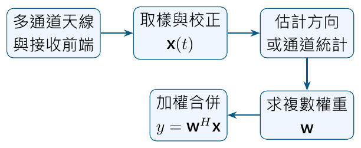
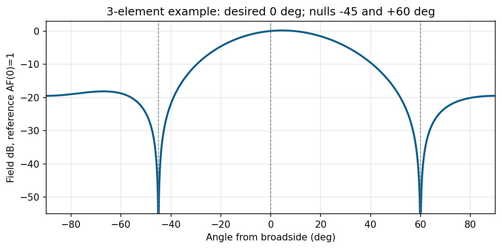

# 單元 27｜饋入權重的分析與智慧型天線

從壓低旁瓣，到追蹤使用者與干擾

原始影片：[陳晏笙老師「天線」單元 27](https://www.youtube.com/watch?v=3bBR_3SgSC4)

影片長度：約 108 分鐘　建議閱讀：約 25 分鐘

前置單元：25、26；需理解線陣 AF 與漸進相位。

> **核心觀念：** 相位主要用來對準方向，振幅權重主要用來塑形。低旁瓣、窄主瓣、易實作與高效率之間有取捨；智慧型天線則根據使用者與干擾的變動，選擇或更新這些複數權重。

## 本單元的四個目標

1.  用陣列向量寫一般權重，辨認轉置與共軛的差別。

2.  比較均勻、二項式、邊緣及 Dolph–Chebyshev 饋入。

3.  看懂切換波束、Butler 矩陣與適應陣列的分工。

4.  跟著影片的三元件例，解出保留訊號、消掉兩個干擾的權重。

## 兩種角度，先分清楚

前半延續線陣角 $`\phi`$：從 $`+x`$ 軸起算，距離投影是 $`d\cos\phi`$。後半 Butler 與接收例改用偏離正側向的角 $`\theta`$：投影是 $`d\sin\theta`$。兩者公式都來自同一個點積。

## 閱讀地圖

第 2 頁：向量模型；第 3 頁：四種權重比較；第 4 頁：二項式與取捨；第 5 頁：Chebyshev 與掃描；第 6 頁：智慧天線；第 7 頁：Butler；第 8～9 頁：適應與零點；第 10 頁：自測。 依影片完整權重與系統討論重寫。例題的補充解算、投影片數值更正與模型條件均標記。

## 1．一般權重：把每個元件的係數寫出來

影片對照：[約 02:00](https://www.youtube.com/watch?v=3bBR_3SgSC4&t=120s)－[11:00](https://www.youtube.com/watch?v=3bBR_3SgSC4&t=660s)

元件位置 $`x_n=nd`$，以 $`\phi`$ 從陣列軸起算：

```math
\mathbf a(\phi)=
[1,e^{jkd\cos\phi},\ldots,e^{j(N-1)kd\cos\phi}]^T.
```

令 $`\mathbf c=[c_0,\ldots,c_{N-1}]^T`$ 是實際複數電流係數，則

```math
\boxed{\mathrm{AF}(\phi)=\mathbf c^T\mathbf a(\phi).}
```

$`c_n=A_ne^{jn\delta}`$ 就包含振幅 taper 與漸進相位。等幅且 $`\delta=0`$ 才回到全 1 權重。

### 實數振幅權重的正規化

若 $`A_n\ge0`$，且相位已讓目標方向對齊，該方向的最大場幅為 $`\sum A_n`$。因此可用

```math
F_n(\phi)=\frac{|\mathrm{AF}(\phi)|}{\sum_n A_n}.
```

一般任意複數權重，不宜直接拿 $`\sum c_n`$ 當最大幅度；它可能互相抵消，甚至為零。應按實際目標或全角域峰值選參考。

### 接收常用 $`\mathbf w^H\mathbf x`$，不是換了物理

接收快照 $`\mathbf x`$ 的合併輸出可定義為

```math
y=\mathbf w^H\mathbf x.
```

此時每個通道真正相乘的係數是 $`w_n^*`$。若想與上面的 $`\mathbf c^T\mathbf a`$ 完全對應，就令 $`\mathbf c=\mathbf w^*`$。影片主要用 $`\mathbf w^T\mathbf a`$；閱讀其他文獻時先查定義，不能混用 $`T,H`$。

### 硬體意義

振幅可用分功率器或衰減器控制，相位可用移相器控制；全數位系統則在多通道基頻對訊號乘複數係數。衰減器消耗功率，並非只在紙上改形狀而沒有代價。

> **核心觀念：** 寫出「實際乘上訊號的複數係數」，比只看權重字母叫 $`w`$ 還可靠。

## 2．影片四種方法：看主瓣，也看旁瓣

影片對照：[約 11:00](https://www.youtube.com/watch?v=3bBR_3SgSC4&t=660s)－[44:00](https://www.youtube.com/watch?v=3bBR_3SgSC4&t=2640s)

影片比較 $`N=5,d=0.5\lambda`$，等相位、正側向陣列：



本圖以偏離正側向的角作橫軸，場的相對 dB 為 $`20\log F_n`$；權重圖各按自己的最大振幅正規化。不是四組用相同絕對輸入功率的效率比較。

| 方法            | 相對振幅                   | 主要取捨                           |
|:----------------|:---------------------------|:-----------------------------------|
| 均勻            | $`1,1,1,1,1`$                | 易實作、主瓣較窄；旁瓣較大         |
| 二項式          | $`1,4,6,4,1`$                | 本例無旁瓣；主瓣較寬、振幅範圍較大 |
| 邊緣            | $`1,0,0,0,1`$                | 中央波瓣很窄；有等高重複波瓣       |
| Dolph–Chebyshev | 約 $`1,1.609,1.932,1.609,1`$ | 設定等高旁瓣，以寬度交換旁瓣抑制   |

### 正規化圖看不出損耗

理想權重在等向、半波間距、忽略互耦模型下有

```math
D_{\rm peak}=\frac{|\sum c_n|^2}{\sum|c_n|^2}
```

（目標為同相正側向）。四組分別約 6.99、5.63、3.01、6.71 dBi。這些是該理想模型的指向性，不是任意實際元件與饋網的增益。

> **核心觀念：** 最窄的一個波瓣不保證最高指向性；邊緣饋入把能量分給多個同樣強的方向。

## 3．二項式與邊緣饋入：把優缺點算出來

影片對照：[約 15:00](https://www.youtube.com/watch?v=3bBR_3SgSC4&t=900s)－[27:00](https://www.youtube.com/watch?v=3bBR_3SgSC4&t=1620s)

### 二項式來自 Pascal 三角形

```math
(1+z)^{N-1}=\sum_{n=0}^{N-1}{N-1\choose n}z^n.
```

取 $`z=e^{j\psi}`$，權重為二項係數：

```math
\mathrm{AF}=(1+e^{j\psi})^{N-1}
=2^{N-1}e^{j(N-1)\psi/2}\cos^{N-1}(\psi/2).
```

```math
F_n=|\cos(\psi/2)|^{N-1}.
```

$`N=5`$ 得 $`1,4,6,4,1`$；中心電流是兩端的 6 倍，同阻抗下對應功率比 36 倍，硬體動態範圍不可只看電流倍數。

### 「沒有旁瓣」有可見角域條件

正側向、$`d\le\lambda/2`$ 時，$`-kd\le\psi\le kd`$ 落在一個基本主瓣區間，二項式形狀無一般旁瓣。間距增加或掃描若讓其他週期最大值進入可見區間，仍可能出現柵瓣；不能把二項式當成消除所有柵瓣的方法。

### 邊緣饋入只剩兩個相隔很遠的源

$`N=5,d=0.5\lambda`$，僅兩端通電，間距為 $`4d=2\lambda`$：

```math
\mathrm{AF}=1+e^{j4\psi},
\quad F_n=|\cos(2\psi)|.
```

波瓣很窄，但相隔兩波長的兩源有多個全同相方向。影片用這個極端例說明「只追求窄寬度」可能造成很差的全空間功率配置。這是本組非負、同相振幅比較的窄波瓣參考；允許一般複數權重與超指向性時，不能把它當成普遍的最小 HPBW 定理。

### 均勻的最大集中度也是有條件的

對半波間距等向元件且總輻射功率為 $`\sum|c_n|^2`$ 的模型，Cauchy–Schwarz 給 $`|\sum c_n|^2\le N\sum|c_n|^2`$；目標方向等幅同相時達等號。任意間距、互耦與實際 EF 下，不能把此結論當成所有天線的硬上限。

> **核心觀念：** 權重抑制旁瓣會改變有效孔徑與所需動態範圍；間距引起的空間歧義仍需另外處理。

## 4．Dolph–Chebyshev：先給旁瓣上限再求權重

影片對照：[約 27:00](https://www.youtube.com/watch?v=3bBR_3SgSC4&t=1620s)－[48:00](https://www.youtube.com/watch?v=3bBR_3SgSC4&t=2880s)

影片介紹 Dolph 的等波紋方法：在標準線陣模型與指定旁瓣上限下，以等高旁瓣取得相應的窄主瓣；不是所有三維天線與任意硬體條件下都最佳。

### 不必先學完整多項式，也能讀懂設計

先給 $`N,d`$ 與允許的旁瓣；求出對稱振幅；再加漸進相位掃描。指定旁瓣越低，通常主瓣越寬。影片 $`N=5,d=0.5\lambda`$、$`-20`$ dB 得近似振幅 $`1,1.6,1.9,1.6,1`$。 **補充解說／重算例題：**$`-20`$ dB 的功率比是 0.01，場幅比是 0.1，求多項式峰值比時應用 $`R=10^{20/20}=10`$。

### 五元件的補充公式

令 $`T_4(x)=8x^4-8x^2+1`$，

```math
x_0=\cosh\left(\frac{\mathop{\mathrm{acosh}}10}{4}\right),
\qquad
F(\psi)=\frac{T_4(x_0\cos(\psi/2))}{T_4(x_0)}.
```

展開為常數、$`\cos\psi`$ 與 $`\cos2\psi`$，即可匹配對稱的五元件係數。重算約 $`1,1.6085,1.9319,1.6085,1`$；影片取一位小數，所以不必期望精確等高 $`-20`$ dB。

### 影片掃向 60° 的相位需更正

其投影片給 $`N=5,d=0.5\lambda,\phi_0=60^\circ`$，但把 $`-kd\cos60^\circ`$ 寫成 $`-\pi`$，後續電流也採交替正負。

```math
\boxed{\delta=-\pi\cos60^\circ=-\pi/2=-90^\circ.}
```

正確電流相位依序為 $`0,-90,-180,-270,-360`$ 度，故按影片取整振幅：

```math
\mathbf c=[1,\,-j1.6,\,-1.9,\,+j1.6,\,1]^T.
```

投影片 $`[1,-1.6,1.9,-1.6,1]^T`$ 對應 $`\delta=-\pi`$，在半波間距是兩端都全同相的端射案例，並非所標的 60°。

> **核心觀念：** 幅度 taper 與掃描相位可以分步設計；最後仍要用 AF 驗證目標角與所有可見波瓣。

## 5．智慧型天線：把固定權重變成系統控制

影片對照：[約 48:00](https://www.youtube.com/watch?v=3bBR_3SgSC4&t=2880s)－[78:00](https://www.youtube.com/watch?v=3bBR_3SgSC4&t=4680s)

影片先提醒前半忽略的因素：饋入實作、元件互耦、數位波束形成及其他陣列布局。接著把權重放回無線系統。

### 系統為什麼需要方向控制？

同頻干擾、多路徑延遲、衰落及有限頻譜會限制通訊。更集中地接收期望訊號（SOI），並壓低不希望的訊號（SNOI），可提高訊號品質或空間重用能力。

### 兩種主要架構

| 面向 | 切換波束 switched beam                   | 適應陣列 adaptive array      |
|:-----|:-----------------------------------------|:-----------------------------|
| 波束 | 事先設好有限個                           | 根據訊號持續調權重           |
| 控制 | 從候選波束中選較好者                     | 可追蹤 SOI、調零點壓干擾     |
| 實作 | 可用固定饋網加開關                       | 多通道接收與 DSP，校正較複雜 |
| 限制 | 使用者可能落在兩束之間，干擾未必落在零點 | 需可靠估計、運算及硬體一致性 |

切換波束不是每次都重算任意場型；適應陣列也不是「永遠最強」，它依選定目標與可取得的通道資訊更新。

### 空間多工與多樣性分開理解

空間多工可讓不同方向使用者共享部分時頻資源，但通道需可分辨，硬體與干擾條件也需支持。空間多樣性利用不同接收通道減少深衰落風險；有多根天線並不自動同時達成兩者。

### 線陣與平面陣列

線陣主要控制一個方向投影；影片用 $`4\times5`$ 平面陣列示範行列相乘。若位置為 $`(md_x,nd_y)`$，權重可分離為 $`c_{mn}=p_mq_n`$，則

```math
\mathrm{AF}=
\left(\sum_{m=0}^{3}p_m e^{jmkd_x u_x}\right)
\left(\sum_{n=0}^{4}q_n e^{jnkd_y u_y}\right),
\quad u_x=\hat{\mathbf r}\cdot\hat{\mathbf x},\quad
u_y=\hat{\mathbf r}\cdot\hat{\mathbf y}.
```

兩個線陣因子控制不同投影；權重不可分離時，應回到雙重和，不能直接相乘。平面控制也增加元件、饋網與校正需求。

> **核心觀念：** 智慧是估計與控制權重的能力；多根天線的幾何配置與訊號通道仍決定可做到多少。

## 6．Butler 矩陣：用固定網路產生多組漸進相位

影片對照：[約 78:00](https://www.youtube.com/watch?v=3bBR_3SgSC4&t=4680s)－[96:00](https://www.youtube.com/watch?v=3bBR_3SgSC4&t=5760s)

影片以 Butler 矩陣實作切換波束：不同輸入埠，會在陣列輸出產生不同的等幅漸進相位。網路由 3 dB 耦合器、固定移相器與交叉線路組成。

### 四元件半波間距

這裡角度 $`\theta`$ 從正側向起算，

```math
\psi=kd\sin\theta+\delta,\quad kd=\pi.
```

四組常見相差為 $`\delta=\pm45^\circ,\pm135^\circ`$。主最大值滿足

```math
\sin\theta_0=-\delta/\pi.
```

| 漸進相位     | 正側向角 $`\theta_0`$ | 所需相鄰路徑的相位差 |
|:-------------|:--------------------|:---------------------|
| $`+45^\circ`$  | $`-14.48^\circ`$      | $`+45^\circ`$          |
| $`-45^\circ`$  | $`+14.48^\circ`$      | $`-45^\circ`$          |
| $`+135^\circ`$ | $`-48.59^\circ`$      | $`+135^\circ`$         |
| $`-135^\circ`$ | $`+48.59^\circ`$      | $`-135^\circ`$         |

符號採本講義約定；實際「第幾個埠對應哪邊」必須看電路輸出順序、參考方向與相位定義，不能只背埠號。

**追一次路徑相位：**某輸入按輸出順序得到 $`-45^\circ,-90^\circ,-135^\circ,-180^\circ`$。耦合器提供 90° 相差，固定移相器加 45°。相鄰相差都是 $`-45^\circ`$，本講義主峰為 $`+14.48^\circ`$；共同起始相位不改功率場型。

### 分功率不等於 dissipative loss

理想四路網路各輸出是輸入功率的 $`1/4`$；加總仍等於輸入，不代表額外損耗 6 dB。實際導體、介質、耦合器插損則使總輸出變少，會降低整體增益。

**八路與多束：**$`8\times8`$ 可選八組固定波束。同時激發多埠時，應疊加複數場，不能直接相加功率圖；相鄰波束能否合成較寬波瓣，需檢查幅相。

### 限制

等幅饋入的旁瓣較高；固定波束不能隨意把零點放到正在移動的干擾角度。這是後面適應陣列要解的問題。

> **核心觀念：** Butler 把選埠變成選一組固定相位，能快速切換方向；它不等同於任意自適應權重。

## 7．適應陣列：估計、求權重、再更新

影片對照：[約 96:00](https://www.youtube.com/watch?v=3bBR_3SgSC4&t=5760s)－[102:00](https://www.youtube.com/watch?v=3bBR_3SgSC4&t=6120s)

影片的接收流程：多根天線各自接收、降頻、數位化；DSP 估計入射方向或直接根據接收資料求權重；加權合併後得到輸出，隨環境改變繼續更新。



### 影片提到的不同工具

MUSIC、ESPRIT、SAGE 等用來估計方向或多路徑參數；波束形成可採直接滿足指定方向條件、最大化期望訊號，或最大化 SINR。它們的任務不同，不能把「估到方向」當成已經抑制干擾。

### 可用的自由度

窄頻、單一複數輸出且方向向量獨立時，$`N`$ 個元件保留一個期望方向，通常最多再指定 $`N-1`$ 個獨立零點。若方向向量幾乎相同，矩陣接近奇異，權重會很大且不穩定。

### 為什麼有時理論零點量不到？

互耦改變各通道響應，幅相誤差、元件位置誤差與頻率變化都會填起零點。應使用校正後的陣列向量或 embedded element pattern，並在整個工作頻帶檢查，不只測一個中心頻率。

### 接收權重不能原封不動照抄到發射

方向定義、轉置與共軛、上下行頻率及前端校正需一致。頻分雙工的上下行頻率不同，幾何相位也不同；傳播互易不自動替你消除兩端硬體的誤差。

> **核心觀念：** 適應陣列的效果取決於資料、模型與校正。紙上的深零點只是設計條件，還要驗證實際響應。

## 8．影片三元件例：保留 0°，消掉 $`-45^\circ`$ 與 60°

影片對照：[約 102:00](https://www.youtube.com/watch?v=3bBR_3SgSC4&t=6120s)－[107:00](https://www.youtube.com/watch?v=3bBR_3SgSC4&t=6420s)；補充完整解算

位置為 $`-d,0,+d`$，角 $`\theta`$ 從正側向起算。影片指定 SOI $`0^\circ`$，兩個 SNOI 分別 $`-45^\circ,60^\circ`$。取 $`d=0.5\lambda`$ 作數值示例：

```math
\mathbf a(\theta)=[e^{-j\pi\sin\theta},1,e^{j\pi\sin\theta}]^T.
```

用實際乘上通道的係數 $`\mathbf c`$，要求

```math
\mathbf c^T\mathbf a(0^\circ)=1,\quad
\mathbf c^T\mathbf a(-45^\circ)=0,\quad
\mathbf c^T\mathbf a(60^\circ)=0.
```

這是三條複數線性方程；矩陣每列是對應方向向量的轉置。補充解算為

```math
\boxed{\mathbf c\approx[
0.276463+j0.070483,\quad0.447074,\quad
0.276463-j0.070483]^T.}
```

若接收寫 $`y=\mathbf w^H\mathbf x`$，就用 $`\mathbf w=\mathbf c^*`$。



圖以目標 $`0^\circ`$ 的響應為 0 dB，並非宣稱這是全圖最高值。兩個干擾方向的理想響應為零，圖中的谷底受繪圖網格與顯示下限影響。

### 影片增益式的功率基準

$`|\mathbf c^T\mathbf a|^2/(\mathbf c^H\mathbf c)`$ 可表示相同且不相關通道雜訊下的合併 SNR 增益。要當天線指向性，還需總輻射功率恰與 $`\sum|c_n|^2`$ 成比例（如半波間距、等向元件的理想模型）；一般 EF、互耦或非半波間距要回到球面積分。

> **核心觀念：** 用線性方程可以指定零點；求解後仍需掃過全部角度與頻率，檢查非目標峰值和穩定性。

## 9．五題自測與答案

先作答，再看解析。

1.  五元件二項式振幅是哪一列？中心與邊緣的同阻抗功率比是多少？

2.  為何只讓兩個最外側元件通電，不能保證最好指向性？

3.  影片 $`d=0.5\lambda,\phi_0=60^\circ`$ 的正確漸進相位為何？$`[1,-1.6,1.9,-1.6,1]`$ 真正對應什麼相位？

4.  Butler 四路相差 $`-45^\circ`$、半波間距，本講義 $`\theta`$ 約指向哪邊？

5.  三個獨立通道能否在保留一個 SOI 的同時，任意指定五個獨立零點？

### 答案與解析

1.  $`1,4,6,4,1`$；電流比 6、功率比 36。二項式低旁瓣需檢查可見區間。

2.  首尾跨度大，中央波瓣很窄，但有很多等高方向；總功率未必集中在目標。

3.  正確 $`\delta=-90^\circ`$；交替正負是 $`-180^\circ`$，不是原題的 60°。

4.  $`\sin\theta_0=1/4`$，約 $`+14.48^\circ`$。埠號對應仍依具體網路。

5.  不行。只有三個複數係數，保留一個方向後通常最多兩個獨立零點，且約束矩陣需可解。

### 回看影片

[18:00：二項式](https://www.youtube.com/watch?v=3bBR_3SgSC4&t=1080s)；[28:00：Dolph](https://www.youtube.com/watch?v=3bBR_3SgSC4&t=1680s)；[44:00：掃描例與更正](https://www.youtube.com/watch?v=3bBR_3SgSC4&t=2640s)。

[70:00：兩種架構](https://www.youtube.com/watch?v=3bBR_3SgSC4&t=4200s)；[88:00：Butler](https://www.youtube.com/watch?v=3bBR_3SgSC4&t=5280s)；[102:00：三元件零點例](https://www.youtube.com/watch?v=3bBR_3SgSC4&t=6120s)。

**下一單元：**用濾波器與頻率響應的觀點，看懂陣列及固定波束寬度。
