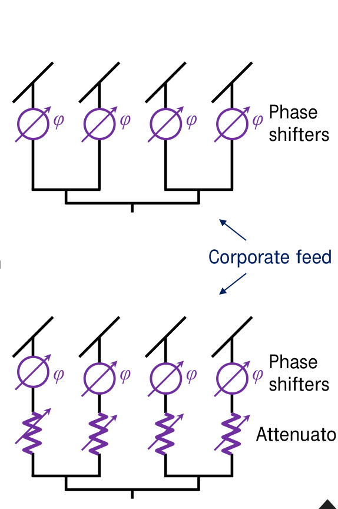
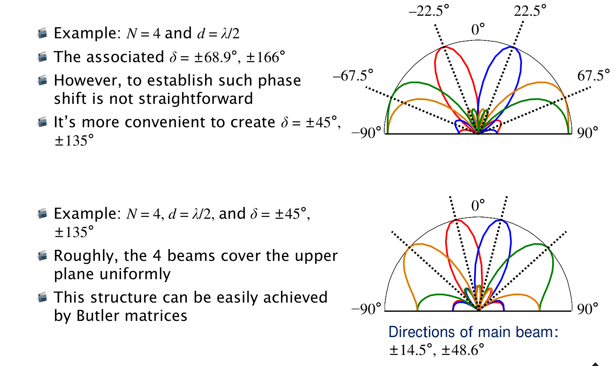
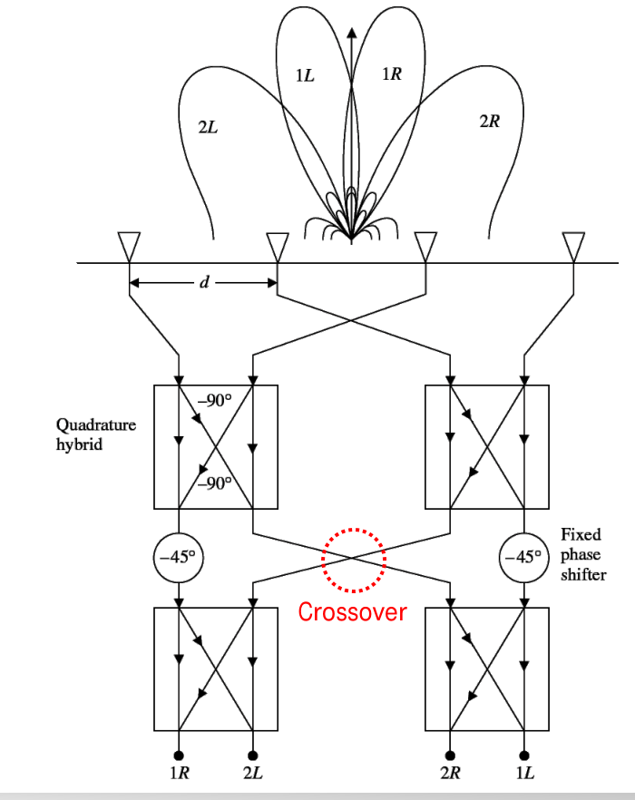
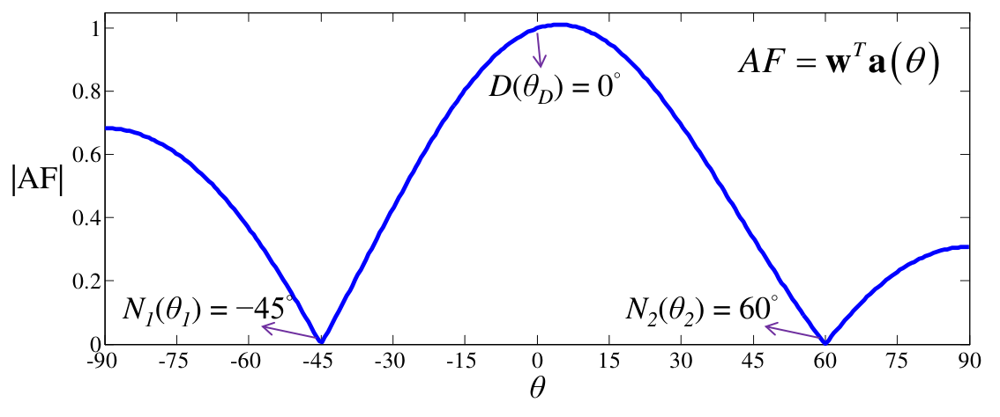

# 單元 27｜饋入權重的分析與智慧型天線

原始影片：[陳晏笙老師「天線」單元 27](https://www.youtube.com/watch?v=3bBR_3SgSC4)（約 108 分鐘）

原始講義：[Lecture 6：Array Fundamentals](https://drive.google.com/file/d/1R3MSohfcRyOONnIcZhn96AkJDZwSqRJv/view)，PDF 第 **64–104 頁**，§6.5 Array Weighting、§6.6 Special Topic: 5G Antenna Systems。

建議閱讀：約 50–65 分鐘；前置：[單元 25](025_均勻N單元線性陣列（一）.md)、單元 26 的均勻線陣與漸進相位。

這一章依老師講義，先比較四種振幅權重，再把「選振幅、選相位」放進智慧型天線系統；最後從三元件消除兩個干擾的例題，推廣到一般 $`N`$ 元件的聯立方程。

學習重點：能分辨場型正規化與真正增益、說明主瓣與旁瓣的取捨、追出 Butler 矩陣各埠的相位，以及用複數權重保留期望訊號並設定零點。

## 講義與影片對照

以下時間整合影片口述與畫面，為包含板書的約略主題區間；PDF 頁碼才是正文的編排依據。影片開頭回顧整份目錄，約 56 分鐘開始從硬體轉入智慧型天線。

| PDF 頁碼 | 原英文主題 | 中文整理 | 影片定位 |
|:--|:--|:--|:--|
| 64–67 | Array Weighting / General Form | 振幅控制、向量、設計目標 | [約 02:53–11:23](https://www.youtube.com/watch?v=3bBR_3SgSC4&t=173s) |
| 68 | Uniform Excitation | 均勻權重 | 約 11:23–14:50 |
| 69 | Binomial Excitation | 二項式與動態範圍 | 約 14:51–22:46 |
| 70 | Edge Excitation | 邊緣饋入與取捨 | 約 22:46–27:21 |
| 71 | Dolph–Tchebyscheff Excitation | 等波紋、旁瓣與比較基準 | [約 27:21–41:17](https://www.youtube.com/watch?v=3bBR_3SgSC4&t=1641s) |
| 72–74 | How Do We Steer a Beam While Keep Low SLL? | 低旁瓣的 60° 掃描例 | 約 41:17–47:56 |
| 75 | What Did We Disregard in This Section? | 硬體、互耦、4×5 平面陣列板書 | [約 47:56–56:31](https://www.youtube.com/watch?v=3bBR_3SgSC4&t=2876s) |
| 76–79 | Need for Smart Antennas | 延遲擴展、SOI／SNOI、SINR、SDMA | 約 56:31–69:01 |
| 80–83 | Two Major Configurations / Comparison | 切換波束與適應陣列 | 約 69:01–76:32 |
| 84–85 | Switched-Beam Approach | 固定波束、選擇與切換 | 約 76:33–79:06 |
| 86–88 | Butler Matrix (1/8–3/8) | 等角方向與實用相差 | 約 79:06–84:10 |
| 89 | Butler Matrix (4/8) | 耦合器、移相器、交叉線 | 約 84:10–86:13 |
| 90–93 | Butler Matrix (5/8–8/8) | 四埠逐一追蹤相位 | [約 86:13–91:54](https://www.youtube.com/watch?v=3bBR_3SgSC4&t=5173s) |
| 94 | 8 × 8 Butler Matrix | 八路擴充與寬頻實作限制 | 約 91:54–94:14 |
| 95–97 | Overview of Adaptive Array | DOA、基頻權重與系統流程 | 約 94:14–100:46 |
| 98–100 | How Do We Nullify the Interference? | 三元件原例 | [約 100:46–104:17](https://www.youtube.com/watch?v=3bBR_3SgSC4&t=6046s) |
| 101–104 | Direct Beamforming Approaches | 一般方程、剩餘自由度與限制 | 約 104:17–107:58 |

## 1．從等幅變成非等幅：多一個可調變數（第 65 頁）

前一單元用等幅電流與漸進相位，把主瓣移到指定方向。這裡進一步讓每個元件的**電流振幅**也可設計，用來降低旁瓣、在特定方向放零點或改變整體場型。



來源：老師講義第 65 頁局部。上圖只控制相位；下圖加入衰減器，以不同振幅激發元件。圖上的 $`\varphi`$ 是移相器符號，不是這一章觀察方向的 $`\phi`$。

振幅也可由不等比分功率器產生。若用衰減器，耗掉的功率是真實損失；正規化後看起來漂亮的場型，不能直接代表整體效率更高。

約 04:22–05:51，老師把目標分成降低旁瓣、指定零點、塑造平頂（flat-top）等場型。前章只有一個漸進相位 $`\delta`$ 可調時，主瓣與整組零點會一起移動；不能在保持主瓣的同時任意搬動各個零點。加入各元件的振幅，或進一步使用獨立複數權重，才能增加控制自由度。

## 2．一般權重向量與正規化（General Form，第 66 頁）

此處線陣沿 $`x`$ 軸排列，$`\phi=0^\circ`$ 沿陣列軸、$`\phi=90^\circ`$ 是正側向。沿用講義，把相鄰元件的相位差 $`\delta`$ 放在陣列向量內：

```math
\psi=kd\cos\phi+\delta,\qquad k=\frac{2\pi}{\lambda},
```

```math
\mathbf a_\delta(\phi)=
[1,e^{j\psi},\ldots,e^{j(N-1)\psi}]^T,
\qquad
\mathbf w=[w_1,w_2,\ldots,w_N]^T,
```

```math
\boxed{\mathrm{AF}(\phi)=\mathbf w^T\mathbf a_\delta(\phi)
=\sum_{n=1}^N w_n e^{j(n-1)(kd\cos\phi+\delta)}.}
```

前半的 $`w_n`$ 通常是非負實數振幅，而且關於中心對稱。若目標方向使所有元件同相，場幅最大值為 $`\sum_n w_n`$，因此

```math
F_n(\phi)=\frac{\left|\mathbf w^T\mathbf a_\delta(\phi)\right|}
{\sum_{n=1}^N w_n}.
```

第 66 頁的正規化式要配合上述實數非負權重條件使用。對一般複數權重，$`\sum_n w_n`$ 可能為零或互相抵消，應改用指定參考方向或全角域峰值正規化。

若把全部相位併入實際電流係數 $`c_n=w_n e^{j(n-1)\delta}`$，則也可寫

```math
\mathrm{AF}(\phi)=\sum_{n=1}^N c_n e^{j(n-1)kd\cos\phi}.
```

這兩種寫法等價；不要既在 $`c_n`$ 內加入掃描相位，又在陣列向量再加一次 $`\delta`$。

## 3．先選設計目標，再選權重（第 67 頁）

| 老師列出的目標 | 方法 | 理解重點 |
|:--|:--|:--|
| 降低旁瓣 | 二項式 Binomial | 以主瓣變寬、振幅差增大為代價 |
| 提高峰值指向性 | 均勻 Uniform | 在本章理想半波間距模型下達到最大值 |
| 縮窄中央波瓣 | 邊緣 Edge | 多個波瓣可能與主瓣一樣強 |
| 指定旁瓣上限並縮窄主瓣 | Dolph–Tchebyscheff，亦稱 Dolph–Chebyshev | 形成等高旁瓣 |
| 在特定方向設零點 | Howells 等方法 | 權重需配合所指定的方向 |
| 其他場型塑形 | Blackman、Hamming、Gaussian、Kaiser–Bessel | 與訊號處理中的窗函數有相通之處 |

講義同時要求考慮實作複雜度、可調性與硬體限制。這些目標通常無法全部同時最佳；「最窄」「最高」也必須連同元件數、間距、可用權重與元件場型來看。

## 4．四種饋入方式逐一比較（第 68–71 頁）

四頁都以 $`N=5,d=0.5\lambda`$、等相位正側向線陣作比較。先看每種權重如何改變 AF，再一起看數值。

### 4.1 均勻饋入（Uniform，第 68 頁）

```math
\mathbf w=[1,1,1,1,1]^T,\qquad
F_n(\phi)=\left|\frac{\sin(N\psi/2)}{N\sin(\psi/2)}\right|.
```

優點是等幅饋入容易做，而且在本例理想模型下有最大的峰值指向性；缺點是旁瓣不低。老師用第一旁瓣約為主瓣場幅的 21% 說明：陣列仍會朝非目標方向輻射，或接收到該方向的訊號。

這個百分比是**某方向的場幅比**，不是「總功率有 21% 流失」。五元件的第一旁瓣約 $`-12.04\ \mathrm{dB}`$；大 $`N`$ 的均勻陣列才趨近 $`-13.26\ \mathrm{dB}`$。第 68 頁的大 $`N`$ 數字寫成 $`-13.46\ \mathrm{dB}`$，由上式可重算校正；第二旁瓣約 $`-17.83\ \mathrm{dB}`$，與投影片的 $`-17.90\ \mathrm{dB}`$ 接近。

### 4.2 二項式饋入（Binomial，第 69 頁）

老師直接從 Pascal 三角形挑第 $`N`$ 列的係數：

| 元件數 $`N`$ | 相對電流振幅 |
|:--|:--|
| 2 | 1、1 |
| 3 | 1、2、1 |
| 4 | 1、3、3、1 |
| 5 | **1、4、6、4、1** |
| 6 | 1、5、10、10、5、1 |
| 7 | 1、6、15、20、15、6、1 |
| 8 | 1、7、21、35、35、21、7、1 |
| 9 | 1、8、28、56、70、56、28、8、1 |

其無旁瓣的原因可由二項式展開看出：

```math
\mathrm{AF}=(1+e^{j\psi})^{N-1}
=2^{N-1}e^{j(N-1)\psi/2}\cos^{N-1}(\psi/2),
```

```math
F_n=\left|\cos(\psi/2)\right|^{N-1}.
```

正側向且 $`d\le\lambda/2`$ 時，可見角域落在同一個基本主瓣區間，所以沒有一般旁瓣。若增大間距或掃描到讓其他週期的最大值進入可見區間，仍要檢查柵瓣。

代價有兩項：主瓣變寬，以及中心與邊緣電流差很大。五元件中心電流是兩端的 6 倍；同阻抗下功率比為 **36 倍**，不能只看振幅比例就低估饋網的難度。

約 19:47–21:46，老師用九元件作更明顯的例子：$`[1,8,28,56,70,56,28,8,1]`$ 的中心／邊緣電流比是 **70:1**，同阻抗功率比為 $`70^2=4900:1`$，約 **36.90 dB**。因此單元變多時，理想無旁瓣的代價包含饋網動態範圍、誤差與可實現性；不能把「數學上有解」等同「硬體容易做到」。老師約 22:00 另以「五元件、−40 dB 旁瓣又要求 20° HPBW」提醒規格取捨；若要判定精確可行範圍，仍應用相同間距與權重限制計算，不能只憑能量守恆或二項式的一個結果推定全部界限。

### 4.3 邊緣饋入（Edge，第 70 頁）

只保留兩端：

```math
\mathbf w=[1,0,0,0,1]^T,\qquad
\mathrm{AF}=1+e^{j4\psi},\qquad F_n=|\cos(2\psi)|.
```

兩個有效元件相隔 $`(N-1)d=2\lambda`$。中央波瓣很窄，但還有其他同樣高的波瓣；SLL 等於 0 dB。因此「波瓣窄」不等於「能量只集中在一個方向」。

講義把它當作固定五個位置、非負同相振幅比較的極端情形。若允許任意複數權重或超指向性設計，不能把這個例子升格成所有陣列的最小 HPBW 定理。

約 25:50–27:21，老師說這個極端例的用途在於建立觀念：先看最外側一對，再往內分層，便能理解不同孔徑尺度對場型的貢獻。這個「由外到內看各對元件」的觀點，也會接到下一單元的頻率響應分析。

### 4.4 Dolph–Chebyshev 饋入（第 71 頁）

這個方法先指定可容忍的旁瓣高度，例如 $`-20\ \mathrm{dB}`$，再求對稱權重，使旁瓣等高，並在標準設計條件下得到相應最窄的主瓣。

老師五元件的取整結果為

```math
\mathbf w\approx[1,1.6,1.9,1.6,1]^T.
```

與均勻陣列相比，主瓣稍寬，但旁瓣明顯降低；與二項式相比，允許少量旁瓣以換回較窄主瓣。完整五元件多項式重算放在章末補充。

### 影片板書：等波紋為什麼是折衷？

約 28:56–35:12，老師連到多節四分之一波長阻抗轉換器：二項式著重最大平坦，Chebyshev 則容許等波紋（equal ripple）。在陣列中，均勻權重的第一旁瓣較高、後續旁瓣逐漸降低；Chebyshev 讓可見旁瓣貼近同一允許高度，不必把它們全部壓到零，因而減輕主瓣變寬的代價。老師用「把高旁瓣壓下、低旁瓣提高」作能量分布的直觀解釋；精確權重仍由多項式／最佳化條件求出，不能只靠能量守恆推導。

約 35:12–38:46，老師進一步比較硬體與極限：本例最大／最小電流只有約 1.9 倍，功率比約 $`1.9^2=3.61`$，比九元件二項式的動態範圍容易處理。對固定元件數，旁瓣要求越低，權重越往中央集中、主瓣越寬；把允許旁瓣推向零的極限，Chebyshev 權重會趨近二項式。要求放寬時，權重則可較接近均勻分布，但不是所有門檻都精確等於均勻權重。

約 39:14–40:46 的研究提醒是：提出新的饋入權重時，應同時與**均勻權重及 Dolph–Chebyshev**比較，並固定元件數、間距、旁瓣要求、功率正規化與硬體限制；只勝過均勻陣列的旁瓣，還不足以說明方法的優點。


此圖為筆記依 AF 公式重畫，橫軸改用偏離正側向的角；場型 dB 為 $`20\log_{10}F_n`$。各組權重與場型分別正規化，不是等輸入功率的實際增益測試。

| 方法 | 相對振幅 | PDF 所列 HPBW | 依所列 AF 重算 HPBW | 第一旁瓣／重複波瓣 | 理想峰值指向性 |
|:--|:--|:--|:--|:--|:--|
| 均勻 | 1、1、1、1、1 | 23° | 20.78° | 約 −12.04 dB | 6.99 dBi |
| 二項式 | 1、4、6、4、1 | 31° | 30.28° | 無一般旁瓣 | 5.63 dBi |
| 邊緣 | 1、0、0、0、1 | 15° | 14.36° | 0 dB | 3.01 dBi |
| Dolph–Chebyshev | 1、1.6、1.9、1.6、1 | 27° | 23.64° | 約 −20 dB | 6.72 dBi |

表中保留老師圖旁的 HPBW，另列同一組權重、半波間距、$`F_n=1/\sqrt2`$ 的重算結果，避免把圖示近似值當作精確解。使用完整 Chebyshev 權重時，HPBW 為 23.71°、指向性為 6.71 dBi。

以上指向性假設等向元件、半波間距、無損且忽略互耦：

```math
D_{\rm peak}=\frac{\left|\sum_n w_n\right|^2}{\sum_n|w_n|^2}.
```

對此模型，Cauchy–Schwarz 不等式給 $`D_{\rm peak}\le N`$，等幅同相達等號。換成其他間距、實際元件場型或含互耦天線，應重新算總輻射功率。

## 5．保留低旁瓣，同時掃到 60°（第 72–74 頁）

第 72 頁把設計分成兩件事：由旁瓣需求選振幅 $`\mathbf w`$，由主瓣方向選相位

```math
\delta=-kd\cos\phi_0.
```

第 73 頁原題：$`N=5,d=0.5\lambda,\phi_0=60^\circ`$，用 Dolph–Chebyshev 維持約 $`-20\ \mathrm{dB}`$ 旁瓣。代入可得

```math
\boxed{\delta=-\pi\cos60^\circ=-\frac{\pi}{2}=-90^\circ.}
```

以老師取整振幅寫實際電流：

```math
\mathbf c=
[1\angle0^\circ,\;1.6\angle(-90^\circ),\;
1.9\angle(-180^\circ),\;1.6\angle(-270^\circ),\;
1\angle(-360^\circ)]^T,
```

```math
\boxed{\mathbf c=[1,-j1.6,-1.9,+j1.6,1]^T.}
```

**講義與口述校正：**約 43:52–46:54 沿用投影片的 −180° 說法；第 73 頁把 $`-\pi\cos60^\circ`$ 算成 $`-\pi`$，電流遂寫成交替正負；第 74 頁也沿用 $`-180^\circ`$。這與 60° 原題不一致。交替正負在半波間距對應端射兩端全同相的情形，不能拿來當原題答案。

第 74 頁比較 Chebyshev、二項式、均勻三種振幅。三者要指向相同的 60°，應都使用 $`\delta=-90^\circ`$，再比較旁瓣與波束寬度。若只看各自正規化場型，不要把高度都為 1 誤認為它們增益相同。

## 6．理想 AF 暫時忽略了什麼？（第 75 頁）

老師在進入系統之前補上三個限制。

1. **權重如何實現。**約 47:56–49:25，老師以各元件後方的收發模組（TRM，transmit/receive module）說明硬體成本。類比可用衰減器與移相器；數位波束形成（DBF）在各通道基頻乘複數係數，減少對 RF 可調移相器的依賴，但仍需多通道前端、取樣與校正。
2. **元件互耦。**鄰近天線會改變各通道響應；只套孤立元件與理想相位，可能無法形成預期深零點。實作可用校正後陣列向量或內嵌元件場型（embedded element pattern）。
3. **其他幾何布局。**圓陣、平面陣列都可設計；線陣的一維投影並不涵蓋全部方向控制。

影片約 50:52–55:29 另用板書談平面陣列；54:15 畫面明確是 **$`x`$ 方向每列 5 個、$`y`$ 方向共 4 列**的 $`4\times5`$ 排列。先把一列五元件的 AF 當成新的元素因子，再分析四列沿 $`y`$ 的排列；反過來先算四元件列、再算五列，也得到相同結果。若權重可以分離成 $`c_{mn}=p_mq_n`$，AF 才能分解為兩個線陣因子：

```math
\mathrm{AF}=
\left(\sum_{m=0}^{4}p_m e^{jmkd_xu_x}\right)
\left(\sum_{n=0}^{3}q_n e^{jnkd_yu_y}\right),
\quad
u_x=\hat{\mathbf r}\cdot\hat{\mathbf x},\quad
u_y=\hat{\mathbf r}\cdot\hat{\mathbf y}.
```

此式是板書觀念的補充整理。若權重不能分離，應使用完整雙重和；多一個維度也會增加元件、饋網與校正需求。

## 7．為什麼需要智慧型天線？（第 76–79 頁）

第 76 頁是 §6.6 的分節頁。第 77 頁回到無線環境的四個限制：多路徑造成延遲擴展、同頻干擾、Rayleigh 衰落，以及頻譜有限。

約 57:58–60:56 的口述把延遲擴展（delay spread）連回第 1 章：同一訊號經直達、建物反射或散射等路徑抵達，各路的延遲與功率不同。若第 $`i`$ 路的平均功率為 $`P_i`$、延遲為 $`\tau_i`$，可用功率加權的均方根延遲擴展描述：

```math
\bar\tau=\frac{\sum_iP_i\tau_i}{\sum_iP_i},\qquad
\sigma_\tau=\sqrt{\frac{\sum_iP_i(\tau_i-\bar\tau)^2}{\sum_iP_i}}.
```

當延遲相對符元時間不可忽略，前一符元的回波會與後續符元重疊，造成符際干擾（ISI）。移動會改變通道，但 **ISI 並不以移動為必要條件**；固定環境的多路徑也可能造成它。等化、保護間隔、編碼與空間處理各有分工，智慧天線主要在空間方向上改善接收條件。

第 78 頁的智慧型天線系統（Smart Antenna System, SAS）結合陣列、RF 硬體與數位訊號處理：估計期望訊號 SOI（signal of interest）及非期望訊號 SNOI（signal not of interest）的方向，改變各通道權重，對準 SOI 並壓低 SNOI，且隨環境更新。

約 61:01–64:51，老師強調「智慧」來自後方的估計、運算與控制，金屬本身不會辨認訊號。SOI／SNOI 是相對於當前接收任務的分類：另一個用戶的合法訊號，對這個接收器仍可能是干擾。SINR 的分子、分母都是功率：

```math
\mathrm{SINR}=\frac{P_{\rm SOI}}{P_{\rm interference}+P_{\rm noise}}.
```

提高 SOI 響應、壓低特定方向的干擾，是兩個互補的目標。特定方向的零點不能消除所有方向的熱雜訊，也不能在不犧牲 SOI 的情況下，消除與 SOI 具有完全相同陣列向量的干擾。

第 79 頁把系統效益分成三類：

| 功能 | 權重／陣列做什麼 | 講義列出的可能效益 |
|:--|:--|:--|
| 訊號增益 Signal gain | 合併多根天線的期望訊號 | 提升覆蓋、降低達到指定覆蓋所需功率 |
| 干擾抑制 Interference rejection | 朝同頻干擾方向降低響應，提升 SINR | 更密集的空間／頻率重用，提高容量 |
| 空間多樣性 Spatial diversity | 利用不同通道降低深衰落與多路徑的不利影響 | 改善可靠度，適當處理下可減少有效延遲擴展、支援較高速率 |

這些是設計目標，不是「裝多根天線就全部自動達成」。空間多樣性是抗衰落；空間多工則是利用可分辨的通道，同時服務不同資料流或使用者，兩者要分開理解。

### 影片補充：SDMA 增加的是哪一個分隔維度？

約 62:23–63:22、65:23–68:59，老師將空間分隔接回多重存取：

| 方法 | 分開使用者所用的資源 |
|:--|:--|
| FDMA | 不同頻率通道 |
| TDMA | 不同時槽 |
| CDMA | 可分辨的碼序列 |
| SDMA | 不同空間通道／方向 |

SDMA 的重點是：若陣列能分開使用者的通道，就有機會重用相同時間、頻率資源，提升容量。老師用行動通訊世代作直觀串接；這張表整理的是分隔原理，並不是各代標準都依序把所有方法疊加，也不表示 SDMA 到 5G 才出現。

## 8．切換波束與適應陣列（第 80–83 頁）

| 比較項目 | 切換波束 Switched beam | 適應陣列 Adaptive array |
|:--|:--|:--|
| 可用場型 | 有限組預先設好的固定波束 | 依資料持續調整複數權重 |
| 移動時如何處理 | 從候選波束選一束並切換 | 追蹤 SOI 與 SNOI，重新塑形 |
| 訊號對準 | 使用者可能位於兩束之間 | 可把主瓣更準確放到目標方向 |
| 干擾處理 | 干擾不一定落在原有零點 | 可對指定干擾安排零點 |
| 實作與成本 | 結構相對簡單、成本較低 | 多通道收發與運算較複雜、成本較高 |
| 覆蓋表現 | 通常優於傳統固定扇區 | 在高干擾條件下可有更好的有效覆蓋 |

第 81 頁的兩張覆蓋圖要連同環境讀：干擾低時，兩者都比傳統扇區改善很多；干擾強時，適應陣列因可壓低干擾，優勢較明顯。第 82 頁則畫出固定波束只能粗略對準，適應波束可讓主瓣與零點更貼合實際方向。

第 83 頁提到適應架構可減少某些重複硬體，並不表示整體系統必然更便宜；收發器、校正與運算的複雜度仍存在。投影片的「無限多場型」是可連續調權重的理想化說法，實體硬體會受量化與動態範圍限制。

## 9．固定波束如何產生、選擇與切換？（第 84–85 頁）

老師按四個問題說明 switched-beam 系統：

1. **如何產生不同方向？**改變陣列的漸進相位。
2. **如何把幾組波束固定下來？**用設計好的饋入網路，例如 Butler、Blass、Nolen 矩陣。
3. **如何選波束？**比較候選波束的接收資訊，例如選接收訊號較強的一束。
4. **使用者移動怎麼辦？**持續監測，必要時切換到另一區。

第 85 頁把一個扇區再分成數個微扇區（microsectors），連結到空間分割多重存取（SDMA）。這種方法提供空間選擇性，但單憑「最強訊號」不能保證分清 SOI 與干擾，也沒有自動把零點移到干擾角度的能力。約 73:30–75:33，老師用「SOI 與干擾恰好都落在選中的波束內」說明此限制；適應陣列則會把兩個方向一起納入權重設計。

若硬體只有一條 RF 鏈與一個選路開關，每次只能選一束；要在同一時間、頻率服務多個獨立資料流，還須有對應的多通道收發與空間處理。單靠來回切換波束，不等於已完成同時多使用者的 SDMA。

## 10．Butler 的角度設計：等角與容易實現的相差（第 86–88 頁）

### 10.1 先換角度定義

從第 86 頁起，$`\theta`$ 由**正側向**起算：正側向為 0°、左右端射為 $`\pm90^\circ`$。沿用該頁的正相位 AF：

```math
\Psi=kd\sin\theta+\delta,\qquad
F_n(\theta)=\left|\frac{\sin(N\Psi/2)}{N\sin(\Psi/2)}\right|.
```

```math
\delta=-kd\sin\theta_0,
\qquad
F_n(\theta)=\left|
\frac{\sin\left[N\pi(d/\lambda)(\sin\theta-\sin\theta_0)\right]}
{N\sin\left[\pi(d/\lambda)(\sin\theta-\sin\theta_0)\right]}
\right|.
```

這與前半的 $`\cos\phi`$ 並不矛盾，只是角度基準不同。約 79:39–80:38 的口述稱它為「補角」；依這裡的基準應理解為與陣列軸角互餘，且左右正負仍要依圖的座標定義。

### 10.2 真正等角的四束

第 87 頁先把半平面切成等角方向。對偶數 $`N`$：

```math
\theta_0=\frac{\ell\pi}{N},\qquad
\ell=\pm\frac12,\pm\frac32,\ldots,\pm\frac{N-1}{2},
```

```math
\delta=-kd\sin\left(\frac{\ell\pi}{N}\right).
```

$`N=4,d=\lambda/2`$ 時，四個方向是 $`\pm22.5^\circ,\pm67.5^\circ`$，所需漸進相位的大小為約 $`68.88^\circ,166.30^\circ`$。這些相差不容易只用簡單的固定 45°、90° 電路拼出。

### 10.3 Butler 選擇好做的相位，角度便不是等間隔

老師改用 $`\delta=\pm45^\circ,\pm135^\circ`$，再由 $`\sin\theta_0=-\delta/\pi`$ 求角度：

| 漸進相位 $`\delta`$ | 依第 86 頁定義的主瓣角 $`\theta_0`$ |
|:--|:--|
| +45° | −14.48° |
| −45° | +14.48° |
| +135° | −48.59° |
| −135° | +48.59° |



來源：老師講義第 88 頁局部。上圖是等角的 $`\pm22.5^\circ,\pm67.5^\circ`$，下圖是方便實現的 $`\pm14.5^\circ,\pm48.6^\circ`$。後者只是大致覆蓋半平面，並非四束等角間隔。

## 11．四路 Butler 矩陣逐埠追蹤（第 89–93 頁）

第 89 頁的網路由 3 dB 正交耦合器、固定移相器與交叉線組成。對 $`N=2^n`$：

```math
\text{耦合器數}=\frac N2\log_2N,\qquad
\text{固定移相器數}=\frac N2(\log_2N-1).
```

四路因此需要 4 個耦合器、2 個固定移相器，並配合圖中的交叉線。

約 84:10–85:42，老師說明每個 3 dB 正交耦合器將功率等分，兩個輸出相差 90°；圖上以直通路 0°、耦合路 −90° 表示相對延遲。固定移相器再提供 −45°。交叉線讓兩路交會但不短接，實作還須控制隔離、反射與相位誤差。



來源：老師講義第 89 頁局部；原圖引自 C.-C. Chang、R.-J. Lee、T.-Y. Shih，IEEE Transactions on Antennas and Propagation，2010。此處依老師下方輸入埠由左到右編 1–4，上方天線也由左到右讀相位。

各路都是等幅；約 86:13–91:54 逐路追蹤時，**先以目前輸入埠作 0° 參考**，再把沿途相位延遲相加。以埠 1 為例，四條路的相位和分別為 $`-45^\circ`$、$`-90^\circ`$、$`-45^\circ-90^\circ`$、$`-90^\circ-90^\circ`$。共同延遲不改變主瓣，決定方向的是相鄰輸出的相差。第 90–93 頁分別激發一個輸入埠：

| 講義頁／輸入埠 | 上方四個輸出的相位（由左到右） | 相鄰相差，模 360° | 由第 86 頁公式算出的方向 |
|:--|:--|:--|:--|
| 90／埠 1 | −45°、−90°、−135°、−180° | −45° | +14.48° |
| 91／埠 2 | −135°、0°、−225°、−90° | +135° | −48.59° |
| 92／埠 3 | −90°、−225°、0°、−135° | −135° | +48.59° |
| 93／埠 4 | −180°、−135°、−90°、−45° | +45° | −14.48° |

例如埠 2 的第二個相差是 $`-225^\circ-0^\circ=-225^\circ\equiv+135^\circ`$，因此它確實是一組固定漸進相位，不能因為沒有單調遞增就認為不符合。

**原圖方向標示校對：**第 90–93 頁圖上依序標 $`-14.5^\circ,+48.6^\circ,+14.5^\circ,-48.6^\circ`$，約 88:20–91:24 的口述也沿用這些角度。它們與第 86 頁的正相位 AF 及同一輸出順序不一致；後兩頁連角度大小也對不上各自的 $`\lvert\delta\rvert`$。上表統一依第 86 頁重算。實際埠號對哪一側，應以硬體輸出排序、座標方向及相量定義為準；只翻轉角度正負，仍不足以修正原圖後兩頁的大小對應。

理想網路把功率分成四路，每路為輸入的 $`1/4`$，加總仍等於輸入；不能把每路 −6 dB 當作網路額外耗散 6 dB。實際導體、介質與耦合器的插入損耗則會減少總輸出。

## 12．八路擴充與固定網路的限制（第 94 頁）

$`8\times8`$ Butler 矩陣產生八組相位，讓八元件陣列選擇八束覆蓋半平面的波束。把 RF 開關接到不同輸入埠，就可切換。

約 92:46–93:46，老師列出八路版本的 22.5°、45°、67.5° 固定移相器，以及 12 個耦合器；由前頁公式算出固定移相器共 8 個。通道數增加，交叉線、等幅誤差及相位誤差更難控制。若要求寬頻，耦合器、移相器、交叉線都要在頻帶內維持所需特性，不能只驗證中心頻率。

老師列出兩個限制：等幅激發使旁瓣偏高；同時激發鄰近兩束時，可能合成一個波束，不能假設仍保有兩條獨立主瓣。精確說法是：多埠同時激發要疊加**複數場**，結果取決於輸入的振幅與相位，不能直接把兩張功率圖相加。

固定網路擅長快速選方向，但沒有任意設定深零點的自由度，這引出後面的適應陣列。

## 13．適應陣列的接收與回授流程（第 95–97 頁）

第 95 頁的流程為：各天線接收 → 降頻到基頻 → A/D 取樣 → 乘複數權重 → 相加。DSP 根據方向估計與適應演算法更新權重，再回授調整。


此圖為筆記流程整理；圖內用常見接收記號 $`y=\mathbf w_{\rm rx}^H\mathbf x`$。本章講義用實際相乘係數 $`\mathbf w^T\mathbf x`$，兩者對照為 $`\mathbf w_{\rm rx}=\mathbf w^*`$。$`T`$ 是轉置、$`H`$ 是共軛轉置，不能在同一公式裡無條件互換。

第 96 頁分開列出兩類工作：

| 工作 | 講義列出的方法 | 輸出／目的 |
|:--|:--|:--|
| 估計入射方向 DOA | MUSIC、ESPRIT、SAGE | 知道 SOI、SNOI 或多路徑從何而來 |
| 決定波束權重 | 直接法、最大化 SOI 功率、最大化 SINR | 形成所需方向響應 |

方向估計不等於干擾已被消除，還要把結果轉成權重。下行可以利用上行的方向資訊，但不可忽略上下行頻率差、轉置／共軛定義及前端校正，就把接收權重原封不動照抄到發射。

第 97 頁示意兩個使用者能在同一小區內分享原本的通道資源：各自對準一人、降低另一人的干擾。容量提升來自空間可分辨性與干擾控制；若兩個使用者的陣列向量幾乎相同，這個好處就有限。

約 96:47–100:14，老師把兩種工程觀點連起來：RF 端看最後送入各天線的電流振幅與相位；基頻端則在送出訊號前先乘上複數權重，或在接收後加權合併。本質上仍是合成同一組空間場型，數位運算不會解除孔徑、間距、元件場型及校正精度的限制。

## 14．原例：三元件保留 0°，消掉 −45° 與 60°（第 98–100 頁）

### 14.1 按老師原圖建立方程

位置為 $`-d,0,+d`$，$`\theta`$ 仍從正側向起算。第 98 頁定義

```math
\mathbf a(\theta)=
[e^{-jkd\sin\theta},1,e^{jkd\sin\theta}]^T,
\qquad
\mathbf w=[w_1,w_2,w_3]^T,
```

```math
y=\mathbf w^T\mathbf a(\theta)
=w_1e^{-jkd\sin\theta}+w_2+w_3e^{jkd\sin\theta}.
```

約 100:46–102:46，老師特別指出這裡**不再強迫相鄰相位成等差**。未知數是各個獨立複數 $`w_n`$，振幅與相位都放進權重；陣列向量只留由幾何位置決定的空間相位，因此不能再額外加一組漸進相位。

SOI 位於 $`\theta_D=0^\circ`$，兩個 SNOI 位於 $`\theta_1=-45^\circ`$、$`\theta_2=60^\circ`$。若各自波形為 $`s(t),n_1(t),n_2(t)`$，加權後各乘上相應方向響應；為使輸出只剩 $`s(t)`$，要滿足

```math
\mathbf w^T\mathbf a(0^\circ)=1,\qquad
\mathbf w^T\mathbf a(-45^\circ)=0,\qquad
\mathbf w^T\mathbf a(60^\circ)=0.
```

第 99 頁的矩陣就是

```math
\begin{bmatrix}
1&1&1\\
e^{-jkd\sin(-45^\circ)}&1&e^{jkd\sin(-45^\circ)}\\
e^{-jkd\sin60^\circ}&1&e^{jkd\sin60^\circ}
\end{bmatrix}
\begin{bmatrix}w_1\\w_2\\w_3\end{bmatrix}
=\begin{bmatrix}1\\0\\0\end{bmatrix}.
```

### 14.2 補上原例省略的間距

第 98–99 頁畫出 $`d`$，卻沒有明寫 $`d/\lambda`$。**由原答案回代可確認，採 $`d=\lambda/4`$ 可重現老師的數值**：

```math
\boxed{\mathbf w\approx
[0.7480499+j0.0938553,\;-0.4960998,\;
0.7480499-j0.0938553]^T.}
```

這與講義取三位小數的 $`[0.748+j0.094,-0.496,0.748-j0.094]^T`$ 一致。這是依答案回代所補的條件，並非宣稱 PDF 已列出該間距。舊筆記採 $`d=\lambda/2`$ 的結果另放章末，兩種間距的權重不能混用。依第 99 頁原式、原圖與權重回代，第二個干擾方向採 **+60°**，負號不能與第一個干擾的 −45° 混用。

令 $`q=(\pi/2)\sin\theta`$，本例可化為實數響應

```math
\mathrm{AF}(\theta)=
1.4960998\cos q+0.1877106\sin q-0.4960998.
```

代入 0° 得 1；代入 −45° 與 60° 均得 0，可直接驗證三項要求。



來源：老師講義第 100 頁局部。縱軸是線性場幅。**保留 0° 的單位響應，不等於強迫全圖最大值精確在 0°**；原曲線的最高點稍偏向正角，正好提醒我們「指定響應」與「找最大峰值」是不同條件。

### 14.3 零點與解析度限制

第 100 頁提醒：陣列長度決定可用的角度解析度，主峰與零點不能在實際限制下任意貼近。更完整地說，過近的方向向量會使解矩陣病態，產生很大的權重、放大雜訊，而且對幅相誤差非常敏感。

約 106:21–107:22，老師用「訊號與干擾要相隔超過波束寬度」提醒實作限制。這是分辨能力的直觀說法，**不是以原本 HPBW 為界的嚴格可解／不可解定理**：理想方程有時仍能在更近方向放零點，但代價可能是巨大權重、低白雜訊增益與極高誤差敏感度。

對窄頻、單一複數輸出、方向約束彼此獨立的 $`N`$ 元件陣列，保留一個 SOI 響應後，通常最多再指定 **$`N-1`$ 個獨立零點**。這比第 100 頁「零點數不超過元件數」更精確，也與後面第 102 頁一致。

## 15．一般 $`N`$ 元件的直接波束形成（第 101–104 頁）

### 15.1 先沿用這組接收陣列向量（第 101 頁）

第 101 頁改以第一個元件為參考，並採接收負空間相位：

```math
\mathbf a(\theta)=
[1,e^{-jkd\sin\theta},\ldots,e^{-j(N-1)kd\sin\theta}]^T,
\qquad
\mathrm{AF}(\theta)=\mathbf w^T\mathbf a(\theta).
```

這與第 98 頁的中心參考、正位置相位寫法不同。比較兩組權重前，要先統一參考位置及相量／方向慣例；只改變參考原點會多一個共同相位，改相位正負則可能需要共軛對應。

講義的增益式為

```math
G(\theta)=10\log_{10}
\frac{|\mathbf w^T\mathbf a(\theta)|^2}{\mathbf w^H\mathbf w}.
```

若各通道雜訊等強且互不相關，分母是加權後的雜訊功率因子，此式可表示相對單通道的 SNR 合併增益。要當作天線指向性，還需總輻射功率與 $`\sum|w_n|^2`$ 成正比，例如理想等向、半波間距模型；僅有「全向元件且效率 1」仍不保證所有間距都符合。

### 15.2 把所有來源分開寫（第 102 頁）

令 $`w_n=u_n+jv_n`$，$`q_{n,k}=(n-1)kd\sin\theta_k`$。SOI 的輸出與第 $`k`$ 個干擾的輸出為

```math
S(t)=s(t)\sum_{n=1}^{N}w_ne^{-jq_{n,D}},\qquad
N_k(t)=n_k(t)\sum_{n=1}^{N}w_ne^{-jq_{n,k}}.
```

```math
y(t)=S(t)+\sum_{k=1}^{N-1}N_k(t).
```

想得到 $`y(t)=s(t)`$，就令 SOI 的複數係數為 1，其他每個干擾的係數都為 0；這是 $`N`$ 條複數方程，亦即 $`2N`$ 條實數方程。

### 15.3 正確展開實部與虛部（第 103–104 頁）

先算單一項，最不容易漏符號：

```math
(u_n+jv_n)e^{-jq}
=(u_n\cos q+v_n\sin q)
+j(v_n\cos q-u_n\sin q).
```

因此對每個方向 $`\theta_k`$，真正要解的是

```math
\sum_{n=1}^{N}\left(u_n\cos q_{n,k}+v_n\sin q_{n,k}\right)
=\mathop{\mathrm{Re}}\nolimits b_k,
```

```math
\sum_{n=1}^{N}\left(v_n\cos q_{n,k}-u_n\sin q_{n,k}\right)
=\mathop{\mathrm{Im}}\nolimits b_k,
\qquad
b_D=1,\quad b_1=\cdots=b_{N-1}=0.
```

**講義校正：**第 103–104 頁把展開簡化成實部只含 $`w_{n,1}\cos q`$、虛部只含 $`w_{n,2}\sin q`$，漏掉複數乘法的交叉項；部分 $`n-1`$ 也落在三角函數外。上式從第 102 頁的原複數式直接展開，保留完整的相位與正負號。

最精簡的計算方式是直接解複數矩陣：

```math
\underbrace{\begin{bmatrix}
\mathbf a(\theta_D)^T\\
\mathbf a(\theta_1)^T\\
\vdots\\
\mathbf a(\theta_{N-1})^T
\end{bmatrix}}_{\mathbf A}
\mathbf w
=\underbrace{[1,0,\ldots,0]^T}_{\mathbf b}.
```

若需要純實數形式，令 $`A_{kn}=C_{kn}-jS_{kn}`$，則

```math
\begin{bmatrix}\mathbf C&\mathbf S\\-\mathbf S&\mathbf C\end{bmatrix}
\begin{bmatrix}\mathbf u\\\mathbf v\end{bmatrix}
=\begin{bmatrix}\mathop{\mathrm{Re}}\nolimits \mathbf b\\\mathop{\mathrm{Im}}\nolimits \mathbf b\end{bmatrix}.
```

只有當 $`\mathbf A`$ 滿秩時，才有唯一解。不同角度可能因柵瓣對應相同陣列向量，接近的方向也可能造成數值不穩定；「方程數等於未知數」本身不足以保證可解。直接法還需要事先知道 SOI 與 SNOI 的 DOA，這正是老師第 104 頁的最後提醒。

### 15.4 方向數少於元件數，不必虛構干擾源

約 104:17–105:52，老師為了沿用可直接反矩陣的方陣解法，提出方向數不夠時可補一個「影子／假干擾」。更精確地說：若只有 $`M<N`$ 個獨立方向約束，$`\mathbf A_M\mathbf w=\mathbf b`$ 通常有多組解；這是**仍有自由度可用**，不是方法失效。

可以額外指定一個有意義的零點，也可以在保留原要求下選最小權重範數。對各列互相獨立、秩為 $`M`$ 的 $`\mathbf A_M`$，後者為

```math
\mathbf w_{\min}=\mathbf A_M^H
(\mathbf A_M\mathbf A_M^H)^{-1}\mathbf b.
```

這裡的 $`H`$ 來自最小範數解法，並未把原本的響應定義 $`\mathbf w^T\mathbf a`$ 改成另一套記號。各通道白雜訊等強、互不相關時，最小化 $`\|\mathbf w\|^2`$ 也會最小化加權後雜訊。若選擇補一個方向，它是新增的設計約束，不能把它當成真的量測到一個干擾源。

## 補充解說與重算例題

### A．五元件 Chebyshev 權重怎麼求？

這是第 71 頁的補充推導。指定旁瓣為 −20 dB，主瓣／旁瓣的**場幅比**是 $`R=10^{20/20}=10`$，不是 100。令

```math
T_4(x)=8x^4-8x^2+1,\qquad
x_0=\cosh\left(\frac{\mathop{\mathrm{acosh}}\nolimits 10}{4}\right),
```

```math
F(\psi)=\frac{T_4\left(x_0\cos(\psi/2)\right)}{T_4(x_0)}.
```

展開分子為

```math
T_4\left(x_0\cos\frac\psi2\right)
=x_0^4\cos2\psi+(4x_0^4-4x_0^2)\cos\psi
+(3x_0^4-4x_0^2+1).
```

中心為原點的對稱五元件 AF 寫成 $`a_0+2a_1\cos\psi+2a_2\cos2\psi`$，匹配係數後，以最外側振幅正規化得到

```math
[a_2,a_1,a_0,a_1,a_2]
\propto[1,1.608519,1.931936,1.608519,1].
```

取成老師的 $`1,1.6,1.9,1.6,1`$ 便於理解與實作，但旁瓣不再精確等高 −20 dB。

### B．把三元件例改成半波間距

這是保留原筆記的**另一組間距**，不是第 99 頁原數值。若 $`d=\lambda/2`$，仍使用第 98 頁的中心參考向量、保留 0° 並消掉 −45°、60°，可得

```math
\mathbf w\approx
[0.276463+j0.070483,\;0.447074,\;
0.276463-j0.070483]^T.
```


此圖為筆記依半波間距模型重算。以 0° 的響應作 0 dB 參考，並非強迫它是全角域最高點；理想零點的顯示深度受角度取樣與圖的下限影響。

比較原例的負中心權重 $`-0.4961`$ 與此例的正中心權重 $`+0.4471`$，可以看到間距改變會連帶改變每個方向的相位關係，因此必須重新求解。

### C．理想零點為什麼實測填起來？

實際元件互耦、幅相誤差、位置誤差、頻率改變或 DOA 偏差，都會破壞設計時的精確抵消。檢查時要掃過整個角域和工作頻帶，使用校正後的通道響應；單一頻率、單一理想方向上的零值，只是設計條件。

## 自測與解析

1. 五元件二項式電流是哪一列？中心與邊緣的同阻抗功率比是多少？
2. 為什麼邊緣饋入的中央波瓣最窄，指向性卻只有約 3 dBi？
3. $`d=\lambda/2,\phi_0=60^\circ`$ 時，正確漸進相位為何？
4. Butler 的 $`\pm45^\circ,\pm135^\circ`$ 為何不是四個等角方向？
5. 第 99 頁權重可用哪個間距重現？能直接與半波間距例混用嗎？
6. 三個獨立通道在保留一個 SOI 的同時，通常最多能指定幾個獨立零點？
7. 複數權重乘 $`e^{-jq}`$ 時，實部與虛部能各自只留下原權重的實部或虛部嗎？

### 解析

1. $`1,4,6,4,1`$；電流比 6、功率比 36。硬體需要相當大的振幅動態範圍。
2. 只剩相隔兩波長的兩個源，能量分到多個等高波瓣。波瓣寬度不足以單獨決定指向性。
3. $`\delta=-\pi/2=-90^\circ`$；交替正負電流是 −180° 相差，不是該 60° 原題。
4. 相位與角度滿足 $`\sin\theta_0=-\delta/\pi`$，反正弦是非線性關係；結果為 $`\pm14.48^\circ,\pm48.59^\circ`$。
5. $`d=\lambda/4`$ 可重現。不能混用，因為陣列向量與約束矩陣都依賴 $`kd`$。
6. 通常兩個，且方向約束需獨立；若矩陣病態，理論解仍可能非常不實用。
7. 不能。實部是 $`u\cos q+v\sin q`$，虛部是 $`v\cos q-u\sin q`$；必須保留交叉項。

**下一單元：**[單元 28｜陣列的頻率響應觀點](028_陣列的頻率響應觀點.md)，把權重變成隨頻率改變的饋入，理解寬頻固定 HPBW 的設計。
