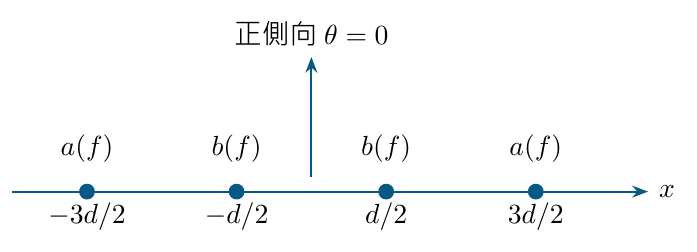
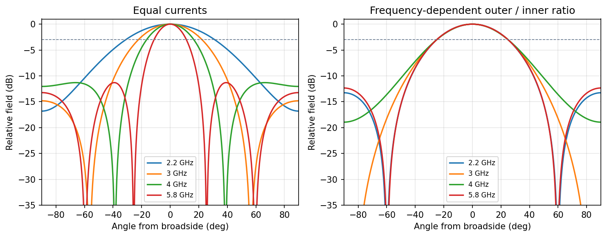
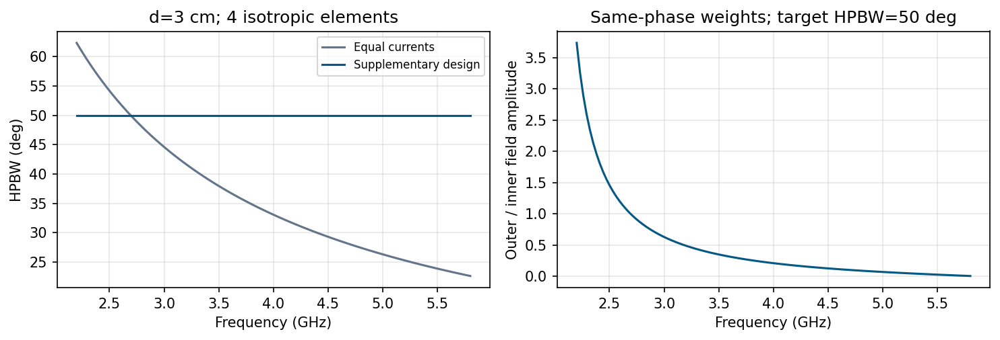
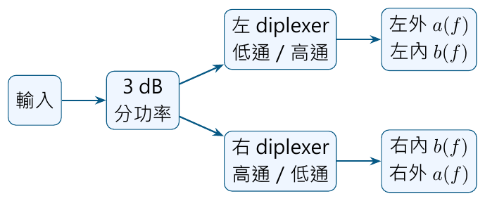

# 單元 28｜陣列的頻率響應觀點

[下載原始 PDF](../pdf/028_陣列的頻率響應觀點.pdf)

用選頻饋入維持波束寬度

原始影片：[陳晏笙老師「天線」單元 28](https://www.youtube.com/watch?v=VxX5IRE_2r4)

影片長度：約 49 分鐘　建議閱讀：約 25 分鐘

前置單元：23～27；單元 2 的濾波器概念也有幫助。

> **核心觀念：** 固定的實體間距，會隨頻率變成不同的電氣間距。想要寬頻內維持相近波束，不能只讓 $S_{11}$ 合格；必須讓各元件的複數饋入權重隨頻率一起變化。

## 本單元的四個目標

1.  用 $kd=2\pi fd/c$ 解釋頻率增加時波束常變窄。

2.  看懂影片內、外兩組饋入的四元件模型。

3.  跟著補充算例，反求固定 HPBW 所需的振幅比例。

4.  把模型映射到濾波器／diplexer，並同時檢查旁瓣、EF、相位及損耗。

## 影片的真正設計目標

影片以寬頻 Vivaldi 陣列為應用，目標是指定頻帶內，半功率寬度變動盡量小。它先用等向元件算 AF，再加入指向性 EF、不等間距與實際選頻饋網。這與只在一個頻率壓旁瓣不同。

## 閱讀地圖

第 2 頁：頻率與空間相位；第 3 頁：內外組模型；第 4 頁：固定 50° 的算例；第 5 頁：重繪比較；第 6 頁：旁瓣、EF 與間距；第 7 頁：饋網實作；第 8 頁：自測。 依影片板書與選頻饋入圖重寫；50° 表格及重繪圖為補充解析例，不是從原圖讀取的實測數據。

## 1．為什麼頻率改變，場型也會改變？

影片對照：[00:00](https://www.youtube.com/watch?v=VxX5IRE_2r4&t=0s)－[08:00](https://www.youtube.com/watch?v=VxX5IRE_2r4&t=480s)

一般遠場：

$$
E(f,\hat{\mathbf r})=C(f,r)\,\mathrm{EF}(f,\hat{\mathbf r})
\sum_n c_n(f)e^{jk(f)\hat{\mathbf r}\cdot\mathbf r_n}.
$$

三種頻率依賴同時存在：元件 EF、空間相位 $k(f)\hat{\mathbf r}\cdot\mathbf r_n$，以及饋網產生的 $c_n(f)$。其中自由空間 $k(f)=2\pi f/c$。

### 固定間距不等於固定 $d/\lambda$

$d=3$ cm，在 2 GHz 為 $0.2\lambda$，到 6 GHz 為 $0.6\lambda$。同樣四個等幅元件，電氣跨度增加，正側向主瓣通常變窄，其他波瓣也可能進入可見區間。

$$
\mathrm{HPBW}_{\rm rad}\approx0.886\frac{c}{Ndf}
\quad\text{（窄主瓣均勻線陣）}.
$$

這只是主瓣近似；小陣列、寬波束仍要回到有限和求半功率交點。

### 補充：和 FIR 頻率響應的數學連結

均勻間距 AF 寫成 $\sum c_ne^{jn\psi}$。FIR 的離散頻率響應是

$$
H(e^{j\Omega})=\sum_n h_ne^{-jn\Omega}.
$$

取 $h_n=c_n,\Omega=-\psi$，就得到同一個複數和。振幅 taper 類似窗函數，零點類似陷波；但天線只看由角度映射出的可見 $\psi$ 區間，且還要乘 EF。

### 頻率固定與角度固定，是不同切法

固定 $f$，掃角度是場型。固定某個觀察方向，掃 $f$，則是一個由幾何延遲與饋網共同決定的頻率響應。不能把一張場型圖當成實際 RF 濾波器的全頻響應。

> **核心觀念：** 同一個複數和可以沿角度或頻率觀看；實體天線仍多了 EF、互耦、損耗及可見方向的限制。

## 2．影片四元件：低頻用外組，高頻轉向內組

影片對照：[約 08:00](https://www.youtube.com/watch?v=VxX5IRE_2r4&t=480s)－[26:00](https://www.youtube.com/watch?v=VxX5IRE_2r4&t=1560s)

影片將四個元件分成內、外兩組，均為對稱饋入。等間距 $d$，以中心為原點：

$$
x_n=-3d/2,-d/2,+d/2,+3d/2.
$$

內組複數權重 $b(f)$，外組 $a(f)$；角度 $\theta$ 從正側向起算：

$$
\boxed{\mathrm{AF}=
2b(f)\cos\!\left(\frac{kd}{2}\sin\theta\right)
+2a(f)\cos\!\left(\frac{3kd}{2}\sin\theta\right).}
$$

### 兩組各自代表不同跨度

只有外組：跨度 $3d$，波瓣較窄，但較早產生重複波瓣。只有內組：跨度 $d$，波束較寬。等幅四源是兩組的相干疊加，不是兩張功率圖的平均。

### 用頻率選擇「有效孔徑」

低頻電氣間距小，可以給外組較高比重以收窄波束；高頻則降低外組、提高內組，使有效輻射範圍縮小，補償頻率上升造成的自然變窄。

### 同相是設計條件，不是濾波器自動保證

只有 $a,b$ 相位一致時，才可直接用下一頁的正實數比例。實際濾波器同時改振幅與相位，相對相位差會改變波束與零點，必須一起分析。

> **核心觀念：** 固定物理布局，改變各部分的頻率權重，就能讓有效孔徑隨頻率縮放。

## 3．補充算例：反求固定 50° 的權重比例

沿用影片四元件、等向源與同相內外組；非原影片數據。

選 $d=3$ cm，目標 HPBW 為 50°，半功率點 $\theta_h=25^\circ$。令內組 $b=1$、外組 $a=r$；共同尺度不影響正規化場型：

$$
q=\frac{kd}{2}\sin25^\circ,\qquad
F_n(\theta_h)=
\frac{\cos q+r\cos3q}{1+r}.
$$

在主瓣第一個交點要求 $F_n=1/\sqrt2=h$：

$$
\boxed{r(f)=\frac{h-\cos q}{\cos3q-h},\quad
h=\frac1{\sqrt2}.}
$$

| 頻率    | 外／內場幅比例 $r=a/b$ | 正規化功率 $P_n(25^\circ)$ |
|:--------|:-----------------------|:---------------------------|
| 2.2 GHz | 約 3.734               | 0.5                        |
| 3.0 GHz | 約 0.631               | 0.5                        |
| 4.0 GHz | 約 0.213               | 0.5                        |
| 5.0 GHz | 約 0.0722              | 0.5                        |
| 5.8 GHz | 約 0.00779             | 0.5                        |

$c=3\times10^8$ m/s。可見外組由低頻的主力，轉成高頻極小的比重。這個表只算相對比例；若設計無源網路，還需按可用輸入功率、阻抗與損耗規定共同尺度。

### 先檢查模型可行範圍

當 $r<0$，代表同相正振幅模型做不到此目標，需要改條件；分母為零也要檢查極限。本例只有外組與只有內組的半功率寬度，界定約 1.97～5.92 GHz 的正比值範圍。

### 一個角度達半功率，還不等於完成整體設計

仍須驗證 25° 是從主峰出去遇到的第一個交點，主瓣內沒有更早的谷底；還要算旁瓣、其他角度與實際 EF。本例下一頁掃過整個前半角域作檢查。

> **核心觀念：** 解析比例可以當初始設計；最終設計要同時驗證整張場型與實際複數饋網。

## 4．重繪比較：固定饋入與選頻饋入

補充圖：2.2～5.8 GHz，$d=3$ cm，四個等向元件。

左圖等幅 $a=b$，頻率提高時，主瓣半功率交點向 0° 移動。右圖用前頁比例，交點維持在 $\pm25^\circ$。場型其他部位沒有完全重合，所以**固定 HPBW 不代表整個三維場型頻率不變**。

本例給的是理想同相權重，不是已經實作的低損耗饋網。影片則以最佳化權重、濾波器實作及真實 Vivaldi EF 展示更多條件下的取捨。

### 固定寬度也不保證固定增益

功率可用性、效率、EF 與三維總積分仍會隨頻率變化。兩個主面寬度相近，也不能直接說 realized gain 相同；饋網損耗與匹配尤其要另外檢查。

> **核心觀念：** 把「寬度不變」作為一個明確目標，而不是把它誤讀成所有天線性能都不變。

## 5．影片三個改良：旁瓣、EF、不等間距

影片對照：[約 26:00](https://www.youtube.com/watch?v=VxX5IRE_2r4&t=1560s)－[41:00](https://www.youtube.com/watch?v=VxX5IRE_2r4&t=2460s)

### 間距增加可以變窄，也可能縮小合格頻帶

影片比較約 3 cm 與 5.6 cm 的等間距模型。較大間距可得到較窄目標 HPBW，但高頻旁瓣或重複方向變強，使「旁瓣也合格」的操作頻帶變窄。應取 HPBW 與 SLL 等條件的交集。 影片圖中目標寬度約由 50° 縮成 30°；5.6 cm 案例若還要求 SLL 低於 $-10$ dB，合格範圍約只剩 3～4 GHz。這是特定模型的讀圖值，說明匹配頻帶寬不保證場型的可用頻帶同樣寬。

### 加入指向性元件

影片以 Vivaldi 取代等向 EF，讓

$$
E_{\rm total}(f,\theta)=\mathrm{EF}(f,\theta)\,
\mathrm{AF}(f,\theta).
$$

若 EF 在不希望方向較弱，可以壓低總場旁瓣，擴展可用頻帶；但 EF 本身也隨頻率改變。不能先假設 Vivaldi 「寬頻」就等於其場型、增益或極化完全不變。

### 不等間距多一個幾何自由度

影片定內組距離 $d$，外組跨度為 $3dr$（此處幾何比例 $r$，與前面的振幅比不同）。例如 $d=4.133$ cm、$r=1.5$，外組跨度約 18.60 cm，內組仍為 4.133 cm。 改變內、外組跨度比，可重新分配低、高頻的自然寬度以及旁瓣位置。影片指出增加幾何比例可擴展操作頻帶，但提升到某程度後，旁瓣仍成為限制。

### 不要把圖上案例的最佳值泛化

影片的數值包含特定 EF、布局、頻率與目標條件；不是「間距越不均勻越好」。應逐頻率算總場 HPBW、SLL、增益與匹配，觀察哪一條件首先失敗。

> **核心觀念：** 加權、元件方向性與位置可一起設計；每多一個自由度，都要重新驗證整個頻帶的總場。

## 6．實作：把 $a(f),b(f)$ 變成選頻饋入網路

影片對照：[約 41:00](https://www.youtube.com/watch?v=VxX5IRE_2r4&t=2460s)－[48:53](https://www.youtube.com/watch?v=VxX5IRE_2r4&t=2933s)

影片的流程是：先由最佳化求頻率權重，以「各採樣頻率的 HPBW 變動盡量小」作目標，再比較二、三、四階 Butterworth 類型濾波器的擬合。影片案例最後採四階，製作四元件 Vivaldi 與饋網，再和均勻饋入的量測比較。

### diplexer 的用途

輸入經 3 dB 分配到左右兩邊；每邊用 diplexer 將不同頻率比重分配到外、內元件。外組偏低通、內組偏高通，使低頻使用較大孔徑、高頻使用較小孔徑。

### 階數增加不是免費改善

較高階可更貼近振幅目標，但帶來更多元件、線長、群延遲與損耗。要共同檢查

$$
a(f)=|a(f)|e^{j\alpha(f)},\qquad
b(f)=|b(f)|e^{j\beta(f)}
$$

的相對相位 $\alpha-\beta$，不能只擬合兩條幅度圖。

### 完成設計的驗證順序

1.  選低、中、高頻與潛在最差頻率，不只檢查中心頻點。

2.  使用完整複數饋網、實際 EF 與互耦，計算總場。

3.  檢查 HPBW、SLL、匹配、增益與功率損耗是否都合格。

4.  量測饋入幅相，再量完整切面；誤差若填起零點，回到模型校正。

> **核心觀念：** 「權重函數」最終是一個有阻抗、相位與損耗的網路；實體性能由整個系統一起決定。

## 7．五題自測與答案

先作答，再看解析。

1.  間距固定 3 cm，頻率從 2 到 6 GHz，$d/\lambda$ 如何變化？

2.  為保持相近 HPBW，低頻與高頻應偏重四源的哪一組？原因為何？

3.  固定 50° 算例的 4 GHz 外／內場幅比例約是多少？能直接把它當成兩埠功率比嗎？

4.  兩濾波器幅度完美符合設計，但相對相位不符，總場會維持原設計嗎？

5.  HPBW 在頻帶內近乎固定，就能宣布該天線是完全頻率不變的天線嗎？

### 答案與解析

1.  由 0.2 變成 0.6；頻率三倍，電氣間距也三倍。

2.  低頻偏外組、取得較大有效跨度；高頻偏內組，抵消自然波束變窄。

3.  約 0.2127。它是場幅／電流比例；在相同實阻抗條件下，功率比為其平方約 0.0452，不是 0.2127。

4.  未必。複數場相干相加，相位誤差會改變干涉、零點與主瓣。

5.  不能。其他角度的場型、EF、旁瓣、匹配與增益仍可變；應說「指定頻帶內 HPBW 符合目標」。

### 回看影片

[12:00：選頻權重](https://www.youtube.com/watch?v=VxX5IRE_2r4&t=720s)；[24:00：HPBW 與 SLL](https://www.youtube.com/watch?v=VxX5IRE_2r4&t=1440s)；[34:00：Vivaldi EF](https://www.youtube.com/watch?v=VxX5IRE_2r4&t=2040s)。

[38:00：不等間距](https://www.youtube.com/watch?v=VxX5IRE_2r4&t=2280s)；[42:00：diplexer 與擬合](https://www.youtube.com/watch?v=VxX5IRE_2r4&t=2520s)；[44:00：實作照片](https://www.youtube.com/watch?v=VxX5IRE_2r4&t=2640s)。

### 課程學完後的整體練習

選一個小型線陣：先定頻率、空間、目標方向與極化；算匹配及效率；再求 AF、總場、D 與 G；用鏈路預算檢查通訊餘裕；最後掃頻率檢查波束與匹配頻帶是否重合。每一步都能回到本套對應單元。
