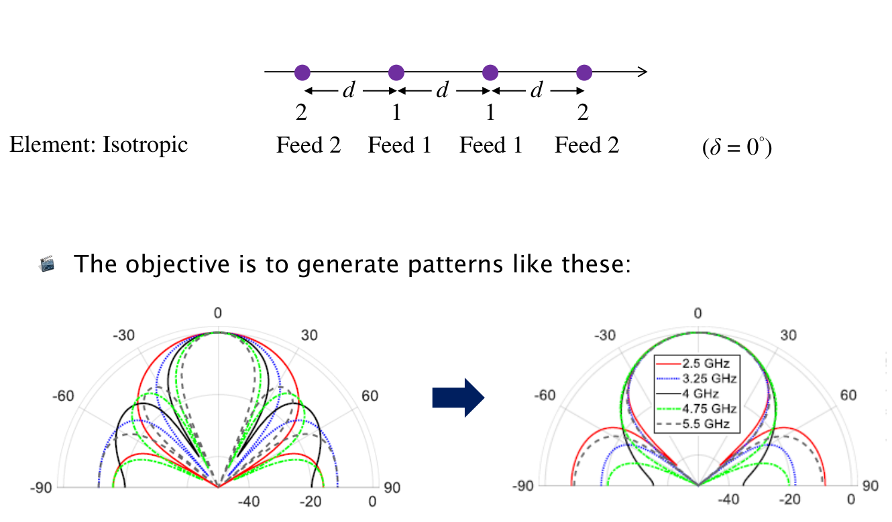
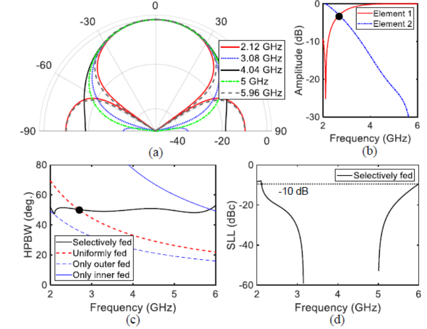
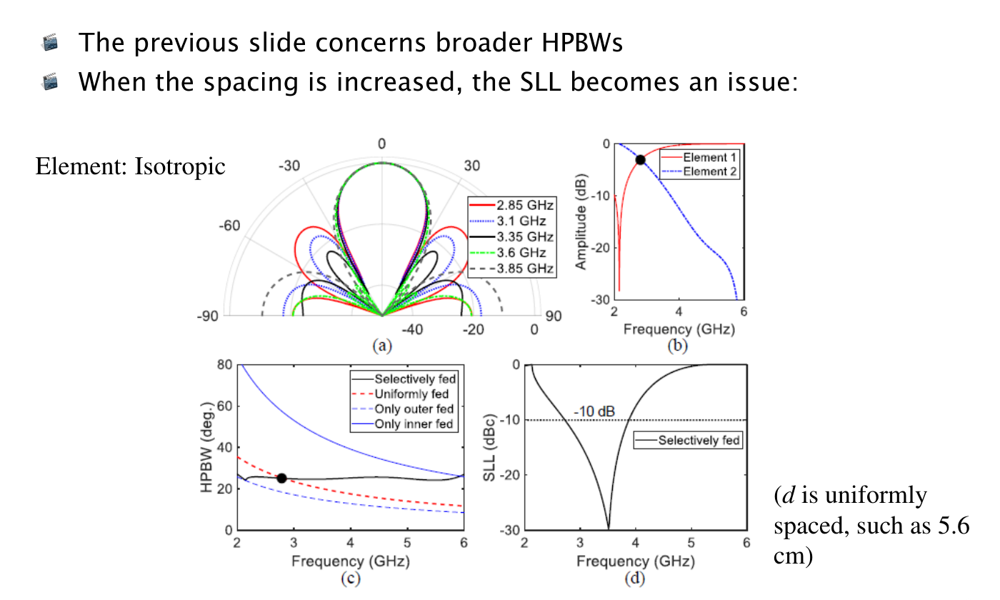
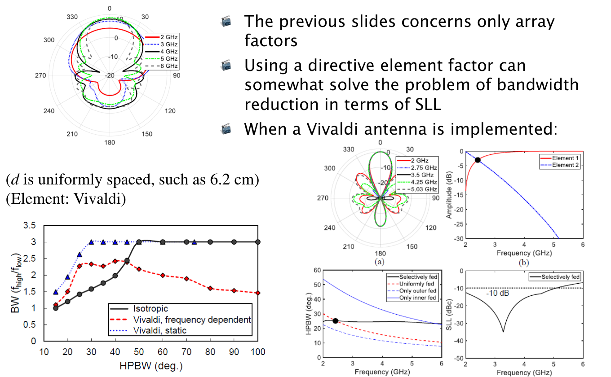
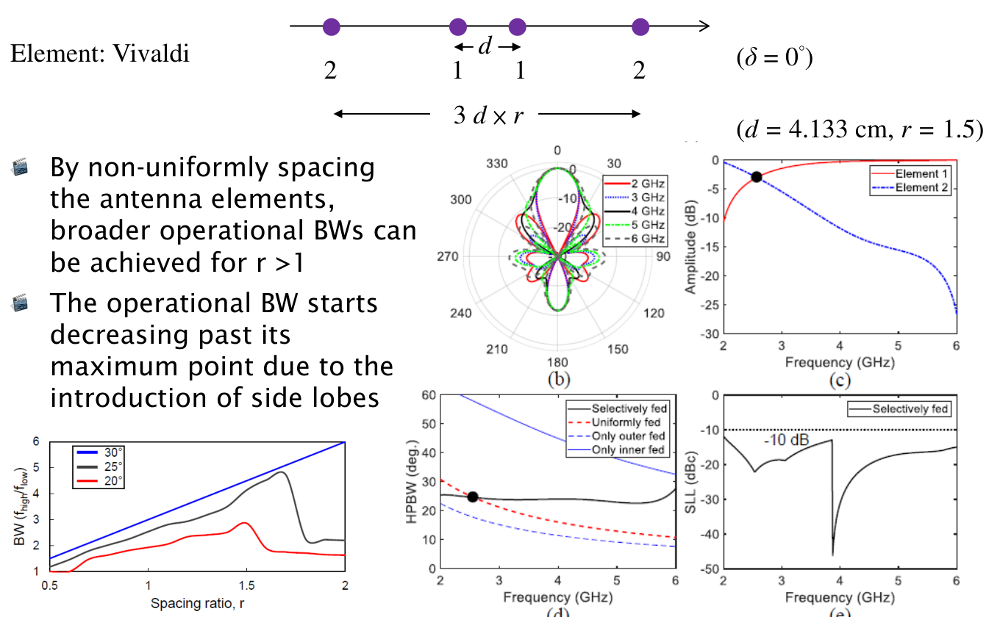
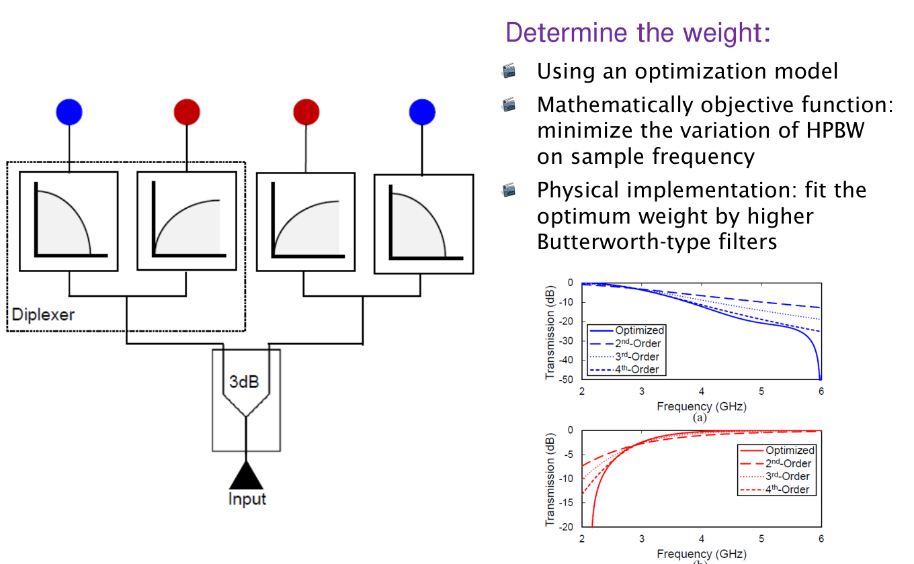
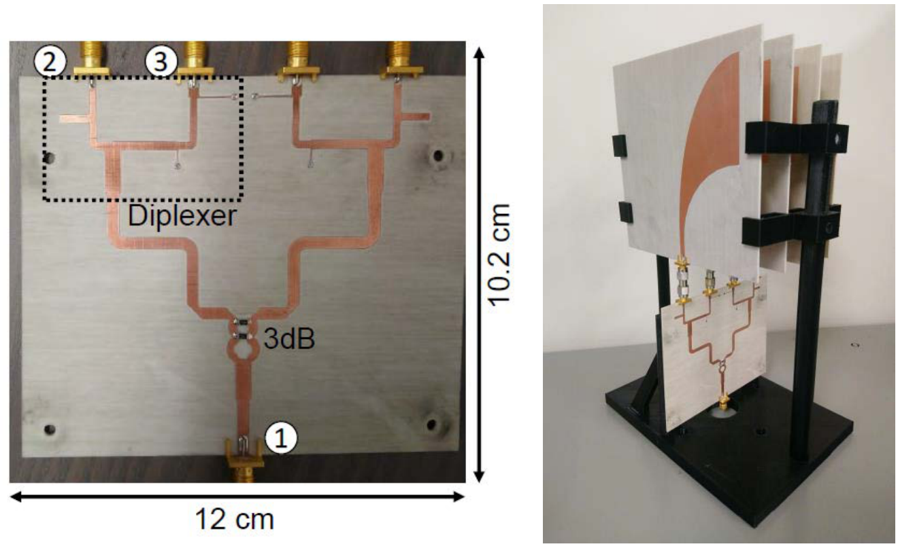
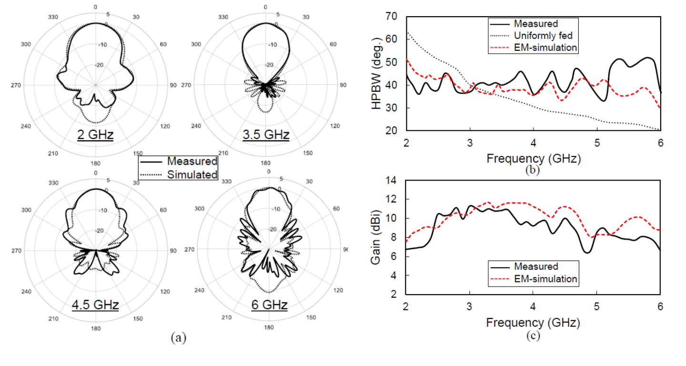

# 單元 28｜陣列的頻率響應觀點

用隨頻率改變的饋入權重，讓寬頻陣列的波束寬度盡量保持穩定。

原始影片：[陳晏笙老師「天線」單元 28](https://www.youtube.com/watch?v=VxX5IRE_2r4)（48:53）

老師講義：[Lecture 6：Array Fundamentals／陣列基礎](https://drive.google.com/file/d/1R3MSohfcRyOONnIcZhn96AkJDZwSqRJv/view)，PDF 第 **105–115 頁**，6.7「Constant HPBW Applications」。第 105 頁為本節目錄。

建議閱讀：約 40 分鐘。前置單元：23～27；單元 2 的濾波器概念也有幫助。

本單元依老師「頻率相依場型 → 內外組選頻饋入 → 間距與旁瓣 → 元件方向性 → 不等間距 → 實作與量測」的順序整理。讀完應能說明：固定實體間距為何會產生不同頻率的場型、如何用權重控制有效孔徑，以及為何固定半功率波束寬度（half-power beamwidth, HPBW）還需要同時檢查旁瓣與增益。

> **核心觀念：** 寬頻匹配不等於寬頻場型穩定。要讓不同頻率的波束寬度接近，必須把元件因子、電氣間距及饋入權重一起考慮。

**老師的開場連結（[約 00:30–02:30](https://www.youtube.com/watch?v=VxX5IRE_2r4&t=30s)）：** 前幾節在單一頻率下調整相位、權重與零點，本節要把同一套思考擴展到整個頻帶。上一節的邊緣激發（Edge Excitation）只使用最外側兩個元件，看似浪費中間元件，卻能當成判斷可達波束寬度的極端情況；把陣列拆成內、外兩組，正是本節解法的起點。

老師以 2～6 GHz 作寬頻例子。若中心頻率取算術平均 4 GHz，絕對頻寬為 4 GHz、分數頻寬為 100%，上／下限頻率比則為 3；這三種表示法不能混用。接著在[約 02:30–03:40](https://www.youtube.com/watch?v=VxX5IRE_2r4&t=150s)強調：除了阻抗，HPBW、前後比、軸比、增益與效率都能各自訂定合格門檻，得到各自的可用頻帶。

## 講義與影片對照

以下連結已對照影片口述與關鍵畫面，是主題定位點，**不是精確換頁時間**；老師會在投影片與板書間來回，也曾提前展示文獻頁。正文按講義頁序編排，章末的固定 50° 算例與重繪曲線另標為補充。

| 講義頁碼 | 原英文主題 | 中文內容 | 影片定位 |
|:--|:--|:--|:--|
| 105 | Constant HPBW Applications | 本節目錄與設計目標 | 約 [02:30](https://www.youtube.com/watch?v=VxX5IRE_2r4&t=150s) |
| 106 | Frequency-Dependent Patterns | 四元件均勻饋入，場型隨頻率改變 | 約 [04:30](https://www.youtube.com/watch?v=VxX5IRE_2r4&t=270s) |
| 107 | Make HPBW as Constant as Possible | 分成內、外兩組，讓主瓣寬度接近 | 約 [08:00](https://www.youtube.com/watch?v=VxX5IRE_2r4&t=480s) |
| 108 | How Do We Achieve This? | 3 cm 等間距案例；權重、HPBW、SLL 對照 | 約 [12:00](https://www.youtube.com/watch?v=VxX5IRE_2r4&t=720s)；[18:20](https://www.youtube.com/watch?v=VxX5IRE_2r4&t=1100s) 有內外組板書 |
| 109 | Trade-off between HPBW and SLL | 5.6 cm 等間距：窄波束與旁瓣的取捨 | 約 [28:40](https://www.youtube.com/watch?v=VxX5IRE_2r4&t=1720s) |
| 110 | Using a Directive Element Factor | 6.2 cm 等間距 Vivaldi 與頻寬比較 | 約 [35:00](https://www.youtube.com/watch?v=VxX5IRE_2r4&t=2100s) |
| 111 | Enhance BW Using Non-Uniform Spacing | 內距與外跨度分開設計 | 約 [40:00](https://www.youtube.com/watch?v=VxX5IRE_2r4&t=2400s)；[39:10](https://www.youtube.com/watch?v=VxX5IRE_2r4&t=2350s) 有板書 |
| 112 | Implementation (1/2) | 最佳化、Butterworth 擬合、選頻饋網 | 約 [42:00](https://www.youtube.com/watch?v=VxX5IRE_2r4&t=2520s) |
| 113 | Implementation (2/2) | 饋入網路與 Vivaldi 陣列實體 | 約 [43:40](https://www.youtube.com/watch?v=VxX5IRE_2r4&t=2620s) |
| 114 | Results | 四個頻率的場型、HPBW 與增益量測 | 約 [45:00](https://www.youtube.com/watch?v=VxX5IRE_2r4&t=2700s) |
| 115 | Related Studies | 固定波束寬度與選頻饋網的研究脈絡 | 約 [46:40](https://www.youtube.com/watch?v=VxX5IRE_2r4&t=2800s) |

## 1．固定陣列，為什麼頻率一變場型就變？（Frequency-Dependent Patterns，p.106）

老師先從四個等間距、等向性元件開始，令相鄰元件的等差饋入相位為 $`\delta=0^\circ`$，也就是同相激發。投影片比較 2.5、3.25、4、4.75、5.5 GHz：即使各元件的饋入振幅完全相同，主瓣寬度與旁瓣位置仍不相同。

在[約 03:50–05:00](https://www.youtube.com/watch?v=VxX5IRE_2r4&t=230s)，老師提醒這裡的等向性點源是理想比較模型。等向性（isotropic）指整個立體角的輻射強度相同；全向性（omnidirectional）通常只要求某一切面均勻，兩者不能互換。即使先把元件本身的頻率變化完全拿掉，陣列幾何仍會造成頻率相依場型。

原因在於相位累積看的是「相隔幾個波長」，不只是尺量出的公分數：

```math
k(f)d=\frac{2\pi d}{\lambda}=\frac{2\pi fd}{c}.
```

例如實體間距固定 $`d=3`$ cm，在 2 GHz 是 $`0.2\lambda`$，在 6 GHz 已是 $`0.6\lambda`$。頻率越高，陣列相對於波長越大；在這類正側向陣列中，主瓣通常逐漸變窄，其他波瓣也可能進入可見角域。

這也說明為何「使用寬頻 Vivaldi 元件」仍不夠。寬頻內可接受功率，只解決部分匹配問題；若系統要求不同頻率覆蓋相近角度，還要另外處理場型的頻率變化。

## 2．設計目標：把四個元件分成內、外兩組（Make HPBW as Constant as Possible，p.107）

老師希望不同頻率的主瓣盡量重合，尤其讓 HPBW 的變動減少。因此四個位置仍保持對稱，但不再要求四個元件在所有頻率都有相同振幅。



*來源：老師 Lecture 6，p.107 局部。原投影片圖源為 D. Simpson 與 D. Psychogiou，2021；左、右為設計概念對照。*

投影片的「1、2」是**兩種饋入權重的組別**。本筆記沿用既有示意圖的 $`a,b`$，對照如下：

| 講義標示 | 元件位置 | 本筆記複數權重 | 等間距時兩元件跨度 |
|:--|:--|:--|:--|
| Feed 1／Element 1 | 中間兩支，內組 | $`b(f)`$ | $`d`$ |
| Feed 2／Element 2 | 最外兩支，外組 | $`a(f)`$ | $`3d`$ |


*補充示意圖：以陣列中心為原點，$`\theta=0^\circ`$ 是正側向。內組 $`b`$ 對應 Feed 1，外組 $`a`$ 對應 Feed 2。*

只用外組時，跨度較大，主瓣較窄，但也較容易出現其他強波瓣；只用內組時，跨度較小，主瓣較寬。**低頻多用外組、高頻多用內組**，便能讓有效孔徑隨頻率提高而縮小，抵消波束自然變窄的趨勢。

右圖的各頻率主瓣接近，不代表整張場型完全相同。旁瓣、背瓣與增益仍可能改變，所以本節的具體目標是「HPBW 盡量固定」。

## 3．3 cm 等間距：如何用權重把波束寬度拉平？（How Do We Achieve This?，p.108）

本頁先採四個等向性元件、同相饋入與 $`d=3`$ cm。老師把四種圖放在一起，讓我們同時看「想得到的場型」與「需要付出的權重」。



*來源：老師 Lecture 6，p.108 局部；原圖取自 Simpson 與 Psychogiou，2021。圖中頻點為 2.12、3.08、4.04、5、5.96 GHz，與章末自行設定的重算例題不同。*

| 原圖 | 要看什麼 | 讀圖結論 |
|:--|:--|:--|
| (a) 各頻率場型 | 主瓣的半功率交點是否接近 | 主瓣寬度接近，旁瓣形狀仍隨頻率變化 |
| (b) 內外組振幅 | 紅線 Element 1 與藍線 Element 2 | 內組在高頻占比提高；外組在高頻受到抑制 |
| (c) HPBW | 黑線選頻饋入，與均勻、僅內組、僅外組比較 | 選頻饋入約維持 50°；均勻饋入則持續變窄 |
| (d) 旁瓣位準（sidelobe level, SLL） | 與 $`-10`$ dB 門檻比較 | 在圖示主要操作範圍內，旁瓣也受到限制 |

(b)、(c) 的黑點用來對照內、外組權重相等的情況。當 $`a=b`$，四支元件便是均勻饋入；共同的幅度縮放不會改變正規化場型。黑線在該點與均勻饋入曲線相交。

### 老師板書：內組與外組是兩條不同的自然寬度曲線

約 [18:20](https://www.youtube.com/watch?v=VxX5IRE_2r4&t=1100s) 的板書畫出「裡面／外面」兩組的 HPBW 隨頻率下降，以及位於兩者之間的目標寬度。旁邊也重畫兩元件陣列的週期函數：

```math
\lvert \mathrm{AF}_{2,n}\rvert
=\left|\cos\frac{\Psi}{2}\right|,
\qquad
\Psi=kD\cos\phi+\delta.
```

這裡 $`D`$ 代表正在分析的那一對元件間距：內組取 $`D=d`$，外組取 $`D=3d`$；$`\phi`$ 從陣列軸起算。相同的餘弦函數，因 $`kD`$ 不同而映射成不同的角度寬度。這就是內外兩組可以互補的原因。

為了接回上面的示意圖，改用從正側向起算的 $`\theta`$，則 $`\cos\phi=\sin\theta`$。把兩個對稱元件各自的指數項合併，可將四元件模型整理成：

```math
\begin{aligned}
\mathrm{AF}(f,\theta)
&=b(f)\!\left(e^{-j(kd/2)\sin\theta}+e^{j(kd/2)\sin\theta}\right)\\
&\quad+a(f)\!\left(e^{-j(3kd/2)\sin\theta}+e^{j(3kd/2)\sin\theta}\right)\\
&=2b(f)\cos\!\left(\frac{kd}{2}\sin\theta\right)
+2a(f)\cos\!\left(\frac{3kd}{2}\sin\theta\right).
\end{aligned}
```

這是**複數場的相干疊加**，不能把內組與外組的兩張功率圖直接平均。上式是板書概念的代數整理；章末再用它反求一組理想權重，幫助理解圖中趨勢。

講義圖先考慮同相權重。實際濾波器也會改變相位，只有內、外組相位一致時，才能直接把 $`a/b`$ 當作正實數振幅比使用。

### 為什麼目標水平線不能任意選？

老師在[約 15:10–20:40](https://www.youtube.com/watch?v=VxX5IRE_2r4&t=910s)逐步畫出可調範圍：固定一個頻率，只開外組的波束較窄，只開內組的波束較寬；但兩條自然寬度曲線都隨頻率升高而下降。低頻時內組能做到的最寬波束，到高頻通常已無法維持；高頻時外組的最窄波束，也不能直接要求低頻照做。

以 $`H_{\rm out}(f)`$、$`H_{\rm in}(f)`$ 表示兩組單獨工作時的 HPBW，在本節同相、非負權重及所選正側向主瓣分支下，可將這個設計直覺整理為必要的共同範圍：

```math
H_{\rm out}(f)\le H_{\rm target}\le H_{\rm in}(f)
\quad\text{對所有設計頻率成立},
```

也就是

```math
\max_f H_{\rm out}(f)
\le H_{\rm target}\le
\min_f H_{\rm in}(f).
```

這不是包含任意複數激發、超指向性或所有旁瓣條件的普遍界限，而是老師用內外組建立的設計範圍。最低頻偏向只開外組，最高頻偏向只開內組，中間頻率才讓四支共同工作並調權重，便有機會連成近似水平線。若共同範圍不存在，就要改變幾何或目標，而非只反覆調振幅。

到[約 20:40–23:40](https://www.youtube.com/watch?v=VxX5IRE_2r4&t=1240s)，老師把這個思路翻成電路：**外組使用低通型傳輸響應，內組使用高通型傳輸響應**。理想端點可接近另一組關閉，中間頻率則以最佳化或誤差最小化選權重；它不是在兩組功率場型之間做線性內插。實際饋網的設計見 p.112。

## 4．5.6 cm 等間距：波束變窄，旁瓣卻可能限制頻寬（Trade-off between HPBW and SLL，p.109）

若把 $`d`$ 增加為 **5.6 cm**，可以得到較窄的主瓣。但老師要提醒的是：HPBW 達標的頻帶，不一定全都能使用。



*來源：老師 Lecture 6，p.109 局部；原圖取自 Simpson 與 Psychogiou，2021。以下數值為原圖讀值，並非重新量測。*

本頁選頻饋入的 HPBW 約 **25°**。雖然黑色 HPBW 曲線在較大頻段內都接近水平，SLL 卻在低頻端與高頻端升高。若要求 SLL 不高於 $`-10`$ dB，圖中合格頻帶大約只剩 **2.85～3.85 GHz**；所列的五張場型也選在這個範圍內。

**口述與圖值對照：** 老師在[約 27:00–27:30](https://www.youtube.com/watch?v=VxX5IRE_2r4&t=1620s)口頭稱此例約 30°；依該頁 HPBW 黑線與縱軸，正文採約 25°。後面口述以「約 3～4 GHz」概括可用範圍，本筆記則保留圖中約 2.85～3.85 GHz 的讀值。

| 等向性案例 | 等間距 | 選頻饋入 HPBW | 主要觀察 |
|:--|:--|:--|:--|
| p.108 | 3 cm | 約 50° | 寬波束較容易在廣頻帶內兼顧旁瓣 |
| p.109 | 5.6 cm | 約 25° | 即使寬度接近固定，SLL 仍把可用頻帶縮小 |

因此可用頻帶應取各條件的交集，例如：

```math
\mathcal B_{\rm usable}
=\mathcal B_{\rm HPBW}\cap\mathcal B_{\rm SLL}
\cap\mathcal B_{\rm matching}\cap\mathcal B_{\rm gain}.
```

這個交集是讀圖後的設計整理。老師本頁直接展示的是 HPBW 與 SLL 的取捨，並沒有在此頁提供完整的匹配或增益數據。

### 為什麼兩端頻率特別容易出現大旁瓣？

老師在[約 28:30–31:00](https://www.youtube.com/watch?v=VxX5IRE_2r4&t=1710s)要求回到兩元件 AF 思考：低頻主要剩外組，高頻主要剩內組，兩端都接近兩元件陣列。若其電氣間距已把下一個週期峰值帶入可見角域，便會出現接近主瓣高度的另一個波束。

用本頁尺寸檢查就很直觀：2 GHz 時外組跨度為 16.8 cm，6 GHz 時內組跨度為 5.6 cm，兩者分別都是當時的 $`1.12\lambda`$。對同相兩元件，$`\Psi=0,\pm2\pi`$ 的峰值都可能落入可見角域。因此「縮成兩支」不保證旁瓣低；反過來說，也不是任意兩元件陣列都必然出現等高旁瓣，還要看間距與可見區間。

這裡的 $`-10`$ dB 是論文採用的 SLL 門檻。老師在[約 30:20–31:30](https://www.youtube.com/watch?v=VxX5IRE_2r4&t=1820s)認為它偏寬鬆，並舉更低門檻作提醒；實際仍應依系統需求訂規格，不把某個 dB 值當成所有陣列共同的標準。

## 5．把等向性元件換成 Vivaldi（Using a Directive Element Factor，p.110）

前面只有陣列因子（array factor, AF）；本頁加入具有方向性的元件因子（element factor, EF），並以 **6.2 cm 等間距 Vivaldi 陣列**為例。

```math
E_{\rm total}(f,\theta)
=\mathrm{EF}(f,\theta)\,\mathrm{AF}(f,\theta).
```

若 EF 在 AF 旁瓣所在的方向較弱，相乘後的總場旁瓣便可能降低。這使某些原本被 SLL 排除的頻率重新可用。



*來源：老師 Lecture 6，p.110 局部；原圖取自 Simpson 與 Psychogiou，2021。*

本頁有兩層比較，不能只看右邊的漂亮主瓣：

- **右側案例：** 指向性 EF 配合選頻權重，讓約 25° 的主瓣在較廣頻段維持相近寬度；SLL 圖也顯示比前頁的等向性窄波束案例更寬的合格範圍。
- **左上元件場型：** Vivaldi 的 EF 本身隨頻率改變，並非一張固定形狀的濾波遮罩。
- **左下頻寬比較：** 黑線為等向性元件，藍線為假設 EF 不變的 Vivaldi，紅線則納入 Vivaldi 的頻率變化。固定 EF 的理想化結果，可能高估真實可達頻寬。

左下圖的縱軸是頻率比：

```math
\mathrm{BW}_{\rm ratio}=\frac{f_{\rm high}}{f_{\rm low}},
```

不是 $`f_{\rm high}-f_{\rm low}`$，也不是以中心頻率正規化的百分比頻寬。圖中真實 Vivaldi 的優勢隨目標 HPBW 而變，不能推成「換成 Vivaldi，所有寬度的可用頻帶都一定增加」。

老師在[約 32:00–35:50](https://www.youtube.com/watch?v=VxX5IRE_2r4&t=1920s)將解法連回本章開頭的場型相乘法則：AF 在不想要的方向有強波瓣時，可以利用 EF 在該方向較弱、甚至接近零點的特性抑制它。不必先要求 AF 自己完美，才開始考慮元件；但真實 EF 也會隨頻率改變，所以要在整個頻帶檢查零點與弱輻射方向是否仍對得上。這也是左下圖必須區分固定 EF 與真實 EF 的原因。

## 6．不等間距：分開調整內距與外跨度（Enhance BW Using Non-Uniform Spacing，p.111）

等間距把內、外組跨度綁在 $`1:3`$。老師再增加一個幾何自由度：內組距離維持 $`d`$，外組跨度改為 $`3dr`$，其中 **$`r`$ 是幾何比例**。



*來源：老師 Lecture 6，p.111 局部；原圖取自 Simpson 與 Psychogiou，2021。*

投影片案例：

```math
d=4.133\ {\rm cm},\qquad r=1.5,\qquad
3dr=18.5985\ {\rm cm}\approx18.60\ {\rm cm}.
```

以中心為原點，位置就是 $`-3dr/2,-d/2,+d/2,+3dr/2`$。前面的四元件 AF 只需把外組的跨度 $`3d`$ 換成 $`3dr`$。

老師在[約 37:10–38:30](https://www.youtube.com/watch?v=VxX5IRE_2r4&t=2230s)明確比較前後兩頁：前頁 $`d=6.2`$ cm 的等間距陣列，外組跨度也是 $`3d=18.6`$ cm；本頁幾乎保留外組跨度，卻把內組拉近為 4.133 cm。因此相較於說「外組拉遠」，本例更直接的理解是「外組幾乎不動、內組靠近」。外組繼續照顧低頻的窄波束，較近的內組則在高頻提供更寬的自然波束，增加調整空間。約 [39:10](https://www.youtube.com/watch?v=VxX5IRE_2r4&t=2350s) 的板書也用內、外組曲線間的區域說明這種可調範圍。

原圖右側在 2～6 GHz 展示接近 25° 的 HPBW，以及低於 $`-10`$ dB 的 SLL。左下圖則比較 20°、25°、30° 三種目標：在適當範圍增加 $`r`$ 有助於擴展頻寬，但 20°、25° 曲線在某個比例後明顯下降，原因是旁瓣開始限制操作；30° 曲線在圖示範圍內仍上升。

因此不能只記「不等間距越大越好」。應把位置、權重、實際 EF 與旁瓣一起掃頻檢查。本頁的 $`r`$ 只表示幾何；章末的**外／內振幅比改用 $`\rho=a/b`$**，避免混用。

在[約 38:30–40:10](https://www.youtube.com/watch?v=VxX5IRE_2r4&t=2310s)，老師強調新的自由度使目標可以稍微放寬，用較寬主瓣換取旁瓣改善，最後才讓整個 2～6 GHz 都達到該例的 $`-10`$ dB 門檻。這是此設計的取捨，不代表只要滿足能量守恆就能算出唯一的 HPBW／SLL 關係；仍需用完整場型驗證。

## 7．實作 1/2：把最佳化權重做成濾波器（Implementation，p.112）

前面的曲線先回答「每個頻率需要多少內、外組權重」。老師接著說明如何把這個目標轉為饋入網路：

1. 在一組採樣頻率上調整權重，使 HPBW 的變動盡量小。
2. 得到理想的內、外組頻率響應。
3. 用可實作的 Butterworth 類型濾波器擬合，並比較二、三、四階的差異。



*來源：老師 Lecture 6，p.112 局部；原圖取自 Simpson 與 Psychogiou，2021。上方藍色曲線對應外組，下方紅色曲線對應內組。*

外組需要隨頻率上升而衰減，內組則需要隨頻率上升而取得較多能量。圖中較高階的響應能更接近部分理想權重，但仍不是完全相同。

**實際採用階數已由口述確認（[約 42:20–43:30](https://www.youtube.com/watch?v=VxX5IRE_2r4&t=2540s)）：** 先求目標傳輸參數，再以二、三、四階響應作曲線擬合。老師指出二階低通在高頻的抑制不足，二階高通在低頻的抑制也不足；四階較接近目標，因此最後採用**四階 Butterworth 型濾波器**實現此例的頻率選擇饋入。

### diplexer 與 3 dB 分配器各做什麼？


*補充示意圖：把 p.112 的饋入流程改畫為中文。*

輸入先經 Wilkinson 3 dB 功率分配器分到左右兩邊；每邊的雙工分頻器（diplexer）再把低頻偏重的支路接到外組、高頻偏重的支路接到內組。這樣既保持左右對稱，又讓有效孔徑隨頻率改變。理想 3 dB 等分表示每一路取得一半輸入功率，不代表一半功率都耗散在分配器內。

老師在[約 40:50–42:00](https://www.youtube.com/watch?v=VxX5IRE_2r4&t=2450s)特別區分兩種「分組」：**分析時按內組／外組分，硬體則每一側各用一個 diplexer，同時供應該側的一支內元件與一支外元件。** 不能因為理論把內組畫在一起，就誤以為同一個 diplexer 的兩輸出都接內組。

### 從振幅圖走到實體網路，還要補上相位

實際權重為：

```math
a(f)=|a(f)|e^{j\alpha(f)},\qquad
b(f)=|b(f)|e^{j\beta(f)}.
```

即使振幅擬合得很好，相對相位 $`\alpha-\beta`$ 不符，也會改變相干疊加的結果。較高階網路還可能增加元件、線長、群延遲與損耗。這是將講義振幅設計落實時應檢查的條件，不能只憑兩條幅度曲線宣布設計完成。

## 8．實作 2/2：饋網與四元件 Vivaldi 硬體（Implementation，p.113）



*來源：老師 Lecture 6，p.113 局部；原圖取自 Simpson 與 Psychogiou，2021。*

左圖將前頁方塊圖實作成平面饋入網路：下方端口 1 為輸入，中間為 3 dB 分配部分，左右各有分頻支路。虛線框圈出一組 diplexer，照片中的端口 2、3 是該分頻器的兩個輸出。圖上 **12 cm × 10.2 cm 是饋網板的尺寸**，不是整組天線的高度與寬度。

右圖把饋網接到四支 Vivaldi 天線，固定在支架上。這一步將理想權重轉為包含連接、傳輸線與天線負載的完整系統，因此下一頁必須用量測確認場型與增益。

## 9．實際結果：寬度比較穩定，增益仍有起伏（Results，p.114）



*來源：老師 Lecture 6，p.114 局部；原圖取自 Simpson 與 Psychogiou，2021。數值若以下列文字表示，均為讀圖約值。*

| 原圖 | 比較內容 | 應讀出的重點 |
|:--|:--|:--|
| (a) 場型 | 2、3.5、4.5、6 GHz；實線量測、點線模擬 | 主瓣大致相符，但旁瓣與背瓣細節仍有差異 |
| (b) HPBW | 量測、電磁模擬、均勻饋入 | 均勻饋入約由 60° 降到 20°；選頻饋入量測約落在 33～53°，明顯減少整體縮窄趨勢，但不是完全水平 |
| (c) 增益 | 量測與電磁模擬 | 量測約在 6～12 dBi 間起伏，部分頻段低於模擬；不能由固定 HPBW 推論固定增益 |

這些是**實作結果**，不要與章末理想四個等向性元件的「精確 50°」曲線混在一起。實際結果仍包括 EF、匹配、饋網損耗與其他非理想效應；單憑本頁不能把每一處偏差指定為某一種損耗造成。

老師在[約 44:00–45:30](https://www.youtube.com/watch?v=VxX5IRE_2r4&t=2640s)接受實際 HPBW 仍有起伏，重點是相較均勻饋入，改善了隨頻率一路縮窄的趨勢。他也再次要求：研究新的饋入權重時，應先建立 **uniform excitation 的比較基準**，才能看出改進來自哪裡。口述把增益概括為近似穩定；圖中的 6～12 dBi 起伏仍應照實保留，不能改寫為精確定值。

驗證時應把完整複數饋網、實際元件與互耦納入模型，並在低、中、高頻及潛在最差頻率檢查 HPBW、SLL、匹配、增益和效率。固定主面寬度只是其中一項指標，不代表三維場型、總輻射功率或增益也固定。

## 10．延伸研究：這是一系列頻率與空間的聯合設計（Related Studies，p.115）

本節第 106～114 頁的主要圖源為：

D. Simpson and D. Psychogiou, “Frequency-selective feeding methods for broadband Vivaldi arrays with minimum half-power beamwidth (HPBW) variation,” *IEEE Open Journal of Antennas and Propagation*, vol. 2, pp. 564–577, 2021。

講義第 115 頁再列出六篇相關研究。依原順序，可把研究問題理解成：

| 年份、作者 | 研究主題的中文整理 |
|:--|:--|
| 1993，Goodwin、Elko | 固定波束寬度的波束成形 |
| 2012，Ihsan、Solbach | 超寬頻印刷圓形單極陣列的頻率不變遠場場型 |
| 2016，Wincza、Gruszczynski | 以選頻網路饋入可擴充的固定波束寬度寬頻陣列 |
| 2017，Wincza、Gruszczynski | 以方向性濾波器構成選頻饋網 |
| 2019，J. Chen、F. Chen | 同時追求低旁瓣與固定波束寬度的寬頻波束成形網路 |
| 2019，Simpson、Psychogiou | 頻率不變 HPBW 的寬頻線性陣列 |

這些題目連起前面學過的三件事：用陣列位置決定空間相位，用 RF 網路決定頻率權重，再以完整天線場型檢查結果。

老師在[約 09:00–10:50](https://www.youtube.com/watch?v=VxX5IRE_2r4&t=540s)推薦這篇 2021 年論文，原因是它把理論、直觀解釋、電路實現與實驗驗證連在一起，適合作為整章複習；不是只挑一張平坦曲線來看。片尾[約 45:50–48:50](https://www.youtube.com/watch?v=VxX5IRE_2r4&t=2750s)則把課程拉回通訊系統：**天線是發射機的最後一站、接收機的第一站**，場型、匹配、極化與增益的規格，都應回應系統真正遇到的多路徑、干擾、覆蓋與功率傳輸問題。

## 補充解說與重算例題

本節保留原筆記中有助理解的推導與圖。以下是**補充模型與自行重算**，不是老師投影片的原始量測資料。

### A．把所有頻率依賴寫在同一式中

對相同且可用共同 EF 描述的元件，遠場可寫成：

```math
E(f,\hat{\mathbf r})
=C(f,r)\,\mathrm{EF}(f,\hat{\mathbf r})
\sum_n c_n(f)e^{jk(f)\hat{\mathbf r}\cdot\mathbf r_n}.
```

三種頻率依賴同時存在：元件 EF、空間相位 $`k(f)\hat{\mathbf r}\cdot\mathbf r_n`$，以及饋網產生的複數權重 $`c_n(f)`$。$`C(f,r)`$ 收納共同的距離與比例因子。

對窄主瓣、均勻饋入的正側向線陣，常用估算為：

```math
\mathrm{HPBW}_{\rm rad}\approx0.886\frac{c}{Ndf}.
```

它說明固定 $`N,d`$ 時的 $`1/f`$ 趨勢；小陣列或寬波束仍須回到有限和，直接求半功率交點。

### B．與 FIR 頻率響應的數學連結

均勻間距 AF 可寫成 $`\sum_n c_n e^{jn\Psi}`$。有限脈衝響應濾波器（FIR）的離散頻率響應為：

```math
H(e^{j\Omega})=\sum_n h_n e^{-jn\Omega}.
```

取 $`h_n=c_n,\ \Omega=-\Psi`$，就是同一種複數和。振幅加權類似窗函數，零點類似陷波；但天線還要乘 EF，也只看得到由觀察角度映射出的可見 $`\Psi`$ 區間。

固定頻率、改變角度，是場型；固定觀察方向、改變頻率，則得到由幾何延遲與饋網共同決定的頻率響應。這兩種切法相關，但不能把一張場型圖直接當成 RF 濾波器的全頻響應。

### C．反求固定 50° 所需的外／內振幅比

沿用四個等向性元件、等間距、同相內外組。自行選定 $`d=3`$ cm，目標 HPBW 為 50°，所以半功率點為 $`\theta_h=25^\circ`$。

令內組 $`b=1`$、外組 $`a=\rho`$，共同尺度不影響正規化場型。此處 **$`\rho=a/b`$ 是場幅比，與 p.111 的幾何比例 $`r`$ 不同**。

```math
q=\frac{kd}{2}\sin25^\circ,\qquad
F_n(\theta_h)=\frac{\cos q+\rho\cos3q}{1+\rho}.
```

在主瓣第一個半功率交點，場幅需為 $`h=1/\sqrt2`$，因此：

```math
\cos q+\rho\cos3q=h(1+\rho)
\quad\Longrightarrow\quad
\boxed{\rho(f)=\frac{h-\cos q}{\cos3q-h}},
\qquad h=\frac1{\sqrt2}.
```

| 頻率 | 外／內場幅比例 $`\rho=a/b`$ | 正規化功率 $`P_n(25^\circ)`$ |
|:--|:--|:--|
| 2.2 GHz | 約 3.734 | 0.5 |
| 3.0 GHz | 約 0.631 | 0.5 |
| 4.0 GHz | 約 0.213 | 0.5 |
| 5.0 GHz | 約 0.0722 | 0.5 |
| 5.8 GHz | 約 0.00779 | 0.5 |

計算採 $`c=3\times10^8`$ m/s。外組由低頻主力，逐漸變成高頻極小的比重。這是相對場幅；若負載是相同實阻抗，外／內功率比才可寫為 $`\rho^2`$。若設計無源饋網，還要由可用輸入功率、阻抗與損耗決定共同尺度，不能把「令 $`b=1`$」當作所有頻率的實際輸出功率固定。

**可行範圍也要檢查。** 只有外組時，第一個半功率點滿足 $`3q=\pi/4`$；只有內組時則是 $`q=\pi/4`$。因此此分支的正比值解位於：

```math
\frac{c}{12d\sin25^\circ}<f<
\frac{c}{4d\sin25^\circ}
\quad\Longrightarrow\quad
1.97\ {\rm GHz}<f<5.92\ {\rm GHz}.
```

低頻端趨近只有外組，故 $`\rho\to\infty`$；高頻端趨近只有內組，故 $`\rho\to0`$。若算得負值、分母為零，或主瓣出現更早的半功率交點，就不能直接套用這個同相正振幅方案。

### D．重繪比較：固定饋入與選頻饋入


*自行計算圖：2.2、3、4、5.8 GHz，$`d=3`$ cm，四個等向性元件。左圖為等幅；右圖用補充 C 的 $`\rho(f)`$。*

左圖的主瓣半功率交點隨頻率升高而靠近 0°；右圖維持在 $`\pm25^\circ`$。其他角度的曲線沒有完全重合，因此固定 HPBW 不等於整張場型不變。


*自行計算圖：左圖比較等幅與目標 HPBW，右圖為 $`\rho(f)`$。已檢查所列頻率的第一個主瓣半功率交點。*

這是理想同相權重，並非已完成的低損耗實體饋網；老師 p.114 的曲線才是投影片中的實作量測對照。

## 自測與解析

先作答，再看答案。

1. 實體間距固定 3 cm，頻率從 2 到 6 GHz，$`d/\lambda`$ 如何改變？為何波束會受影響？
2. 投影片 Feed 1、Feed 2 各接內組還是外組？低頻與高頻應偏重哪一組？
3. p.109 的 HPBW 已接近固定，為什麼仍不能把整個 2～6 GHz 都當作合格頻帶？
4. p.110 的頻寬縱軸 $`f_{\rm high}/f_{\rm low}`$ 與百分比頻寬相同嗎？為何固定 EF 的結果可能太樂觀？
5. 幾何比例 $`r=1.5`$、$`d=4.133`$ cm 時，外組跨度多少？與振幅比 $`\rho`$ 有何差別？
6. 補充算例在 4 GHz 的外／內場幅比例約是多少？在相同實阻抗下，功率比又是多少？
7. 兩個濾波器的振幅都符合目標，但相對相位不符，場型一定不變嗎？
8. p.114 的量測是否證明這是一個「所有天線性能都不隨頻率變化」的系統？

### 答案

1. 由 $`0.2\lambda`$ 變成 $`0.6\lambda`$，電氣間距變為三倍；同一觀察方向的幾何相位差改變，因此干涉與波束寬度改變。
2. Feed 1 接內組，Feed 2 接外組。低頻偏外組以取得較大有效跨度，高頻偏內組以減少自然變窄。
3. 旁瓣限制仍須滿足。原圖在 $`-10`$ dB 的 SLL 門檻下，合格範圍約為 2.85～3.85 GHz。
4. 不同；它是上、下限頻率的比值。真實 Vivaldi EF 會隨頻率改變，固定 EF 的理想模型可能高估改善程度。
5. $`3dr=18.5985`$ cm，約 18.60 cm。$`r`$ 控制元件位置；$`\rho=a/b`$ 控制外／內組場幅。
6. $`\rho\approx0.2127`$；功率比約 $`\rho^2\approx0.0452`$，不是 0.2127。
7. 不一定。總場是複數場的相干和，相對相位誤差會改變干涉、零點及波瓣。
8. 沒有。量測顯示波束寬度變動減少，但 HPBW 仍有起伏，增益、旁瓣與背瓣也仍隨頻率改變。

本單元是課程最後一講。可選一組小型線陣作整體練習：先定頻率、空間、目標方向與極化，檢查匹配及效率，再算 AF、總場、指向性與增益，最後以鏈路預算和掃頻結果確認通訊範圍及可用頻帶。

回到：[課程導讀與目錄](000_課程導讀與目錄.md)；前一單元：[27 饋入權重的分析與智慧型天線](027_饋入權重的分析與智慧型天線.md)。
